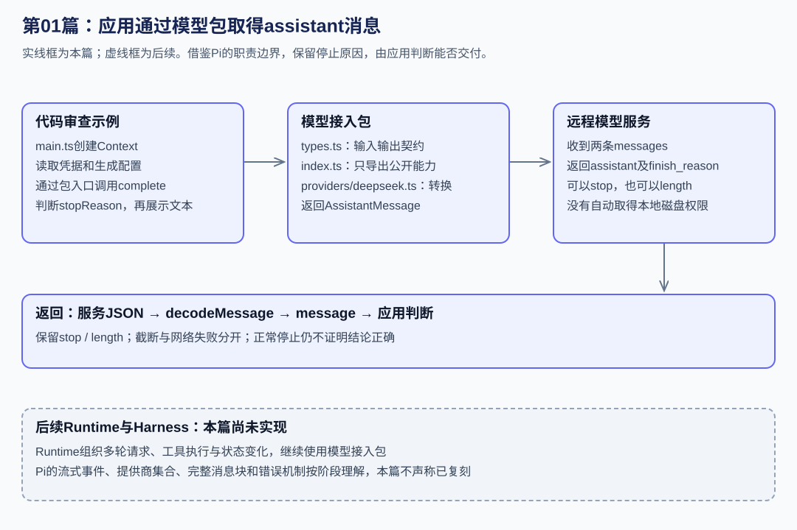
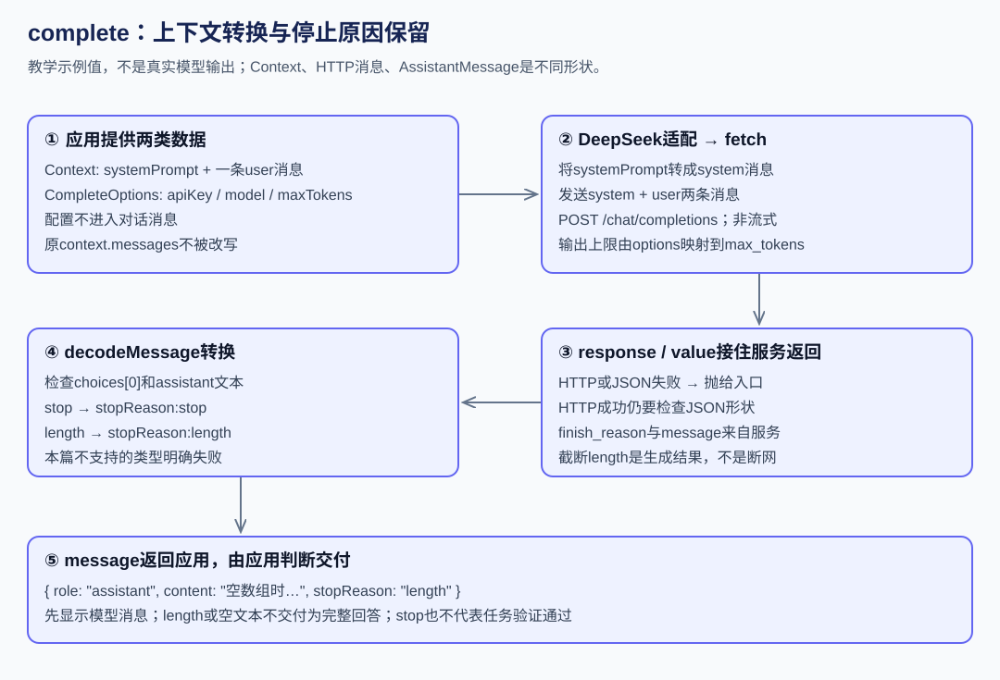

# 01 从包入口发起一次模型调用

先看一个具体任务：给模型一段 TypeScript 代码，请它指出一个问题。

```ts
function first(items: string[]) {
  return items[0].toUpperCase();
}
```

你能看出空数组会让这段代码出错。把这个任务交给模型时，程序需要明确代码从哪里来、发出了什么、接住了什么，并区分文字分析与真正读取仓库、执行函数。

本篇把这条路径亲手接通：**示例应用组织消息 → 调用模型包 → 请求远程服务 → 检查返回 → 应用显示文本。** 从第一篇开始，任务示例与可复用包分开；后面自动循环会继续使用模型接入能力，而不是重新复制一次请求。

这是[第一阶段](/roadmap)的起点。整门课程最终建设可独立使用的 Runtime/Harness，再接入命令行和桌面 Coding Agent。本篇只实现模型调用，还没有工具执行和自动循环。

## 先看它在系统中的位置

大语言模型根据本次输入生成输出。Agent 在此基础上利用工具与环境反馈继续推进任务；Runtime 承载请求、动作执行和状态变化。现在只接通向模型请求结果的这部分。

[](/diagrams/01-system-position.svg)

| 部分 | 本篇谁负责 | 以后怎样使用 |
|---|---|---|
| 任务和展示 | `examples/code-review/src/main.ts` | 可以换成别的任务应用或桌面界面 |
| 模型调用和响应转换 | `packages/model/src/providers/deepseek.ts` | 后续由运行内核通过公开入口调用 |
| 公开契约与导出 | `types/`与`index.ts` | 应用依赖包入口，服务实现不堆在入口 |
| 执行工具、保存运行状态、决定是否继续 | 本篇尚未实现 | 后续放进 Runtime，不塞进示例或模型包 |
| 被审查的代码 | 本次用户消息里的字符串 | 不等于模型已经读取磁盘文件 |

本篇没有额外创建材料文件。那段待审查函数只是发给模型的文本，也不会被本地 TypeScript 编译器执行。

## 用两条消息理解这次请求

模型服务最终收到按角色排列的消息；应用稍后会用`Context`组织它们，再由模型包转换成下面的服务格式：

```json
[
  {"role":"system","content":"你是代码审查助手。只根据用户消息中的代码说明问题，不声称读取本地文件或运行过代码。回答简短。"},
  {"role":"user","content":"请指出这段TypeScript函数的一个问题：function first(items: string[]) { return items[0].toUpperCase(); }"}
]
```

`system`给出本次回答的总体要求；`user`提供具体任务和代码。模型服务返回的回答角色是`assistant`。角色说明消息来源与用途，不会把磁盘读取、命令执行或安全权限自动赋给模型。

这组消息是本次模型可用的信息的一部分，通常称为上下文。模型处理文本时使用 token 作为计量单位；token 不等于一个汉字或一个英文单词。一次请求能容纳的输入与输出有上限，本篇先保持任务很短，后面再学习如何管理长任务的信息。

[DeepSeek 消息接口](https://api-docs.deepseek.com/api/create-chat-completion/)规定了消息角色和响应结构。本教程在包内把服务响应转换成`AssistantMessage`，这是当前项目的接口选择，不是所有模型服务共同的标准。

## 先明确本篇怎样借鉴 Pi

本篇固定参考 Pi 提交[`8efd314`](https://github.com/earendil-works/pi/tree/8efd314fa3d3232ce197d8d7a6a5660530b9d83e)，先学习三个与这次调用直接有关的设计：

| 参考位置 | 借鉴的职责 | 本篇落地 |
|---|---|---|
| [`types.ts`](https://github.com/earendil-works/pi/blob/8efd314fa3d3232ce197d8d7a6a5660530b9d83e/packages/ai/src/types.ts)的`Context/AssistantMessage` | 输入信息与模型消息有明确形状，输出保留角色和停止原因 | `types/`下的三个文件定义文本消息、上下文和调用配置；只保留本篇所需字段 |
| [`index.ts`](https://github.com/earendil-works/pi/blob/8efd314fa3d3232ce197d8d7a6a5660530b9d83e/packages/ai/src/index.ts) | 公开入口负责导出，服务实现不全部堆在入口 | 本篇`index.ts`只导出类型和`complete` |
| [`providers/deepseek.ts`](https://github.com/earendil-works/pi/blob/8efd314fa3d3232ce197d8d7a6a5660530b9d83e/packages/ai/src/providers/deepseek.ts)与[`api/openai-completions.ts`](https://github.com/earendil-works/pi/blob/8efd314fa3d3232ce197d8d7a6a5660530b9d83e/packages/ai/src/api/openai-completions.ts) | 提供商配置与协议处理有归属；API 字段转换为项目消息 | 本篇仅一个提供商，把配置与文本协议暂放`providers/deepseek.ts` |

这些是职责上的借鉴，不是复制同一套 API。Pi 的[`Models.complete`](https://github.com/earendil-works/pi/blob/8efd314fa3d3232ce197d8d7a6a5660530b9d83e/packages/ai/src/models.ts)通过流式调用取得最终消息；本篇先用一次非流式 HTTP 请求理解输入和输出，不实现提供商集合、事件流、OAuth 或完整消息块。

还有一个重要区别：Pi 保留`length`等停止原因供后续处理。本篇也保留截断结果，交由示例决定是否接受，不把截断混同于连接失败。HTTP、JSON 或暂不支持的协议错误目前仍抛异常；这与 Pi 的完整错误消息/事件机制不同，将在运行控制阶段继续学习。

## 准备本篇文件

先确认实际状态，再由你创建章节分支。不要覆盖已有学习改动。

```bash
git status --short --branch
git switch -c agent/chapter-01-model-call
```

```text
package.json                     保留站点命令，增加学习项目命令与开发依赖
tsconfig.json                    根目录类型检查
.env.example                     空密钥模板
packages/model/
  package.json                   声明公开入口与构建命令
  tsconfig.json                  类型与构建设置
  src/types/
    messages.ts                  对话消息与模型返回消息
    context.ts                   本次输入上下文
    options.ts                   连接与生成配置
  src/validation.ts              包内通用的数据形状判断
  src/providers/deepseek.ts      当前提供商的请求与响应转换
  src/index.ts                   只导出公开能力
examples/code-review/
  package.json                   声明对模型包的依赖
  src/main.ts                    组织任务，检查并展示模型消息
```

根目录已有`package.json`，保留`workspaces`、Node 版本要求和三个`docs:*`命令；新增`build/check/start/debug`及本篇开发依赖。其余配置按标题位置新建。先完成后面的源码，再统一安装运行。

::: details 根目录 package.json【修改】
<<< @/snippets/01-model-call/package.json
:::

::: details 根目录 tsconfig.json【新增文件】
<<< @/snippets/01-model-call/tsconfig.json
:::

::: details packages/model/package.json【新增文件】
<<< @/snippets/01-model-call/packages/model/package.json
:::

::: details packages/model/tsconfig.json【新增文件】
<<< @/snippets/01-model-call/packages/model/tsconfig.json
:::

::: details examples/code-review/package.json【新增文件】
<<< @/snippets/01-model-call/examples/code-review/package.json
:::

::: details 根目录的 .env.example【新增文件】
<<< @/snippets/01-model-call/.env.example{ini}
:::

示例通过 workspace 依赖`@ai-harness/model`的本地`0.1.0`版本。公开入口指向`dist/index.js`及对应类型文件，根目录运行`npm install`会连接匹配的本地包。

本篇用 tsup 把包内模块构建为一个 ESM 入口并生成类型与源码映射，应用仍通过包名使用构建产物。这样可以分离源码职责，同时保留包内无扩展名导入；不让示例跨包读取内部源码。构建工具的选择是本项目安排，不声称 Pi 使用相同构建方式。包当前为私有，避免误发布；本地打包和消费不受影响。

## 第一步：定义这次调用需要交换的数据

这次调用的两端是示例应用和模型接入包。应用知道要审查什么代码、使用什么模型；模型包负责连接服务，最终把生成结果交回来。先约定两端交换的数据，后面的函数才能知道该接收什么、返回什么。

本篇使用四个类型：`Message`描述一条对话消息；`Context`把总体要求和对话放在一起；`CompleteOptions`携带连接与生成配置；`AssistantMessage`描述一次返回的模型消息。它们分别放在`types/messages.ts`、`types/context.ts`和`types/options.ts`，通过包入口供应用使用。

先创建`packages/model/src/types/`目录。下面按消息、上下文、调用配置的顺序，新建三个文件；每处代码都是对应文件的完整内容，写入一次即可。

### 定义输入消息与模型返回消息

新建`packages/model/src/types/messages.ts`，写入下面完整代码，其中同时定义`Message`和`AssistantMessage`。应用用前者组织对话，模型包用后者返回本次结果；字段上方的注释说明角色、文本和停止原因的含义：

<<< @/snippets/01-model-call/packages/model/src/types/messages.ts#full

### 组合本次输入上下文

新建`packages/model/src/types/context.ts`，写入下面完整代码。通过类型导入从同目录的`messages.ts`取得`Message`，`Context.messages`使用它描述对话数组：

<<< @/snippets/01-model-call/packages/model/src/types/context.ts#full

### 应用先创建输入，模型包随后使用

假设用户要检查本篇的`first`函数。应用稍后会创建下面这份上下文，并交给模型包。以下 JSON 仅用于观察数据，不是需要另建的源码文件：

```json
{
  "systemPrompt":"你是代码审查助手。只根据用户消息中的代码说明问题，不声称读取本地文件或运行过代码。回答简短。",
  "messages":[{"role":"user","content":"请指出这段TypeScript函数的一个问题：function first(items: string[]) { return items[0].toUpperCase(); }"}]
}
```

这份值符合`Context`：总体要求在`systemPrompt`，本次任务在`messages[0].content`。数组中的对象符合`Message`，`role:'user'`表示它来自用户。`Message`也允许 assistant 文本，供以后组织已有回答使用；本次输入还没有 assistant 消息。

`readonly Message[]`限制通过这个类型增删或替换数组项，并不冻结消息对象；本次调用不追加历史，是`complete`的实际行为约定，不能仅凭`readonly`推断。

### 定义连接与生成配置

新建`packages/model/src/types/options.ts`，写入下面完整代码。应用创建配置，模型包据此选择服务模型、设置鉴权和输出上限：

<<< @/snippets/01-model-call/packages/model/src/types/options.ts#full

密钥、模型名和输出上限通过另一个参数`CompleteOptions`传入。`model:'deepseek-flash'`选择服务模型，`maxTokens:256`控制本次输出上限，`apiKey`用于请求鉴权。这些是连接和生成配置，不属于发给模型分析的对话内容。

### 返回的是模型消息，是否展示由应用决定

一次成功取得的结果可能是：

```json
{
  "role":"assistant",
  "content":"空数组时items[0]是undefined，调用toUpperCase会报错。",
  "stopReason":"stop"
}
```

这是`AssistantMessage`的形状。`role`明确回答来源，`content`是文本，`stopReason`保留本次生成的结束原因。后面的调用函数会返回这个对象，示例应用接住后再决定是否展示。这里的回答只是教学示例，不是作者真实模型输出。

类型声明只让 TypeScript 检查本地代码如何使用数据。写下`interface AssistantMessage`不会产生回答，也不会检查网络 JSON，所以还需要实现下一节的响应检查。

## 第二步：把服务响应转换成模型消息

DeepSeek 返回的数据带有`choices`和`finish_reason`等服务字段。应用需要的是刚才约定的`AssistantMessage`。`decodeMessage`负责完成这次转换，让应用不用每次自己读取`choices[0].message`。

先用一份截断响应看清输入和目标输出。下面是教学数据，尚未发出任何网络请求：

```json
{"choices":[{"finish_reason":"length","message":{"role":"assistant","content":"空数组时…"}}]}
```

转换后应该得到：

```json
{"role":"assistant","content":"空数组时…","stopReason":"length"}
```

文本仍然是那段部分回答，`length`也保留下来。模型包报告“服务实际返回了什么”；后面应用才判断这段文字能否作为完整回答交付。

### 先准备模型包内部的数据判断

服务响应从网络进入时，起初是`unknown`。在读取它的字段之前，需要判断它是不是可以检查字段的对象。新建`packages/model/src/validation.ts`，写入完整代码：

<<< @/snippets/01-model-call/packages/model/src/validation.ts#full

`isRecord`接收未知值，返回布尔值。比如`null`和`[]`返回`false`，前面的响应对象返回`true`。返回类型中的`value is Record<string, unknown>`告诉 TypeScript：判断为真后，可以按字符串字段名读取这个对象，但字段值仍是未知类型，还要继续检查。

这个函数只判断非空、非数组的对象，不确认它含有`choices`，也不保证它是模型响应。它放在模型包内部，不依赖提供商、消息类型或 Agent 状态；适配文件可以导入它，包的公开入口无需导出它。这里单独建文件，是为了明确通用判断与服务协议的边界，不需要另建共享 npm 包。

### 再检查并转换服务响应

新建`packages/model/src/providers/deepseek.ts`，依次写入以下导入和完整的`decodeMessage`函数。它通过`../validation`使用刚才的判断，不在当前文件保留另一份`isRecord`。下一节会在同一文件末尾追加请求函数。

<<< @/snippets/01-model-call/packages/model/src/providers/deepseek.ts#imports

<<< @/snippets/01-model-call/packages/model/src/providers/deepseek.ts#decode

`decodeMessage`的`value`参数来自解析后的网络 JSON，开始时不能假定它有正确字段。小函数`isRecord`先排除`null`、数组和普通非对象值，让后面的代码能够检查对象字段；它没有验证完整消息。

对上面的输入，第一次检查确认存在`choices`数组，`choice`接住数组第一项。第二次检查确认本篇认识它的停止原因。然后`message`接住服务中的消息对象，继续核对 assistant 角色与字符串内容。最后返回的新对象复制文本，并把服务的`finish_reason`转换成项目的`stopReason`。

如果输入缺少`choices`、角色错误或内容类型不对，函数会抛错，不会猜出一个回答。`stop`与`length`都能转换；其他原因目前不支持，明确失败。空字符串仍能作为模型消息返回，是否有可显示内容交给应用检查。

这也说明了为什么要在这里检查：`response.json()`只负责解析 JSON，合法 JSON 仍可能缺字段。把检查与转换集中在模型包里，应用才能使用明确的结果形状。

`decodeMessage`使用`isRecord`检查响应对象，再把服务字段转换为模型包的`AssistantMessage`，返回给调用方。

## 第三步：替应用完成一次模型调用

`complete`位于应用与 DeepSeek 服务之间，负责接收上下文和连接配置，把它们转换成服务请求，再把取得的响应交给`decodeMessage`，最终返回一条`AssistantMessage`。

它有两个输入：前面那份`Context`，以及包含密钥、模型名和输出上限的`CompleteOptions`。调用它的示例应用不必自己拼请求头，也不必解释`choices`。这一步仍只完成一次调用，不负责判断代码是否真的有问题。

[](/diagrams/01-model-flow.svg)

在`packages/model/src/providers/deepseek.ts`末尾追加这个完整函数：

<<< @/snippets/01-model-call/packages/model/src/providers/deepseek.ts#complete

下面沿刚才那份代码审查输入走一次。接下来的短代码摘录已经包含在上方完整函数中，只用于对照，无需再次追加或替换。

### 发请求之前，先确认必要输入

应用如果没有传入密钥，就无法完成鉴权；没有模型名或消息，也没有可执行的调用。开头的检查会直接抛错，**此时尚未执行`fetch`，没有向服务发送请求**。同样，输出上限必须是正安全整数，避免把无效控制值发给服务。

若没有传`maxTokens`，`options.maxTokens ?? 256`使用本篇选择的默认值 256；传了合法值就用该值。这是生成配置，不是审查任务的一部分。缺配置、非法上限和已经取得的截断结果，是不同的情况。

### 把应用上下文转换成服务消息

应用的`context.messages`里只有一条 user 消息，总体要求还在`systemPrompt`里。DeepSeek 要求把总体要求也放进消息数组，因此需要这段转换：

```ts
  const messages = context.systemPrompt === undefined
    ? [...context.messages]
    : [{ role: 'system', content: context.systemPrompt }, ...context.messages];
```

这次`systemPrompt`存在，函数新建 system 消息，再展开原来的 user 消息，得到发送给服务的两条消息：

```json
[
  {"role":"system","content":"你是代码审查助手。只根据用户消息中的代码说明问题，不声称读取本地文件或运行过代码。回答简短。"},
  {"role":"user","content":"请指出这段TypeScript函数的一个问题：function first(items: string[]) { return items[0].toUpperCase(); }"}
]
```

新数组由本地变量`messages`接住，原来的`context.messages`仍只有那条 user 消息。如果没有`systemPrompt`，就只复制原消息数组。这里复制的是数组，消息对象仍可被共享；这个函数没有修改对象内容，不能把它说成所有数据都被深拷贝。

### 等待响应，再交回调用方

`fetch`向 DeepSeek 发送一次 HTTP 请求。请求头携带鉴权信息，`JSON.stringify`把模型名、转换后的消息和生成选项变成 JSON 正文。密钥没有进入正文的`messages`。

`await fetch(...)`等待取得 HTTP 响应，由`response`接住；它是 HTTP 响应对象，还不是应用需要的模型消息。接下来的几行完成读取与转换：

```ts
  if (!response.ok) throw new Error(`模型服务请求失败（HTTP ${response.status}）。`);
  const value: unknown = await response.json();
  return decodeMessage(value);
```

HTTP 状态失败时先抛错，不继续当作正常模型响应处理。状态成功后，`response.json()`读取并解析正文，结果由`value`接住，再交给`decodeMessage`。如果服务返回前面那份截断 JSON，`complete`最终返回的就是含`stopReason:'length'`的 assistant 消息。

`complete`是异步函数，调用方拿到一个 Promise；等 Promise 成功兑现，应用的变量才取得这条消息。如果网络、JSON 解析或响应检查失败，调用方会进入异常处理，拿不到这次成功返回值。第四步会把具体调用语句接上。

### 本次接入选择的边界

`stream:false`表示等完整 HTTP 响应，本篇不处理逐段文本事件；`thinking:{type:'disabled'}`使用非思考模式，依据见[DeepSeek 模式说明](https://api-docs.deepseek.com/guides/thinking_mode/)。Pi 的`complete`在内部取得流式最终消息，本篇暂不实现那条事件链。

`maxTokens`映射为服务的`max_tokens`，单位是 token，不是字符数；30 秒限制当前 HTTP 等待，还不是整次 Agent 的运行预算。HTTP 失败只报告状态码，不直接把服务错误正文或请求头打印出来。

到这里，这个函数只完成了“请求并返回模型消息”。它没有读取仓库、执行待审查代码，也没有把返回值追加到历史。以后要累积对话时，需要由运行内核明确保存，不能从一次函数调用推断已经有跨轮记忆。

## 第四步：应用接住消息，再决定怎样展示

模型包的四个部分已经有了分工：`types/`下的三个文件定义交换的数据，`validation.ts`提供包内数据判断，`providers/deepseek.ts`完成服务接入，`index.ts`提供应用使用的公开入口。

新建`packages/model/src/index.ts`：

<<< @/snippets/01-model-call/packages/model/src/index.ts#full

应用从`@ai-harness/model`导入`complete`和类型，不需要知道请求实现在哪个内部文件。这个入口只导出，不会因为被导入就调用模型。本篇只有一个提供商，暂不增加注册或路由系统。

接下来由示例应用完成剩下的工作：选择审查任务、创建上下文和配置、等待模型消息，并根据停止原因决定是否展示。新建`examples/code-review/src/main.ts`，写入完整代码：

<<< @/snippets/01-model-call/examples/code-review/src/main.ts#full

此时如果还没执行下一节的安装与构建，编辑器可能在`@ai-harness/model`和`process`下显示红线：前者依赖 workspace 连接及模型包生成的类型文件，后者依赖`@types/node`。先完成下面的讲解，再按“运行与观察”执行`npm install`和`npm run check`；这两步不请求模型。不要为消除红线把包名导入改成跨包源码路径。

### 应用持有输入，等待这次返回

入口从命令行取得任务，没有传入时才使用本篇的`first`函数示例；它把总体要求与任务组成`context`。本地环境变量提供模型名和密钥，密钥不写入对话消息。Node 启动命令负责加载根目录`.env`，模型包本身不寻找这个文件。

下面是上方入口中已经写入的调用语句，仅用于定位阅读，无需再次追加：

```ts
  const message = await complete(context, {
    apiKey: process.env.DEEPSEEK_API_KEY?.trim() ?? '',
    model,
    maxTokens: 256,
  });
```

`context`作为第一个参数传给模型包，第二个参数提供连接和输出配置。程序在`await`处等待；成功返回后，`message`才接住前面定义的`AssistantMessage`。应用因此能直接读取`message.content/stopReason`，而不用再访问服务的`choices[0]`。

这里保留输入和接住返回，是两个不同动作。`const message = ...`没有把结果放回`context.messages`；观察输入时，里面仍是原来的 user 消息。

### 取得模型消息，不等于本次接受为回答

入口先打印收到的完整模型消息，再执行这两个判断。同样只是上方入口的摘录：

```ts
  if (message.stopReason !== 'stop') throw new Error('输出已截断，本次不交付为完整回答。');
  if (!message.content.trim()) throw new Error('没有可显示的文本，本次不交付回答。');
```

| 实际路径 | 应用接下来做什么 | 观察依据 |
|---|---|---|
| `stop`且文本非空 | 显示`模型文本（text）` | 已收到模型消息，且通过本示例的显示条件 |
| `length` | 先显示含停止原因的模型消息，再抛错进入`catch`；退出码为 1 | 有返回结果，但本示例不把截断文本当完整回答 |
| `stop`但文本空白 | 显示消息，再进入未交付分支 | 服务停止了，却没有可显示内容 |
| 请求或响应检查抛错 | `await`未成功返回，直接进入`catch` | 不会执行打印模型消息的语句 |

`catch`输出“本次调用未交付”并设置非零退出码，让命令行调用者也能识别失败。这张表描述程序实际分支，不是四次真实模型运行日志。

截断不交付是这个代码审查示例的策略，模型包仍保留实际结果，其他应用可以选择展示部分文本或安排后续处理。即使显示了正常文本，也还没有验证回答正确，更没有运行或修复待审查代码。

## 运行与观察

在仓库根目录执行，完成安装、构建和类型检查，再创建本地配置：

```bash
npm install
npm run check
cp .env.example .env
```

`npm install`安装开发依赖，并连接 workspace 中的模型包；`npm run check`先构建模型包，生成`dist/index.js`和`dist/index.d.ts`，再检查项目类型。完成后，入口的包导入与`process`应能被识别。若命令已通过而 VS Code 仍显示旧错误，可在命令面板执行“TypeScript: Restart TS Server”，并确认打开的是仓库根目录。

自行填写本地`.env`里的`DEEPSEEK_API_KEY`，模型名默认使用`deepseek-flash`，按[当前服务文档](https://api-docs.deepseek.com/)核对。不提交或展示真实密钥。

`npm start`会调用所配置的模型服务，可能产生费用。作者只使用固定响应验证程序，没有替你调用真实模型。

```bash
npm start
```

观察结构如下，实际回答不要求逐字一致：

```text
请求模型（model）： deepseek-flash
应用上下文（context）： {systemPrompt: ..., messages: [一条user消息]}
模型消息（message）： {"role":"assistant","content":"本次实际文本","stopReason":"stop"}
模型文本（text）： 本次实际文本
```

| 观察点 | 核对内容 |
|---|---|
| 应用的 context | 一条 user 消息与独立 systemPrompt；没有本地仓库内容自动加入 |
| 提供商的 messages | 转换后两条服务消息，context 原数组没有改变 |
| 返回的 message | role、content 和 stopReason 来自响应转换 |
| 应用的最终 text | 只有正常结束且非空才展示；stop 不证明结论正确 |

模型没有读取磁盘或执行审查函数。即使生成文字声称“测试过”，也要依据实际程序动作判断，不能把措辞当运行记录。

## 断点与可逆实验

```bash
npm run debug
```

在`providers/deepseek.ts`的`const messages = ...`之后、`return decodeMessage(value)`处，以及示例的`console.log('模型消息…')`处设断点。分别看`context.messages`、转换后的`messages`、服务`value`和返回`message`，追踪三个不同形状的数据。

构建生成源码映射；如果断点未绑定，先确认已重新构建并连接当前进程，再查看`packages/model/dist/index.js`，不要在未绑定断点上一直等待。

实验一：临时清空本地`.env`中的密钥。应在请求前出现“缺少 DEEPSEEK_API_KEY”，没有模型消息，退出码非零；实验后恢复配置。

实验二：只把示例调用里的`maxTokens:256`临时改成`1`。若服务返回`length`，你应先看见`message.stopReason:"length"`，随后出现“不交付为完整回答”，没有最终`模型文本`日志。包仍返回消息，拒绝交付发生在应用；恢复 256 后重新运行。真实结果以服务返回为准，该实验也会调用服务。

实验三：只换命令行任务，模型适配无需增加业务规则：

```bash
npm start -- '请审查这段代码：function divide(a: number, b: number) { return a / b; }'
```

观察 user 消息变化，区分 JavaScript 事实与业务假设。在`docs/model-call-observation.md`记录实际输入、停止原因、应用是否交付，以及哪些动作没有发生；未调用真实服务就如实记录，不补成功日志。

## 失败时按调用位置定位

| 现象 | 检查位置 |
|---|---|
| 找不到模型包或 dist | 根目录 workspace 安装、包名/依赖版本，以及是否先 build |
| 缺少密钥 | 本地 `.env` 字段是否非空，不把实际值贴到日志 |
| HTTP401/429 | 凭据或服务限制，避免不停重试代替定位 |
| fetch 失败或超时 | 当前网络与代理，不把它写成模型理解失败 |
| stopReason 为 length | 请求已经产生结果，应用拒绝截断；检查输出上限与任务长度 |
| 不支持的停止原因或消息 | 检查实际响应，不能用类型断言绕过 |

如网络需要代理，按本机配置设置。Node 支持的版本可使用环境代理，支持范围见[Node 环境代理说明](https://nodejs.org/api/cli.html#node_use_env_proxy1)；不把某台机器端口写成默认值，不关闭证书校验。

## 本篇省略什么，后面在哪里补

Pi 将提供商、协议适配、模型集合与流式事件进一步分层。本篇仅一个提供商，暂把其配置和协议放在一个文件；接入其他提供商时审查是否需要独立协议模块。完整内容块、工具请求在第一阶段后续扩展；流式输出、鉴权扩展和统一失败处理归第二阶段逐步学习。

这不是把整个 Pi 缩写成几个函数。借鉴的是已核对的职责、输入输出和停止语义；原生 fetch、单文件适配、纯文本内容、异常抛出和固定 30 秒是当前教学选择，保留明确替换位置。

## 完整文件核对

配置见前面的六个展开块。下面七份源码与分步实现同源，不需要重复追加。

::: details packages/model/src/types/messages.ts
<<< @/snippets/01-model-call/packages/model/src/types/messages.ts#full
:::

::: details packages/model/src/types/context.ts
<<< @/snippets/01-model-call/packages/model/src/types/context.ts#full
:::

::: details packages/model/src/types/options.ts
<<< @/snippets/01-model-call/packages/model/src/types/options.ts#full
:::

::: details packages/model/src/validation.ts
<<< @/snippets/01-model-call/packages/model/src/validation.ts#full
:::

::: details packages/model/src/providers/deepseek.ts
<<< @/snippets/01-model-call/packages/model/src/providers/deepseek.ts#full
:::

::: details packages/model/src/index.ts
<<< @/snippets/01-model-call/packages/model/src/index.ts#full
:::

::: details examples/code-review/src/main.ts
<<< @/snippets/01-model-call/examples/code-review/src/main.ts#full
:::

## 保存本篇

恢复实验，确认 `.env` 未暂存，再检查并由你审阅保存：

```bash
npm run check
npm run docs:build
git diff --check
git status --short --branch
git add .gitignore AGENTS.md README.md package.json package-lock.json tsconfig.json .env.example
git add packages/model/package.json packages/model/tsconfig.json packages/model/src/
git add examples/code-review/package.json examples/code-review/src/main.ts
git add site/ docs/
git diff --cached --stat
git diff --cached
git commit -F - <<'COMMIT'
第01篇：借鉴Pi边界完成一次模型调用

分离公开入口、输入输出契约和DeepSeek接入，示例通过构建包调用。
区分应用上下文与服务消息，保留assistant角色及stop和length停止原因。
由应用判断截断与空文本能否交付，区分生成状态与任务成功。
提供Pi源码对应、教学简化、分步图解、断点和完整文件核对。
保存课程路线、协作约定及预先准备的网站。
COMMIT
git push -u origin agent/chapter-01-model-call
```

本篇只取得一次可解释的模型结果。接下来会扩展工具请求、实际执行、反馈与循环，继续沿源码职责建设自己的底座。
