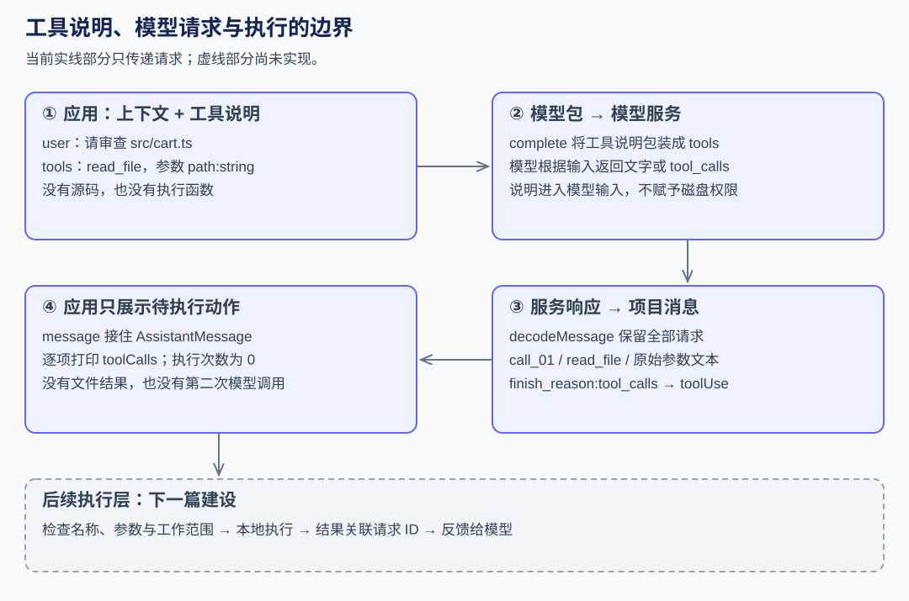
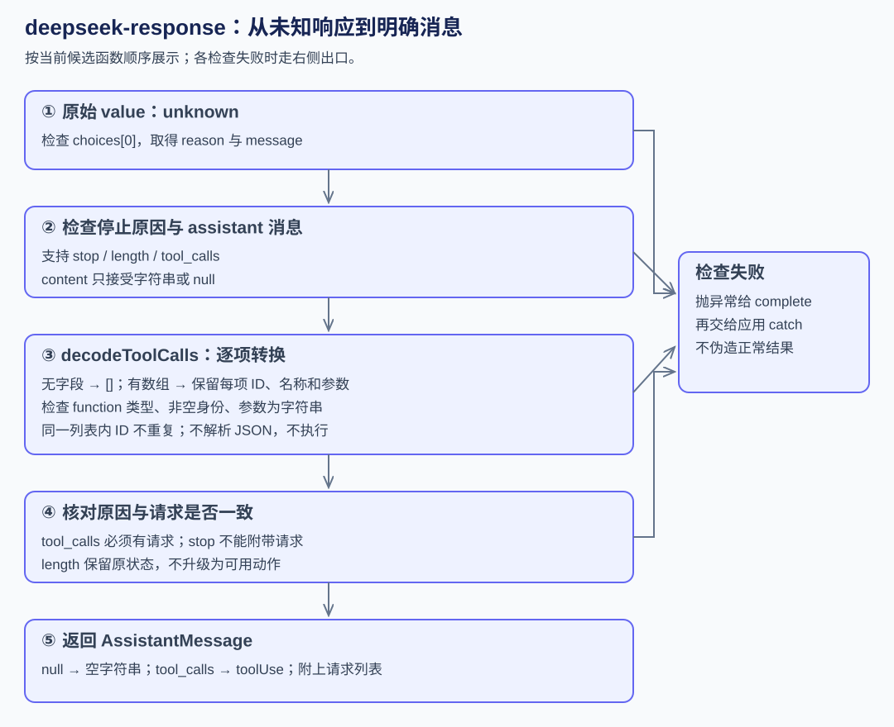
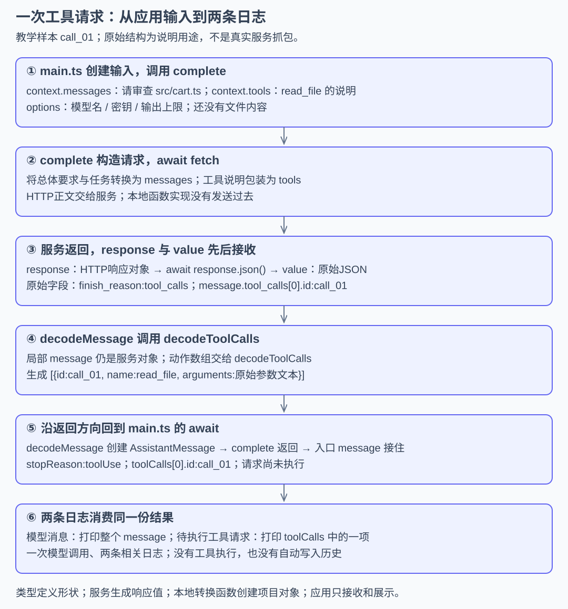

# 02 让模型提出工具请求

上一章把代码直接放进消息，模型可以据此分析。现在把任务换成：**“请审查`src/cart.ts`，先取得源码，再根据内容指出问题。”** 输入里只有路径，没有源码。模型需要表达“我想读取这个文件”，程序才能知道下一步需要什么动作。

本篇实现：**应用提供工具说明 → 模型生成结构化请求 → 模型包转换响应 → 应用展示待执行动作。** 完成后，程序能区分普通文本和工具请求，并保留每项请求的 ID、名称和参数。它属于[第一阶段](/roadmap#第一阶段-逐篇大纲)的动作请求部分；下一篇才真正执行工具并反馈结果，再往后接成自动循环。

这里的`src/cart.ts`只是任务中的路径字符串，不需要现在创建文件。模型不会因为收到路径就获得磁盘访问能力。

## 从“想读文件”到可识别的请求

如果模型只回复“我需要看一下文件”，程序仍只拿到一段文字。工具调用协议让模型把动作放进专门的字段：哪个工具、给什么参数、用哪个 ID 标识这一次请求。这里说的“工具请求”就是这份动作数据，不是已经执行的函数。

应用先写一份工具说明：名称是`read_file`，参数中需要字符串`path`。模型服务收到任务和说明后，可以生成“请求读取这个路径”的动作数据；本地程序再接收并解释它。**说明由应用提供，请求由模型生成，是否执行由本地程序决定。**

下面用一份教学样本贯穿本章。ID 统一简写为`call_01`，文本和参数只是可能的值；原始结构按本篇适配代码展示，不是真实抓包记录，也不是需要写入程序的固定响应。

```json
{
  "choices": [{
    "finish_reason": "tool_calls",
    "message": {
      "role": "assistant",
      "content": "我先读取该文件的内容。",
      "tool_calls": [{
        "id": "call_01",
        "type": "function",
        "function": {
          "name": "read_file",
          "arguments": "{\"path\":\"src/cart.ts\"}"
        }
      }]
    }
  }]
}
```

这条响应同时包含文字和动作：`content`是模型生成的说明，`tool_calls`是模型提出的请求。`function.arguments`是字符串，字符串内部才是 JSON 对象的写法；收到它时还没有解析参数，更没有读取文件。模型包把服务字段转换成项目结果：

```json
{
  "role": "assistant",
  "content": "我先读取该文件的内容。",
  "stopReason": "toolUse",
  "toolCalls": [{
    "id": "call_01",
    "name": "read_file",
    "arguments": "{\"path\":\"src/cart.ts\"}"
  }]
}
```

这两份 JSON 是同一次调用在转换前后的形状。服务返回的字段名是`tool_calls`和`finish_reason`；项目选择使用`toolCalls`和`stopReason`，并把`tool_calls`停止原因映射为`toolUse`。字段名的变化发生在本地转换函数，文本、请求 ID、工具名和参数值都来自服务响应。

模型也可能不附带文字，返回`content:null`；适配会把它转为空字符串，仍保留动作请求。ID 用于以后把执行结果对应到原请求，它不是文件名或整个会话的 ID。无论附带哪种文字，本篇都停在请求阶段。

[DeepSeek 的消息接口](https://api-docs.deepseek.com/api/create-chat-completion/)分别定义了输入`tools`、输出`tool_calls`及参数文本，并提醒执行前校验参数。本篇读取这些字段，暂不解析和执行参数。即使参数看起来符合说明，也不能据此认为动作已获授权。

[](/diagrams/02-tool-boundary.svg)

## 本篇怎样接在已有代码上

本篇继续使用`@ai-harness/model`及代码审查示例，不新增 Runtime 包。构建、检查、启动和调试命令保持不变。

先检查实际状态，由你创建本章分支：

```bash
git status --short --branch
git switch -c agent/chapter-02-tool-requests
```

| 文件 | 本篇操作 |
|---|---|
| `packages/model/src/types/tools.ts` | 新建，定义`ToolDefinition/ToolCall` |
| `packages/model/src/types/messages.ts` | 替换已有文件，保留`Message`，扩展`AssistantMessage` |
| `packages/model/src/types/context.ts` | 替换已有文件，为`Context`增加工具说明 |
| `packages/model/src/providers/deepseek-response.ts` | 新建，承接`decodeMessage`并检查多项请求 |
| `packages/model/src/providers/deepseek.ts` | 删除本地`decodeMessage`，导入新模块；请求正文加入工具说明 |
| `packages/model/src/index.ts` | 增加两个公共类型导出 |
| `examples/code-review/src/tools.ts` | 新建，提供工具说明，不含执行函数 |
| `examples/code-review/src/main.ts` | 替换入口，展示请求或文本 |

`types/options.ts`、`validation.ts`与所有配置沿用 01，不需要重写。下面分步实现，章末再提供完整文件核对。

模型包完成本篇后的源码目录如下：

```text
packages/model/src/
  types/
    messages.ts
    tools.ts
    context.ts
    options.ts
  providers/
    deepseek.ts
    deepseek-response.ts
  validation.ts
  index.ts
```


## 第一步：区分工具说明和工具请求

先辨认输入和输出：`ToolDefinition`是应用创建的“可请求什么”，`ToolCall`是模型响应转换出的“这次请求什么”。同一个`read_file`说明可以对应不同路径、多次请求，它们各自有 ID。

01 已经创建`packages/model/src/types/`目录，其中有`messages.ts`、`context.ts`和`options.ts`。本篇不移动这些文件，只做下面三项改动：

1. **新建`types/tools.ts`**：定义`ToolDefinition`和`ToolCall`，分别表示应用提供的工具说明和模型返回的动作请求。
2. **完整替换已有的`types/messages.ts`**：保留`Message`；为`AssistantMessage.stopReason`增加`toolUse`，并增加`toolCalls`数组。
3. **完整替换已有的`types/context.ts`**：保留`systemPrompt/messages`，增加可选的`tools`字段。

以上路径都位于`packages/model/src/`下，下面各处会再次给出完整路径和代码。`types/options.ts`中的`CompleteOptions`保持 01 的内容，本篇不修改。

先新建`packages/model/src/types/tools.ts`，写入完整代码：

<<< @/snippets/02-tool-requests/packages/model/src/types/tools.ts#full

`ToolDefinition.parameters`保存参数的 JSON Schema。JSON Schema 是描述 JSON 数据形状的规则，本篇只用到对象、字段类型、必填字段和额外字段限制。它会作为模型输入，帮助模型生成参数；这个接口里的`Record<string, unknown>`仅允许保存规则对象，没有替程序验证规则或参数。

这两个接口只是本地类型契约。真正创建工具说明值的是后面的`reviewTools`数组；实际请求的值由服务生成，再由`decodeToolCalls`创建符合`ToolCall`形状的本地对象。写下`interface ToolCall`不会生成 ID、选择工具或发出请求。

`ToolCall.arguments`保留服务返回的原始字符串。例如`'{"path":"src/cart.ts"}'`仍是文本，不是已经交给读取函数的对象。下一篇会在执行前解析、核对字段、查找工具及限制工作范围。参数本身是坏 JSON 时，本篇也不会悄悄改成空对象或假装执行成功。

### 在结果中保留全部请求

**完整替换已有的`packages/model/src/types/messages.ts`**。新增`./tools`的类型导入；`Message`不变，只扩展`AssistantMessage`。`AssistantMessage`保留`role/content`，为`stopReason`增加`toolUse`，并新增始终存在的`toolCalls`数组。下面是替换后的完整文件：

<<< @/snippets/02-tool-requests/packages/model/src/types/messages.ts#full

纯文本结果的`toolCalls`为`[]`，工具响应则包含一项或多项。`toolUse`只表示模型提出动作；`length`表示输出被截断，即使已有部分请求，也不能当完整动作接受。收到文本和收到动作，是两种需要分别处理的结果。

`Message`本章仍表示输入中的文本对话；它还不能保存和发送带请求的 assistant 历史。本篇只有一次调用，下一篇反馈结果时会一起扩展输入消息契约，不能现在把`AssistantMessage`直接追加后又丢掉请求字段。

### 在上下文中提供工具说明

**完整替换已有的`packages/model/src/types/context.ts`**。保留原来的`Message`导入、`systemPrompt`和`messages`字段；新增`ToolDefinition`导入和可选的`tools`字段。下面是替换后的完整文件：

<<< @/snippets/02-tool-requests/packages/model/src/types/context.ts#full

应用持有`tools`列表，模型包读取后转换为服务格式。没有提供列表时，仍能像 01 那样发起纯文本调用。列表中没有本地执行函数；把 JavaScript 函数写进消息也不会让远程服务执行本机代码。

## 第二步：转换服务返回的动作数据

原来的`decodeMessage`只认识文本。现在它需要读取动作列表、保存请求身份，并区分“正常文本”“请求工具”“截断”。先实现列表转换，再接回整条消息。

新建`packages/model/src/providers/deepseek-response.ts`，先写入导入：

```ts
// 【新增文件】从DeepSeek响应中取得文本和工具请求，不执行任何工具。
import type { AssistantMessage } from '../types/messages';
import type { ToolCall } from '../types/tools';
import { isRecord } from '../validation';
```

### 把每项服务请求转换为 ToolCall

在导入之后追加完整的`decodeToolCalls`函数。输入是服务的`message.tool_calls`，输出是项目的请求数组，供下一个函数使用：

<<< @/snippets/02-tool-requests/packages/model/src/providers/deepseek-response.ts#calls

对开头的样本，调用方会把`message.tool_calls`这一个数组传进`value`，不是把整个 HTTP 响应传进来。`map`处理第一项时，`item.id`是`call_01`，`fn`接住`item.function`，其中的名称是`read_file`，参数仍是`'{"path":"src/cart.ts"}'`。

回调里的`return { id: item.id, name: fn.name, arguments: fn.arguments }`创建一项本地请求对象，把服务的嵌套字段放到同一层。`map`收集各次回调返回的对象，外面的`return value.map(...)`再把整个数组交回`decodeToolCalls`的调用方。如果服务给了两项，就生成并返回两项，顺序不变；这两个 return 都没有调用文件读取函数。

`ids`是本次函数调用里的集合，用来发现同一消息中重复的请求 ID。重复时无法可靠对应结果，所以直接抛错。这不是跨轮去重机制，下一次调用会创建新集合。

没有`tool_calls`字段时返回空数组。字段存在却不是数组、缺少非空 ID、类型不是`function`、缺工具名或参数不是字符串时，抛错而不制造请求。这里检查的是协议形状；名称是否已注册、参数是否有效及是否允许读取，都还没有检查。

### 把文字、动作和停止原因组合为消息

在同一文件末尾追加完整`decodeMessage`：

<<< @/snippets/02-tool-requests/packages/model/src/providers/deepseek-response.ts#message

继续跟踪开头的完整响应：这里的`value`来自`response.json()`，是含`choices`的整个 JSON 对象。`choice`接住`choices[0]`，`reason`得到`tool_calls`，局部变量`message`接住服务中的 assistant 对象，它仍使用`tool_calls`字段。

`const toolCalls = decodeToolCalls(message.tool_calls)`把服务的动作数组交给前一个函数，返回的本地数组由`toolCalls`接住。随后`return { ... }`创建另一份对象：`content`保留“我先读取该文件的内容。”，`stopReason`变为`toolUse`，`toolCalls`使用刚得到的数组。这个对象才是项目的`AssistantMessage`；接口声明没有参与运行时转换。

| 服务原始位置 | 本地结果位置 | 本次值怎样得到 |
|---|---|---|
| `message.content` | `content` | 复制服务文本；若为`null`则使用空字符串 |
| `choice.finish_reason` | `stopReason` | `tool_calls`在本地映射为`toolUse` |
| `message.tool_calls[].id` | `toolCalls[].id` | 保留服务给本次请求的 ID |
| `message.tool_calls[].function.name` | `toolCalls[].name` | 保留模型返回的名称；应用说明中提供了可用工具名 |
| `message.tool_calls[].function.arguments` | `toolCalls[].arguments` | 保留参数字符串，不解析或改写路径 |

`decodeMessage`返回后，结果先交给调用它的`complete`，尚未直接跳到示例打印。本节的`message`是解码函数内的服务消息；第四步入口也有一个叫`message`的变量，接收的是转换后的项目消息，二者不在同一个作用域。

注意两种数组的区别：`choices`是不同生成结果的列表，本篇仍取第一条；这条结果里的`tool_calls`才是全部动作请求，不能只取第一项。

如果停止原因声称请求工具，却没有实际请求，函数会失败；若停止原因是`stop`却附带动作，也明确拒绝这种不一致的结果。`length`不会改成`toolUse`：只要协议字段还能识别，就保留已有内容和截断状态，随后由应用拒绝接受；如果截断连协议字段都破坏了，则在检查时抛错。

[](/diagrams/02-response-flow.svg)

图中的成功出口仍只产生数据。没有任何一步调用`read_file`，也没有更新对话历史。

## 第三步：把工具说明送进请求

现在让`complete`使用刚才的解码函数，并发送工具说明。

**完整替换`packages/model/src/providers/deepseek.ts`**：删除旧的本地`decodeMessage`和不再使用的`isRecord`导入，保留导出函数`complete`；保留 01 的三个类型导入，新增`./deepseek-response`导入和请求正文的`tools`转换。下面是替换后的完整文件：

<<< @/snippets/02-tool-requests/packages/model/src/providers/deepseek.ts#full

下面摘录已包含在上方完整文件中，仅用于对照，不要重复追加：

```ts
      tools: context.tools?.length ? context.tools.map((tool) => ({
        type: 'function',
        function: { name: tool.name, description: tool.description, parameters: tool.parameters },
      })) : undefined,
```

`context.tools`由应用传入。每份说明转换成`{type:'function', function:{name, description, parameters}}`，再与`model/messages`一起序列化。没有工具说明时，`tools`的值为`undefined`，`JSON.stringify`不把这个字段写进正文。

这次请求中的`messages`包含总体要求和一条路径任务，`tools`包含工具说明，两者是请求正文的不同字段。`JSON.stringify`把它们序列化后，`fetch`才发送 HTTP 请求。没有函数实现或文件内容跟着说明进入服务。

`await fetch(...)`先让`response`接住 HTTP 响应对象，它还不是模型消息。接下来这一段已经包含在上面的完整实现中，只用于对照，不重复追加：

```ts
  if (!response.ok) throw new Error(`模型服务请求失败（HTTP ${response.status}）。`);
  const value: unknown = await response.json();
  return decodeMessage(value);
```

HTTP 状态成功后，`await response.json()`读取、解析正文，完整原始 JSON 由`value`接住。`decodeMessage(value)`进行第二步的转换，返回项目对象；`return decodeMessage(value)`再把该结果作为`complete`的成功结果交给外部调用方。不是只打印转换结果，也不是由 DeepSeek 服务直接返回我们定义的`stopReason/toolCalls`。

如果 HTTP、JSON 解析或解码检查失败，就不会得到这个成功结果，入口的`await`会转入`catch`。成功路径仍没有修改`context.messages`；把结果返回和把结果写入历史是不同动作。

本篇继续使用非流式、非思考模式，不设置强制工具选择。是否提出动作仍取决于实际模型输出；提供工具说明不保证每次都会调用，也不保证生成的名称和参数正确。30 秒仍只约束这次 HTTP 等待，输出上限仍由调用方传入。

接着完整替换`packages/model/src/index.ts`，保留`complete`导出，并增加`ToolDefinition/ToolCall`类型导出：

<<< @/snippets/02-tool-requests/packages/model/src/index.ts#full

应用仍从`@ai-harness/model`导入，包名和既有公共类型名称不变。模型包内部继续从`types/`下的具体文件导入类型。

**继续写示例之前，先在仓库根目录构建模型包：**

```bash
npm run build
```

这一步生成新的`dist/index.js`和`dist/index.d.ts`。示例通过包名导入时，TypeScript 读取的是构建后的类型文件；只改`src/index.ts`而未重新构建，下一步导入`ToolDefinition`时就可能出现“没有导出的成员”。构建不会调用模型服务。确认命令成功后，再进入第四步；若编辑器仍保留旧提示，执行“TypeScript: Restart TS Server”。


## 第四步：应用声明工具，观察模型决定

模型包已经能传递动作说明和请求，示例需要提供具体工具。新建`examples/code-review/src/tools.ts`，写入完整代码：

<<< @/snippets/02-tool-requests/examples/code-review/src/tools.ts#full

`reviewTools`是应用实际创建的数组值，里面的`read_file`名称和参数规则来自这段代码。模型不会自己发明这份说明；应用稍后把数组赋给`context.tools`，`complete`再把它转换为 HTTP 正文的`tools`。

这份说明没有具体文件内容，也没有预先填好本次的`path`值。`properties.path`声明“参数中有个叫 path 的字符串字段”，`required:['path']`表示期望它必填，`additionalProperties:false`表示不希望模型增加额外字段。模型读到任务`src/cart.ts`后，才生成本次参数文本`'{"path":"src/cart.ts"}'`。

这里的`parameters.type:'object'`描述参数数据，服务包装中的`type:'function'`描述工具种类，TypeScript 的`ToolDefinition`则约束本地代码，三者用途不同。本篇未使用严格模式，也没有执行前参数校验器，收到参数仍不等于它已经通过本地校验。

这一步只定义了工具说明，没有实现`read_file`函数。本篇任务路径不要求真实存在；实际读取的函数、允许范围和错误结果会在下一篇实现。

完整替换`examples/code-review/src/main.ts`：保留环境配置、一次`complete`调用和异常处理；导入`reviewTools`加入上下文，把原来的单一文本判断改为截断、工具请求、文本三条分支：

<<< @/snippets/02-tool-requests/examples/code-review/src/main.ts#full

### 应用从哪里接住返回结果

入口先创建`prompt`、`context`和配置：本次 user 消息只有路径任务，`tools`引用`reviewTools`。下面是完整入口中已经写过的调用语句，仅用于对照，不再次追加：

```ts
  const message = await complete(context, {
    apiKey: process.env.DEEPSEEK_API_KEY?.trim() ?? '',
    model,
    maxTokens: 256,
  });
```

第一个参数把本次输入交给模型包，第二个参数提供连接与输出配置。程序在`await`处等待；`complete`成功返回后，入口的`message`接住转换后的`AssistantMessage`。沿调用方向看，是入口调用`complete`，`complete`调用`decodeMessage`，后者调用`decodeToolCalls`；沿返回方向则依次交回，最终回到这一行赋值。

入口没有访问`choices[0]`，因为这些服务字段已经在模型包内转换。`message`现在是局部变量持有的返回结果，不是自动追加进`context.messages`的新历史；输入对话数组仍只有原来的 user 消息。

### 两条日志为什么不是执行了两次

第一条`console.log('模型消息（message）：', JSON.stringify(message))`打印整个项目消息，包括文字、停止原因和请求数组。它没有打印原始 HTTP 响应，也没有再次调用模型。

当`stopReason`为`toolUse`时，代码再进入下面的循环。这也是上方入口的原文摘录，不重复写入：

```ts
    for (const call of message.toolCalls) {
      console.log('待执行工具请求：', JSON.stringify(call));
    }
```

每次循环的`call`是`message.toolCalls`中的一项，第二条日志只是把这一项单独序列化打印。如果列表只有一项，就看到一条“模型消息”和一条“待执行工具请求”；两条日志里的 ID 相同，是因为它们引用同一项请求，并不是执行了两次`read_file`。若有两项，则仍只有一条整消息日志，但有两条逐项请求日志。

入口先检查`length`，截断时进入`catch`，不会进入这个循环；普通`stop`结果则走非空文本显示分支。本篇没有执行器，因此“工具执行次数：0”说明当前路径没有执行工具，不是通过日志统计推断。

## 用同一份数据串起整次调用

到这里可以把前面各处接成完整过程。图中是本章教学样本的可能路径，不是真实服务运行记录；它沿用`call_01`和`src/cart.ts`，不新增实现。

[](/diagrams/02-call-roundtrip.svg)

| 位置 | 这一刻持有什么 | 下一步交给谁 |
|---|---|---|
| 入口`context` | 一条路径任务与`reviewTools`说明，无源码 | 调用`complete(context, options)` |
| `complete`的 HTTP 正文 | 转换后的`messages`和`tools`，密钥在请求头 | 由`fetch`发送给服务 |
| `response`、`value` | 前者是 HTTP 响应，后者是解析后的原始 JSON | `value`交给`decodeMessage` |
| 解码函数内的`message` | 服务的 assistant 对象，仍含`tool_calls` | 动作数组交给`decodeToolCalls` |
| `decodeToolCalls`返回值 | 平铺的请求数组，参数仍是字符串 | 由解码函数的`toolCalls`变量接住 |
| `decodeMessage`返回值 | 新建的`AssistantMessage`对象 | 经`complete`返回给入口 |
| 入口`message`与循环`call` | 前者是整条项目消息，后者是其中一项请求 | 只打印，当前路径到此停止 |

这条链路里，服务生成了“我先读取该文件的内容。”和读取请求，本地程序完成了接收与转换；没有任何函数真正打开文件。模型的文字描述不能替代执行证据。下一篇需要在请求之后增加本地执行、结果消息与再次调用模型，才会让新信息进入下一轮。

## 构建、运行与观察

根目录配置、两个包的配置和`validation.ts`沿用 01，不新增依赖或按章节编号的启动命令。完成本篇文件后，在仓库根目录执行：

```bash
npm install
npm run check
```

`check`先构建模型包再做类型检查。新增的公共类型要通过生成的声明文件供示例使用；若编辑器保留旧错误，检查构建结果并重启 TypeScript 服务。这里还没有调用模型。

沿用 01 的本地配置，自行执行真实调用：

```bash
npm start
```

这条命令会请求配置的模型服务并可能产生费用。作者没有替你调用服务；下面沿用本章教学样本展示两条日志的关系，实际文字、ID、参数空格与项数以服务响应为准：

```text
模型消息（message）： {"role":"assistant","content":"我先读取该文件的内容。","stopReason":"toolUse","toolCalls":[{"id":"call_01","name":"read_file","arguments":"{\"path\":\"src/cart.ts\"}"}]}
待执行工具请求： {"id":"call_01","name":"read_file","arguments":"{\"path\":\"src/cart.ts\"}"}
本篇停在请求阶段，工具执行次数：0；尚未取得源码。
```

| 观察位置 | 本篇要核对什么 |
|---|---|
| `应用上下文` | 有一条路径任务和`tools`，没有自动读取的源码 |
| 请求正文的`tools` | 是服务要求的 function 包装，参数规则未变 |
| `message.stopReason` | `toolUse`、`stop`或`length`，不能混作任务完成 |
| `message.toolCalls` | 每项 ID、名称、原始参数与响应对应，可能不止一项 |
| `待执行工具请求` | 只是请求数据，没有工具返回或第二次模型调用 |

如果真实模型直接返回文本，记录该事实，不手动构造请求冒充它的选择。检查是否确实带上工具说明、任务是否缺少内容，以及模型是否在澄清；当前本地机制验证不保证模型必然选择某个动作。

## 断点、故障与小迁移

```bash
npm run debug
```

按这次调用的顺序设置断点：先在入口调用`complete`前看`context.messages`和`context.tools`；进入`deepseek.ts`看请求正文中的`messages/tools`；在`const value = await response.json()`之后看原始 JSON，再进入解码模块观察局部`message/toolCalls`；最后回到入口，看`await`后的`message`和循环中的`call`。

重点核对三件事：原始 JSON 是否仍使用`tool_calls/finish_reason`；入口对象是否已经使用`toolCalls/stopReason`；循环`call.id`是否等于该数组项的 ID。当前程序没有保存原始响应日志，不能只看“模型消息”就声称看到了服务原文；需要在解码前断点观察。调试变量时只查看相关数据，不展开或输出带鉴权信息的请求头。

**可逆实验一：暂时从`context`删去`tools: reviewTools`。** 重新运行后，请求正文不应出现工具清单；真实模型可能澄清或输出文本，不能据此说它已经执行了文件读取。观察后恢复该行。此实验会调用模型服务。

**可逆实验二：将入口的`maxTokens:256`临时改为`1`。** 若实际返回`length`，应先看见模型消息，再进入“本次不接受文本或工具请求”的失败分支；若协议已无法识别，可能更早在解码处报错。记录实际路径，不保证固定返回。恢复 256 后重新构建。此实验也会调用服务。

**小迁移：保留工具说明与模型包，只换成两个路径的任务。**

```bash
npm start -- '请比较src/cart.ts与src/discount.ts的配合方式，缺少内容时先请求读取。'
```

模型可能一次提出多项请求，也可能只请求一项或先澄清。本篇只检查收到的每一项是否被保留、展示，不要求某种固定动作顺序。文件仍无需创建，因为还没有执行读取。

把实际输入、停止原因、请求项数及哪些动作没发生，记在`docs/tool-request-observation.md`。没有运行真实服务就如实写未运行；不要用本章教学 JSON 填成真实日志。

## Pi 对照与本篇范围

本篇继续参考固定提交[`8efd314`](https://github.com/earendil-works/pi/tree/8efd314fa3d3232ce197d8d7a6a5660530b9d83e)。

| Pi 对应位置 | 本篇借鉴与差异 |
|---|---|
| [`types.ts`的`Tool/Context`](https://github.com/earendil-works/pi/blob/8efd314fa3d3232ce197d8d7a6a5660530b9d83e/packages/ai/src/types.ts) | 工具说明进入模型输入，不携带执行函数；本篇用普通 schema 对象，未接入 Pi 的 schema 类型与上下文归一流程 |
| 同文件`ToolCall/AssistantMessage` | 保留请求 ID、名称及多个动作；Pi 使用内容块和已解析参数，本篇仍用文本加请求数组、原始参数字符串 |
| [`openai-completions.ts`的`convertTools`与工具增量处理](https://github.com/earendil-works/pi/blob/8efd314fa3d3232ce197d8d7a6a5660530b9d83e/packages/ai/src/api/openai-completions.ts) | 借鉴工具说明到服务协议的转换；Pi 会累计流式参数，本篇等待非流式完整响应，不实现增量拼接 |

现在完成的是动作请求通道。参数解析、工具查找与执行前检查、实际执行、结果消息和再次请求模型，都留给下一篇；自动循环留到 04。没有把请求记录成成功执行，也没有因为输出了`toolUse`就完成代码审查。

## 完整文件核对

下面十份源码与分步代码同源。`validation.ts`和所有配置沿用 01；已写完分步代码时无需再次追加。

::: details packages/model/src/types/tools.ts
<<< @/snippets/02-tool-requests/packages/model/src/types/tools.ts#full
:::

::: details packages/model/src/types/messages.ts
<<< @/snippets/02-tool-requests/packages/model/src/types/messages.ts#full
:::

::: details packages/model/src/types/context.ts
<<< @/snippets/02-tool-requests/packages/model/src/types/context.ts#full
:::

::: details packages/model/src/types/options.ts（沿用）
<<< @/snippets/02-tool-requests/packages/model/src/types/options.ts#full
:::

::: details packages/model/src/providers/deepseek-response.ts
<<< @/snippets/02-tool-requests/packages/model/src/providers/deepseek-response.ts#full
:::

::: details packages/model/src/providers/deepseek.ts
<<< @/snippets/02-tool-requests/packages/model/src/providers/deepseek.ts#full
:::

::: details packages/model/src/index.ts
<<< @/snippets/02-tool-requests/packages/model/src/index.ts#full
:::

::: details examples/code-review/src/tools.ts
<<< @/snippets/02-tool-requests/examples/code-review/src/tools.ts#full
:::

::: details examples/code-review/src/main.ts
<<< @/snippets/02-tool-requests/examples/code-review/src/main.ts#full
:::

::: details packages/model/src/validation.ts（沿用）
<<< @/snippets/02-tool-requests/packages/model/src/validation.ts#full
:::

## 保存本篇

恢复实验改动，核对本地配置没有暂存，再由你审阅执行：

```bash
npm run check
npm run docs:build
git diff --check
git status --short --branch
git add packages/model/src/ examples/code-review/src/
git add site/ docs/
git diff --cached --stat
git diff --cached
git commit -F - <<'COMMIT'
第02篇：让模型提出结构化工具请求

增加工具说明与工具请求契约，将说明转换为DeepSeek请求字段。
保留多项请求的ID、名称和原始参数，区分文本、工具请求与截断。
扩展已有类型文件并分离响应转换模块，示例只观察请求，不伪造执行或源码结果。
补充数据轨迹、处理流程图、断点与可逆实验，并更新课程导航。
COMMIT
git push -u origin agent/chapter-02-tool-requests
```
