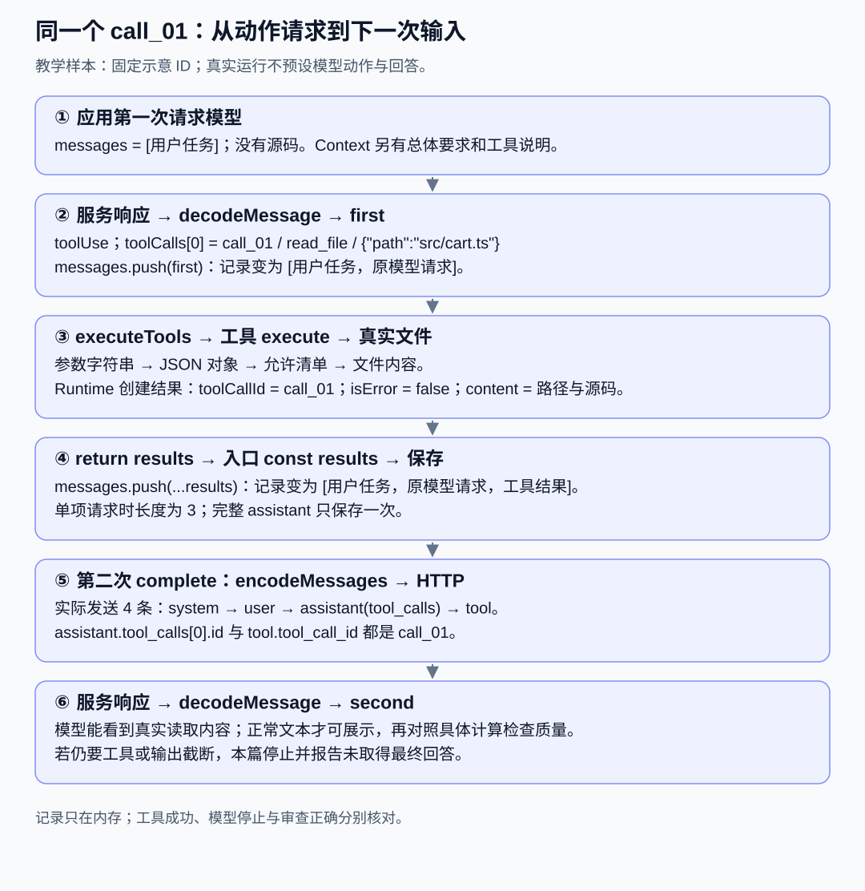
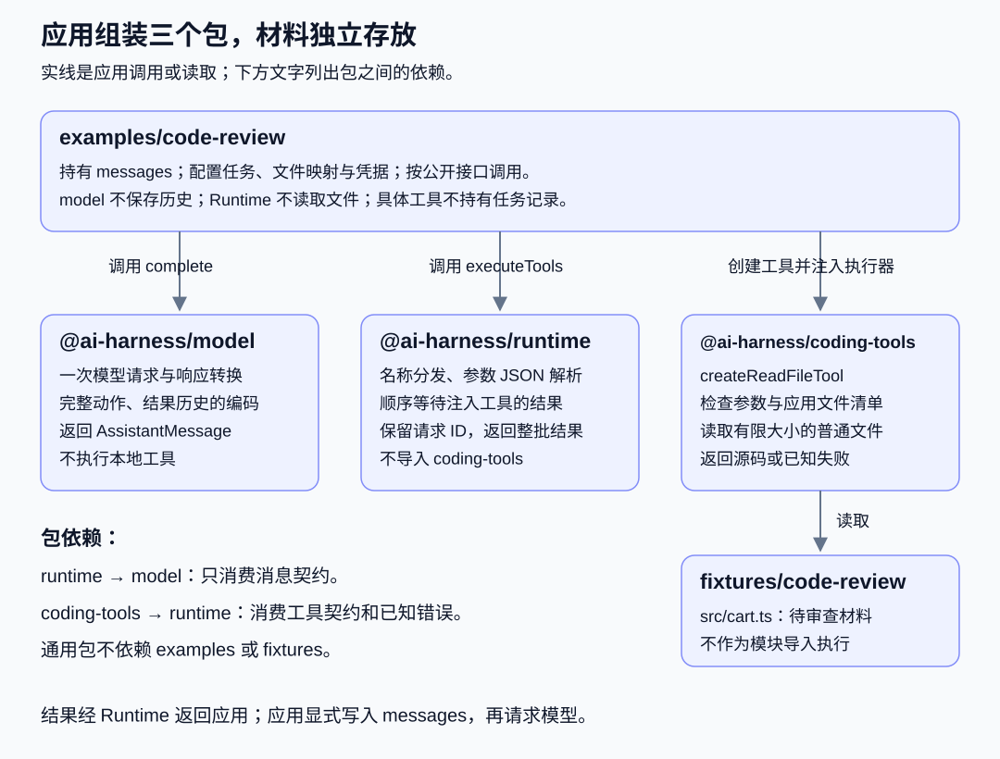
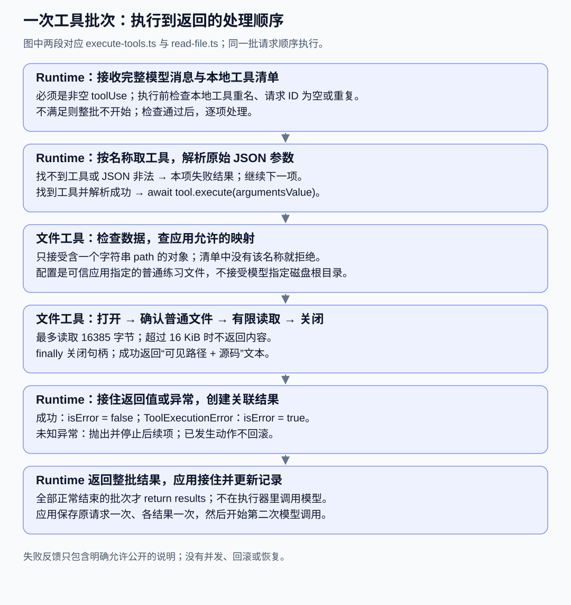
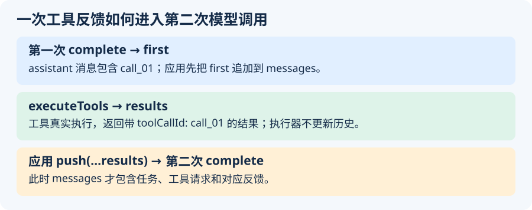

# 03 执行工具，把结果交回模型

02 中，模型已经会提出 `read_file` 请求，但终端只能展示“待执行”。**本篇让程序真正读取源码，把读取结果交给模型，再取得基于源码的回答。** 沿用审查 `src/cart.ts` 的任务：第一次调用时模型不知道文件内容，第二次调用时它能看到本地工具实际返回的内容。

这是[第一阶段](/roadmap#第一阶段-逐篇大纲)的执行与反馈部分。新增链条是：**模型提出动作 → Runtime 调用本地工具 → 应用保存结果 → 模型利用新信息回答。** Runtime 在这里指承接请求、组织本地执行的运行代码；本篇先建其中的工具执行部分，04 再把显式的两次调用接成自动循环。

本篇完成后，要能从日志找到原请求、实际文件内容、第二次输入，以及模型的后续响应。工具成功只证明取得了内容；回答是否指出真正的问题，还要对照材料检查。

## 本篇技术方案

### 实施前，先走完一次具体过程

先看本篇要审查的文件：`fixtures/code-review/src/cart.ts`。02 只在任务里提到了路径，还没有创建这个文件；本篇会用下面这份真实材料。这里先阅读完整内容，第四步再按操作说明创建：

<<< @/snippets/03-tool-feedback/fixtures/code-review/src/cart.ts

`CartItem` 表示一项商品，`price` 是单价，`quantity` 是数量；`total` 应计算所有商品的总价。当前实现只累加单价，没有乘数量。例如输入 `[{ price: 10, quantity: 3 }]`，正确结果应为 30，当前函数却返回 10。模型的审查结果需要能指出这处问题。

这份文件是独立的待审查材料，不属于 Agent 框架。任务中使用的 `src/cart.ts` 是应用提供给模型的可读名称，应用稍后会把它映射到 `fixtures/code-review/src/cart.ts`；模型不会仅凭这个名称就获得文件内容。

应用只告诉模型任务和可用工具，不提前塞入源码。假设第一次返回下面这项请求，这是教学样本，ID 简写为 `call_01`，真实运行的文字、ID 和请求数量可能不同：

```json
{"id":"call_01","name":"read_file","arguments":"{\"path\":\"src/cart.ts\"}"}
```

围绕这项请求，整篇实现按下面的顺序协作：

1. **应用发起第一次模型调用。** 输入只有任务和工具说明，没有源码。模型包把服务响应转换后，应用接到包含上述读取请求的完整模型消息。
2. **Runtime 执行器把请求交给实际工具。** 按名称找到应用注入的工具，解析参数，将 `{ "path": "src/cart.ts" }` 交给执行函数。它只处理本次响应中的请求，不把所有注册工具都运行一遍。
3. **文件工具取得实际内容，执行器组成反馈。** 工具检查字段和允许清单，再读取真实文件。执行器把返回文本装进结果，复制原请求 ID；已知失败则返回对应请求的失败反馈。
4. **应用保存反馈，发起第二次调用。** 应用依次保存原模型消息与工具结果，将更新后的记录交给模型包。模型包把这些项目消息转换成服务协议，模型这次才有机会看见实际源码。
5. **应用接住后续回答并检查。** 展示读取记录和模型响应，再对照源码检查结论。本篇仍由应用显式写两次调用，没有自动循环，也不能把读取成功直接当作审查正确。

工具结果的项目内结构如下。`content` 这里用说明性文本缩写，实际运行会包含路径和完整文件内容；不要把这份样本写死到程序里。

```json
{
  "role": "toolResult",
  "toolCallId": "call_01",
  "toolName": "read_file",
  "content": "src/cart.ts\n这里实际放读取到的完整源码",
  "isError": false
}
```

`call_01` 回答“这是哪一次请求的结果”。如果模型一次请求两个文件，即使工具名都叫 `read_file`，也能通过不同 ID 配对。结果不能改成一条普通用户消息，否则会丢掉这层关联。

第一次调用前，应用记录只有一条用户消息。执行一次工具后，记录是三条：**用户任务 → 包含请求的模型消息 → 对应该请求的工具结果**。第二次调用由模型包额外附上总体要求，所以 HTTP 正文会有四条消息。总体要求没有被插回应用的记录数组。

### 实现架构图

[](/diagrams/03-feedback-trace.svg)

这套对应关系参考了 Pi 的[工具执行和结果写回](https://github.com/badlogic/pi-mono/blob/8efd314fa3d3232ce197d8d7a6a5660530b9d83e/packages/agent/src/agent-loop.ts)：它把本地工具与说明关联，生成带原请求 ID 的结果，再让运行继续。本篇采用纯文本、顺序执行和两次显式调用；Pi 的完整循环、并行、事件和取消等能力还没有实现。

## 模型、Runtime 和文件工具分别做什么

本篇增加两个实际使用的包：

| 位置 | 本篇职责 | 不持有什么 |
|---|---|---|
| `packages/model` | 转换消息，完成一次模型调用 | 本地文件执行函数、应用历史的更新权 |
| `packages/runtime` | 找工具、解析参数、顺序等待、创建关联结果 | 文件路径规则、任务要求、对话记录 |
| `packages/coding-tools` | 提供可配置的文件读取实现 | 代码审查任务和对话记录 |
| `examples/code-review` | 配置可读文件，保存记录，显式调用两次 | 服务原始协议转换 |
| `fixtures/code-review` | 提供真实待审查源码 | Agent 执行机制 |

从本篇开始，`coding-tools` 提供受配置清单限制的读取；工作区调查、修改与验证在第三阶段继续扩展。当前只读一个由应用明确配置的文件，不开放整个磁盘，也不执行待审查代码。

[](/diagrams/03-package-boundary.svg)

先检查 Git 状态，再由你创建本章分支。若上一章还有未保存的修改，先处理实际状态，不直接照抄切分支：

```bash
git status --short --branch
git switch -c agent/chapter-03-tool-feedback
```

下面按“能保存反馈 → 能执行 → 能读取 → 接回模型”的顺序实现。中间会先运行一次不调用模型的本地检查，避免写完全部入口才发现读取没有接通。

## 第一步：让工程认识两个新包

根 `package.json` 完整替换为下面内容。保留原有 workspace、依赖和 `start/debug/check/docs:*` 名称；只修改 `build`，按 model → runtime → coding-tools 的依赖顺序构建。

<<< @/snippets/03-tool-feedback/package.json

新建以下四个配置文件。两个包都通过 `dist` 提供 JavaScript 和类型；Runtime 依赖模型契约，文件工具依赖 Runtime 的工具契约。应用仍从包入口导入，不穿过目录访问另一个包的内部源码。

::: details packages/runtime/package.json【新增文件】
<<< @/snippets/03-tool-feedback/packages/runtime/package.json
:::

::: details packages/runtime/tsconfig.json【新增文件】
<<< @/snippets/03-tool-feedback/packages/runtime/tsconfig.json
:::

::: details packages/coding-tools/package.json【新增文件】
<<< @/snippets/03-tool-feedback/packages/coding-tools/package.json
:::

::: details packages/coding-tools/tsconfig.json【新增文件】
<<< @/snippets/03-tool-feedback/packages/coding-tools/tsconfig.json
:::

完整替换 `examples/code-review/package.json`：保留 `@ai-harness/model`，增加 Runtime 和文件工具依赖。

<<< @/snippets/03-tool-feedback/examples/code-review/package.json

根 `tsconfig.json`、`.env.example` 和网站配置不需要为学习实现修改。先创建好上述文件，后面在模型类型完成后统一安装、构建。

## 第二步：记录中保留请求和结果

02 的 `Message` 只能表达文本，无法完整保存工具请求和结果。现在把它改为三种消息的联合：用户输入、完整模型消息、本地工具结果。这里“联合”表示一项记录可以是其中一种，程序按 `role` 区分。

先新建 `packages/model/src/types/tool-results.ts`，定义工具结果消息的类型 `ToolResultMessage`。这个文件只规定消息有哪些字段，不执行工具，也不创建实际结果。工具结果会成为下一次模型调用的输入，所以消息类型定义在模型包中。

后面接入执行时，Runtime 会根据实际执行情况，创建符合这个类型的结果对象；应用把结果对象追加到对话记录；下一次调用时，模型包读取记录中的结果对象，转换成服务要求的 `tool` 消息。类型定义与运行时创建的对象是两件事。

这个类型约定一项本地执行反馈应包含哪些信息。执行器实际创建 ToolResultMessage，复制请求 ID、填写结果文本和失败标志；本篇由应用保存对象，模型包在第二次调用时将它编码成服务消息。放在模型包是因为它属于可发送的消息契约，文件本身不执行工具。

<<< @/snippets/03-tool-feedback/packages/model/src/types/tool-results.ts

Runtime 创建结果对象时，将原请求的 ID 和工具名分别填入 `toolCallId`、`toolName`，把工具返回文本或已知失败说明填入 `content`，并通过 `isError` 标记是否失败。下面的接口只是这些字段的约定；填入具体值的执行代码在第三步实现。

**完整替换已有的 `packages/model/src/types/messages.ts`**：保留 `AssistantMessage` 及其已有字段；把旧 `Message` 接口中的用户部分命名为 `UserMessage`，让导出的 `Message` 变成三类消息的联合。以后保存模型消息要保存完整的 `AssistantMessage`，不能只存 `{ role: 'assistant', content }`。

这份联合类型让同一条历史记录能够是用户任务、包含请求的模型消息，或者本地工具结果。应用按顺序保存这些值，编码器按 role 区分并转换，避免第二次调用丢掉第一轮请求与反馈。

<<< @/snippets/03-tool-feedback/packages/model/src/types/messages.ts

已有示例创建的 `{ role: 'user', content: prompt }` 仍有效。`Context.messages` 引用的仍是 `Message`，所以 `types/context.ts` 不用修改；`types/tools.ts/options.ts` 和响应解码也继续沿用 02。

### 把这三种消息送到服务

项目里叫 `toolResult`，DeepSeek 接口使用 `tool`；项目里叫 `toolCallId`，接口使用 `tool_call_id`。因此不能把内部记录原样展开进请求。

新建 `packages/model/src/providers/deepseek-messages.ts`。它替 `complete` 创建发送用的消息数组。输入中同一条 `call_01` 请求与结果，输出中仍保持相同 ID，只改变服务需要的字段结构。

encodeMessages 替请求函数把应用保存的项目历史转换成服务消息数组。传入“用户任务、模型读取请求、读取结果”三项，它会保留请求与结果的 ID 对应关系，返回新数组供 HTTP 正文使用，不修改或追加原历史。

<<< @/snippets/03-tool-feedback/packages/model/src/providers/deepseek-messages.ts

正常的一次转换是：用户消息复制角色和内容；模型消息把 `toolCalls` 转成 `tool_calls`；工具结果转成 `role: 'tool'`，关联字段来自 `message.toolCallId`。`stopReason` 是本地处理状态，不发送给服务。

服务没有本项目的 `isError` 字段，因此结果的 `content` 使用 JSON 文本，同时传入状态和内容。例如成功时是 `{"isError":false,"content":"src/cart.ts\n实际源码"}`；失败时是 `{"isError":true,"content":"参数必须是只包含字符串 path 的对象。"}`。这是本项目选择的文本格式，不是所有模型服务统一规定的结果结构。[DeepSeek 消息接口](https://api-docs.deepseek.com/api/create-chat-completion/)规定了工具消息角色和请求关联字段。

**完整替换 `packages/model/src/providers/deepseek.ts`**：保留 `complete`、响应解码与已有请求配置；新增 `encodeMessages` 导入，把原来直接复制 `context.messages` 的位置改为先转换历史，再附上总体要求。

这份请求实现把刚才的历史编码接回 complete：应用交入累计消息与调用配置，函数发送完整记录、等待服务并返回一条模型消息。保存新返回值仍是本篇应用的工作，不由 complete 自动完成。

<<< @/snippets/03-tool-feedback/packages/model/src/providers/deepseek.ts

沿第二次调用看：`context.messages` 中已有三条记录，`encodeMessages` 返回三条服务消息，由 `history` 接住。`messages` 再在前面放一条 system 消息，`JSON.stringify` 把四条消息发送出去。HTTP 响应由 `response` 接住，`value` 接住解析后的原始数据，`decodeMessage(value)` 创建新的项目模型消息，最后 `complete` 的调用方接住返回值。转换与返回都没有替应用更新记录。

**完整替换 `packages/model/src/index.ts`**：保留已有导出，消息导出增加 `UserMessage`，新增 `ToolResultMessage` 导出；两个协议转换模块仍是包内部实现。

这个入口公开新的 ToolResultMessage 和更新后的消息类型，让应用、Runtime 与模型编码器使用同一份契约；它不保存任何运行记录。

<<< @/snippets/03-tool-feedback/packages/model/src/index.ts

现在安装 workspace 链接并先构建模型包：

```bash
npm install
npm run build --workspace @ai-harness/model
```

后面的 Runtime 将导入新类型。先构建能让编辑器从模型包公开入口的 `dist/index.d.ts` 找到它们；只改源码导出，旧构建产物不会自行更新。

## 第三步：Runtime 按请求执行工具

一个工具现在有两面：给模型看的名称、用途、参数说明，以及只在本地存在的执行函数。新建 `packages/runtime/src/types/tools.ts`，把这种组合命名为 `ExecutableTool`。

ExecutableTool 约定本地工具既有模型可见的说明，也有程序可调用的 execute。应用将这样的对象交给执行器；执行器按模型请求选中它，等待 execute 返回文本。声明不是工具注册或执行动作。

<<< @/snippets/03-tool-feedback/packages/runtime/src/types/tools.ts

Runtime 把解析后的参数交给 `execute`，但数据仍标记为 `unknown`：能解析成 JSON，不代表它有正确的 `path`。每个工具要检查自己的参数，再执行动作。模型包只挑选工具说明字段发送，`execute` 不会传给模型。

### 哪些失败可以交回模型

例如参数不是 JSON，或请求了未允许的路径，模型可以根据反馈重新决定。这些失败需要一段可公开的说明。新建 `packages/runtime/src/tool-error.ts`：

这个错误类用来表达工具已经识别、可以安全反馈的失败。读取工具遇到不允许路径或预期 I/O 问题时创建它，执行器捕获后转成该请求的失败结果；其他异常仍向上抛出，不一律伪装成可继续的失败。

<<< @/snippets/03-tool-feedback/packages/runtime/src/tool-error.ts

`ToolExecutionError` 是明确的约定：工具主动抛出它，表示这条消息允许作为反馈。普通 `Error` 等未知异常不自动发给模型；可能是程序缺陷，不能一概冒充“可以重试的文件失败”。

### 执行完整批次

新建 `packages/runtime/src/execute-tools.ts`。应用把第一次得到的完整模型消息和本地工具清单交给 `executeTools`；它返回一项或多项 `ToolResultMessage`，留给应用保存。以 `call_01` 为例，目标返回值是带 `toolCallId: 'call_01'` 和实际源码的结果数组。

executeTools 接收一条包含请求的模型消息和本地工具清单，负责查名称、解析参数、顺序调用相应工具，并返回关联原请求 ID 的结果数组。应用接住该数组后才保存历史；执行器不会自己请求模型或运行未被请求的工具。

<<< @/snippets/03-tool-feedback/packages/runtime/src/execute-tools.ts

正常路径中，`registry` 保存名称与本地对象的对应关系。`registry.get('read_file')` 找到工具；`JSON.parse(call.arguments)` 创建参数对象，由 `argumentsValue` 接住。`await tool.execute(argumentsValue)` 等待读取结束，返回的字符串进入执行器局部的 `content`，随后 `results.push` 创建带原 ID 的结果对象。

`results` 是执行器内部的数组，返回后才由应用接住。这里没有 `complete`，也没有对应用历史的 `push`。所以同一个执行器以后可以用于其他工具，不需要知道“代码审查”或 `src/cart.ts`。

一条模型消息可以有多项请求。`for ... of` 内的 `await` 让第一项完成后才执行第二项，保持返回顺序。整批完成才返回，应用不会在第一项结果后就急着请求模型。原模型消息也只保存一次，而不是每执行一项重复保存。

失败分三层处理：

- 批内 ID 为空或重复、本地工具重名：在动作开始前抛出，无法可靠配对时不执行。
- 工具未注册、JSON 非法、工具主动报告已知失败：生成 `isError: true` 的关联结果；继续处理后续项。
- 未知异常：向入口抛出，不执行后面的项，也不开始第二次模型调用。已经发生的读取不会回滚；此时调用方没有取得完整结果数组，本篇也没有部分恢复机制。

[](/diagrams/03-execution-flow.svg)

新建 `packages/runtime/src/index.ts`，公开契约、已知错误与执行函数：

Runtime 的入口公开工具契约、已知错误类和批次执行函数，供能力包及应用通过包名使用。它没有启动自动循环，本篇仍由应用决定何时执行和再次请求模型。

<<< @/snippets/03-tool-feedback/packages/runtime/src/index.ts

### 先构建 Runtime，再让文件工具导入

到这里，Runtime 的类型、执行器、错误类和公开入口已经齐全。在仓库根目录运行：

```bash
npm run build --workspace @ai-harness/runtime
```

确认生成 `packages/runtime/dist/index.js` 和 `packages/runtime/dist/index.d.ts`，再继续第四步。第一步配置的包入口指向这两个构建文件；`npm install` 建立 workspace 链接，但不会生成它们。只有 `src/index.ts` 时，下一步从 `@ai-harness/runtime` 导入仍可能报找不到模块或类型声明。

## 第四步：接入实际文件工具

### 先创建要读的材料

现在新建开头已经展示的 `fixtures/code-review/src/cart.ts`，写入同一份完整内容：

<<< @/snippets/03-tool-feedback/fixtures/code-review/src/cart.ts

这个文件只作为 UTF-8 文本读取。应用没有导入并运行 `total`，因此模型最后给出的具体输入和正确结果仍要人工核对。这里提供全部材料代码，后续排查“有没有读到正确版本”时可以直接比对。

### 应用指定可读清单

新建 `packages/coding-tools/src/types/read-file.ts`：

ReadFileOptions 约定应用提供的可读名称到实际文件位置的映射。文件工具工厂接收这份配置，模型只提交其中的可见名称；类型本身不扫描目录，也不开放任意磁盘路径。

<<< @/snippets/03-tool-feedback/packages/coding-tools/src/types/read-file.ts

例如应用把可见名称 `src/cart.ts` 对应到练习文件的本地位置。模型只选择这个名称，不提供磁盘根目录。换一份材料时，由应用更换映射，Runtime 不变。

新建 `packages/coding-tools/src/read-file.ts`。工厂函数 `createReadFileTool` 接收上述配置，返回有说明和 `execute` 的工具对象。内部 `readAllowedFile` 负责读取配置选中的普通文件，并限制返回规模。

<<< @/snippets/03-tool-feedback/packages/coding-tools/src/read-file.ts

沿一次正常调用看：工厂在应用启动时创建 `files` 映射；Runtime 传入 `{ path: 'src/cart.ts' }` 后，`execute` 确认它是只有一个字符串 `path` 的对象。`files.get(value.path)` 找到应用配置的真实位置，再调用 `readAllowedFile(target)`。返回文本由这里的 `source` 接住，拼上可见路径后返回给 Runtime；它不会自己生成 `toolCallId`，关联 ID 是执行器负责的。

`readAllowedFile` 取得文件句柄后先确认普通文件。读取缓冲区是 16 KiB 加 1 字节：循环累计实际读到的字节数，遇到文件末尾停止；若读到了第 16385 字节，就拒绝返回内容。循环是为了正确处理一次读取没有填满缓冲区的情况，不是 Agent 决策循环。`finally` 在成功或失败时关闭已取得的句柄。

找不到文件、无读取权限等列出的 I/O 错误被转成简短的 `ToolExecutionError`，不会把含本地绝对路径的系统错误正文交给模型。超大文件和非普通文件也作为已知失败。其他异常继续向上抛出，由 Runtime 停止批次。

清单限制模型可以选择的名称；**应用必须只配置自己确认可公开的普通文件**。本工具遵循本地文件系统的路径和链接行为，没有操作系统沙箱，也不保证抵御文件被其他进程并发替换。它适合当前受控练习材料，完整工作区与隔离能力按后续阶段建设。

新建 `packages/coding-tools/src/index.ts`：

这个入口公开读取工具的配置类型与创建函数，让应用取得能力对象，再将它注入 Runtime；导入时不会立即读取材料。

<<< @/snippets/03-tool-feedback/packages/coding-tools/src/index.ts

现在先在仓库根目录构建文件工具包，再编写使用它的示例：

```bash
npm run build --workspace @ai-harness/coding-tools
```

确认生成 `packages/coding-tools/dist/index.js` 和 `packages/coding-tools/dist/index.d.ts`。下面示例从 `@ai-harness/coding-tools` 导入时，读取的就是这些公开构建文件。此时模型包和 Runtime 已在前面的检查点构建完成，无需提前运行后面的整工程检查。

**完整替换 `examples/code-review/src/tools.ts`**：删除 02 手写的 `reviewTools: readonly ToolDefinition[]` 说明对象和 `ToolDefinition` 导入；保留导出名 `reviewTools`，改为调用文件工具工厂并配置可读文件。

这份代码把原来的说明数组换成实际读取工具：应用配置 src/cart.ts 对应的材料位置，工厂返回带 execute 的对象，并仍以 reviewTools 导出。接下来的执行器因此可以实际取得源码，而不只打印动作说明。

<<< @/snippets/03-tool-feedback/examples/code-review/src/tools.ts

`new URL(..., import.meta.url)` 从当前模块的位置找到仓库中的材料，不依赖启动终端的当前目录。给模型的名称仍是 `src/cart.ts`，磁盘位置留在本地映射里。说明与执行来自同一个工具对象，避免应用声明了一个工具却忘记提供对应执行实现。

### 先检查本地执行，不调用模型

到这里，模型历史转换、Runtime、读取工具、材料与工具配置均已写完；`main.ts` 暂时还是 02 入口。先构建三个包，再从仓库根目录运行：

```bash
npm run build
node --import tsx --input-type=module <<'JS'
import { executeTools } from '@ai-harness/runtime';
import { reviewTools } from './examples/code-review/src/tools.ts';

const request = {
  role: 'assistant', content: '', stopReason: 'toolUse',
  toolCalls: [{ id: 'local_01', name: 'read_file', arguments: '{"path":"src/cart.ts"}' }],
};
console.log(JSON.stringify(await executeTools(request, reviewTools), null, 2));
JS
```

这条命令使用 Node 的临时输入脚本，没有创建新的工程运行别名；脚本从 `tsx` 加载现有 TypeScript 模块。观察 `toolCallId` 为 `local_01`、`isError` 为 `false`、`content` 含实际 `total` 源码。它没有请求网络。

此处的请求由脚本固定提供，只证明本地工具链连通，不能证明模型会选择正确动作。下一步复用同一执行器，把请求来源换回真实的 `complete` 返回值。

## 第五步：保存反馈，再调用模型

**完整替换 `examples/code-review/src/main.ts`**：删除 02 只展示待执行请求的分支；保留模型配置和错误出口，新增 `messages` 记录、`executeTools` 调用、第二次 `complete` 与回答展示检查。`reviewTools` 的导入名保持不变。

这个入口把整次两轮往返串起来：创建任务历史，接住第一次模型请求，调用执行器并保存请求和结果，再把更新后的记录交给第二次 complete。最后的展示函数检查停止状态与可用文字；本篇衔接仍是显式两次调用，不是自动循环。

<<< @/snippets/03-tool-feedback/examples/code-review/src/main.ts

### 用同一个 call_01 串起全部返回值

第一次 `complete(context, options)` 从服务拿到原始响应，经 02 的 `decodeMessage` 转换，外部的 `first` 接住项目模型消息。若 `first.stopReason` 是 `toolUse`，它的 `toolCalls[0]` 就可能是前面那个 `call_01` 请求。

`messages.push(first)` 是第一次真正更新应用记录的语句。它保存整个模型消息，包括文字、停止原因和全部动作；`complete` 的返回本身没有保存效果。`context.messages` 与这里的 `messages` 引用同一数组，后续追加会被下一次调用看到。`readonly` 只限制通过 `Context` 类型进行的操作，不把这个数组冻结。

接着 `executeTools(first, reviewTools)` 调用本地工具。文件工具返回源码字符串，执行器把它装进 `ToolResultMessage`；执行器的 `return results` 最终交给入口的 `const results = await ...`。入口循环打印各项本地结果，再执行：

```ts
messages.push(...results);
```

这行仅用于对照，已包含在上方完整代码中，无需重复追加。它把各项结果放到原请求消息后面。若只有一项读取，此时数组长度是 3；有两项读取则是 4，而原 assistant 仍只有一条。

第二次 `complete(context, options)` 读取更新后的同一个数组。请求函数把 `toolCalls` 和 `toolResult` 转成服务字段后发送；模型这时才获得实际源码。服务返回的新响应仍经过 `response → value → decodeMessage → complete`，最终由入口的 `second` 接住。`messages.push(second)` 保存后续响应，单工具正常路径最终在内存中有四条记录；没有写入磁盘。

工具成功、模型停止、审查正确是三件事：`isError: false` 表示本次工具读到了内容；`stopReason: 'stop'` 表示生成正常停止；回答是否看出了数量问题，仍需与具体输入结果对照。



### 停止时发生什么

入口中的 `ReviewStopped` 只装应用主动给出的说明，供终端显示。`showAnswer` 负责检查文本能否展示，不负责验证模型的结论。第一次没请求文件时，本任务直接停止，因为“先取源码”的要求没有满足；第一次截断时不执行任何请求。

第二次若仍返回 `toolUse`，`showAnswer` 明确报“仍有待执行请求”，不再读取，也不启动第三次模型调用。两次调用是本篇显式展示反馈的边界，不保证所有任务都能在这里结束；04 会把继续条件交给 Runtime 循环。

若工具已知失败，失败结果同样进入第二次输入，模型可以解释缺少什么证据。但即使它返回了正常文本，入口仍因 `results` 中存在 `isError` 把本次审查标记为未交付。未知执行或服务异常只显示通用停止信息，调试器中检查原异常，不把内部正文直接写入默认日志。

## 第六步：运行时到底看什么

沿用 01 准备好的环境配置，不展示或提交真实密钥。本节 `start` 会调用你配置的模型服务，由你自行执行；前面的本地检查不调用模型。

```bash
npm run check
npm start
```

正常的一次可能轨迹是：第一次请求 `src/cart.ts`，本地成功读取，第二次指出 `quantity` 没有参与计算。模型文字与请求数量不固定，以下各项才是需要对照的关系：

| 日志 | 从哪里来 | 核对什么 |
|---|---|---|
| `第一次模型消息` | `first`，已经转换的完整模型消息 | `stopReason` 是 `toolUse`，请求的名称、路径与 ID |
| `本地工具结果` | `results` 中的每一项 | `toolCallId` 等于原 ID，内容与磁盘一致，`isError` 为 false |
| `第二次输入记录` | 应用持有的 `messages` 数组 | 用户、原模型请求、所有结果的顺序；单工具时长度为 3 |
| `第二次模型消息` | 第二次调用返回的 `second` | 是否仍要工具、是否截断、具体结论依据是什么 |
| `模型文本（text）` | `second.content` | 是否指出数量问题，例如单价 10、数量 3 应得 30 而不是 10 |

这些日志没有直接打印原始 HTTP 响应。第一次模型消息和后面的输入记录都出现 `call_01`，只是同一请求在返回与保存后的两次展示，不代表执行两次。多项工具请求会分别打印结果，但第二次输入记录仍只在整批结束后打印一次。

如果回答只说“代码有问题”而没有把问题对应到读取内容和具体计算，执行反馈机制可能已通，但审查质量还没有通过。如果模型直接回答、第二次继续要工具或遇到截断，保留真实日志中的停止位置，不把它改写成一条成功轨迹。

作者在临时工程用固定模型响应、真实文件读取及实际入口验证了正常、参数错误、读取失败、批次顺序和停止路径；没有代你调用付费模型。固定响应能证明程序行为，不能证明真实模型会自主完成审查。

### 用断点看信息怎样增加

运行 `npm run debug`，在 VS Code 附加 Node 调试器后设置这些断点：

1. `main.ts` 的 `const results = await executeTools(...)`：看 `first.toolCalls`。此时还未取得源码。
2. `coding-tools/src/read-file.ts` 的 `const source = await readAllowedFile(target)`：看 `value.path` 与本地 `target`；跨过后检查 `source` 是否与材料一致，不在共享日志中打印绝对路径。
3. `main.ts` 的 `messages.push(...results)`：跨过后看数组，从两条变成三条；不要停在调用前就说已保存。
4. `model/src/providers/deepseek.ts` 的 `fetch`：第二次暂停时看 `messages`，应有 system/user/assistant/tool；assistant 的请求 ID 与 tool 的 `tool_call_id` 相同。

完整原始响应可在本地断点检查 `value`，不要把请求头、密钥或全部服务错误直接输出到终端。这里定位的是数据和执行边界，不根据模型文字猜它内部怎样思考。

### 一个可逆失败：文件暂时不存在

保留工具清单不变，将 `fixtures/code-review/src/cart.ts` 临时改名为 `cart.hidden.ts`，运行 `npm start`，观察：

- 模型若请求原路径，本地结果应为 `isError: true`，内容含 `ENOENT`，不含系统绝对路径正文。
- 第二次输入仍有同一个 ID 的失败结果；第二次模型消息是对失败信息的响应，没有取得源码。
- 即使第二次有文字，入口最终也应报告“存在工具失败”，退出码非 0。

如果第一次没有请求工具，先按实际分支记录；这次运行尚未触发文件失败路径。需要精确检查读取失败时，可运行第四步的本地命令，它使用固定请求且不付费。

完成实验立即把文件改回 `cart.ts`。这个故障验证“失败也是反馈”，不要求模型在本篇自动重试，也不声称所有异常都可以安全反馈。

### 小迁移：只换材料，不改 Runtime

复制 `fixtures/code-review/src/cart.ts` 为 `basket.ts`，把问题改成另一处你能用具体输入说明的计算错误。在 `examples/code-review/src/tools.ts` 为 `src/basket.ts` 增加一项本地路径映射，再运行：

```bash
npm start -- '请审查src/basket.ts，先读取源码，再给出一个具体计算问题和输入结果。'
```

只改材料、清单和任务，保留 `complete/executeTools`。核对实际请求选中了新路径、返回内容来自新材料，且第二次输入关联正确。模型是否选对、回答是否有依据，需要看这次运行；不能用原材料的成功替代。

## 完整文件核对

下面从本篇同一候选目录引用最终文件，供核对，不是另一套实现。包括本章未修改的模型文件与基础配置；没有要求重抄未变内容。

::: details package.json
<<< @/snippets/03-tool-feedback/package.json
:::

::: details tsconfig.json
<<< @/snippets/03-tool-feedback/tsconfig.json
:::

::: details .env.example
<<< @/snippets/03-tool-feedback/.env.example{sh}
:::

::: details packages/coding-tools/package.json
<<< @/snippets/03-tool-feedback/packages/coding-tools/package.json
:::

::: details packages/coding-tools/src/index.ts
<<< @/snippets/03-tool-feedback/packages/coding-tools/src/index.ts
:::

::: details packages/coding-tools/src/read-file.ts
<<< @/snippets/03-tool-feedback/packages/coding-tools/src/read-file.ts
:::

::: details packages/coding-tools/src/types/read-file.ts
<<< @/snippets/03-tool-feedback/packages/coding-tools/src/types/read-file.ts
:::

::: details packages/coding-tools/tsconfig.json
<<< @/snippets/03-tool-feedback/packages/coding-tools/tsconfig.json
:::

::: details packages/model/package.json
<<< @/snippets/03-tool-feedback/packages/model/package.json
:::

::: details packages/model/src/index.ts
<<< @/snippets/03-tool-feedback/packages/model/src/index.ts
:::

::: details packages/model/src/providers/deepseek-messages.ts
<<< @/snippets/03-tool-feedback/packages/model/src/providers/deepseek-messages.ts
:::

::: details packages/model/src/providers/deepseek-response.ts
<<< @/snippets/03-tool-feedback/packages/model/src/providers/deepseek-response.ts
:::

::: details packages/model/src/providers/deepseek.ts
<<< @/snippets/03-tool-feedback/packages/model/src/providers/deepseek.ts
:::

::: details packages/model/src/types/context.ts
<<< @/snippets/03-tool-feedback/packages/model/src/types/context.ts
:::

::: details packages/model/src/types/messages.ts
<<< @/snippets/03-tool-feedback/packages/model/src/types/messages.ts
:::

::: details packages/model/src/types/options.ts
<<< @/snippets/03-tool-feedback/packages/model/src/types/options.ts
:::

::: details packages/model/src/types/tool-results.ts
<<< @/snippets/03-tool-feedback/packages/model/src/types/tool-results.ts
:::

::: details packages/model/src/types/tools.ts
<<< @/snippets/03-tool-feedback/packages/model/src/types/tools.ts
:::

::: details packages/model/src/validation.ts
<<< @/snippets/03-tool-feedback/packages/model/src/validation.ts
:::

::: details packages/model/tsconfig.json
<<< @/snippets/03-tool-feedback/packages/model/tsconfig.json
:::

::: details packages/runtime/package.json
<<< @/snippets/03-tool-feedback/packages/runtime/package.json
:::

::: details packages/runtime/src/execute-tools.ts
<<< @/snippets/03-tool-feedback/packages/runtime/src/execute-tools.ts
:::

::: details packages/runtime/src/index.ts
<<< @/snippets/03-tool-feedback/packages/runtime/src/index.ts
:::

::: details packages/runtime/src/tool-error.ts
<<< @/snippets/03-tool-feedback/packages/runtime/src/tool-error.ts
:::

::: details packages/runtime/src/types/tools.ts
<<< @/snippets/03-tool-feedback/packages/runtime/src/types/tools.ts
:::

::: details packages/runtime/tsconfig.json
<<< @/snippets/03-tool-feedback/packages/runtime/tsconfig.json
:::

::: details examples/code-review/package.json
<<< @/snippets/03-tool-feedback/examples/code-review/package.json
:::

::: details examples/code-review/src/main.ts
<<< @/snippets/03-tool-feedback/examples/code-review/src/main.ts
:::

::: details examples/code-review/src/tools.ts
<<< @/snippets/03-tool-feedback/examples/code-review/src/tools.ts
:::

::: details fixtures/code-review/src/cart.ts
<<< @/snippets/03-tool-feedback/fixtures/code-review/src/cart.ts
:::


## 保存本篇

确认检查通过、故障材料已恢复，再审阅自己的差异。下面只由你执行；仓库可能含本地实验文件，先按 `git status` 核对，不把真实 `.env` 暂存。

```bash
git status --short --branch
git diff --stat
git add packages/model packages/runtime packages/coding-tools examples/code-review fixtures/code-review package.json package-lock.json
git commit -F - <<'MSG'
实现工具执行与结果反馈

扩展模型历史消息，保留完整工具请求和关联结果。
建立通用顺序工具执行器，校验参数并区分已知失败与未知异常。
通过独立代码工具包读取受配置清单限制的真实源码。
示例显式保存反馈并再次请求模型，区分工具成功与审查交付。
MSG
git push -u origin agent/chapter-03-tool-feedback
```

下一篇把这里由应用明确写出的“请求、执行、写回、再请求”交给 Runtime 自动推进，同时设置继续与停止条件。文件读取、消息转换和结果关联继续复用。
