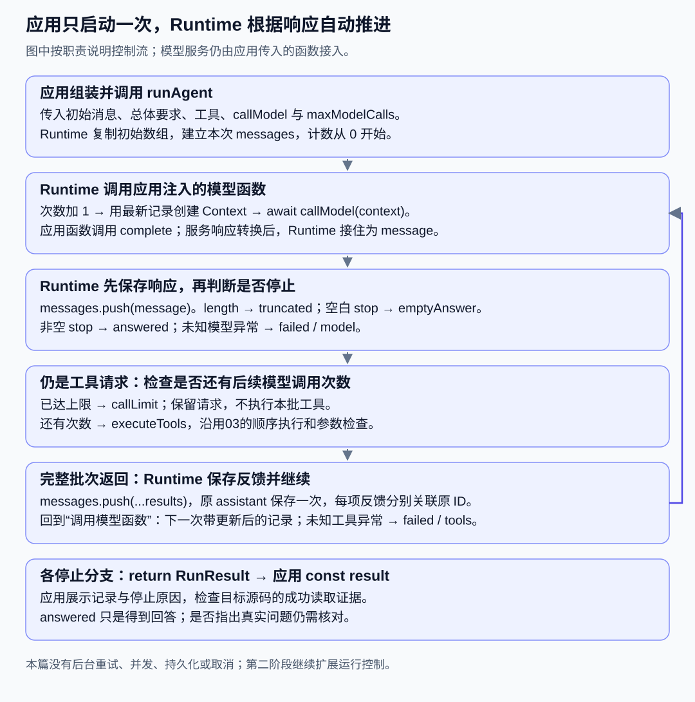
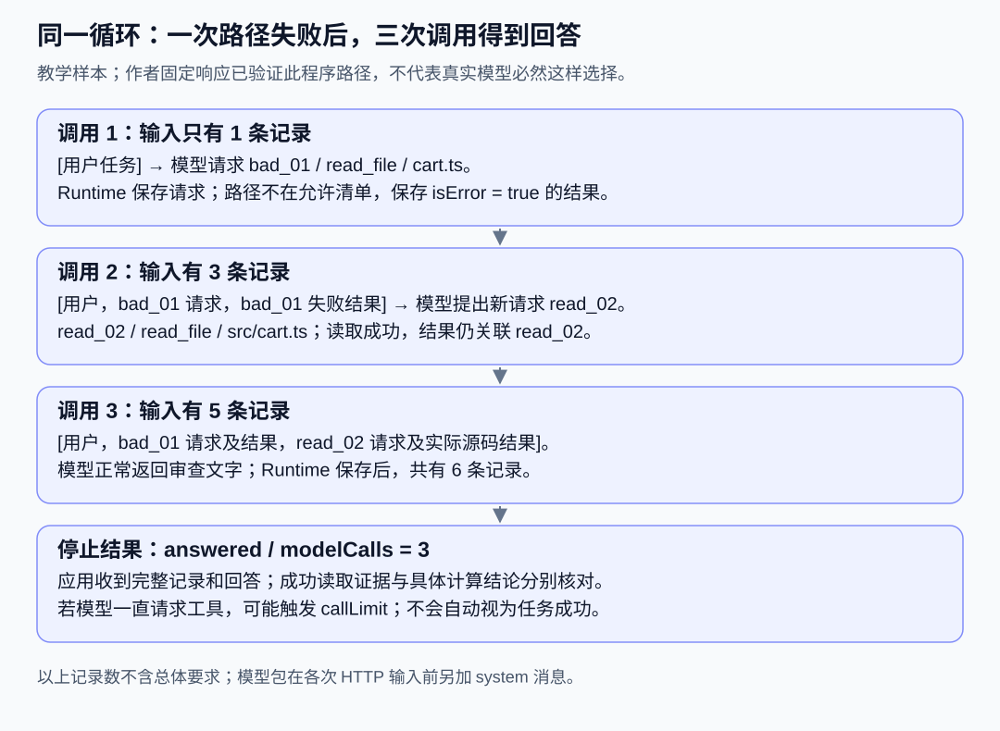
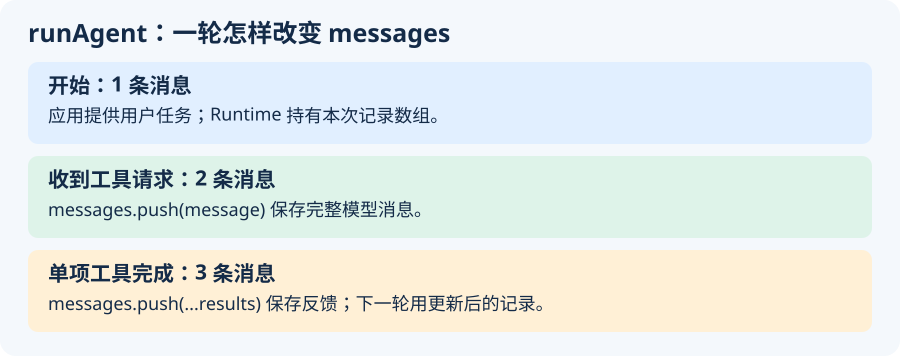

# 04 让 Runtime 自动继续与停止

03 中，应用先调用一次模型，执行工具，再手写第二次调用。如果第二次模型还需要文件，程序就停下了。**本篇把这段衔接交给 Runtime：模型请求工具就执行并反馈，再请求模型；模型返回文本或触发运行限制时，返回明确的停止结果。** 应用只调用一次运行入口，不再写 `first/second`。

这是[第一阶段](/roadmap#第一阶段-逐篇大纲)的自动循环部分。仍使用 03 的文件读取工具和审查材料，不增加业务功能。完成后，程序可以根据实际响应走不同次数：一次回答、读取后回答，或者根据工具失败调整请求后再回答。每条路径都受调用上限约束。

这里的自动循环不是不断重复同一请求。**每次调用模型前，Runtime 都把上一次模型响应和已完成的工具结果保存进去，让下一次决定基于更新的信息。** 反馈改变的是模型可见的证据；下一步动作仍由模型产生，本地程序检查并执行。

## 从两次固定调用到一次运行

先确认沿用的材料。03 创建的 `fixtures/code-review/src/cart.ts` 完整内容如下，本篇无需修改：

<<< @/snippets/04-agent-loop/fixtures/code-review/src/cart.ts

任务仍是审查 `src/cart.ts`。应用把这个模型可见名称映射到上面的实际文件；工具读取文本，不导入执行 `total`。可以用单价 10、数量 3 应得 30 这一输入检查回答是否指出遗漏数量的问题。

本篇把应用手写的衔接交给 Runtime，整体按下面的顺序运行：

1. **应用准备一次运行。** 提供初始任务、工具、调用上限和一个会请求模型的函数；服务配置留在应用与模型包，循环不用认识密钥或服务地址。
2. **Runtime 建立自己持有的历史。** 从初始消息开始，每次把当前历史交给模型函数，等待一条完整模型消息，再保存这条响应。
3. **根据响应继续或停止。** 有工具请求，就调用原执行器；执行器返回真实结果后，由 Runtime 追加到历史，再带着更新后的内容进入下一轮。只有文字时，按停止原因和内容选取返回分支。
4. **限制和异常同样有明确出口。** 达到模型调用上限，不再请求；未知异常返回失败。已经发生的工具动作不会因停止自动回滚。
5. **应用只接住一次最终结果。** 结果带历史、调用次数和停止状态；应用展示记录、检查成功读取证据，再人工核对具体结论。循环返回文本不等于任务质量已通过。

这些步骤不预先规定模型第二次就回答。例如下面是一种可能轨迹：

| 模型调用 | 输入中的记录数 | 模型响应 | 本地下一步 |
|---|---:|---|---|
| 1 | 1 | 请求 `cart.ts`，ID 为 `bad_01` | 路径不在清单内，保存失败结果 |
| 2 | 3 | 根据反馈改为 `src/cart.ts`，ID 为 `read_02` | 读取成功，保存源码结果 |
| 3 | 5 | 根据源码给出审查文字 | 保存响应，结束运行 |

这是说明机制的样本，不要求真实模型先犯错，也不保证它会这样修正。第一种路径错误并没有打开文件；第二次请求是模型生成的新动作，不是程序偷偷把错误路径改掉。

正常的“读一次就回答”只需要两次模型调用。支持这两种情况的是同一个循环，而不是分别写两套流程。

[](/diagrams/04-runtime-loop.svg)

本篇参考 Pi 固定版本的[运行循环](https://github.com/badlogic/pi-mono/blob/8efd314fa3d3232ce197d8d7a6a5660530b9d83e/packages/agent/src/agent-loop.ts)：运行层维护当前历史，执行工具批次并写回，再决定是否继续；模型调用能力通过函数传入。本项目仍使用非流式返回，不实现其消息队列、事件流或取消机制。

## 先明确记录由谁保存

03 由 `main.ts` 持有 `messages` 并调用 `push`。本篇改为：**应用提供初始消息，Runtime 创建本次记录数组并负责追加，运行停止后把记录交回应用。**

| 对象 | 本篇谁创建、谁更新 | 谁接着使用 |
|---|---|---|
| 初始消息数组 | 应用创建，Runtime 不向这个原数组追加 | Runtime 用它建立本次记录 |
| 本次运行的 `messages` | Runtime 复制初始数组，保存模型响应与工具结果 | 下一次模型调用和最终运行结果 |
| 每次的 `Context` | Runtime 用最新记录和工具说明组装 | 应用注入的函数，再交给模型包 |
| `RunResult` | Runtime 在停止位置创建 | 应用展示状态、记录并检查任务证据 |

模型包的 `complete` 仍然只做一次请求，文件工具仍然只负责读取，`executeTools` 仍然只执行一批。本篇把循环放到 Runtime，没有把其他职责塞进去。

先检查实际 Git 状态，再由你创建本篇分支：

```bash
git status --short --branch
git switch -c agent/chapter-04-agent-loop
```

本篇的文件变化如下；模型包、文件工具、材料和各个 `package.json` 均沿用 03：

| 文件 | 操作 |
|---|---|
| `packages/runtime/src/types/model-call.ts` | 新建单次模型调用函数类型 |
| `packages/runtime/src/types/run.ts` | 新建运行配置与停止结果类型 |
| `packages/runtime/src/run-agent.ts` | 新建循环，调用已有执行器 |
| `packages/runtime/src/index.ts` | 保留原导出，增加运行入口与类型 |
| `examples/code-review/src/report-run.ts` | 新建结果展示与当前任务的证据检查 |
| `examples/code-review/src/main.ts` | 替换为配置、调用一次运行入口、展示结果 |

## 第一步：定义 Runtime 使用的调用与结果

### 给 Runtime 一个会调用模型的函数

Runtime 需要“传入本次上下文，得到一条模型响应”，不需要知道服务地址和密钥。新建 `packages/runtime/src/types/model-call.ts`：

<<< @/snippets/04-agent-loop/packages/runtime/src/types/model-call.ts

`ModelCall` 是函数类型，不是模型对象，也不会自己发请求。后面应用会创建一个符合这个类型的函数，内部调用现有 `complete`。Runtime 每次把最新的 `Context` 交给该函数，`await` 后得到已经转换过的 `AssistantMessage`。

它只规定本阶段需要的调用形状。不同提供商的协议转换仍在模型包，第二阶段再接入第二家服务；本篇不提前加入提供商注册系统。

### 配置和停止结果

新建 `packages/runtime/src/types/run.ts`。配置由应用提供，实际运行结果由 Runtime 创建；不是在这个类型文件中执行循环。

这些类型约定一次运行的输入和停止后的输出：应用创建选项，Runtime 创建带历史和调用次数的结果，报告按 status 选择展示分支。它们描述运行数据，不会自行执行循环或判断审查结论。

<<< @/snippets/04-agent-loop/packages/runtime/src/types/run.ts

本次应用会提供一条用户消息、文件读取工具、总体要求和 `maxModelCalls: 6`。`callModel` 负责模型接入，配置里没有 DeepSeek 专属字段。

结果由共同记录加不同停止分支组成。`RunRecord` 保存所有分支都需要的消息与计数；`RunResult` 根据 `status` 区分：只有 `answered` 分支有 `answer`，只有 `failed` 分支有异常阶段和原异常。应用先检查状态，再读取相应字段，不靠猜测可选字段是否存在。

`modelCalls` 统计 Runtime 调用 `callModel` 函数的尝试次数，包括返回最终回答的调用，以及抛异常的调用。它不是工具数、消息数，也不等于真正发出的 HTTP 请求数或计费次数：例如模型函数可能在检查配置时就抛出异常。

需要先理解的几个停止结果：

| `status` | 表示什么 | 能证明任务完成吗 |
|---|---|---|
| `answered` | 模型正常停止且有非空文字 | 不能，还要按任务检查证据和结论 |
| `callLimit` | 最后一次允许调用仍请求工具 | 不能，保留了尚未执行的请求 |
| `truncated` | 本次模型输出达到生成上限而截断 | 不能，截断的请求不执行 |
| `emptyAnswer` | 模型正常停止却没有有效文字 | 不能 |
| `failed` | 模型调用或工具批次抛出未知异常 | 不能，原异常只供本地调试 |

## 第二步：循环推进，并在明确位置停止

新建 `packages/runtime/src/run-agent.ts`。它替应用完成整次推进：接收初始消息和工具，反复调用传入的模型函数、执行工具、保存反馈，最终返回一份 `RunResult`。

以开头的三次调用样本为例，输入只有一条用户消息；目标输出是 `status: 'answered'`、`modelCalls: 3` 和六条记录，其中包含一次路径失败、一次成功读取和最终回答。若中途达到上限，就返回上限分支，不把已有工具动作包装成任务成功。

<<< @/snippets/04-agent-loop/packages/runtime/src/run-agent.ts

### 一次正常推进怎样发生

先看记录的建立。`const messages = [...options.messages]` 创建新的数组，03 应用里的初始数组不再承担追加任务。工具对象通过 `map` 提取成 `definitions`，这里只保留名称、描述和参数说明，不把本地 `execute` 交给模型函数。

第一次进入循环，`modelCalls` 从 0 变成 1。Runtime 调用 `options.callModel`，给它的 `messages` 是当前记录的另一份数组浅拷贝。此时只有用户任务。返回的 `AssistantMessage` 由循环局部变量 `message` 接住，`messages.push(message)` 保存整条响应。

若它请求工具，程序调用已有的 `executeTools(message, options.tools)`。这个函数执行完整批次并返回结果数组，由循环的 `results` 接住，再执行：

```ts
messages.push(...results);
```

这行已包含在上方完整函数中，仅用于对照，不要再次追加。单项工具执行后，本次记录从两条变成三条：用户、模型请求、工具结果。执行器没有自行改历史；实际写回发生在循环这里。

控制流随后回到 `while`。第二次不是把最初那一条用户消息再发一次，而是重新从更新后的 `messages` 创建输入。模型能看到刚才的成功或失败结果，决定继续请求什么，或者回答。

### 具体跟踪一次失败后的修正

开头样本中，第一次的 `message.toolCalls[0]` 请求 `cart.ts`。工具清单只允许 `src/cart.ts`，所以工具返回已知失败，执行器创建 `isError: true` 的结果。

第二次传入模型函数的记录已有三条。假设模型返回新的 `read_02` 请求，路径改为 `src/cart.ts`，循环保存这条新消息，再执行工具。这次 `results[0].content` 包含实际源码，写回后记录长度变成 5。

第三次调用得到正常文字，循环保存响应，进入 `stop` 分支，创建 `answered` 结果并返回。**改变路径的是模型产生的新请求；让模型看到错误并有机会改变动作的是 Runtime 的反馈写回。** 如果模型一直请求错误路径，它也可能用完调用次数，本篇没有保证自动修复成功。

[](/diagrams/04-feedback-rounds.svg)

这里的数组复制只复制数组，不深拷贝、冻结消息或参数对象。注入的模型函数属于可信应用代码，应读取上下文而不修改消息对象；这不是对不可信插件的隔离机制。本次记录只在内存中，进程退出后不会自动恢复。



### 为什么先保存，再检查停止原因

`messages.push(message)` 在分支判断前执行，因此截断或最后一次尚未执行的请求也保留在结果里，便于应用解释停在哪里。保存不等于接受，更不等于执行：`length` 分支直接返回，不把可能截断的参数交给工具。

`stop` 分支先检查文字是否为空。有内容才返回 `answered`，这里判断的是“模型给出了可以进一步检查的回答”，并没有检查审查内容是否正确。

### 最后一次请求工具怎么办

例如 `maxModelCalls: 2`：第一次请求并执行读取，第二次仍请求其他内容。这时已经没有第三次模型调用来消费新结果，所以返回 `callLimit`，**第二次提出的那批工具不会执行**。最后一条记录会是待执行的 assistant 请求，没有对应结果；这是一份停止记录，不是已经可以直接续跑的完整历史。

如果第二次返回正常文字，则可以在上限内得到 `answered`。因此上限不是“到了这个次数就一律失败”，而是最多允许调用多少次模型函数。该策略用于本篇，之后涉及可持久化动作和恢复时还需重新审视，不能理解为所有框架的唯一做法。

已知工具失败仍由 03 的执行器转换为结果，循环保存后可以继续。未知异常则返回 `failed`，`phase` 区分模型函数和工具执行；不再开始后续批次或下一次模型调用。工具批次中已经发生的动作不回滚，也没有部分结果恢复机制。

## 第三步：导出并先检查循环

**完整替换 `packages/runtime/src/index.ts`**：保留 `ExecutableTool/ToolExecutionError/executeTools` 导出，新增 `ModelCall/RunAgentOptions/RunResult/runAgent` 导出。

这个公开入口把自动运行函数和相关类型交给应用，同时保留原工具执行能力。调用方可以只发起一次 runAgent，再等待最终结果，而不用访问循环内部文件。

<<< @/snippets/04-agent-loop/packages/runtime/src/index.ts

现在就在仓库根目录构建，确认新的公开入口和类型产物已生成，再编写导入它们的示例：

```bash
npm run build
```

这里按原顺序构建 model → runtime → coding-tools。构建后 `packages/runtime/dist/index.d.ts` 应能找到 `runAgent` 等新导出；仅修改源码不会自动刷新包入口的类型产物。尚未替换应用入口，也能先运行下面这个本地检查点：

```bash
node --import tsx --input-type=module <<'JS'
import { runAgent } from '@ai-harness/runtime';
import { reviewTools } from './examples/code-review/src/tools.ts';

const result = await runAgent({
  messages: [{ role: 'user', content: '读取src/cart.ts后回答。' }],
  tools: reviewTools,
  maxModelCalls: 3,
  callModel: async (context) => {
    const last = context.messages.at(-1);
    if (last?.role === 'toolResult') {
      return { role: 'assistant', content: '已接收到工具反馈。', stopReason: 'stop', toolCalls: [] };
    }
    return {
      role: 'assistant', content: '', stopReason: 'toolUse',
      toolCalls: [{ id: 'local_01', name: 'read_file', arguments: '{"path":"src/cart.ts"}' }],
    };
  },
});
console.log('停止状态：', result.status, '模型函数调用次数：', result.modelCalls);
console.log('工具反馈：', JSON.stringify(result.messages.filter((message) => message.role === 'toolResult')));
JS
```

应看到状态 `answered`、模型函数调用次数 2，工具反馈里有 `isError: false` 和真实文件内容。本检查的 `callModel` 是固定响应函数，**没有请求模型服务**，也没有判断审查结论。它只验证：同一个循环接收请求、实际执行、写回，再把反馈交给第二次函数调用。若文件失败，固定函数仍会回答“已接收到工具反馈”，此时 `answered` 不表示读取成功，必须继续看 `isError`。

此函数只是命令里的临时替身，不写进项目源码。下面把注入的函数换回真实 `complete`，循环与工具保持不变。

## 第四步：应用展示记录，检查审查证据

到这里，Runtime 已经能自动推进并返回 `RunResult`。但应用还需要回答两个问题：**这次到底做了什么？返回的文字是否至少基于目标文件的一次成功读取？**

新建 `examples/code-review/src/report-run.ts`，把运行结束后的展示和当前审查任务的基本检查放在这里。它做三件事：打印已经保存的模型响应和工具结果、解释停止原因、决定是否展示最终审查文字。它不会请求模型、读取文件或启动下一轮。

其中主要函数是 `reportRun(result, requiredPath)`：

| 参数或返回值 | 从哪里来、用来做什么 |
|---|---|
| `result` | 前面 `runAgent` 返回的实际运行结果，包含记录、调用次数与停止状态 |
| `requiredPath` | 应用指定的审查目标，本例为字符串 `'src/cart.ts'` |
| 返回 `true` | 模型给出了正常回答，而且记录中有目标文件的成功读取；已展示最终文字 |
| 返回 `false` | 本次没有满足这些基本条件，应用应把这次命令标记为未通过 |

这里的布尔值是应用检查结果，不是模型返回的判断。下一步的 `main.ts` 会接住它：返回 `false` 时把 `process.exitCode` 设为 1，向终端表明本次命令未通过；返回 `true` 时不设置失败退出码。即使返回 `true`，也还没有证明模型的具体结论正确。

先看一份正常运行的记录示意，只用于对照变量，不需要写入代码：

```text
result.status = 'answered'
result.modelCalls = 2
result.messages = [用户任务，模型读取请求，成功的工具结果，模型最终回答]
result.answer = 上面那条模型最终回答
requiredPath = 'src/cart.ts'
```

这个函数会先按顺序展示记录，再确认状态和读取证据，最后打印 `result.answer.content`。下面是完整实现；前面的 `describeFailure` 是同文件内的辅助函数，只在异常分支中被调用。

<<< @/snippets/04-agent-loop/examples/code-review/src/report-run.ts

### 先展示已经发生的过程

`for (const message of result.messages)` 遍历的是 Runtime 已经收集好的记录。遇到 `assistant` 就打印模型消息，遇到 `toolResult` 就打印本地执行结果；用户任务在这个展示循环里跳过，因为应用已经知道自己发起的任务。

沿上面的四条记录看：用户任务不打印；第一条 assistant 打印为“模型响应 1”，其中仍有读取请求；工具结果打印为“本地工具结果”；最后一条 assistant 打印为“模型响应 2”。这只是回看过程，不会把原请求再次执行。最后的 `模型文本（text）` 还会单独展示最终回答的文字，与“模型响应 2”来自同一条消息，不是第三次模型调用。

`responseNumber` 只是这里展示时增加的响应编号。`result.modelCalls` 来自 Runtime，统计模型函数的调用尝试数。如果第二次调用抛异常，记录里可能只有第一条模型响应，此时展示编号到 1，调用次数却是 2：第二次尝试没有产生可保存的响应。

### 再检查这次为什么停止

打印完记录后，函数输出 `result.status` 和 `result.modelCalls`，然后检查：

```ts
if (result.status === 'failed') {
  console.error('异常阶段：', result.phase, '异常标识：', describeFailure(result.error));
  return false;
}
if (result.status !== 'answered') return false;
```

这个摘录已包含在上方完整文件中，仅用于对照，不要再次追加。

`failed` 表示模型函数或工具批次抛出了异常，当前不能展示为正常审查，所以补充输出异常阶段和受控的异常说明，再返回 `false`。`callLimit/truncated/emptyAnswer` 也不满足“已经拿到有效回答”，所以第二个判断统一返回 `false`；它们的具体状态已经在前一条日志中展示。

只有 `answered` 能继续检查读取证据。先判断状态还有一个作用：按照 `RunResult` 的类型约定，只有这个分支有 `answer`，后面才能访问 `result.answer.content`。

### 有回答，还要确认读到了哪个文件

Runtime 的 `answered` 表示模型正常停止并给出了非空文字。假如模型没有读文件就直接回答，Runtime 仍可能返回这个状态，但当前任务明确要求先读取目标源码，所以应用还要检查记录。

关键判断如下，同样已包含在上方完整文件中，无需再次写入：

```ts
const hasSource = result.messages.some((message) => message.role === 'toolResult'
  && message.toolName === 'read_file' && !message.isError
  && message.content.startsWith(`${requiredPath}\n`));
```

`.some(...)` 在这里问的是：**记录里是否至少有一条消息，同时满足下面四个条件？** 找到就得到 `true`，一条都没有就得到 `false`。

| 条件 | 为什么检查 |
|---|---|
| `message.role === 'toolResult'` | 要找的是本地工具反馈，模型自己说“已经读了”不能算 |
| `message.toolName === 'read_file'` | 反馈必须来自文件读取工具，其他工具结果不算源码读取 |
| `!message.isError` | 失败结果也有工具名和 ID，但它没有提供成功读取的内容 |
| `message.content.startsWith(...)` | 确认返回的是本次要求审查的文件，不是另一份文件 |

最后一个条件与 03 的工具返回格式对应。文件工具返回的是“模型可见路径＋换行＋源码”，例如：

```text
src/cart.ts
export interface CartItem {
  ……这里省略其余实际源码……
}
```

这份文本只用于说明格式，不是替换材料的代码。若 `requiredPath` 是 `'src/cart.ts'`，模板字符串生成的前缀就是路径后紧跟一个实际换行符。成功的目标文件结果以这个前缀开头，所以检查通过；`src/pricing.ts` 的读取结果或 `ENOENT` 的失败说明都不能替代它。

这里使用路径加换行，而不只是路径，是为了匹配完整的首行名称，避免把 `src/cart.ts.backup` 之类的名称也当成目标文件。

### 最后决定展示什么、返回什么

如果 `hasSource` 为 `false`，函数打印缺少成功读取证据并返回 `false`，不会进入最后的“模型文本”输出。前面回看记录时仍可能已经打印了完整模型消息，那是为了排查“模型说了什么”，不表示应用已经接受这份回答。

如果 `hasSource` 为 `true`，函数打印 `result.answer.content`，然后返回 `true`。正常样本因此会展示源码读取、两条模型响应、`answered` 状态和最终文字；下一步的入口据此保持正常退出。

再看两种不同情况：

- 先读取失败，模型随后修正路径并成功读取，再给出回答：历史里虽然有失败，但也有成功的目标读取，`hasSource` 可以是 `true`。
- 读取一直失败，模型最后回答“缺少源码，无法审查”：Runtime 可以是 `answered`，但没有成功读取，当前审查仍返回 `false`。

这个检查是当前示例的最低接受条件，不是完整的答案评估器。它不检查源码版本，不验证模型是否真正使用了内容，也不能防止不可信工具伪造文本；本阶段工具由可信应用注入。是否指出遗漏数量的问题，仍要对照材料与具体计算检查。

### 辅助函数怎样缩小异常范围

`describeFailure(error)` 只在 `result.status === 'failed'` 时使用。它接收 Runtime 留下的原异常，返回可以展示的一小段字符串，不修改异常，也不修复运行。

正常的源码审查不会走到这里。出现失败时，它按以下方式处理：

1. 抛出的值不是 `Error` 对象，返回“未识别的异常”。JavaScript 可以抛任意值，不能假定一定有 `message`。
2. `error.message` 完整匹配模型包生成的固定 HTTP 状态格式，例如“模型服务请求失败（HTTP 401）。”，只展示这段已控制的说明，不展示服务响应正文。
3. 其他异常先取允许的标准名称。名称不在清单中时统一用 `Error`，避免任意自定义名称直接进入日志。
4. 再查看 `error.cause`。它可能保存底层网络异常；只有确实是 `Error`、具有 `code`，且代码在允许清单内，才把代码附到名称后面。例如得到 `TypeError / ECONNREFUSED`。缺少这些条件时只返回名称。

因此，`reportRun` 的失败日志可能是“异常阶段：model，异常标识：TypeError / ECONNREFUSED”。阶段说明停在模型调用，代码帮助定位连接问题；它们不能直接证明是密钥错误或某个确定的网络原因。

原异常仍在 `result.error` 中，可以在本地断点查看。不要直接打印整个 `result`、完整异常或请求对象，它们可能包含本地路径、请求信息或其他不应进入共享日志的内容。配置校验发生在运行开始前；配置无效时由入口的 `catch` 处理，不会先创建一个正常运行结果。

## 第五步：应用一次调用 Runtime

**完整替换 `examples/code-review/src/main.ts`**：删除 `ReviewStopped`、`showAnswer`、`messages/context` 的本地累计逻辑和 `first/second` 两次调用；保留模型配置、任务和工具接入。新增 `callModel` 函数，把当前 `complete` 绑定到配置，再调用 `runAgent` 和 `reportRun`。

这份入口只组装审查任务、文件工具和模型连接，调用一次 runAgent，再把返回结果交给 reportRun。callModel 将最新上下文连接到现有 complete；历史保存和轮次推进已经交给 Runtime。

<<< @/snippets/04-agent-loop/examples/code-review/src/main.ts

先看模型接入这一行，已包含在上方完整代码中，仅用于对照，不要重复追加：

```ts
const callModel: ModelCall = (context) => complete(context, options);
```

它创建函数，没有在定义时调用模型。`options` 是应用作用域中的服务配置。Runtime 后面调用这个函数，函数才会把收到的最新 `context` 与既有 `options` 交给 `complete`。

以第二次调用为例，整个往返是：

```text
Runtime：callModel({ messages: 三条最新记录, ... })
    ↓
应用函数：complete(context, options)
    ↓
模型包：encodeMessages → fetch → response.json → decodeMessage
    ↓
complete 返回 AssistantMessage，应用函数返回同一份调用结果
    ↓
Runtime 的 await 接住为 message，再保存并判断下一步
```

服务原始 `tool_calls` 经 `decodeMessage` 转成 `toolCalls`，Runtime 将这条模型消息保存到自己的 `messages`。下一次调用时，模型包再把历史 `toolCalls` 转回服务的 `tool_calls`，并把 `toolResult` 转成 `tool` 消息。重发历史用于关联反馈，不是在重新执行原请求。

运行停止后，`runAgent` 返回的 `RunResult` 由应用的 `result` 接住；`reportRun(result, reviewPath)` 展示并检查。应用不再对这份运行记录 `push`，也不负责决定下一次模型调用。`reviewPath` 是当前示例的任务配置，用来生成默认任务并核对读取证据；命令行覆盖提示词时，基本审查目标仍是这个路径。

`maxModelCalls: 6` 是本示例选择的上限，不保证模型一定收敛；`maxTokens: 256` 仍限制单次生成。两者不同，也都不是整次运行时限。单次 HTTP 等待继续沿用模型包限制，整次取消、时限和更细的预算在第二阶段建设。

## 第六步：运行与验收

确认 03 的材料在 `fixtures/code-review/src/cart.ts`，工具清单映射未改。配置与启动命令沿用 03，不新增依赖或运行别名。

```bash
npm run check
npm start
```

`npm start` 会使用你配置的服务，由你自行执行并管理费用。终端会在运行停止后展示收集到的响应和结果；本篇还不是边运行边输出的事件流。如果等待期间尚未出现日志，不等于没有发起模型调用。

| 观察位置 | 正常读取后回答时核对什么 |
|---|---|
| `模型响应 1` | 原模型消息中有读取请求、ID 与参数 |
| `本地工具结果` | `toolCallId` 对应原请求，`isError: false`，源码与磁盘一致 |
| `模型响应 2`，或更后面的响应 | 使用已有反馈，正常回答或继续提出有依据的动作 |
| `运行停止` | 正常回答为 `answered`，次数是实际模型函数调用数 |
| `模型文本（text）` | 对应目标源码，指出数量问题并给出可核对的计算例子 |

真实模型可能直接回答、继续读取、生成空文本或达到上限。直接回答但没有目标文件读取证据时，应用应拒绝交付；只有 `answered` 不足以验收审查质量。多项请求在同一响应中出现时，复用 03 的顺序执行，整批写回后才进入下一次模型调用。

作者在临时工程验证了固定响应下的两次调用、失败后修正、批次顺序、上限、截断和未知异常，配合真实文件读取与实际入口；未代你请求付费服务。固定模型轨迹证明程序能这样推进，不证明真实模型会自主选择同样动作。

### 用断点追一次循环

运行 `npm run debug` 并附加调试器：

1. `run-agent.ts` 的 `options.callModel(...)`：看 `modelCalls`，第一次为 1；第二次检查 `messages` 已含原请求和反馈。不要打印凭据配置。
2. `messages.push(...results)`：看执行器返回的 `results`；单项时跨过语句后，数组从两条变三条。
3. `if (modelCalls === options.maxModelCalls)`：只有仍请求工具才来到这里，确认最后一次不会调用执行器。
4. `main.ts` 的 `reportRun(...)`：看 `result.status/messages/modelCalls`。失败时在本地查看 `phase/error`，不要把整个结果或带敏感内容的异常直接粘贴到共享日志。

### 可逆实验：把上限改为 1

只把 `main.ts` 的 `maxModelCalls: 6` 临时改成 1，运行 `npm start`。如果第一次响应请求工具，预期：`运行停止：callLimit`、次数 1，记录保留这条模型请求，**没有本地工具结果，也没有第二次调用**。

如果模型直接给出文字，就按实际分支记录：Runtime 可为 `answered`，但应用会因没有读取证据拒绝审查；不要把它误认为命中了工具请求上限路径。要精确观察上限，可把第三步固定响应检查点里的上限改成 1，它不会调用付费服务。

实验后恢复为 6。不要通过一直加大上限解决无依据的重复请求；先看模型实际收到哪些反馈、是否有明确可继续的动作。

### 小迁移：沿源码引用继续调查

这次保留 Runtime 和文件工具实现，只扩大材料范围。新建 `fixtures/code-review/src/pricing.ts`，写入完整内容：

```ts
export function lineTotal(price: number, quantity: number): number {
  return price;
}
```

为练习，完整替换 `fixtures/code-review/src/cart.ts` 为：

```ts
import { lineTotal } from './pricing';

export interface CartItem {
  price: number;
  quantity: number;
}

export function total(items: CartItem[]): number {
  return items.reduce((sum, item) => sum + lineTotal(item.price, item.quantity), 0);
}
```

在 `examples/code-review/src/tools.ts` 的 `files` 对象中保留原 `src/cart.ts` 条目，再增加下列一项（只追加这个属性，已有导入与工厂不变）：

```ts
'src/pricing.ts': fileURLToPath(new URL('../../../fixtures/code-review/src/pricing.ts', import.meta.url)),
```

运行：

```bash
npm start -- '请审查src/cart.ts。先读取它，再根据源码引用补充调查src/pricing.ts，指出一个计算问题并给出具体输入与正确结果。'
```

核对两个实际文件是否都读到，后续输入是否保留前面材料，最终结论是否定位到 `lineTotal` 忽略数量。模型可以一次提出两项读取，也可以分开请求；不要为了得到三次调用而强制固定顺序。若只读到一份、用完次数或结论缺少依据，就记录本次缺口，不能把“循环退出”当作调查完成。

练习结束后可保留这组迁移材料用于后续复用，也可将 `cart.ts` 和允许清单恢复到本篇默认版本。下面完整文件核对展示默认版本；若保留练习改动，提交前应明确这些是自己的材料变化。

## 完整文件核对

以下内容来自同一个 04 候选快照。默认材料、工具与模型包沿用 03；只需按前面的步骤写入本篇新增或修改内容，不必重抄未变文件。模型包里的 `Context` 仍是单次输入契约；本篇调用它的 Runtime 成为运行期间记录的持有方，不是因为类型而自动产生了历史。

::: details package.json
<<< @/snippets/04-agent-loop/package.json
:::

::: details tsconfig.json
<<< @/snippets/04-agent-loop/tsconfig.json
:::

::: details .env.example
<<< @/snippets/04-agent-loop/.env.example{sh}
:::

::: details packages/coding-tools/package.json
<<< @/snippets/04-agent-loop/packages/coding-tools/package.json
:::

::: details packages/coding-tools/src/index.ts
<<< @/snippets/04-agent-loop/packages/coding-tools/src/index.ts
:::

::: details packages/coding-tools/src/read-file.ts
<<< @/snippets/04-agent-loop/packages/coding-tools/src/read-file.ts
:::

::: details packages/coding-tools/src/types/read-file.ts
<<< @/snippets/04-agent-loop/packages/coding-tools/src/types/read-file.ts
:::

::: details packages/coding-tools/tsconfig.json
<<< @/snippets/04-agent-loop/packages/coding-tools/tsconfig.json
:::

::: details packages/model/package.json
<<< @/snippets/04-agent-loop/packages/model/package.json
:::

::: details packages/model/src/index.ts
<<< @/snippets/04-agent-loop/packages/model/src/index.ts
:::

::: details packages/model/src/providers/deepseek-messages.ts
<<< @/snippets/04-agent-loop/packages/model/src/providers/deepseek-messages.ts
:::

::: details packages/model/src/providers/deepseek-response.ts
<<< @/snippets/04-agent-loop/packages/model/src/providers/deepseek-response.ts
:::

::: details packages/model/src/providers/deepseek.ts
<<< @/snippets/04-agent-loop/packages/model/src/providers/deepseek.ts
:::

::: details packages/model/src/types/context.ts
<<< @/snippets/04-agent-loop/packages/model/src/types/context.ts
:::

::: details packages/model/src/types/messages.ts
<<< @/snippets/04-agent-loop/packages/model/src/types/messages.ts
:::

::: details packages/model/src/types/options.ts
<<< @/snippets/04-agent-loop/packages/model/src/types/options.ts
:::

::: details packages/model/src/types/tool-results.ts
<<< @/snippets/04-agent-loop/packages/model/src/types/tool-results.ts
:::

::: details packages/model/src/types/tools.ts
<<< @/snippets/04-agent-loop/packages/model/src/types/tools.ts
:::

::: details packages/model/src/validation.ts
<<< @/snippets/04-agent-loop/packages/model/src/validation.ts
:::

::: details packages/model/tsconfig.json
<<< @/snippets/04-agent-loop/packages/model/tsconfig.json
:::

::: details packages/runtime/package.json
<<< @/snippets/04-agent-loop/packages/runtime/package.json
:::

::: details packages/runtime/src/execute-tools.ts
<<< @/snippets/04-agent-loop/packages/runtime/src/execute-tools.ts
:::

::: details packages/runtime/src/index.ts
<<< @/snippets/04-agent-loop/packages/runtime/src/index.ts
:::

::: details packages/runtime/src/run-agent.ts
<<< @/snippets/04-agent-loop/packages/runtime/src/run-agent.ts
:::

::: details packages/runtime/src/tool-error.ts
<<< @/snippets/04-agent-loop/packages/runtime/src/tool-error.ts
:::

::: details packages/runtime/src/types/model-call.ts
<<< @/snippets/04-agent-loop/packages/runtime/src/types/model-call.ts
:::

::: details packages/runtime/src/types/run.ts
<<< @/snippets/04-agent-loop/packages/runtime/src/types/run.ts
:::

::: details packages/runtime/src/types/tools.ts
<<< @/snippets/04-agent-loop/packages/runtime/src/types/tools.ts
:::

::: details packages/runtime/tsconfig.json
<<< @/snippets/04-agent-loop/packages/runtime/tsconfig.json
:::

::: details examples/code-review/package.json
<<< @/snippets/04-agent-loop/examples/code-review/package.json
:::

::: details examples/code-review/src/main.ts
<<< @/snippets/04-agent-loop/examples/code-review/src/main.ts
:::

::: details examples/code-review/src/report-run.ts
<<< @/snippets/04-agent-loop/examples/code-review/src/report-run.ts
:::

::: details examples/code-review/src/tools.ts
<<< @/snippets/04-agent-loop/examples/code-review/src/tools.ts
:::

::: details fixtures/code-review/src/cart.ts
<<< @/snippets/04-agent-loop/fixtures/code-review/src/cart.ts
:::


## 保存本篇

恢复临时上限，检查材料与期望版本一致后，审阅自己的修改，再自行保存与推送：

```bash
git status --short --branch
git diff --stat
git add packages/runtime examples/code-review
git commit -F - <<'MSG'
实现Agent自动循环与明确停止结果

由Runtime维护本次消息记录，自动衔接模型请求、工具执行和反馈。
通过应用注入模型调用函数，保持循环与具体提供商分离。
增加模型调用上限及回答、截断、空文本和异常停止结果。
示例展示运行记录，并根据目标文件读取证据检查审查交付。
MSG
git push -u origin agent/chapter-04-agent-loop
```

如果保留了迁移练习中的材料变化，在审阅后另行暂存 `fixtures/code-review`，再提交；不要把真实 `.env` 或无关实验文件加入版本控制。下一篇会换任务检验同一内核，检查是否只需替换工具和应用配置，而不复制循环。
