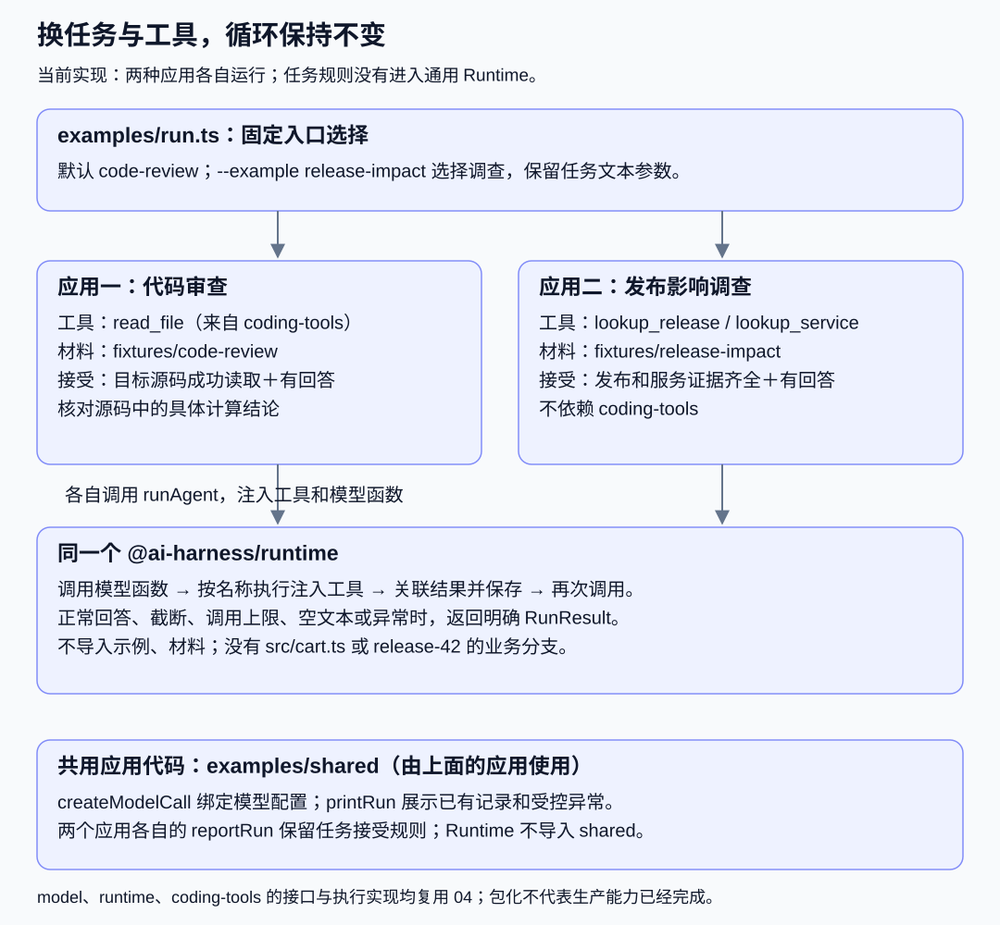
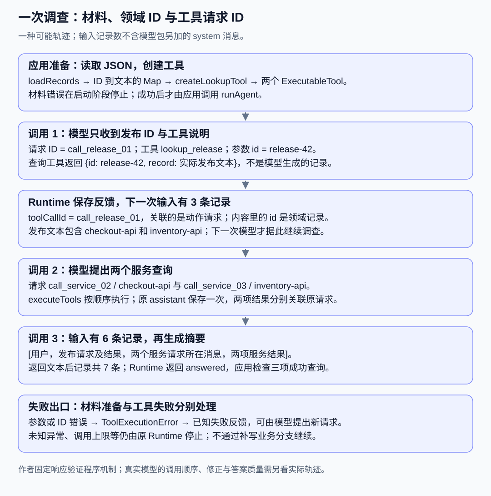

# 05 换任务，检验同一个运行内核

04 已经能自动调用模型、执行工具、保存反馈并明确停止。现在要检验一个更重要的问题：**换一个任务和一组工具，是否还能直接使用这段 Runtime？**

本篇增加“发布影响调查”：查询一次发布变更了哪些服务，再查清这些服务的负责人和直接依赖，输出简短摘要。模型包、`runAgent`、`executeTools` 和代码工具包均保持原实现，代码审查示例继续保留。变化集中在新材料、新工具和应用的任务接受规则。

这是[第一阶段](/roadmap#第一阶段-逐篇大纲)的收敛章。目标是让两个任务实际使用同一个内核，并能从调用记录解释复用边界。完成本篇内容不自动表示已掌握整阶段，更不表示已经具备生产系统的完整能力。

## 本篇技术方案

### 实施前，先走完一次具体过程

任务是：“调查发布 `release-42`，列出所有变更服务的负责人和直接依赖，形成影响摘要。”这里只查询教学材料，不给别人发送通知。

发布材料将放在 `fixtures/release-impact/releases.json`，完整内容如下。先阅读这份数据，第二步再创建文件：

<<< @/snippets/05-runtime-reuse/fixtures/release-impact/releases.json

它是“记录 ID → 记录文本”的对象。查询 `release-42` 可以知道两个变更服务的 ID，但还不知道负责人和依赖。对应的服务材料位于 `fixtures/release-impact/services.json`：

<<< @/snippets/05-runtime-reuse/fixtures/release-impact/services.json

因此有依据的摘要应包括：`checkout-api` 由交易组负责，直接依赖 `payment-gateway`；`inventory-api` 由库存组负责，直接依赖 `warehouse-sync`。这些都是当前材料中的事实，不是课程替真实企业提供的发布信息。

应用只把发布 ID 和查询工具说明交给模型，不提前把服务清单和负责人塞进用户消息。模型要通过工具取得新材料，再决定还缺哪些记录。工具响应里的 `record` 是材料文本，不是模型生成的解释。

把这份材料接入原内核，整篇实现分为五个环节：

1. **应用加载材料并创建查询工具。** 启动时读取两份 JSON，保存为本地记录映射；为发布和服务分别创建按 ID 查询的工具。完整记录留在应用侧，没有提前放进模型输入。
2. **模型先取得发布记录。** 输入只给目标发布 ID。模型提出查询后，原执行器调用查询工具，返回发布实际文本；Runtime 保存反馈，下一轮模型据此得到变更服务的 ID。
3. **模型继续取得服务记录。** 根据新信息选择要查的服务。一次响应若含两项请求，原执行器顺序处理，结果各自关联请求 ID，再由 Runtime 整批写入历史。
4. **应用接住摘要并检查本任务证据。** 要求目标发布和预期服务的成功查询齐全，才展示摘要；负责人和依赖是否忠实于材料，仍需对照检查。
5. **用两个入口检验复用。** 原代码审查仍读源码，新调查只查记录；它们共享模型连接、记录展示与同一个 Runtime，任务材料和接受条件各自保留。

下面用一种可能轨迹对照中间的模型调用：

| 模型调用 | 得到的决定 | 本地动作与下一次可见信息 |
|---|---|---|
| 1 | 用 `lookup_release` 查询 `release-42` | 保存发布记录，后续模型能看到两个服务 ID |
| 2 | 用 `lookup_service` 查询两个服务 | 一条响应中的两项请求按顺序执行，整批结果写回 |
| 3 | 根据完整记录形成摘要 | Runtime 返回 `answered`，应用继续检查查询证据 |

这是一种可能轨迹，不是固定动作脚本。模型也可能分开查询服务、改正错误 ID，或用完调用次数；不能为了得到三次调用而强制它按表运行。

### 实现架构图

[](/diagrams/05-reuse-boundary.svg)

Pi 的[工具契约与名称查找](https://github.com/badlogic/pi-mono/blob/8efd314fa3d3232ce197d8d7a6a5660530b9d83e/packages/agent/src/agent-loop.ts)也把工具说明和执行能力注入运行层，执行器按请求名称查找，而不把某个领域的工具写成固定业务分支。本篇复用这个职责划分；发布材料和接受规则是本课程自有示例，没有实现 Pi 的完整扩展系统。

## 这次改哪里、保留哪里

两个任务之间需要共用模型接入配置和运行记录打印，所以把这两部分放到 `examples/shared/`。它们服务于示例应用，不新增框架包。代码审查检查“目标文件是否成功读到”，发布调查检查“目标发布及相关服务是否成功查到”，这些任务规则分别保留。

新建的查询工具放在 `examples/release-impact/src/`：当前只用于这个发布调查领域。`coding-tools` 继续承接源码读取，不加入发布记录业务；Runtime 继续只认识 `ExecutableTool`，不导入任何示例。

先检查 Git 状态，再由你创建本篇分支：

```bash
git status --short --branch
git switch -c agent/chapter-05-runtime-reuse
```

| 位置 | 本篇操作 |
|---|---|
| `packages/model`、`packages/runtime`、`packages/coding-tools` | 实现与包配置不改，直接复用 |
| `fixtures/release-impact` | 新建两份查询材料 |
| `examples/release-impact` | 新建材料加载、工具、任务入口与接受检查 |
| `examples/shared` | 从旧示例提取模型接入和记录打印 |
| `examples/code-review/src/main.ts`、`report-run.ts` | 改为调用共用部分，保留原任务与接受条件 |
| `examples/run.ts`、根 `package.json` | 固定入口选择，保留 `start/debug/check` 名称 |

先按下面步骤实现，再运行最后的两任务检查。本章不需要把旧应用删除，也不需要重新复制一份循环。

## 第一步：建立新示例的包入口

新建 `examples/release-impact/package.json`，声明它使用模型契约和 Runtime。新任务不读取源码，不依赖 `coding-tools`。

<<< @/snippets/05-runtime-reuse/examples/release-impact/package.json

在仓库根目录运行：

```bash
npm install
npm run build
```

`npm install` 建立新 workspace 链接并更新锁文件，`build` 沿用原顺序构建三个库。这时新的示例源码还没写完，不需要提前执行全工程 `check`；先保证后续从公开包入口导入的类型和 JavaScript 已存在。

## 第二步：准备并加载记录

现在创建前面已经展示的两份材料：`fixtures/release-impact/releases.json` 和 `fixtures/release-impact/services.json`，分别写入开头的完整 JSON。不要放进 `src/`，也不要修改原来的审查材料。

### 共用形状检查，再检查具体字段

材料 JSON、模型参数和工具结果都需要先判断是不是非空、非数组对象。新建 `examples/release-impact/src/validation.ts`，让后面三个位置复用这一步：

isRecord 接收材料解析值、查询参数或结果解析值，返回它是否为非空非数组对象。三个调用位置先用这个共同判断，再检查各自字段；函数不读取材料，也不保证对象已经符合某个具体协议。

<<< @/snippets/05-runtime-reuse/examples/release-impact/src/validation.ts

`isRecord` 只检查这层形状，不保证 `id` 是字符串或 `record` 非空。加载器、查询函数和证据检查仍分别核对自己需要的字段。这个辅助函数留在当前示例内部，不改变模型包原有的内部校验文件，也不增加公共工具包。

### 把材料文件变成可查询的映射

新建 `examples/release-impact/src/load-records.ts`。应用给它固定的文件位置，它读取 JSON 并检查每项是否为非空 ID 和非空文本，返回供查询使用的 `Map`。

例如发布文件经过这个函数后，就能用 `records.get('release-42')` 取得发布文本。这个读取发生在应用启动时，不是模型请求了一次磁盘读取。

<<< @/snippets/05-runtime-reuse/examples/release-impact/src/load-records.ts

`readFile(file, 'utf8')` 从应用给定的位置读取文本，`JSON.parse` 解析后先放进 `unknown`。检查通过后，`records.set(id, record)` 才把确定的字符串写进新映射，`return records` 将映射交给调用方。

如果材料不是对象、包含非文本值、空 ID 或空内容，就抛出准备错误；空对象也不能作为有效材料。JSON 语法错误或文件缺失同样使加载失败。本例使用应用选择的受控小文件，没有向模型开放任意路径，也没有建立通用数据导入平台。

## 第三步：让新工具符合已有执行契约

### 工具工厂需要哪些配置

新建 `examples/release-impact/src/types/tools.ts`：

LookupToolOptions 约定查询工具工厂需要的名称、说明、参数描述和记录映射。应用负责加载材料并创建这份配置，工厂据此创建可执行工具，模型不会直接拿到整张本地映射。

<<< @/snippets/05-runtime-reuse/examples/release-impact/src/types/tools.ts

这是当前示例创建工具时的配置类型。`records` 是应用刚加载的映射；名称和说明给模型使用，完整记录留在本地。类型声明不会加载文件或创建执行函数。

### 从记录映射创建查询工具

新建 `examples/release-impact/src/lookup-tool.ts`。`createLookupTool` 接收名称、用途、参数说明和记录映射，返回现有的 `ExecutableTool`。发布记录和服务记录都按 ID 查询，因此可以共用这个实现。

输入请求例如 `{ id: 'release-42' }`，工具成功返回的是一段 JSON 文本，形状为 `{ "id": "release-42", "record": "实际发布记录" }`。它只返回查询内容，原工具请求 ID 的关联仍由 Runtime 完成。

<<< @/snippets/05-runtime-reuse/examples/release-impact/src/lookup-tool.ts

工厂复制映射，使本次工具使用创建时的记录集合。模型通过 schema 知道需要字符串 `id`；Runtime 解析请求的 JSON 参数后，执行函数仍检查数据是否只有一个非空字符串字段。这与“JSON 语法合法”是不同的检查。

随后 `records.get(value.id)` 找实际记录，成功时创建 `id/record` 对象并转成文本。未找到记录或参数不对时，抛出已有的 `ToolExecutionError`；执行器会将安全说明装成 `isError: true` 的工具结果，关联原请求。这里没有调用模型，也没有修改 Runtime 的历史。

### 应用组装两类工具

新建 `examples/release-impact/src/tools.ts`：

createReleaseTools 在应用准备阶段加载发布与服务材料，分别配置 lookup_release 和 lookup_service，返回两项工具给 runAgent。模型真正提出某个 ID 的请求后，工具才从已加载映射查出对应记录并返回。

<<< @/snippets/05-runtime-reuse/examples/release-impact/src/tools.ts

`createReleaseTools` 在应用启动时被调用。两个 `loadRecords` 各读一份材料，`Promise.all` 等待两份都成功，由 `releases/services` 接住各自映射。再分别调用工厂，创建 `lookup_release` 和 `lookup_service`；它们使用同一套参数检查和查询实现，但持有不同记录。

返回数组交给后面的 `runAgent`。Runtime 只把两个工具的说明交给模型，模型提出哪项请求，执行器就按名称找对应的执行对象。材料加载失败时，应用还没有启动运行，不会伪造一条成功的工具反馈。

[](/diagrams/05-query-flow.svg)

### 先在本地检查复用链条

到这里，新工具已经具备执行能力，先不接真实模型。在仓库根目录运行下面的临时脚本：

```bash
node --import tsx --input-type=module <<'JS'
import { runAgent } from '@ai-harness/runtime';
import { createReleaseTools } from './examples/release-impact/src/tools.ts';

const tools = await createReleaseTools();
let count = 0;
const request = (calls) => ({ role: 'assistant', content: '', stopReason: 'toolUse', toolCalls: calls });
const call = (id, name, recordId) => ({ id, name, arguments: JSON.stringify({ id: recordId }) });
const result = await runAgent({
  messages: [{ role: 'user', content: '调查release-42。' }],
  tools,
  maxModelCalls: 4,
  callModel: async () => {
    count += 1;
    if (count === 1) return request([call('local_release', 'lookup_release', 'release-42')]);
    if (count === 2) return request([
      call('local_checkout', 'lookup_service', 'checkout-api'),
      call('local_inventory', 'lookup_service', 'inventory-api'),
    ]);
    return { role: 'assistant', content: '已收到调查材料。', stopReason: 'stop', toolCalls: [] };
  },
});
console.log('停止：', result.status, '调用次数：', result.modelCalls);
for (const message of result.messages) {
  if (message.role === 'toolResult') console.log(JSON.stringify(message));
}
JS
```

预期 `answered`、调用次数 3，以及三项 `isError: false` 的查询结果。工具结果内容应来自两份实际 JSON；`toolCallId` 分别对应脚本中的三个请求 ID。

这个命令显式固定了请求和回答，只检查同一 Runtime 是否能调度新工具、顺序执行一批请求并保存反馈，**没有调用模型服务，也没有验证自主调查**。`count/request/call` 都只是临时脚本的辅助值，不要把这套固定流程写进应用。真实入口仍由服务返回工具请求。

## 第四步：共用连接和展示，保留任务规则

### 把模型连接配置提取出来

新建 `examples/shared/model.ts`，把 04 中应用绑定模型配置的逻辑放到这里：

createModelCall 替两个应用统一准备当前模型配置，返回符合 Runtime 契约的调用函数。Runtime 后续传入每轮上下文时，这个函数才调用 complete 并返回模型消息；创建连接函数本身不请求服务。

<<< @/snippets/05-runtime-reuse/examples/shared/model.ts

两个应用启动时分别调用 `createModelCall()`，取得自己的调用函数。创建函数时读取配置，但不会立即请求服务；Runtime 后面传入最新 `context` 时，返回的函数才执行 `complete(context, options)`。参数和返回消息形状都沿用 04，不给 Runtime 增加提供商分支。

凭据仍由应用侧管理，不进入任务消息或默认日志。第二阶段再建设多提供商适配，本篇只减少两个应用中已经出现的重复配置。

### 公共部分只展示运行过程

新建 `examples/shared/print-run.ts`。把 04 的 `describeFailure`、消息遍历、停止状态和异常打印放在这里，不加入具体任务的接受条件：

printRun 接收已停止的运行结果，输出模型消息、工具结果、调用次数与停止原因。两个应用共用这段展示，但任务能否接受仍由各自 reportRun 判断，打印函数不修改历史或重新执行工具。

<<< @/snippets/05-runtime-reuse/examples/shared/print-run.ts

`printRun(result)` 接收已经结束的运行，只遍历已有记录并输出信息，没有返回“任务通过”的布尔值。模型响应、工具结果、停止原因和受控异常的展示逻辑与 04 一致；不打印任意异常正文或整个包含异常的结果对象。

### 代码审查仍检查源码证据

**完整替换 `examples/code-review/src/report-run.ts`**：删除本地 `describeFailure` 和公共日志遍历，新增 `printRun` 导入；保留 `reportRun`、`requiredPath`、成功读取检查与最终文本展示。

这个报告接住 Runtime 结果与目标源码名称，先调用公共记录展示，再确认正常回答且成功取得目标源码，返回是否满足当前审查的基础证据。原来的源码证据要求保留，不因新增查询任务而改成通用规则。

<<< @/snippets/05-runtime-reuse/examples/code-review/src/report-run.ts

`printRun` 先打印过程，随后这个应用仍按原规则接受：必须是 `answered`，且成功读到目标源码，才展示最终审查文字并返回 `true`。文件位置、工具、任务和审查条件都没有改变。

**完整替换 `examples/code-review/src/main.ts`**：删除本地 `complete/ModelCall` 导入、`model/options` 配置和手写调用闭包；新增 `createModelCall` 导入。保留审查目标、提示词、文件工具、`runAgent` 调用和接受检查。

代码审查入口改为取得共用的模型连接，再将原目标与文件工具交给同一个 runAgent。它接住最终结果后仍调用审查报告，并据布尔返回设置失败退出码，不参与发布调查。

<<< @/snippets/05-runtime-reuse/examples/code-review/src/main.ts

这里仍只有一次 `runAgent`。改变的是模型连接配置的创建位置，没有把新调查任务的 ID 或接受规则塞进旧应用。

## 第五步：调查应用检查自己的证据

新建 `examples/release-impact/src/report-run.ts`。它同样先展示记录，但本任务要求“发布记录＋两个变更服务的记录”齐全。不能继续用“成功读取 `src/cart.ts`”作为所有任务的通用完成条件。

这个函数接收 Runtime 的结果、目标发布 ID 和当前受控案例的预期服务 ID 清单。该清单用于验收，不决定模型第几轮调用哪项工具，也不作为模型输入。

<<< @/snippets/05-runtime-reuse/examples/release-impact/src/report-run.ts

先看 `hasQuery`：它查找已经保存的工具结果，只接受指定工具、没有失败且 JSON 内容可识别的那项。`value.id` 必须等于要求的记录 ID，`record` 还必须是非空文本。模型在回答中自行写“已查询”不能代替这份本地反馈。

工具执行器只负责请求与结果关联，记录内容使用哪种格式由工具决定。本例查询函数返回 `id/record` 的 JSON 文本，所以当前应用按这个格式读取。`JSON.parse` 失败时返回 `false`，不把不可识别的结果当成有效证据。

主函数 `reportRun` 先调用 `printRun`。若 Runtime 不是 `answered` 就返回 `false`；有回答时，再创建本任务需要的三项证据：

```text
lookup_release / release-42
lookup_service / checkout-api
lookup_service / inventory-api
```

`required.filter(...)` 把缺少成功结果的项收集到 `missing`。只查了发布和第一个服务时，`missing` 会留下第二个服务，即使模型有非空回答也不通过。三项齐全时，展示 `result.answer.content` 并返回 `true`。

这是最低证据检查：它证明这些查询成功发生过，不验证摘要是否忠实、是否漏写某条依赖，也不防止不可信工具伪造内容。工具是应用提供的，记录是受控教学材料；最终负责人和依赖仍要人工对照。

### 创建第二个任务入口

新建 `examples/release-impact/src/main.ts`：

这个新入口准备发布 ID、调查目标和两项查询工具，再调用原 runAgent。运行结果返回后，交给发布调查的报告核对记录证据；预期服务清单只用于报告，不提前告诉模型该按哪几步查询。

<<< @/snippets/05-runtime-reuse/examples/release-impact/src/main.ts

应用先用 `createReleaseTools` 取得加载好记录的工具，再把任务、总体要求、工具和 `createModelCall()` 返回的模型函数交给已有 `runAgent`。循环、反馈与停止都由原内核处理；返回值由应用的 `result` 接住，再传给调查自己的 `reportRun`。检查返回 `false` 时，入口把 `process.exitCode` 设为 1；返回 `true` 仅表示当前最低证据条件满足，摘要内容仍需对照。

`serviceIds` 是当前练习案例的预期证据清单，只传给运行结束后的 `reportRun`。`runAgent` 收到的配置里没有它；初始用户消息只有发布 ID 和调查要求，工具说明也不包含两个服务的实际记录。模型需要通过发布查询取得服务 ID。

应用预先知道受控材料的预期证据，是为了检查任务表现。更一般的任务接受规则需要后续继续建设；这里没有实现自动理解任意发布任务的评估器。命令行若覆盖提示词，当前基本验收目标仍是代码中的 `releaseId/serviceIds`。

## 第六步：用稳定命令选择入口

### 只允许选择已配置的两个应用

新建 `examples/run.ts`：

这个入口读取命令行中的示例名称，只导入允许列表中的对应应用。任务选中后仍由各自 main 启动运行；选择器不包含模型决策或工具执行逻辑，后续 start/debug 共用这一个位置。

<<< @/snippets/05-runtime-reuse/examples/run.ts

默认加载原代码审查入口；只有显式提供 `--example release-impact` 才加载调查入口。两个动态导入都使用固定路径，不根据任意输入拼接模块文件名。无效名称先报错，不启动应用或请求模型。

`argv` 就是当前 Node 进程的命令参数数组。选择参数消费后用 `splice(2, 2)` 删除，保留原有的任务文本位置。例如：

```text
原参数：[node, run.ts, --example, code-review, 请审查目标代码]
删除选择器后：[node, run.ts, 请审查目标代码]
```

因此原应用仍能从 `process.argv[2]` 接收任务文本；不显式选择时，原有位置参数也保持原样。入口模块加载后执行自己的顶层应用代码，其他应用不会同时启动。

### 更新脚本入口

打开仓库顶层的 **`ai-harness/package.json`**，位置如下。这里的 `ai-harness/` 表示整个项目文件夹：

```text
ai-harness/
├── package.json       ← 本步修改这个文件
├── examples/
│   ├── run.ts         ← start/debug 将使用的入口
│   ├── code-review/
│   └── release-impact/
└── packages/
```

在这个文件的 `scripts` 对象中，**只替换已有的 `start` 和 `debug` 两个属性**为下面两项；不要把片段另建成一个文件，也不要覆盖整个 `scripts` 对象。保留 `build/check/docs:*`、依赖版本和 workspaces。JSON 中与相邻属性保持逗号：

```json
"start": "npm run build && node --env-file=.env --import tsx examples/run.ts",
"debug": "npm run build && node --enable-source-maps --env-file=.env --inspect-brk --import tsx examples/run.ts"
```

这是本篇正式保留的入口调整，后续无需改回原来的 `examples/code-review/src/main.ts`。`examples/run.ts` 默认仍选择代码审查，提供选择参数时才运行发布调查。

章末的 `package.json` 折叠块是这个仓库顶层文件的完整版本，供核对；不需要修改两个示例各自的 `package.json` 来配置启动入口，也不需要增加新的运行别名。

## 第七步：验证两任务，而不只验证新文件

先运行构建和类型检查；接下来的 `npm start` 使用你配置的模型服务，由你自行执行并管理费用：

```bash
npm run check
npm start
npm start -- --example release-impact
```

第一条启动命令仍运行代码审查，确认它能读到材料并展示原有结论。第二条运行发布调查。调试时用 `npm run debug -- --example release-impact`，沿用原有附加调试器方式。

发布调查重点检查：

| 日志与值 | 应证明什么 |
|---|---|
| 首项 `lookup_release` 成功结果 | `record` 来自发布材料，包含本次实际变更服务 |
| 每项 `lookup_service` 的结果 | 原请求 ID 正确关联，`id` 是目标服务，负责人和依赖与材料一致 |
| 后续模型响应 | 已获得前面查询结果，能继续调查或根据完整记录回答 |
| `运行停止` | `answered`、上限或失败按实际分支报告，不把次数固定为三次 |
| `调查摘要` | 两个服务的负责人、依赖齐全，没有凭空补充事实 |

一项发布查询、两个服务查询都成功后，应用才满足默认的最低证据条件。模型可能把服务请求放同一批，也可能分轮查询；两种方式都不需要修改循环。

本篇作者用固定模型/HTTP 响应、真实 JSON 加载和实际两个入口验证机制，并回归 04 的停止与失败分支，没有代你请求付费服务。真实模型能否正确调查和回答，仍要看你的实际轨迹，不能由固定脚本成功代替。

### 断点检查一次跨模块往返

1. 在调查 `main.ts` 的 `runAgent(...)` 暂停：确认初始用户消息只有任务，工具只有当前配置的两类；预期服务清单没有进入模型输入。
2. 在 `lookup-tool.ts` 的 `records.get(value.id)` 暂停：`value` 来自 Runtime 解析的模型参数，`records` 来自启动时加载的材料。确认模型没有直接访问磁盘。
3. 在未修改的 `run-agent.ts` 的 `messages.push(...results)` 暂停：检查成功发布结果写回后，下一次 `callModel` 输入确实包含两个服务 ID；查完服务后，后面的输入再增加负责人和依赖。
4. 在调查 `report-run.ts` 的 `missing` 检查处暂停：看三项证据是否齐全；`result` 来自 Runtime 返回，`serviceIds` 来自应用验收配置，来源不同。

完整往返仍是：服务返回请求 → 模型包转成 `toolCalls` → Runtime 找到查询工具 → 工具返回文本 → 执行器关联原 ID → 循环保存结果 → 下一次模型调用。工具响应 JSON 中的 `id` 是领域记录 ID，`toolCallId` 是动作请求 ID，它们不能互换。

### 可逆故障：缺少一个服务记录

临时从 `fixtures/release-impact/services.json` 删除 `inventory-api` 条目，保留另一个有效条目，并确保 JSON 语法正确。重新运行调查：

- 查询该服务时，应出现 `isError: true`，说明记录未找到；它是工具反馈，不是启动加载失败。
- 模型可能说明材料缺失，也可能继续查询直到上限。按实际分支记录，不能承诺一定第三次结束。
- 即使最终有文字，也没有该服务的成功查询证据，当前调查不能通过。

实验后恢复原条目。若不小心破坏 JSON，应用会在启动准备阶段停止，尚未发起模型调用；这与一次执行中的已知工具失败不同。

### 小迁移：调查另一份发布

完整替换两份材料，保留原记录并增加以下新案例：

::: details fixtures/release-impact/releases.json：迁移练习版本
```json
{
  "release-42": "发布 release-42 变更了 checkout-api 和 inventory-api。请查询这些服务的负责人和直接依赖，以准备发布影响摘要。",
  "release-43": "发布 release-43 变更了 search-api。请查询该服务的负责人和直接依赖。"
}
```
:::

::: details fixtures/release-impact/services.json：迁移练习版本
```json
{
  "checkout-api": "服务 checkout-api：负责人为交易组；直接依赖 payment-gateway。",
  "inventory-api": "服务 inventory-api：负责人为库存组；直接依赖 warehouse-sync。",
  "search-api": "服务 search-api：负责人为搜索组；直接依赖 catalog-index。"
}
```
:::

在调查 `main.ts` 中只替换下面两项任务配置，其他代码保留：

```ts
const releaseId = 'release-43';
const serviceIds = ['search-api'];
```

再次运行相同的调查命令。目标是成功查询新发布和新服务，并根据实际记录说明搜索组及 `catalog-index`；Runtime、查询工厂和接受函数都不修改。若需要去循环里写 `search-api` 分支，说明任务与内核边界出现了问题，应回查接入位置。

可以保留迁移材料用于延迟复习，也可以恢复默认任务配置和材料。章末完整文件是本篇默认版本，不覆盖你自行保留的练习变化。

## 第一阶段回看：现在形成了什么

目前的底座已经有：一次模型接入、动作请求、本地执行、关联反馈、运行历史、自动继续和明确停止。通过包入口接入两个应用，可以检查框架机制与任务规则是否分离。

| 关系 | 本阶段应该能用实际轨迹解释的内容 |
|---|---|
| 输入与决定 | 每次模型实际收到什么，新请求怎样由模型产生 |
| 动作与执行 | 请求名称如何找到注入函数，参数在哪里检查 |
| 反馈与状态 | 谁创建工具结果，哪条 `push` 更新了下一次输入 |
| 继续与停止 | 工具请求为什么继续，截断、上限和异常为什么停止 |
| 接受与复用 | 为什么有回答仍可能不通过，换任务时哪些部分保持不变 |

这些是阶段取证要求，不是读完五篇就自动获得的结论。除了跟做默认案例，还需要保留一条自己的失败定位和新材料迁移记录，隔一段时间再解释一次，才能判断理解是否可以独立使用。

当前仍缺完整的模型适配、事件、流式、取消与运行预算，长期上下文、持久化恢复、权限与隔离、完整评估也尚未建立。下一阶段先通过第二家模型接入检验调用边界，再逐步完善可观察、可控制的运行内核；多提供商待办不会因为目前有 `ModelCall` 就被视为完成。

## 完整文件核对

下面引用同一份 05 候选的默认版本。三个库仅清除了继承的教材变化标签，接口和执行实现沿用 04；当前学习源码中的库不需要为本篇重写。重点核对新增示例、共用应用函数、两个旧入口文件和根脚本。

::: details package.json
<<< @/snippets/05-runtime-reuse/package.json
:::

::: details tsconfig.json
<<< @/snippets/05-runtime-reuse/tsconfig.json
:::

::: details .env.example
<<< @/snippets/05-runtime-reuse/.env.example{sh}
:::

::: details packages/coding-tools/package.json
<<< @/snippets/05-runtime-reuse/packages/coding-tools/package.json
:::

::: details packages/coding-tools/src/index.ts
<<< @/snippets/05-runtime-reuse/packages/coding-tools/src/index.ts
:::

::: details packages/coding-tools/src/read-file.ts
<<< @/snippets/05-runtime-reuse/packages/coding-tools/src/read-file.ts
:::

::: details packages/coding-tools/src/types/read-file.ts
<<< @/snippets/05-runtime-reuse/packages/coding-tools/src/types/read-file.ts
:::

::: details packages/coding-tools/tsconfig.json
<<< @/snippets/05-runtime-reuse/packages/coding-tools/tsconfig.json
:::

::: details packages/model/package.json
<<< @/snippets/05-runtime-reuse/packages/model/package.json
:::

::: details packages/model/src/index.ts
<<< @/snippets/05-runtime-reuse/packages/model/src/index.ts
:::

::: details packages/model/src/providers/deepseek-messages.ts
<<< @/snippets/05-runtime-reuse/packages/model/src/providers/deepseek-messages.ts
:::

::: details packages/model/src/providers/deepseek-response.ts
<<< @/snippets/05-runtime-reuse/packages/model/src/providers/deepseek-response.ts
:::

::: details packages/model/src/providers/deepseek.ts
<<< @/snippets/05-runtime-reuse/packages/model/src/providers/deepseek.ts
:::

::: details packages/model/src/types/context.ts
<<< @/snippets/05-runtime-reuse/packages/model/src/types/context.ts
:::

::: details packages/model/src/types/messages.ts
<<< @/snippets/05-runtime-reuse/packages/model/src/types/messages.ts
:::

::: details packages/model/src/types/options.ts
<<< @/snippets/05-runtime-reuse/packages/model/src/types/options.ts
:::

::: details packages/model/src/types/tool-results.ts
<<< @/snippets/05-runtime-reuse/packages/model/src/types/tool-results.ts
:::

::: details packages/model/src/types/tools.ts
<<< @/snippets/05-runtime-reuse/packages/model/src/types/tools.ts
:::

::: details packages/model/src/validation.ts
<<< @/snippets/05-runtime-reuse/packages/model/src/validation.ts
:::

::: details packages/model/tsconfig.json
<<< @/snippets/05-runtime-reuse/packages/model/tsconfig.json
:::

::: details packages/runtime/package.json
<<< @/snippets/05-runtime-reuse/packages/runtime/package.json
:::

::: details packages/runtime/src/execute-tools.ts
<<< @/snippets/05-runtime-reuse/packages/runtime/src/execute-tools.ts
:::

::: details packages/runtime/src/index.ts
<<< @/snippets/05-runtime-reuse/packages/runtime/src/index.ts
:::

::: details packages/runtime/src/run-agent.ts
<<< @/snippets/05-runtime-reuse/packages/runtime/src/run-agent.ts
:::

::: details packages/runtime/src/tool-error.ts
<<< @/snippets/05-runtime-reuse/packages/runtime/src/tool-error.ts
:::

::: details packages/runtime/src/types/model-call.ts
<<< @/snippets/05-runtime-reuse/packages/runtime/src/types/model-call.ts
:::

::: details packages/runtime/src/types/run.ts
<<< @/snippets/05-runtime-reuse/packages/runtime/src/types/run.ts
:::

::: details packages/runtime/src/types/tools.ts
<<< @/snippets/05-runtime-reuse/packages/runtime/src/types/tools.ts
:::

::: details packages/runtime/tsconfig.json
<<< @/snippets/05-runtime-reuse/packages/runtime/tsconfig.json
:::

::: details examples/code-review/package.json
<<< @/snippets/05-runtime-reuse/examples/code-review/package.json
:::

::: details examples/code-review/src/main.ts
<<< @/snippets/05-runtime-reuse/examples/code-review/src/main.ts
:::

::: details examples/code-review/src/report-run.ts
<<< @/snippets/05-runtime-reuse/examples/code-review/src/report-run.ts
:::

::: details examples/code-review/src/tools.ts
<<< @/snippets/05-runtime-reuse/examples/code-review/src/tools.ts
:::

::: details examples/release-impact/package.json
<<< @/snippets/05-runtime-reuse/examples/release-impact/package.json
:::

::: details examples/release-impact/src/load-records.ts
<<< @/snippets/05-runtime-reuse/examples/release-impact/src/load-records.ts
:::

::: details examples/release-impact/src/lookup-tool.ts
<<< @/snippets/05-runtime-reuse/examples/release-impact/src/lookup-tool.ts
:::

::: details examples/release-impact/src/main.ts
<<< @/snippets/05-runtime-reuse/examples/release-impact/src/main.ts
:::

::: details examples/release-impact/src/report-run.ts
<<< @/snippets/05-runtime-reuse/examples/release-impact/src/report-run.ts
:::

::: details examples/release-impact/src/tools.ts
<<< @/snippets/05-runtime-reuse/examples/release-impact/src/tools.ts
:::

::: details examples/release-impact/src/types/tools.ts
<<< @/snippets/05-runtime-reuse/examples/release-impact/src/types/tools.ts
:::

::: details examples/release-impact/src/validation.ts
<<< @/snippets/05-runtime-reuse/examples/release-impact/src/validation.ts
:::

::: details examples/run.ts
<<< @/snippets/05-runtime-reuse/examples/run.ts
:::

::: details examples/shared/model.ts
<<< @/snippets/05-runtime-reuse/examples/shared/model.ts
:::

::: details examples/shared/print-run.ts
<<< @/snippets/05-runtime-reuse/examples/shared/print-run.ts
:::

::: details fixtures/code-review/src/cart.ts
<<< @/snippets/05-runtime-reuse/fixtures/code-review/src/cart.ts
:::

::: details fixtures/release-impact/releases.json
<<< @/snippets/05-runtime-reuse/fixtures/release-impact/releases.json
:::

::: details fixtures/release-impact/services.json
<<< @/snippets/05-runtime-reuse/fixtures/release-impact/services.json
:::


## 保存本篇

恢复故障实验，确认两任务及迁移范围后，自行审阅和保存。不要暂存真实 `.env`：

```bash
git status --short --branch
git diff --stat
git add examples fixtures/release-impact package.json package-lock.json
git commit -F - <<'MSG'
用第二个任务验证Agent运行内核复用

增加发布影响调查材料与两类只读查询工具，通过原有Runtime推进任务。
共用模型连接与运行记录展示，分别保留两个应用的任务接受规则。
保留默认代码审查入口，并支持通过稳定命令选择新示例。
检查查询证据、已知失败反馈和跨任务复用，不修改运行循环。
MSG
git push -u origin agent/chapter-05-runtime-reuse
```

如果同时保存本篇教程和内部记录，再审阅 `site/`、`docs/` 与工程约定的差异后单独暂存；不要把“已经推送”当作真实模型任务或迁移验收通过。
