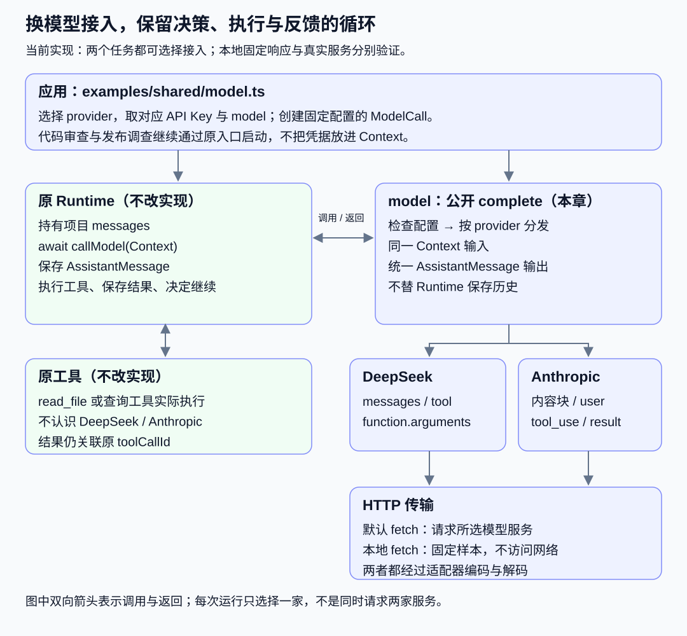
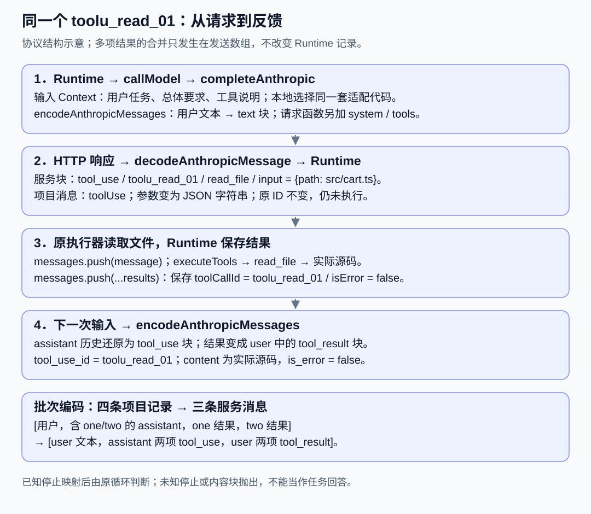
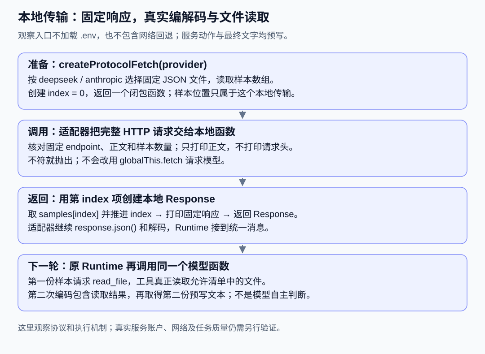

# 06 模型适配：换服务，保留同一个 Runtime

05 已让代码审查和发布调查共用同一个 Runtime。但两者最终都调用 DeepSeek：如果换成另一家服务，需要改循环吗？工具请求、工具结果还能继续流转吗？

本篇在模型包中接入 **Anthropic Messages API**。应用选择服务，模型包负责转换各自的请求与响应，Runtime 继续使用原来的消息结构、工具执行器和停止规则。完成后，两种任务都能选择接入；没有第二家 API Key，也能用本地固定响应观察完整的协议往返。

这是[第二阶段](/roadmap#第二阶段-逐篇大纲)的第一篇，建设的是 Agent 的**模型接入能力**：无论服务怎样表达动作，运行内核都能接住项目消息、执行工具、保存反馈，再继续决策。它不改变模型本身的能力，也不保证两家服务的答案相同。接下来的单元继续建设工具契约、事件、流式输出、取消和预算。

## 实施前，先串起本篇的实现逻辑

1. **应用选择提供商，保留原任务。** 代码审查还是请求文件，发布调查还是查询记录；变化的是模型配置增加服务选择。密钥仍由应用提供，不放进任务消息。
2. **统一入口解析配置，再选择适配器。** 模型包接收项目上下文和配置，检查模型名、输出上限等选项，将同一次调用交给对应服务实现，Runtime 不增加厂商分支。
3. **适配器完成两个方向的转换。**
   - **3.1 发送时转换。** 把项目的用户消息、模型工具请求与本地结果，组织成所选服务认识的消息格式；两家格式不同，不能直接把一家的正文换个地址发送。
   - **3.2 返回时转换。** 从服务原生响应取得文字、工具请求与停止原因，统一返回项目的模型消息。Runtime 接到的仍是原契约，可以继续执行工具和保存反馈。
4. **用同一循环继续任务。** 工具结果进入下一轮上下文，再由适配器编码发送。应用仍按各自任务规则展示和检查最终结果，不要求两家回答措辞相同。
5. **没有第二家 Key，也能先观察协议。** 本地入口用预写的两种原生 HTTP 响应替代网络，但调用实际编码、解码、Runtime 和文件工具，检查整个往返。它证明接线可运行，不等于第二家真实服务已验证。

后面先接配置与适配，再把两种入口连到同一套任务，不重新实现执行循环。

## 换服务时，什么应该变化

继续使用代码审查任务：读取 `src/cart.ts`，指出总价计算的问题。工具和材料沿用 03 至 05；实际文件仍是 `fixtures/code-review/src/cart.ts`，由应用配置的清单映射为模型看到的 `src/cart.ts`。

先只看两家服务怎样表达“读取同一个文件”。下面是**协议结构示意，保留本章使用的字段，不是真实调用日志**：

```json
// DeepSeek 响应中的工具请求
{"id":"call_read_01","type":"function","function":{"name":"read_file","arguments":"{\"path\":\"src/cart.ts\"}"}}

// Anthropic 响应中的工具请求内容块
{"type":"tool_use","id":"toolu_read_01","name":"read_file","input":{"path":"src/cart.ts"}}
```

DeepSeek 的参数是 JSON 文本，Anthropic 的 `input` 已经是对象。两者都要求保留请求 ID，但它们的字段位置不同。不能只换 HTTP 地址，再把另一种响应当成 `choices[0].message` 读取。

本项目已定义 `ToolCall`：`id/name/arguments`，其中 `arguments` 是字符串。新适配器把 Anthropic 的 `input` 用 `JSON.stringify` 转成这种结构，再返回 `AssistantMessage`。Runtime 仍在执行前解析参数、查找工具，工具仍负责检查具体路径并实际读取。

读取后，Runtime 保存的仍是 `ToolResultMessage`。第二次调用时，DeepSeek 需要 `role: 'tool'` 和 `tool_call_id`；Anthropic 需要 `role: 'user'` 中的 `tool_result` 内容块。**内部结果没有变，发送给服务的表达变了。** 对应规则见两家的 [Chat Completions 协议](https://api-docs.deepseek.com/api/create-chat-completion/)和 [工具调用反馈说明](https://platform.claude.com/docs/en/agents-and-tools/tool-use/handle-tool-calls)。

[](/diagrams/06-model-boundary.svg)

“适配”就是把项目认识的输入输出，与服务要求的格式互相转换。应用负责选服务、提供对应密钥；模型包负责这种转换；Runtime 负责什么时候调用、执行哪些工具、保存什么以及何时停止。工具不会因为换模型服务而搬到模型包。

Pi 固定版本的 [Models.stream / complete](https://github.com/badlogic/pi-mono/blob/8efd314fa3d3232ce197d8d7a6a5660530b9d83e/packages/ai/src/models.ts)也在模型层选择接入，`complete` 等待流的最终结果。本篇借鉴职责边界，先保留非流式 HTTP；不引入它的完整模型目录、认证和流式实现。

## 本篇的范围与文件

本次支持的是非流式文本和应用提供的工具。Anthropic 选择支持关闭思考的 `claude-haiku-5-5` 作为配置示例，使用 `2026-10-21` API 版本。当前服务对关闭思考的支持随型号不同，不能认为任意 Claude 模型都能直接替换；依据见[模型列表](https://platform.claude.com/docs/en/models/overview)、[思考模式支持表](https://platform.claude.com/docs/en/build-with-claude/thinking)和 [API 版本说明](https://platform.claude.com/docs/en/api/versioning)。

当前公共消息没有图片、思考内容块或服务端工具的表达。遇到这些内容明确失败，避免丢掉后续反馈所需的信息。三种支持的停止原因如下；拒绝、服务端暂停等暂不映射成回答，具体含义见[停止原因说明](https://platform.claude.com/docs/en/build-with-claude/handling-stop-reasons)。

| Anthropic 原始值 | 项目 `stopReason` | 原 Runtime 的行为 |
|---|---|---|
| `end_turn` | `stop` | 非空文本得到 `answered`，应用再检查任务证据 |
| `tool_use` | `toolUse` | 有剩余次数时执行工具，再请求模型 |
| `max_tokens` | `length` | 得到 `truncated`，不执行其中的工具请求 |

一次运行固定使用同一个提供商。本篇验证的是**从新任务开始选择另一家服务**，没有实现运行中途切换服务、历史 ID 兼容迁移或自动降级。

先由你检查状态并创建分支：

```bash
git status --short --branch
git switch -c agent/chapter-06-model-providers
```

| 位置 | 操作与职责 |
|---|---|
| `packages/model/src/types/options.ts` | 扩展已有配置，保留原字段与默认值 |
| `packages/model/src/request-options.ts`、`complete.ts` | 共用检查、选择适配器 |
| `packages/model/src/providers/deepseek.ts` | 原调用改名，共用检查移到入口；编解码文件不变 |
| `packages/model/src/types/anthropic.ts`、`providers/anthropic*.ts` | 新服务的发送类型、编码、解码和请求 |
| `packages/model/src/index.ts` | 公开统一 `complete` 与提供商类型 |
| `examples/shared/model.ts`、根 `.env.example` | 应用选择配置，保持 DeepSeek 默认 |
| `fixtures/model-protocol/`、代码审查的两个观察文件 | 无网络的协议材料与观察入口 |
| Runtime、coding-tools、两个任务的原入口和材料 | 不改实现；不复制循环 |

包配置、依赖和根 `package.json` 脚本均不变，继续使用 `build/check/start/debug`。

## 第一步：给调用配置加上选择

完整替换 `packages/model/src/types/options.ts`。原有 `apiKey/model/maxTokens` 保留；新增 `provider`，不传时仍选 DeepSeek；新增可选 `fetch`，正常调用不传，本地观察时传入一个只返回样本的函数。

`ModelProvider` 是提供商名称的类型。`ResolvedCompleteOptions` 表示已经补全默认值的配置，仅供模型包内部使用；定义它不会自动完成校验，下一步的函数才实际检查并创建对象。

<<< @/snippets/06-model-providers/packages/model/src/types/options.ts

这里的两个函数入口用途不同：Runtime 的 `ModelCall` 接收项目 `Context`、返回项目消息；`fetch` 接收 HTTP 请求、返回 HTTP `Response`。本地替换后者，仍会经过真实的消息编码和响应解码。自定义传输能接触请求头，只能由可信应用提供；不要把模型生成的代码作为这个函数执行。

## 第二步：共用检查，保留 DeepSeek 的协议

### 一次检查，再选择接入

新建 `packages/model/src/request-options.ts`。它替公开 `complete` 检查两家共同需要的配置：服务名称可识别、密钥和模型非空、至少有一条消息、输出上限有效。例如传入未指定服务和上限的配置，返回对象就会带 `provider: 'deepseek'` 与 `maxTokens: 256`。

<<< @/snippets/06-model-providers/packages/model/src/request-options.ts

返回值是新对象，原 `options` 不变。它不验证远程账户、模型是否可用，也不验证工具参数的业务含义；这些不能靠检查字符串非空得知。失败会在 HTTP 发送之前抛出，后面不再调用适配器。

### 调整原请求函数

完整替换 `packages/model/src/providers/deepseek.ts`：原 `complete` 改名为 `completeDeepSeek`，参数改为内部 `ResolvedCompleteOptions`；删除原来重复的密钥、模型、消息与上限检查。原 `encodeMessages`、`decodeMessage`、工具 schema 转换和服务选项保留。`maxTokens` 现在从检查后的配置取得。

这个适配入口接收项目上下文和已经检查的配置，按 DeepSeek 协议发送、解码并返回项目消息。公开 complete 会按服务选择调用它，Runtime 仍然不接触原生响应字段。

<<< @/snippets/06-model-providers/packages/model/src/providers/deepseek.ts

关键变化是 `(options.fetch ?? globalThis.fetch)(...)`：有本地传输就调用它，没有就调用正常网络传输。两种情况下，后面仍等待 `Response`、读取未知 JSON，再交给原 `decodeMessage`。更换传输没有绕过协议转换，也没有直接给 Runtime 塞一条最终消息。

公开包入口还会在第五步更新，先把新服务的转换接齐，不要在此时运行不完整的工程。

## 第三步：把项目记录编码成新服务消息

先看输入与目标输出。Runtime 中一轮批次可能保存以下四条记录，**只用于观察，不写入源码**：

```text
用户任务
assistant：toolCalls = [请求 one，请求 two]
toolResult：toolCallId = one，content = 第一份结果，isError = false
toolResult：toolCallId = two，content = 第二份结果，isError = true
```

Anthropic 需要三条发送消息：用户任务；带两个 `tool_use` 块的 assistant；带两个 `tool_result` 块的 user。两项结果合并发送，但 Runtime 内部仍分别保存。`isError: true` 映射到块上的 `is_error: true`，原 ID 复制到 `tool_use_id`。

### 先定义发送结构

新建 `packages/model/src/types/anthropic.ts`。这些类型只描述该服务编码器创建的对象，不从包入口导出，也不替换项目公共 `Message`。工具说明使用服务的 `input_schema` 字段，稍后由请求函数转换，字段定义见[工具说明协议](https://platform.claude.com/docs/en/agents-and-tools/tool-use/define-tools)。

这份内部类型约定项目消息编码成 Anthropic 请求时使用的文本块、工具请求块和工具结果块。编码器创建这些对象，请求函数放进正文；本地类型声明不验证服务返回，也不替代项目公共消息。

<<< @/snippets/06-model-providers/packages/model/src/types/anthropic.ts

### 创建发送用数组

新建 `packages/model/src/providers/anthropic-messages.ts`。`encodeAnthropicMessages` 接收 Runtime 交给本次调用的记录，返回新的服务消息数组。调用它的是后面的请求函数，使用返回值的是 HTTP 请求正文。

<<< @/snippets/06-model-providers/packages/model/src/providers/anthropic-messages.ts

沿前面的四条记录看一遍：第一条用户文本变成一个 `text` 块；第二条 assistant 的 `toolCalls` 逐项变成 `tool_use`，参数文本解析成服务要求的 `input` 对象。到第三条结果时，创建一个装有 `tool_result` 的 user 消息；到第四条时，`followsResult` 为真，把第二个结果加入刚才新建的 user 内容数组。

`previousRole` 记的是**上一条项目记录**的角色，不是已经编码了多少条消息。因为四条项目记录可以编码成三条服务消息，不能拿两个数组的下标互相代替。`previous.content.push(block)` 修改的是本函数创建的发送对象，没有改 Runtime 持有的原结果。

这是发送历史时的 JSON 解析；真正执行工具前的解析与参数检查仍在原执行层。正常记录里的参数来自已保存的工具请求。若手工拼出非法历史参数，新服务无法接收，本次调用会失败，不能悄悄改成空对象发送。编码器也没有负责补齐任意缺失结果；输入应来自已完成整批反馈的正常循环。

## 第四步：把新服务响应还原为项目消息

### 先转换返回值

假设服务返回一个 `tool_use` 块，ID 为 `toolu_read_01`，名称为 `read_file`，`input` 为 `{path: 'src/cart.ts'}`。解码后应得到：

```json
{"role":"assistant","content":"","stopReason":"toolUse","toolCalls":[{"id":"toolu_read_01","name":"read_file","arguments":"{\"path\":\"src/cart.ts\"}"}]}
```

新建 `packages/model/src/providers/anthropic-response.ts`。参数 `value` 来自 HTTP 的 `response.json()`，它在检查前是未知数据，不能因为写了接口就相信内容正确。

decodeAnthropicMessage 接收未知的服务 JSON，将文本块、工具请求块和停止原因转换成一条项目 AssistantMessage，返回给 Anthropic 请求函数。这样上层循环只处理原来的消息形状，而不解析服务专有的 content 块。

<<< @/snippets/06-model-providers/packages/model/src/providers/anthropic-response.ts

`value.content` 是服务的内容块数组。函数把文本收集到 `texts`，把工具块收集到 `toolCalls`；复制服务给出的 `id/name`，将对象参数重新序列化成项目要求的字符串。最后创建一条项目 `AssistantMessage` 返回，不保存记录，也不读取文件。

`stop_reason` 的字段名和取值由服务定义，`stopReason` 和 `toolUse` 是项目内部约定。转换后，Runtime 不需要认识 `end_turn` 或 `tool_use`。截断仍保留为 `length`；如果截断内容连当前支持的块形状都不满足，则属于解码失败，不把残缺动作升级为可执行请求。

重复 ID、停止原因与请求矛盾、未知块或未知停止值都会抛出异常。比如只把思考块删掉再返回其余工具，可能丢掉服务要求后续带回的信息；当前选择明确停止。已有 Runtime 会返回 `failed / model`，不会执行这次没有成功返回的动作。更细的失败分类在下一篇建设。

### 连接一次 HTTP 请求

新建 `packages/model/src/providers/anthropic.ts`。它替应用完成一次服务调用：取得项目上下文，生成发送结构，等待响应，返回刚才解码后的消息。

<<< @/snippets/06-model-providers/packages/model/src/providers/anthropic.ts

输入仍是同一个 `Context`。这里 `system` 是请求的独立字段；`messages` 使用第三步的编码器；`tools` 将公共说明中的 `parameters` 放到 `input_schema`。工具的 `execute` 从来没有发送给服务。

按本章采用的 API 版本，密钥放在 Bearer 请求头，版本固定在 `anthropic-version`；请求结构依据 [Messages API](https://platform.claude.com/docs/en/api/messages/create)。配置示例关闭思考，避免生成当前公共消息无法保存的块。选择不支持此模式的型号可能被服务拒绝，不会自动换型号或换服务。

`await` 得到的 `response` 是 HTTP 对象；`value` 才是读取出的原始 JSON；`decodeAnthropicMessage(value)` 返回项目消息。30 秒仍只限制这次 HTTP 等待，输出上限仍由 `maxTokens` 映射为 `max_tokens`。没有在本篇暗中加入重试或整次任务超时。

[](/diagrams/06-message-roundtrip.svg)

图中的服务响应是结构示意。真实调用时服务生成请求值；本地观察时样本文件提供这些值，程序职责相同，证据含义不同。

## 第五步：公开统一入口，先检查一次转换

新建 `packages/model/src/complete.ts`。它沿用外部函数名 `complete(context, options)`，先接住 `resolveOptions` 返回的 `resolved`，再按提供商调用对应函数。

这个统一入口替应用选择一次调用的实际适配器，接收原 Context 和可带 provider 的配置，返回与之前相同的模型消息。它不执行工具，也不建立历史；Runtime 接住消息后继续原流程。

<<< @/snippets/06-model-providers/packages/model/src/complete.ts

应用等待的是这个函数返回的 Promise。适配器返回项目消息后，公开函数继续把它返回；如果是在 `runAgent` 中调用，最终由循环的 `message = await options.callModel(...)` 接住。**真正保存历史的是原来的 `messages.push(message)`，不是适配器的 `return`。**

完整替换 `packages/model/src/index.ts`：保留所有已有类型导出，新增 `ModelProvider`；`complete` 的导出来源从 `./providers/deepseek` 改为 `./complete`。不导出内部发送类型和已补全配置。

包入口公开统一 complete 和服务选择类型。应用仍从 @ai-harness/model 导入，服务内部的请求结构与默认值处理不变成公共调用要求。

<<< @/snippets/06-model-providers/packages/model/src/index.ts

在仓库顶层运行，先生成新的公开声明，再做一次无需 Key 的文本转换观察：

```bash
npm run check
node --input-type=module <<'JS'
import { complete } from '@ai-harness/model';
const message = await complete({ messages: [{ role: 'user', content: '你好' }] }, {
  provider: 'anthropic', model: 'claude-haiku-5-5', apiKey: 'local-placeholder',
  fetch: async () => Response.json({
    role: 'assistant', stop_reason: 'end_turn',
    content: [{ type: 'text', text: '这是固定响应。' }],
  }),
});
console.log(message);
JS
```

这里没有调用网络，密钥只是占位值。应看到 `content: '这是固定响应。'`、`stopReason: 'stop'` 和空 `toolCalls`。这证明新公开入口经过新适配器并返回统一消息；还没有证明工具往返或线上服务可用，下面继续接回真实 Runtime。

## 第六步：应用选择提供商

完整替换 `examples/shared/model.ts`。保留 `createModelCall` 的名字和返回的 `ModelCall`；在创建函数时确定本次运行的配置。

这个工厂从应用配置选择服务及对应凭据，返回绑定好配置的 ModelCall。每轮 Runtime 传入新上下文时，闭包使用同一份服务配置调用公开 complete，把统一消息返回循环。

<<< @/snippets/06-model-providers/examples/shared/model.ts

不设置 `MODEL_PROVIDER` 时仍选择 DeepSeek，用原来的密钥和模型。选择 `anthropic` 时，只读取 `ANTHROPIC_API_KEY/ANTHROPIC_MODEL`；没有相应密钥就失败，不拿 DeepSeek 的密钥补位。配置在闭包中保留，同一次运行的后续轮次继续使用它。

根目录的 `.env.example` 完整替换为以下模板；它没有真实密钥。已有本地 `.env` 只需按需增加名称，不要把自己的配置覆盖为空模板，也不要把真实文件加入 Git。

<<< @/snippets/06-model-providers/.env.example{sh}

两种任务的 `main.ts` 仍调用 `createModelCall()`，所以不用修改它们；`runAgent` 和 `read_file` 也不用新增提供商分支。`start/debug` 继续由 `examples/run.ts` 选择任务，没有临时切换脚本入口。

## 第七步：没有第二家 Key，走完本地工具往返

### 准备服务响应材料

这次新增的材料放在 `fixtures/model-protocol/`，与框架源码分开。它们是**预先写好的 HTTP 响应样本**，仅保留解码需要的字段。第一个响应要求读取，第二个响应给出预写文本；动作顺序和审查结论都不代表模型自主表现。

新建 `fixtures/model-protocol/anthropic.json`，写入完整内容：

<<< @/snippets/06-model-providers/fixtures/model-protocol/anthropic.json

再新建 `fixtures/model-protocol/deepseek.json`，写入完整内容：

<<< @/snippets/06-model-providers/fixtures/model-protocol/deepseek.json

读取工具使用的源码仍来自原 `fixtures/code-review/src/cart.ts`，没有用样本文字冒充文件读取结果。

### 只替换 HTTP 等待

新建 `examples/code-review/src/protocol-fetch.ts`。它读取指定服务的样本数组，返回一个符合 `fetch` 调用形状的函数。第一次调用返回第一份样本，第二次返回第二份；多次调用或地址不符就失败，**没有任何回退到网络的分支**。

<<< @/snippets/06-model-providers/examples/code-review/src/protocol-fetch.ts

`index` 是这个本地传输保存的样本位置，不是 Runtime 的模型调用次数。`Response` 由本地函数创建，供适配器继续执行 `response.json()`。日志只打印请求正文和固定响应，不打印请求头；本入口也只提供占位密钥。这个观察工具不属于框架能力，不进入正常 `start` 接线。

[](/diagrams/06-local-transport.svg)

新建 `examples/code-review/src/check-protocol.ts`，把本地传输交给 `complete`，仍把原 `reviewTools` 交给原 `runAgent`：

这个观察入口选择某家预写 HTTP 样本，将本地 fetch 注入公开 complete，再把连接与实际文件工具交给 runAgent。最后展示统一历史，检查两种原生响应能否走完相同工具往返；动作和答案仍由样本预先提供。

<<< @/snippets/06-model-providers/examples/code-review/src/check-protocol.ts

`callModel` 没有直接返回最终消息，它调用模型包。模型包解码第一次样本后返回 `toolUse`；Runtime 保存这条消息，调用原 `executeTools`；`read_file` 真正打开允许的文件，结果由 Runtime 保存。第二次 `complete` 才从最新 `Context` 编码出工具反馈，再取得第二份样本。

两个本地命令都在仓库顶层执行，**不加载 `.env`，不访问模型服务**：

```bash
npm run check
node --import tsx examples/code-review/src/check-protocol.ts anthropic
node --import tsx examples/code-review/src/check-protocol.ts deepseek
```

### 对照哪几条日志

以 Anthropic 本地观察为例，按以下顺序找值：

| 日志 | 应看见什么 | 说明什么 |
|---|---|---|
| `本地请求正文 1` | `messages` 只有用户任务，工具说明用 `input_schema` | 模型包创建了发送正文，没有提前塞入源码 |
| `本地原始响应 1` | `tool_use`，`id: toolu_read_01`，`input.path: src/cart.ts` | 当前值来自样本，不是线上服务 |
| `本地请求正文 2` | assistant 的 `tool_use` 后有 user 的 `tool_result`，`tool_use_id` 同为 `toolu_read_01`；结果含实际 `quantity` 源码 | 执行反馈进入了第二次发送结构 |
| `模型响应 1` | 项目 `stopReason: toolUse`，`toolCalls[0].arguments` 是 JSON 字符串 | 这是转换后对象，由原 `printRun` 打印 |
| `本地工具结果` | 原 ID、`isError: false`，实际文件内容 | 原工具确实读到文件，不是服务代为读取 |
| `运行停止` | `answered`，模型调用次数为 `2` | 本地固定路径经过完整循环；不证明预写答案的质量 |

`printRun` 是停止后遍历历史，所以“模型响应 1”可能出现在两次本地请求日志之后。它不是又调用了一遍模型。同一请求在原始样本、转换后历史与结果关联中多次出现，也不代表多次工具执行。

切到 DeepSeek 本地命令，项目消息角色与 Runtime 行为不变；第二次 HTTP 正文变为 `role: 'tool'`、`tool_call_id`，结果中的成功/失败状态编码进文本。应比较**同一份项目记录如何转换**，不要求两家原始 JSON 相同。

## 正常服务入口与失败实验

原来的 DeepSeek 配置可继续手动运行，以下命令会调用真实服务并可能产生费用；它与上面的本地检查分开：

```bash
npm start
npm start -- --example release-impact
```

已有对应服务权限与 Key 时，才按需执行 `MODEL_PROVIDER=anthropic npm start` 或带 `--example release-impact` 的同一命令。没有 Key 时完成本地路径即可，本章真实 Anthropic 调用保留为待验证。不要为凑相同轮数、相同措辞而改循环。

### 断点：追踪同一个 ID

用已准备的本地入口启动调试，不需要 `.env`：

```bash
node --enable-source-maps --inspect-brk --import tsx examples/code-review/src/check-protocol.ts anthropic
```

依次在 `anthropic-response.ts` 的 `toolCalls.push(...)`、Runtime 原来的 `messages.push(message)`、`execute-tools.ts` 的工具执行处、`anthropic-messages.ts` 的 `tool_result` 分支停下。观察 `toolu_read_01` 怎样从样本到请求、到本地结果，再到下一次正文。断点命中库的构建映射时，对照的是 `packages/model` 源码；修改后先重新 `npm run build`。

### 可逆故障：未知响应不能当作回答

先备份 `fixtures/model-protocol/anthropic.json`。只把**第二份响应**的 `stop_reason` 从 `end_turn` 改成 `pause_turn`，再运行本地 Anthropic 命令。应得到 `failed`、异常阶段 `model`、调用次数 `2`，不会打印“模型文本”交付。第一轮已经读取的结果仍在记录中。

这是当前不支持的停止原因，不能把它映射成 `stop`。原应用的受控错误展示可能只显示 `Error`；在解码器断点看具体错误。下一篇会改善可判断的失败信息，不在此处打印所有原始错误来解决诊断。完成后恢复 `end_turn`，重新运行，应恢复 `answered / 2`。

### 小迁移：让失败结果通过另一种协议返回

只把 Anthropic **第一份样本**的 `input.path` 改成不在允许清单中的 `src/missing.ts`，运行本地命令。应看到第二次正文中的 `tool_result.is_error: true`，原 ID 仍保留；原审查应用因没有成功读取目标文件而拒绝交付。样本第二份仍会说预写结论，这恰好说明固定文本不能作为成功证据。

此实验只改样本，不改 Runtime、适配器或工具。恢复路径后再运行。若把请求 ID 改名，应在历史和第二次反馈中看到同一新 ID；不要手工给反馈另造身份。

## 到这里增加了什么

现在应用能在两个接入之间选择，模型包消化服务格式差异，Runtime 继续按统一消息执行与反馈。正常 DeepSeek 默认和两个任务入口保留，运行内核与文件工具没有提供商分支。

本地固定响应验证了编解码与真实工具往返；真实第二家服务的账户、网络兼容与自主任务质量仍需单独验证。用量与成本尚未统一记录，流式事件、主动取消和整次预算按阶段大纲继续实现。当前包接口支持扩展接入，不因此称为已经完成企业级 Harness。

## 完整文件核对

以下内容与分步代码同源。折叠项标出本章新增或修改，其余是复用文件；无需再创建第二份实现。Runtime 和 coding-tools 保持 05 的实现，完整快照保留它们便于核对。

::: details .env.example 【修改】

<<< @/snippets/06-model-providers/.env.example{sh}

:::

::: details examples/code-review/package.json （复用）

<<< @/snippets/06-model-providers/examples/code-review/package.json

:::

::: details examples/code-review/src/check-protocol.ts 【新增文件】

<<< @/snippets/06-model-providers/examples/code-review/src/check-protocol.ts

:::

::: details examples/code-review/src/main.ts （复用）

<<< @/snippets/06-model-providers/examples/code-review/src/main.ts

:::

::: details examples/code-review/src/protocol-fetch.ts 【新增文件】

<<< @/snippets/06-model-providers/examples/code-review/src/protocol-fetch.ts

:::

::: details examples/code-review/src/report-run.ts （复用）

<<< @/snippets/06-model-providers/examples/code-review/src/report-run.ts

:::

::: details examples/code-review/src/tools.ts （复用）

<<< @/snippets/06-model-providers/examples/code-review/src/tools.ts

:::

::: details examples/release-impact/package.json （复用）

<<< @/snippets/06-model-providers/examples/release-impact/package.json

:::

::: details examples/release-impact/src/load-records.ts （复用）

<<< @/snippets/06-model-providers/examples/release-impact/src/load-records.ts

:::

::: details examples/release-impact/src/lookup-tool.ts （复用）

<<< @/snippets/06-model-providers/examples/release-impact/src/lookup-tool.ts

:::

::: details examples/release-impact/src/main.ts （复用）

<<< @/snippets/06-model-providers/examples/release-impact/src/main.ts

:::

::: details examples/release-impact/src/report-run.ts （复用）

<<< @/snippets/06-model-providers/examples/release-impact/src/report-run.ts

:::

::: details examples/release-impact/src/tools.ts （复用）

<<< @/snippets/06-model-providers/examples/release-impact/src/tools.ts

:::

::: details examples/release-impact/src/types/tools.ts （复用）

<<< @/snippets/06-model-providers/examples/release-impact/src/types/tools.ts

:::

::: details examples/release-impact/src/validation.ts （复用）

<<< @/snippets/06-model-providers/examples/release-impact/src/validation.ts

:::

::: details examples/run.ts （复用）

<<< @/snippets/06-model-providers/examples/run.ts

:::

::: details examples/shared/model.ts 【修改】

<<< @/snippets/06-model-providers/examples/shared/model.ts

:::

::: details examples/shared/print-run.ts （复用）

<<< @/snippets/06-model-providers/examples/shared/print-run.ts

:::

::: details fixtures/code-review/src/cart.ts （复用）

<<< @/snippets/06-model-providers/fixtures/code-review/src/cart.ts

:::

::: details fixtures/model-protocol/anthropic.json 【新增文件】

<<< @/snippets/06-model-providers/fixtures/model-protocol/anthropic.json

:::

::: details fixtures/model-protocol/deepseek.json 【新增文件】

<<< @/snippets/06-model-providers/fixtures/model-protocol/deepseek.json

:::

::: details fixtures/release-impact/releases.json （复用）

<<< @/snippets/06-model-providers/fixtures/release-impact/releases.json

:::

::: details fixtures/release-impact/services.json （复用）

<<< @/snippets/06-model-providers/fixtures/release-impact/services.json

:::

::: details package.json （复用）

<<< @/snippets/06-model-providers/package.json

:::

::: details packages/coding-tools/package.json （复用）

<<< @/snippets/06-model-providers/packages/coding-tools/package.json

:::

::: details packages/coding-tools/src/index.ts （复用）

<<< @/snippets/06-model-providers/packages/coding-tools/src/index.ts

:::

::: details packages/coding-tools/src/read-file.ts （复用）

<<< @/snippets/06-model-providers/packages/coding-tools/src/read-file.ts

:::

::: details packages/coding-tools/src/types/read-file.ts （复用）

<<< @/snippets/06-model-providers/packages/coding-tools/src/types/read-file.ts

:::

::: details packages/coding-tools/tsconfig.json （复用）

<<< @/snippets/06-model-providers/packages/coding-tools/tsconfig.json

:::

::: details packages/model/package.json （复用）

<<< @/snippets/06-model-providers/packages/model/package.json

:::

::: details packages/model/src/complete.ts 【新增文件】

<<< @/snippets/06-model-providers/packages/model/src/complete.ts

:::

::: details packages/model/src/index.ts 【修改】

<<< @/snippets/06-model-providers/packages/model/src/index.ts

:::

::: details packages/model/src/providers/anthropic-messages.ts 【新增文件】

<<< @/snippets/06-model-providers/packages/model/src/providers/anthropic-messages.ts

:::

::: details packages/model/src/providers/anthropic-response.ts 【新增文件】

<<< @/snippets/06-model-providers/packages/model/src/providers/anthropic-response.ts

:::

::: details packages/model/src/providers/anthropic.ts 【新增文件】

<<< @/snippets/06-model-providers/packages/model/src/providers/anthropic.ts

:::

::: details packages/model/src/providers/deepseek-messages.ts （复用）

<<< @/snippets/06-model-providers/packages/model/src/providers/deepseek-messages.ts

:::

::: details packages/model/src/providers/deepseek-response.ts （复用）

<<< @/snippets/06-model-providers/packages/model/src/providers/deepseek-response.ts

:::

::: details packages/model/src/providers/deepseek.ts 【修改】

<<< @/snippets/06-model-providers/packages/model/src/providers/deepseek.ts

:::

::: details packages/model/src/request-options.ts 【新增文件】

<<< @/snippets/06-model-providers/packages/model/src/request-options.ts

:::

::: details packages/model/src/types/anthropic.ts 【新增文件】

<<< @/snippets/06-model-providers/packages/model/src/types/anthropic.ts

:::

::: details packages/model/src/types/context.ts （复用）

<<< @/snippets/06-model-providers/packages/model/src/types/context.ts

:::

::: details packages/model/src/types/messages.ts （复用）

<<< @/snippets/06-model-providers/packages/model/src/types/messages.ts

:::

::: details packages/model/src/types/options.ts 【修改】

<<< @/snippets/06-model-providers/packages/model/src/types/options.ts

:::

::: details packages/model/src/types/tool-results.ts （复用）

<<< @/snippets/06-model-providers/packages/model/src/types/tool-results.ts

:::

::: details packages/model/src/types/tools.ts （复用）

<<< @/snippets/06-model-providers/packages/model/src/types/tools.ts

:::

::: details packages/model/src/validation.ts （复用）

<<< @/snippets/06-model-providers/packages/model/src/validation.ts

:::

::: details packages/model/tsconfig.json （复用）

<<< @/snippets/06-model-providers/packages/model/tsconfig.json

:::

::: details packages/runtime/package.json （复用）

<<< @/snippets/06-model-providers/packages/runtime/package.json

:::

::: details packages/runtime/src/execute-tools.ts （复用）

<<< @/snippets/06-model-providers/packages/runtime/src/execute-tools.ts

:::

::: details packages/runtime/src/index.ts （复用）

<<< @/snippets/06-model-providers/packages/runtime/src/index.ts

:::

::: details packages/runtime/src/run-agent.ts （复用）

<<< @/snippets/06-model-providers/packages/runtime/src/run-agent.ts

:::

::: details packages/runtime/src/tool-error.ts （复用）

<<< @/snippets/06-model-providers/packages/runtime/src/tool-error.ts

:::

::: details packages/runtime/src/types/model-call.ts （复用）

<<< @/snippets/06-model-providers/packages/runtime/src/types/model-call.ts

:::

::: details packages/runtime/src/types/run.ts （复用）

<<< @/snippets/06-model-providers/packages/runtime/src/types/run.ts

:::

::: details packages/runtime/src/types/tools.ts （复用）

<<< @/snippets/06-model-providers/packages/runtime/src/types/tools.ts

:::

::: details packages/runtime/tsconfig.json （复用）

<<< @/snippets/06-model-providers/packages/runtime/tsconfig.json

:::

::: details tsconfig.json （复用）

<<< @/snippets/06-model-providers/tsconfig.json

:::

## 保存本章

先审阅差异，确认没有把真实 `.env`、日志或构建产物加入暂存区；以下命令由你执行：

```bash
git status --short --branch
git diff --check
git diff

git add packages/model/src examples/shared/model.ts \
  examples/code-review/src/check-protocol.ts examples/code-review/src/protocol-fetch.ts \
  fixtures/model-protocol .env.example site docs AGENTS.md

git commit -F - <<'EOF'
第06篇：接入第二种模型协议并复用运行内核

在模型包增加统一调用入口，分别编码和解码DeepSeek与Anthropic协议。
应用按提供商选择独立凭据，保留原DeepSeek默认和两个任务入口。
提供无需密钥的本地协议观察，经过原Runtime和真实文件读取。
明确固定响应、真实服务及任务质量的验证边界。
EOF

git push -u origin agent/chapter-06-model-providers
```
