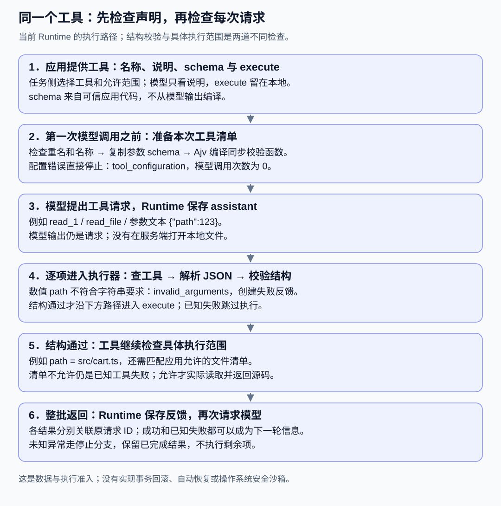
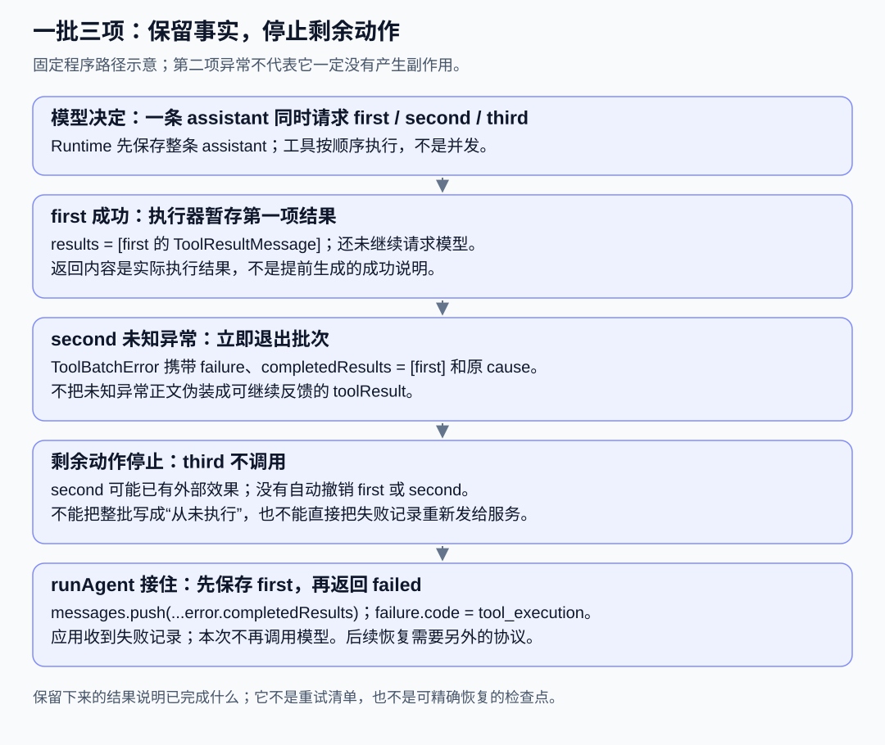
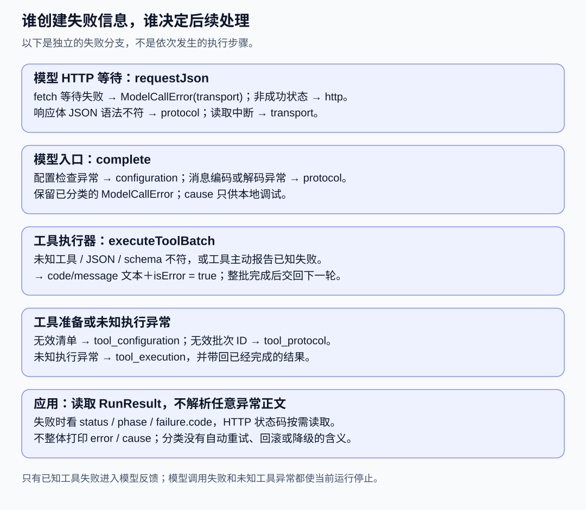

# 07 工具准入与可判断的失败

本篇给 Agent 增加一项执行能力：**模型提出动作后，Runtime 先统一检查参数；能处理的错误交回模型继续决定，无法确定的异常则停止并保留已完成事实。** 重点是动作怎样被检查、执行和反馈，错误类型用来表达这些判断的结果。

继续使用代码审查任务，不增加新业务。模型请求读取 `src/cart.ts`，本地真正执行读取的仍是 `read_file`。变化发生在它们之间：Runtime 不再只解析 JSON 后就交给工具，而是先按照工具声明的参数规则检查数据，再决定能否调用工具。

这是[第二阶段](/roadmap#第二阶段-逐篇大纲)的第二个单元，建设的是 Agent 的执行机制：模型负责提出动作，Runtime 负责检查与组织执行，工具负责实际操作，结果再成为下一轮模型可见的信息。原来的发布调查和两种模型接入继续复用。

## 为什么已有参数检查，还要做这一篇

03 的读取工具和 05 的查询工具已经各自检查参数，因此旧示例并非接受任意输入。但只靠每个工具自己写检查，接入一个新工具时，仍可能出现“发给模型的规则写了，本地执行前却漏查了”的缺口。

本篇把**同一份参数规则接到执行入口**：它既用于向模型说明怎样传参，也用于本地判断实际参数是否符合规则。这里的 schema 就是描述参数形状的数据，例如“必须有字符串 `path`，不能有额外字段”；仅仅写出这份数据不会自动产生检查。

| 要判断的事情 | 本篇之前 | 本篇之后 |
|---|---|---|
| 应用提供的工具是否重名、参数规则能否用于检查 | 重名主要在执行批次时检查；规则尚未统一编译 | 启动前统一准备，有问题就不请求模型 |
| 模型的参数是否符合工具声明 | 各工具内部自行检查 | Runtime 先按 schema 检查，合格后才进入工具 |
| 出现已知失败或未知异常后怎样继续 | 已有反馈和停止；未知批次异常前的结果未统一带回 | 反馈与停止明确分开，停止时保留此前完成的结果 |

所以正常读取的答案可能没有变化，**新增的是每个经 Runtime 执行的工具都要经过相同的检查步骤**。原工具的文件清单、记录是否存在等检查仍然保留，因为参数形状正确不代表动作被允许。

## 先走一遍坏参数怎样得到修正

继续使用原来的 `read_file`。它的工具说明要求 `path` 是字符串，且不能有额外字段；这份说明既发送给模型，也会成为本地检查的依据。

整篇实现先准备工具，再逐项决定能否执行，最后把结果交回循环：

1. **启动时准备应用提供的工具清单。** 检查名称与说明，复制本次使用的数据，再将每个工具的 schema 编译成校验函数。后面多轮复用这份准备结果，不在每轮重新编译。
2. **模型提出请求后，执行器先检查批次身份。** 核对工具请求的类型、名称字段和批内 ID，再按响应中列出的请求逐项处理；这不是把全部注册工具都执行一次。
3. **每项请求经过两层门禁。**
   - **3.1 Runtime 检查普通数据。** 查工具名、解析参数 JSON，再按已编译的 schema 检查字段和类型。不通过就产生原请求 ID 对应的已知失败反馈，不进入工具 execute。
   - **3.2 工具检查具体动作。** 数据形状通过后，读取工具还要检查路径清单、文件条件并真正读取。schema 不能替代这层许可与执行检查。
4. **能解释的失败反馈给模型，未知异常停止。** 已知错误成为 toolResult，Runtime 保存后允许下一轮修正；未知异常终止后续动作，同时保留本批已经完成的反馈。模型等待的故障也用明确类别报告，不混同工具参数错误。
5. **应用观察为什么停止。** 运行结果带阶段与受控失败标识，报告展示原因；即使最后 answered，仍要检查实际读取和结论。本地固定入口用坏参数复现门禁，真实模型不必先犯这个错误。

下面是一种可能轨迹，不是要求真实模型固定调用三次：

| 模型调用 | 决定或结果 | Runtime 的动作 |
|---|---|---|
| 1 | 请求 `read_1 / read_file / {path:123}` | 解析 JSON 后检查结构，拒绝进入 `execute`；保存 `invalid_arguments` 反馈 |
| 2 | 看见反馈，提出 `read_2 / read_file / {path:'src/cart.ts'}` | 结构通过，再由原工具检查路径清单并实际读取；保存源码结果 |
| 3 | 根据源码回答 | 返回 `answered`，应用仍需核对读取证据与审查结论 |

两次工具请求的 ID 不同。第一项失败仍属于 `read_1`，第二项成功属于 `read_2`；不能为了看起来成功就把旧失败改写成新结果。

这里要区分两件事：**schema 检查数据形状，工具检查这次动作是否允许、是否做得成**。`{path:'src/missing.ts'}` 的形状正确，但路径不在允许清单中，原工具仍会拒绝。schema 通过不等于授权通过，更不等于操作系统隔离。

Pi 固定版本的 [prepareToolCall](https://github.com/badlogic/pi-mono/blob/8efd314fa3d3232ce197d8d7a6a5660530b9d83e/packages/agent/src/agent-loop.ts)会先查工具、调用参数验证，再进入执行路径。它的 [validateToolArguments](https://github.com/badlogic/pi-mono/blob/8efd314fa3d3232ce197d8d7a6a5660530b9d83e/packages/ai/src/utils/validation.ts)还包含类型转换和可选值处理。本篇借鉴“执行前统一验证、复用校验器”，采用 Ajv 验证已经使用的普通 JSON Schema，暂不自动把数值改成字符串或补上缺失字段。

[](/diagrams/07-tool-gates.svg)

## 检查以后，程序要做出什么决定

先用三个具体结果辨认后续动作，不必先记住错误名称：

| 观察到的情况 | 程序接下来做什么 | 谁使用结果 |
|---|---|---|
| `path` 传成数值，结构不合要求 | 不调用读取函数，创建一条失败的工具结果，整批结束后保存 | 下一轮模型看到失败，可以提出新的请求 |
| 参数合格，路径也在允许清单内 | 工具实际读取，创建一条成功的工具结果，保存源码 | 下一轮模型利用源码决定回答或继续动作 |
| 工具抛出未知异常，无法确定这项操作的执行情况 | 停止剩余动作，保留此前已完成的结果，返回运行失败 | 应用展示原因，操作者定位故障；本次不再请求模型 |

错误代码只是让最后这些结果有稳定名称。写 `invalid_arguments` 不会自动挡住读取，真正挡住它的是执行前的条件判断；定义 `ToolBatchError` 也不会自动保存历史，真正保存的是 Runtime 接住结果后执行的追加语句。下面会逐一找到这些动作的位置。

## 文件位置与安装

先检查状态，再由你创建分支：

```bash
git status --short --branch
git switch -c agent/chapter-07-tool-contracts
```

本篇新增内容按职责归组：

```text
packages/model/src/
├── errors/model-call-error.ts
├── types/failures.ts
├── providers/shared/request-json.ts
└── complete.ts                         修改；两家请求函数也更新接线
packages/runtime/src/
├── tools/registry.ts                    准备与编译工具清单
├── tools/execute.ts                     承接原 execute-tools.ts
├── errors/tool-execution-error.ts       承接原 tool-error.ts
├── errors/tool-batch-error.ts
├── types/tool-registry.ts
├── types/failures.ts
└── run-agent.ts                         准备清单、保存结果与返回失败
```

公共包入口的 `runAgent/executeTools/ToolExecutionError` 名字保留。先按下文创建新文件并更新导入，完成第六步后删除旧 `packages/runtime/src/execute-tools.ts` 和 `packages/runtime/src/tool-error.ts`，不保留两份实现。提供商既有文件位置不改，只有两家确实重复的 HTTP 等待进入 `providers/shared/`。

在仓库顶层安装本篇唯一新依赖，命令会更新 **Runtime 的** `package.json` 和根锁文件：

```bash
npm install ajv@8.20.0 --save-exact --workspace @ai-harness/runtime
```

不自己实现一个 JSON Schema 引擎。Ajv 先把 schema 编译成检查函数，再多次调用这个函数，见[官方入门](https://ajv.js.org/guide/getting-started.html)。本篇只接收可信应用代码提供的同步对象 schema，不从模型输出编译 schema，也不加载远程引用。

## 第一步：为模型调用准备明确的停止原因

先接好工具主线所需的一个停止出口：如果请求模型时连接失败，或响应无法转换为工具请求，就没有可执行动作；这种失败应返回应用，而不是生成一条假的工具结果再交给模型。本步给这些出口命名，后面的第二至五步再完成工具准备、请求检查、执行与反馈。

### 定义错误，而不是匹配错误字符串

新建 `packages/model/src/types/failures.ts`：

ModelFailureKind 约定模型等待失败的稳定类别，供后面的错误对象和 Runtime 分支使用。它只是类别名称，不会通过错误文字自动识别连接、HTTP 或协议问题。

<<< @/snippets/07-tool-contracts/packages/model/src/types/failures.ts

再新建 `packages/model/src/errors/model-call-error.ts`：

ModelCallError 将一项受控失败类别与允许展示的说明组合成错误对象。HTTP 层和模型入口在实际失败处创建它，Runtime 接住后生成运行失败信息；原始原因仅保留供本地检查。

<<< @/snippets/07-tool-contracts/packages/model/src/errors/model-call-error.ts

模型包抛出的 `ModelCallError` 有四种 `kind`：调用配置不符、服务返回非成功 HTTP、连接或响应体等待失败、消息格式不支持。`httpStatus` 只在 HTTP 失败时使用。`cause` 保存原始异常，供本地断点查看，不进入模型消息或默认日志。

类型定义不会自动识别错误；下面在实际动作发生处创建这个错误对象。可信应用若自己创建它，也应只把允许展示的说明放进 `message`。

### 共用 HTTP 等待

新建 `packages/model/src/providers/shared/request-json.ts`。它替两家请求函数完成同一段工作：等待 HTTP，检查状态，读取 JSON。输入是已经编码好的请求，输出仍是未知数据，之后由对应服务解码器判断消息字段。

<<< @/snippets/07-tool-contracts/packages/model/src/providers/shared/request-json.ts

例如服务返回 HTTP 429，函数直接抛出 `kind: 'http'`、`httpStatus: 429`，不读取并打印服务错误正文。如果状态成功却返回非 JSON，归为 `protocol`；如果读取响应体时连接中断，则归为 `transport`。返回未知 JSON 并不代表模型消息已经合法，仍要经过原解码器。

### 接回两家适配与公开入口

完整替换 `packages/model/src/providers/deepseek.ts` 和 `packages/model/src/providers/anthropic.ts`。分别保留原来的请求正文和编码/解码函数，将直接 `fetch`、HTTP 判断和 `response.json()` 改为调用 `requestJson`。原来的 `response` 局部变量不再使用，`value` 接住共用函数返回的 JSON。

::: details packages/model/src/providers/deepseek.ts【修改】

这份 deepseek 适配仍接收统一上下文与配置，构造本服务正文，并将共用 HTTP 函数取得的未知 JSON 交给自己的解码器。成功返回项目消息；连接或读取故障则沿新错误类别向上报告，不返回伪造的工具观察。

<<< @/snippets/07-tool-contracts/packages/model/src/providers/deepseek.ts

:::

::: details packages/model/src/providers/anthropic.ts【修改】

这份 anthropic 适配仍接收统一上下文与配置，构造本服务正文，并将共用 HTTP 函数取得的未知 JSON 交给自己的解码器。成功返回项目消息；连接或读取故障则沿新错误类别向上报告，不返回伪造的工具观察。

<<< @/snippets/07-tool-contracts/packages/model/src/providers/anthropic.ts

:::

再完整替换 `packages/model/src/complete.ts`。原 `resolveOptions` 与提供商选择保留；配置检查失败转为 `configuration`，适配器已有的 `ModelCallError` 原样抛出，其余编码或解码异常转为 `protocol`。

统一入口继续选择适配器并返回项目消息，同时为配置和未识别的编解码失败设置受控类别。调用方可以按类别处理失败，不需要猜服务错误字符串，也不会因为转换失败而执行半份工具请求。

<<< @/snippets/07-tool-contracts/packages/model/src/complete.ts

这里 `return await (...)` 有具体作用：等待适配器的 Promise 在当前 `try` 内成功或失败，才能被当前 `catch` 归类。只写 `return promise` 会直接把尚未完成的 Promise 交出去，它之后的拒绝不会进入这一层 `catch`。

完整替换模型包 `packages/model/src/index.ts`，保留原导出，增加错误类和类别类型：

<<< @/snippets/07-tool-contracts/packages/model/src/index.ts

现在可以只构建模型包，先观察一个完整的小阶段。以下命令没有网络请求，也不需要 `.env`：

```bash
npm run build --workspace @ai-harness/model
node --input-type=module <<'JS'
import { complete, ModelCallError } from '@ai-harness/model';
try {
  await complete({ messages: [{ role: 'user', content: '你好' }] }, {
    apiKey: 'local-placeholder', model: 'deepseek-flash',
    fetch: async () => { throw new Error('本地模拟连接失败'); },
  });
} catch (error) {
  if (!(error instanceof ModelCallError)) throw error;
  console.log(error.kind, error.message);
}
JS
```

应看到 `transport 模型服务连接或等待失败。`。原始异常仍在 `error.cause`，没有作为展示说明输出。此时只是接好了模型侧分类；接下来把工具和运行结果接齐。

## 第二步：定义本地工具准备与运行失败

新建 `packages/runtime/src/types/failures.ts`。`RunFailure` 是 Runtime 交给应用的受控对象，代码可以用 `failure.code` 分支；它与本地调试用的原异常分开。

<<< @/snippets/07-tool-contracts/packages/runtime/src/types/failures.ts

应用提供的 `ExecutableTool` 有参数规则 `parameters` 和执行函数 `execute`，但规则本身不是可调用的函数。Runtime 要先把规则编译成 `validate`，之后每次收到参数，才可以调用它判断合不合格。

因此，同一个工具在准备前后有两种表达：

| 对象 | 内容 | 谁实际创建、谁使用 |
|---|---|---|
| `ExecutableTool` | 原说明、参数规则、执行函数 | 工具工厂创建，应用传入 Runtime |
| `RegisteredTool` | 保留上述内容，增加编译好的 `validate` | 下一步的 `createToolRegistry` 创建，执行器使用 |

新建 `packages/runtime/src/types/tool-registry.ts`。`extends ExecutableTool` 表示保留原字段再增加字段，不会替 Runtime 自动完成编译。`ToolFailureCode` 则是已知失败的类别名称，用于反馈文本，与检查函数各有用途。

<<< @/snippets/07-tool-contracts/packages/runtime/src/types/tool-registry.ts

为什么不直接要求 `ExecutableTool` 带上 `validate`？那样每个工具作者都要负责准备校验函数，也会把 Ajv 的接线带到各个能力实现里。现在应用只提供规则，由 Runtime 统一准备，并在同一次运行里复用编译结果。

完整替换已有的 `packages/runtime/src/types/tools.ts`，字段不变，只明确结构验证与工具语义检查的分工：

这里仍约定应用提供工具说明和 execute，字段没有改变。Runtime 从说明编译普通参数检查，具体工具继续检查许可与实际操作；这个类型不会替任何一方执行验证。

<<< @/snippets/07-tool-contracts/packages/runtime/src/types/tools.ts

schema 的运行时验证不会把跨函数的 TypeScript 参数自动变成某个接口，因此 `execute` 仍接收 `unknown`。既有工具中的类型缩小和路径、记录清单检查继续保留；本篇新增门禁保证经 Runtime 调用的每个工具都经过声明的结构检查。

在新位置创建 `packages/runtime/src/errors/tool-execution-error.ts`。它承接旧 `tool-error.ts` 的类，保留 `new ToolExecutionError('允许反馈的说明')` 用法，默认代码为 `tool_failure`；执行器可用第二个参数选择更具体的代码。

这个类把“允许反馈的工具失败”交给执行器：输入安全说明与可选代码，创建能被识别的错误对象。执行器据此产生 toolResult，模型下一轮可以修正请求；工具作者仍不应把任意内部异常当成该类抛出。

<<< @/snippets/07-tool-contracts/packages/runtime/src/errors/tool-execution-error.ts

新建 `packages/runtime/src/errors/tool-batch-error.ts`。它不表示可继续反馈的失败，而是“这批必须停止”，同时带回已经完成的结果。

ToolBatchError 替执行器把未知异常与本批此前结果一起带回循环。循环可以保存已完成反馈后停止，既不丢掉已发生事实，也不让后续工具继续执行；它不是给模型重试的一项普通失败结果。

<<< @/snippets/07-tool-contracts/packages/runtime/src/errors/tool-batch-error.ts

`completedResults` 是执行器已经创建的 `ToolResultMessage` 数组，不是重新执行所需的清单。Runtime 后面接住它并保存，原异常留在 `cause`。未知异常这一项不会被伪造成正常的工具失败，剩余项也不会继续执行。

## 第三步：启动前检查并准备工具清单

这一步把上一节的两种工具表达真正接起来。应用传入原 `reviewTools`，其中的 `read_file` 还只有规则和执行函数；Runtime 需要一份能按名称查找、又能直接检查参数的准备结果。

新建 `packages/runtime/src/tools/registry.ts`。`createToolRegistry` 返回“名称 → 已准备工具”的 Map，代码中叫 `registry`。这里的“注册”就是检查工具后放入这张表，不是执行所有工具。`runAgent` 每次启动调用一次，之后的请求复用它。

<<< @/snippets/07-tool-contracts/packages/runtime/src/tools/registry.ts

以 `read_file` 为例，正常准备过程是：先复制它的 schema，再用 `ajv.compile(parameters)` 取得检查函数。随后 `registry.set(...)` 才真正创建并存入带有 `validate` 的工具对象；这就是上一节 `RegisteredTool` 类型描述的对象。

返回以后，`runAgent` 用 `registry` 中的说明构造模型可见的工具列表，执行器则在模型提出请求后，按名称取出同一项。它拿到 `{path:123}` 时调用 `validate`，得到不合格；拿到 `{path:'src/cart.ts'}` 时结构合格，才有机会调用原 `execute`。准备阶段本身没有读取文件。

这里的名称限制为 1 至 64 位字母、数字、下划线或连字符，是本项目当前的工具命名范围。重名会造成动作分发歧义，所以在第一次模型调用前拒绝；schema 拼错或不支持时也在这里停止，不把应用配置缺陷交给模型“修参数”。

`structuredClone` 使调用前已准备的 schema 不随应用原对象的后续修改而变化。它没有隔离工具闭包或冻结所有对象；应用提供的模型回调和工具仍是可信代码。`bind(tool)` 保留工具方法原来依赖的 `this`，不把函数拿出来后悄悄改变其调用对象。

Ajv 使用 `strict: true` 拒绝有歧义或不支持的 schema；未开启的类型转换、默认值填充和额外字段删除保持关闭，依据见[官方选项说明](https://ajv.js.org/options.html)。因此 `123` 不会变成 `'123'`，多余参数也不会被静默删掉后执行。`addUsedSchema: false` 不把每个已编译 schema 自动登记成一份全局 `$id` 清单；本篇通过工具名持有各自的检查函数，没有动态远程 schema 服务。

## 第四步：执行前校验，已知失败返回，未知异常停止

### 执行哪些请求：看本次响应，不是遍历所有可用工具

一个批次指**同一条模型响应中的 `toolCalls` 请求列表**。03 就已支持它，本篇是在原有路径中增加统一校验，不是新建一种“把所有工具各跑一次”的机制。

比如 05 的应用提供 `lookup_release` 和 `lookup_service` 两个工具。模型某次响应包含两项 `lookup_service` 请求，分别查询 `checkout-api`、`inventory-api`，执行器就只做这两项，不会顺便再查一次发布。这里是同一个工具使用不同参数；批次也可以包含不同工具，数量还可以只有一项。

| 对象 | 表示什么 | 是否会逐项执行 |
|---|---|---|
| 应用传入的 `tools` | 本次允许模型选择的工具清单 | 不会因出现在这里就执行 |
| 准备后的 `registry` | 可按名称查到工具与检查函数的表 | 用于查找，不是待执行列表 |
| 本次响应的 `message.toolCalls` | 模型这次明确提出的动作 | 执行器按这里的顺序处理 |

为什么正常情况下处理完整批次再请求模型？模型这一条消息已经请求了两份资料，程序应先取得两项对应结果，再让它根据新信息继续判断。若刚执行第一项就再次请求，第二项还没有结果，工具往返也没有完成。未知异常是停止出口，不会硬凑完整批次再继续。

同批动作的参数在模型返回时就已确定。即使列表中先读后写，后面的写入参数也不会自动根据读取结果重新生成；需要读完再决定怎样修改时，应先反馈读取结果，由下一次模型调用提出修改。本项目本篇没有新增写工具。

### 用准备好的工具处理本批请求

在新位置创建 `packages/runtime/src/tools/execute.ts`。它承接原 `execute-tools.ts` 的执行。保留两个调用入口，是因为它们接收的工具准备状态不同：

| 函数 | 谁调用、传入什么 | 替调用方完成什么 |
|---|---|---|
| 公开 `executeTools(message, tools)` | 独立执行一批的调用方，提供原始工具清单 | 先准备清单，再处理本批请求 |
| 内部 `executeToolBatch(message, registry)` | `runAgent`，提供本次运行已准备的表 | 直接检查并执行本批，避免每轮重新编译 |

这两个入口最后进入同一段执行逻辑，不会各执行一遍。下面代码中的 `for (const call of message.toolCalls)` 明确了真正被遍历的是请求列表。

<<< @/snippets/07-tool-contracts/packages/runtime/src/tools/execute.ts

沿 `read_1` 走一次：先查到 `read_file`，`JSON.parse` 把参数文本转成 `{path:123}`；`tool.validate(value)` 返回假，于是抛出已知的 `invalid_arguments`。`tool.execute(value)` 没有被调用，文件读取也就没有开始。执行器接住这类已知错误，生成 `code/message` 文本，创建与 `read_1` 关联的结果，继续处理同批其余请求。

下一次请求使用 `{path:'src/cart.ts'}` 时，校验通过才进入原工具；工具仍从应用清单找真实文件。返回的源码放入成功结果，执行器整批返回后，Runtime 才统一保存并继续调用模型。

### 结果返回给谁，谁把它变成下一次输入

03 已有 `ToolExecutionError`，用来表示可以公开反馈的已知工具失败。本篇保留它，并给反馈增加代码。比如参数不符时，执行器返回的项目消息形如下面这样；这是**观察示意，不要追加到源码**：

```json
{
  "role": "toolResult",
  "toolCallId": "read_1",
  "toolName": "read_file",
  "content": "{\"code\":\"invalid_arguments\",\"message\":\"参数不符合工具说明，请检查字段类型、必填项与额外字段。\"}",
  "isError": true
}
```

`content` 仍是文本，只是现在承载一段有 `code/message` 的 JSON。`ToolResultMessage` 的结构没有修改，06 的两家适配器仍能编码它。代码用于稳定识别类别，中文说明帮助模型或操作者理解；它们都由本地程序创建，不是模型返回的字段。

`executeToolBatch` 返回的 `results` 交给 `runAgent` 接住，随后才由 `messages.push(...results)` 保存。如果第一项请求失败，下一次传给模型的项目记录就是：原用户任务、包含 `read_1` 的 assistant、关联 `read_1` 的失败结果。模型能够利用反馈，是因为这条结果进入了下一次输入，不是因为程序抛出过异常。


ID 为空或重复属于整批无法可靠关联，在任何一项动作之前停止。参数校验则逐项发生：第一项成功、第二项参数失败时，第一项不会回滚，第二项得到反馈，同批其他项仍可继续。这不是原子事务。

06 的服务解码器也会检查响应 ID；若在解码时已拒绝，得到的是 `model_protocol`。这里的 `tool_protocol` 是执行器对项目批次的保护，也覆盖自定义 `ModelCall` 或直接调用 `executeTools` 的情况。分类取决于实际在哪一步发现问题。

如果 `execute` 抛出了未知异常，当前 `results` 中已有的结果复制进 `ToolBatchError`，并附上出错项的 ID。执行器立即退出，不执行后面的工具。它没有把任意异常的正文放进反馈，避免把内部信息交回模型。

## 第五步：Runtime 保存结果，并向应用报告原因

### 扩展停止结果

完整替换 `packages/runtime/src/types/run.ts`。`RunAgentOptions` 和原状态值保留；只有 `status: 'failed'` 分支新增必填 `failure: RunFailure`，原 `error` 继续留给本地调试。

这份契约让应用从 failed 分支同时取得受控的 failure 和供本地调试的原异常。运行函数负责创建这些值，报告负责选择安全字段展示；类型声明不捕获异常。

<<< @/snippets/07-tool-contracts/packages/runtime/src/types/run.ts

`status` 回答“运行怎样停下”，`phase` 回答“模型侧还是工具侧”，`failure.code` 回答“这一侧识别到了哪类问题”。比如工具配置错误是 `failed / tools / tool_configuration`，但模型调用数为 0。调用上限、截断仍是原来的独立状态，不强行塞进异常类型。

### 接回完整循环

完整替换 `packages/runtime/src/run-agent.ts`。保留原循环、次数预算、文本和截断停止规则；将原直接映射工具说明改为先准备注册表；工具执行调用改为 `executeToolBatch`；两个异常出口补上受控失败信息。

这一版循环在启动时取得工具注册表，多轮复用它来执行请求。成功或已知失败继续保存反馈；模型等待、工具准备或未知工具异常则返回明确的停止结果，并带回已经完成的批次事实给应用。

<<< @/snippets/07-tool-contracts/packages/runtime/src/run-agent.ts

正常路径仍是：`message = await options.callModel(...)` 接住决定，`messages.push(message)` 保存，执行器返回 `results` 后再 `messages.push(...results)`。区别是模型看到的说明与执行器检查用的 schema 都来自本次准备结果。

模型侧捕获到 `ModelCallError` 时，`kind: 'protocol'` 变成 `failure.code: 'model_protocol'`。应用自己注入的回调若抛出未分类异常，则是 `model_unknown`，Runtime 不根据错误文字猜它是网络还是协议问题。消息转换失败没有返回 assistant，所以也不会执行这次响应里看似存在的工具。

工具侧若接住 `ToolBatchError`，先执行 `messages.push(...error.completedResults)`，再返回失败。**保存已完成事实之后停止，不会再进入下一次模型调用。** 例如一条 assistant 提了三项请求，第一项成功、第二项未知异常，返回记录是：初始用户消息、含三项请求的 assistant、第一项成功结果；第三项未执行，第二项的结果不确定。

[](/diagrams/07-partial-batch.svg)

这份失败记录可能包含尚未完成的工具请求，不能直接当作完整工具往返重新发给服务。本篇没有恢复协议，也无法证明出错的第二项没有产生外部副作用；需要后续检查点与副作用专题处理。

## 第六步：更新公开入口与展示

完整替换 `packages/runtime/src/index.ts`。原函数名不变，只更新内部导入路径并导出失败类型；不把注册表或 `ToolBatchError` 当作外部插件接口。

<<< @/snippets/07-tool-contracts/packages/runtime/src/index.ts

现在删除旧 `packages/runtime/src/execute-tools.ts` 与 `packages/runtime/src/tool-error.ts`。循环和公开入口都已指向新目录；`coding-tools` 仍通过包入口导入 `ToolExecutionError`，无需修改它，也不要改成跨包相对路径。

在仓库顶层运行：

```bash
npm run check
```

先生成新的公开声明，再改应用的展示代码。完整替换 `examples/shared/print-run.ts`：保留已有历史遍历和受控异常标识，新增输出 `failure.code` 与框架给出的说明。

这个显示函数读取 Runtime 已经生成的历史和受控 failure，输出失败阶段、代码与安全说明。它不重新分类任意异常，也不因为日志显示失败而重新执行工具。

<<< @/snippets/07-tool-contracts/examples/shared/print-run.ts

模型服务 HTTP 失败可能看到 `model_http`，并从 `failure.httpStatus` 取得状态码；工具执行异常看到 `tool_execution`。原始 `result.error` 与嵌套 `cause` 不整体打印。`ToolExecutionError` 的说明本身仍由工具作者负责选择，只能放允许反馈的内容。

### 失败代码速查

先从动作是否执行、结果给模型还是给应用来理解，再用下表对照日志中的代码。分类不会自动触发重试或换服务；HTTP 401 与 429 同属 HTTP 失败，仍可能需要不同处理。

| 情况 | 本篇处理 | 之后是否再调用模型 |
|---|---|---|
| 工具名未注册、JSON 错误、参数不符合 schema | 已知失败反馈：`unknown_tool / invalid_json / invalid_arguments` | 整批完成且有剩余次数时继续 |
| 工具明确报告路径不允许、记录不存在等 | 已知失败反馈：默认 `tool_failure` | 同上，允许模型改选动作 |
| 工具清单重名、schema 无效 | 运行失败：`tool_configuration` | 启动前拒绝，模型调用次数为 0 |
| 进入执行器的项目批次 ID 为空或重复 | 运行失败：`tool_protocol` | 不执行本批，停止 |
| 工具抛未知异常、返回非文本 | 运行失败：`tool_execution` | 保留此前结果，停止剩余动作 |
| 模型配置、HTTP、连接或消息协议失败 | 运行失败：`model_...` | 停止，不伪装成工具反馈 |


[](/diagrams/07-failure-routing.svg)

## 第七步：不调用模型服务，观察参数门禁

新建 `examples/code-review/src/check-tool-contract.ts`。它预写“坏参数 → 正确参数 → 文本”的三次决定，用原 Runtime 和原真实文件工具观察。这个入口属于示例观察，不是框架新增业务，不替换正常 `start`。

<<< @/snippets/07-tool-contracts/examples/code-review/src/check-tool-contract.ts

这里直接替换的是 `ModelCall`：前两次返回项目工具请求，第三次返回预写文字。因此它验证本地门禁与反馈记录，不验证 06 的 HTTP 转换，也不能证明模型自主改正了参数。06 的两个 `check-protocol` 入口保留，用来检查另一层。

在仓库顶层运行，均不加载 `.env`、不访问模型服务：

```bash
npm run check
node --import tsx examples/code-review/src/check-tool-contract.ts
node --import tsx examples/code-review/src/check-protocol.ts deepseek
node --import tsx examples/code-review/src/check-protocol.ts anthropic
```

第一条观察命令应出现这些值：

| 日志或记录 | 应观察的值 | 可以证明什么 |
|---|---|---|
| 第一项本地工具结果 | `toolCallId: 'read_1'`、`isError: true`，内容代码 `invalid_arguments` | 数值 `path` 被 Runtime 拒绝，尚未读文件 |
| 第二项本地工具结果 | `toolCallId: 'read_2'`、`isError: false`，内容含实际 `quantity` 源码 | 正确参数通过门禁并到达真实读取 |
| 运行停止 | `answered`，模型调用次数为 `3` | 固定三次决定走完原循环 |

两条协议命令仍应 `answered / 2`，说明原两家转换仍能接回 Runtime。真实 DeepSeek 任务仍可自行用 `npm start`、`npm start -- --example release-impact` 运行；它们会请求模型并可能产生费用，不属于上面的本地检查。没有第二家 Key 时不执行真实 Anthropic 命令。

### 断点：确认不只是工具自己的检查

用本地入口启动调试：

```bash
node --enable-source-maps --inspect-brk --import tsx examples/code-review/src/check-tool-contract.ts
```

在 `tools/execute.ts` 的 `if (!tool.validate(value))` 和原 `coding-tools/src/read-file.ts` 的 `execute` 内各放一个断点。第一轮应在结构检查失败，没有进入工具；第二轮才进入工具。再到 `run-agent.ts` 的 `messages.push(...results)`，看失败和成功如何按各自 ID 保存；这些都是内存记录，没有自动落盘。

### 可逆故障：应用配置有错，模型不应替它承担

先备份 `examples/code-review/src/tools.ts`。在创建完成的原 `reviewTools` 数组之后追加一行，用于把同一工具注册两遍：

```typescript
// 仅用于故障实验；完成后删除这一行。
reviewTools.push(reviewTools[0]!);
```

原 `reviewTools` 是普通可变数组；如果自行改成了只读数组，改用下面观察入口里的 `tools: [...reviewTools, ...reviewTools]`，不改框架类型。两种方式只选一种。

运行 `check-tool-contract.ts`，应看到 `failed`、`modelCalls: 0`、`tool_configuration`。这是第一次决定之前的失败；不会出现 `read_1`。恢复数组或原 `tools: reviewTools` 后重跑，应恢复三次调用。不要通过去掉注册检查来“修好”演示。

### 小迁移：区分结构错误与允许范围

只把观察入口第一次构造参数的 `123` 改为 `'src/missing.ts'`。这次参数是字符串，应该通过 schema，但在原工具的路径清单检查处失败，反馈代码变成 `tool_failure`。第二次仍读 `src/cart.ts` 成功。

对照断点与第一项结果，解释为何不是 `invalid_arguments`。完成后恢复 `123`。这个练习不需要新增工具，也不用改循环；它检查两道边界是否真正区分开了。

## 本篇形成的边界

读完并运行后，应能沿一次请求指出三个变化：

1. **调用前有共同检查**：`path` 为数值时，在 Runtime 的 `validate` 处拒绝，尚未进入读取工具。
2. **拒绝后有下一轮可用的信息**：失败结果关联原 ID，由 Runtime 保存，下一次模型才能据此改选动作或修正参数。
3. **无法继续时仍保留事实**：未知异常使运行停止，已完成项由 Runtime 保存，应用拿到原因；剩余项不执行。

`RegisteredTool` 支持第一件事，已知失败反馈支持第二件事，批次错误与运行失败结果支持第三件事。类型和错误类只有接进这些实际动作后才产生作用。

现在工具清单先准备，模型参数再逐项检查，工具守住具体执行范围。已知失败作为观察进入后续决策；未知异常明确停止，应用按稳定代码识别，已经完成的结果仍能从记录找到。

这不等于自动恢复、事务回滚或安全沙箱，也没有证明真实模型一定会根据失败修正。schema 的计算成本与可信度仍由接入方约束；不能把任意外部 schema 当作安全输入。后续沿阶段大纲接入事件、流式和运行控制。

## 完整文件核对

以下是同源最终文件。本章删除的两个旧 Runtime 文件不再保留；其余复用项只清除继承的变化标签，原意图说明保留。配置核对时，Runtime 依赖中应有精确版本 `ajv: 8.20.0`，根锁文件由安装命令更新。

::: details .env.example （复用）

<<< @/snippets/07-tool-contracts/.env.example{sh}

:::

::: details examples/code-review/package.json （复用）

<<< @/snippets/07-tool-contracts/examples/code-review/package.json

:::

::: details examples/code-review/src/check-protocol.ts （复用）

<<< @/snippets/07-tool-contracts/examples/code-review/src/check-protocol.ts

:::

::: details examples/code-review/src/check-tool-contract.ts 【新增文件】

<<< @/snippets/07-tool-contracts/examples/code-review/src/check-tool-contract.ts

:::

::: details examples/code-review/src/main.ts （复用）

<<< @/snippets/07-tool-contracts/examples/code-review/src/main.ts

:::

::: details examples/code-review/src/protocol-fetch.ts （复用）

<<< @/snippets/07-tool-contracts/examples/code-review/src/protocol-fetch.ts

:::

::: details examples/code-review/src/report-run.ts （复用）

<<< @/snippets/07-tool-contracts/examples/code-review/src/report-run.ts

:::

::: details examples/code-review/src/tools.ts （复用）

<<< @/snippets/07-tool-contracts/examples/code-review/src/tools.ts

:::

::: details examples/release-impact/package.json （复用）

<<< @/snippets/07-tool-contracts/examples/release-impact/package.json

:::

::: details examples/release-impact/src/load-records.ts （复用）

<<< @/snippets/07-tool-contracts/examples/release-impact/src/load-records.ts

:::

::: details examples/release-impact/src/lookup-tool.ts （复用）

<<< @/snippets/07-tool-contracts/examples/release-impact/src/lookup-tool.ts

:::

::: details examples/release-impact/src/main.ts （复用）

<<< @/snippets/07-tool-contracts/examples/release-impact/src/main.ts

:::

::: details examples/release-impact/src/report-run.ts （复用）

<<< @/snippets/07-tool-contracts/examples/release-impact/src/report-run.ts

:::

::: details examples/release-impact/src/tools.ts （复用）

<<< @/snippets/07-tool-contracts/examples/release-impact/src/tools.ts

:::

::: details examples/release-impact/src/types/tools.ts （复用）

<<< @/snippets/07-tool-contracts/examples/release-impact/src/types/tools.ts

:::

::: details examples/release-impact/src/validation.ts （复用）

<<< @/snippets/07-tool-contracts/examples/release-impact/src/validation.ts

:::

::: details examples/run.ts （复用）

<<< @/snippets/07-tool-contracts/examples/run.ts

:::

::: details examples/shared/model.ts （复用）

<<< @/snippets/07-tool-contracts/examples/shared/model.ts

:::

::: details examples/shared/print-run.ts 【修改】

<<< @/snippets/07-tool-contracts/examples/shared/print-run.ts

:::

::: details fixtures/code-review/src/cart.ts （复用）

<<< @/snippets/07-tool-contracts/fixtures/code-review/src/cart.ts

:::

::: details fixtures/model-protocol/anthropic.json （复用）

<<< @/snippets/07-tool-contracts/fixtures/model-protocol/anthropic.json

:::

::: details fixtures/model-protocol/deepseek.json （复用）

<<< @/snippets/07-tool-contracts/fixtures/model-protocol/deepseek.json

:::

::: details fixtures/release-impact/releases.json （复用）

<<< @/snippets/07-tool-contracts/fixtures/release-impact/releases.json

:::

::: details fixtures/release-impact/services.json （复用）

<<< @/snippets/07-tool-contracts/fixtures/release-impact/services.json

:::

::: details package.json （复用）

<<< @/snippets/07-tool-contracts/package.json

:::

::: details packages/coding-tools/package.json （复用）

<<< @/snippets/07-tool-contracts/packages/coding-tools/package.json

:::

::: details packages/coding-tools/src/index.ts （复用）

<<< @/snippets/07-tool-contracts/packages/coding-tools/src/index.ts

:::

::: details packages/coding-tools/src/read-file.ts （复用）

<<< @/snippets/07-tool-contracts/packages/coding-tools/src/read-file.ts

:::

::: details packages/coding-tools/src/types/read-file.ts （复用）

<<< @/snippets/07-tool-contracts/packages/coding-tools/src/types/read-file.ts

:::

::: details packages/coding-tools/tsconfig.json （复用）

<<< @/snippets/07-tool-contracts/packages/coding-tools/tsconfig.json

:::

::: details packages/model/package.json （复用）

<<< @/snippets/07-tool-contracts/packages/model/package.json

:::

::: details packages/model/src/complete.ts 【修改】

<<< @/snippets/07-tool-contracts/packages/model/src/complete.ts

:::

::: details packages/model/src/errors/model-call-error.ts 【新增文件】

<<< @/snippets/07-tool-contracts/packages/model/src/errors/model-call-error.ts

:::

::: details packages/model/src/index.ts 【修改】

<<< @/snippets/07-tool-contracts/packages/model/src/index.ts

:::

::: details packages/model/src/providers/anthropic-messages.ts （复用）

<<< @/snippets/07-tool-contracts/packages/model/src/providers/anthropic-messages.ts

:::

::: details packages/model/src/providers/anthropic-response.ts （复用）

<<< @/snippets/07-tool-contracts/packages/model/src/providers/anthropic-response.ts

:::

::: details packages/model/src/providers/anthropic.ts 【修改】

<<< @/snippets/07-tool-contracts/packages/model/src/providers/anthropic.ts

:::

::: details packages/model/src/providers/deepseek-messages.ts （复用）

<<< @/snippets/07-tool-contracts/packages/model/src/providers/deepseek-messages.ts

:::

::: details packages/model/src/providers/deepseek-response.ts （复用）

<<< @/snippets/07-tool-contracts/packages/model/src/providers/deepseek-response.ts

:::

::: details packages/model/src/providers/deepseek.ts 【修改】

<<< @/snippets/07-tool-contracts/packages/model/src/providers/deepseek.ts

:::

::: details packages/model/src/providers/shared/request-json.ts 【新增文件】

<<< @/snippets/07-tool-contracts/packages/model/src/providers/shared/request-json.ts

:::

::: details packages/model/src/request-options.ts （复用）

<<< @/snippets/07-tool-contracts/packages/model/src/request-options.ts

:::

::: details packages/model/src/types/anthropic.ts （复用）

<<< @/snippets/07-tool-contracts/packages/model/src/types/anthropic.ts

:::

::: details packages/model/src/types/context.ts （复用）

<<< @/snippets/07-tool-contracts/packages/model/src/types/context.ts

:::

::: details packages/model/src/types/failures.ts 【新增文件】

<<< @/snippets/07-tool-contracts/packages/model/src/types/failures.ts

:::

::: details packages/model/src/types/messages.ts （复用）

<<< @/snippets/07-tool-contracts/packages/model/src/types/messages.ts

:::

::: details packages/model/src/types/options.ts （复用）

<<< @/snippets/07-tool-contracts/packages/model/src/types/options.ts

:::

::: details packages/model/src/types/tool-results.ts （复用）

<<< @/snippets/07-tool-contracts/packages/model/src/types/tool-results.ts

:::

::: details packages/model/src/types/tools.ts （复用）

<<< @/snippets/07-tool-contracts/packages/model/src/types/tools.ts

:::

::: details packages/model/src/validation.ts （复用）

<<< @/snippets/07-tool-contracts/packages/model/src/validation.ts

:::

::: details packages/model/tsconfig.json （复用）

<<< @/snippets/07-tool-contracts/packages/model/tsconfig.json

:::

::: details packages/runtime/package.json 【修改】

<<< @/snippets/07-tool-contracts/packages/runtime/package.json

:::

::: details packages/runtime/src/errors/tool-batch-error.ts 【新增文件】

<<< @/snippets/07-tool-contracts/packages/runtime/src/errors/tool-batch-error.ts

:::

::: details packages/runtime/src/errors/tool-execution-error.ts 【新增文件】

<<< @/snippets/07-tool-contracts/packages/runtime/src/errors/tool-execution-error.ts

:::

::: details packages/runtime/src/index.ts 【修改】

<<< @/snippets/07-tool-contracts/packages/runtime/src/index.ts

:::

::: details packages/runtime/src/run-agent.ts 【修改】

<<< @/snippets/07-tool-contracts/packages/runtime/src/run-agent.ts

:::

::: details packages/runtime/src/tools/execute.ts 【新增文件】

<<< @/snippets/07-tool-contracts/packages/runtime/src/tools/execute.ts

:::

::: details packages/runtime/src/tools/registry.ts 【新增文件】

<<< @/snippets/07-tool-contracts/packages/runtime/src/tools/registry.ts

:::

::: details packages/runtime/src/types/failures.ts 【新增文件】

<<< @/snippets/07-tool-contracts/packages/runtime/src/types/failures.ts

:::

::: details packages/runtime/src/types/model-call.ts （复用）

<<< @/snippets/07-tool-contracts/packages/runtime/src/types/model-call.ts

:::

::: details packages/runtime/src/types/run.ts 【修改】

<<< @/snippets/07-tool-contracts/packages/runtime/src/types/run.ts

:::

::: details packages/runtime/src/types/tool-registry.ts 【新增文件】

<<< @/snippets/07-tool-contracts/packages/runtime/src/types/tool-registry.ts

:::

::: details packages/runtime/src/types/tools.ts 【修改】

<<< @/snippets/07-tool-contracts/packages/runtime/src/types/tools.ts

:::

::: details packages/runtime/tsconfig.json （复用）

<<< @/snippets/07-tool-contracts/packages/runtime/tsconfig.json

:::

::: details tsconfig.json （复用）

<<< @/snippets/07-tool-contracts/tsconfig.json

:::

## 保存本章

由你审阅并执行；不加入真实 `.env`、临时日志或构建产物：

```bash
git status --short --branch
git diff --check
git diff

git add packages/model/src packages/runtime \
  examples/shared/print-run.ts examples/code-review/src/check-tool-contract.ts \
  package-lock.json site docs AGENTS.md

git commit -F - <<'EOF'
第07篇：统一校验工具请求并明确运行失败

启动前检查工具清单并编译参数schema，执行前拒绝无效参数。
已知工具失败通过稳定代码反馈，未知异常停止并保存此前结果。
模型配置、HTTP、连接与协议错误分类，应用展示受控失败信息。
新增无网络门禁观察，保留两任务与双提供商接入。
EOF

git push -u origin agent/chapter-07-tool-contracts
```
