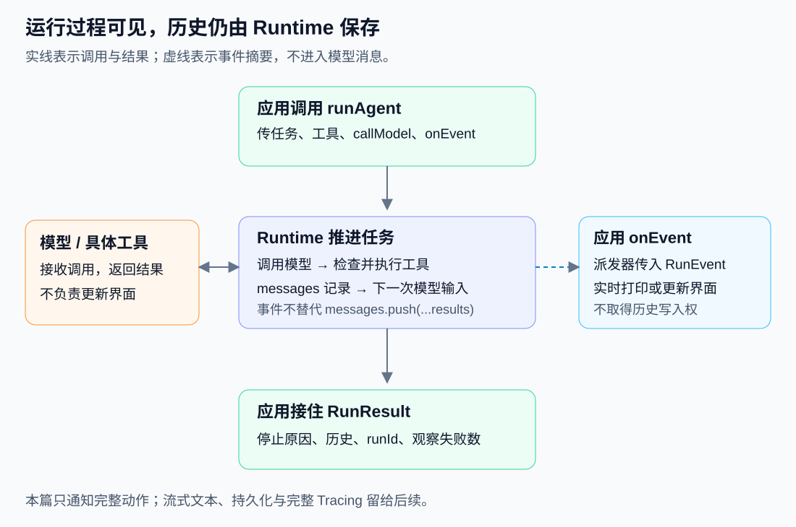
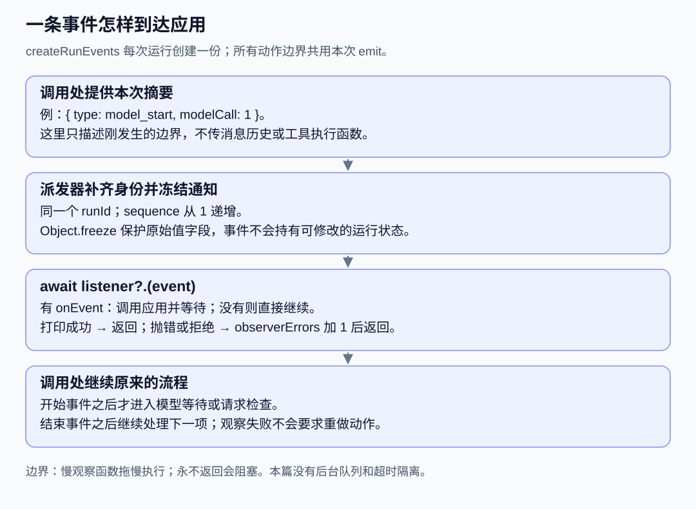
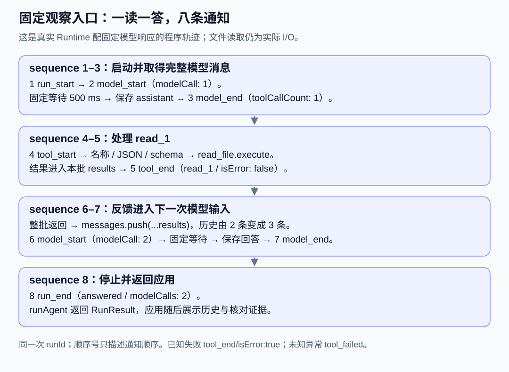

# 08 运行事件与实时进度

本篇实现：**Agent 还在执行时，应用就能知道当前开始了哪次模型调用、正在处理哪个工具请求，以及最终为什么停止。** 原来的代码审查与发布调查继续使用同一个 Runtime，只增加一条观察运行过程的通道。

这是[第二阶段](/roadmap#第二阶段-逐篇大纲)的第三个单元。07 解决动作执行前怎样检查、失败后怎样处理；08 让这些动作在发生时可见。它属于 Agent Runtime 的运行机制：以后终端、桌面应用可以通过同一接口更新进度，不需要把界面代码写进循环。下一篇再接入模型文本的流式输出。

## 先看现在缺少什么

现在应用写的是：

```ts
const result = await runAgent(/* 运行配置 */);
reportRun(result, reviewPath);
```

这是已有调用关系的简写，用于观察，不需要另写入文件。`await runAgent` 没有返回前，`reportRun` 还不会执行。虽然 Runtime 内部已经请求模型、读取文件，应用仍然要等到停止后才通过 `printRun` 展示记录。

如果第三次模型调用等待较久，终端就可能长时间没有变化。停止后得到 `failed / model_transport` 可以定位最后的失败，但运行中无法及时知道“目前正在等第几次模型调用”。

本篇保留最终的 `RunResult`，另外让应用传入一个函数。Runtime 在某个动作开始或结束时调用它，交给它一份小的通知对象。**这里把这种“某件事发生了”的通知称为事件。** 应用拿到事件就可以打印进度；不必等 `runAgent` 整体返回。

这不是让模型多写一句“我正在读取”。模型的文字仍可能只是动作意图。事件由本地 Runtime 在实际处理位置创建，能表明程序走到了哪一步。

## 实施前：先走完整个实现逻辑

先沿一次“读取文件，再给出审查回答”的任务走完整个过程。暂时不用记后面的类型与辅助函数，先看谁负责推进、谁负责观察。

1. **应用启动，并交给 Runtime 一个接收进度的函数。** 应用照常提供任务、工具和模型连接。新增的接收函数只负责显示进度，应用不用另外运行一个 Agent 循环。
2. **Runtime 在动作发生的位置通知应用。** 即将请求模型时先通知“开始等待”；完整响应返回后，Runtime 先保存模型消息，再通知“响应已到达”。这时模型只是提出读取请求，文件还没有读。
3. **执行器处理模型提出的请求。** 它先通知“开始处理这项请求”，再检查名称、参数和工具规则，合格后才真正读取文件。得到成功内容或已知失败反馈，就通知“这项处理已有结果”。通知中只带请求身份与状态，不塞入整个源码或运行历史。
4. **Runtime 保存反馈，再让模型继续。** 整批工具处理结束，循环把结果追加到历史，带着这些新事实再次请求模型。与此同时，统一的事件派发器给每条通知补上本次运行 ID 和顺序号，调用应用的接收函数。应用按这个顺序显示进度；显示通知不会替代历史写入。
5. **运行停止后，应用再核对最终结果。** 模型给出回答或运行遇到停止条件，Runtime 先通知“运行停止”，再将最终结果返回应用。应用展示完整记录，并按原来的任务规则检查证据与回答；进度显示“停止”不等于任务已验收通过。

因此有两条配合的路径：**模型与工具的结果进入历史，支持下一次决策；动作通知进入应用，支持实时展示。** 两条路径在同一套 Runtime 中发生，但用途不同。下面的图先看清这两个方向：

[](/diagrams/08-event-position.svg)

实现时会依次写通知的数据形状、公共派发器、工具和循环中的通知位置，最后接上应用侧的终端排版。排版工具只决定人看到的格式，不决定模型或工具接下来做什么。

### 用一次读取对齐事件

仍使用已有材料 `fixtures/code-review/src/cart.ts`，通过原工具清单显示为 `src/cart.ts`；不创建新业务文件。假设模型第一次提出 `read_1 / read_file`，读取完成后第二次给出回答，可能按下面顺序运行：

| 顺序 | Runtime 正在做什么 | 应用收到的事件 |
|---|---|---|
| 1 | 本次有效运行进入循环准备阶段 | `run_start` |
| 2 | 即将调用第一次模型函数 | `model_start / modelCall:1` |
| 3 | 得到并保存完整的模型消息，里面有一个工具请求 | `model_end / toolCallCount:1` |
| 4 | 即将检查和处理 `read_1` | `tool_start / toolCallId:read_1` |
| 5 | 读取结果已进入本批结果数组 | `tool_end / isError:false` |
| 6 | 整批结果写入历史，即将调用第二次模型 | `model_start / modelCall:2` |
| 7 | 得到并保存完整回答 | `model_end / stopReason:stop` |
| 8 | 已决定本次停止，准备把结果返回应用 | `run_end / status:answered` |

本篇会提供固定响应入口复现这条程序路径，实际读取仍由原工具完成。真实模型可能提出不同请求或使用不同次数，事件顺序由实际动作决定。

特别留意第四项：`tool_start` 表示**开始处理一个请求**，还包括名称、JSON、schema 检查，不保证已经进入工具的 `execute`。坏参数可以得到 `tool_start → tool_end / isError:true`，同时没有任何文件读取。

Pi 固定版本在 [runAgentLoop / runLoop](https://github.com/badlogic/pi-mono/blob/8efd314fa3d3232ce197d8d7a6a5660530b9d83e/packages/agent/src/agent-loop.ts)发出运行和消息通知，在 `executeToolCallsSequential` 中围绕单项请求发出工具开始、结束通知；`AgentEventSink` 可以返回 Promise。这里借鉴“在实际动作边界通知应用”，先用每次运行一个回调函数实现。Pi 的事件流、增量消息和其他执行模式更完整，本篇接口与它并不相同。

## 文件与起点

从已实现 07 的版本开始。在仓库根目录检查状态，再自行创建本章分支：

```bash
git status --short --branch
git switch -c agent/chapter-08-runtime-events
```

本篇不修改 model、coding-tools、任务材料或根 `package.json`，不增加依赖。文件按职责放置：

| 文件 | 本次操作与作用 |
|---|---|
| `packages/runtime/src/types/events.ts` | 新建，定义观察函数接收的数据 |
| `packages/runtime/src/events/dispatcher.ts` | 新建，添加运行身份、顺序号，等待观察函数并隔离其异常 |
| `packages/runtime/src/tools/execute.ts` | 修改，在单项请求处理前后通知 |
| `packages/runtime/src/types/run.ts` | 修改，加入可选观察函数与最终观察失败数 |
| `packages/runtime/src/run-agent.ts` | 修改，把事件接入模型、工具与停止出口 |
| `packages/runtime/src/index.ts` | 修改，公开事件类型 |
| `examples/shared/terminal.ts` | 新建，两种展示共用的进度行与内容块排版 |
| `examples/shared/print-event.ts` | 新建，将事件摘要显示为中文进度行 |
| `examples/code-review/src/check-events.ts` | 新建，无网络观察入口 |
| 两个任务的 `src/main.ts` | 修改，传入同一个观察函数 |
| `examples/shared/print-run.ts` | 修改，停止后显示运行身份与观察失败数 |

前半段先接好 Runtime，再运行无网络入口；后半段把相同接口接到两个现有任务。没有列出的文件继续沿用 07。

## 第一步：描述一次通知，而不是复制整个运行状态

新建 `packages/runtime/src/types/events.ts`。先看应用真正需要什么：看到 `model_start` 时知道正在等哪次调用；看到 `tool_end` 时知道是哪项请求，以及这项处理是否产生失败反馈。它不需要为了更新进度取得整段源码、请求头或可修改的历史数组。

下面用 `type` 区分事件种类。`RunEventData` 是各处提供的摘要；`RunEvent` 再增加同一次运行的身份与顺序；`RunEventListener` 是应用提供的接收函数。文件定义契约，真正的对象由后面的派发器创建。

<<< @/snippets/08-runtime-events/packages/runtime/src/types/events.ts

例如应用以后会接到这样一份值。以下是结构示意，不需要写入源码；运行 ID 以占位值表示：

```json
{"type":"tool_end","toolCallId":"read_1","toolName":"read_file","isError":false,"modelCall":1,"runId":"本次运行的UUID","sequence":5}
```

`runId` 把它归到某次 `runAgent`，`sequence` 表示这是该次运行第五条通知。`modelCall:1` 指提出这个动作的模型调用，`toolCallId` 则沿用模型请求的 ID；这几个值解决的问题不同，不能互相替代。

事件只包含字符串、数值、布尔值等原始值，不携带 `messages` 或 `RunResult.error` 的对象引用。`Readonly` 只是 TypeScript 约束，实际防止改写还要看下一步的 `Object.freeze`。

`model_end` 表示完整模型消息已返回，不表示整个任务完成。`tool_end / isError:true` 表示形成了一份已知失败反馈，仍可能继续请求模型；未知工具异常用 `tool_failed`，随后整次运行停止。这些名称按程序含义使用，不按“有 end 就算成功”判断。

## 第二步：为一次运行派发事件

新建 `packages/runtime/src/events/dispatcher.ts`，写入完整代码。它替调用位置做三件共同工作：生成本次运行 ID、为通知递增编号、接住观察函数自身的异常。

比如循环传入 `{type:'model_start', modelCall:1}`，派发器补上 ID 和顺序号，调用应用函数；该函数完成后，`emit` 才返回。调用处随后继续请求模型。

<<< @/snippets/08-runtime-events/packages/runtime/src/events/dispatcher.ts

`createRunEvents` 每次被调用都会创建自己的 `runId`、`sequence` 和 `observerErrors`。返回的 `emit` 与 `errorCount` 会继续访问这三个变量，因此连续通知使用同一个 ID，编号持续递增；再次运行会创建另一份变量，编号重新从 1 开始。[Node 的 `randomUUID`](https://nodejs.org/api/crypto.html#cryptorandomuuidoptions)用于生成本次身份，它不等于创建了磁盘会话或恢复记录。

`data` 是当前动作摘要。`{ ...data, runId, sequence: ++sequence }` 创建新的事件对象，没有把调用者的摘要拿来直接改写。对象字段都为原始值，所以冻结这一层即可防止监听方改写它们；这不涉及冻结整个 Agent 的历史或工具闭包。

`await listener?.(event)` 的意思是：有观察函数才调用，并等它完成。没有观察函数也不会改变执行选择。有 `await`，异步观察函数的拒绝才能在这里被 `catch` 接住；如果只调用后立即返回，稍后发生的拒绝就会脱离这段异常处理。

观察失败只把 `observerErrors` 加 1，不制造工具失败，也不重试已经执行的动作。最终结果会带回计数，应用可以发现“任务完成了，但进度展示发生过故障”。这是本项目选择的观察语义，不是权限检查：审批失败必须能阻止动作，不能使用这个会隔离异常的接口承担审批。

**等待观察函数也有代价**：它打印很慢，下一步就开始得晚；它一直不返回，运行也会一直等待。本篇使用轻量的终端打印，尚无事件队列、超时或慢消费者隔离。不要在这里等待用户输入或执行长时间网络工作。

[](/diagrams/08-dispatcher.svg)

## 第三步：在实际处理每项请求时通知

完整替换 `packages/runtime/src/tools/execute.ts`。保留 `executeTools(message, tools)` 的公开调用方式，以及原来的批次预检、参数检查和失败反馈。

本次只给包内 `executeToolBatch` 增加第三个可选参数 `notify`，并在三处通知：开始处理、已形成结果、未知异常。这个函数不知道运行 ID，也不负责打印；循环稍后把它接到刚写好的派发器。

这个执行器仍接收本轮请求和准备好的工具表，返回实际反馈数组；新增职责是在请求开始处理、已有结果或发生异常时，调用传入的通知函数。循环把这些摘要接给应用观察，执行器不负责打印或写入整次历史。

<<< @/snippets/08-runtime-events/packages/runtime/src/tools/execute.ts

沿 `read_1` 走一次：整批 ID 检查通过，执行器先通知 `tool_start`，再解析 `call.arguments` 并查 schema；参数合格才真正调用 `tool.execute(value)`。读取成功后，源码仍放进原来的 `ToolResultMessage.content`，由 `results.push(...)` 保存到**当前批次的局部数组**；这时通知 `tool_end / isError:false`。

以下摘录已包含在上方完整实现中，只用于讲解，不要再次追加或替换：

```ts
    results.push({ role: 'toolResult', toolCallId: call.id, toolName: call.name, content, isError });
    // 【新增】结果已进入本批数组；runAgent 会在整批结束或异常返回后写入历史。
    await notify?.({ type: 'tool_end', toolCallId: call.id, toolName: call.name, isError });
```

此时 `tool_end` 没有把源码发给应用，也没有替循环写历史。整批结束时执行器仍返回 `results`，下一步由 `runAgent` 接住并保存。即使应用已经显示“读取结束”，模型还要等反馈进入下一次输入才能使用它。

若参数不符，原来的 `ToolExecutionError` 会转成 `isError:true` 的结果，同样有一条 `tool_end`。若工具抛出未知异常，程序改为发出 `tool_failed`，随后按 07 抛出带此前结果的 `ToolBatchError`，不伪造这项请求的正常结果。

模型同批提出 `read_1`、`read_2` 时，通知是 `read_1 start → read_1 end → read_2 start → read_2 end`，不会执行注册清单中所有工具。整批 ID 预检失败时，还没有开始处理任何单项，因此没有 `tool_start`；最终运行失败会由循环通知。

## 第四步：让循环发出进度，并统一通知停止

### 扩展运行配置与结果

完整替换 `packages/runtime/src/types/run.ts`。保留配置中的消息、工具、模型函数和调用上限，只增加可选的 `onEvent`。

原来 `RunResult` 中的消息记录和停止联合改名为包内使用的 `RunOutcome`；新的公开 `RunResult` 保留这些字段，再附 `runId` 和 `observerErrors`。`ModelCall`、`RunFailure` 与工具类型不变，应用原来判断 `result.status` 的代码仍然适用。

这份类型让应用在运行前提供 onEvent，在停止后取得 runId 和观察失败计数。Runtime 负责填充这些字段，报告读取它们；事件摘要与最终消息历史仍是不同数据。

<<< @/snippets/08-runtime-events/packages/runtime/src/types/run.ts

`RunOutcome` 让循环先表达“为什么停、已经保存什么”，最终再添加本次运行的观察信息。它不是额外运行一次，也不是另一份模型消息；后面 `finish` 接收这个对象并返回 `RunResult`。

`observerErrors` 与工具结果的 `isError` 不同。前者是应用观察函数失败次数，后者是一次工具处理的反馈状态。把它们混合，可能让一个打印故障看起来像模型执行任务失败。

### 接入循环

完整替换 `packages/runtime/src/run-agent.ts`。原有的状态保存、调用上限和停止判断保留；新增派发器与局部 `finish`，所有原来的停止 `return` 改为经 `finish(...)` 返回。`finish` 只服务当前运行，所以放在函数内部，直接使用本次的派发器，不新增全局管理器。

这份循环替应用继续推进原任务，同时在实际动作位置发出通知。它接收原任务配置和可选观察函数，保存完整模型及工具结果，最终返回带运行身份的结果；局部 finish 负责通知停止，确保不同停止分支都能交回应用。

<<< @/snippets/08-runtime-events/packages/runtime/src/run-agent.ts

先追正常路径。应用传入 `onEvent`，`createRunEvents(options.onEvent)` 取得这个函数，建立本次派发器。`run_start` 发完之后才检查工具清单。第一次循环把 `modelCalls` 从 0 变为 1，先发 `model_start`，再进入 `await options.callModel(...)`。因此模型尚未返回时，应用已经拿到开始通知。

以下摘录同样来自上面的完整代码，只用于讲解，无需再次写入：

```ts
    messages.push(message);
    // 【新增】完整模型消息已保存；这里只通知摘要，不把消息交给监听方改写。
    await events.emit({ type: 'model_end', modelCall: modelCalls,
      stopReason: message.stopReason, toolCallCount: message.toolCalls.length });
```

`message` 仍是模型包转换后、由 `callModel` 返回的项目消息。Runtime 先将它追加到自己持有的 `messages`，再通知完整响应已经到达；应用观察函数没有参与保存，返回值也不会成为新的模型输入。

遇到工具请求，循环把通知函数传给执行器。执行器提供 `toolCallId/toolName/isError` 等单项摘要；包装函数追加当前的 `modelCall`，派发器再加 `runId/sequence`。这一条事件的字段由三个明确位置共同提供，ID 不是应用打印时另外生成的。

以下摘录已包含在上方完整实现中，只用于讲解：

```ts
      const results = await executeToolBatch(message, registry, (event) =>
        events.emit({ ...event, modelCall: modelCalls }));
      messages.push(...results);
```

`results` 是执行器返回的结果数组；`messages.push(...results)` 才真正更新循环历史。回到顶部，下一次 `callModel` 取得这些反馈，模型可以据此继续。事件沿“执行器 → 派发器 → 应用”传递，工具内容沿“执行器 → 循环历史 → 下一次模型输入”传递。

最终得到回答时，循环调用 `finish({status:'answered', ...})`。`finish` 先发一条 `run_end`，再返回含身份和计数的结果。最外面的 `const result = await runAgent(...)` 接住它，应用继续原来的证据核对。`run_end` 回调本身也可能失败，所以要等它结束后再读取 `errorCount()`，否则最终计数会漏掉这一次。

失败分支保持 07 的行为：模型异常通知 `model_failed` 后停止；工具未知异常先通知 `tool_failed`，循环保存已有结果后再通知停止；清单无效时只有运行开始与停止，没有虚构的模型或工具动作。`maxModelCalls` 非法、初始消息为空仍是进入有效运行前抛出的配置错误，不承诺此时有 `run_start/run_end`。

### 公开类型并先构建

完整替换 `packages/runtime/src/index.ts`。旧导出全部保留，新增 `RunEvent` 与 `RunEventListener`；`RunOutcome`、派发器与内部工具摘要不从包入口导出。

<<< @/snippets/08-runtime-events/packages/runtime/src/index.ts

在仓库根目录运行：

```bash
npm run check
```

这会先构建公开包，再检查示例类型。接下来应用才从 `@ai-harness/runtime` 导入新类型；不要省略这一步，否则编辑器可能还读取上一章的声明文件。

## 第五步：先运行无网络的进度观察

### 先写共用的终端排版

新建 `examples/shared/terminal.ts`，写入完整代码。实时进度与最终记录都需要输出，但显示方式不同：进度适合一行一项，源码和回答适合带标题、保留换行的内容块。因此这里只提供 `logLine` 与 `logBlock`，两个任务共同使用，不引入日志框架或新包。

<<< @/snippets/08-runtime-events/examples/shared/terminal.ts

`logLine` 把标签与摘要排成一行。`logBlock` 先打印分隔标题，再缩进内容：字符串保留原有换行，因此源码不会被压成含 `\n` 的一大串；对象交给 [Node 的 `inspect`](https://nodejs.org/download/release/latest-jod/docs/api/util.html#utilinspectobject-options)排成多行，方便看清字段。`depth` 与两项长度设置让当前小型记录完整展开；关闭自定义打印与 getter 求值，避免排版时调用对象提供的这些方法。

本篇先使用无颜色的输出，终端与重定向到文件时都保留相同文字。这是供人阅读的格式，不是可解析的 JSON 日志，也没有自动落盘或脱敏功能。调用方仍要选择可展示的字段，不能把请求凭据或整个原始异常交给它。

### 把事件变成进度行

新建 `examples/shared/print-event.ts`。它接到事件，按事件种类选择中文摘要，再调用 `logLine`；Runtime 不需要知道终端怎样输出。

<<< @/snippets/08-runtime-events/examples/shared/print-event.ts

例如 `tool_end / read_1 / isError:false` 会显示为“read_file / read_1：成功结果”。`label` 保留运行 ID 的前 8 位、顺序号和英文事件名，方便快速浏览，也能按 `tool_end` 找到程序位置。开始行和最终停止块显示完整 ID；短前缀只用于排版，没有改写事件中的身份值。`modelCall`、工具名和结果状态来自事件，打印函数没有另外执行工具或生成第二个请求 ID。

函数返回后 Runtime 才继续该位置之后的工作。这里读取事件并生成文字，没有改写事件或历史；后续换成桌面进度组件时，替换应用的接收函数即可。

### 使用固定响应观察时机

再新建 `examples/code-review/src/check-events.ts`，写入完整代码。入口使用固定模型函数：第一次返回读取请求，第二次返回预写文字；每次等待 500 毫秒，让开始与结束的时机容易观察。它复用原来的 `reviewTools` 实际读取文件，不读取 `.env`，不发网络请求。

<<< @/snippets/08-runtime-events/examples/code-review/src/check-events.ts

`callModel` 参数中的 `context` 仍来自循环最新历史。第一次只有用户消息，第二次已经有用户消息、模型请求和工具结果，共 3 条；这里只打印条数，避免为了看进度重复打印整段源码。`modelCalls` 是这个固定响应入口决定返回哪份样本的计数，不参与 Runtime 的调用预算。

`onEvent: printEvent` 传递函数本身，没有在配置时提前调用。以后 Runtime 调用它时才出现事件日志。最终 `const result` 接住停止结果，`printRun(result)` 才输出完整记录。接回真实任务前，还会把这个停止后的展示改为共用内容块排版。

在仓库根目录执行：

```bash
node --import tsx examples/code-review/src/check-events.ts
```

正常情况下，事件类型应依次为：

```text
run_start
model_start   modelCall:1
model_end     modelCall:1  stopReason:toolUse  toolCallCount:1
tool_start    modelCall:1  toolCallId:read_1
tool_end      modelCall:1  toolCallId:read_1   isError:false
model_start   modelCall:2
model_end     modelCall:2  stopReason:stop     toolCallCount:0
run_end       status:answered  modelCalls:2
```

下面是无网络入口的前几行显示方式，运行 ID 用占位文字代替；每次执行的实际 ID 不同：

```text
  [ID前缀 #01] run_start  运行开始 · runId=完整运行ID
  [ID前缀 #02] model_start  模型调用 1：即将开始等待
  固定模型等待  本次输入消息数：1
  [ID前缀 #03] model_end  模型调用 1：完整响应到达 · toolUse · 请求工具 1 项
  [ID前缀 #04] tool_start  模型调用 1 · read_file / read_1：开始检查和处理
  [ID前缀 #05] tool_end  模型调用 1 · read_file / read_1：成功结果
```

上方类型列表用于对齐程序字段，下面的进度行用于人阅读，两者来自同一批事件。具体检查：

- 第一次 `model_start` 出现在“固定模型等待”之前，此时没有 `model_end`。它证明开始通知发生在等待前，并非结束后重放日志。
- 八条通知的 `runId` 一致，`sequence` 从 1 到 8；第二次启动会得到新 ID 和重新计数的顺序号。
- `read_1` 的开始和结束能对应起来，随后才出现第二次 `model_start`，第二次固定模型输入条数为 3。
- 完成本节时，原 `printRun` 仍显示 `运行停止： answered 模型调用次数： 2`；第六步替换后，停止内容块中对应 `status: 'answered'`、`modelCalls: 2`。两种排版都应能看到成功读取的工具结果。回答文字明确写着固定响应，不证明模型自主发现了问题。

本入口不依赖 API Key。若读取材料缺失，`tool_end / isError:true` 仍可能之后得到固定 `answered`；要核对成功工具结果，不能用这个预写回答当任务验收。真实任务继续使用自己的 `reportRun`。

[](/diagrams/08-event-trace.svg)

## 第六步：接回两个真实任务入口

无网络观察走通后，再把同一个接收函数接到现有任务。完整替换以下两个 `main.ts`：保留任务、工具、接入配置、调用上限和接受条件，新增 `printEvent` 导入及 `onEvent: printEvent`。

### 代码审查入口

文件是 `examples/code-review/src/main.ts`：

代码审查入口把 printEvent 交给原 runAgent，运行中接收进度，停止后再将结果交给原审查报告。任务、文件工具和模型连接不变，进度函数不替它保存历史或验证结论。

<<< @/snippets/08-runtime-events/examples/code-review/src/main.ts

模型接入仍由 `createModelCall()` 创建，框架不选择任务或服务。`runAgent` 运行中调用 `printEvent` 展示进度；返回后调用 `reportRun` 展示记录并检查源码证据。两者输出发生在不同时间，不是执行了两次模型或两次工具。

### 发布调查入口

文件是 `examples/release-impact/src/main.ts`：

发布调查入口复用同一个事件接收函数，运行中展示查询处理进度，停止后仍按发布与服务查询证据报告。它验证观察能力可用于第二个任务，不另建发布专用循环。

<<< @/snippets/08-runtime-events/examples/release-impact/src/main.ts

这里仍先准备材料和工具，再启动 Runtime。模型同批请求两个服务时，两项通知各自带原请求 ID，并属于同一个 `modelCall`。这验证事件与循环一样不认识“源码审查”或“发布调查”业务，换任务只需接同一个观察接口。

### 停止后的展示

最后完整替换 `examples/shared/print-run.ts`。保留 `describeFailure` 对异常标识的筛选和原来的记录遍历，把密集的 JSON 行改成 `logBlock` 内容块：模型文字、工具请求、工具结果分别展示；停止块列出状态、调用次数、运行 ID 和观察失败数。实时事件不代替最终事实核对，所以这里仍然显示完整记录。

<<< @/snippets/08-runtime-events/examples/shared/print-run.ts

例如读取结果的正文会以实际换行显示，停止信息则排成多行字段。以下省略源码与实际 ID，只说明布局：

```text
── 工具结果 · read_file / read_1 · 成功 ──
  src/cart.ts
  // 后续是实际读取的源码，各行保留换行

── 运行停止 ──
  {
    status: 'answered',
    modelCalls: 2,
    runId: '本次运行的实际ID',
    observerErrors: 0
  }
```

工具正文仍来自 `message.content`，没有重新读取文件。失败块只选择 `failure.code/message`、阶段和筛选后的异常标识；不会将包含原始 `error` 的整个 `result` 传给通用打印函数。

正常运行时 `observerErrors` 应为 0。大于 0 说明观察函数发生过异常，要检查应用展示逻辑；不能由此推断模型或工具发生同样次数的失败。`runId` 用于与之前进度对齐，这里没有自动写盘或上传日志。

根目录的 `start/debug/check` 都不改。由操作者自行决定是否调用真实付费服务，沿用已有配置执行：

```bash
npm run check
npm start
npm start -- --example release-impact
```

这些 `npm start` 命令使用真实服务配置，与前面的无网络观察入口不同。无需第二家 Key；继续使用已经配置的模型即可。检查事件与实际轮次对应，不要求真实模型恰好走固定两次或三次。

## 调试：找到进度与事实分开的地方

沿无网络入口设置断点，仍可使用原 `debug` 查看真实入口。要调固定观察入口，在仓库根目录运行下面的单次命令，不新建章节脚本：

```bash
node --inspect-brk --import tsx examples/code-review/src/check-events.ts
```

| 断点位置 | 观察值与预期 |
|---|---|
| `events/dispatcher.ts` 的 `await listener?.(event)` | 第一次 `type:run_start / sequence:1`；后续同 ID 递增。执行到这里说明事件对象已由 Runtime 创建 |
| `run-agent.ts` 的 `await options.callModel(...)` | 应用已收到当前 `model_start`，完整模型消息还没有返回 |
| `tools/execute.ts` 的 `tool.execute(value)` | 当前项的 `tool_start` 已发，`value` 已通过结构检查；此处才进入具体工具 |
| `tools/execute.ts` 的 `results.push(...)` 之后 | 本批结果已有 `read_1`；循环的 `messages` 还没接收整批返回值 |
| `run-agent.ts` 的 `messages.push(...results)` 之后 | 循环历史从 2 条变成 3 条，下一次模型输入能取得工具结果 |
| `finish` 返回前 | `run_end` 已通知，当前 `errorCount()` 包括这条通知自身的失败 |

如果只看到某次 `model_start`，还没有对应的结束或失败，说明从观察记录看仍停在模型调用等待范围；它不单独证明远程服务正在生成，也不能仅据此断言网络故障。若观察函数自身尚未返回，实际模型函数甚至还没有开始。先用断点确认当前等待位置。

## 可逆实验：进度展示失败，会不会重做动作

只在 `examples/shared/print-event.ts` 的 `printEvent` 函数中，找到 `case 'tool_end'` 分支，在已有的 `logLine(...)` 之后、`break` 之前插入下面这一行，其他分支不动：

```ts
      throw new Error('临时模拟进度展示故障');
```

重新运行无网络入口。预期读取仍只有一次，后续能看到第二次 `model_start` 和 `run_end`；最终仍是 `answered / modelCalls:2`，停止内容块中 `observerErrors: 1`。工具结果仍是成功读取，不能因为打印函数抛错就把它改成失败或重读一次。

实验完成后恢复本篇原 `printEvent` 函数，移除临时 `throw`，再次运行应回到正常进度。若把观察函数改成 `async` 后抛错，也会由派发器等待并计数；它不会自动产生新的模型调用。

## 小迁移：用现有错误验证事件含义

只在 `check-events.ts` 中，把第一次固定请求的 `path:'src/cart.ts'` 临时改成 `path:123`，其他内容不动。目标不是教模型修正，而是验证“开始处理”与“实际进入工具”有区别。

预期 `tool_start` 仍出现，接着 `tool_end / isError:true`；原始反馈内容包含 `invalid_arguments`。在实际工具 `execute` 的断点不应命中。第二次模型输入依旧有 3 条消息，第三条是失败结果。固定模型仍可能返回 `answered`，这不构成审查交付。

验证后把 `path` 恢复为字符串，再运行恢复成功读取。进一步把 `onEvent: printEvent` 暂时移除，应没有实时事件行，但原记录与停止结果仍可取得，`observerErrors` 为 0；恢复该字段后再保存。

## 本篇的边界与下一篇

现在应用拥有一条有运行身份、顺序和请求关联的观察接口，模型等待与工具处理可以在发生时展示。Runtime 仍掌握历史和执行选择，任务验收仍在应用；观察失败单独计数，不导致副作用重做。

本篇没有文本分片、持久化事件、跨进程发送、完整链路追踪或回放。`sequence` 只在本次内存运行中排序，不能拿来断点恢复；`runId` 也不是跨轮幂等键。摘要不默认附正文与参数，但工具名和请求 ID 仍应按实际数据分类处理，不能由此推断具备日志脱敏系统。

下一篇在这条观察通道上接入模型增量：文字尚未生成完就能展示，同时只有完整的工具请求才能进入执行器。不会靠把本篇完整响应拆成几条打印冒充服务流式输出。

## 完整文件核对

下面与分步代码使用同一份候选来源。先核对本章新增与修改文件；其余累计文件保留在后面的折叠项中，便于核对同一版本，不需要重写未变的模块。

::: details packages/runtime/src/types/events.ts 【新增文件】

<<< @/snippets/08-runtime-events/packages/runtime/src/types/events.ts

:::

::: details packages/runtime/src/events/dispatcher.ts 【新增文件】

<<< @/snippets/08-runtime-events/packages/runtime/src/events/dispatcher.ts

:::

::: details packages/runtime/src/tools/execute.ts 【修改】

<<< @/snippets/08-runtime-events/packages/runtime/src/tools/execute.ts

:::

::: details packages/runtime/src/types/run.ts 【修改】

<<< @/snippets/08-runtime-events/packages/runtime/src/types/run.ts

:::

::: details packages/runtime/src/run-agent.ts 【修改】

<<< @/snippets/08-runtime-events/packages/runtime/src/run-agent.ts

:::

::: details packages/runtime/src/index.ts 【修改】

<<< @/snippets/08-runtime-events/packages/runtime/src/index.ts

:::

::: details examples/shared/terminal.ts 【新增文件】

<<< @/snippets/08-runtime-events/examples/shared/terminal.ts

:::

::: details examples/shared/print-event.ts 【新增文件】

<<< @/snippets/08-runtime-events/examples/shared/print-event.ts

:::

::: details examples/code-review/src/check-events.ts 【新增文件】

<<< @/snippets/08-runtime-events/examples/code-review/src/check-events.ts

:::

::: details examples/code-review/src/main.ts 【修改】

<<< @/snippets/08-runtime-events/examples/code-review/src/main.ts

:::

::: details examples/release-impact/src/main.ts 【修改】

<<< @/snippets/08-runtime-events/examples/release-impact/src/main.ts

:::

::: details examples/shared/print-run.ts 【修改】

<<< @/snippets/08-runtime-events/examples/shared/print-run.ts

:::

### 其余累计文件（复用）

::: details .env.example （复用）

<<< @/snippets/08-runtime-events/.env.example{text}

:::

::: details examples/code-review/package.json （复用）

<<< @/snippets/08-runtime-events/examples/code-review/package.json

:::

::: details examples/code-review/src/check-protocol.ts （复用）

<<< @/snippets/08-runtime-events/examples/code-review/src/check-protocol.ts

:::

::: details examples/code-review/src/check-tool-contract.ts （复用）

<<< @/snippets/08-runtime-events/examples/code-review/src/check-tool-contract.ts

:::

::: details examples/code-review/src/protocol-fetch.ts （复用）

<<< @/snippets/08-runtime-events/examples/code-review/src/protocol-fetch.ts

:::

::: details examples/code-review/src/report-run.ts （复用）

<<< @/snippets/08-runtime-events/examples/code-review/src/report-run.ts

:::

::: details examples/code-review/src/tools.ts （复用）

<<< @/snippets/08-runtime-events/examples/code-review/src/tools.ts

:::

::: details examples/release-impact/package.json （复用）

<<< @/snippets/08-runtime-events/examples/release-impact/package.json

:::

::: details examples/release-impact/src/load-records.ts （复用）

<<< @/snippets/08-runtime-events/examples/release-impact/src/load-records.ts

:::

::: details examples/release-impact/src/lookup-tool.ts （复用）

<<< @/snippets/08-runtime-events/examples/release-impact/src/lookup-tool.ts

:::

::: details examples/release-impact/src/report-run.ts （复用）

<<< @/snippets/08-runtime-events/examples/release-impact/src/report-run.ts

:::

::: details examples/release-impact/src/tools.ts （复用）

<<< @/snippets/08-runtime-events/examples/release-impact/src/tools.ts

:::

::: details examples/release-impact/src/types/tools.ts （复用）

<<< @/snippets/08-runtime-events/examples/release-impact/src/types/tools.ts

:::

::: details examples/release-impact/src/validation.ts （复用）

<<< @/snippets/08-runtime-events/examples/release-impact/src/validation.ts

:::

::: details examples/run.ts （复用）

<<< @/snippets/08-runtime-events/examples/run.ts

:::

::: details examples/shared/model.ts （复用）

<<< @/snippets/08-runtime-events/examples/shared/model.ts

:::

::: details fixtures/code-review/src/cart.ts （复用）

<<< @/snippets/08-runtime-events/fixtures/code-review/src/cart.ts

:::

::: details fixtures/model-protocol/anthropic.json （复用）

<<< @/snippets/08-runtime-events/fixtures/model-protocol/anthropic.json

:::

::: details fixtures/model-protocol/deepseek.json （复用）

<<< @/snippets/08-runtime-events/fixtures/model-protocol/deepseek.json

:::

::: details fixtures/release-impact/releases.json （复用）

<<< @/snippets/08-runtime-events/fixtures/release-impact/releases.json

:::

::: details fixtures/release-impact/services.json （复用）

<<< @/snippets/08-runtime-events/fixtures/release-impact/services.json

:::

::: details package.json （复用）

<<< @/snippets/08-runtime-events/package.json

:::

::: details packages/coding-tools/package.json （复用）

<<< @/snippets/08-runtime-events/packages/coding-tools/package.json

:::

::: details packages/coding-tools/src/index.ts （复用）

<<< @/snippets/08-runtime-events/packages/coding-tools/src/index.ts

:::

::: details packages/coding-tools/src/read-file.ts （复用）

<<< @/snippets/08-runtime-events/packages/coding-tools/src/read-file.ts

:::

::: details packages/coding-tools/src/types/read-file.ts （复用）

<<< @/snippets/08-runtime-events/packages/coding-tools/src/types/read-file.ts

:::

::: details packages/coding-tools/tsconfig.json （复用）

<<< @/snippets/08-runtime-events/packages/coding-tools/tsconfig.json

:::

::: details packages/model/package.json （复用）

<<< @/snippets/08-runtime-events/packages/model/package.json

:::

::: details packages/model/src/complete.ts （复用）

<<< @/snippets/08-runtime-events/packages/model/src/complete.ts

:::

::: details packages/model/src/errors/model-call-error.ts （复用）

<<< @/snippets/08-runtime-events/packages/model/src/errors/model-call-error.ts

:::

::: details packages/model/src/index.ts （复用）

<<< @/snippets/08-runtime-events/packages/model/src/index.ts

:::

::: details packages/model/src/providers/anthropic-messages.ts （复用）

<<< @/snippets/08-runtime-events/packages/model/src/providers/anthropic-messages.ts

:::

::: details packages/model/src/providers/anthropic-response.ts （复用）

<<< @/snippets/08-runtime-events/packages/model/src/providers/anthropic-response.ts

:::

::: details packages/model/src/providers/anthropic.ts （复用）

<<< @/snippets/08-runtime-events/packages/model/src/providers/anthropic.ts

:::

::: details packages/model/src/providers/deepseek-messages.ts （复用）

<<< @/snippets/08-runtime-events/packages/model/src/providers/deepseek-messages.ts

:::

::: details packages/model/src/providers/deepseek-response.ts （复用）

<<< @/snippets/08-runtime-events/packages/model/src/providers/deepseek-response.ts

:::

::: details packages/model/src/providers/deepseek.ts （复用）

<<< @/snippets/08-runtime-events/packages/model/src/providers/deepseek.ts

:::

::: details packages/model/src/providers/shared/request-json.ts （复用）

<<< @/snippets/08-runtime-events/packages/model/src/providers/shared/request-json.ts

:::

::: details packages/model/src/request-options.ts （复用）

<<< @/snippets/08-runtime-events/packages/model/src/request-options.ts

:::

::: details packages/model/src/types/anthropic.ts （复用）

<<< @/snippets/08-runtime-events/packages/model/src/types/anthropic.ts

:::

::: details packages/model/src/types/context.ts （复用）

<<< @/snippets/08-runtime-events/packages/model/src/types/context.ts

:::

::: details packages/model/src/types/failures.ts （复用）

<<< @/snippets/08-runtime-events/packages/model/src/types/failures.ts

:::

::: details packages/model/src/types/messages.ts （复用）

<<< @/snippets/08-runtime-events/packages/model/src/types/messages.ts

:::

::: details packages/model/src/types/options.ts （复用）

<<< @/snippets/08-runtime-events/packages/model/src/types/options.ts

:::

::: details packages/model/src/types/tool-results.ts （复用）

<<< @/snippets/08-runtime-events/packages/model/src/types/tool-results.ts

:::

::: details packages/model/src/types/tools.ts （复用）

<<< @/snippets/08-runtime-events/packages/model/src/types/tools.ts

:::

::: details packages/model/src/validation.ts （复用）

<<< @/snippets/08-runtime-events/packages/model/src/validation.ts

:::

::: details packages/model/tsconfig.json （复用）

<<< @/snippets/08-runtime-events/packages/model/tsconfig.json

:::

::: details packages/runtime/package.json （复用）

<<< @/snippets/08-runtime-events/packages/runtime/package.json

:::

::: details packages/runtime/src/errors/tool-batch-error.ts （复用）

<<< @/snippets/08-runtime-events/packages/runtime/src/errors/tool-batch-error.ts

:::

::: details packages/runtime/src/errors/tool-execution-error.ts （复用）

<<< @/snippets/08-runtime-events/packages/runtime/src/errors/tool-execution-error.ts

:::

::: details packages/runtime/src/tools/registry.ts （复用）

<<< @/snippets/08-runtime-events/packages/runtime/src/tools/registry.ts

:::

::: details packages/runtime/src/types/failures.ts （复用）

<<< @/snippets/08-runtime-events/packages/runtime/src/types/failures.ts

:::

::: details packages/runtime/src/types/model-call.ts （复用）

<<< @/snippets/08-runtime-events/packages/runtime/src/types/model-call.ts

:::

::: details packages/runtime/src/types/tool-registry.ts （复用）

<<< @/snippets/08-runtime-events/packages/runtime/src/types/tool-registry.ts

:::

::: details packages/runtime/src/types/tools.ts （复用）

<<< @/snippets/08-runtime-events/packages/runtime/src/types/tools.ts

:::

::: details packages/runtime/tsconfig.json （复用）

<<< @/snippets/08-runtime-events/packages/runtime/tsconfig.json

:::

::: details tsconfig.json （复用）

<<< @/snippets/08-runtime-events/tsconfig.json

:::

## 保存本章

先恢复可逆实验，检查候选与实际学习代码，再由你审阅并执行以下命令。暂存范围包括本章实现、教程与导航；不加入真实 `.env`、临时日志或构建产物。提交正文中的验证描述应以实际完成的检查为准。

```bash
git status --short --branch
git diff --check
git diff

git add packages/runtime/src examples/shared \
  examples/code-review/src/main.ts examples/code-review/src/check-events.ts \
  examples/release-impact/src/main.ts site docs AGENTS.md

git commit -F - <<'EOF'
第08篇：通过运行事件实时观察Agent进度

Runtime在模型调用和单项工具处理边界派发事件，包含运行身份和顺序号。
应用通过公开onEvent接口展示进度，历史保存与任务接受仍保留原职责。
观察函数异常单独计数，不伪装成工具失败，也不重试已完成动作。
接入两任务入口，增加无网络观察、断点与可逆故障实验。
EOF

git push -u origin agent/chapter-08-runtime-events
```

提交是保存本地版本，推送是上传当前章节分支；这两步都不代表合并或部署，也不代表真实任务质量与理解已经通过验证。
