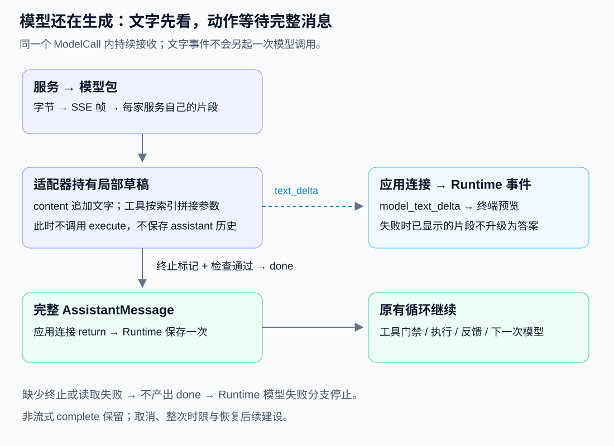
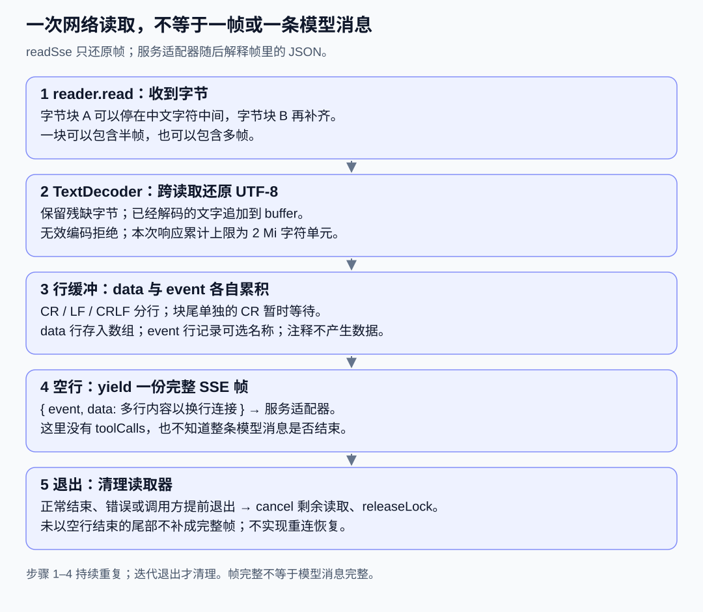
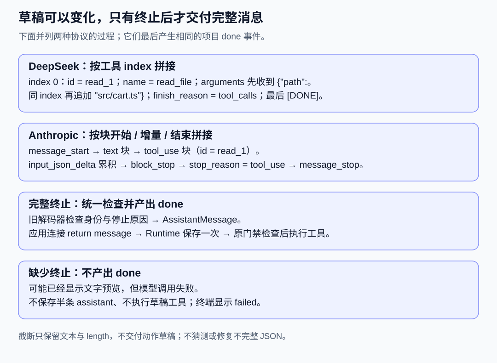

# 09 流式模型与完整消息

本篇实现：**模型还没说完，应用就能显示已经生成的文字；模型提出工具动作时，程序仍等完整请求检查通过后再执行。** 沿用代码审查与发布调查，接入两种服务的真实流式协议，不增加业务任务。

这是[第二阶段](/roadmap#第二阶段-逐篇大纲)的第四个单元。08 已经能通知“开始等模型”和“完整响应到了”，但两条通知之间仍看不到文字。本篇在中间加入文字预览，继续建设可观察的 Agent Runtime。取消和整次时限留到 10、11，原来的调用次数上限保持。

## 本篇技术方案

### 实施前，先走完一次具体过程

先拿“读取 `src/cart.ts`，再根据源码审查”的任务走一遍。文件仍来自 08 的 `fixtures/code-review/src/cart.ts`，读取仍由原来的工具执行。

1. **应用启动同一个 Runtime，模型连接改为读取流。** 循环依旧等待一次模型调用的完整结果；变化在模型包内部，请求服务时开启逐步发送响应。
2. **模型包连续读取响应，把字节恢复成数据帧。** 网络交来的一小块数据可能连一个中文字符都不完整，也可能含几条通知，因此先还原文字、识别完整帧，再解释服务字段。
3. **文字可以先显示，工具参数继续拼接。** 比如先收到“我先读取”，模型包交出一条文字增量，应用连接转给 Runtime，Runtime 用 08 的事件通道通知终端。若收到参数 `{"path":`，只保存在适配器的局部草稿里，暂不执行。
4. **服务明确结束，适配器才交出完整消息。** 后续片段补齐 `"src/cart.ts"}`，但仅仅凑成合法 JSON 还不够；还要收到服务终止标记、核对停止原因和请求身份。模型包交出完整消息，应用的模型函数返回它，Runtime 只保存一次，再按已有规则检查与执行工具。
5. **工具反馈仍进入历史，下一次模型再生成回答。** 第二次调用可以逐片显示审查文字；完整结束后保存最终回答，应用继续原来的任务验收。预览与最后记录显示同样的文字，不代表调用了两次模型。

本篇因此始终区分两条路径：**片段 → 事件 → 应用预览**，以及**完整消息 → Runtime 历史 → 工具执行或任务停止**。前者不能替代后者。如果连接提前结束，屏幕上已经出现的文字仍只是预览，不是可以交付的答案。

### 实现架构图

[](/diagrams/09-stream-boundary.svg)

## 先辨认三种不同的“小块”

“流式”是指服务不用先把整个结果准备完才返回，而是边生成边发送。本篇使用 SSE，即服务在一个 HTTP 响应中连续发送带 `data:` 的文本帧；空行分隔帧。[SSE 规范](https://html.spec.whatwg.org/multipage/server-sent-events.html#event-stream-interpretation)规定了这些行与帧的解释方式。

| 层次 | 本例中的内容 | 谁处理 |
|---|---|---|
| 网络字节块 | 某次读取取得的字节，可能在中文字符或 JSON 中间截开 | 共享读取器保留 UTF-8 解码状态 |
| SSE 帧 | `data: {"choices":...}` 后跟空行 | 共享读取器还原完整帧，服务适配器解析帧数据 |
| 模型内容片段 | 某帧中的文字，或者某项工具参数的一部分 | 服务适配器拼接；只有文字片段向应用预览 |

所以不能对每次 `reader.read()` 的返回值直接 `JSON.parse`，也不能以“这次读取完了”判断模型说完了。

本项目的公共流事件只有 `text_delta` 与 `done`：前者是一段新增文字，后者携带一条完整 `AssistantMessage`。它们是课程自己的契约，不是 DeepSeek 或 Anthropic 的原始字段。`complete` 原来的非流式接口仍保留，旧的固定协议入口也继续可用。

Pi 固定版本的 [streamAssistantResponse](https://github.com/badlogic/pi-mono/blob/8efd314fa3d3232ce197d8d7a6a5660530b9d83e/packages/agent/src/agent-loop.ts)会消费增量事件，并取得最终消息；它也在 [Anthropic 适配器](https://github.com/badlogic/pi-mono/blob/8efd314fa3d3232ce197d8d7a6a5660530b9d83e/packages/ai/src/api/anthropic-messages.ts)中恢复 SSE 和内容块。本篇借鉴增量与最终结果分离，但暂不把部分消息写入历史；Pi 会维护并替换 partial 消息，两者的状态策略不同。

## 起点与文件归属

从已实现 08 的版本开始，在仓库根目录检查状态，自行创建本章分支：

```bash
git status --short --branch
git switch -c agent/chapter-09-model-streaming
```

不增加依赖，不修改根 `package.json` 或任务工具。新增与修改分为三组：

| 位置 | 本篇职责 |
|---|---|
| `packages/model/src/types/stream.ts`、`types/sse.ts`、`types/anthropic-stream.ts` | 公共流事件，以及只在包内使用的帧与草稿 |
| `packages/model/src/providers/shared/` | HTTP 状态检查、完整 JSON 读取、字节到 SSE 帧 |
| `packages/model/src/providers/deepseek/`、`anthropic/` | 每家服务的共用请求构造与流拼接 |
| `providers/deepseek/deepseek.ts`、`anthropic/anthropic.ts` | 原非流式入口移入对应目录，改用共用请求构造 |
| `packages/model/src/stream.ts`、`index.ts` | 公共流入口及类型导出 |
| Runtime 的 `types/model-call.ts`、`types/events.ts`、`run-agent.ts` | 接收文字预览，沿用原历史保存与执行规则 |
| `examples/shared/stream-model.ts`、`model.ts`、`print-event.ts` | 共用流连接、真实配置、终端预览 |
| `fixtures/model-stream/`、`examples/code-review/src/stream-fetch.ts`、`check-stream.ts` | 固定协议材料与无网络观察，不属于框架实现 |

每家服务的调用入口、消息编码、响应解码、请求构造与流拼接统一放进对应目录。已有编解码逻辑保留，只调整文件位置与相对导入；公共包入口不变。第三步先完成明确的文件移动，再继续请求与流式实现。

## 第一步：定义预览与完整结果

新建 `packages/model/src/types/stream.ts`：

ModelStreamEvent 约定模型包交出的两类值：新增文字供即时预览，done 携带完整模型消息供后续保存和执行。适配器实际创建事件，应用连接逐项接住；定义事件类型不会启动网络读取。

<<< @/snippets/09-model-streaming/packages/model/src/types/stream.ts

例如模型包先产出 `{type:'text_delta', text:'我先读取'}`，最后产出 `{type:'done', message:完整消息}`。类型声明不会拼接数据，也不会保存历史；真正创建这两类值的是后面的服务适配器。

`text` 只放本次新增部分。如果两次分别是“数量”和“未参与计算”，应用可以依次展示，最终消息内容应是“数量未参与计算”；不能把第二次片段误当作完整答案。

异步生成器是一个可以“等待后再交出下一项”的函数。本篇的 `async function*` 用 `yield` 逐项交出值，调用方用 `for await` 依次接住。它不同于普通 `Promise<AssistantMessage>`：后者只能在最后返回一次，不能单靠 `return` 在中间交出多段预览。

## 第二步：先把字节还原成完整 SSE 帧

### 帧的类型

新建 `packages/model/src/types/sse.ts`。这是共享读取器与服务适配器之间的包内数据，不从包入口公开：

SseFrame 约定一次完整数据帧里的事件名与文本数据。共享读取器创建它，服务适配器再解析其中的原生 JSON；它既不是一次网络字节块，也不是可直接执行的模型请求。

<<< @/snippets/09-model-streaming/packages/model/src/types/sse.ts

同一帧可以有多行 `data:`，读取器用换行连接；`event:` 则是可选名称。此时还不知道数据表示文字还是工具参数，不在这里判断模型字段。

### 共享读取器

新建 `packages/model/src/providers/shared/read-sse.ts`。它接收一个 SSE 响应，逐帧交出 `{event,data}`，供下一层服务适配器解释。

比如一次读到 `data: {"text":"你`，下一次才到 `好"}\n\n`，第一次不能交出帧；缓冲区收到空行后，才交出完整的 `{"text":"你好"}` 字符串。

<<< @/snippets/09-model-streaming/packages/model/src/providers/shared/read-sse.ts

先沿正常读取看对象：`reader` 是响应体的读取器，`part` 是本次读取的字节或结束信号；`decoder` 跨多次读取保留未凑齐的 UTF-8 字节。`text` 是本次已经可以解码的文字，`buffer` 则保留尚未分完行的文字，两者用途不同。

内层循环从 `buffer` 取出完整行。遇到普通 `data:` 行先放入 `data` 数组，遇到空行才 `yield` 一帧，并清空当前帧状态。刚好落在块尾的 `\r` 先保留，避免下一次到来的 `\n` 被错当作又一个空行。注释行和不参与本次调用的重连字段不影响数据。

以下摘录已在上方完整代码中，只作对照，不要再次追加：

```ts
        if (line === '') {
          if (data.length > 0) yield { event, data: data.join('\n') };
          event = '';
          data = [];
```

这里的 `yield` 只说明“一帧完整了”，没有说明“模型消息完整了”。`readSse` 不认识 `[DONE]` 或 `message_stop`；是否能完成一次模型消息，交给服务适配器判断。

响应累计超过 2 Mi 个 JavaScript 字符单元就停止，限制当前接入的内存范围；它不等于 token 预算。无效 UTF-8、读取中断分别归为协议或传输失败。没有空行结束的尾部不强行补成帧。`finally` 在正常结束、异常或调用方提前退出时取消剩余读取、释放 reader；清理不会替程序恢复一次中断的生成。

[](/diagrams/09-sse-reader.svg)

### 先观察帧读取，不调用模型

写完这两个文件就可以观察共享读取器，不用先接上全部模块。从仓库根目录运行以下临时命令；它进入模型包，直接调试该包内部函数，不创建新的应用入口或公开导出：

```bash
(
cd packages/model
node --import tsx --input-type=module <<'JS'
import { readSse } from './src/providers/shared/read-sse';
const response = new Response('data: {"text":"你好"}\r\n\r\n', {
  headers: { 'Content-Type': 'text/event-stream' },
});
for await (const frame of readSse(response)) console.log(frame);
JS
)
```

应只看到一帧，`event` 为空字符串，`data` 是 `{"text":"你好"}`。这里没有模型请求，也没有工具执行；它先验证字节到帧这一步，后面继续复用同一个读取器。

## 第三步：完整调用与流式调用共用请求规则

### 共用 HTTP 状态检查

新建 `packages/model/src/providers/shared/request-response.ts`。响应头到达后返回 `Response`，不提前调用 `response.json()`，因为流式接入还要继续读取响应体。

requestResponse 替 JSON 和流式适配器完成共同的连接及 HTTP 检查：接收地址、已构造的请求和传输函数，返回成功 Response。调用方随后选择读 JSON 或逐帧读流，避免在共同层提前把响应体消耗掉。

<<< @/snippets/09-model-streaming/packages/model/src/providers/shared/request-response.ts

`await fetcher(...)` 返回并不表示整段响应体已经读完。这里先判断连接与 HTTP 状态；非成功状态不读取服务错误正文，并释放未使用的响应体。成功响应交给上层，JSON 与 SSE 各自继续消费。

完整替换已有的 `packages/model/src/providers/shared/request-json.ts`：保留 JSON 读取和错误归类，把共同的连接及 HTTP 检查交给刚新增的函数。

这个函数继续为非流式调用返回解析后的未知 JSON，但把建立连接和检查状态委托给 requestResponse。原响应解码器接住 JSON，再创建项目消息；这条路径不会消费同一份 SSE 流。

<<< @/snippets/09-model-streaming/packages/model/src/providers/shared/request-json.ts

因此旧的 `complete` 仍取得未知 JSON 后交给旧解码器；流式路径则取得同样经过状态检查的响应后交给 SSE 读取器。不是给一个响应体读两次。

### 响应流可以在 HTTP 成功后报告服务失败

服务也可能在已经开始的流中发送错误，而不是改回 HTTP 错误状态。此时要停止，但不能把一条明确的服务错误误说成损坏的 JSON。完整替换 `packages/model/src/types/failures.ts`，保留原类别，新增 `service`。Runtime 原来的 `model_${kind}` 映射会相应得到 `model_service`，不需要解析错误正文：

<<< @/snippets/09-model-streaming/packages/model/src/types/failures.ts

后面的服务适配器识别这种错误帧，只返回受控说明；无法识别的格式仍按协议失败处理。HTTP 失败、读取中断、服务报告失败各有不同来源，不因都发生在等待模型时就合并。

### 先把每家服务的文件放在一起

下面六个文件在 08 已经存在。将它们移动到对应目录，**不保留根 `providers/` 下的旧副本**；已经创建的 `request.ts` 放在同一目录即可。移动不改变编解码规则，也不修改应用使用的包名。

| 原路径（相对于 `packages/model/src/`） | 移动后的路径 |
|---|---|
| `providers/deepseek.ts` | `providers/deepseek/deepseek.ts` |
| `providers/deepseek-messages.ts` | `providers/deepseek/deepseek-messages.ts` |
| `providers/deepseek-response.ts` | `providers/deepseek/deepseek-response.ts` |
| `providers/anthropic.ts` | `providers/anthropic/anthropic.ts` |
| `providers/anthropic-messages.ts` | `providers/anthropic/anthropic-messages.ts` |
| `providers/anthropic-response.ts` | `providers/anthropic/anthropic-response.ts` |

整理后目录如下，`stream.ts` 在第四步再新建，不要提前复制其他章节文件：

```text
providers/
├── deepseek/
│   ├── deepseek.ts
│   ├── deepseek-messages.ts
│   ├── deepseek-response.ts
│   ├── request.ts
│   └── stream.ts          # 第四步新增
├── anthropic/
│   ├── anthropic.ts
│   ├── anthropic-messages.ts
│   ├── anthropic-response.ts
│   ├── request.ts
│   └── stream.ts          # 第四步新增
└── shared/
    ├── request-response.ts
    ├── request-json.ts
    └── read-sse.ts
```

移动后的消息编码和响应解码文件只改相对导入：原来 `../types/...` 改为 `../../types/...`，原来 `../validation` 改为 `../../validation`。不是给每个导入统一多加一层，仍要以目标文件位置为准。下面四份是移动后的完整代码，直接核对新位置的内容：

::: details packages/model/src/providers/deepseek/deepseek-messages.ts 【移动并修改导入】

DeepSeek 编码器接收累计项目历史，返回服务 messages；请求构造函数使用它发送此前请求和工具反馈。这里只移动文件与调整导入，编码行为沿用原实现。

<<< @/snippets/09-model-streaming/packages/model/src/providers/deepseek/deepseek-messages.ts

:::

::: details packages/model/src/providers/deepseek/deepseek-response.ts 【移动并修改导入】

DeepSeek 解码器检查服务返回的文字、动作和停止原因，返回项目模型消息，供完整调用及流式拼接结束时使用。文件移动不增加一次请求或工具执行。

<<< @/snippets/09-model-streaming/packages/model/src/providers/deepseek/deepseek-response.ts

:::

::: details packages/model/src/providers/anthropic/anthropic-messages.ts 【移动并修改导入】

Anthropic 编码器把项目历史转换成服务的内容块消息数组，交给请求构造函数；此处只更换文件位置，保留原协议转换。

<<< @/snippets/09-model-streaming/packages/model/src/providers/anthropic/anthropic-messages.ts

:::

::: details packages/model/src/providers/anthropic/anthropic-response.ts 【移动并修改导入】

Anthropic 解码器从完整的服务消息取得项目文字与工具请求，返回统一消息。后面的流适配器在拼接完整后也会使用它，移动文件不改变消息契约。

<<< @/snippets/09-model-streaming/packages/model/src/providers/anthropic/anthropic-response.ts

:::

两个调用入口稍后完整替换。在此之前，先完整替换 `packages/model/src/complete.ts`：保留 `complete` 的参数、提供商选择、返回值与异常处理，仅把两个内部入口导入改为新位置：

<<< @/snippets/09-model-streaming/packages/model/src/complete.ts

`packages/model/src/index.ts` 仍从 `./complete` 导出，因此应用继续使用 `@ai-harness/model`；Runtime、根脚本和包的 `exports` 不需要因为这次移动而修改。第四步新建的两个 `stream.ts` 则从同目录的 `./deepseek-response`、`./anthropic-response` 导入解码器。

### 每家服务只有一份请求构造

新建 `packages/model/src/providers/deepseek/request.ts`，写入完整代码：

这份请求构造函数接收上下文、已检查配置和是否流式的开关，返回 deepseek 服务所需的 RequestInit。完整调用和流调用共用它来组织鉴权、消息与生成设置；它只创建发送数据，后面的 HTTP 函数才实际请求。

<<< @/snippets/09-model-streaming/packages/model/src/providers/deepseek/request.ts

输入仍是同一个 `Context` 与已检查配置。函数创建 `RequestInit`，将 `streaming` 放到服务的 `stream` 字段；完整调用传 `false`，流式调用传 `true`。历史转换、工具说明、请求头、关闭思考和 30 秒单请求时限保持原规则。函数只构造数据，真正发送发生在 `requestResponse` 或 `requestJson`。

新建 `packages/model/src/providers/anthropic/request.ts`：

这份请求构造函数接收上下文、已检查配置和是否流式的开关，返回 anthropic 服务所需的 RequestInit。完整调用和流调用共用它来组织鉴权、消息与生成设置；它只创建发送数据，后面的 HTTP 函数才实际请求。

<<< @/snippets/09-model-streaming/packages/model/src/providers/anthropic/request.ts

Anthropic 仍使用自己的消息块编码和工具字段，不把 DeepSeek 请求体原样发过去。这里只统一“同一家服务的两种读取方式”，没有抹掉两家协议差异。

完整替换已经移动后的两个入口：`packages/model/src/providers/deepseek/deepseek.ts` 与 `packages/model/src/providers/anthropic/anthropic.ts`。`completeDeepSeek/completeAnthropic` 的名称和返回值保留；请求构造交给同目录的 `request.ts`，编解码算法不变。注意类型导入现在以 `../../types/` 开始，共享 HTTP 读取来自 `../shared/`：

::: details packages/model/src/providers/deepseek/deepseek.ts 【修改】

这个非流式入口继续替调用方取得一次完整结果：使用共用请求构造发送 deepseek 请求，等待 JSON，解码后返回项目消息。新增流能力不会把这个入口改成逐片输出。

<<< @/snippets/09-model-streaming/packages/model/src/providers/deepseek/deepseek.ts

:::

::: details packages/model/src/providers/anthropic/anthropic.ts 【修改】

这个非流式入口继续替调用方取得一次完整结果：使用共用请求构造发送 anthropic 请求，等待 JSON，解码后返回项目消息。新增流能力不会把这个入口改成逐片输出。

<<< @/snippets/09-model-streaming/packages/model/src/providers/anthropic/anthropic.ts

:::

这两个文件仍服务于非流式 `complete`。后面的 `stream` 使用新拼接器；不能让原解码器直接解析半截网络块。

## 第四步：两种服务各自拼接，同一个项目消息返回

### DeepSeek：按工具索引追加参数

[DeepSeek 流式接口](https://api-docs.deepseek.com/api/create-chat-completion/)以 SSE 发送内容增量，最终使用 `[DONE]`。本篇读取第 0 个 choice 中的 `delta`，工具片段按 `index` 区分，不拿临时数组长度当模型请求 ID。

先看两段参数的结构示意，以下用于观察，不写入源码：

```json
{"index":0,"id":"read_1","type":"function","function":{"name":"read_file","arguments":"{\"path\":"}}
{"index":0,"function":{"arguments":"\"src/cart.ts\"}"}}
```

第一段创建索引 0 的草稿，第二段继续追加同一草稿，最后参数才是 `{"path":"src/cart.ts"}`。索引用于拼接，本来的 `read_1` 用于之后工具结果关联；两者不能混用。

新建 `packages/model/src/providers/deepseek/stream.ts`：

streamDeepSeek 把服务的逐帧响应转换成项目流事件。它接收上下文与配置，文字到达时交出 text_delta，工具字段按索引保留在局部草稿；服务终止且消息检查完成后才交出 done。上层连接消费这些事件，Runtime 不会见到或执行半份参数。

<<< @/snippets/09-model-streaming/packages/model/src/providers/deepseek/stream.ts

`response` 是已取得响应头的 HTTP 响应；`for await` 从共享读取器接住一帧后，才解析 `frame.data`。适配器把文字追加到局部 `content`，同时 `yield text_delta` 给应用预览。工具片段只追加到 `calls` 中，不向 Runtime 交出可执行请求。

每个 Map 值都有 `id/name/arguments` 三段字符串。不同项可以交错到达，结束时按索引排序并检查是否缺项，再交给解码器；不能用首次到达顺序替代工具在完整列表中的位置。服务可能在后续帧才补上字段，因而不能每次收到片段都要求参数已经是完整 JSON。与此同时，索引、类型和字段形状仍要检查，不能把任意数据拼成看似成功的响应。

收到 `[DONE]` 后还要有受支持的停止原因。正常结果组装为旧解码器认识的完整形状，由 `decodeMessage` 再检查身份、停止原因与请求列表，最后才 `yield done`。`length` 则只保留文本和截断状态，不把动作草稿交付为请求。这样即使 JSON 碰巧已经能解析，缺少服务终止标记仍不能执行。

### Anthropic：先开块，再追加，最后结束块与消息

[Anthropic 流式协议](https://platform.claude.com/docs/en/build-with-claude/streaming)有明确的块生命周期：消息开始，内容块开始/增量/结束，消息停止原因，最后 `message_stop`。工具参数在 `input_json_delta.partial_json` 中分段到达。

新建 `packages/model/src/types/anthropic-stream.ts`。这里的 `json` 是待拼接文本，不是已经验证的工具参数：

AnthropicBlock 描述适配器内部正在拼接的内容块：文本块存文字，工具块存 ID、名称和参数草稿。服务事件处理函数创建和更新这些值，完整终止后才将它们转换成项目消息，不把草稿公开为工具请求。

<<< @/snippets/09-model-streaming/packages/model/src/types/anthropic-stream.ts

再新建 `packages/model/src/providers/anthropic/stream.ts`：

streamAnthropic 负责按服务的块生命周期接收文字与工具参数，返回与 DeepSeek 相同的项目事件。它在块开始时创建草稿，增量到达时追加，收到完整消息终止后才交出 done；公共流入口随后将事件传给应用连接。

<<< @/snippets/09-model-streaming/packages/model/src/providers/anthropic/stream.ts

以本例为线索：`message_start` 开始一条空消息；索引 0 的文字块逐步收到“我先读取”，可立即预览；该块结束后，索引 1 的工具块开始，保存 `read_1/read_file`。后续 JSON 片段只追加到这个块的 `json`。

`active` 保存当前尚未结束的块索引，`blocks` 保存本次消息已开始的所有块。开始索引不连续、没有活动块就发增量、文字片段进入工具块等情况都会拒绝，不把它们猜成正常数据。当前只支持文本和自定义工具，思考、服务端工具等其他内容明确拒绝；`ping` 保持连接但不生成文字。

最后收到 `message_delta` 的停止原因以及 `message_stop`，才解析完整工具 JSON、组装原解码器的输入，再产生 `done`。多个文字块之间沿用旧解码器的换行规则，预览也补相同换行；没有把半截 JSON“修复”成某个猜测参数。截断结果仍只作为 `length` 返回。

[](/diagrams/09-provider-final.svg)

## 第五步：公开流入口，并观察一次模型流

新建 `packages/model/src/stream.ts`。它像 `complete` 一样检查配置并选择提供商，但返回的是可以逐项消费的异步生成器：

<<< @/snippets/09-model-streaming/packages/model/src/stream.ts

调用 `stream(...)` 先取得可迭代对象，进入 `for await` 后才开始执行函数体和请求服务。`yield*` 将所选适配器的事件依次交给调用方，不把所有文字先收集完再一次性输出。`ModelCallError` 原类别保留，未知解析和拼接错误统一成为受控的协议失败，原始原因只保留供本地断点检查。

完整替换 `packages/model/src/index.ts`：原导出保留，新增 `stream/ModelStreamEvent`，包内帧和草稿不公开。

<<< @/snippets/09-model-streaming/packages/model/src/index.ts

配置字段没有新增；`types/options.ts` 只更新“供 complete 或 stream 使用”的注释，完整内容见章末，不需要调整原字段。随后在仓库根目录先构建模型包，应用才可读取新导出：

```bash
npm run build --workspace @ai-harness/model
```

下一步接 Runtime 之前，可以先准备本篇的固定流材料，单独查看模型包输出。新建 `fixtures/model-stream/`，按以下文件名写入**完整内容，保留帧之间空行**。这些是预写协议样本，不是另一套业务源码，也不是实际模型日志。末尾的 `: fixed sample end` 是 SSE 注释，可保留；终止数据帧后仍须有空行，不能把相邻帧直接连在一起：

::: details fixtures/model-stream/deepseek-tools.sse 【新增文件】

<<< @/snippets/09-model-streaming/fixtures/model-stream/deepseek-tools.sse{text}

:::

::: details fixtures/model-stream/deepseek-answer.sse 【新增文件】

<<< @/snippets/09-model-streaming/fixtures/model-stream/deepseek-answer.sse{text}

:::

::: details fixtures/model-stream/anthropic-tools.sse 【新增文件】

<<< @/snippets/09-model-streaming/fixtures/model-stream/anthropic-tools.sse{text}

:::

::: details fixtures/model-stream/anthropic-answer.sse 【新增文件】

<<< @/snippets/09-model-streaming/fixtures/model-stream/anthropic-answer.sse{text}

:::

再新建 `examples/code-review/src/stream-fetch.ts`。它替代 HTTP 传输，每次从固定文件读取响应，按 32 字节逐块发送；两种模式都不访问网络：

<<< @/snippets/09-model-streaming/examples/code-review/src/stream-fetch.ts

`createStreamFetch` 返回一个与 `fetch` 形状相同的函数，`calls` 只决定先读工具样本还是回答样本。`pull` 在读取方需要更多数据时交出下一段字节，`offset` 标记已发送位置；32 字节可能截开字符或帧，因此实际锻炼共享读取器。20 毫秒等待只是让样本变化可见，不是服务延迟统计。

`interrupt` 模式去掉第一次响应的终止标记再正常结束响应体，用来复现“响应提前结束，缺少完整消息”的协议失败；它不伪装成操作系统网络报错。样本内的请求与回答都已预定，只能证明程序路径。

在仓库根目录先运行一次模型流观察，不启动 Agent：

```bash
node --import tsx --input-type=module <<'JS'
import { stream } from '@ai-harness/model';
import { createStreamFetch } from './examples/code-review/src/stream-fetch';
for await (const event of stream({ messages: [{ role: 'user', content: '观察读取请求' }] }, {
  provider: 'deepseek', apiKey: 'local-placeholder', model: 'local-sample',
  fetch: createStreamFetch('deepseek'),
})) console.log(event);
JS
```

应先得到 `text_delta / 我先读取`，再得到 `done` 中完整的 `toolUse` 消息与 `read_1`。这条命令没有实际读取 `src/cart.ts`；模型包不执行工具。随后将两处 `deepseek` 都改成 `anthropic` 再观察，应得到相同的项目事件，尽管固定样本的原生协议不同。

## 第六步：让 Runtime 转发预览，只保存完整结果

完整替换 `packages/runtime/src/types/model-call.ts`。`ModelCall` 增加可选的第二个参数，模型连接用它通知文字，返回值仍为一条完整消息。旧的单参数固定模型函数可以忽略它，不需要重写所有旧观察入口：

<<< @/snippets/09-model-streaming/packages/runtime/src/types/model-call.ts

完整替换 `packages/runtime/src/types/events.ts`。保留 08 事件，新增 `model_text_delta` 的调用序号与文字字段；这次事件允许携带预览文字，仍不暴露可写历史或工具参数：

<<< @/snippets/09-model-streaming/packages/runtime/src/types/events.ts

完整替换 `packages/runtime/src/run-agent.ts`。保留原循环与全部停止判断，只在调用 `options.callModel` 时传入第二个函数，把文字接到 08 的受保护派发器：

循环仍等待一次 ModelCall 的完整返回，变化是把中途预览接到事件派发器。文字片段因此能到达应用；只有最终返回的 AssistantMessage 会写入历史，并作为工具执行或停止判断的依据。

<<< @/snippets/09-model-streaming/packages/runtime/src/run-agent.ts

下面的关键语句已在完整文件中，只用于对照，不需再次写入：

```ts
      }, (text) => events.emit({ type: 'model_text_delta', modelCall: modelCalls, text }));
```

这段函数由 Runtime 创建，模型连接在收到文字片段时调用。它等待应用观察完成，但没有 `messages.push`，不会创建一条 assistant 历史。真正保存的位置仍是后面的 `messages.push(message)`：只有 `await options.callModel(...)` 成功返回完整消息后，程序才执行这条语句并发出 `model_end`。

因此流失败时，原来的模型异常分支返回 `failed / model`，不会先保存半条 assistant 再假装已经正常返回。工具执行器完全不改，仍只接完整消息，经停止原因、次数上限及批次门禁后执行。预览打印失败沿用 08 的观察失败计数，不要求模型重新生成或重做工具。

## 第七步：共用流连接，运行完整的无网络任务

新建 `examples/shared/stream-model.ts`。它负责把模型包的多次流事件接回 Runtime 需要的一次完整返回；两个真实任务和固定观察共用，不各自复制消费循环：

createStreamingModelCall 将模型包的异步事件转换成 Runtime 需要的 ModelCall：接收调用配置，返回一个连接函数；连接函数逐项消费事件，将文字交给预览回调，最后把 done 中的完整消息返回循环。它不保存运行历史。

<<< @/snippets/09-model-streaming/examples/shared/stream-model.ts

先辨认两个方向：`for await` 接住的是模型包事件；`onTextDelta` 是 Runtime 刚传入的通知函数。收到 `text_delta` 时，连接调用通知函数再继续等下一项；收到 `done` 时，`return event.message` 结束本次 `ModelCall`，消息回到 Runtime 的 `message` 变量。

这条返回不会自动保存历史。还要回到上一节的 `messages.push(message)` 才保存；连接函数不拥有对话记录，也不调用具体工具。调用方提前结束迭代时会向生成器传递退出，共享 reader 在 `finally` 清理；不是让 HTTP 读取留在后台继续无限运行。

新建 `examples/code-review/src/check-stream.ts`：

这个无网络入口将固定 SSE 传输、共用流连接和真实文件工具接到原 runAgent。运行中显示实际解码出的预览，停止后展示完整历史，用来观察“片段到达”和“完整消息可执行”之间的边界；模型动作顺序由样本给定。

<<< @/snippets/09-model-streaming/examples/code-review/src/check-stream.ts

这里的 `apiKey/model` 只是本地占位值，真正接触它们的是固定 fetch，不发服务请求。`provider` 选择哪种协议样本，`reviewTools` 仍真正读取清单内的源码；固定回答不证明自主审查质量。

完成所有当前文件后，在仓库根目录运行：

```bash
npm run check
node --import tsx examples/code-review/src/check-stream.ts deepseek
node --import tsx examples/code-review/src/check-stream.ts anthropic
```

两种协议都应有以下顺序，ID 以占位前缀表示；下方是摘出的事件，不是完整记录：

```text
run_start
model_start        模型调用 1
model_text_delta   文字预览："我先读取"
model_end          toolUse / 请求工具 1 项
tool_start         read_file / read_1
tool_end           read_file / read_1 / 成功结果
model_start        模型调用 2
model_text_delta   文字预览："【固定响应】"
model_text_delta   文字预览："已收到源码。"
model_end          stop / 请求工具 0 项
run_end            answered / 模型调用 2 次
```

具体看三件事：第一段预览先于 `model_end`；第一次 `tool_start` 晚于完整 `model_end`；最终记录只有两条完整 assistant 与一条工具结果，加初始用户消息共 4 条，没有把三个片段各保存成消息。第二次模型输入仍是用户、第一次完整请求、工具结果共 3 条。

记录中再次展示“我先读取”与最后的完整文字，是读取已保存消息，不是又发了一次服务请求。终端继续使用 08 的分块工具，不需要新日志依赖。

## 第八步：让两个真实入口使用相同接线

完整替换 `examples/shared/model.ts`：保留提供商选择、对应凭据、模型名与 256 输出 token 配置，只把末尾的连接换成 `createStreamingModelCall(options)`。

这个应用工厂仍选择当前服务与对应凭据，最后返回共用流连接。两个 main 因此都获得能报告预览、又能返回完整消息的 ModelCall，无需各自实现流消费循环。

<<< @/snippets/09-model-streaming/examples/shared/model.ts

两个 `main.ts` 不改：它们原来已经调用共用 `createModelCall` 并传入 `printEvent`。更换传输方式不需要把服务协议写进 Runtime 或任务。

完整替换 `examples/shared/print-event.ts`：保留原事件分支，只新增 `model_text_delta` 展示。使用 `JSON.stringify` 给预览文字加引号并显示片段内换行，便于看清每片边界；它不是等待最终结果后再拆字：

<<< @/snippets/09-model-streaming/examples/shared/print-event.ts

根目录 `start/debug/check` 不变。下面两个命令沿用真实服务配置，可能产生费用，由操作者自行决定是否运行；与刚才无网络命令不同：

```bash
npm start
npm start -- --example release-impact
```

真实服务的分片数量、长度与工具选择不固定。观察同一个 `modelCall` 的片段在结束前出现，完整工具请求之后才执行；不要要求真实服务每个片段恰好和固定样本一样。

## 中断实验：已经显示的文字不算完整答案

无须修改源码，在仓库根目录运行：

```bash
node --import tsx examples/code-review/src/check-stream.ts deepseek --interrupt
node --import tsx examples/code-review/src/check-stream.ts anthropic --interrupt
```

入口会故意删掉第一条固定响应的最终终止标记。预期仍可见“我先读取”的 `model_text_delta`，随后 `model_failed / model_protocol`，最终 `failed / modelCalls:1`。不应有第一次的 `model_end`、任何 `tool_start` 或成功工具结果；最终历史只有初始用户消息。退出码 1 表示本次故障如实停止，并不代表要把它改成正常答案。

去掉 `--interrupt` 再运行，应恢复正常读取和两次调用。这个实验复现缺少协议终止，不代表所有网络中断都会归为同一类别；真实 reader 拒绝属于 `model_transport`，HTTP 非成功状态仍有原来的 HTTP 类别；服务在流中报告的错误为 `model_service`。

### 可逆故障：片段展示抛错

在 `examples/shared/print-event.ts` 的 `case 'model_text_delta'` 中，已有 `logLine(...)` 之后、`break` 之前临时插入：

```ts
      throw new Error('临时模拟文字预览展示失败');
```

再跑正常无网络入口。应仍是 `answered / modelCalls:2`、只有一次读取；固定样本三个文字事件对应 `observerErrors:3`。这是 08 异常隔离在新事件上的复用，不是三次模型失败。实验后移除临时 `throw`，恢复计数为 0，再保存代码。

## 断点：第一次出现差异在哪里

```bash
node --inspect-brk --import tsx examples/code-review/src/check-stream.ts deepseek
```

| 位置 | 观察与判断 |
|---|---|
| `read-sse.ts` 的 `reader.read()` 后 | `part.value` 是字节，不保证等于一帧；`buffer`保留未完整分行的文字 |
| DeepSeek 的 `call[key] += ...` | 先见 `arguments` 为 `{"path":`，再补齐；没有 Runtime 工具调用 |
| Anthropic 的 `block.json += ...` | `active` 指当前工具块，草稿不进入 Runtime 历史 |
| 服务适配器的 `yield {type:'done',message}` | 已有服务终止标记；检查工具 ID 与完整参数 |
| `stream-model.ts` 的 `return event.message` | 返回给当前 `ModelCall`，没有自行保存历史 |
| Runtime 的 `messages.push(message)` | 本次完整消息才追加；预览没有额外 assistant 条目 |

看到半截 JSON 时，不要提前改工具校验器放行；先确认自己停在适配器的局部拼接阶段。完整参数到达仍不意味着工具可以立即运行，还要经过服务终止与 Runtime 原有门禁。

## 小迁移：一项请求的参数分成三帧

只改 `fixtures/model-stream/deepseek-tools.sse`：找到索引 0 后半段参数，把它改为两帧，分别追加 `"src/` 和 `cart.ts"}`。前一帧的 `finish_reason` 为 `null`，后一帧保留 `tool_calls`；最后 `[DONE]` 不动。每帧都保持合法的外层 JSON 和空行分隔。

目标仍是最后得到 `{"path":"src/cart.ts"}`，只执行一次 `read_1`，第二次模型输入仍为 3 条。不能把三帧当三次工具调用，也不需要修改工具本身。验证后恢复固定样本，避免后续核对混入实验改动。

## 本篇边界与下一步

现在两种服务都可以在一次模型调用里交出文字预览与最终消息，两个任务复用同一个连接与 Runtime。当前只支持文本、自定义工具与有限原生事件；不静默接收无法保存的思考块、图片或服务工具。截断只交回文本与 length，动作草稿不作为请求交付。

这不是完整 SSE 客户端、服务兼容认证或生产流平台：没有自动重连、重放、跨服务降级或恢复，2 Mi 字符限制也不替代任务预算。已显示预览不会在失败后自动撤回，桌面应用以后需要明确显示失败状态；当前终端通过模型失败与运行停止行说明结果。

观察函数仍顺序等待，慢展示会拖慢读取；30 秒仍是单 HTTP 请求时限，调用次数上限仍由 Runtime 执行。下一篇加入主动取消，处理应用提出停止、模型读取与工具等待如何协作退出，不靠无限等待或增加次数维持运行。

## 完整文件核对

以下与分步代码使用同一份候选。新文件与本章变化标注基于 08；其余文件只清除旧章节标签并复用。固定材料不包含真实凭据。

::: details .env.example （复用）

<<< @/snippets/09-model-streaming/.env.example{text}

:::

::: details examples/code-review/package.json （复用）

<<< @/snippets/09-model-streaming/examples/code-review/package.json

:::

::: details examples/code-review/src/check-events.ts （复用）

<<< @/snippets/09-model-streaming/examples/code-review/src/check-events.ts

:::

::: details examples/code-review/src/check-protocol.ts （复用）

<<< @/snippets/09-model-streaming/examples/code-review/src/check-protocol.ts

:::

::: details examples/code-review/src/check-stream.ts 【新增文件】

<<< @/snippets/09-model-streaming/examples/code-review/src/check-stream.ts

:::

::: details examples/code-review/src/check-tool-contract.ts （复用）

<<< @/snippets/09-model-streaming/examples/code-review/src/check-tool-contract.ts

:::

::: details examples/code-review/src/main.ts （复用）

<<< @/snippets/09-model-streaming/examples/code-review/src/main.ts

:::

::: details examples/code-review/src/protocol-fetch.ts （复用）

<<< @/snippets/09-model-streaming/examples/code-review/src/protocol-fetch.ts

:::

::: details examples/code-review/src/report-run.ts （复用）

<<< @/snippets/09-model-streaming/examples/code-review/src/report-run.ts

:::

::: details examples/code-review/src/stream-fetch.ts 【新增文件】

<<< @/snippets/09-model-streaming/examples/code-review/src/stream-fetch.ts

:::

::: details examples/code-review/src/tools.ts （复用）

<<< @/snippets/09-model-streaming/examples/code-review/src/tools.ts

:::

::: details examples/release-impact/package.json （复用）

<<< @/snippets/09-model-streaming/examples/release-impact/package.json

:::

::: details examples/release-impact/src/load-records.ts （复用）

<<< @/snippets/09-model-streaming/examples/release-impact/src/load-records.ts

:::

::: details examples/release-impact/src/lookup-tool.ts （复用）

<<< @/snippets/09-model-streaming/examples/release-impact/src/lookup-tool.ts

:::

::: details examples/release-impact/src/main.ts （复用）

<<< @/snippets/09-model-streaming/examples/release-impact/src/main.ts

:::

::: details examples/release-impact/src/report-run.ts （复用）

<<< @/snippets/09-model-streaming/examples/release-impact/src/report-run.ts

:::

::: details examples/release-impact/src/tools.ts （复用）

<<< @/snippets/09-model-streaming/examples/release-impact/src/tools.ts

:::

::: details examples/release-impact/src/types/tools.ts （复用）

<<< @/snippets/09-model-streaming/examples/release-impact/src/types/tools.ts

:::

::: details examples/release-impact/src/validation.ts （复用）

<<< @/snippets/09-model-streaming/examples/release-impact/src/validation.ts

:::

::: details examples/run.ts （复用）

<<< @/snippets/09-model-streaming/examples/run.ts

:::

::: details examples/shared/model.ts 【修改】

<<< @/snippets/09-model-streaming/examples/shared/model.ts

:::

::: details examples/shared/print-event.ts 【修改】

<<< @/snippets/09-model-streaming/examples/shared/print-event.ts

:::

::: details examples/shared/print-run.ts （复用）

<<< @/snippets/09-model-streaming/examples/shared/print-run.ts

:::

::: details examples/shared/stream-model.ts 【新增文件】

<<< @/snippets/09-model-streaming/examples/shared/stream-model.ts

:::

::: details examples/shared/terminal.ts （复用）

<<< @/snippets/09-model-streaming/examples/shared/terminal.ts

:::

::: details fixtures/code-review/src/cart.ts （复用）

<<< @/snippets/09-model-streaming/fixtures/code-review/src/cart.ts

:::

::: details fixtures/model-protocol/anthropic.json （复用）

<<< @/snippets/09-model-streaming/fixtures/model-protocol/anthropic.json

:::

::: details fixtures/model-protocol/deepseek.json （复用）

<<< @/snippets/09-model-streaming/fixtures/model-protocol/deepseek.json

:::

::: details fixtures/model-stream/anthropic-answer.sse 【新增文件】

<<< @/snippets/09-model-streaming/fixtures/model-stream/anthropic-answer.sse{text}

:::

::: details fixtures/model-stream/anthropic-tools.sse 【新增文件】

<<< @/snippets/09-model-streaming/fixtures/model-stream/anthropic-tools.sse{text}

:::

::: details fixtures/model-stream/deepseek-answer.sse 【新增文件】

<<< @/snippets/09-model-streaming/fixtures/model-stream/deepseek-answer.sse{text}

:::

::: details fixtures/model-stream/deepseek-tools.sse 【新增文件】

<<< @/snippets/09-model-streaming/fixtures/model-stream/deepseek-tools.sse{text}

:::

::: details fixtures/release-impact/releases.json （复用）

<<< @/snippets/09-model-streaming/fixtures/release-impact/releases.json

:::

::: details fixtures/release-impact/services.json （复用）

<<< @/snippets/09-model-streaming/fixtures/release-impact/services.json

:::

::: details package.json （复用）

<<< @/snippets/09-model-streaming/package.json

:::

::: details packages/coding-tools/package.json （复用）

<<< @/snippets/09-model-streaming/packages/coding-tools/package.json

:::

::: details packages/coding-tools/src/index.ts （复用）

<<< @/snippets/09-model-streaming/packages/coding-tools/src/index.ts

:::

::: details packages/coding-tools/src/read-file.ts （复用）

<<< @/snippets/09-model-streaming/packages/coding-tools/src/read-file.ts

:::

::: details packages/coding-tools/src/types/read-file.ts （复用）

<<< @/snippets/09-model-streaming/packages/coding-tools/src/types/read-file.ts

:::

::: details packages/coding-tools/tsconfig.json （复用）

<<< @/snippets/09-model-streaming/packages/coding-tools/tsconfig.json

:::

::: details packages/model/package.json （复用）

<<< @/snippets/09-model-streaming/packages/model/package.json

:::

::: details packages/model/src/complete.ts 【修改】

<<< @/snippets/09-model-streaming/packages/model/src/complete.ts

:::

::: details packages/model/src/errors/model-call-error.ts （复用）

<<< @/snippets/09-model-streaming/packages/model/src/errors/model-call-error.ts

:::

::: details packages/model/src/index.ts 【修改】

<<< @/snippets/09-model-streaming/packages/model/src/index.ts

:::

::: details packages/model/src/providers/anthropic/anthropic-messages.ts 【修改】

<<< @/snippets/09-model-streaming/packages/model/src/providers/anthropic/anthropic-messages.ts

:::

::: details packages/model/src/providers/anthropic/anthropic-response.ts 【修改】

<<< @/snippets/09-model-streaming/packages/model/src/providers/anthropic/anthropic-response.ts

:::

::: details packages/model/src/providers/anthropic/anthropic.ts 【修改】

<<< @/snippets/09-model-streaming/packages/model/src/providers/anthropic/anthropic.ts

:::

::: details packages/model/src/providers/anthropic/request.ts 【新增文件】

<<< @/snippets/09-model-streaming/packages/model/src/providers/anthropic/request.ts

:::

::: details packages/model/src/providers/anthropic/stream.ts 【新增文件】

<<< @/snippets/09-model-streaming/packages/model/src/providers/anthropic/stream.ts

:::

::: details packages/model/src/providers/deepseek/deepseek-messages.ts 【修改】

<<< @/snippets/09-model-streaming/packages/model/src/providers/deepseek/deepseek-messages.ts

:::

::: details packages/model/src/providers/deepseek/deepseek-response.ts 【修改】

<<< @/snippets/09-model-streaming/packages/model/src/providers/deepseek/deepseek-response.ts

:::

::: details packages/model/src/providers/deepseek/deepseek.ts 【修改】

<<< @/snippets/09-model-streaming/packages/model/src/providers/deepseek/deepseek.ts

:::

::: details packages/model/src/providers/deepseek/request.ts 【新增文件】

<<< @/snippets/09-model-streaming/packages/model/src/providers/deepseek/request.ts

:::

::: details packages/model/src/providers/deepseek/stream.ts 【新增文件】

<<< @/snippets/09-model-streaming/packages/model/src/providers/deepseek/stream.ts

:::

::: details packages/model/src/providers/shared/read-sse.ts 【新增文件】

<<< @/snippets/09-model-streaming/packages/model/src/providers/shared/read-sse.ts

:::

::: details packages/model/src/providers/shared/request-json.ts 【修改】

<<< @/snippets/09-model-streaming/packages/model/src/providers/shared/request-json.ts

:::

::: details packages/model/src/providers/shared/request-response.ts 【新增文件】

<<< @/snippets/09-model-streaming/packages/model/src/providers/shared/request-response.ts

:::

::: details packages/model/src/request-options.ts （复用）

<<< @/snippets/09-model-streaming/packages/model/src/request-options.ts

:::

::: details packages/model/src/stream.ts 【新增文件】

<<< @/snippets/09-model-streaming/packages/model/src/stream.ts

:::

::: details packages/model/src/types/anthropic-stream.ts 【新增文件】

<<< @/snippets/09-model-streaming/packages/model/src/types/anthropic-stream.ts

:::

::: details packages/model/src/types/anthropic.ts （复用）

<<< @/snippets/09-model-streaming/packages/model/src/types/anthropic.ts

:::

::: details packages/model/src/types/context.ts （复用）

<<< @/snippets/09-model-streaming/packages/model/src/types/context.ts

:::

::: details packages/model/src/types/failures.ts 【修改】

<<< @/snippets/09-model-streaming/packages/model/src/types/failures.ts

:::

::: details packages/model/src/types/messages.ts （复用）

<<< @/snippets/09-model-streaming/packages/model/src/types/messages.ts

:::

::: details packages/model/src/types/options.ts 【修改】

<<< @/snippets/09-model-streaming/packages/model/src/types/options.ts

:::

::: details packages/model/src/types/sse.ts 【新增文件】

<<< @/snippets/09-model-streaming/packages/model/src/types/sse.ts

:::

::: details packages/model/src/types/stream.ts 【新增文件】

<<< @/snippets/09-model-streaming/packages/model/src/types/stream.ts

:::

::: details packages/model/src/types/tool-results.ts （复用）

<<< @/snippets/09-model-streaming/packages/model/src/types/tool-results.ts

:::

::: details packages/model/src/types/tools.ts （复用）

<<< @/snippets/09-model-streaming/packages/model/src/types/tools.ts

:::

::: details packages/model/src/validation.ts （复用）

<<< @/snippets/09-model-streaming/packages/model/src/validation.ts

:::

::: details packages/model/tsconfig.json （复用）

<<< @/snippets/09-model-streaming/packages/model/tsconfig.json

:::

::: details packages/runtime/package.json （复用）

<<< @/snippets/09-model-streaming/packages/runtime/package.json

:::

::: details packages/runtime/src/errors/tool-batch-error.ts （复用）

<<< @/snippets/09-model-streaming/packages/runtime/src/errors/tool-batch-error.ts

:::

::: details packages/runtime/src/errors/tool-execution-error.ts （复用）

<<< @/snippets/09-model-streaming/packages/runtime/src/errors/tool-execution-error.ts

:::

::: details packages/runtime/src/events/dispatcher.ts （复用）

<<< @/snippets/09-model-streaming/packages/runtime/src/events/dispatcher.ts

:::

::: details packages/runtime/src/index.ts （复用）

<<< @/snippets/09-model-streaming/packages/runtime/src/index.ts

:::

::: details packages/runtime/src/run-agent.ts 【修改】

<<< @/snippets/09-model-streaming/packages/runtime/src/run-agent.ts

:::

::: details packages/runtime/src/tools/execute.ts （复用）

<<< @/snippets/09-model-streaming/packages/runtime/src/tools/execute.ts

:::

::: details packages/runtime/src/tools/registry.ts （复用）

<<< @/snippets/09-model-streaming/packages/runtime/src/tools/registry.ts

:::

::: details packages/runtime/src/types/events.ts 【修改】

<<< @/snippets/09-model-streaming/packages/runtime/src/types/events.ts

:::

::: details packages/runtime/src/types/failures.ts （复用）

<<< @/snippets/09-model-streaming/packages/runtime/src/types/failures.ts

:::

::: details packages/runtime/src/types/model-call.ts 【修改】

<<< @/snippets/09-model-streaming/packages/runtime/src/types/model-call.ts

:::

::: details packages/runtime/src/types/run.ts （复用）

<<< @/snippets/09-model-streaming/packages/runtime/src/types/run.ts

:::

::: details packages/runtime/src/types/tool-registry.ts （复用）

<<< @/snippets/09-model-streaming/packages/runtime/src/types/tool-registry.ts

:::

::: details packages/runtime/src/types/tools.ts （复用）

<<< @/snippets/09-model-streaming/packages/runtime/src/types/tools.ts

:::

::: details packages/runtime/tsconfig.json （复用）

<<< @/snippets/09-model-streaming/packages/runtime/tsconfig.json

:::

::: details tsconfig.json （复用）

<<< @/snippets/09-model-streaming/tsconfig.json

:::

## 保存本章

先恢复临时故障与材料修改，完成相应检查，再由你审阅并执行。暂存包括实现、固定样本和网站；不加入真实 `.env`、临时日志或构建产物：

```bash
git status --short --branch
git diff --check
git diff

git add packages/model/src packages/runtime/src \
  examples/shared examples/code-review/src/check-stream.ts \
  examples/code-review/src/stream-fetch.ts fixtures/model-stream site docs AGENTS.md

git commit -F - <<'EOF'
第09篇：显示模型增量并等待完整请求再执行

模型包提供原生流入口，分别拼接DeepSeek和Anthropic协议，保留完整调用。
共享读取器处理UTF8分块与SSE帧，未取得终止标记不交付完整消息。
Runtime转发文字预览，只保存完整响应，工具继续经过原有执行门禁。
两个任务复用流连接，补充无网络观察、提前结束和展示故障实验。
EOF

git push -u origin agent/chapter-09-model-streaming
```

提交、推送不等于合并部署，也不代表已验证真实模型任务质量或独立掌握。

<style>
.model-streaming .vp-doc .custom-block.details summary {
  overflow-wrap: anywhere;
}
</style>
