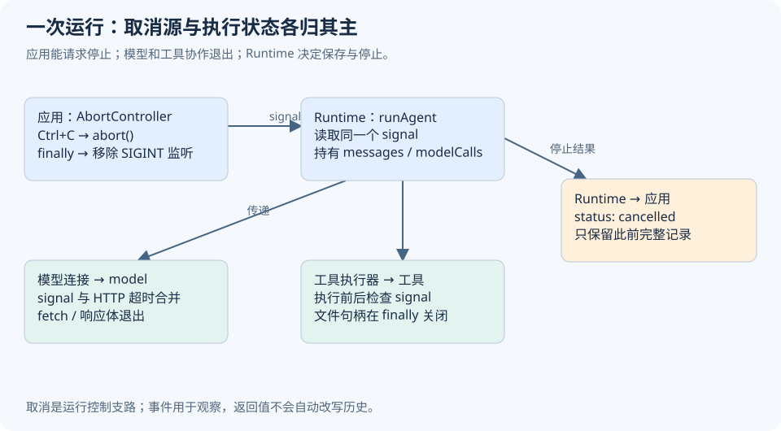
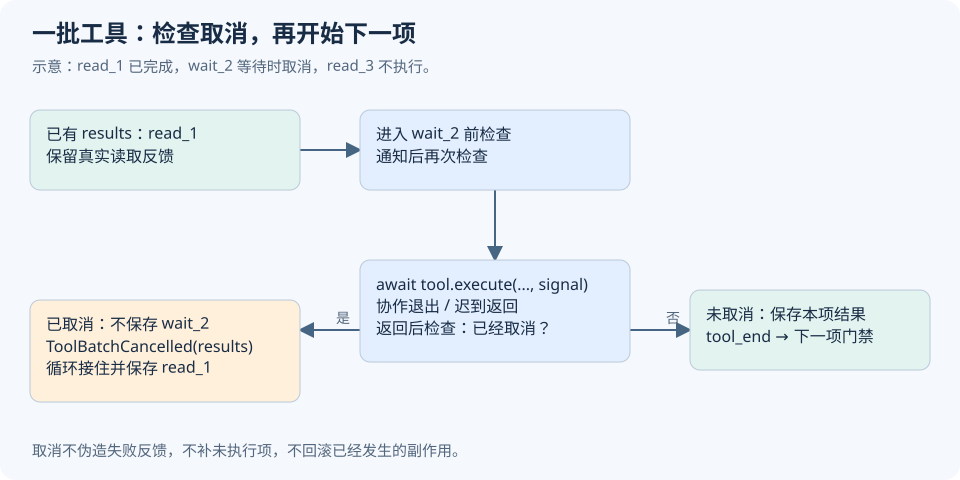
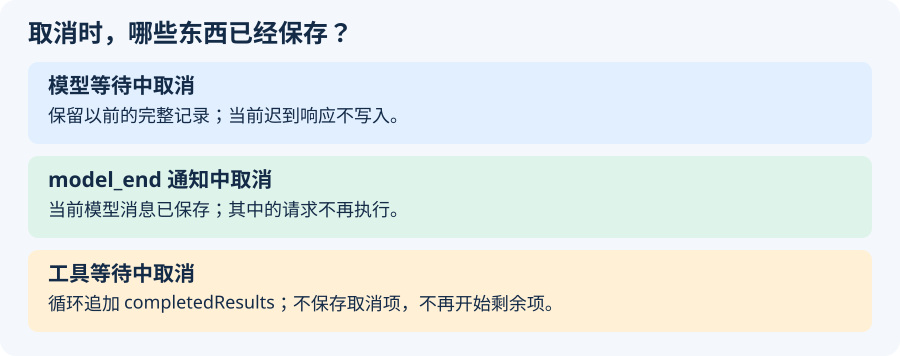
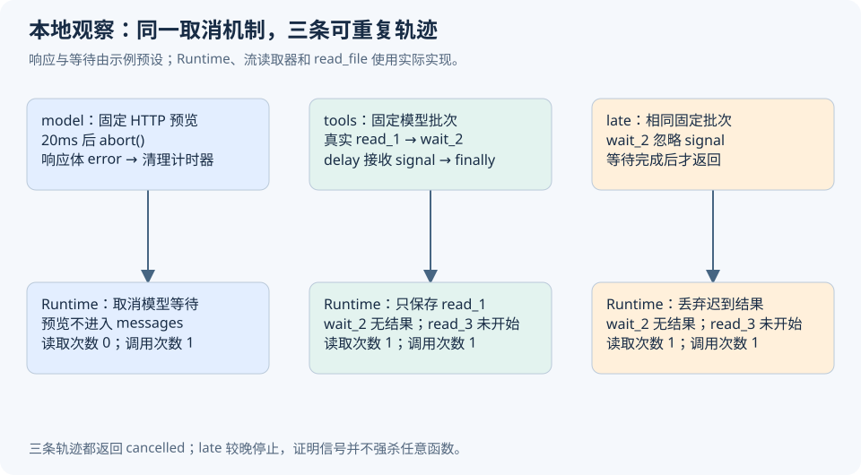

# 10 主动取消一次运行

本篇实现：**应用发出停止请求后，正在等待的模型和工具协作退出；Runtime 保留此前完成的记录，拒绝迟到结果，并停止后续动作。** 两个原有任务都可以按 Ctrl+C 取消，不需要给循环加入任务分支。

这是[第二阶段](/roadmap#第二阶段-逐篇大纲)的第五个单元，继续建设可控制的 Agent Runtime。09 让模型输出逐片可见；现在看到运行方向不合适时，应用还需要能叫停。整次任务期限与预算管理留给 11，本篇保留单次 HTTP 30 秒和原有调用次数上限。

## 实施前：先走完整个实现逻辑

仍用代码审查任务：模型请求读取 `src/cart.ts`，文件内容由已有的 `read_file` 返回。任务材料继续是 `fixtures/code-review/src/cart.ts`，本篇不新增业务规则。

正常运行时，应用创建一份“取消通知”，把它交给 Runtime。Runtime 每次调用模型或工具，都把这份通知继续传下去。没有人发出取消，原来的查询、反馈、下一轮和回答保持原样。

如果在第二次模型生成回答时按 Ctrl+C，会发生以下过程：

1. **应用请求停止。** 终端入口接收 Ctrl+C，调用自己持有的控制器。它不修改 Runtime 的历史，也不直接退出进程。
2. **模型等待收到通知。** 应用的模型连接把信号传进模型包，模型包再交给 HTTP 请求。底层读取因此退出，09 的读取器仍在 `finally` 取消剩余读取、释放 reader。
3. **Runtime 接住等待结束。** 它先检查本次运行是否已经取消，再决定如何处理返回或异常。被取消的当前模型响应不保存；已经显示的文字仍只是预览。
4. **保留此前完成的事实。** 第一次完整模型请求和读取结果仍在 `messages`。取消不把它们删掉，也不捏造第二次模型回答。
5. **返回专门的停止结果。** 应用收到 `status: 'cancelled'`，显示“未交付答案”，并移除 Ctrl+C 监听。Runtime 不再执行新的工具或开始第三次模型调用。

取消若发生在一批工具中，原则相同：先前完成的项保留，正在取消的项不伪造结果，后面的项不开始。运行可能留下一条 assistant 请求及其中部分 toolResult；这是停止记录，不是可以直接重新发送服务的完整对话。如何补齐协议、确认副作用并恢复，属于后面的可靠执行阶段。

[](/diagrams/10-cancel-ownership.svg)

### “发出取消”和“已经停下”之间有一次等待

JavaScript 的 `AbortController` 是发出通知的对象，`controller.signal` 是供消费者读取的通知；`abort()` 将 `signal.aborted` 变成 `true`。`throwIfAborted()` 在已取消时抛出原因，未取消时直接继续。[Node 官方说明](https://nodejs.org/api/globals.html#class-abortcontroller)提供了这组机制。

信号不能强制终止任意函数。`fetch` 支持它；工具也需要把信号传进自己的等待，或者在可结束的工作段之间检查。若一个工具忽略信号但稍后返回，本篇等待它返回，再丢弃当前结果。若它永不返回，运行也无法及时返回；同步死循环甚至会阻止 Ctrl+C 回调执行。停止外部进程、隔离执行与回滚副作用需要别的机制。

因此本篇不用 `Promise.race` 抢先返回“已经取消”：那样可能只是调用方不等了，工具还在后台写数据。这里的 `cancelled` 表示循环已停止推进、当前等待已退出；它仍不证明此前动作没有产生副作用。

Pi 固定版本的 [streamAssistantResponse 与 executeToolCallsSequential](https://github.com/badlogic/pi-mono/blob/8efd314fa3d3232ce197d8d7a6a5660530b9d83e/packages/agent/src/agent-loop.ts)也把信号沿模型与工具调用传递，并检查是否停止剩余项。本篇借鉴这条责任链；Pi 会为剩余项构造取消结果，本项目暂不补造这些结果，也不保存 partial 消息。接口和停止记录是本项目当前的选择。

## 起点与文件归属

从 09 的完整实现继续：两家服务已经各自在 `providers/deepseek/`、`providers/anthropic/` 内；共享流连接是 `examples/shared/stream-model.ts`。先确认自己的 09 改动已保存，再自行创建本章分支：

```bash
git status --short --branch
git switch -c agent/chapter-10-run-cancellation
```

| 位置 | 本篇职责 |
|---|---|
| `packages/model/` | 调用配置接收 signal；HTTP 同时响应外部取消和原有超时；取消不交付迟到消息 |
| `packages/runtime/` | 传递信号、检查动作边界、保存已有结果，返回 cancelled |
| `packages/coding-tools/` | 文件读取协作检查，并确保关闭句柄 |
| `examples/shared/` 与两个 `main.ts` | 绑定信号、处理 Ctrl+C、展示与清理 |
| `examples/code-review/src/cancellation/` | 固定 HTTP 和等待装置，用于重复观察取消；不属于框架能力 |

不移动已有文件，不新增包或依赖。根目录 `package.json` 的 `start/debug/check` 和所有 `docs:*` 命令保持原样。

## 第一步：让模型调用接收取消通知

先把通知接到模型包，完成一个无需网络的早期观察；此时暂不改 Runtime。

### 调用配置与 HTTP 请求

**完整替换** `packages/model/src/types/options.ts`：保留 `ModelProvider`、`CompleteOptions`、`ResolvedCompleteOptions`，只给公共配置增加可选 `signal`。它由应用创建，模型包读取；不进入 messages 或 HTTP JSON 正文。`resolveOptions` 已用对象展开返回新配置，所以不需要另外增加一份状态。

<<< @/snippets/10-run-cancellation/packages/model/src/types/options.ts

**完整替换**以下两个已有请求构造文件。`createDeepSeekRequest`、`createAnthropicRequest` 名称、请求头、正文与 `stream` 开关保留，只修改返回对象的 `signal`：有外部信号时与 30 秒限制合并，没有时沿用原限制。

::: details packages/model/src/providers/deepseek/request.ts

这份请求构造代码把本次运行的外部信号接到 deepseek HTTP 请求，同时保留单请求 30 秒限制。返回的仍是请求配置，由共享 HTTP 层发送；它既不创建应用控制器，也不决定整次运行停止状态。

<<< @/snippets/10-run-cancellation/packages/model/src/providers/deepseek/request.ts

:::

::: details packages/model/src/providers/anthropic/request.ts

这份请求构造代码把本次运行的外部信号接到 anthropic HTTP 请求，同时保留单请求 30 秒限制。返回的仍是请求配置，由共享 HTTP 层发送；它既不创建应用控制器，也不决定整次运行停止状态。

<<< @/snippets/10-run-cancellation/packages/model/src/providers/anthropic/request.ts

:::

下面这段已包含在上方完整文件中，只用于对照，不再次写入：

```ts
signal: options.signal
  ? AbortSignal.any([options.signal, AbortSignal.timeout(30_000)])
  : AbortSignal.timeout(30_000),
```

例如应用给出的信号在第 2 秒触发，合并信号也会触发，当前 HTTP 不必等到 30 秒。反过来，HTTP 的 30 秒先到，也只影响当前请求，不会反向取消应用持有的控制器。[`AbortSignal.any` 的官方定义](https://nodejs.org/api/globals.html#static-method-abortsignalanysignals)是任一输入触发就触发组合信号。

Runtime 后面只把“自己的运行信号已经取消”判定为 `cancelled`。单请求超时仍沿原有模型等待失败路径处理；不能看到异常叫 `AbortError` 就断定操作者取消了任务。

### 不交出取消后的响应

**完整替换** `packages/model/src/providers/shared/request-response.ts`：保留 HTTP 失败分类与响应体清理；增加发送前检查，以及自定义 `fetch` 迟到返回时取消未使用响应体的处理。

这个 HTTP 边界接收可能已取消的请求，检查后才发送；即使传输函数迟到返回，也先判断信号，取消未使用的响应体再抛回。上层不会把取消之后的 Response 当作可用结果继续解析。

<<< @/snippets/10-run-cancellation/packages/model/src/providers/shared/request-response.ts

`init.signal` 是请求构造器生成的组合信号。已经触发时，函数在 `fetcher` 之前退出；如果传入的自定义传输忽略通知，它回来之后还会再检查一次，释放响应体，不让调用方消费迟到响应。原生 `fetch` 会响应取消；这项补充也约束本地替身和可信自定义传输的返回边界。

**完整替换** `packages/model/src/complete.ts`：保留服务选择、配置检查与错误分类；增加开始时和完整消息返回前的信号检查。取消原因继续抛给调用者，不包装成协议错误。

::: details packages/model/src/complete.ts

完整调用入口接收带 signal 的配置，照常选择服务，但只在信号仍有效时把最终消息交回。若等待期间取消，它将取消原因抛给调用者，避免 Runtime 收到一条迟到的成功响应。

<<< @/snippets/10-run-cancellation/packages/model/src/complete.ts

:::

**完整替换** `packages/model/src/stream.ts`：保留公共异步生成器与服务选择，将原来直接 `yield*` 的位置换为逐项消费；每次交出 `text_delta` 或 `done` 前检查信号，异常时也先判断取消。

这个公共流入口逐项接住所选适配器的事件，在向外交出每片预览或完整 done 前检查取消。应用连接收到的是仍有效的事件；取消后退出迭代，不把剩余草稿或迟到结果交给 Runtime。

<<< @/snippets/10-run-cancellation/packages/model/src/stream.ts

以一次 DeepSeek 调用为例，`source` 仍是原来的服务流；它可能交出 `{type:'text_delta', text:'我先读取'}`。`stream` 先检查取消，再把这项交给外层的 `for await`。若应用随后取消，下一项即使已经由服务拼好，也不会继续交付。

退出 `for await` 会结束正在消费的服务生成器，再沿其内部的循环结束 SSE 读取器；09 的 `finally` 负责 reader 清理。这里没有给 reader 新增一份运行状态，也没有把预览写进历史。真实读取卡住时，主要由传给 `fetch` 的信号使等待退出；忽略信号的自定义传输仍可能延迟退出。

### 先运行：已经取消，就不发送

以上模型文件改完后，在**仓库根目录**运行。命令中的 fetch 是本地计数函数，即使误调用也只会抛错，不访问网络，不读取 `.env`：

```bash
npm run build --workspace @ai-harness/model
node --input-type=module <<'JS'
import { complete } from '@ai-harness/model';
const controller = new AbortController();
controller.abort();
let requests = 0;
try {
  await complete({ messages: [{ role: 'user', content: '本地取消观察' }] }, {
    apiKey: 'local-placeholder', model: 'local-sample', signal: controller.signal,
    fetch: async () => { requests += 1; throw new Error('本地装置不访问网络'); },
  });
} catch {
  console.log('已取消：', controller.signal.aborted, 'HTTP 请求次数：', requests);
}
JS
```

应看到 `已取消： true HTTP 请求次数： 0`。这只证明模型入口在请求前尊重信号，还没有证明 Runtime 或工具会停止。

## 第二步：运行与工具共用一份信号

现在将通知接进循环。应用仍持有控制器，只把 `controller.signal` 传入 `runAgent`；Runtime 不获得调用 `abort()` 的权力。

**完整替换** `packages/runtime/src/types/model-call.ts`：保留第一个 `context` 和第二个预览回调，在第三个位置新增可选 `signal`。第二参数已经用于预览，不能直接改成信号，否则 09 的连接会接错值。

<<< @/snippets/10-run-cancellation/packages/runtime/src/types/model-call.ts

**完整替换** `packages/runtime/src/types/tools.ts`：保留 `ExecutableTool` 与原参数，在 `execute` 的第二位置增加可选信号。模型仍只看到说明，不能创建或控制这个本地对象。旧单参数函数仍可以赋给这个类型，但不会因此自动响应取消。

<<< @/snippets/10-run-cancellation/packages/runtime/src/types/tools.ts

**完整替换** `packages/runtime/src/types/run.ts`：`RunAgentOptions` 增加 `signal`，`RunOutcome` 增加 `cancelled` 分支；原停止状态与 `RunResult` 的运行身份、观察失败数保留。

这些类型让应用在运行选项传入只读信号，也能从返回结果识别 cancelled。控制器仍归应用，Runtime 只消费信号并创建停止结果；定义类型本身不会停止任何等待。

<<< @/snippets/10-run-cancellation/packages/runtime/src/types/run.ts

例如应用可能收到下列**结构示意**，不需要写入文件：

```ts
{ status: 'cancelled', messages: [/* 此前保存的完整记录 */],
  modelCalls: 1, runId: '本次运行的ID', observerErrors: 0 }
```

这个分支没有 `answer`，也没有 `failure`；操作者停止与程序故障分别表达。`messages` 中仍可能有此前形成的工具失败反馈，`cancelled` 不把它们改成成功。

**完整替换** `packages/runtime/src/types/events.ts`：保留原事件，给 `ToolEventData` 增加 `tool_cancelled`，给 `RunEventData` 增加 `model_cancelled`，并让 `run_end.status` 接受 `cancelled`。

::: details packages/runtime/src/types/events.ts

<<< @/snippets/10-run-cancellation/packages/runtime/src/types/events.ts

:::

`model_cancelled` 表示已进入的模型等待因取消退出，或其迟到响应被拒绝；`tool_cancelled` 表示已经开始处理的这一项没有形成反馈。若在某项开始之前就取消，不会为它发送 `tool_start` 或 `tool_cancelled`，因为程序根本没有处理它。

这些类型仍通过原来的包入口导出，不需要修改 `packages/runtime/src/index.ts`。声明只描述对象形状，下一步执行器和循环才真正创建对象。

## 第三步：工具退出后，把已完成的项带回来

假设同一模型消息请求三项动作：`read_1` 读取文件，`wait_2` 等待一个本地装置，`read_3` 再读取。第一项已经完成；第二项等待时取消。如果直接抛一个普通错误，循环拿不到本批已完成的第一项。我们要把那份结果带回，但不能把取消项包装成可继续反馈的工具失败。

新建 `packages/runtime/src/errors/tool-batch-cancelled.ts`，写入完整代码。它和 07 的 `ToolBatchError` 类似，都负责从执行器向循环带回此前结果；区别是它代表取消，不包含一份执行故障。

<<< @/snippets/10-run-cancellation/packages/runtime/src/errors/tool-batch-cancelled.ts

这个类只在 Runtime 内部使用，不从包入口导出，也不进入模型输入。构造时传入的 `completedResults` 是执行器已有结果的数组副本，消息对象没有深拷贝；循环随后显式追加到自己的历史。

[](/diagrams/10-batch-cancel.svg)

**完整替换** `packages/runtime/src/tools/execute.ts`：保留名称、JSON、schema 检查及已知失败反馈。`executeTools` 增加可选第三参数信号；内部 `executeToolBatch` 保留第三参数通知函数，在第四参数接信号。执行前、等待后、整批返回前增加取消门禁。

执行器继续顺序处理本批请求，但把同一信号传给工具，并在开始下一项和接收返回时检查取消。正常返回结果数组；取消则用专门对象带回此前完成项，循环保存这些事实后停止，不给取消项伪造反馈。

<<< @/snippets/10-run-cancellation/packages/runtime/src/tools/execute.ts

沿刚才的三个请求看返回值：

- `read_1` 正常返回，执行器创建一条 `ToolResultMessage`，放进本批 `results`，发出 `tool_end`。此时结果还没有回到循环。
- `wait_2` 接收同一信号。它抛出取消异常时，或忽略信号后返回时，执行器发现 `signal.aborted`，发出 `tool_cancelled`，抛出携带 `results` 副本的 `ToolBatchCancelled`。`wait_2` 不进入结果数组。
- `read_3` 没有机会进入下一次迭代，不会执行。循环接住取消对象后，只保存其中 `read_1` 的结果。

下面是上方已包含的关键语句，只供对照：

```ts
content = await tool.execute(value, signal);
signal?.throwIfAborted();
```

第一行等待具体工具退出；第二行阻止“取消期间刚好返回”的文本继续成为结果。只在执行前检查不够，因为取消经常发生在 `await` 期间。

门禁也设在通知之后：观察函数可能触发应用持有的控制器，所以发出 `tool_start` 后，还要再检查才能进入真实执行。最后一项 `tool_end` 期间如果取消，整批返回前会再检查；该项结果已形成，仍然带回保存。

未知异常和已知工具失败沿 07 的路径处理。判断取消以本次信号为准，不根据异常名称；工具自己抛一个叫 `AbortError` 的错误，而运行信号没有取消时，仍是执行异常。直接使用公开 `executeTools` 时，取消以 Promise 拒绝返回，调用方可检查自己传入的信号；本篇的 `RunResult` 是 `runAgent` 提供的，不是执行器的返回值。

## 第四步：循环接住取消，停止推进

执行器现在会区分完整结果、取消与未知失败。循环需要分别接住它们，并保留之前“只有完整模型消息才写入历史”的规则。

**完整替换** `packages/runtime/src/run-agent.ts`。保留工具准备、模型调用注入、停止联合、事件派发与历史追加；新增取消出口及等待前后门禁。`modelCalls` 在开始通知完成且信号仍有效后才增加，避免没有真正调用模型就计数。

这份循环将应用信号传给每次模型和工具等待，在取消后停止推进，保留此前完整历史并返回 cancelled。它等待当前操作退出，不把“已经通知取消”立即当作“操作已经结束”，也不会自动撤销工具副作用。

<<< @/snippets/10-run-cancellation/packages/runtime/src/run-agent.ts

先看一次没有取消的往返。循环调用 `options.callModel(context, preview, options.signal)`，`message` 接住完整 `AssistantMessage`；信号仍有效，才执行 `messages.push(message)`。工具整批返回后，`results` 接住结果数组，再由 `messages.push(...results)` 保存，下一轮才能使用。第三参数没有改变历史的归属。

现在把取消放在同一个模型等待里。模型函数可能抛错，也可能不响应通知而正常返回；两个出口都先看运行信号。已取消就发出 `model_cancelled`，调用 `cancel()`，不会越过后面的 `messages.push(message)`。因此“函数返回一条消息”与“Runtime 接受并保存它”依然是两步。

工具取消则走另一条出口。下方摘录已在完整文件中，不再次追加：

```ts
if (error instanceof ToolBatchCancelled) {
  messages.push(...error.completedResults);
  return cancel();
}
```

`completedResults` 由执行器交回来；真正更新运行历史的是这里的 `messages.push`。`cancel()` 只构造停止结果，交给 `finish` 发送 `run_end`，最后由应用的 `result = await runAgent(...)` 接住。

### 保存与停止的时间边界

| 取消发生的位置 | 保留什么 | 不再做什么 |
|---|---|---|
| 运行开始前或开始通知期间 | 初始消息；调用次数 0 | 不请求模型、不执行工具 |
| 模型等待或预览期间 | 先前完整记录 | 不保存当前迟到响应、不执行其动作 |
| 完整模型消息保存后，`model_end` 通知期间 | 这条完整消息 | 不执行其中请求，也不交付答案 |
| 工具等待期间 | 此批先前已形成的结果 | 不保存取消项、不开始剩余项或下一轮 |
| `tool_end` 通知期间 | 刚才已经形成的结果也保留 | 不开始下一动作 |

`model_start` 是“即将调用”的通知；若其观察函数触发取消，最后实际调用次数仍可为 0。`model_end` 与工具结果的写入时机则保持 08 的区别：模型消息先保存再通知，单项工具先进入批内数组，稍后才由循环保存。

本篇在识别取消的动作边界优先返回 `cancelled`。已选定普通故障、开始发出 `model_failed/tool_failed` 通知后，不再把故障改成取消；最终 `run_end` 前也已经选定停止原因。即使 `run_end` 的观察函数调用 `abort()`，已经完成的 `answered` 不会再改写。观察函数仍按顺序等待；永不返回的观察函数也会阻塞，信号不能替它结束。



## 第五步：具体读取与模型连接继续传信号

Runtime 传出了信号，真正的等待也要收到它。

### 文件工具：在有界读取之间退出

**完整替换** `packages/coding-tools/src/read-file.ts`：保留清单、16 KiB 限制、普通文件检查与已知 I/O 错误反馈。`execute` 接第二参数信号，`readAllowedFile` 接并检查信号；已有的文件句柄 `finally` 保留。

这个实际读取工具接收 Runtime 传来的信号，在有界读取的等待之间检查取消，成功才返回原有源码文本。已打开句柄仍在 finally 关闭；执行器还会在接收返回时检查，防止最后一刻取消的结果进入后续运行。

<<< @/snippets/10-run-cancellation/packages/coding-tools/src/read-file.ts

例如取消发生在 `await file.read(...)` 期间，这个底层调用不会被本篇强杀；它结束后紧接着检查信号，抛出取消，再进入 `finally` 关闭已打开的句柄。文件很小，本篇一次等待有范围限制，但这不等于能承诺任意磁盘故障下的退出时间。

如果取消发生在 `open` 之前，不打开文件；发生在 `open` 已返回之后，也仍会进入关闭逻辑。即使工具来不及发现最后一刻的取消，执行器返回后的门禁还会拒绝结果。这两层检查分别负责实际资源与循环推进，不能互相替代。

### 模型连接：不要把通知丢在包与循环之间

**完整替换** `examples/shared/stream-model.ts`：保留工厂、预览通知、唯一完整消息返回；新增接收第三参数，并传入 `stream` 配置。

这个连接函数将 Runtime 的第三参数 signal 放进模型流配置，继续转发预览并返回唯一完整消息。它补上循环与模型包之间的信号传递，否则 HTTP 等待不会仅因 Runtime 已知取消而自动退出。

<<< @/snippets/10-run-cancellation/examples/shared/stream-model.ts

完整链路现在是 `runAgent` 的信号 → `ModelCall` 第三参数 → `stream` 的 `options.signal` → 服务请求的组合信号 → HTTP。返回路径仍是 `done.message` → 连接函数 return → 循环的 `message` → 取消检查 → `messages.push`。

`signal ?? options.signal` 表示运行时传来的信号优先；直接调用这个连接而没有运行信号时，也能沿用工厂绑定的配置。两份信号不会各自保存历史。`examples/shared/model.ts` 继续选择服务和凭据，无需修改。

**完整替换** `examples/shared/print-event.ts`：保留现有终端排版，增加 `model_cancelled/tool_cancelled` 两种展示分支。

::: details examples/shared/print-event.ts

<<< @/snippets/10-run-cancellation/examples/shared/print-event.ts

:::

到这里再在**仓库根目录**运行：

```bash
npm run check
```

它按顺序构建三个公共包，再检查示例类型。确认新的工具第二参数、模型第三参数和 `cancelled` 联合已进入构建产物，之后再写下面的示例消费者。根脚本无需改动。

## 第六步：两个实际入口都能按 Ctrl+C

取消源属于应用：终端入口接收进程信号，将来桌面入口则可以响应按钮点击；Runtime 都只接收同一类 `AbortSignal`。

新建 `examples/shared/interrupt.ts`，写入完整代码。`createInterrupt()` 安装一次 `SIGINT` 监听，返回只读信号和清理函数；控制器保留在闭包内。

<<< @/snippets/10-run-cancellation/examples/shared/interrupt.ts

第一次 Ctrl+C 调用 `controller.abort()`，重复按仍只表示取消。应用没有调用 `process.exit()`，所以模型读取器和工具有机会完成清理。运行结束时调用返回的 `dispose()`，移除同一个 `onInterrupt` 函数；否则以后同一进程启动别的任务时可能留下旧监听。

它只负责“终端输入 → 取消通知”，不接触 messages，也不判断任务完成。强制退出不在这个函数里。

下面分别修改代码审查与发布调查的入口。两份代码各自保留原任务、工具、六次调用上限和验收；新增 `createInterrupt`、`signal`、取消分支与 `finally` 清理。取消时不调用普通任务报告，而是设置退出码 130；这是本项目的终端约定。

**代码审查入口：完整替换 `examples/code-review/src/main.ts` 的全部内容：**

代码审查入口创建 Ctrl+C 通知源，把信号交给原运行入口；正常停止才调用任务报告，取消则使用退出码 130。无论运行怎样退出，finally 都移除监听，不由 Runtime 直接控制终端进程。

<<< @/snippets/10-run-cancellation/examples/code-review/src/main.ts

**发布调查入口：完整替换 `examples/release-impact/src/main.ts` 的全部内容。展开下方代码后写入该文件：**

::: details examples/release-impact/src/main.ts【修改】

发布调查使用同样的应用取消接线，保留本来的查询工具和接受规则。这个入口负责信号来源、运行后展示与监听清理，具体等待如何响应仍由模型包、Runtime 和工具协作完成。

<<< @/snippets/10-run-cancellation/examples/release-impact/src/main.ts

:::

例如代码审查的 `result` 接住 Runtime 的结果。如果 `result.status === 'cancelled'`，入口只显示停止；否则仍交给原来的 `reportRun` 检查读取证据。模型返回 `stop` 与任务可交付的区别没有取消。

已有真实服务配置时，可在**仓库根目录**自行运行；这些命令会使用原有付费模型配置，不属于后面的无网络观察：

```bash
npm start
npm start -- --example release-impact
```

在模型等待或文字预览时按 Ctrl+C，观察 `run_end` 的 `cancelled` 以及“未交付答案”。若任务已经结束，再按键不属于本次取消。终端取消只影响已进入 `runAgent` 的运行；发布材料准备发生在它之前，本篇不把那段读取纳入 Runtime 生命周期。

没有 Key 或不好把握时机时，直接用下一步的本地入口，无需购买第二家服务。

## 第七步：用可重复轨迹观察取消

这里新增的是实验材料，放在示例侧，框架不导入它们。固定 HTTP 生成预写文本；固定模型生成预写工具批次；其中 `read_file` 仍读取真实文件。它们用于验证运行控制，不证明模型自主决定、真实服务兼容或审查质量。

先走这三条过程，再看装置代码：

- `model`：固定 HTTP 给一段“正在等待”，随后暂不交尾帧。入口看到预览后安排取消，响应体等待报错并清理计时器；Runtime 不保存预览，不执行工具。
- `tools`：固定模型给出 `read_1/wait_2/read_3`。第一项真实读取；第二项进入支持信号的计时等待并安排取消；清理后 Runtime 保留第一项，第三项不开始。
- `late`：批次相同，但第二项故意不给计时等待传信号。它会晚一点正常返回；执行器在返回后发现取消，丢弃它，仍然不开始第三项。

[](/diagrams/10-cancel-trace.svg)

### 固定响应与等待工具

新建目录 `examples/code-review/src/cancellation/`，再新建其中的 `fixtures.ts`，写入完整代码。这里的 `fixtures` 是本地观察装置，不是运行时工具库；名字和预写 ID 不进入核心。

::: details examples/code-review/src/cancellation/fixtures.ts

这份装置创建两类受控依赖：能在预览期间等待的本地传输，以及包含真实读取和固定等待的工具场景。观察入口选择依赖与取消时机，再交给原 Runtime；装置不另写执行循环，也不代表模型自主选取这些动作。

<<< @/snippets/10-run-cancellation/examples/code-review/src/cancellation/fixtures.ts

:::

`createWaitingFetch(provider)` 返回一个可注入的 fetch 函数。服务选择只决定两段固定 SSE 文本的字段形状；返回的 Response 仍交给真正的模型包与 SSE 读取器消费。`start` 交第一段，再安排 200 毫秒后交尾段；响应信号触发时，`onAbort` 令响应体报错，并移除监听、清除尾段计时器。正常尾段发送与消费者提前退出也会清理，所以装置不会留下一个等待尾段的后台任务。

`createToolScenario` 接收已有 `read_file`、应用控制器、是否故意忽略信号、是否安排取消。它返回工具清单、固定模型函数和读取次数查询函数：

- `trackedRead` 包装实际工具；只在真正进入 `execute` 时计数，再把参数和信号原样传给原工具。
- `waitTool` 创建 20 毫秒取消计时器，自己等待 100 毫秒。正常模式把信号交给 Node 的 `timers/promises.setTimeout`，它会因取消拒绝；`late` 则故意不交。无论成功或抛错，`finally` 都清除取消计时器。[Node 计时等待文档](https://nodejs.org/api/timers.html#cancelling-timers)说明了这一协作方式。
- `callModel` 第一次返回固定三项请求，第二次返回固定文本；没有调用服务，也没有理解源码。正常对照会走第二次，取消路径不会。

这两个函数不在内部调用 `runAgent`。入口接住它们返回的依赖，再组装同一个 Runtime；没有另写一套演示循环。

### 观察入口

新建 `examples/code-review/src/cancellation/main.ts`，写入完整代码。入口根据参数选装置，创建自己的控制器，把同一信号传入 Runtime。

<<< @/snippets/10-run-cancellation/examples/code-review/src/cancellation/main.ts

`scenario` 保存固定模型与工具；`callModel` 在 `model` 模式选择真实流连接，在另外两种模式选择固定函数。`result` 始终接同一个 `runAgent` 的返回值。

模型模式的 20 毫秒取消是在第一段预览后安排的：观察回调很快返回，读取器进入下一次响应体等待，计时器才触发控制器。它没有把 `onEvent` 的返回值当作停止命令；停止来自独立的 `controller.abort()`。工具模式则由等待装置在真正进入第二项后安排取消。计时数值只用来安排可重复时机，不是新的 Runtime 超时策略。

在**仓库根目录**运行，全部不读取 `.env`、不访问模型服务：

```bash
npm run check
node --import tsx examples/code-review/src/cancellation/main.ts model deepseek
node --import tsx examples/code-review/src/cancellation/main.ts model anthropic
node --import tsx examples/code-review/src/cancellation/main.ts tools
node --import tsx examples/code-review/src/cancellation/main.ts late
```

不要只看最后一个 `cancelled`，按下面的值核对：

| 入口 | 日志与记录应能证明什么 |
|---|---|
| `model`，两家协议 | 有 `model_text_delta`，随后固定 HTTP 清理、`model_cancelled/run_end`；没有完整模型响应记录、没有 `tool_start`；调用 1 次，实际读取 0 次 |
| `tools` | `read_1` 成功，`wait_2` 的 `finally` 清理后出现 `tool_cancelled`；历史只有 `read_1` 结果；没有 `read_3` 的开始；调用 1 次，实际读取 1 次 |
| `late` | 先看到“等待完成，准备返回”，再看到 `tool_cancelled`；仍不保存 `wait_2`，不启动 `read_3`，调用与读取各 1 次 |

输出的“模型提出的工具请求”中仍会展示三项，因为这是第一条完整 assistant 的原始请求清单；它不证明三项都执行过。真正的执行证据要看 `tool_start/tool_end`、结果记录与读取次数。

## 正常对照、断点与可逆故障

### 不取消时，原循环仍可走完

使用同一装置关闭取消安排：

```bash
node --import tsx examples/code-review/src/cancellation/main.ts tools deepseek --no-cancel
node --import tsx examples/code-review/src/cancellation/main.ts model anthropic --no-cancel
```

工具对照应有三项结果、实际读取 2 次、模型调用 2 次、`answered`；模型对照应在尾段到达后形成完整文本、调用 1 次。这里的 `answered` 只表示固定流程有文本，不能充当代码审查验收。`--no-cancel` 是这个本地入口的选项，根 `start` 脚本与 Runtime 没有新增该开关。

### 断点：确认谁在保存

在编辑器直接调试无 Key 入口，可使用：

```bash
node --inspect-brk --import tsx examples/code-review/src/cancellation/main.ts late
```

1. 在 `tools/execute.ts` 的 `content = await tool.execute(value, signal)` 后断住。第二项迟到返回时，检查 `signal.aborted === true`；本批 `results` 仍只有 `read_1`。
2. 在 `run-agent.ts` 的 `ToolBatchCancelled` 分支断住，检查 `error.completedResults[0].toolCallId === 'read_1'`；走过 `messages.push` 后，运行历史才增加这条结果。
3. 在 `finish` 的 `run_end` 前检查 `outcome.status === 'cancelled'`、`modelCalls === 1`；继续后入口 `result` 接住同一份停止记录。

调试暂停时计时器不会按真实墙钟轨迹运行，先连续运行看日志，再用断点检查对象；不拿断点耗时评估取消延迟。

### 可逆故障：只丢信号会发生什么

只在示例 `examples/shared/stream-model.ts` 临时将 `stream` 的配置改为 `{ ...options, signal: undefined }`，其他代码不动，再运行 `model deepseek`。

此时本地 HTTP 没收到取消通知，所以不会打印“响应体等待已取消”，而是等到 200 毫秒尾段。Runtime 仍收到自己的运行信号，最后拒绝迟到消息，返回 `cancelled`。这说明“循环不再推进”与“底层等待及时退出”是两层能力。

实验后立即恢复 `{ ...options, signal: signal ?? options.signal }`，重新运行应再次看到 HTTP 清理日志。此故障只检查接线，不能推广成所有真实服务都恰好 200 毫秒退出。

### 小迁移：在已完成项与下一项之间取消

只修改本地观察入口 `examples/code-review/src/cancellation/main.ts` 的 `onEvent`：保留打印，在 `mode === 'tools'` 且收到 `read_1` 的 `tool_end` 时，调用本入口已有的 `controller.abort()`。不要修改 Runtime 或工具。

运行 `tools`，目标是：`read_1` 真实结果仍保存，`wait_2` 连开始通知都没有，`read_3` 也不开始，最终 `cancelled`、模型调用 1 次、实际读取 1 次。比较原来的工具等待中取消，说明为何这次没有 `tool_cancelled`。完成后恢复原回调，再运行原三条轨迹。

这次迁移改变取消发生的位置，不增加第二套执行器；在边界之间保留哪些事实仍由同一个 Runtime 决定。

## 完整文件核对

以下内容与步骤引用同一份候选文件。折叠标题标明本章新建、修改或沿用；只在确认差异时展开，不需要再次创建一套项目。前三个包持续演进，示例负责接入和观察，fixtures 仍是任务材料。

::: details .env.example【沿用】

<<< @/snippets/10-run-cancellation/.env.example{text}

:::

::: details examples/code-review/package.json【沿用】

<<< @/snippets/10-run-cancellation/examples/code-review/package.json

:::

::: details examples/code-review/src/cancellation/fixtures.ts【新增文件】

<<< @/snippets/10-run-cancellation/examples/code-review/src/cancellation/fixtures.ts

:::

::: details examples/code-review/src/cancellation/main.ts【新增文件】

<<< @/snippets/10-run-cancellation/examples/code-review/src/cancellation/main.ts

:::

::: details examples/code-review/src/check-events.ts【沿用】

<<< @/snippets/10-run-cancellation/examples/code-review/src/check-events.ts

:::

::: details examples/code-review/src/check-protocol.ts【沿用】

<<< @/snippets/10-run-cancellation/examples/code-review/src/check-protocol.ts

:::

::: details examples/code-review/src/check-stream.ts【沿用】

<<< @/snippets/10-run-cancellation/examples/code-review/src/check-stream.ts

:::

::: details examples/code-review/src/check-tool-contract.ts【沿用】

<<< @/snippets/10-run-cancellation/examples/code-review/src/check-tool-contract.ts

:::

::: details examples/code-review/src/main.ts【修改】

<<< @/snippets/10-run-cancellation/examples/code-review/src/main.ts

:::

::: details examples/code-review/src/protocol-fetch.ts【沿用】

<<< @/snippets/10-run-cancellation/examples/code-review/src/protocol-fetch.ts

:::

::: details examples/code-review/src/report-run.ts【沿用】

<<< @/snippets/10-run-cancellation/examples/code-review/src/report-run.ts

:::

::: details examples/code-review/src/stream-fetch.ts【沿用】

<<< @/snippets/10-run-cancellation/examples/code-review/src/stream-fetch.ts

:::

::: details examples/code-review/src/tools.ts【沿用】

<<< @/snippets/10-run-cancellation/examples/code-review/src/tools.ts

:::

::: details examples/release-impact/package.json【沿用】

<<< @/snippets/10-run-cancellation/examples/release-impact/package.json

:::

::: details examples/release-impact/src/load-records.ts【沿用】

<<< @/snippets/10-run-cancellation/examples/release-impact/src/load-records.ts

:::

::: details examples/release-impact/src/lookup-tool.ts【沿用】

<<< @/snippets/10-run-cancellation/examples/release-impact/src/lookup-tool.ts

:::

::: details examples/release-impact/src/main.ts【修改】

<<< @/snippets/10-run-cancellation/examples/release-impact/src/main.ts

:::

::: details examples/release-impact/src/report-run.ts【沿用】

<<< @/snippets/10-run-cancellation/examples/release-impact/src/report-run.ts

:::

::: details examples/release-impact/src/tools.ts【沿用】

<<< @/snippets/10-run-cancellation/examples/release-impact/src/tools.ts

:::

::: details examples/release-impact/src/types/tools.ts【沿用】

<<< @/snippets/10-run-cancellation/examples/release-impact/src/types/tools.ts

:::

::: details examples/release-impact/src/validation.ts【沿用】

<<< @/snippets/10-run-cancellation/examples/release-impact/src/validation.ts

:::

::: details examples/run.ts【沿用】

<<< @/snippets/10-run-cancellation/examples/run.ts

:::

::: details examples/shared/interrupt.ts【新增文件】

<<< @/snippets/10-run-cancellation/examples/shared/interrupt.ts

:::

::: details examples/shared/model.ts【沿用】

<<< @/snippets/10-run-cancellation/examples/shared/model.ts

:::

::: details examples/shared/print-event.ts【修改】

<<< @/snippets/10-run-cancellation/examples/shared/print-event.ts

:::

::: details examples/shared/print-run.ts【沿用】

<<< @/snippets/10-run-cancellation/examples/shared/print-run.ts

:::

::: details examples/shared/stream-model.ts【修改】

<<< @/snippets/10-run-cancellation/examples/shared/stream-model.ts

:::

::: details examples/shared/terminal.ts【沿用】

<<< @/snippets/10-run-cancellation/examples/shared/terminal.ts

:::

::: details fixtures/code-review/src/cart.ts【沿用】

<<< @/snippets/10-run-cancellation/fixtures/code-review/src/cart.ts

:::

::: details fixtures/model-protocol/anthropic.json【沿用】

<<< @/snippets/10-run-cancellation/fixtures/model-protocol/anthropic.json

:::

::: details fixtures/model-protocol/deepseek.json【沿用】

<<< @/snippets/10-run-cancellation/fixtures/model-protocol/deepseek.json

:::

::: details fixtures/model-stream/anthropic-answer.sse【沿用】

<<< @/snippets/10-run-cancellation/fixtures/model-stream/anthropic-answer.sse{text}

:::

::: details fixtures/model-stream/anthropic-tools.sse【沿用】

<<< @/snippets/10-run-cancellation/fixtures/model-stream/anthropic-tools.sse{text}

:::

::: details fixtures/model-stream/deepseek-answer.sse【沿用】

<<< @/snippets/10-run-cancellation/fixtures/model-stream/deepseek-answer.sse{text}

:::

::: details fixtures/model-stream/deepseek-tools.sse【沿用】

<<< @/snippets/10-run-cancellation/fixtures/model-stream/deepseek-tools.sse{text}

:::

::: details fixtures/release-impact/releases.json【沿用】

<<< @/snippets/10-run-cancellation/fixtures/release-impact/releases.json

:::

::: details fixtures/release-impact/services.json【沿用】

<<< @/snippets/10-run-cancellation/fixtures/release-impact/services.json

:::

::: details package.json【沿用】

<<< @/snippets/10-run-cancellation/package.json

:::

::: details packages/coding-tools/package.json【沿用】

<<< @/snippets/10-run-cancellation/packages/coding-tools/package.json

:::

::: details packages/coding-tools/src/index.ts【沿用】

<<< @/snippets/10-run-cancellation/packages/coding-tools/src/index.ts

:::

::: details packages/coding-tools/src/read-file.ts【修改】

<<< @/snippets/10-run-cancellation/packages/coding-tools/src/read-file.ts

:::

::: details packages/coding-tools/src/types/read-file.ts【沿用】

<<< @/snippets/10-run-cancellation/packages/coding-tools/src/types/read-file.ts

:::

::: details packages/coding-tools/tsconfig.json【沿用】

<<< @/snippets/10-run-cancellation/packages/coding-tools/tsconfig.json

:::

::: details packages/model/package.json【沿用】

<<< @/snippets/10-run-cancellation/packages/model/package.json

:::

::: details packages/model/src/complete.ts【修改】

<<< @/snippets/10-run-cancellation/packages/model/src/complete.ts

:::

::: details packages/model/src/errors/model-call-error.ts【沿用】

<<< @/snippets/10-run-cancellation/packages/model/src/errors/model-call-error.ts

:::

::: details packages/model/src/index.ts【沿用】

<<< @/snippets/10-run-cancellation/packages/model/src/index.ts

:::

::: details packages/model/src/providers/anthropic/anthropic-messages.ts【沿用】

<<< @/snippets/10-run-cancellation/packages/model/src/providers/anthropic/anthropic-messages.ts

:::

::: details packages/model/src/providers/anthropic/anthropic-response.ts【沿用】

<<< @/snippets/10-run-cancellation/packages/model/src/providers/anthropic/anthropic-response.ts

:::

::: details packages/model/src/providers/anthropic/anthropic.ts【沿用】

<<< @/snippets/10-run-cancellation/packages/model/src/providers/anthropic/anthropic.ts

:::

::: details packages/model/src/providers/anthropic/request.ts【修改】

<<< @/snippets/10-run-cancellation/packages/model/src/providers/anthropic/request.ts

:::

::: details packages/model/src/providers/anthropic/stream.ts【沿用】

<<< @/snippets/10-run-cancellation/packages/model/src/providers/anthropic/stream.ts

:::

::: details packages/model/src/providers/deepseek/deepseek-messages.ts【沿用】

<<< @/snippets/10-run-cancellation/packages/model/src/providers/deepseek/deepseek-messages.ts

:::

::: details packages/model/src/providers/deepseek/deepseek-response.ts【沿用】

<<< @/snippets/10-run-cancellation/packages/model/src/providers/deepseek/deepseek-response.ts

:::

::: details packages/model/src/providers/deepseek/deepseek.ts【沿用】

<<< @/snippets/10-run-cancellation/packages/model/src/providers/deepseek/deepseek.ts

:::

::: details packages/model/src/providers/deepseek/request.ts【修改】

<<< @/snippets/10-run-cancellation/packages/model/src/providers/deepseek/request.ts

:::

::: details packages/model/src/providers/deepseek/stream.ts【沿用】

<<< @/snippets/10-run-cancellation/packages/model/src/providers/deepseek/stream.ts

:::

::: details packages/model/src/providers/shared/read-sse.ts【沿用】

<<< @/snippets/10-run-cancellation/packages/model/src/providers/shared/read-sse.ts

:::

::: details packages/model/src/providers/shared/request-json.ts【沿用】

<<< @/snippets/10-run-cancellation/packages/model/src/providers/shared/request-json.ts

:::

::: details packages/model/src/providers/shared/request-response.ts【修改】

<<< @/snippets/10-run-cancellation/packages/model/src/providers/shared/request-response.ts

:::

::: details packages/model/src/request-options.ts【沿用】

<<< @/snippets/10-run-cancellation/packages/model/src/request-options.ts

:::

::: details packages/model/src/stream.ts【修改】

<<< @/snippets/10-run-cancellation/packages/model/src/stream.ts

:::

::: details packages/model/src/types/anthropic-stream.ts【沿用】

<<< @/snippets/10-run-cancellation/packages/model/src/types/anthropic-stream.ts

:::

::: details packages/model/src/types/anthropic.ts【沿用】

<<< @/snippets/10-run-cancellation/packages/model/src/types/anthropic.ts

:::

::: details packages/model/src/types/context.ts【沿用】

<<< @/snippets/10-run-cancellation/packages/model/src/types/context.ts

:::

::: details packages/model/src/types/failures.ts【沿用】

<<< @/snippets/10-run-cancellation/packages/model/src/types/failures.ts

:::

::: details packages/model/src/types/messages.ts【沿用】

<<< @/snippets/10-run-cancellation/packages/model/src/types/messages.ts

:::

::: details packages/model/src/types/options.ts【修改】

<<< @/snippets/10-run-cancellation/packages/model/src/types/options.ts

:::

::: details packages/model/src/types/sse.ts【沿用】

<<< @/snippets/10-run-cancellation/packages/model/src/types/sse.ts

:::

::: details packages/model/src/types/stream.ts【沿用】

<<< @/snippets/10-run-cancellation/packages/model/src/types/stream.ts

:::

::: details packages/model/src/types/tool-results.ts【沿用】

<<< @/snippets/10-run-cancellation/packages/model/src/types/tool-results.ts

:::

::: details packages/model/src/types/tools.ts【沿用】

<<< @/snippets/10-run-cancellation/packages/model/src/types/tools.ts

:::

::: details packages/model/src/validation.ts【沿用】

<<< @/snippets/10-run-cancellation/packages/model/src/validation.ts

:::

::: details packages/model/tsconfig.json【沿用】

<<< @/snippets/10-run-cancellation/packages/model/tsconfig.json

:::

::: details packages/runtime/package.json【沿用】

<<< @/snippets/10-run-cancellation/packages/runtime/package.json

:::

::: details packages/runtime/src/errors/tool-batch-cancelled.ts【新增文件】

<<< @/snippets/10-run-cancellation/packages/runtime/src/errors/tool-batch-cancelled.ts

:::

::: details packages/runtime/src/errors/tool-batch-error.ts【沿用】

<<< @/snippets/10-run-cancellation/packages/runtime/src/errors/tool-batch-error.ts

:::

::: details packages/runtime/src/errors/tool-execution-error.ts【沿用】

<<< @/snippets/10-run-cancellation/packages/runtime/src/errors/tool-execution-error.ts

:::

::: details packages/runtime/src/events/dispatcher.ts【沿用】

<<< @/snippets/10-run-cancellation/packages/runtime/src/events/dispatcher.ts

:::

::: details packages/runtime/src/index.ts【沿用】

<<< @/snippets/10-run-cancellation/packages/runtime/src/index.ts

:::

::: details packages/runtime/src/run-agent.ts【修改】

<<< @/snippets/10-run-cancellation/packages/runtime/src/run-agent.ts

:::

::: details packages/runtime/src/tools/execute.ts【修改】

<<< @/snippets/10-run-cancellation/packages/runtime/src/tools/execute.ts

:::

::: details packages/runtime/src/tools/registry.ts【沿用】

<<< @/snippets/10-run-cancellation/packages/runtime/src/tools/registry.ts

:::

::: details packages/runtime/src/types/events.ts【修改】

<<< @/snippets/10-run-cancellation/packages/runtime/src/types/events.ts

:::

::: details packages/runtime/src/types/failures.ts【沿用】

<<< @/snippets/10-run-cancellation/packages/runtime/src/types/failures.ts

:::

::: details packages/runtime/src/types/model-call.ts【修改】

<<< @/snippets/10-run-cancellation/packages/runtime/src/types/model-call.ts

:::

::: details packages/runtime/src/types/run.ts【修改】

<<< @/snippets/10-run-cancellation/packages/runtime/src/types/run.ts

:::

::: details packages/runtime/src/types/tool-registry.ts【沿用】

<<< @/snippets/10-run-cancellation/packages/runtime/src/types/tool-registry.ts

:::

::: details packages/runtime/src/types/tools.ts【修改】

<<< @/snippets/10-run-cancellation/packages/runtime/src/types/tools.ts

:::

::: details packages/runtime/tsconfig.json【沿用】

<<< @/snippets/10-run-cancellation/packages/runtime/tsconfig.json

:::

::: details tsconfig.json【沿用】

<<< @/snippets/10-run-cancellation/tsconfig.json

:::

## 本篇验收与下一步

能从日志与断点分别确认：取消源在应用，信号沿模型/工具接线传递；等待退出后由 Runtime 决定是否接受结果；先前事实保留，取消项与未执行项不伪造反馈。对外 `cancelled`、普通故障与任务答案分别处理。

当前仍没有强杀不协作操作、回滚、持久化或恢复。作者的本地固定响应与真实文件验证只证明这些程序路径，真实模型效果、独立迁移和理解仍需实际表现。11 将在这条控制链上区分整次期限与各类预算，不通过无限增加调用次数解决收敛。

## 保存本篇实现

由操作者先审阅差异，再执行 Git 命令；站点与候选也可一起保存。确认当前是自己创建的本章分支，不在上一章分支直接照抄提交。

```bash
git status --short --branch
git diff --check
git diff
npm run check
npm run docs:build
git add -A
git commit -F - <<'EOF'
第10篇：让应用主动取消运行并停止后续动作

应用持有取消源，Runtime将信号传入模型调用和工具执行。
模型HTTP合并单次时限，等待退出后拒绝迟到消息；工具协作清理资源。
取消批次只保存此前已完成结果，不伪造取消项，不再执行剩余动作。
两个任务接入Ctrl+C和监听清理，提供无需Key的固定取消及正常对照。
EOF

git push -u origin agent/chapter-10-run-cancellation
```

提交推送不代表任务质量或掌握已经验证，也不包含合并部署。


<style>
.run-cancellation .vp-doc .custom-block.details summary {
  overflow-wrap: anywhere;
}
</style>
