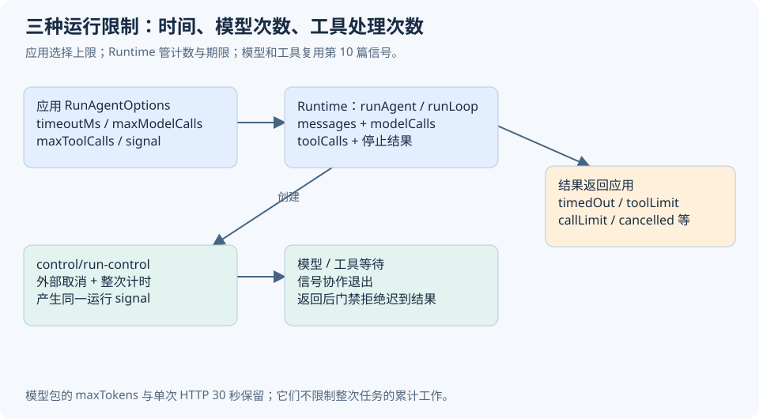
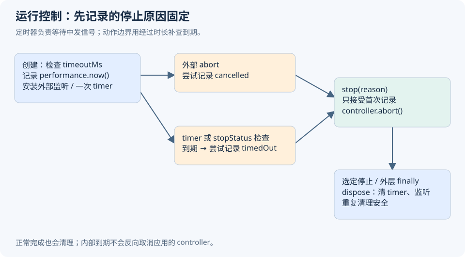
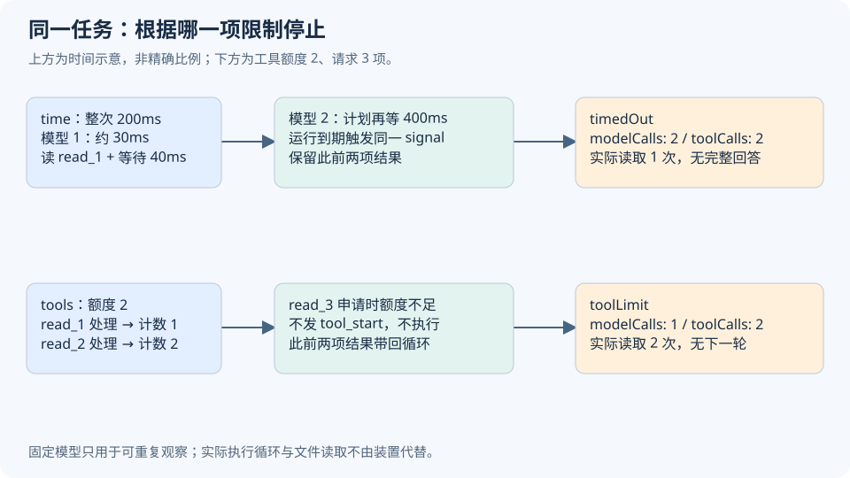

# 11 整次时限与运行预算

本篇实现：**一次 Agent 运行有累计的时间和工具处理额度；到期或额度不足时，停止后续动作，保留此前完成的事实，并告诉应用是哪项限制触发。** 继续使用代码审查和发布调查，不新增业务任务。

这是[第二阶段](/roadmap#第二阶段-逐篇大纲)的第六个单元。10 已经能由应用主动取消，但需要有人发出停止请求。现在让 Runtime 根据应用给定的约束自行停止。已有的模型调用次数上限保留，阶段末再用新材料检验这些机制共同工作。

## 实施前：先走完整个实现逻辑

先看“读取 `src/cart.ts`，再给审查结论”的任务。源码仍在已有的 `fixtures/code-review/src/cart.ts`，读取工具不变。假设应用要求：整次最多运行 60 秒，最多调用模型 6 次，累计最多处理 8 项工具请求。

1. **应用给本次运行设约束。** `runAgent` 启动后创建一份运行控制，记录开始时刻，安装一只整次计时器。不是每次模型调用都重新得到 60 秒。
2. **Runtime 按原来的循环继续。** 模型请求读取文件时，先检查整次运行是否仍有效，再申请一项工具额度。获准后才进入参数检查与执行；文件内容返回，仍由 Runtime 保存成反馈。
3. **下一轮沿用剩余时间和额度。** 模型第二次调用用的是同一份运行信号，工具处理计数也继续累计。某一轮可以有多项请求，但每项都单独占用额度。
4. **到期时，复用 10 的协作停止。** 运行控制发出信号，使模型或工具等待退出；循环不接受当前迟到结果，返回 `timedOut`。此前已保存的请求和读取结果仍保留。
5. **工具额度不足时，不开始超额项。** 如果已经处理 8 项，模型还提出第 9 项，执行器把本批先前完成的结果交回循环，返回 `toolLimit`，不再请求下一轮。应用展示受限制停止，不把未完成调查交付为答案。

因此新增的是“**在给定约束内推进任务**”的运行能力。模型仍决定查什么，工具仍执行动作，Runtime 决定是否还允许继续；预算并不替模型分解任务，也不保证它会在额度内成功。

[](/diagrams/11-runtime-limits.svg)

### 先区分四种容易混在一起的上限

| 配置 | 限制什么 | 本篇怎样处理 |
|---|---|---|
| 模型包 `maxTokens` | 一次生成最多输出多少 token | 保留；截断沿原来的 `truncated` 停止，不是工具额度 |
| 模型包 HTTP 30 秒 | 当前一次 HTTP 的连接与响应等待 | 保留；单请求失败仍按模型等待故障处理 |
| Runtime `timeoutMs` | 从本次有效运行启动到选定停止原因的经过时长 | 新增；包含中间观察、准备、模型和工具，不随轮次重置 |
| Runtime `maxModelCalls/maxToolCalls` | 本次最多调用模型几次、进入工具处理几项 | 保留前者、新增后者；按本次运行累计 |

例如三次 HTTP 分别用了 20 秒，每次都没有达到 30 秒，整次任务却已经运行约 60 秒。仅有单次 HTTP 超时不能约束这种累计耗时。反过来，某次 HTTP 自己先失败，而整次期限还没到，仍应报告模型故障，不能把所有等待错误都写成整次超时。

**工具预算统计处理尝试，不是实际 I/O 数。** 未知工具名、坏 JSON 和不符 schema 的参数都需要程序处理，也占一项额度。否则模型可以用无限坏请求绕过限制。`tool_start` 通知后取消的项也已经占额，哪怕没有进入具体工具。批次身份本身不合法则先按原协议错误停止，不进入逐项计数。

这些计数不能换算成准确费用。token 用量、服务计费、重试费用和金额上限需要另一套观测与核算，后续继续建设。

## 起点与实现范围

从 10 的运行取消实现继续。若尚未写 10 的本地取消演示，本篇不依赖那个演示目录；需要的是模型与工具已有的信号传递、运行停止与资源清理。

先保存上一章的实现，再由操作者创建本章分支：

```bash
git status --short --branch
git switch -c agent/chapter-11-run-budgets
```

本篇不改模型包或文件工具的协议。新增期限控制放在 `packages/runtime/src/control/`；相关内部类型仍在 `src/types/`。循环继续管理历史和计数，示例负责配置、打印与实验材料。根目录 `package.json` 的 `start/debug/check/docs:*` 保持原样，不新增依赖。

Pi 固定版本的 [runLoop、streamAssistantResponse 和 executeToolCallsSequential](https://github.com/badlogic/pi-mono/blob/8efd314fa3d3232ce197d8d7a6a5660530b9d83e/packages/agent/src/agent-loop.ts)可帮助观察循环、信号传递与逐项工具处理的职责。本篇的 `timeoutMs/maxToolCalls`、计数规则和停止联合是本项目设计，不将它们当作 Pi 已有的同名接口。

## 第一步：建立一次运行的期限控制

先完成一个小模块并单独观察，不必等整个循环改完。

### 控制对象保存什么

新建 `packages/runtime/src/types/run-control.ts`，写入完整代码。这里定义 Runtime 内部的 `RunControl`，不是额外的公共 Agent 对象。应用的控制器在应用手里；本模块再创建自己的信号，便于区分“应用取消”和“运行到期”。

<<< @/snippets/11-run-budgets/packages/runtime/src/types/run-control.ts

例如应用给出 `timeoutMs: 60_000` 和外部 `signal`，运行控制持有自己的 `signal`。外部取消时，内部记录 `cancelled` 并发信号；期限先被记录时，内部保存 `timedOut` 并发信号。模型和工具只要响应内部信号，不需要认识这两个原因。

`stopStatus()` 负责检查并返回原因；它不会保存消息。`dispose()` 负责清理本次计时器和外部监听，也不会撤销工具动作。

### 从开始时刻计算经过时长

新建 `packages/runtime/src/control/` 目录，再新建 `packages/runtime/src/control/run-control.ts`，写入完整代码。它接收外部信号与可选期限，返回上面的控制对象。

createRunControl 将外部取消与本次累计期限组合成一个包内控制对象，返回供循环使用的信号、检查和清理能力。它按启动时刻计算剩余时间，记录主动取消或到期的来源；后面的循环据此选择停止结果，消息和工具计数不在这里保存。

<<< @/snippets/11-run-budgets/packages/runtime/src/control/run-control.ts

先沿没有取消的过程理解。`started` 保存创建时的 `performance.now()`；若期限为 60 秒，计时器只创建一次。每次动作边界调用 `stopStatus()`，用“现在减开始”检查整次已经经过多久，未到期就返回 `undefined`，循环可以继续。

`performance.now()` 给出相对进程起点的经过时间；这里取两次读数之差，不依赖系统日期。[Node 时间测量文档](https://nodejs.org/api/perf_hooks.html#performancenow)说明了它的含义。计时器用于在异步等待中发信号；边界检查则补足另一种情况：工具占用了主线程，或者连续微任务使计时回调还没有机会运行。程序重新取得执行权时，仍应先核对期限，不能直接接受迟到结果。

下面三行已在上方完整文件中，仅用于对照，不再次追加：

```ts
if (disposed || status !== undefined) return;
status = reason;
controller.abort();
```

第一次记录原因后立即发出本次信号。后续来源不改写它：先记录主动取消，随后到期仍是 `cancelled`；先记录到期，随后用户取消仍是 `timedOut`。本篇固定的是**程序先记录的原因**，不声称能还原主线程阻塞期间两个外部事件的精确发生顺序。

`dispose()` 把控制对象置为已清理，清除计时器、移除外部监听；重复调用安全，后续检查不会给已结束任务新添超时。内部到期只取消内部控制器，不会反向取消应用的原控制器。

[](/diagrams/11-run-control.svg)

`timeoutMs` 必须在 1 到 2147483647 之间取整数。这个范围来自本篇使用的 Node 计时器：超范围延迟会被调整成很短的延迟，而不是得到一个更长期限；[Node 定时器说明](https://nodejs.org/api/timers.html#settimeoutcallback-delay-args)也明确不保证精确回调时刻。因此拒绝超范围配置，且不承诺任务能在截止的那一毫秒完成退出。

### 先运行这个局部过程

在**仓库根目录**执行。它只观察包内控制模块，不是应用长期使用的公共入口，也不读取 `.env`：

```bash
node --import tsx --input-type=module <<'JS'
import { setTimeout as delay } from 'node:timers/promises';
import { createRunControl } from './packages/runtime/src/control/run-control';
const external = new AbortController();
const control = createRunControl(external.signal, 20);
try {
  await delay(40);
  console.log('停止原因：', control.stopStatus());
  console.log('运行信号：', control.signal.aborted, '应用信号：', external.signal.aborted);
} finally {
  control.dispose();
}
JS
```

应看到 `timedOut`、运行信号 `true`、应用信号 `false`。这证明期限能产生运行信号，并保留来源；还没有接进 Agent 的历史与工具计数。

## 第二步：定义运行额度和停止结果

现在把控制对象接回本次运行。应用配置采用可选字段，旧调用方省略时保留原有行为。

**完整替换 `packages/runtime/src/types/run.ts` 的全部内容。** 保留 `RunAgentOptions/RunOutcome/RunResult` 与原有状态；新增 `timeoutMs/maxToolCalls`，给运行记录增加数字 `toolCalls`，增加 `timedOut/toolLimit` 停止分支。

这份契约约定应用怎样给一次运行设置时间与工具额度，以及 Runtime 怎样返回累计工具处理数和受限制停止。模型调用次数和工具处理次数是不同字段，报告直接读取它们，而不从事件数量推算。

<<< @/snippets/11-run-budgets/packages/runtime/src/types/run.ts

`maxToolCalls: 0` 允许模型回答，但不允许程序处理工具请求；省略它才表示本篇不额外设工具上限。`timeoutMs` 省略也表示不设整次期限，原来的模型调用次数和单次 HTTP 限制仍生效。

注意两个同名字段的所在对象不同：`message.toolCalls` 是模型提出的请求数组，`result.toolCalls` 是本次累计处理次数。提出三项但只获准处理两项时，前者长度为 3，后者值为 2。

### 停止事件要带回什么

08 的事件用于让应用在运行中观察，`run_end` 是 Runtime 选定停止结果后发出的最后一条通知。10 已能用它报告回答、主动取消、调用上限等停止情况；本篇还要让终端知道“整次到期”或“工具额度不足”，以及停止前已经处理了几项请求。

**完整替换 `packages/runtime/src/types/events.ts` 的全部内容。** 相比 10，本文件只有下面两处类型结构变化；另外两处只是事件含义的说明调整：

| 准确位置 | 本篇变化 | 应用需要它做什么 |
|---|---|---|
| `RunEventData` → `type: 'run_end'` → `status` | 保留六个原值，追加 `timedOut` 和 `toolLimit` | 从最后一条通知区分整次到期、工具额度不足，以及原有的取消或故障 |
| 同一个 `run_end` 分支 → `toolCalls` | 新增必填数字字段，位于 `modelCalls` 后 | 展示本次累计处理尝试数；它不是模型请求数组，也不是成功工具数 |
| `model_cancelled` 与 `tool_cancelled` 分支 | 名称、字段与类型结构都保留；只更新含义注释 | 说明某次等待已退出；具体因取消还是到期，仍由 `run_end.status` 表达 |

在下面的完整代码中，两个新状态各自占一行并标【新增】，新计数字段也单独标【新增】。两个中止事件旁的【修改】明确表示“只扩展含义，字段不变”，不需要给它们新增一个原因字段。

这份事件类型让停止通知携带 Runtime 已经统计的工具处理数，并接受到期或额度不足状态。应用接收事件来展示原因；模型或工具等待中止的通知仍需结合最终 run_end 才能确定停止来源。

<<< @/snippets/11-run-budgets/packages/runtime/src/types/events.ts

**先看一组具体通知。** 以下是“第二次模型等待期间到期”的结构示意，只用于阅读，不写入源码；省略了更早的开始与读取通知：

```ts
{ type: 'model_cancelled', modelCall: 2, runId: 'run_example', sequence: 9 }
{ type: 'run_end', status: 'timedOut', modelCalls: 2, toolCalls: 2,
  runId: 'run_example', sequence: 10 }
```

第一条由循环在模型等待退出后发出，说明第 2 次模型调用没有交付当前完整响应。第二条由 `finish` 发出：它从停止结果 `outcome` 复制 `status/modelCalls/toolCalls`，事件派发器再加上同一次运行的 `runId` 和递增 `sequence`，应用的 `onEvent` 接住并展示。比如先前读取一项文件、处理一项等待，`toolCalls` 就是 2；只有一次真实文件读取也完全可能。

如果改为操作者主动取消，第一条仍可能是 `model_cancelled`，最后一条的 `status` 则是 `cancelled`。所以不能从 `model_cancelled` 这个名字推断用户一定按了 Ctrl+C。工具等待中止同理；而工具额度不足是“下一项根本不开始”，不会为那个未开始的超额项发送 `tool_cancelled`，最后直接用 `toolLimit` 说明停止。

本步只是让类型能够表达这些通知，不会自动创建事件或计算次数。第四步的 `finish` 会真正填入新字段，第五步的 `printEvent` 再把它显示出来；`RunResult.toolCalls` 则在 `await runAgent(...)` 返回后供应用读取。

以上公共类型由既有包入口导出，不新增公共类型名；`packages/runtime/src/index.ts` 无需修改。

## 第三步：让执行器逐项申请额度

模型一次可以请求多个工具，仅限制模型调用次数不能约束一批内的动作数。现在让每项在开始处理前向循环申请额度。

### 内部批次配置

新建 `packages/runtime/src/types/tool-batch.ts`，写入完整代码。原来 `executeToolBatch` 依次接收通知与信号；新增预算和期限刷新之后，改成按名字传配置，避免混淆多个位置参数。

<<< @/snippets/11-run-budgets/packages/runtime/src/types/tool-batch.ts

这四个字段分别负责运行信号、单项通知、刷新期限、申请额度。`tryStartToolCall()` 的实现由 Runtime 提供：有额度时累计并返回 `true`，没有时返回 `false`；执行器不复制一份全局计数。

`checkStop()` 是 Runtime 提供的内部刷新函数。它更新期限对应的信号，执行器随后读 `signal.aborted`，模型与具体工具仍只接普通的信号。这里的配置对象不传给模型，也不成为具体工具的额外协议。

### 额度不足仍要带回此前结果

新建 `packages/runtime/src/errors/tool-batch-limit.ts`，写入完整代码。与 10 的 `ToolBatchCancelled` 一样，它把批次先前已经完成的结果交回循环；含义改为额度不足，不能伪装成给模型重试的工具失败。

<<< @/snippets/11-run-budgets/packages/runtime/src/errors/tool-batch-limit.ts

例如 `read_1/read_2` 已经形成结果，准备处理 `read_3` 时额度不足，错误对象中的 `completedResults` 只含前两项。循环仍需要显式追加到历史，构造错误对象本身不保存任何消息。

### 完整替换批次执行器

**完整替换 `packages/runtime/src/tools/execute.ts` 的全部内容。** 公开 `executeTools(message, tools, signal?)` 保持 10 的签名；内部 `executeToolBatch` 从 `(message, registry, notify?, signal?)` 改为 `(message, registry, options?)`。保留原参数门禁、顺序处理、已知失败和取消行为，新增逐项额度申请与期限刷新。

这个批次执行器为每项请求申请工具额度，再做原参数门禁与真实执行。获准项的结果交回循环；额度不足则携带本批已完成结果停止。坏参数也占处理额度，不等于只有实际文件 I/O 才计数。

<<< @/snippets/11-run-budgets/packages/runtime/src/tools/execute.ts

先走正常过程。循环给执行器三项请求和一份“最多处理两项”的申请函数。第一项开始前刷新期限，申请成功，计数变 1；发送 `tool_start` 后检查信号，再解析参数并执行。成功或已知失败都形成结果，放进本批 `results`。第二项同样获准，计数变 2。

第三项开始前刷新期限，申请函数返回 `false`，执行器直接抛出携带前两项结果的 `ToolBatchLimit`。它没有发第三项的开始通知，没有解析其参数，也没有调用具体工具。额度被拒绝的项不计数。

下面的关键代码已包含在上方完整文件中，只供对照：

```ts
checkStop();
if (options.tryStartToolCall && !options.tryStartToolCall()) throw new ToolBatchLimit([...results]);
await notify?.({ type: 'tool_start', toolCallId: call.id, toolName: call.name });
```

次序决定计量含义：获准才占额、占额后才进入处理通知；因此通知回调期间取消，这一项仍计入尝试，但可能没有执行 I/O。成功数、尝试数与实际执行数不能混用。

时间检查也留在执行后和抛错处。工具可能占用主线程很久才返回或抛错，期间计时回调没运行；刷新期限后，仍能按已到期处理，而不是接受迟到文本或错报成普通未知异常。先前形成的结果继续带回，当前项不补造反馈。

没有传 `tryStartToolCall` 的公开直接执行入口仍不设整次工具预算；它不持有整次运行，不能假装知道别的批次已经用了多少额度。本章累计约束由 `runAgent` 提供。

## 第四步：循环保留计数，控制模块保留期限

现在将前面的两条关系连接起来：运行控制管时间和信号；循环管模型次数、工具尝试次数与历史；执行器逐项申请。

**完整替换 `packages/runtime/src/run-agent.ts` 的全部内容。** 保留公共 `runAgent`，把实际循环整理为同文件内的 `runLoop`；新增 `createRunControl` 的创建/清理、`finishStopped` 与 `tryStartToolCall`。原来的 `cancel()` 被能区分到期与取消的 `finishStopped()` 替代，原工具/模型失败和停止规则保留。

runAgent 创建并最终清理本次期限控制，同文件的 runLoop 使用它推进任务，保存历史并累计模型与工具处理数。应用只等待一个结果；到期、主动取消、额度不足和未知失败分别返回，不因为一次等待结束就都归为同一种错误。

<<< @/snippets/11-run-budgets/packages/runtime/src/run-agent.ts

### 先走没有触发限制的一轮

应用调用 `runAgent(options)`，配置合法后创建 `control`，再 `await runLoop(options, control)`。`runLoop` 创建本次 `messages/modelCalls/toolCalls`，调用模型时传 `control.signal`，不再把应用原信号直接传下去。应用原信号由控制模块监听；新增的内部信号同时承接外部取消和整次到期。

模型完整返回，`message` 接住它；检查仍可运行后才 `messages.push(message)`。若请求工具，执行器调用本函数里的 `tryStartToolCall`，由这里的 `toolCalls += 1` 真正更新总计数。执行器返回完整结果后，仍由 `messages.push(...results)` 保存；下一次模型沿用同一控制对象与计数。

例如最多处理 3 项，本轮恰好处理完 3 项，仍允许下一次模型只生成答案。**用满额度不自动失败，要再次请求超额动作才返回 `toolLimit`。** 原来的模型次数限制则保留：最后一次模型仍请求工具时，没有后续机会把结果交回，返回 `callLimit`，整批不执行。若两项额度都不足，这条已有规则先判断，工具计数仍为 0。

### 到期与额度不足怎样返回应用

下面两组摘录已在上方完整文件中，不再次追加。

```ts
if (control.stopStatus()) {
  await events.emit({ type: 'model_cancelled', modelCall: modelCalls });
  return finishStopped();
}
```

模型等待因信号退出，或者不协作而迟到返回，都先检查运行控制。`finishStopped` 取出已经固定的 `timedOut/cancelled`，交给 `finish`。当前模型消息没有越过后面的 `messages.push`，所以不进入历史。

```ts
if (error instanceof ToolBatchLimit) {
  messages.push(...error.completedResults);
  return finish({ status: 'toolLimit', messages, modelCalls, toolCalls });
}
```

工具额度不足时，执行器交回此前结果；这里的 `push` 才把它们保存。随后直接返回停止结果，不把缺少后续反馈的批次再发给模型。`ToolBatchCancelled` 路径仍先保存已完成项，再根据控制对象区分主动取消与到期。

### 为什么要有两处清理

`finish` 选定结果后先 `control.dispose()`，再通知 `run_end`。终止展示变慢，不会把一个已经生成的答案事后改成超时。最外层 `try/finally` 则兜住所有异常出口，即使包内意外抛错，也移除外部监听和计时器。清理允许重复调用，两个位置不会创建两份控制状态。

期限从合法配置后的控制创建开始，包含 `run_start`、工具准备和中间观察；不包含应用启动前的材料加载，也不包含选定停止后的 `run_end` 展示。未知故障已经选定、进入故障通知时，仍保留原故障原因，不在通知期间改写。与 10 一样，永不返回的工具或观察函数仍会阻塞返回，计时器不能强杀它。

此时可在**仓库根目录**运行一次检查，再继续写应用：

```bash
npm run check
```

它会更新公共包的类型产物，使下面的示例能够从包入口使用新选项与停止状态。

## 第五步：应用配置限制，显示同一运行的计数

### 事件与最终报告

**完整替换 `examples/shared/print-event.ts` 的全部内容。** 本次只改三个 `switch` 分支：`model_cancelled` 和 `tool_cancelled` 的文字改成“等待已停止”，并提示查看 `run_end`；`run_end` 的输出行在模型调用次数后增加 `event.toolCalls`。它读取 Runtime 已填好的数字，不在打印函数里重新计数。对应逻辑块已标【修改】，其他分支保留。

::: details examples/shared/print-event.ts

这个展示函数从每条运行通知选取摘要，显示真实累计数字及停止状态。它不增加工具计数，也不根据中止通知的异常名称猜测是否到期，最终原因以 run_end 为准。

<<< @/snippets/11-run-budgets/examples/shared/print-event.ts

:::

**完整替换 `examples/shared/print-run.ts` 的全部内容。** 保留已有记录与安全诊断展示，只在最终停止摘要中增加数字 `toolCalls`。

::: details examples/shared/print-run.ts

这个函数接收已经停止的运行记录，展示新增的 toolCalls 与原有历史、失败信息。它只帮助观察三种数字的区别，不决定额度是否可用，也不会重新执行未完成动作。

<<< @/snippets/11-run-budgets/examples/shared/print-run.ts

:::

前者在动作发生时打印事件，后者在 `await runAgent(...)` 返回后读取已有记录。它们都没有执行工具，也没有再调用模型。出现三项请求列表但只有两条结果时，要以最终计数和结果记录核对，不能把请求列表当执行证明。

### 两个真实任务的入口

这两份代码各保留原任务、工具、六次模型调用上限、Ctrl+C 与原验收；新增 60 秒整次期限、8 项工具额度，以及约束停止的应用分支。这是当前两个示例的初始策略，不是“企业任务都应使用”的推荐值，阶段联调再根据实际任务证据调整。

**代码审查入口：完整替换 `examples/code-review/src/main.ts` 的全部内容：**

审查入口为同一运行提供 6 次模型、8 项工具和 60 秒约束，继续传入 Ctrl+C 信号。接住结果后先区分取消或受限制停止，只有正常任务路径才进入原报告，最后清理应用监听。

<<< @/snippets/11-run-budgets/examples/code-review/src/main.ts

**发布调查入口：完整替换 `examples/release-impact/src/main.ts` 的全部内容。展开下方代码后写入该文件：**

::: details examples/release-impact/src/main.ts

调查入口为原查询任务配置相同的初始约束，再等待原 Runtime 的结果。任务工具和发布证据规则不变；停止控制不因任务更换而复制到业务查询函数。

<<< @/snippets/11-run-budgets/examples/release-impact/src/main.ts

:::

以代码审查为例，入口的 `result` 接住停止结果。`cancelled` 仍按原终端约定设置退出码 130；`timedOut/toolLimit` 说明给定约束内尚未完成，展示原因与计数，退出码为 1；其他状态仍交给原 `reportRun`。不把“循环返回了”改写为“任务已经通过”。`finally` 继续清理 Ctrl+C 监听。

`examples/shared/model.ts`、`stream-model.ts` 和 `interrupt.ts` 不改。模型连接和文件读取已经在 10 接收信号，现在只是信号的来源多了一种，具体工具无需导入期限模块。

有真实服务配置时，可以自行在**仓库根目录**运行原命令；它们会使用模型服务，费用由操作者管理：

```bash
npm start
npm start -- --example release-impact
```

没有 Key 或需要稳定复现限制时，使用下面的本地入口。

## 第六步：用同一任务观察六种结果

新增的是示例装置，不是第二套 Agent。装置返回固定模型决策，Runtime 与 `read_file` 仍使用真正实现；因此它能检验限制在哪个边界生效，不能证明模型自主任务质量。

[](/diagrams/11-limit-traces.svg)

### 准备固定决策与等待

新建 `examples/code-review/src/limits/` 目录，再新建 `examples/code-review/src/limits/scenario.ts`，写入完整代码。它接收已有读取工具，返回固定模型函数、工具清单和读取次数查询函数。

::: details examples/code-review/src/limits/scenario.ts

<<< @/snippets/11-run-budgets/examples/code-review/src/limits/scenario.ts

:::

`createLimitScenario` 没有调用循环。它只创建三种本地依赖：包装实际 `read_file` 的计数工具、一个支持信号的 40 毫秒等待工具，以及预写决策的 `callModel`。

普通模式第一次固定返回三项读取，第二次返回固定文本；时间相关模式先等待约 30 毫秒，返回 `read_1/wait_2`，下一次计划等待 400 毫秒再返回文本。400 毫秒仍远小于单请求的 30 秒，但足以超过本地入口设定的 200 毫秒整次期限。这里没有真正 HTTP，比较的是两类限制的含义；原生 HTTP 路径由模型包的同一信号链承接。

`late` 故意不给固定模型等待传信号；它会晚些正常返回，由 Runtime 的边界检查拒绝。`finally` 日志让退出与清理可见；固定回答“流程已结束”没有审查源码的含义，不能拿它验证业务结论。

### 新建本地观察入口

新建 `examples/code-review/src/limits/main.ts`，写入完整代码。它选择装置和约束，把依赖传给公开 `runAgent`，等待停止后展示结果。

<<< @/snippets/11-run-budgets/examples/code-review/src/limits/main.ts

`scenario` 接住刚才的依赖，`controller` 是本地入口的主动取消源，`timer` 只负责 `cancel` 模式的实验时机。整次期限的计时器在 Runtime 内，二者不是一只计时器。

`cancel` 模式在第二次模型开始通知时安排 10 毫秒后调用应用控制器；通知先返回，Runtime 真正进入第二次等待，再收到主动取消。`time` 则由 Runtime 自己的 200 毫秒期限触发。最终仍由 `result = await runAgent(...)` 接住结果；末尾的预期状态判断只用于固定观察命令，不是任务验收器。

在**仓库根目录**运行，不读取 `.env`、不访问模型服务：

```bash
npm run check
node --import tsx examples/code-review/src/limits/main.ts time
node --import tsx examples/code-review/src/limits/main.ts tools
node --import tsx examples/code-review/src/limits/main.ts calls
node --import tsx examples/code-review/src/limits/main.ts normal
node --import tsx examples/code-review/src/limits/main.ts cancel
node --import tsx examples/code-review/src/limits/main.ts late
```

按日志、计数和实际记录分别核对，而不只看退出码：

| 模式 | 最终状态与计数 | 应观察的动作 |
|---|---|---|
| `time` | `timedOut`；模型 2 次、工具处理 2 项、实际读取 1 次 | 先前读取和等待结果保留；第二次等待清理后中止，没有完整回答 |
| `tools` | `toolLimit`；模型 1 次、处理 2 项、读取 2 次 | 模型请求三项，第三项没有 `tool_start` 或结果，不再开始第二次模型 |
| `calls` | `callLimit`；模型 1 次、处理 0 项、读取 0 次 | 最后一次模型仍要工具，整批不执行，保留原有模型上限规则 |
| `normal` | `answered`；模型 2 次、处理 3 项、读取 3 次 | 恰好用满工具额度后仍可生成固定答案 |
| `cancel` | `cancelled`；模型 2 次、处理 2 项、读取 1 次 | 第二次等待由应用信号中止，区别于整次到期 |
| `late` | `timedOut`；模型 2 次、处理 2 项、读取 1 次 | 第二次固定模型打印“等待返回”，但迟到回答没有进入历史 |

表中是本地观察的预期轨迹，不承诺定时器精确毫秒。主线程很慢或调试暂停可能让到期发生在更早边界；先连续运行观察，在断点中再核对对象。无论在哪个边界到期，都不应继续新动作或把当前迟到返回交付为答案。

## 断点、可逆故障与小迁移

### 看清计数在哪里变化

直接调试无需 Key 的入口：

```bash
node --inspect-brk --import tsx examples/code-review/src/limits/main.ts tools
```

- 在 `run-agent.ts` 的 `tryStartToolCall` 断住。第一次放行前 `toolCalls === 0`，走过 `toolCalls += 1` 才是 1；这是本次总计数的更新位置。
- 第三次申请时 `toolCalls === options.maxToolCalls === 2`，返回 `false`，数字不增加。执行器的 `results` 已含 `read_1/read_2`，没有第三项。
- 在 `ToolBatchLimit` 分支的 `messages.push` 后查看历史：两份读取已经保存；随后 `finish` 返回 `toolLimit`，不是继续模型。

`modelCalls`、`toolCalls` 与 `message.toolCalls.length` 分别对应循环调用次数、处理尝试数、这一条消息提出的请求数。把这三个值同时看一遍，比只看字段名更容易定位。

### 可逆故障：只靠定时回调够不够

在 `packages/runtime/src/control/run-control.ts` 临时注释 `stopStatus()` 内的经过时长判断，保留计时器，再用一个固定模型函数在同一段同步代码中工作到超过期限才返回。此时定时回调可能尚未运行，边界就可能错误接受返回。

可直接运行以下局部观察命令；它只导入控制模块，不改学习源码，也不调用模型服务：

```bash
node --import tsx --input-type=module <<'JS'
import { performance } from 'node:perf_hooks';
import { createRunControl } from './packages/runtime/src/control/run-control';
const control = createRunControl(undefined, 10);
try {
  const end = performance.now() + 30;
  while (performance.now() < end) { /* 只用于局部阻塞实验 */ }
  console.log('边界检查：', control.stopStatus(), control.signal.aborted);
} finally {
  control.dispose();
}
JS
```

原实现应输出 `timedOut true`；临时移除判断后，在计时回调尚未执行的同一段同步过程里可能看到 `undefined false`。立即恢复原判断，再运行确认恢复。这个实验说明检查为何不能全交给回调，不是推荐在 Agent 工具里忙等，也不是让期限强制抢占同步函数。

### 小迁移：跨两批也共用一份工具额度

只修改本地 `limits/scenario.ts` 的固定模型：第一轮提出两项读取，第二轮再提出两项，第三轮才返回文本；不要修改 Runtime。入口使用 `maxToolCalls: 3`、`maxModelCalls: 4`，期限设到足以完成本地观察。

目标是第二批第一项处理后总计数变 3，第二批第二项没有开始；最终 `toolLimit`、模型 2 次、工具处理 3 项、三份读取结果保留。这检验预算是否属于整次运行，而不是每批重新得到 3 项。完成后恢复固定装置，再跑一次 `normal`。

## 当前保证与后续建设

本篇限制的是本次程序可继续的工作量。时间到达会通知协作操作并在边界拒绝迟到结果；工具额度不足则阻止新项开始。它们不替代操作系统隔离、工具权限、事务回滚或持久化恢复，部分工具反馈也不能直接作为完整服务对话重新发送。

模型或工具忽略信号、观察函数永不结束时，仍可能延迟或阻塞返回。时间到期不保证服务端没有继续计算，也不保证没有已发生的外部副作用。工具尝试数不等于费用，这些范围需要后续可靠执行、安全与评估阶段继续处理。

下一篇按第二阶段规划做累计联调：在新材料和组合故障中检查接入、事件、流式、取消、期限与预算共同工作，并继续验证公共包消费。作者固定响应通过不代表已经掌握或真实模型任务质量通过。

## 完整文件核对

下面与步骤引用同一份候选代码；新文件、修改与沿用分别标注，不再创建另一套实现。仅为核对展开所需文件，完整替换按步骤中的准确路径执行。

::: details .env.example【沿用】

<<< @/snippets/11-run-budgets/.env.example{text}

:::

::: details examples/code-review/package.json【沿用】

<<< @/snippets/11-run-budgets/examples/code-review/package.json

:::

::: details examples/code-review/src/cancellation/fixtures.ts【沿用】

<<< @/snippets/11-run-budgets/examples/code-review/src/cancellation/fixtures.ts

:::

::: details examples/code-review/src/cancellation/main.ts【沿用】

<<< @/snippets/11-run-budgets/examples/code-review/src/cancellation/main.ts

:::

::: details examples/code-review/src/check-events.ts【沿用】

<<< @/snippets/11-run-budgets/examples/code-review/src/check-events.ts

:::

::: details examples/code-review/src/check-protocol.ts【沿用】

<<< @/snippets/11-run-budgets/examples/code-review/src/check-protocol.ts

:::

::: details examples/code-review/src/check-stream.ts【沿用】

<<< @/snippets/11-run-budgets/examples/code-review/src/check-stream.ts

:::

::: details examples/code-review/src/check-tool-contract.ts【沿用】

<<< @/snippets/11-run-budgets/examples/code-review/src/check-tool-contract.ts

:::

::: details examples/code-review/src/limits/main.ts【新增文件】

<<< @/snippets/11-run-budgets/examples/code-review/src/limits/main.ts

:::

::: details examples/code-review/src/limits/scenario.ts【新增文件】

<<< @/snippets/11-run-budgets/examples/code-review/src/limits/scenario.ts

:::

::: details examples/code-review/src/main.ts【修改】

<<< @/snippets/11-run-budgets/examples/code-review/src/main.ts

:::

::: details examples/code-review/src/protocol-fetch.ts【沿用】

<<< @/snippets/11-run-budgets/examples/code-review/src/protocol-fetch.ts

:::

::: details examples/code-review/src/report-run.ts【沿用】

<<< @/snippets/11-run-budgets/examples/code-review/src/report-run.ts

:::

::: details examples/code-review/src/stream-fetch.ts【沿用】

<<< @/snippets/11-run-budgets/examples/code-review/src/stream-fetch.ts

:::

::: details examples/code-review/src/tools.ts【沿用】

<<< @/snippets/11-run-budgets/examples/code-review/src/tools.ts

:::

::: details examples/release-impact/package.json【沿用】

<<< @/snippets/11-run-budgets/examples/release-impact/package.json

:::

::: details examples/release-impact/src/load-records.ts【沿用】

<<< @/snippets/11-run-budgets/examples/release-impact/src/load-records.ts

:::

::: details examples/release-impact/src/lookup-tool.ts【沿用】

<<< @/snippets/11-run-budgets/examples/release-impact/src/lookup-tool.ts

:::

::: details examples/release-impact/src/main.ts【修改】

<<< @/snippets/11-run-budgets/examples/release-impact/src/main.ts

:::

::: details examples/release-impact/src/report-run.ts【沿用】

<<< @/snippets/11-run-budgets/examples/release-impact/src/report-run.ts

:::

::: details examples/release-impact/src/tools.ts【沿用】

<<< @/snippets/11-run-budgets/examples/release-impact/src/tools.ts

:::

::: details examples/release-impact/src/types/tools.ts【沿用】

<<< @/snippets/11-run-budgets/examples/release-impact/src/types/tools.ts

:::

::: details examples/release-impact/src/validation.ts【沿用】

<<< @/snippets/11-run-budgets/examples/release-impact/src/validation.ts

:::

::: details examples/run.ts【沿用】

<<< @/snippets/11-run-budgets/examples/run.ts

:::

::: details examples/shared/interrupt.ts【沿用】

<<< @/snippets/11-run-budgets/examples/shared/interrupt.ts

:::

::: details examples/shared/model.ts【沿用】

<<< @/snippets/11-run-budgets/examples/shared/model.ts

:::

::: details examples/shared/print-event.ts【修改】

<<< @/snippets/11-run-budgets/examples/shared/print-event.ts

:::

::: details examples/shared/print-run.ts【修改】

<<< @/snippets/11-run-budgets/examples/shared/print-run.ts

:::

::: details examples/shared/stream-model.ts【沿用】

<<< @/snippets/11-run-budgets/examples/shared/stream-model.ts

:::

::: details examples/shared/terminal.ts【沿用】

<<< @/snippets/11-run-budgets/examples/shared/terminal.ts

:::

::: details fixtures/code-review/src/cart.ts【沿用】

<<< @/snippets/11-run-budgets/fixtures/code-review/src/cart.ts

:::

::: details fixtures/model-protocol/anthropic.json【沿用】

<<< @/snippets/11-run-budgets/fixtures/model-protocol/anthropic.json

:::

::: details fixtures/model-protocol/deepseek.json【沿用】

<<< @/snippets/11-run-budgets/fixtures/model-protocol/deepseek.json

:::

::: details fixtures/model-stream/anthropic-answer.sse【沿用】

<<< @/snippets/11-run-budgets/fixtures/model-stream/anthropic-answer.sse{text}

:::

::: details fixtures/model-stream/anthropic-tools.sse【沿用】

<<< @/snippets/11-run-budgets/fixtures/model-stream/anthropic-tools.sse{text}

:::

::: details fixtures/model-stream/deepseek-answer.sse【沿用】

<<< @/snippets/11-run-budgets/fixtures/model-stream/deepseek-answer.sse{text}

:::

::: details fixtures/model-stream/deepseek-tools.sse【沿用】

<<< @/snippets/11-run-budgets/fixtures/model-stream/deepseek-tools.sse{text}

:::

::: details fixtures/release-impact/releases.json【沿用】

<<< @/snippets/11-run-budgets/fixtures/release-impact/releases.json

:::

::: details fixtures/release-impact/services.json【沿用】

<<< @/snippets/11-run-budgets/fixtures/release-impact/services.json

:::

::: details package.json【沿用】

<<< @/snippets/11-run-budgets/package.json

:::

::: details packages/coding-tools/package.json【沿用】

<<< @/snippets/11-run-budgets/packages/coding-tools/package.json

:::

::: details packages/coding-tools/src/index.ts【沿用】

<<< @/snippets/11-run-budgets/packages/coding-tools/src/index.ts

:::

::: details packages/coding-tools/src/read-file.ts【沿用】

<<< @/snippets/11-run-budgets/packages/coding-tools/src/read-file.ts

:::

::: details packages/coding-tools/src/types/read-file.ts【沿用】

<<< @/snippets/11-run-budgets/packages/coding-tools/src/types/read-file.ts

:::

::: details packages/coding-tools/tsconfig.json【沿用】

<<< @/snippets/11-run-budgets/packages/coding-tools/tsconfig.json

:::

::: details packages/model/package.json【沿用】

<<< @/snippets/11-run-budgets/packages/model/package.json

:::

::: details packages/model/src/complete.ts【沿用】

<<< @/snippets/11-run-budgets/packages/model/src/complete.ts

:::

::: details packages/model/src/errors/model-call-error.ts【沿用】

<<< @/snippets/11-run-budgets/packages/model/src/errors/model-call-error.ts

:::

::: details packages/model/src/index.ts【沿用】

<<< @/snippets/11-run-budgets/packages/model/src/index.ts

:::

::: details packages/model/src/providers/anthropic/anthropic-messages.ts【沿用】

<<< @/snippets/11-run-budgets/packages/model/src/providers/anthropic/anthropic-messages.ts

:::

::: details packages/model/src/providers/anthropic/anthropic-response.ts【沿用】

<<< @/snippets/11-run-budgets/packages/model/src/providers/anthropic/anthropic-response.ts

:::

::: details packages/model/src/providers/anthropic/anthropic.ts【沿用】

<<< @/snippets/11-run-budgets/packages/model/src/providers/anthropic/anthropic.ts

:::

::: details packages/model/src/providers/anthropic/request.ts【沿用】

<<< @/snippets/11-run-budgets/packages/model/src/providers/anthropic/request.ts

:::

::: details packages/model/src/providers/anthropic/stream.ts【沿用】

<<< @/snippets/11-run-budgets/packages/model/src/providers/anthropic/stream.ts

:::

::: details packages/model/src/providers/deepseek/deepseek-messages.ts【沿用】

<<< @/snippets/11-run-budgets/packages/model/src/providers/deepseek/deepseek-messages.ts

:::

::: details packages/model/src/providers/deepseek/deepseek-response.ts【沿用】

<<< @/snippets/11-run-budgets/packages/model/src/providers/deepseek/deepseek-response.ts

:::

::: details packages/model/src/providers/deepseek/deepseek.ts【沿用】

<<< @/snippets/11-run-budgets/packages/model/src/providers/deepseek/deepseek.ts

:::

::: details packages/model/src/providers/deepseek/request.ts【沿用】

<<< @/snippets/11-run-budgets/packages/model/src/providers/deepseek/request.ts

:::

::: details packages/model/src/providers/deepseek/stream.ts【沿用】

<<< @/snippets/11-run-budgets/packages/model/src/providers/deepseek/stream.ts

:::

::: details packages/model/src/providers/shared/read-sse.ts【沿用】

<<< @/snippets/11-run-budgets/packages/model/src/providers/shared/read-sse.ts

:::

::: details packages/model/src/providers/shared/request-json.ts【沿用】

<<< @/snippets/11-run-budgets/packages/model/src/providers/shared/request-json.ts

:::

::: details packages/model/src/providers/shared/request-response.ts【沿用】

<<< @/snippets/11-run-budgets/packages/model/src/providers/shared/request-response.ts

:::

::: details packages/model/src/request-options.ts【沿用】

<<< @/snippets/11-run-budgets/packages/model/src/request-options.ts

:::

::: details packages/model/src/stream.ts【沿用】

<<< @/snippets/11-run-budgets/packages/model/src/stream.ts

:::

::: details packages/model/src/types/anthropic-stream.ts【沿用】

<<< @/snippets/11-run-budgets/packages/model/src/types/anthropic-stream.ts

:::

::: details packages/model/src/types/anthropic.ts【沿用】

<<< @/snippets/11-run-budgets/packages/model/src/types/anthropic.ts

:::

::: details packages/model/src/types/context.ts【沿用】

<<< @/snippets/11-run-budgets/packages/model/src/types/context.ts

:::

::: details packages/model/src/types/failures.ts【沿用】

<<< @/snippets/11-run-budgets/packages/model/src/types/failures.ts

:::

::: details packages/model/src/types/messages.ts【沿用】

<<< @/snippets/11-run-budgets/packages/model/src/types/messages.ts

:::

::: details packages/model/src/types/options.ts【沿用】

<<< @/snippets/11-run-budgets/packages/model/src/types/options.ts

:::

::: details packages/model/src/types/sse.ts【沿用】

<<< @/snippets/11-run-budgets/packages/model/src/types/sse.ts

:::

::: details packages/model/src/types/stream.ts【沿用】

<<< @/snippets/11-run-budgets/packages/model/src/types/stream.ts

:::

::: details packages/model/src/types/tool-results.ts【沿用】

<<< @/snippets/11-run-budgets/packages/model/src/types/tool-results.ts

:::

::: details packages/model/src/types/tools.ts【沿用】

<<< @/snippets/11-run-budgets/packages/model/src/types/tools.ts

:::

::: details packages/model/src/validation.ts【沿用】

<<< @/snippets/11-run-budgets/packages/model/src/validation.ts

:::

::: details packages/model/tsconfig.json【沿用】

<<< @/snippets/11-run-budgets/packages/model/tsconfig.json

:::

::: details packages/runtime/package.json【沿用】

<<< @/snippets/11-run-budgets/packages/runtime/package.json

:::

::: details packages/runtime/src/control/run-control.ts【新增文件】

<<< @/snippets/11-run-budgets/packages/runtime/src/control/run-control.ts

:::

::: details packages/runtime/src/errors/tool-batch-cancelled.ts【沿用】

<<< @/snippets/11-run-budgets/packages/runtime/src/errors/tool-batch-cancelled.ts

:::

::: details packages/runtime/src/errors/tool-batch-error.ts【沿用】

<<< @/snippets/11-run-budgets/packages/runtime/src/errors/tool-batch-error.ts

:::

::: details packages/runtime/src/errors/tool-batch-limit.ts【新增文件】

<<< @/snippets/11-run-budgets/packages/runtime/src/errors/tool-batch-limit.ts

:::

::: details packages/runtime/src/errors/tool-execution-error.ts【沿用】

<<< @/snippets/11-run-budgets/packages/runtime/src/errors/tool-execution-error.ts

:::

::: details packages/runtime/src/events/dispatcher.ts【沿用】

<<< @/snippets/11-run-budgets/packages/runtime/src/events/dispatcher.ts

:::

::: details packages/runtime/src/index.ts【沿用】

<<< @/snippets/11-run-budgets/packages/runtime/src/index.ts

:::

::: details packages/runtime/src/run-agent.ts【修改】

<<< @/snippets/11-run-budgets/packages/runtime/src/run-agent.ts

:::

::: details packages/runtime/src/tools/execute.ts【修改】

<<< @/snippets/11-run-budgets/packages/runtime/src/tools/execute.ts

:::

::: details packages/runtime/src/tools/registry.ts【沿用】

<<< @/snippets/11-run-budgets/packages/runtime/src/tools/registry.ts

:::

::: details packages/runtime/src/types/events.ts【修改】

<<< @/snippets/11-run-budgets/packages/runtime/src/types/events.ts

:::

::: details packages/runtime/src/types/failures.ts【沿用】

<<< @/snippets/11-run-budgets/packages/runtime/src/types/failures.ts

:::

::: details packages/runtime/src/types/model-call.ts【沿用】

<<< @/snippets/11-run-budgets/packages/runtime/src/types/model-call.ts

:::

::: details packages/runtime/src/types/run-control.ts【新增文件】

<<< @/snippets/11-run-budgets/packages/runtime/src/types/run-control.ts

:::

::: details packages/runtime/src/types/run.ts【修改】

<<< @/snippets/11-run-budgets/packages/runtime/src/types/run.ts

:::

::: details packages/runtime/src/types/tool-batch.ts【新增文件】

<<< @/snippets/11-run-budgets/packages/runtime/src/types/tool-batch.ts

:::

::: details packages/runtime/src/types/tool-registry.ts【沿用】

<<< @/snippets/11-run-budgets/packages/runtime/src/types/tool-registry.ts

:::

::: details packages/runtime/src/types/tools.ts【沿用】

<<< @/snippets/11-run-budgets/packages/runtime/src/types/tools.ts

:::

::: details packages/runtime/tsconfig.json【沿用】

<<< @/snippets/11-run-budgets/packages/runtime/tsconfig.json

:::

::: details tsconfig.json【沿用】

<<< @/snippets/11-run-budgets/tsconfig.json

:::

## 保存本篇实现

先确认当前是自己创建的本章分支，审阅差异与约束设置，再由操作者执行：

```bash
git status --short --branch
git diff --check
git diff
npm run check
npm run docs:build
git add -A
git commit -F - <<'EOF'
第11篇：为整次运行设置期限与工具处理预算

Runtime独立管理整次期限，复用取消信号让模型与工具协作退出。
动作边界补查经过时长，拒绝迟到结果，并清理计时器和外部监听。
累计工具处理尝试跨批次生效，额度不足时保留已完成结果并停止。
两个任务接入期限与额度，补充无Key对照、断点、可逆故障和迁移观察。
EOF

git push -u origin agent/chapter-11-run-budgets
```

提交推送不等于合并部署，也不等于独立掌握或生产可用。


<style>
.run-budgets .vp-doc .custom-block.details summary {
  overflow-wrap: anywhere;
}
</style>
