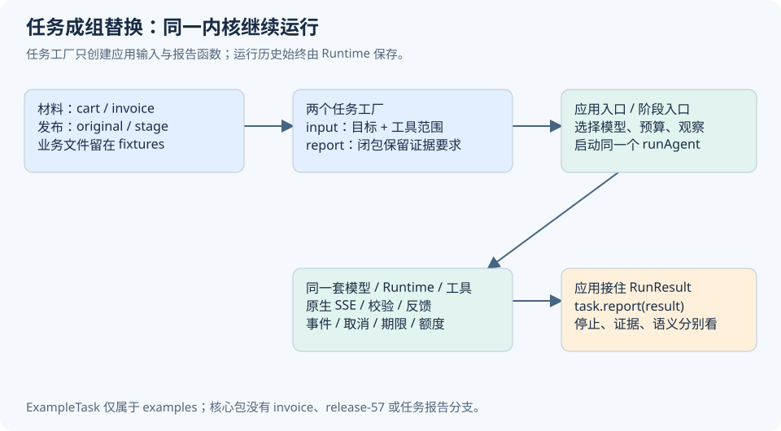
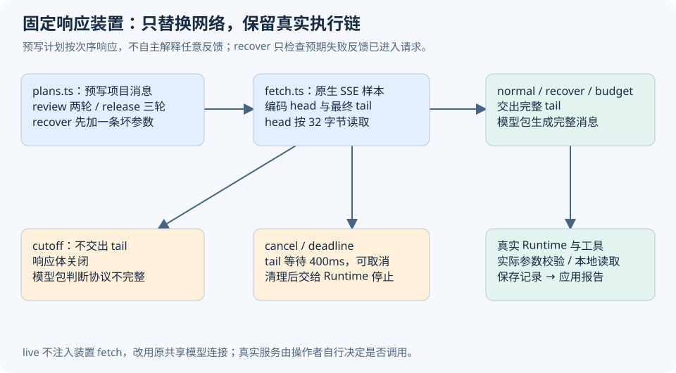
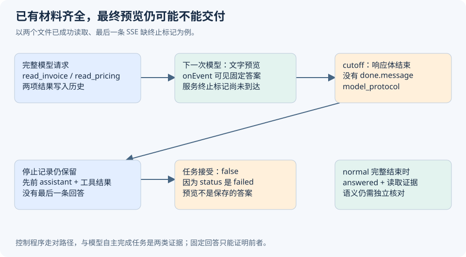
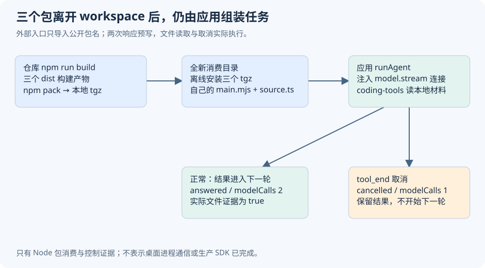

# 12 阶段联调：可观察地控制同一内核

这一篇完成第二阶段的累计联调：**换一组任务材料，使用同一套模型、Runtime 和工具包，观察取证、反馈、回答与停止怎样协作；再把三个包放到仓库外使用。**

前面几篇分别接好了模型适配、工具校验、事件、流式输出、主动取消、整次期限与工具额度。现在需要回答一个工程问题：这些机制一起运行时，是否还能保存正确的记录、停止后续动作，并让应用有依据地判断结果？

本篇增加任务组装函数和一个本地观察入口，三个核心包沿用 11。代码审查继续使用真实文件读取，发布调查继续使用实际记录查询；业务材料留在 `fixtures/`。这一篇仍是只读任务，第三阶段再进入工作区修改、执行验证和交付。

## 实施前，先走完一条任务

这次审查两份新材料：`fixtures/code-review/src/invoice.ts` 计算金额，`pricing.ts` 提供折扣规则，稍后会给出完整内容。单价 100、数量 10 时，规则规定打九折，正确金额为 900；金额函数却连续扣了两次折扣，实际得到 810。

应用先把审查目标、可读的两份文件和证据要求组装在一起。模型只看到目标和工具说明，不会因为本地存在这些文件就自动知道源码。模型提出 `read_file` 请求后，Runtime 检查名称、参数和剩余额度，再由 coding-tools 真正读取配置中的文件。

读取函数返回文本，执行器把它与原请求 ID 组成 `toolResult`。Runtime 将结果保存进自己的消息数组，下一次调用模型时带上它。模型包将项目消息转换成所选服务的格式，服务才有机会根据新内容继续回答。

文字到达时，应用先显示预览。只有模型包确认响应完整，Runtime 才保存完整模型消息并决定停止状态。入口用 `const result = await runAgent(...)` 接住结果，再调用任务自己的报告函数，检查正常回答和两份成功读取证据。最后仍要核对 810、900 及错误原因是否符合源码。

这是一条完整过程。失败时也要沿这条过程找位置：坏参数应产生反馈供下一轮使用；取消或到期应停止等待；响应缺尾帧时，即使屏幕已有答案文字，也不能把预览当成交付。



图中的任务工厂只是一个返回任务配置的函数。它不运行模型、不保存历史，也不替 Runtime 选择下一步。审查与调查各有自己的目标和证据要求，进入循环后仍然使用同一个 `runAgent`。

## 起点和文件范围

从 11 已经完成的工程开始，在仓库根目录执行分支命令：

```bash
git status --short --branch
git switch -c agent/chapter-12-stage-integration
```

本篇不修改 `packages/`、根 `package.json`、`examples/run.ts` 和原来的 `start/debug/check` 命令。新增材料、任务工厂与观察入口；原来的两个任务入口改为调用工厂，默认仍审查 cart 和调查 release-42。

本地观察使用**预写的 HTTP 响应**，不需要 API Key，不访问模型服务。请求编码、两种服务的流解码、Runtime 和本地工具都实际运行；模型请求顺序与答案由装置预先给定，因此只能证明程序路径，不能证明模型会自主找出问题。

## 第一步：准备本次要调查的材料

先创建以下四个文件。它们是待查询的数据，不是框架实现。不要将这些文件导入 Agent 入口执行。

新建 `fixtures/code-review/src/pricing.ts`，写入完整代码：

<<< @/snippets/12-stage-integration/fixtures/code-review/src/pricing.ts

新建 `fixtures/code-review/src/invoice.ts`，写入完整代码：

<<< @/snippets/12-stage-integration/fixtures/code-review/src/invoice.ts

`discountRate(10)` 返回 `0.1`，因此 `invoiceTotal(100, 10)` 实际算的是 `1000 × 0.9 × 0.9 = 810`。规则要求只应用一次折扣，正确结果为 900。这里先手工核对数值，之后才能辨认模型结论是否正确。

新建 `fixtures/release-impact/stage-releases.json`，写入完整内容：

<<< @/snippets/12-stage-integration/fixtures/release-impact/stage-releases.json

新建 `fixtures/release-impact/stage-services.json`，写入完整内容：

<<< @/snippets/12-stage-integration/fixtures/release-impact/stage-services.json

发布任务从 release-57 找到 quote-api 和 checkout-api，继续查询负责人及直接依赖，才能发现两者共享 pricing-core。记录没有证明故障会向哪个方向传播；“共享依赖”不能直接写成“已经受影响”。

## 第二步：把目标、工具范围与证据要求放在一起

### 一个任务对象包含什么

过去两个 `main.ts` 同时维护目标文本、工具和报告参数。现在还要用新材料进入同一套运行流程，若只改目标却漏改工具范围或证据清单，就会出现“要求查 invoice，实际只允许读 cart”的错配。

我们让应用的任务工厂一次返回这三项。新建 `examples/shared/types/task.ts`，写入完整代码：

<<< @/snippets/12-stage-integration/examples/shared/types/task.ts

`input` 将交给 `runAgent`；它只包含初始消息、总体要求和工具。`report` 是运行停止后由入口调用的函数，负责当前任务的有限检查。`id` 只给应用日志区分任务，不是 Runtime 创建的 `runId`。

`Pick<RunAgentOptions, ...>` 表示从已有配置类型中选出这三个字段，没有重新定义一套运行协议。这个约定只在 `examples/` 内使用，凭据、预算和取消来源仍由入口配置。

### 审查工具接受本次材料范围

**完整替换 `examples/code-review/src/tools.ts`。** 保留公开的默认 `reviewTools`；新增 `createReviewTools(files)`，让任务工厂传入自己的路径映射。默认映射仍是 cart，早期观察入口不需要改。

<<< @/snippets/12-stage-integration/examples/code-review/src/tools.ts

例如传入 `{'src/invoice.ts': 本地invoice文件位置, 'src/pricing.ts': 本地pricing文件位置}` 后，工厂返回一个配置好的 `read_file` 工具。模型仍然只提交项目相对路径，实际磁盘位置由应用决定。读取和范围检查继续复用 coding-tools，没有在应用里再写一份文件执行器。

### 审查报告要求两份证据

**完整替换 `examples/code-review/src/report-run.ts`。** 保留 `reportRun` 名称和布尔返回值；第二参数从单个字符串扩展为字符串或路径数组。原先 `reportRun(result, 'src/cart.ts')` 仍有效。新增数组归一化、空清单拒绝及逐文件缺失检查；`printRun` 和最终答案展示保留。

<<< @/snippets/12-stage-integration/examples/code-review/src/report-run.ts

本次传入 `['src/invoice.ts', 'src/pricing.ts']`。`missing` 逐个查找成功的 `read_file` 结果，而且要求结果文本以该路径和换行开头。这个格式由现有读取工具生成，检查依据是 Runtime 保存的实际反馈，不是模型声称“我读过”。

只读到 invoice 时，`missing` 会留下 pricing，报告返回 false。两份都读到，但状态为 failed 时，也返回 false。两份证据齐全且状态为 answered 时才展示答案、返回 true。这个 true 仍不检查计算推理，所以错误答案也可能通过；后面会专门观察这一点。

### 创建审查任务

新建 `examples/code-review/src/task.ts`，写入完整代码：

<<< @/snippets/12-stage-integration/examples/code-review/src/task.ts

`createReviewTask('invoice')` 先选出两条模型可用路径，再把它们映射为实际材料位置。`createReviewTools(files)` 返回本次工具列表，`messages` 只放审查目标，源码内容必须通过工具取得。

返回对象中的 `report: (result) => reportRun(result, paths)` 会记住本次 `paths`。这种函数保留外部变量的写法叫闭包。它保存的是应用的证据要求，不是运行消息；入口之后调用 `task.report(result)` 时，才用这份要求检查结果。

不传参数仍返回原 cart 任务；第二参数仍允许应用提供自定义文本。改变任务材料不需要在 `runAgent` 增加 invoice 分支。

### 发布工具接受另一组记录

**完整替换 `examples/release-impact/src/tools.ts`。** 保留 `createReleaseTools` 和两项查询工具；新增可选的 `materials` 参数，默认 URL 仍指向原来的 `releases.json/services.json`。两次 `loadRecords` 改为读取传入位置，`createLookupTool` 的执行实现不变。

<<< @/snippets/12-stage-integration/examples/release-impact/src/tools.ts

`await createReleaseTools({ releases: 阶段发布URL, services: 阶段服务URL })` 会先实际加载两份 JSON，再返回查询工具。加载发生在启动 Agent 之前；材料无法加载就不启动运行，不能把准备失败伪装为模型的查询反馈。

新建 `examples/release-impact/src/task.ts`，写入完整代码：

<<< @/snippets/12-stage-integration/examples/release-impact/src/task.ts

`createReleaseTask('stage')` 选择 release-57 和两份阶段记录，返回给模型的目标没有预写工具调用序列。`serviceIds` 只留在应用报告闭包里，作为必须取得哪些记录的要求，不直接塞进模型消息。

发布工厂需要等待文件加载，所以返回 `Promise<ExampleTask>`，入口要先 `await` 它。审查工厂只创建文件映射，此时还没有读源码，可以直接返回对象。

### 先观察组装结果

上述文件完成后，先在根目录构建已有包，再只调用任务工厂：

```bash
npm run build
node --import tsx --input-type=module <<'JS'
import { createReviewTask } from './examples/code-review/src/task.ts';
import { createReleaseTask } from './examples/release-impact/src/task.ts';
for (const task of [createReviewTask('invoice'), await createReleaseTask('stage')]) {
  console.log(task.id, task.input.tools.map(tool => tool.name));
  console.log(task.input.messages);
}
JS
```

应看到 `review-invoice` 对应 `read_file`，`release-stage` 对应 `lookup_release/lookup_service`，两条目标分别指向 invoice 和 release-57。这里没有模型响应，也没有工具结果：我们只是完成了应用输入的组装。

## 第三步：原入口也使用相同任务工厂

**完整替换 `examples/code-review/src/main.ts`。** 删除入口内的 `reviewPath/prompt` 和直接 `reviewTools/reportRun` 导入，改为 `createReviewTask('cart', process.argv[2])`；运行配置用 `...task.input`，报告用 `task.report(result)`。原模型连接、事件展示、六次模型上限、八项工具额度、60 秒期限、取消分支和清理均保留。

<<< @/snippets/12-stage-integration/examples/code-review/src/main.ts

**完整替换 `examples/release-impact/src/main.ts`。** 删除入口内的 `releaseId/serviceIds/prompt` 和直接工具、报告导入；在 `try` 中等待 `createReleaseTask('original', process.argv[2])`，再传入 `...task.input`、调用 `task.report(result)`。原预算、连接和取消清理保持不变。

<<< @/snippets/12-stage-integration/examples/release-impact/src/main.ts

这两个入口仍运行原默认材料。接下来新增的阶段入口改选 invoice 或 release-57，但调用的是这两个相同的任务工厂。任务差异在应用配置中，模型接入、运行控制和实际工具能力继续由原来的包承担。

## 第四步：接入可重复观察的本地响应

为了稳定复现“文字已经显示，完整消息却没有交付”等边界，需要精确控制响应何时结束。下面三份文件构成本地观察装置，**可作为配套代码复制**；理解重点是装置替换哪里，以及哪些执行仍然真实发生，无需把原生 SSE 样本编码当成新的 Agent 算法。



### 预写消息计划

新建 `examples/stage-check/fixtures/plans.ts`，写入下方完整代码。它返回预写的项目模型消息；`action` 创建工具请求消息，`call` 为固定参数生成 JSON 文本。审查正常为两轮，发布正常为三轮，recover 在最前面加一次坏参数。

::: details examples/stage-check/fixtures/plans.ts：完整配套代码

<<< @/snippets/12-stage-integration/examples/stage-check/fixtures/plans.ts

:::

审查的正常第一条请求包含 `read_invoice/read_pricing` 两个 ID，第二条是固定答案。recover 先请求 `read_file({path:42})`，随后仍返回预写的正常请求。这不是装置理解反馈后做出的决定；下一份文件只会检查失败反馈确实进入后续输入。

### 把计划变成 HTTP 字节流

新建 `examples/stage-check/fixtures/fetch.ts`，写入下方完整代码。`encodeSample` 把一条项目消息编码成某家服务的 SSE 样本，`createStageFetch` 返回可注入模型包的 `fetch`，以及供装置安排取消时机的 `isFinalResponse`。

::: details examples/stage-check/fixtures/fetch.ts：完整配套代码

<<< @/snippets/12-stage-integration/examples/stage-check/fixtures/fetch.ts

:::

以审查第一条请求为例：计划中的 `arguments` 先被拆成两段服务参数增量，整个响应头再按 32 字节送出。模型包必须走已有的解码器把它们重新拼完整，Runtime 才能接到 `ToolCall`。这里没有直接把项目消息返回给 Runtime，因此两家服务的编码和解码都参与了运行。

`head` 保存内容、参数和停止原因，`tail` 保存服务终止标记。normal 完整交出两部分；cutoff 在最后一次回答时关闭响应体、故意不交出 tail。cancel/deadline 则在最终 tail 前等待 400 毫秒，让取消信号或整次期限真正中止一次尚未完成的等待。

`calls` 是这份固定装置的响应索引，`finalResponse` 只帮助入口安排实验，二者都不进入 Runtime 决策。recover 的第二次请求还会检查 `body.messages` 是否带有 `invalid_arguments`，证明本地拒绝结果经过服务编码进入下一次输入，但检查通过不会让后续固定答案获得自主性。

等待同时接收请求信号和流自身的取消信号。读取器退出会调用 `cancel()`，使本地等待结束；避免已经停止运行，装置还留下一个等待计时器。这个清理服务于本地复现，真实网络仍使用模型包原有链路。

### 阶段入口选择同一任务与模型连接

新建 `examples/stage-check/main.ts`，写入完整代码：

<<< @/snippets/12-stage-integration/examples/stage-check/main.ts

入口的四个动作可以连起来看：

1. `task` 接住 invoice 或 release-57 的任务对象，目标、工具范围与报告要求随材料一起选择。
2. `callModel` 默认使用注入固定 fetch 的原有流式连接。只有显式选择 live 才使用真实服务配置。
3. `const result = await runAgent(...)` 等待停止。Runtime 仍持有历史、次数、事件顺序和停止状态。观察函数只能显示、计数，取消通过应用持有的 controller 发出。
4. `task.report(result)` 检查结果，入口另打印阶段摘要，把停止原因和任务接受分开。

`previewChars` 累加收到的文字增量长度，是 JavaScript 字符串长度，不是 token 用量或费用。`elapsedMs` 从调用 `runAgent` 前计到返回，包含运行期间观察函数的等待，不包含材料组装和停止后的报告；它用于定位现象，不能当性能基准。

recover 的第一次文字预览会让观察函数故意抛错。Runtime 应隔离这次异常并累计 `observerErrors`，继续处理本轮完整消息。不要把“观察展示失败”错误地变成“模型调用失败”。cancel 则在最终文字出现后安排一次取消；Runtime 接收信号并等待流退出，没有把预览写成答案。

所有模式都保留终端 Ctrl+C 监听，并在 `finally` 中清理。阶段故障模式若走到预期停止状态，入口可以正常退出；**退出码 0 只说明装置复现了预期路径，不能代替 `taskAccepted`。**

## 第五步：运行并沿记录定位

以下命令全部在仓库根目录执行。本地模式不需要 `.env`，不会调用模型服务：

```bash
npm run check
node --import tsx examples/stage-check/main.ts review deepseek normal
node --import tsx examples/stage-check/main.ts release anthropic normal
```

### 正常时看什么

审查应有一次包含两项读取的模型请求，两项真实 `toolResult` 分别保留原 ID；第二次模型调用完整结束。摘要为 `status: answered`、`modelCalls: 2`、`toolCalls: 2`、`taskAccepted: true`。

发布应先查询 release-57，再在同一轮请求两个服务，第三次模型调用给出固定摘要。计数为 3 次模型调用、3 项工具处理。实际查询结果应包含定价组、交易组及两项 pricing-core 直接依赖。可以把命令里的提供商互换，材料、工具和 Runtime 不变。

阶段摘要打印应用整理的 `RunResult` 字段和观察计数，不是原始服务响应；此前 `本地工具结果` 打印的是实际执行反馈。预览日志与完整模型消息日志也不表示调用了两次模型。

### 坏参数反馈与观察异常同时发生

```bash
node --import tsx examples/stage-check/main.ts review deepseek recover
```

第一轮请求的 `path` 为数字 42，Ajv 应拒绝它，不发生文件读取。实际失败反馈保留 ID `bad_0`、`isError: true`，内容带 `invalid_arguments`。下一次 HTTP 请求必须带上这条反馈，否则装置会报错。

第二轮预写两项合法读取，第三轮预写答案。最后为 `answered`、`modelCalls: 3`、`toolCalls: 3`、`observerErrors: 1`。坏参数也占一次工具处理额度；3 不表示文件读了三次。观察异常隔离与工具失败反馈是两条独立机制，这次把它们放到同一任务检查。

### 文字完整可见，却没有完整消息

```bash
node --import tsx examples/stage-check/main.ts review deepseek cutoff
```

两份源码已经成功保存，最后一轮也可能显示整段固定答案，但服务终止标记没有到达。应看到模型阶段失败、`model_protocol`、最终 `failed`，报告不接受。停止记录中保留先前请求和工具结果，没有最后那条回答。



此处失败来自本地故意删掉 tail，不是网络超时，更不能据此诊断真实服务密钥错误。DeepSeek 的 `[DONE]` 和 Anthropic 的 `message_stop` 不同，由各自适配器识别；Runtime 只接到转换后的完整消息或受控错误。

### 取消、期限与额度

```bash
node --import tsx examples/stage-check/main.ts review deepseek cancel
node --import tsx examples/stage-check/main.ts release anthropic deadline
node --import tsx examples/stage-check/main.ts review deepseek budget
```

| 模式 | 应观察的停止 | 本次行为与保留内容 |
|---|---|---|
| cancel | cancelled | 最终文字已预览、尾帧仍等待时取消；保留已读取结果，没有最终答案 |
| deadline | timedOut | 整次期限设为 200 毫秒，早于装置 400 毫秒尾帧等待；日志出现最终尾帧等待退出 |
| budget | toolLimit | 工具额度为 1，只处理 invoice，pricing 不开始；已完成 invoice 结果保留 |

发布的 budget 模式先用完一次发布查询额度；第二轮请求服务时停止，`modelCalls: 2/toolCalls: 1`。原来的模型调用上限并没有替代工具额度，两者限制不同动作。

200 毫秒只是本地故障装置使用的值。正常任务沿用 60 秒、六次模型调用和八项工具处理，这些是当前应用策略，没有经过真实任务集的质量、成本对比，不能据此称为最佳配置。

## 第六步：区分三种判断，保留一次反例

| 判断位置 | 依据 | 不能据此推出什么 |
|---|---|---|
| Runtime 停止 | 完整模型返回、失败、取消或预算边界 | answered 不证明计算结论正确 |
| 应用报告 | 正常回答及所需成功材料证据 | taskAccepted 不证明答案正确利用了证据 |
| 任务含义核对 | 源码规则、具体输入、当前值和正确值 | 一次正确不能证明其他任务也稳定正确 |

做一个可逆实验：暂时把 `fixtures/code-review/src/pricing.ts` 的注释改为 20%，把返回值 `0.1` 改为 `0.2`，其他文件不动，再运行 review 的 normal 模式。

读取结果会真正变成 20%规则，固定装置却仍回答当前 810、正确 900。运行依旧 answered、材料证据检查仍可能 true。手工核对后会发现实际为 `1000 × 0.8 × 0.8 = 640`，正确应为 800。问题发生在固定答案的含义，不在工具未读或 Runtime 未保存。

实验后将注释和数值恢复为 10%、`0.1`。这个反例说明后续为什么需要任务质量评估，不能把“有日志”“有证据”“stop 了”当成同一件事。

### 在哪里打断点

- `examples/code-review/src/task.ts` 的返回处：查看 `files/paths`，确认模型可读范围和应用证据清单来自同一次组装。
- `packages/runtime/src/run-agent.ts` 里保存模型消息与工具结果的 `messages.push(...)`：查看 `bad_0`、两个读取 ID 和下一次 `context.messages`。状态更新仍在原循环，没有迁到任务工厂或打印函数。
- `examples/shared/stream-model.ts` 的 `else return event.message`：normal 最终会走到这里；cutoff 最终不会返回完整消息。前面收到的文字增量不等于这个返回值。
- 阶段入口 `const accepted = task.report(result)`：查看 `result.status/messages` 与 accepted，核对报告为何拒绝，而不是只看屏幕有没有答案。

### 换一个要求，再观察真实模型

小迁移只改变一次材料规则：把折扣改为满 20 件打八五折，选择单价 100、数量 20 这个输入，独立算出当前结果和正确结果。只改 `pricing.ts` 的规则与注释，不改 `packages/`、任务工厂或固定计划。

本地固定 normal 会继续产生旧答案，因此不能用它验证新规则的审查质量。若自行选择调用已配置的真实服务，在根目录执行：

```bash
MODEL_PROVIDER=deepseek node --env-file=.env --import tsx examples/stage-check/main.ts review deepseek live
```

这条 live 命令会调用付费服务，需已有有效配置；没有第二家 Key 不需要运行 Anthropic live。模型自行选择是否先读入口、再读规则或同轮读取，不要求复现固定动作顺序。检查实际两份反馈、结论数值、停止状态和次数；失败时保留完整轨迹，先找第一次偏离，不直接增加预算。

live 使用同一任务工厂与原共享模型连接，唯一被替换的是固定 fetch。不把原生模型可能产生的结果写成保证。迁移观察结束后，恢复本篇默认材料。

## 第七步：把构建产物放到仓库外使用

workspace 内能导入包，还需要检验包离开仓库后是否漏了内部文件或依赖。本次用 `npm pack` 生成本地 tgz，再在新目录安装。它创建可安装归档，`--pack-destination` 指定输出位置；这里不执行公开发布。参见[npm pack 官方说明](https://docs.npmjs.com/cli/v11/commands/npm-pack/)。

新建 `fixtures/package-consumer/source.ts`，写入完整代码：

<<< @/snippets/12-stage-integration/fixtures/package-consumer/source.ts



新建 `examples/package-consumer/main.mjs`，写入完整代码。这个入口将复制到仓库外，使用普通 ESM JavaScript，避免还需依赖本仓库的 tsx 配置。

<<< @/snippets/12-stage-integration/examples/package-consumer/main.mjs{js}

`runAgent` 从公开 runtime 包导入，`stream` 从公开 model 包导入，实际文件工具从公开 coding-tools 包导入。使用者配置 `source.ts` 的位置，库里没有写死教学材料路径。

`localFetch` 仍给出固定两次响应：第一次请求读取，第二次给出固定文字。第二次响应前检查原生请求中已经带有 `externalMaterial`，因此不是只导入包却没有完成反馈往返。`callModel` 接收 Runtime 传入的 signal，将文字通知交回观察者、将完整消息返回循环。

加 `--cancel` 时，在 `tool_end` 通知里发出取消。当前工具结果应仍被保存，但不开始第二次模型调用。`hasOwnSource` 从保存的工具结果核对实际文件内容，不从固定答案推断读取成功。

从仓库根目录执行以下整段命令；版本号沿用当前三个包的 0.1.0。安装采用本机已有依赖缓存，缺缓存时会明确失败，不把离线安装问题解释成 Runtime 错误。

```bash
npm run build
artifact_dir="$(mktemp -d)"
consumer_dir="$(mktemp -d)"
npm pack ./packages/model --pack-destination "$artifact_dir"
npm pack ./packages/runtime --pack-destination "$artifact_dir"
npm pack ./packages/coding-tools --pack-destination "$artifact_dir"
cp examples/package-consumer/main.mjs "$consumer_dir/main.mjs"
cp fixtures/package-consumer/source.ts "$consumer_dir/source.ts"
(
  cd "$consumer_dir" || exit
  cat > package.json <<'JSON'
{"name":"local-agent-consumer","private":true,"type":"module"}
JSON
  npm install --offline --ignore-scripts --no-audit --no-fund \
    "$artifact_dir/ai-harness-model-0.1.0.tgz" \
    "$artifact_dir/ai-harness-runtime-0.1.0.tgz" \
    "$artifact_dir/ai-harness-coding-tools-0.1.0.tgz" || exit
  node main.mjs
  node main.mjs --cancel
)
```

第一次输出应为 answered、2 次模型调用、1 项工具处理、`hasOwnSource: true`；第二次为 cancelled、1 次模型调用、1 项工具处理，仍有真实文件结果。新目录没有仓库 `src/`，也没有对包内文件的相对导入。

这证明当前 Node 构建产物可独立消费。桌面应用的进程通信、会话、凭据管理，以及长期兼容的 SDK 仍在后续阶段，包外运行不等于这些能力已经完成。

## 本阶段建立了什么，接下来推进哪里

06 至 11 建立接入、工具准入、观察、流式完整性和停止控制；本篇把它们放进新材料的同一运行中，保持三个核心包不变。Pi 也在循环与模型调用边界组织消息、工具反馈、signal 和事件，设计核对见固定版本的[agent-loop.ts](https://github.com/badlogic/pi-mono/blob/8efd314fa3d3232ce197d8d7a6a5660530b9d83e/packages/agent/src/agent-loop.ts)。本篇任务工厂、有限证据检查与本地故障模式是课程的应用设计，不声称它们等同 Pi 的完整实现。

作者在临时工程完成了两任务、两协议、六模式共 24 条路径检查，原入口四组回归，以及三个包的仓库外消费。所有响应预写，真实文件与记录确实参与；没有以这些检查证明模型自主质量或学习者独立迁移。

第三阶段将沿[阶段路线](/roadmap#第三阶段-逐篇大纲)推进：工作区调查 → 实际修改与验证反馈 → 对应当前变更的交付证据 → 按需计划 → 初步 Coding CLI → 新任务迁移。持久化、权限审批、系统隔离、评估和多 Agent 仍按总路线继续建设。

## 完整文件核对

下面均引用本篇同一份候选快照。新增和修改文件在正文已经给出实现步骤；沿用文件只供核对，无需重新抄写。变化标签只标相对 11 的本篇变化。

::: details .env.example【沿用】

<<< @/snippets/12-stage-integration/.env.example

:::

::: details examples/code-review/package.json【沿用】

<<< @/snippets/12-stage-integration/examples/code-review/package.json

:::

::: details examples/code-review/src/cancellation/fixtures.ts【沿用】

<<< @/snippets/12-stage-integration/examples/code-review/src/cancellation/fixtures.ts

:::

::: details examples/code-review/src/cancellation/main.ts【沿用】

<<< @/snippets/12-stage-integration/examples/code-review/src/cancellation/main.ts

:::

::: details examples/code-review/src/check-events.ts【沿用】

<<< @/snippets/12-stage-integration/examples/code-review/src/check-events.ts

:::

::: details examples/code-review/src/check-protocol.ts【沿用】

<<< @/snippets/12-stage-integration/examples/code-review/src/check-protocol.ts

:::

::: details examples/code-review/src/check-stream.ts【沿用】

<<< @/snippets/12-stage-integration/examples/code-review/src/check-stream.ts

:::

::: details examples/code-review/src/check-tool-contract.ts【沿用】

<<< @/snippets/12-stage-integration/examples/code-review/src/check-tool-contract.ts

:::

::: details examples/code-review/src/limits/main.ts【沿用】

<<< @/snippets/12-stage-integration/examples/code-review/src/limits/main.ts

:::

::: details examples/code-review/src/limits/scenario.ts【沿用】

<<< @/snippets/12-stage-integration/examples/code-review/src/limits/scenario.ts

:::

::: details examples/code-review/src/main.ts【修改】

<<< @/snippets/12-stage-integration/examples/code-review/src/main.ts

:::

::: details examples/code-review/src/protocol-fetch.ts【沿用】

<<< @/snippets/12-stage-integration/examples/code-review/src/protocol-fetch.ts

:::

::: details examples/code-review/src/report-run.ts【修改】

<<< @/snippets/12-stage-integration/examples/code-review/src/report-run.ts

:::

::: details examples/code-review/src/stream-fetch.ts【沿用】

<<< @/snippets/12-stage-integration/examples/code-review/src/stream-fetch.ts

:::

::: details examples/code-review/src/task.ts【新增文件】

<<< @/snippets/12-stage-integration/examples/code-review/src/task.ts

:::

::: details examples/code-review/src/tools.ts【修改】

<<< @/snippets/12-stage-integration/examples/code-review/src/tools.ts

:::

::: details examples/package-consumer/main.mjs【新增文件】

<<< @/snippets/12-stage-integration/examples/package-consumer/main.mjs{js}

:::

::: details examples/release-impact/package.json【沿用】

<<< @/snippets/12-stage-integration/examples/release-impact/package.json

:::

::: details examples/release-impact/src/load-records.ts【沿用】

<<< @/snippets/12-stage-integration/examples/release-impact/src/load-records.ts

:::

::: details examples/release-impact/src/lookup-tool.ts【沿用】

<<< @/snippets/12-stage-integration/examples/release-impact/src/lookup-tool.ts

:::

::: details examples/release-impact/src/main.ts【修改】

<<< @/snippets/12-stage-integration/examples/release-impact/src/main.ts

:::

::: details examples/release-impact/src/report-run.ts【沿用】

<<< @/snippets/12-stage-integration/examples/release-impact/src/report-run.ts

:::

::: details examples/release-impact/src/task.ts【新增文件】

<<< @/snippets/12-stage-integration/examples/release-impact/src/task.ts

:::

::: details examples/release-impact/src/tools.ts【修改】

<<< @/snippets/12-stage-integration/examples/release-impact/src/tools.ts

:::

::: details examples/release-impact/src/types/tools.ts【沿用】

<<< @/snippets/12-stage-integration/examples/release-impact/src/types/tools.ts

:::

::: details examples/release-impact/src/validation.ts【沿用】

<<< @/snippets/12-stage-integration/examples/release-impact/src/validation.ts

:::

::: details examples/run.ts【沿用】

<<< @/snippets/12-stage-integration/examples/run.ts

:::

::: details examples/shared/interrupt.ts【沿用】

<<< @/snippets/12-stage-integration/examples/shared/interrupt.ts

:::

::: details examples/shared/model.ts【沿用】

<<< @/snippets/12-stage-integration/examples/shared/model.ts

:::

::: details examples/shared/print-event.ts【沿用】

<<< @/snippets/12-stage-integration/examples/shared/print-event.ts

:::

::: details examples/shared/print-run.ts【沿用】

<<< @/snippets/12-stage-integration/examples/shared/print-run.ts

:::

::: details examples/shared/stream-model.ts【沿用】

<<< @/snippets/12-stage-integration/examples/shared/stream-model.ts

:::

::: details examples/shared/terminal.ts【沿用】

<<< @/snippets/12-stage-integration/examples/shared/terminal.ts

:::

::: details examples/shared/types/task.ts【新增文件】

<<< @/snippets/12-stage-integration/examples/shared/types/task.ts

:::

::: details examples/stage-check/fixtures/fetch.ts【新增文件】

<<< @/snippets/12-stage-integration/examples/stage-check/fixtures/fetch.ts

:::

::: details examples/stage-check/fixtures/plans.ts【新增文件】

<<< @/snippets/12-stage-integration/examples/stage-check/fixtures/plans.ts

:::

::: details examples/stage-check/main.ts【新增文件】

<<< @/snippets/12-stage-integration/examples/stage-check/main.ts

:::

::: details fixtures/code-review/src/cart.ts【沿用】

<<< @/snippets/12-stage-integration/fixtures/code-review/src/cart.ts

:::

::: details fixtures/code-review/src/invoice.ts【新增文件】

<<< @/snippets/12-stage-integration/fixtures/code-review/src/invoice.ts

:::

::: details fixtures/code-review/src/pricing.ts【新增文件】

<<< @/snippets/12-stage-integration/fixtures/code-review/src/pricing.ts

:::

::: details fixtures/model-protocol/anthropic.json【沿用】

<<< @/snippets/12-stage-integration/fixtures/model-protocol/anthropic.json

:::

::: details fixtures/model-protocol/deepseek.json【沿用】

<<< @/snippets/12-stage-integration/fixtures/model-protocol/deepseek.json

:::

::: details fixtures/model-stream/anthropic-answer.sse【沿用】

<<< @/snippets/12-stage-integration/fixtures/model-stream/anthropic-answer.sse

:::

::: details fixtures/model-stream/anthropic-tools.sse【沿用】

<<< @/snippets/12-stage-integration/fixtures/model-stream/anthropic-tools.sse

:::

::: details fixtures/model-stream/deepseek-answer.sse【沿用】

<<< @/snippets/12-stage-integration/fixtures/model-stream/deepseek-answer.sse

:::

::: details fixtures/model-stream/deepseek-tools.sse【沿用】

<<< @/snippets/12-stage-integration/fixtures/model-stream/deepseek-tools.sse

:::

::: details fixtures/package-consumer/source.ts【新增文件】

<<< @/snippets/12-stage-integration/fixtures/package-consumer/source.ts

:::

::: details fixtures/release-impact/releases.json【沿用】

<<< @/snippets/12-stage-integration/fixtures/release-impact/releases.json

:::

::: details fixtures/release-impact/services.json【沿用】

<<< @/snippets/12-stage-integration/fixtures/release-impact/services.json

:::

::: details fixtures/release-impact/stage-releases.json【新增文件】

<<< @/snippets/12-stage-integration/fixtures/release-impact/stage-releases.json

:::

::: details fixtures/release-impact/stage-services.json【新增文件】

<<< @/snippets/12-stage-integration/fixtures/release-impact/stage-services.json

:::

::: details package.json【沿用】

<<< @/snippets/12-stage-integration/package.json

:::

::: details packages/coding-tools/package.json【沿用】

<<< @/snippets/12-stage-integration/packages/coding-tools/package.json

:::

::: details packages/coding-tools/src/index.ts【沿用】

<<< @/snippets/12-stage-integration/packages/coding-tools/src/index.ts

:::

::: details packages/coding-tools/src/read-file.ts【沿用】

<<< @/snippets/12-stage-integration/packages/coding-tools/src/read-file.ts

:::

::: details packages/coding-tools/src/types/read-file.ts【沿用】

<<< @/snippets/12-stage-integration/packages/coding-tools/src/types/read-file.ts

:::

::: details packages/coding-tools/tsconfig.json【沿用】

<<< @/snippets/12-stage-integration/packages/coding-tools/tsconfig.json

:::

::: details packages/model/package.json【沿用】

<<< @/snippets/12-stage-integration/packages/model/package.json

:::

::: details packages/model/src/complete.ts【沿用】

<<< @/snippets/12-stage-integration/packages/model/src/complete.ts

:::

::: details packages/model/src/errors/model-call-error.ts【沿用】

<<< @/snippets/12-stage-integration/packages/model/src/errors/model-call-error.ts

:::

::: details packages/model/src/index.ts【沿用】

<<< @/snippets/12-stage-integration/packages/model/src/index.ts

:::

::: details packages/model/src/providers/anthropic/anthropic-messages.ts【沿用】

<<< @/snippets/12-stage-integration/packages/model/src/providers/anthropic/anthropic-messages.ts

:::

::: details packages/model/src/providers/anthropic/anthropic-response.ts【沿用】

<<< @/snippets/12-stage-integration/packages/model/src/providers/anthropic/anthropic-response.ts

:::

::: details packages/model/src/providers/anthropic/anthropic.ts【沿用】

<<< @/snippets/12-stage-integration/packages/model/src/providers/anthropic/anthropic.ts

:::

::: details packages/model/src/providers/anthropic/request.ts【沿用】

<<< @/snippets/12-stage-integration/packages/model/src/providers/anthropic/request.ts

:::

::: details packages/model/src/providers/anthropic/stream.ts【沿用】

<<< @/snippets/12-stage-integration/packages/model/src/providers/anthropic/stream.ts

:::

::: details packages/model/src/providers/deepseek/deepseek-messages.ts【沿用】

<<< @/snippets/12-stage-integration/packages/model/src/providers/deepseek/deepseek-messages.ts

:::

::: details packages/model/src/providers/deepseek/deepseek-response.ts【沿用】

<<< @/snippets/12-stage-integration/packages/model/src/providers/deepseek/deepseek-response.ts

:::

::: details packages/model/src/providers/deepseek/deepseek.ts【沿用】

<<< @/snippets/12-stage-integration/packages/model/src/providers/deepseek/deepseek.ts

:::

::: details packages/model/src/providers/deepseek/request.ts【沿用】

<<< @/snippets/12-stage-integration/packages/model/src/providers/deepseek/request.ts

:::

::: details packages/model/src/providers/deepseek/stream.ts【沿用】

<<< @/snippets/12-stage-integration/packages/model/src/providers/deepseek/stream.ts

:::

::: details packages/model/src/providers/shared/read-sse.ts【沿用】

<<< @/snippets/12-stage-integration/packages/model/src/providers/shared/read-sse.ts

:::

::: details packages/model/src/providers/shared/request-json.ts【沿用】

<<< @/snippets/12-stage-integration/packages/model/src/providers/shared/request-json.ts

:::

::: details packages/model/src/providers/shared/request-response.ts【沿用】

<<< @/snippets/12-stage-integration/packages/model/src/providers/shared/request-response.ts

:::

::: details packages/model/src/request-options.ts【沿用】

<<< @/snippets/12-stage-integration/packages/model/src/request-options.ts

:::

::: details packages/model/src/stream.ts【沿用】

<<< @/snippets/12-stage-integration/packages/model/src/stream.ts

:::

::: details packages/model/src/types/anthropic-stream.ts【沿用】

<<< @/snippets/12-stage-integration/packages/model/src/types/anthropic-stream.ts

:::

::: details packages/model/src/types/anthropic.ts【沿用】

<<< @/snippets/12-stage-integration/packages/model/src/types/anthropic.ts

:::

::: details packages/model/src/types/context.ts【沿用】

<<< @/snippets/12-stage-integration/packages/model/src/types/context.ts

:::

::: details packages/model/src/types/failures.ts【沿用】

<<< @/snippets/12-stage-integration/packages/model/src/types/failures.ts

:::

::: details packages/model/src/types/messages.ts【沿用】

<<< @/snippets/12-stage-integration/packages/model/src/types/messages.ts

:::

::: details packages/model/src/types/options.ts【沿用】

<<< @/snippets/12-stage-integration/packages/model/src/types/options.ts

:::

::: details packages/model/src/types/sse.ts【沿用】

<<< @/snippets/12-stage-integration/packages/model/src/types/sse.ts

:::

::: details packages/model/src/types/stream.ts【沿用】

<<< @/snippets/12-stage-integration/packages/model/src/types/stream.ts

:::

::: details packages/model/src/types/tool-results.ts【沿用】

<<< @/snippets/12-stage-integration/packages/model/src/types/tool-results.ts

:::

::: details packages/model/src/types/tools.ts【沿用】

<<< @/snippets/12-stage-integration/packages/model/src/types/tools.ts

:::

::: details packages/model/src/validation.ts【沿用】

<<< @/snippets/12-stage-integration/packages/model/src/validation.ts

:::

::: details packages/model/tsconfig.json【沿用】

<<< @/snippets/12-stage-integration/packages/model/tsconfig.json

:::

::: details packages/runtime/package.json【沿用】

<<< @/snippets/12-stage-integration/packages/runtime/package.json

:::

::: details packages/runtime/src/control/run-control.ts【沿用】

<<< @/snippets/12-stage-integration/packages/runtime/src/control/run-control.ts

:::

::: details packages/runtime/src/errors/tool-batch-cancelled.ts【沿用】

<<< @/snippets/12-stage-integration/packages/runtime/src/errors/tool-batch-cancelled.ts

:::

::: details packages/runtime/src/errors/tool-batch-error.ts【沿用】

<<< @/snippets/12-stage-integration/packages/runtime/src/errors/tool-batch-error.ts

:::

::: details packages/runtime/src/errors/tool-batch-limit.ts【沿用】

<<< @/snippets/12-stage-integration/packages/runtime/src/errors/tool-batch-limit.ts

:::

::: details packages/runtime/src/errors/tool-execution-error.ts【沿用】

<<< @/snippets/12-stage-integration/packages/runtime/src/errors/tool-execution-error.ts

:::

::: details packages/runtime/src/events/dispatcher.ts【沿用】

<<< @/snippets/12-stage-integration/packages/runtime/src/events/dispatcher.ts

:::

::: details packages/runtime/src/index.ts【沿用】

<<< @/snippets/12-stage-integration/packages/runtime/src/index.ts

:::

::: details packages/runtime/src/run-agent.ts【沿用】

<<< @/snippets/12-stage-integration/packages/runtime/src/run-agent.ts

:::

::: details packages/runtime/src/tools/execute.ts【沿用】

<<< @/snippets/12-stage-integration/packages/runtime/src/tools/execute.ts

:::

::: details packages/runtime/src/tools/registry.ts【沿用】

<<< @/snippets/12-stage-integration/packages/runtime/src/tools/registry.ts

:::

::: details packages/runtime/src/types/events.ts【沿用】

<<< @/snippets/12-stage-integration/packages/runtime/src/types/events.ts

:::

::: details packages/runtime/src/types/failures.ts【沿用】

<<< @/snippets/12-stage-integration/packages/runtime/src/types/failures.ts

:::

::: details packages/runtime/src/types/model-call.ts【沿用】

<<< @/snippets/12-stage-integration/packages/runtime/src/types/model-call.ts

:::

::: details packages/runtime/src/types/run-control.ts【沿用】

<<< @/snippets/12-stage-integration/packages/runtime/src/types/run-control.ts

:::

::: details packages/runtime/src/types/run.ts【沿用】

<<< @/snippets/12-stage-integration/packages/runtime/src/types/run.ts

:::

::: details packages/runtime/src/types/tool-batch.ts【沿用】

<<< @/snippets/12-stage-integration/packages/runtime/src/types/tool-batch.ts

:::

::: details packages/runtime/src/types/tool-registry.ts【沿用】

<<< @/snippets/12-stage-integration/packages/runtime/src/types/tool-registry.ts

:::

::: details packages/runtime/src/types/tools.ts【沿用】

<<< @/snippets/12-stage-integration/packages/runtime/src/types/tools.ts

:::

::: details packages/runtime/tsconfig.json【沿用】

<<< @/snippets/12-stage-integration/packages/runtime/tsconfig.json

:::

::: details tsconfig.json【沿用】

<<< @/snippets/12-stage-integration/tsconfig.json

:::

## 保存本篇实现

故障材料恢复后，先审阅本章分支中的全部差异，再自行检查、提交和推送。以下提交说明需与你实际完成的检查一致。

```bash
git status --short --branch
git diff --check
git diff
npm run check
npm run docs:build
git add -A
git commit -F - <<'EOF'
第12篇：联调双任务与仓库外包消费

任务工厂成组提供目标、工具范围与材料证据要求，原入口保留默认任务。
新增双文件审查与共享依赖调查材料，复用同一模型、Runtime和工具包。
提供固定HTTP联调，区分反馈修正、观察异常、协议不完整及运行停止。
增加仓库外消费入口，核对实际文件结果、正常回答与取消后的记录。
保留真实模型质量、独立迁移与后续生产能力的验证边界。
EOF

git push -u origin agent/chapter-12-stage-integration
```

提交、推送和部署是不同动作。保存实现不会自动完成真实任务质量与迁移能力的验证。


<style>
.stage-integration .vp-doc .custom-block.details summary {
  overflow-wrap: anywhere;
}
</style>
