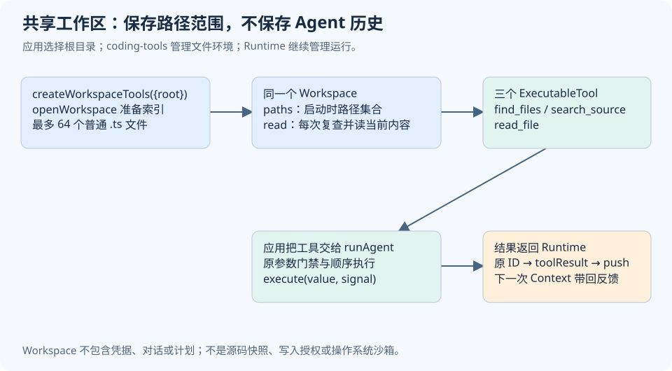
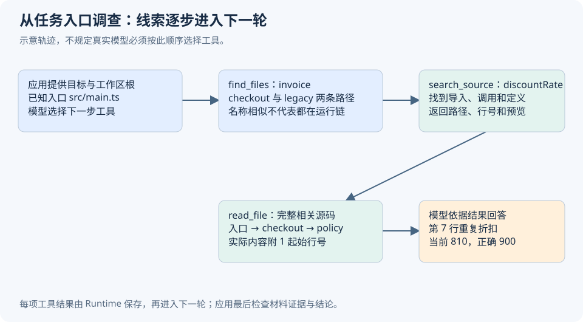
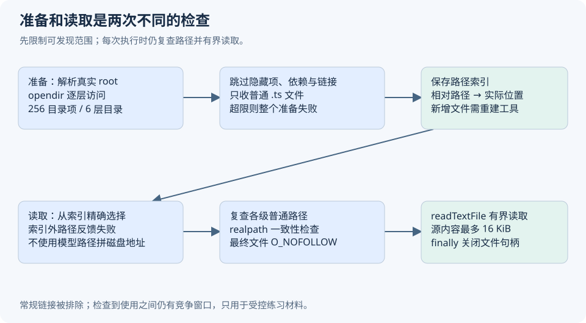
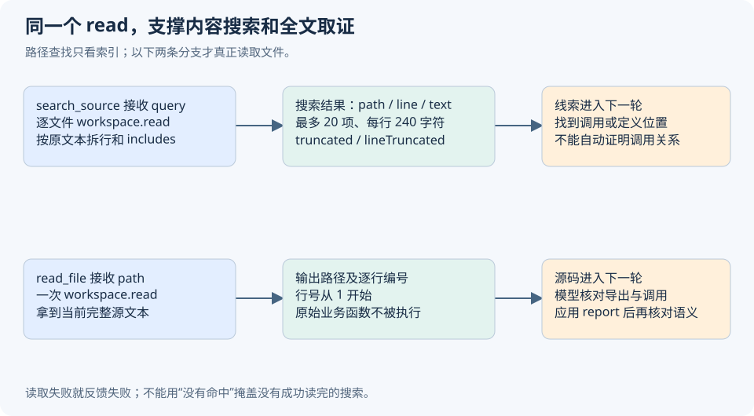

# 13 让 Agent 调查有限工作区

本篇让 Agent **从一个已知入口出发，查找候选文件、搜索函数的调用与定义、读取相关源码，再给出有位置依据的审查结论**。应用只配置工作区根目录，不再为每份材料维护一条读取映射。

这是第三阶段的起点。前两阶段的模型接入、工具门禁、消息反馈、事件、取消与预算继续使用；这次增长的是 coding-tools 的工作区调查能力。下一篇才进入实际修改与执行验证，本篇先把“要改哪里、依据是什么”查清楚。

## 本篇技术方案

### 实施前，先走完一次具体过程

本篇准备一个独立练习项目，入口是 `fixtures/workspace-review/src/main.ts`。它导出金额函数 `invoiceTotal`，当前实现放在 `src/checkout/invoice.ts`，折扣规则放在 `src/pricing/policy.ts`。还有一份 `src/legacy/invoice.ts` 历史材料。稍后会先创建全部文件，再使用它们。

1. **应用选择工作区，工具准备有限索引。** 应用只给根目录；工具扫描允许的普通 TS 文件，保存可用相对路径。索引表示“有哪些可调查位置”，没有把全文提前交给模型，也不是固定内容快照。
2. **模型根据任务找线索。** 任务从 src/main.ts 出发，不直接给出当前计算与规则的实际路径。
   - **2.1 查候选路径。** 模型请求查找 invoice，工具可能同时返回当前和历史文件。此时只能知道位置存在，不能判断哪份属于运行链。
   - **2.2 搜索内容。** 模型请求搜索 discountRate，工具返回导入、调用和定义的路径、行号与预览。这是字面量匹配，不是自动理解调用关系。
   - **2.3 读取完整材料。** 模型根据线索选择全文读取，通过入口导出、计算函数与规则确认实际关系；不会由查找函数替它选择实现。
3. **每项实际结果进入下一轮。** Runtime 调用请求对应的工具，工具返回文本，执行器关联原 ID。Runtime 保存结果后，再把更新的消息交给模型；模型才能利用刚取得的信息继续选动作。
4. **根据材料给出结论。** 当前规则满 10 件打九折，计算却连续应用两次折扣：100×10 得到 810，正确应为 900。这是沿材料判断的结果，不把历史文件当成当前代码。
5. **应用接住停止结果并核对证据。** 检查入口、计算文件、规则文件都有成功全文读取，再人工核对路径、行号、数值和结论。模型正常停止、工具成功与结论正确仍是不同判断。

### 实现架构图





图是一条可能轨迹，不规定真实模型的调用顺序。本篇的能力是让模型可以调查工作区，而不是把这张图写成 Runtime 的固定流程。

## 起点与职责

从 12 完成的工程开始，在仓库根目录自行创建本章分支：

```bash
git status --short --branch
git switch -c agent/chapter-13-workspace-investigation
```

本篇不修改 model 和 runtime 包的执行逻辑。coding-tools 增加一组工作区工具，原来的 `createReadFileTool({ files })` 保留；两个旧任务仍能使用逐文件清单。新任务调用 `createWorkspaceTools({ root })`，一次准备同根目录的三个工具。

| 位置 | 本篇负责的内容 |
|---|---|
| coding-tools 的工作区模块 | 建立路径范围，查找路径、搜索内容、读取全文 |
| Runtime | 检查工具请求、调用 execute、保存反馈、继续或停止 |
| 应用 | 选择根目录、任务、模型连接、预算与接受条件 |
| fixtures | 被调查的项目材料，不导入 Agent 进程执行 |

Pi 也把文件读取、路径查找和内容搜索分为不同工具，并由应用的工作目录提供执行位置。可对照固定版本的[read 工具](https://github.com/badlogic/pi-mono/blob/8efd314fa3d3232ce197d8d7a6a5660530b9d83e/packages/coding-agent/src/core/tools/read.ts)、[find 工具](https://github.com/badlogic/pi-mono/blob/8efd314fa3d3232ce197d8d7a6a5660530b9d83e/packages/coding-agent/src/core/tools/find.ts)与[grep 工具](https://github.com/badlogic/pi-mono/blob/8efd314fa3d3232ce197d8d7a6a5660530b9d83e/packages/coding-agent/src/core/tools/grep.ts)。本篇借鉴这种职责分工；查找采用路径子串、搜索采用字面量，不照搬 Pi 的 glob、rg/fd 进程、图片或分页接口。

## 第一步：创建要调查的练习项目

新建 `fixtures/workspace-review/src/main.ts`，写入完整代码：

这是练习项目的已知入口，只导出当前金额函数。模型先读它，就能沿实际导出位置继续调查；它不会把同名历史文件选为当前实现。

<<< @/snippets/13-workspace-investigation/fixtures/workspace-review/src/main.ts

新建 `fixtures/workspace-review/src/checkout/invoice.ts`，写入完整代码：

这份当前计算材料使用单价、数量和导入的折扣率计算金额，故意重复打折。调查任务要把它与入口及规则连接起来，文件工具只读取这些原文。

<<< @/snippets/13-workspace-investigation/fixtures/workspace-review/src/checkout/invoice.ts

新建 `fixtures/workspace-review/src/pricing/policy.ts`，写入完整代码：

这份规则材料按数量返回折扣率，供当前金额函数使用。读到它，才能核对满 10 件应打一次九折，不能只凭计算文件里的函数名猜规则。

<<< @/snippets/13-workspace-investigation/fixtures/workspace-review/src/pricing/policy.ts

新建 `fixtures/workspace-review/src/legacy/invoice.ts`，写入完整代码：

这是同名历史候选，保留旧金额写法以供辨认。路径查找可能找到它，但当前入口没有导向它；本材料用于观察调查是否依据运行链，而不是看见第一个文件就下结论。

<<< @/snippets/13-workspace-investigation/fixtures/workspace-review/src/legacy/invoice.ts

入口导出的是 checkout 下的函数，计算函数再导入 pricing 下的规则。legacy 文件没有出现在这条关系中。同名候选可以出现在查找结果里，但不能因为名字相似就把它当成当前证据。

这几份材料保留熟悉的金额问题，避免业务规则占据学习主线。新的难点是：模型怎样发现文件、取得相关内容，并把事实带回后续决策。

## 第二步：定义三个工具共享的工作区

工作区在这里表示“本次应用允许调查的一小组项目文件”。准备阶段扫描目录，记录相对路径与实际位置；工具运行时再读文件。**路径索引只记录有哪些文件，不保存源码副本，也不保存对话历史。**


新建 `packages/coding-tools/src/types/workspace.ts`，写入完整代码：

这份契约区分应用提供的根目录配置，与工厂内部创建的共享工作区。后者保存候选路径和读取能力，供三项工具使用；它不会保存源码快照或模型历史。

<<< @/snippets/13-workspace-investigation/packages/coding-tools/src/types/workspace.ts

应用创建 `WorkspaceOptions`，其中的 `root` 必须是明确的绝对目录位置。模型不会收到这个磁盘位置，只会看到相对路径与工具说明。

包内的 `Workspace` 由准备函数创建。`paths` 是启动时发现的路径集合，供查找工具使用；`read(path, signal)` 从同一范围里选择文件，供搜索与全文读取使用。`Promise<string>` 表示读取异步完成后返回源文本，调用它的工具会接住这个返回值；返回本身不会追加消息。

### 复用已有的有界读取

原清单工具已经处理 16 KiB 源内容限制、普通文件检查、取消边界和句柄关闭。工作区也需要这些行为，所以把现有读取函数抽到包内共用文件，而不是再写一份。

新建 `packages/coding-tools/src/files/read-text.ts`，写入完整代码。它承接原 `readAllowedFile`，改名为 `readTextFile` 并供包内使用；新增可选 `flags`，旧清单调用仍用默认 `r`，工作区稍后选择不跟随最终文件链接的标志。已知 I/O 失败增加 `ELOOP`，反馈不包含真实磁盘路径。

readTextFile 接收工具已经选定的实际位置、可选信号与打开标志，取得普通文件的有界 UTF-8 原文并返回。旧清单工具与新工作区工具都复用它，路径是否允许仍由各自上层先检查。

<<< @/snippets/13-workspace-investigation/packages/coding-tools/src/files/read-text.ts

这仍然是原来的有界读取过程：打开句柄后检查普通文件，循环填充最多 16 KiB 加 1 字节的缓冲，超过限制就不返回内容，退出时关闭句柄。额外 1 字节用来区分“恰好 16 KiB”和“还有更多内容”。这里没有先把任意大文件全部读入内存再截掉。

`signal` 在读取前后检查；它不会强杀任意文件系统操作。`finally` 负责已经取得的句柄，即使大小检查或取消抛错，也要关闭。Node 文件句柄读取与关闭接口见[Node 22 文件系统文档](https://nodejs.org/docs/latest-v22.x/api/fs.html#filehandlereadbuffer-offset-length-position)。

**完整替换 `packages/coding-tools/src/read-file.ts`。** 保留 `createReadFileTool`、参数检查、清单映射和原输出格式；删除该文件里的 `MAX_BYTES/KNOWN_IO_ERRORS/readAllowedFile`，导入刚创建的 `readTextFile`。`execute` 中只把读取调用名称替换为 `readTextFile(target, signal)`，不增加行号，不改变旧任务的使用方式。

旧清单工具继续接收模型可见的路径名称，核对应用配置后调用共用读取函数，返回原格式的文件内容。抽出实际读取并不把旧任务自动改成目录扫描，也不扩大它的可读清单。

<<< @/snippets/13-workspace-investigation/packages/coding-tools/src/read-file.ts

旧文件中只删除本步已经迁走的内部读取逻辑，不删除 `read-file.ts`。旧公开工厂继续存在，下一步的工作区工厂会另行导出。

## 第三步：准备索引，执行时复查路径

本次只处理小型、受控的普通 `.ts` 材料。准备阶段有明确上限：最多 256 个访问到的目录项、64 个 TS 文件、六层子目录，相对文件路径不超过 240 字符。隐藏项、`node_modules/dist`及符号链接不会进入索引；被忽略项的名称仍计入目录项数，但不访问其子树。

超过范围就停止准备，让应用缩小材料目录，避免拿着半份索引回答“没有这个文件”。这不是完整仓库扫描，也不读取 `.gitignore` 规则。



新建 `packages/coding-tools/src/workspace/open.ts`，写入完整代码：

openWorkspace 接收应用选择的根目录，建立有限普通文件索引，并返回 paths/read 组成的共享环境。后面的三项工具从同一索引取候选，真正读取时再复查路径，避免把启动索引当作永久不变的许可。

<<< @/snippets/13-workspace-investigation/packages/coding-tools/src/workspace/open.ts

以本篇材料为例，`realpath(options.root)` 取得实际根目录，`visit([])` 逐层发现四份 TS 文件。`files`保存类似 `src/checkout/invoice.ts → 根目录下该文件实际位置` 的映射，`paths`返回排序后的相对路径。排序便于稳定观察，不代表相关性排名。

`visit` 使用 `opendir` 逐个读取目录项，先受 256 项限制，再按名称访问子项。`lstat`检查链接本身；遇到符号链接跳过，遇到普通目录才继续，遇到普通 TS 文件才放进 `files`。异步目录迭代结束或提前退出会关闭目录句柄，依据见[Node 的 opendir 说明](https://nodejs.org/docs/latest-v22.x/api/fs.html#fspromisesopendirpath-options)。

准备返回后，工具通过 `workspace.read('src/checkout/invoice.ts', signal)` 读取。第一道检查是 `files.get(path)`：只有索引中的精确键才能选到实际位置。`../outside.ts`、绝对路径或编造的文件名不会被拼接成磁盘访问地址，而是得到一条可反馈的工具失败。

但路径在扫描后可能被替换，所以 `read` 还逐级检查普通目录与文件，并核对真实位置是否一致。最后将“不跟随最终文件链接”的 `O_NOFOLLOW` 标志交给共用读取函数。共用函数返回原始文本，当前 `read` 再把文本交给搜索或全文读取工具。

`guardIo` 只把已知的缺文件、不可访问等错误变成可反馈说明；未知异常继续向外抛。准备时发生错误，应用不启动 Agent；运行中发生已知错误，Runtime 把它保存为 toolResult 供模型处理。两种时机不能混为一条模型反馈。

### 这里保护到了哪里

本实现排除常规链接、索引外路径和过大的读取，仍有检查到使用之间被其他进程更换祖先路径的竞争窗口，也不阻止硬链接。它是受控练习工作区，**不是操作系统沙箱**；不要将它指向包含秘密或不可信并发写入的真实工程。

索引也不是不可变源码快照：已有文件被正常修改，下次读取看到新内容；新增文件不会自动进入索引，需重新创建工具。下一篇接写入与验证时，将另外定义工作副本及变更证据，不能把这份只读索引当作写入权限。

## 第四步：提供查找、搜索和读取工具

### 共用参数约定

三个工具都接收一个字符串字段，重复的本地检查与 schema 构造放在工作区模块内共用，不继续分散复制。

新建 `packages/coding-tools/src/workspace/arguments.ts`，写入完整代码：

stringArgument 从请求对象取得一个有长度限制的非空字符串，stringParameters 为同样的字段创建工具 schema。三个工具用它们统一声明和读取 query/path；辅助函数不搜索文件或保存状态。

<<< @/snippets/13-workspace-investigation/packages/coding-tools/src/workspace/arguments.ts

`stringParameters` 创建模型可见的字段说明，Runtime 会用同一 schema 执行本地检查。`stringArgument` 则在具体工具里取出字符串，即使应用直接调用 `execute`、绕过 Runtime，也拒绝坏对象、额外字段和纯空白字符串。

例如 `{ query: 'discountRate' }` 返回原字符串；`{ query: 42 }` 或 `{ query: ' ' }` 抛出 `invalid_arguments`。这两个函数只处理当前工具参数，不读取文件，不保存运行状态。

### 路径查找：有哪些候选文件

新建 `packages/coding-tools/src/workspace/find.ts`，写入完整代码：

createFindTool 接收共享工作区，返回按路径子串查候选的工具。模型提供 query，执行时从已知路径筛选并返回候选与截断标志；结果供模型选择下一步，不自动确认当前调用链。

<<< @/snippets/13-workspace-investigation/packages/coding-tools/src/workspace/find.ts

`createFindTool(workspace)` 返回一个可执行工具。真正请求到达时，`execute` 从参数取出 `query`，在 `workspace.paths` 里按区分大小写的子串过滤。本次输入 invoice，结果为：

```json
{"paths":["src/checkout/invoice.ts","src/legacy/invoice.ts"],"truncated":false}
```

这是工具根据索引产生的结果，不是模型编造的列表。它不读取源码，也不决定哪个文件正确。最多返回 20 条；`truncated: true` 表示还有路径没有返回，模型可以换更具体的子串。`*.ts`在这里就是字面量文字，不是 glob 表达式。

### 内容搜索：线索在哪一行

字面量搜索就是按原样查找一段文字，`.`、`*` 等符号不会被解释成正则表达式。

新建 `packages/coding-tools/src/workspace/search.ts`，写入完整代码：

createSearchTool 创建内容字面量搜索工具。模型给 query，工具实际读取索引内文件，返回命中的路径、行号与预览，供模型继续选择全文；它不解析 TypeScript 语义，也不将预览当成整份源码。

<<< @/snippets/13-workspace-investigation/packages/coding-tools/src/workspace/search.ts

`createSearchTool` 接到 `discountRate` 后，逐个调用同一个 `workspace.read` 取得当前文本，拆成原始行，记录包含该字面量的位置。返回的 `line` 从 1 开始；例如 invoice 第 2 行导入、第 6 行调用，policy 第 2 行定义。



本次返回结果中，`matches[0]` 是下面这个对象；完整数组还有调用行与定义行两项：

```json
{
  "path": "src/checkout/invoice.ts",
  "line": 2,
  "text": "import { discountRate } from '../pricing/policy';",
  "lineTruncated": false
}
```

`matches` 在这一项工具执行内部累计，最后序列化为工具文本，随后由 Runtime 保存。它不是跨轮状态。每条命中最多保留 240 个 JavaScript 字符串字符，并用 `lineTruncated` 标出预览是否省略；匹配点也可能在被省略的部分，需按路径与行号读全文。

找到第 21 条命中时，返回前 20 条并标 `truncated: true`；恰好 20 条且已查完时仍为 false。若某份材料读取失败，当前搜索就失败，不能把“没成功检查完”说成“无命中”。它没有跨文件一致性快照，也不解析导入图；本篇小文件限制使逐个读取的成本有限。

### 全文读取：核对完整上下文

新建 `packages/coding-tools/src/workspace/read.ts`，写入完整代码：

createWorkspaceReadTool 为选中的精确相对路径提供全文读取。模型给 path，工具经共享环境复查后返回带行号文本，Runtime 将它保存为反馈，模型再用完整上下文核对入口与规则关系。

<<< @/snippets/13-workspace-investigation/packages/coding-tools/src/workspace/read.ts

请求 `{ path: 'src/checkout/invoice.ts' }` 时，`source` 接住共享工作区返回的实际源码。工具在输出首行写相对路径，再给每行加 `1: / 2: ...` 编号。第 7 行会显示连乘两次折扣的 return 语句，模型可以据此引用实际位置。

源内容上限仍是 16 KiB，编号会额外增加输出长度。工具没有导入或执行这个函数，也没有替模型证明两份文件的关系；它提供可核对的完整文本。

本工具也叫 `read_file`，但与旧清单工具按任务二选一注册。本任务只使用新工作区的三项工具；不要再把旧 `reviewTools` 拼进去，否则会形成重复名称，原 Runtime 会拒绝该清单。

## 第五步：一次创建并公开这组能力

新建 `packages/coding-tools/src/workspace/index.ts`，写入完整代码：

createWorkspaceTools 替应用准备一次工作区，再将同一环境交给查找、搜索和读取工具，返回三项可执行工具。应用只给根目录，无需为每个文件单独创建映射；函数不会启动模型循环。

<<< @/snippets/13-workspace-investigation/packages/coding-tools/src/workspace/index.ts

应用只调用 `createWorkspaceTools({ root })`。`workspace` 接住准备结果，然后交给三个工具工厂；这三个工具因此共享同一份路径范围和读取规则。函数返回工具数组，不启动 Agent，也不执行任何模型请求。

这里传入的 signal 只用于启动前的扫描。运行开始后，每次工具 `execute` 接收的是 Runtime 传来的运行信号，搜索继续把它传给 `workspace.read`；不能误以为准备时的 signal 会自动绑定整个工具生命周期。

**完整替换 `packages/coding-tools/src/index.ts`。** 保留 `ReadFileOptions/createReadFileTool`；新增导出 `WorkspaceOptions/createWorkspaceTools`。包内的 `Workspace/openWorkspace` 不公开，应用仍只通过包名使用能力。

<<< @/snippets/13-workspace-investigation/packages/coding-tools/src/index.ts

### 先不接模型，确认实际环境

上述文件完成后，在根目录先构建包，再运行这段直接调用。构建必须在导入新公开成员之前完成，以免编辑器或 Node 仍看到旧的 dist 声明。

```bash
npm run build
node --input-type=module <<'JS'
import { resolve } from 'node:path';
import { createWorkspaceTools } from '@ai-harness/coding-tools';
const tools = await createWorkspaceTools({ root: resolve('fixtures/workspace-review') });
console.log(tools.map(tool => tool.name));
console.log(await tools[0].execute({ query: 'invoice' }));
console.log(await tools[1].execute({ query: 'discountRate' }));
console.log(await tools[2].execute({ path: 'src/main.ts' }));
JS
```

应看到三个工具名称、两条 invoice 候选路径、三条 discountRate 命中，以及入口的真实带行号内容。这里只调用工具验证环境，还没有模型、toolResult 或 Agent 循环，不能把这几行输出叫作模型自主调查。

## 第六步：接入同一 Agent 循环

### 任务工厂选择根目录和证据要求

新建 `examples/code-review/src/workspace-task.ts`，写入完整代码：

这个任务工厂选择根目录并等待三项工具准备好，返回审查目标、工具和当前材料的报告要求。入口随后把任务交给原 Runtime；已知入口是调查起点，实际计算与规则仍要通过内容取得。

<<< @/snippets/13-workspace-investigation/examples/code-review/src/workspace-task.ts

任务工厂调用公共 `createWorkspaceTools`，默认根目录指向本篇独立材料。给模型的用户消息只指出入口和审查目标，没有列出实际计算文件、规则路径或工具顺序。工具描述也不会把全部文件名提前列给模型。

`tools` 接住准备完成的三项能力，返回的 `input`交给原来的 `runAgent`。`report`继续复用 12 的 `reportRun`，把三份全文读取要求留在应用闭包里。搜索预览可以帮助模型调查，但本任务的有限接受规则要求完整读过入口、实际计算和规则，不能仅凭搜索行完成交付。

报告仍不验证路径行号是否支持结论、算术是否正确、源码版本是否变化。新参数 `root` 方便应用选择另一份同结构材料，不意味着这个任务说明和报告能自动适用于任意仓库。

### 真实服务入口

新建 `examples/code-review/src/workspace-main.ts`，写入完整代码：

这个真实入口准备工作区任务，配置原模型连接、预算、事件与 Ctrl+C，调用一次 runAgent。停止后调用任务报告并清理监听，目录扫描和文件 I/O 不放在循环内部。

<<< @/snippets/13-workspace-investigation/examples/code-review/src/workspace-main.ts

入口先建立取消监听，在 `try` 中等待工作区准备，再创建原共享模型连接。`const result = await runAgent(...)`接住运行结果；循环内部仍检查工具、保存请求和结果、携带新消息继续模型调用。

模型包、Runtime 和运行策略都沿用前面：最多六次模型调用、八项工具处理、整次 60 秒，事件实时展示，Ctrl+C 协作退出，`finally`清理进程监听。准备失败也会走入口的清理，且不会伪造为模型已收到的工具结果。

**完整替换根目录下的 `examples/run.ts`。** 保留默认 code-review、release-impact 及位置参数处理；在名称检查中增加 workspace-review，再增加对应入口分支。根 `package.json` 的 start/debug/build/check 不改。

示例选择器读取 --example，选中 workspace-review 时导入新入口，原 code-review 和 release-impact 仍可运行。它只选择应用，不决定模型查哪些文件，也不改变 start/debug 的用途。

<<< @/snippets/13-workspace-investigation/examples/run.ts

真实服务由操作者自行决定何时调用。已配置原服务时，在根目录执行：

```bash
npm start -- --example workspace-review
```

需要断点时执行：

```bash
npm run debug -- --example workspace-review
```

这些命令使用真实模型与原 `.env` 配置。真实模型自行选择动作，不要求复现后面的固定观察计划：先读已知入口、先查候选或同轮请求多个工具，都可能合理。

**运行中：看模型与工具正在做什么。**

终端先显示实时事件，行首的运行 ID 前缀和 `#序号` 用来关联同一次运行及事件顺序。重点看以下字段：

| 日志 | 本次应怎样理解 |
|---|---|
| `model_start` | 即将发起这一轮模型调用；此时不代表已取得回答 |
| `model_text_delta`，文字预览 | 服务正在返回文字片段；可能是调查说明或答案草稿，不是已交付结果 |
| `model_end`，`toolUse`，请求工具若干项 | 本轮完整模型消息已取得，其中包含待处理的请求 |
| `tool_start`，`工具名 / 请求ID` | Runtime 开始检查这一项请求；此时参数或路径仍可能被拒绝 |
| `tool_end`，成功结果或失败反馈 | 这一项已经形成结果；同一个请求 ID 可在停止后的工具结果中找到 |
| `run_end` | Runtime 已选定停止状态；同时显示模型调用次数和工具处理次数 |

`tool_end` 的“成功结果”只表示该项工具成功，不表示审查结论正确。文字预览也不能替代 `model_end` 或最终停止状态。

**运行停止后：核对保存了什么、最后说了什么。**

普通报告路径会打印 `运行记录`。其中的 `模型响应 N` 是保存下来的完整模型消息，`模型提出的工具请求` 展示该消息里的请求，`工具结果 · 工具名 / 请求ID` 展示实际执行反馈。这里是在重看已有记录，不是又执行一次模型或工具。

先找三份成功的 `read_file` 结果：`src/main.ts`、`src/checkout/invoice.ts`、`src/pricing/policy.ts`。每份内容首行应是对应路径，后面带实际源码与行号。查找返回一个路径、搜索命中一行，都不能替代本任务要求的全文读取。

再看 `运行停止` 的 `status/modelCalls/toolCalls`。例如，模型依次读取入口、计算文件、规则，再回答，可能用四次模型调用、三项工具处理。这与后面固定计划的四次调用、五项工具处理不同，也可以是合理调查；不要求每次都用齐查找、搜索和读取三类工具。

当状态为 `answered` 且三份读取证据齐全，报告才显示 `模型文本（text）`。回答措辞可以不同，但应指出当前入口导出的是 checkout 中的函数、折扣重复应用，并用实际路径及行号说明依据。默认材料应能核对到 invoice 第 7 行、policy 第 3 行，单价 100、数量 10 时当前 810、正确 900。若把 legacy 当成当前实现，或数值与源码不符，即使报告展示了答案，也不能认定任务正确完成。

**没有交付时：先找停止位置。**

| 日志或状态 | 下一步看哪里 |
|---|---|
| `缺少目标文件的成功读取证据` | 查看列出的路径是否有成功 `read_file` 结果；模型自述“读过”不算证据 |
| `failed` | 查看 `运行失败` 的 `phase/code/diagnostic`，区分模型服务、协议与工具异常；不要仅凭超时就判断密钥有误 |
| `callLimit` | 查看最后保存的模型消息和此前反馈，找出调查尚缺什么，不直接增加调用上限 |
| `运行受限制停止：timedOut/toolLimit` | 查看此前实时事件，确认停在模型等待还是哪项工具之前；这两个入口分支不调用普通任务报告 |
| `运行已取消，未交付答案` | 表示主动取消；当前入口同样跳过普通任务报告，不把已有预览当答案 |

真实入口不会打印本地装置的 `工作区观察` 或 `taskAccepted: true` 摘要。这里的布尔接受结果由 `task.report(result)` 返回给入口：不通过时设置退出码 1，但不会自动验证回答语义。真实模型质量仍要依据本次保存的源码与最终结论核对。


### 无 Key 观察：固定决策，真实执行

新建 `examples/code-review/src/workspace-observe.ts`，写入完整代码。本文件是可直接复制的本地观察装置，**固定 ModelCall 代替模型决策，不经过模型包的 HTTP 或协议转换**；工作区准备、Runtime、参数门禁和文件 I/O 实际运行。

::: details examples/code-review/src/workspace-observe.ts：完整配套代码

<<< @/snippets/13-workspace-investigation/examples/code-review/src/workspace-observe.ts

:::

`plan`预写四次模型返回：查找、搜索、三项全文读取、固定答案。`callModel`每次接收 Runtime 传来的 `context`，用 `index`选择下一条预写消息；真实工具结果仍经过原循环保存，下一次上下文确实包含它。

recover 只在最前面加一次索引外路径请求。第二次固定调用检查 `bad_path`的失败反馈确实存在，后续仍使用预写计划，并不自主理解反馈后修正。入口最后调用同一 `task.report(result)`，所以本地和真实入口的材料要求一致。

在根目录执行，不需要 Key 或 `.env`：

```bash
npm run check
node --import tsx examples/code-review/src/workspace-observe.ts normal
node --import tsx examples/code-review/src/workspace-observe.ts recover
```

## 第七步：按证据检查结果

### 正常轨迹

normal 应显示：

| 位置 | 应查看的实际值 |
|---|---|
| find_1 工具结果 | checkout 和 legacy 两条 invoice 路径，truncated 为 false |
| search_2 工具结果 | invoice 第 2、6 行和 policy 第 2 行，三条实际命中 |
| read_entry/read_invoice/read_policy | 成功结果各保留原 ID，文本包含相对路径与行号 |
| 最终摘要 | answered、modelCalls 为 4、toolCalls 为 5、taskAccepted 为 true |

工具处理为 5，是一次查找、一次搜索和三次全文读取。搜索内部还逐个读取四份源码，这些文件 I/O 不是四次额外的模型工具请求。准备阶段扫描目录也不计为模型调用。

固定答案引用 main 第 2 行、invoice 第 7 行、policy 第 3 行。手工核对单价 100、数量 10：小计 1000、折扣率 0.1，当前连乘得 810，一次折扣应得 900。读取成功、answered 和有限报告 true 都不能替代这一步含义核对。

### 索引外路径反馈

recover 第一轮提出 `read_file({path:'../outside.ts'})`。schema 认为这是字符串，但共享工作区查不到这个精确键，返回 `isError: true`、ID 为 bad_path 的已知失败。没有访问根目录外的该路径。

下一次固定调用取得此反馈后，继续既定查找流程。最后是五次模型调用、六项工具处理，仍可接受；此前的一次失败不等于永远不能交付。真实模型是否会根据反馈修正，要用真实轨迹另行观察。

### 可逆故障：规则材料不在范围内

先暂时将规则文件改成非 TS 后缀，再运行本地 normal 模式：

```bash
mv fixtures/workspace-review/src/pricing/policy.ts fixtures/workspace-review/src/pricing/policy.ts.bak
node --import tsx examples/code-review/src/workspace-observe.ts normal
mv fixtures/workspace-review/src/pricing/policy.ts.bak fixtures/workspace-review/src/pricing/policy.ts
```

固定计划仍然请求原 policy 路径，但启动索引不包含 `.bak` 文件。应看到该读取失败，报告列出缺少 `src/pricing/policy.ts` 的成功证据，`taskAccepted: false`，进程退出码 1。即使固定答案仍输出 900，也不能交付；它没有随材料改变而重新推导答案。

执行完一定运行最后一条恢复命令。这里演示的是缺材料后的证据拒绝，不是要求 Agent 修改磁盘或偷偷扩大根目录。

### 在哪里打断点

- `workspace/open.ts` 的 `files.set(relativePath, target)`：看相对键和实际位置分别是什么；准备后 `paths`只有四个普通 TS 文件。
- `workspace/find.ts` 的 `matches`：看到两条候选，但此处没有读源码或决定当前调用链。
- `workspace/search.ts` 的 `const source = await workspace.read(...)`：看返回的当前源码、命中的行号与局部 `matches`。
- `packages/runtime/src/run-agent.ts` 的 `messages.push(...results)`：确认工具返回后是谁保存；下一次 `callModel`的上下文再消费这些反馈。
- 任务的 `report`回调：区分“搜索找到规则符号”和“该任务已取得规则全文”的要求。

### 小迁移：规则换位置，核心保持不变

在 `fixtures/workspace-review/src/` 下新建 `policies/` 目录，将材料 `pricing/policy.ts` 移到 `policies/discount.ts`。修改 `fixtures/workspace-review/src/checkout/invoice.ts` 的导入路径为 `../policies/discount`，并将 `examples/code-review/src/workspace-task.ts` 的报告清单末项改成 `src/policies/discount.ts`。不要修改 coding-tools、Runtime 或模型协议。真实模型应从入口和导入关系找到新位置，再按原规则说明数值。

固定观察装置仍引用旧路径，因此不能用其旧 normal 结果评价迁移后的模型质量；观察新轨迹应自行选择真实服务。迁移后确认查找结果包含新位置，完整读取反馈采用新路径，最终引用与实际行号一致。结束后恢复本篇默认材料，便于下一篇从同一状态继续。

## 本篇留下的能力与边界

现在应用可以只选择一个小型工作区，让 Agent 取得候选路径、内容线索和完整源码。工具负责提供事实，模型负责结合任务选择动作和解释关系，Runtime 负责执行、反馈与停止，应用负责接受条件。

路径子串和字面量搜索是当前有限实现，不是完整仓库工具；64 文件、20 命中、16 KiB 等数值是当前范围策略，没有证明适用于真实大型工程。超限有明确失败或截断信息，不能把不完整结果当完整事实。

下一篇在可重置副本中接上**实际修改 → 运行预先限定的验收程序 → 把真实结果反馈模型 → 调整或交付**。工作区调查会作为这条代码任务链的前半段继续使用。

## 完整文件核对

下面引用同一份本篇候选。只需按正文新增或替换本章变化，沿用文件供核对，不必重新抄写。新旧清单读取并存，没有删除原任务或复制 Runtime 循环。

::: details .env.example【沿用】

<<< @/snippets/13-workspace-investigation/.env.example

:::

::: details examples/code-review/package.json【沿用】

<<< @/snippets/13-workspace-investigation/examples/code-review/package.json

:::

::: details examples/code-review/src/cancellation/fixtures.ts【沿用】

<<< @/snippets/13-workspace-investigation/examples/code-review/src/cancellation/fixtures.ts

:::

::: details examples/code-review/src/cancellation/main.ts【沿用】

<<< @/snippets/13-workspace-investigation/examples/code-review/src/cancellation/main.ts

:::

::: details examples/code-review/src/check-events.ts【沿用】

<<< @/snippets/13-workspace-investigation/examples/code-review/src/check-events.ts

:::

::: details examples/code-review/src/check-protocol.ts【沿用】

<<< @/snippets/13-workspace-investigation/examples/code-review/src/check-protocol.ts

:::

::: details examples/code-review/src/check-stream.ts【沿用】

<<< @/snippets/13-workspace-investigation/examples/code-review/src/check-stream.ts

:::

::: details examples/code-review/src/check-tool-contract.ts【沿用】

<<< @/snippets/13-workspace-investigation/examples/code-review/src/check-tool-contract.ts

:::

::: details examples/code-review/src/limits/main.ts【沿用】

<<< @/snippets/13-workspace-investigation/examples/code-review/src/limits/main.ts

:::

::: details examples/code-review/src/limits/scenario.ts【沿用】

<<< @/snippets/13-workspace-investigation/examples/code-review/src/limits/scenario.ts

:::

::: details examples/code-review/src/main.ts【沿用】

<<< @/snippets/13-workspace-investigation/examples/code-review/src/main.ts

:::

::: details examples/code-review/src/protocol-fetch.ts【沿用】

<<< @/snippets/13-workspace-investigation/examples/code-review/src/protocol-fetch.ts

:::

::: details examples/code-review/src/report-run.ts【沿用】

<<< @/snippets/13-workspace-investigation/examples/code-review/src/report-run.ts

:::

::: details examples/code-review/src/stream-fetch.ts【沿用】

<<< @/snippets/13-workspace-investigation/examples/code-review/src/stream-fetch.ts

:::

::: details examples/code-review/src/task.ts【沿用】

<<< @/snippets/13-workspace-investigation/examples/code-review/src/task.ts

:::

::: details examples/code-review/src/tools.ts【沿用】

<<< @/snippets/13-workspace-investigation/examples/code-review/src/tools.ts

:::

::: details examples/code-review/src/workspace-main.ts【新增文件】

<<< @/snippets/13-workspace-investigation/examples/code-review/src/workspace-main.ts

:::

::: details examples/code-review/src/workspace-observe.ts【新增文件】

<<< @/snippets/13-workspace-investigation/examples/code-review/src/workspace-observe.ts

:::

::: details examples/code-review/src/workspace-task.ts【新增文件】

<<< @/snippets/13-workspace-investigation/examples/code-review/src/workspace-task.ts

:::

::: details examples/package-consumer/main.mjs【沿用】

<<< @/snippets/13-workspace-investigation/examples/package-consumer/main.mjs{js}

:::

::: details examples/release-impact/package.json【沿用】

<<< @/snippets/13-workspace-investigation/examples/release-impact/package.json

:::

::: details examples/release-impact/src/load-records.ts【沿用】

<<< @/snippets/13-workspace-investigation/examples/release-impact/src/load-records.ts

:::

::: details examples/release-impact/src/lookup-tool.ts【沿用】

<<< @/snippets/13-workspace-investigation/examples/release-impact/src/lookup-tool.ts

:::

::: details examples/release-impact/src/main.ts【沿用】

<<< @/snippets/13-workspace-investigation/examples/release-impact/src/main.ts

:::

::: details examples/release-impact/src/report-run.ts【沿用】

<<< @/snippets/13-workspace-investigation/examples/release-impact/src/report-run.ts

:::

::: details examples/release-impact/src/task.ts【沿用】

<<< @/snippets/13-workspace-investigation/examples/release-impact/src/task.ts

:::

::: details examples/release-impact/src/tools.ts【沿用】

<<< @/snippets/13-workspace-investigation/examples/release-impact/src/tools.ts

:::

::: details examples/release-impact/src/types/tools.ts【沿用】

<<< @/snippets/13-workspace-investigation/examples/release-impact/src/types/tools.ts

:::

::: details examples/release-impact/src/validation.ts【沿用】

<<< @/snippets/13-workspace-investigation/examples/release-impact/src/validation.ts

:::

::: details examples/run.ts【修改】

<<< @/snippets/13-workspace-investigation/examples/run.ts

:::

::: details examples/shared/interrupt.ts【沿用】

<<< @/snippets/13-workspace-investigation/examples/shared/interrupt.ts

:::

::: details examples/shared/model.ts【沿用】

<<< @/snippets/13-workspace-investigation/examples/shared/model.ts

:::

::: details examples/shared/print-event.ts【沿用】

<<< @/snippets/13-workspace-investigation/examples/shared/print-event.ts

:::

::: details examples/shared/print-run.ts【沿用】

<<< @/snippets/13-workspace-investigation/examples/shared/print-run.ts

:::

::: details examples/shared/stream-model.ts【沿用】

<<< @/snippets/13-workspace-investigation/examples/shared/stream-model.ts

:::

::: details examples/shared/terminal.ts【沿用】

<<< @/snippets/13-workspace-investigation/examples/shared/terminal.ts

:::

::: details examples/shared/types/task.ts【沿用】

<<< @/snippets/13-workspace-investigation/examples/shared/types/task.ts

:::

::: details examples/stage-check/fixtures/fetch.ts【沿用】

<<< @/snippets/13-workspace-investigation/examples/stage-check/fixtures/fetch.ts

:::

::: details examples/stage-check/fixtures/plans.ts【沿用】

<<< @/snippets/13-workspace-investigation/examples/stage-check/fixtures/plans.ts

:::

::: details examples/stage-check/main.ts【沿用】

<<< @/snippets/13-workspace-investigation/examples/stage-check/main.ts

:::

::: details fixtures/code-review/src/cart.ts【沿用】

<<< @/snippets/13-workspace-investigation/fixtures/code-review/src/cart.ts

:::

::: details fixtures/code-review/src/invoice.ts【沿用】

<<< @/snippets/13-workspace-investigation/fixtures/code-review/src/invoice.ts

:::

::: details fixtures/code-review/src/pricing.ts【沿用】

<<< @/snippets/13-workspace-investigation/fixtures/code-review/src/pricing.ts

:::

::: details fixtures/model-protocol/anthropic.json【沿用】

<<< @/snippets/13-workspace-investigation/fixtures/model-protocol/anthropic.json

:::

::: details fixtures/model-protocol/deepseek.json【沿用】

<<< @/snippets/13-workspace-investigation/fixtures/model-protocol/deepseek.json

:::

::: details fixtures/model-stream/anthropic-answer.sse【沿用】

<<< @/snippets/13-workspace-investigation/fixtures/model-stream/anthropic-answer.sse

:::

::: details fixtures/model-stream/anthropic-tools.sse【沿用】

<<< @/snippets/13-workspace-investigation/fixtures/model-stream/anthropic-tools.sse

:::

::: details fixtures/model-stream/deepseek-answer.sse【沿用】

<<< @/snippets/13-workspace-investigation/fixtures/model-stream/deepseek-answer.sse

:::

::: details fixtures/model-stream/deepseek-tools.sse【沿用】

<<< @/snippets/13-workspace-investigation/fixtures/model-stream/deepseek-tools.sse

:::

::: details fixtures/package-consumer/source.ts【沿用】

<<< @/snippets/13-workspace-investigation/fixtures/package-consumer/source.ts

:::

::: details fixtures/release-impact/releases.json【沿用】

<<< @/snippets/13-workspace-investigation/fixtures/release-impact/releases.json

:::

::: details fixtures/release-impact/services.json【沿用】

<<< @/snippets/13-workspace-investigation/fixtures/release-impact/services.json

:::

::: details fixtures/release-impact/stage-releases.json【沿用】

<<< @/snippets/13-workspace-investigation/fixtures/release-impact/stage-releases.json

:::

::: details fixtures/release-impact/stage-services.json【沿用】

<<< @/snippets/13-workspace-investigation/fixtures/release-impact/stage-services.json

:::

::: details fixtures/workspace-review/src/checkout/invoice.ts【新增文件】

<<< @/snippets/13-workspace-investigation/fixtures/workspace-review/src/checkout/invoice.ts

:::

::: details fixtures/workspace-review/src/legacy/invoice.ts【新增文件】

<<< @/snippets/13-workspace-investigation/fixtures/workspace-review/src/legacy/invoice.ts

:::

::: details fixtures/workspace-review/src/main.ts【新增文件】

<<< @/snippets/13-workspace-investigation/fixtures/workspace-review/src/main.ts

:::

::: details fixtures/workspace-review/src/pricing/policy.ts【新增文件】

<<< @/snippets/13-workspace-investigation/fixtures/workspace-review/src/pricing/policy.ts

:::

::: details package.json【沿用】

<<< @/snippets/13-workspace-investigation/package.json

:::

::: details packages/coding-tools/package.json【沿用】

<<< @/snippets/13-workspace-investigation/packages/coding-tools/package.json

:::

::: details packages/coding-tools/src/files/read-text.ts【新增文件】

<<< @/snippets/13-workspace-investigation/packages/coding-tools/src/files/read-text.ts

:::

::: details packages/coding-tools/src/index.ts【修改】

<<< @/snippets/13-workspace-investigation/packages/coding-tools/src/index.ts

:::

::: details packages/coding-tools/src/read-file.ts【修改】

<<< @/snippets/13-workspace-investigation/packages/coding-tools/src/read-file.ts

:::

::: details packages/coding-tools/src/types/read-file.ts【沿用】

<<< @/snippets/13-workspace-investigation/packages/coding-tools/src/types/read-file.ts

:::

::: details packages/coding-tools/src/types/workspace.ts【新增文件】

<<< @/snippets/13-workspace-investigation/packages/coding-tools/src/types/workspace.ts

:::

::: details packages/coding-tools/src/workspace/arguments.ts【新增文件】

<<< @/snippets/13-workspace-investigation/packages/coding-tools/src/workspace/arguments.ts

:::

::: details packages/coding-tools/src/workspace/find.ts【新增文件】

<<< @/snippets/13-workspace-investigation/packages/coding-tools/src/workspace/find.ts

:::

::: details packages/coding-tools/src/workspace/index.ts【新增文件】

<<< @/snippets/13-workspace-investigation/packages/coding-tools/src/workspace/index.ts

:::

::: details packages/coding-tools/src/workspace/open.ts【新增文件】

<<< @/snippets/13-workspace-investigation/packages/coding-tools/src/workspace/open.ts

:::

::: details packages/coding-tools/src/workspace/read.ts【新增文件】

<<< @/snippets/13-workspace-investigation/packages/coding-tools/src/workspace/read.ts

:::

::: details packages/coding-tools/src/workspace/search.ts【新增文件】

<<< @/snippets/13-workspace-investigation/packages/coding-tools/src/workspace/search.ts

:::

::: details packages/coding-tools/tsconfig.json【沿用】

<<< @/snippets/13-workspace-investigation/packages/coding-tools/tsconfig.json

:::

::: details packages/model/package.json【沿用】

<<< @/snippets/13-workspace-investigation/packages/model/package.json

:::

::: details packages/model/src/complete.ts【沿用】

<<< @/snippets/13-workspace-investigation/packages/model/src/complete.ts

:::

::: details packages/model/src/errors/model-call-error.ts【沿用】

<<< @/snippets/13-workspace-investigation/packages/model/src/errors/model-call-error.ts

:::

::: details packages/model/src/index.ts【沿用】

<<< @/snippets/13-workspace-investigation/packages/model/src/index.ts

:::

::: details packages/model/src/providers/anthropic/anthropic-messages.ts【沿用】

<<< @/snippets/13-workspace-investigation/packages/model/src/providers/anthropic/anthropic-messages.ts

:::

::: details packages/model/src/providers/anthropic/anthropic-response.ts【沿用】

<<< @/snippets/13-workspace-investigation/packages/model/src/providers/anthropic/anthropic-response.ts

:::

::: details packages/model/src/providers/anthropic/anthropic.ts【沿用】

<<< @/snippets/13-workspace-investigation/packages/model/src/providers/anthropic/anthropic.ts

:::

::: details packages/model/src/providers/anthropic/request.ts【沿用】

<<< @/snippets/13-workspace-investigation/packages/model/src/providers/anthropic/request.ts

:::

::: details packages/model/src/providers/anthropic/stream.ts【沿用】

<<< @/snippets/13-workspace-investigation/packages/model/src/providers/anthropic/stream.ts

:::

::: details packages/model/src/providers/deepseek/deepseek-messages.ts【沿用】

<<< @/snippets/13-workspace-investigation/packages/model/src/providers/deepseek/deepseek-messages.ts

:::

::: details packages/model/src/providers/deepseek/deepseek-response.ts【沿用】

<<< @/snippets/13-workspace-investigation/packages/model/src/providers/deepseek/deepseek-response.ts

:::

::: details packages/model/src/providers/deepseek/deepseek.ts【沿用】

<<< @/snippets/13-workspace-investigation/packages/model/src/providers/deepseek/deepseek.ts

:::

::: details packages/model/src/providers/deepseek/request.ts【沿用】

<<< @/snippets/13-workspace-investigation/packages/model/src/providers/deepseek/request.ts

:::

::: details packages/model/src/providers/deepseek/stream.ts【沿用】

<<< @/snippets/13-workspace-investigation/packages/model/src/providers/deepseek/stream.ts

:::

::: details packages/model/src/providers/shared/read-sse.ts【沿用】

<<< @/snippets/13-workspace-investigation/packages/model/src/providers/shared/read-sse.ts

:::

::: details packages/model/src/providers/shared/request-json.ts【沿用】

<<< @/snippets/13-workspace-investigation/packages/model/src/providers/shared/request-json.ts

:::

::: details packages/model/src/providers/shared/request-response.ts【沿用】

<<< @/snippets/13-workspace-investigation/packages/model/src/providers/shared/request-response.ts

:::

::: details packages/model/src/request-options.ts【沿用】

<<< @/snippets/13-workspace-investigation/packages/model/src/request-options.ts

:::

::: details packages/model/src/stream.ts【沿用】

<<< @/snippets/13-workspace-investigation/packages/model/src/stream.ts

:::

::: details packages/model/src/types/anthropic-stream.ts【沿用】

<<< @/snippets/13-workspace-investigation/packages/model/src/types/anthropic-stream.ts

:::

::: details packages/model/src/types/anthropic.ts【沿用】

<<< @/snippets/13-workspace-investigation/packages/model/src/types/anthropic.ts

:::

::: details packages/model/src/types/context.ts【沿用】

<<< @/snippets/13-workspace-investigation/packages/model/src/types/context.ts

:::

::: details packages/model/src/types/failures.ts【沿用】

<<< @/snippets/13-workspace-investigation/packages/model/src/types/failures.ts

:::

::: details packages/model/src/types/messages.ts【沿用】

<<< @/snippets/13-workspace-investigation/packages/model/src/types/messages.ts

:::

::: details packages/model/src/types/options.ts【沿用】

<<< @/snippets/13-workspace-investigation/packages/model/src/types/options.ts

:::

::: details packages/model/src/types/sse.ts【沿用】

<<< @/snippets/13-workspace-investigation/packages/model/src/types/sse.ts

:::

::: details packages/model/src/types/stream.ts【沿用】

<<< @/snippets/13-workspace-investigation/packages/model/src/types/stream.ts

:::

::: details packages/model/src/types/tool-results.ts【沿用】

<<< @/snippets/13-workspace-investigation/packages/model/src/types/tool-results.ts

:::

::: details packages/model/src/types/tools.ts【沿用】

<<< @/snippets/13-workspace-investigation/packages/model/src/types/tools.ts

:::

::: details packages/model/src/validation.ts【沿用】

<<< @/snippets/13-workspace-investigation/packages/model/src/validation.ts

:::

::: details packages/model/tsconfig.json【沿用】

<<< @/snippets/13-workspace-investigation/packages/model/tsconfig.json

:::

::: details packages/runtime/package.json【沿用】

<<< @/snippets/13-workspace-investigation/packages/runtime/package.json

:::

::: details packages/runtime/src/control/run-control.ts【沿用】

<<< @/snippets/13-workspace-investigation/packages/runtime/src/control/run-control.ts

:::

::: details packages/runtime/src/errors/tool-batch-cancelled.ts【沿用】

<<< @/snippets/13-workspace-investigation/packages/runtime/src/errors/tool-batch-cancelled.ts

:::

::: details packages/runtime/src/errors/tool-batch-error.ts【沿用】

<<< @/snippets/13-workspace-investigation/packages/runtime/src/errors/tool-batch-error.ts

:::

::: details packages/runtime/src/errors/tool-batch-limit.ts【沿用】

<<< @/snippets/13-workspace-investigation/packages/runtime/src/errors/tool-batch-limit.ts

:::

::: details packages/runtime/src/errors/tool-execution-error.ts【沿用】

<<< @/snippets/13-workspace-investigation/packages/runtime/src/errors/tool-execution-error.ts

:::

::: details packages/runtime/src/events/dispatcher.ts【沿用】

<<< @/snippets/13-workspace-investigation/packages/runtime/src/events/dispatcher.ts

:::

::: details packages/runtime/src/index.ts【沿用】

<<< @/snippets/13-workspace-investigation/packages/runtime/src/index.ts

:::

::: details packages/runtime/src/run-agent.ts【沿用】

<<< @/snippets/13-workspace-investigation/packages/runtime/src/run-agent.ts

:::

::: details packages/runtime/src/tools/execute.ts【沿用】

<<< @/snippets/13-workspace-investigation/packages/runtime/src/tools/execute.ts

:::

::: details packages/runtime/src/tools/registry.ts【沿用】

<<< @/snippets/13-workspace-investigation/packages/runtime/src/tools/registry.ts

:::

::: details packages/runtime/src/types/events.ts【沿用】

<<< @/snippets/13-workspace-investigation/packages/runtime/src/types/events.ts

:::

::: details packages/runtime/src/types/failures.ts【沿用】

<<< @/snippets/13-workspace-investigation/packages/runtime/src/types/failures.ts

:::

::: details packages/runtime/src/types/model-call.ts【沿用】

<<< @/snippets/13-workspace-investigation/packages/runtime/src/types/model-call.ts

:::

::: details packages/runtime/src/types/run-control.ts【沿用】

<<< @/snippets/13-workspace-investigation/packages/runtime/src/types/run-control.ts

:::

::: details packages/runtime/src/types/run.ts【沿用】

<<< @/snippets/13-workspace-investigation/packages/runtime/src/types/run.ts

:::

::: details packages/runtime/src/types/tool-batch.ts【沿用】

<<< @/snippets/13-workspace-investigation/packages/runtime/src/types/tool-batch.ts

:::

::: details packages/runtime/src/types/tool-registry.ts【沿用】

<<< @/snippets/13-workspace-investigation/packages/runtime/src/types/tool-registry.ts

:::

::: details packages/runtime/src/types/tools.ts【沿用】

<<< @/snippets/13-workspace-investigation/packages/runtime/src/types/tools.ts

:::

::: details packages/runtime/tsconfig.json【沿用】

<<< @/snippets/13-workspace-investigation/packages/runtime/tsconfig.json

:::

::: details tsconfig.json【沿用】

<<< @/snippets/13-workspace-investigation/tsconfig.json

:::

## 保存本篇实现

恢复故障材料，确认当前是自己创建的本章分支，审阅差异与验证结果后再自行提交。提交说明应与你实际完成的检查一致。

```bash
git status --short --branch
git diff --check
git diff
npm run check
npm run docs:build
git add -A
git commit -F - <<'EOF'
第13篇：让Agent调查有限工作区

coding-tools新增共享工作区与路径查找、内容搜索、全文读取能力。
抽取有界文件读取，保留原清单工具与已有任务的公开用法。
工作区启动索引限制范围，执行时复查路径并传播运行取消信号。
新增工作区审查入口和无Key固定决策观察，区分线索、证据与结论。
同步图解、任务迁移、故障定位和完整文件核对。
EOF

git push -u origin agent/chapter-13-workspace-investigation
```

提交推送不等于合并或部署，也不能代替真实任务质量与独立迁移验证。

<style>
.workspace-investigation .vp-doc .custom-block.details summary {
  overflow-wrap: anywhere;
}
</style>

