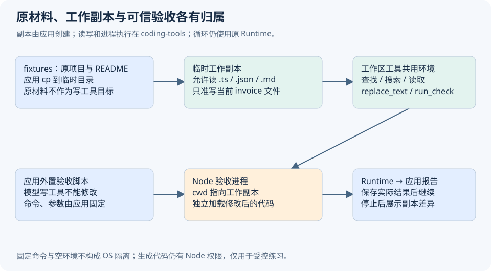
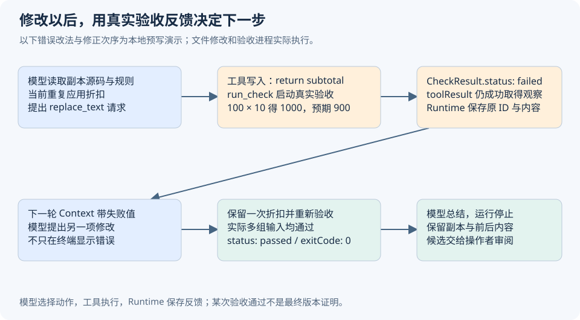
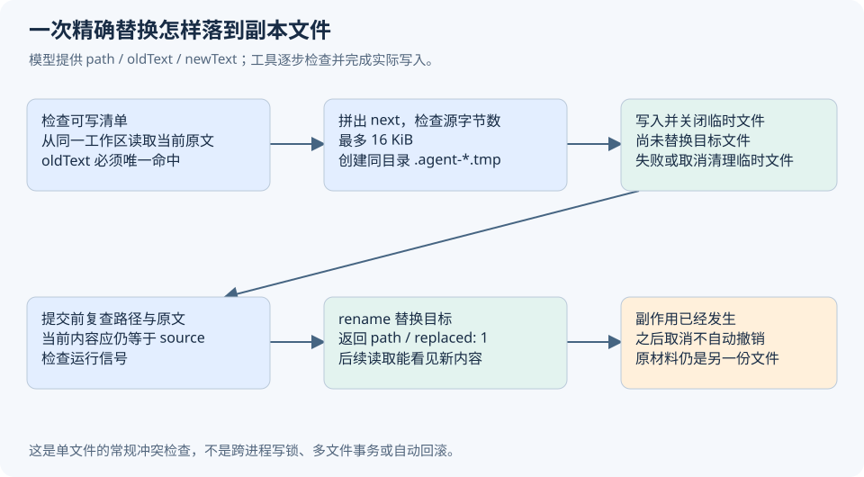
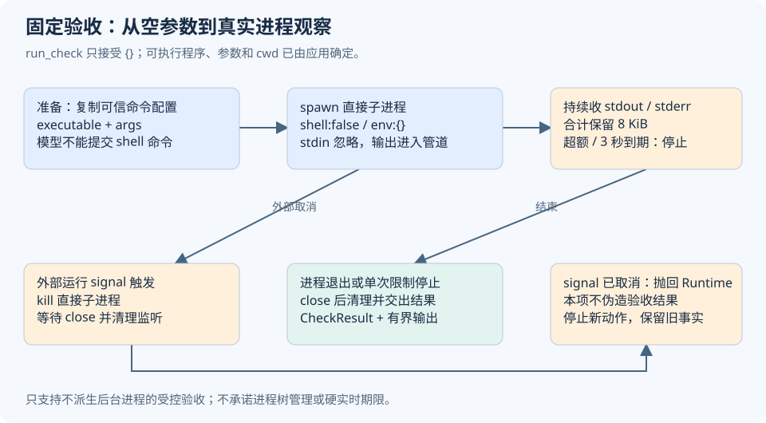
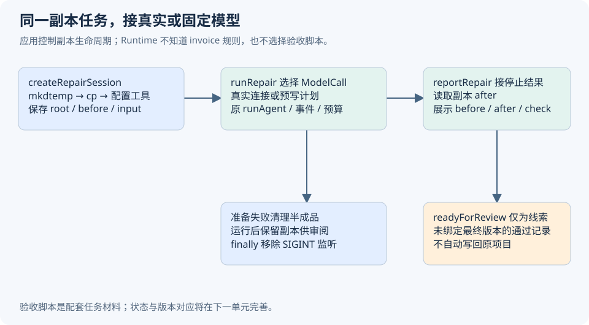

# 14 修改代码，让真实验收反馈进入下一轮

本篇让 Agent **在独立工作副本中修改代码，运行应用限定的验收程序，再根据实际失败输出继续修正或说明限制**。第 13 篇取得的源码证据，现在可以推动真实动作。

模型仍然提出请求，Runtime 仍然执行并保存反馈。本篇在 coding-tools 增加精确文本替换和限定验收，把调查、修改、观察、调整连起来；应用负责创建副本和选择可写范围。原项目材料不会被自动改写，运行后的副本留给操作者审阅。

## 本篇技术方案

### 实施前，先走完一次具体过程

继续使用 13 的金额材料：入口导出当前计算函数，规则规定满 10 件只应用一次 10%折扣。单价 100、数量 10 时，当前重复折扣得到 810，正确应为 900。先保留这些已有材料，稍后补充 README 规则与完整验收程序。

1. **应用准备独立副本与许可。** 先复制材料到新临时目录，调查工具共用这个目录；只有 src/checkout/invoice.ts 获得写入许可。规则与外置验收程序不在写工具的允许清单里，原材料保留。
2. **模型调查后提出修改，工具实际写入。** 先读源码与规则，再使用原文中唯一一段文本做替换。比如把重复折扣改成 return subtotal，副本确实改变了，但这个改法也删掉了全部折扣，不代表修复成功。
3. **验收工具取得真实反馈。**
   - **3.1 运行固定程序。** 模型只能请求 run_check，不能提交另一个命令。工具启动真实 Node 子进程，在副本上执行应用配置的检查。
   - **3.2 接住退出码和用例。** 这个错误改法得到 1000、预期 900，程序退出 1。工具把退出码与输出组成 CheckResult；“成功取得观察”和“用例通过”是不同结果。
   - **3.3 把观察交给下一轮。** 执行器将实际结果与原请求 ID 组成 toolResult，Runtime 保存到历史。下一次模型输入因此包含失败值，不只是终端显示了一句“失败”。
4. **模型依据反馈再决定。** 它可以保留一次折扣、再次运行验收，通过后总结；也可能继续失败、遇到限制或用完预算。修改和重验由实际请求触发，不在 Runtime 写死修复顺序。
5. **停止后展示副本与记录。** 应用接住结果，展示修改前后内容与最近验收。此时只形成待审阅候选，还没把历史通过与最终内容绑定；第 15 篇补这项判断，不把本篇候选自动合回原材料。

### 实现架构图





图中的错误改法与修正顺序是本地固定演示，响应预写；文件、验收进程和反馈保存实际运行。真实模型不必先犯这个错误，也不保证一次修正就能通过。

## 起点、范围与系统位置

从 13 完成的工程开始，在根目录自行创建分支：

```bash
git status --short --branch
git switch -c agent/chapter-14-edit-check-feedback
```

本篇保留原 model/runtime 实现、三个旧入口和稳定的 start/debug/check 命令，不新增包。coding-tools 提供可复用动作；临时副本和金额验收属于应用组装及配套材料。


这不是操作系统沙箱。固定命令、空环境和工作目录限制的是工具接线，**被验收的生成代码仍有 Node 进程权限**。当前只用于受控的本机练习，不用于不可信生成代码或机密环境；进程树管理、系统隔离和审批仍按后续阶段建设。

本篇的结果是可审阅候选与实际验收记录。历史中曾通过一次，尚不能证明之后没有再改代码；第 15 篇将把当前变更与对应验收版本绑定。本篇报告不会自动把副本合回原材料。

Pi 的[edit 工具](https://github.com/badlogic/pi-mono/blob/8efd314fa3d3232ce197d8d7a6a5660530b9d83e/packages/coding-agent/src/core/tools/edit.ts)使用精确文本定位，[bash 执行层](https://github.com/badlogic/pi-mono/blob/8efd314fa3d3232ce197d8d7a6a5660530b9d83e/packages/coding-agent/src/core/tools/bash.ts)管理执行目录、信号、进程和输出。本篇借鉴这些职责，采用单处替换与应用固定命令，不等同其多块编辑、进程树或平台能力。

## 第一步：把文本范围与动作配置说清楚

### 文件类型成为应用配置

Coding Agent 不只面对 TS。本篇把扩展名从扫描条件移到应用配置，默认仍为 `.ts`，因此 13 的只读任务无需修改。修复任务会选择 `.ts/.json/.md`，用同一套查找、搜索和读取工具调查源码、配置与规则。

**完整替换 `packages/coding-tools/src/types/workspace.ts`。** `WorkspaceOptions`保留 root，新增可选 extensions。包内 `Workspace`保留 paths/read，增加 root/extensions 及 resolve：读与替换共用路径复查，写入许可由写工具另外检查。

<<< @/snippets/14-edit-check-feedback/packages/coding-tools/src/types/workspace.ts

`resolve`只返回索引内路径的实际位置，不代表任何文件都可写。文件后缀可配置，也不等于自动处理任意二进制或编码：当前仍处理受控 UTF-8 文本，单文件源内容 16 KiB 等上限保留。

### 可写范围与固定验收

新建 `packages/coding-tools/src/types/code-task.ts`，写入完整代码：

这份类型约定两端数据：应用用 CodeTaskOptions 指定副本、可写文件与固定验收命令，工具用 CheckResult 返回实际退出码及输出。命令配置不从模型参数取得，验收失败结果仍可以反馈给下一轮。

<<< @/snippets/14-edit-check-feedback/packages/coding-tools/src/types/code-task.ts

`CodeTaskOptions`由应用创建。`writablePaths`列出本次可以改的既有文件；`check.executable/args`指定可信程序及参数。模型只得到工具说明，不能给 run_check 另传命令或环境变量。

`CheckResult`是工具执行后的实际观察，不是模型生成的判断。进程退出 0 映射为 passed，非零退出为 failed；timedOut/outputLimit 是这个单次验收的限制。它们不直接等于整次 `RunResult.status`。例如验收 failed 后，Agent 还可以利用反馈继续修改。

## 第二步：读写共用同一工作区

**完整替换 `packages/coding-tools/src/workspace/open.ts`。** 保留 `guardIo/visit`、扫描数量/深度限制和有界读取；新增 extensions 复制与检查，将后缀条件改为应用配置。原 read 内的路径复查提为同文件 `resolve`，read 调用它后再读取，返回环境新增 root/extensions/resolve。

这个准备函数接收根目录与可选文本后缀，返回一份查找、读取和替换可共享的环境。read 和写工具都先经 resolve 复查实际路径；取得路径不等于取得写许可，写工具还需检查更窄的清单。

<<< @/snippets/14-edit-check-feedback/packages/coding-tools/src/workspace/open.ts

应用传入 `extensions: ['.ts', '.json', '.md']` 后，扫描可以收录源码、README 和应用准备的 package.json。省略时仍只收 `.ts`。隐藏项、依赖目录、普通文件检查和启动时索引规则不变；格式不符的后缀或空清单直接拒绝准备。

本次没有让模型拼接磁盘路径：`resolve(path)`仍先查 `files`，再复查祖先和目标。`read`与接下来的替换工具使用同一个函数，所以它们的可发现范围一致；写工具还要检查那份更窄的允许清单。

以下三份工具仅更新可读范围说明，执行流程、参数名及返回结构保持 13。分别**完整替换**对应文件，不将旧清单工具加入同一运行：

`packages/coding-tools/src/workspace/find.ts`：description 读取 `workspace.extensions`，不再写死 TS。

::: details packages/coding-tools/src/workspace/find.ts：完整配套代码

这个工厂返回路径候选工具：从共享索引按模型 query 筛选相对路径，供后续读取选择。行为沿用 13，只有说明改为本次配置的文本后缀。

<<< @/snippets/14-edit-check-feedback/packages/coding-tools/src/workspace/find.ts

:::

`packages/coding-tools/src/workspace/search.ts`：description 使用本次文本范围，逐文件读取和命中截断保留。

::: details packages/coding-tools/src/workspace/search.ts：完整配套代码

这个工厂返回内容搜索工具：实际读取本次范围的文本，按 query 返回有限行命中，模型据此继续调查。它沿用原字面量搜索，不因扩展名可配置就具备跨语言语义分析。

<<< @/snippets/14-edit-check-feedback/packages/coding-tools/src/workspace/search.ts

:::

`packages/coding-tools/src/workspace/read.ts`：description 说明允许的文本后缀，源大小与行号输出保留。

::: details packages/coding-tools/src/workspace/read.ts：完整配套代码

这个工厂返回精确路径的全文读取工具，内容仍经共享环境复查和有界读取，再带行号返回模型。说明随配置后缀更新，读取结果不自动授权修改。

<<< @/snippets/14-edit-check-feedback/packages/coding-tools/src/workspace/read.ts

:::

这几处变化让模型看到的说明与本地实际范围一致。支持新文件格式时，应用配置所需的文本后缀，无需再修改扫描函数。

## 第三步：添加一次精确文本替换

### 参数检查复用

替换请求有 path、oldText、newText 三个字段，验收请求则不需要字段。**完整替换 `packages/coding-tools/src/workspace/arguments.ts`。** 保留原 `stringArgument/stringParameters` 的调用方式；新增 `objectArgument` 检查字段集合，新增 `stringField` 提取有长度限制的字符串。原单字段函数改为调用这两个函数，继续拒绝纯空白查询。

这份共用代码把工具请求对象检查和字符串提取分开：objectArgument 核对允许字段，stringField 取长度受限文本。替换工具用它取得 path/oldText/newText，验收工具用它确认空对象；它不会修改文件。

<<< @/snippets/14-edit-check-feedback/packages/coding-tools/src/workspace/arguments.ts

`objectArgument(value, ['path','oldText','newText'])`只接收这三个字段；`objectArgument(value, [])`要求空对象。`stringField`不随意 trim 替换文本，因为空白也可能是源码的一部分；newText 可以为空，用于删除唯一匹配的原文。

### 先匹配，再提交到副本

新建 `packages/coding-tools/src/workspace/replace.ts`，写入完整代码：

createReplaceTool 接收共享工作区与可写清单，返回 replace_text 工具。模型给出路径、唯一旧文本和新文本，工具核对当前原文后写入副本，成功返回路径和替换次数；下一次读取和验收使用的才是真正改变的内容。

<<< @/snippets/14-edit-check-feedback/packages/coding-tools/src/workspace/replace.ts

`createReplaceTool`将应用的可写清单复制成 Set，返回 replace_text 工具。假设请求的 path 为当前 invoice，oldText 为重复折扣的 return，newText 为 `return subtotal;`：

1. 工具先检查 path 有写许可，再从共享工作区读取当前原文。规则文件虽然可读，也会在写许可检查处被拒绝。
2. `source.indexOf(oldText)`找到原文，第二次查找要求没有其他命中。找不到或出现多次时返回已知失败，模型应重新读取、选择更准确的原文。
3. `next`拼出替换后的完整内容，源字节数超过 16 KiB 就拒绝，不先写再报错。
4. 工具取得复查后的 target，在同目录创建唯一临时文件，写入 next 并关闭句柄。此时目标文件还没变。
5. 提交前再次读取原文件，仍与 source 一致且未取消时，rename 将临时文件替换到目标路径。最终返回 `{"path":"src/checkout/invoice.ts","replaced":1}`，Runtime 再保存这条结果。



这样避免边写目标边暴露半截内容，也能拒绝常规的中途变更；它不提供跨进程原子比较、写锁或多文件事务。临时文件与新目标采用 0600 权限，不保留完整文件元数据。rename 的文件系统接口见[Node 文件系统文档](https://nodejs.org/docs/latest-v22.x/api/fs.html#fspromisesrenameoldpath-newpath)。

失败时 finally 删除未提交的临时文件。若 rename 已经完成，之后才取消，修改仍然存在；Runtime 拒绝迟到结果并不撤销文件副作用。当前通过独立副本隔开原材料，不能把这一点叫作通用回滚。

## 第四步：把限定验收作为真实工具反馈

### 启动进程、收集结果、退出后返回

新建 `packages/coding-tools/src/process/run-check.ts`，写入完整代码：

这份代码替验收工具管理一次真实进程：prepareCheck 复制并检查应用给定的命令，runCheck 接收命令、副本目录与信号，启动执行、收集有限输出，等待退出后返回 CheckResult。它不根据模型总结生成通过状态，也不自行决定任务是否完成。

<<< @/snippets/14-edit-check-feedback/packages/coding-tools/src/process/run-check.ts

`prepareCheck`在准备工具时复制程序路径和参数，拒绝相对程序路径与 NUL 字符。`runCheck`接收已经固定的命令、实际工作目录和本次运行信号，返回 `Promise<CheckResult>`。

先辨认两个对象：`child`是 spawn 立即返回的子进程控制对象；函数返回的 Promise 表示“这个验收进程及其输出管道已经结束，可以交出结果”。spawn 本身没有等待验收完成。

程序启动后，stdout/stderr 的 data 事件分别收集字节，两者合计最多保留 8 KiB。超过限制就记录 outputLimit 并停止直接子进程；3 秒计时器同样记录 timedOut 后停止。运行 signal 触发时也停止它，但最终通过 signal 向 Runtime 报告取消，不生成一条假验收结果。

close 事件到来时，工具清理计时器和取消监听。如果是已知程序启动失败，返回可反馈的工具异常；正常启动后退出 0 则 passed，其他退出码则 failed，输出保留实际内容。未知错误继续抛出，不包装成普通业务失败。



`cwd`指向副本，`shell:false`不解释管道或命令拼接，`env:{}`不继承父进程中的 API 密钥与 NODE_OPTIONS，stdin 不开放。依据见[Node 子进程文档](https://nodejs.org/api/child_process.html#child_processspawncommand-args-options)。

这里只管理直接子进程，要求验收不派生后台进程；不提供进程树管理、硬实时保证或 OS 隔离。空环境也不阻止生成代码访问进程可访问的磁盘和网络。单次 3 秒与 8 KiB 是当前执行范围策略，不是经过任务集评估的最佳配置。

### 模型只能请求“运行这项验收”

新建 `packages/coding-tools/src/workspace/check.ts`，写入完整代码：

createCheckTool 将共享副本和固定命令包装成 run_check。模型只能提供空参数；Runtime 调用 execute 后，工具等待实际 runCheck，返回含退出码与输出的 JSON 文本，供 Runtime 关联请求 ID 并保存反馈。

<<< @/snippets/14-edit-check-feedback/packages/coding-tools/src/workspace/check.ts

模型提出 `run_check({})`，本地从闭包取得固定命令与同一个 workspace.root，再调用 runCheck。`result`接住真实进程结果，工具序列化后返回给 Runtime。

特别注意第一次错误修改：工具实际成功启动程序并取得退出码 1，所以 `toolResult.isError`为 false；内容里的 `CheckResult.status`为 failed。这表示成功取得了一份“验收未通过”的观察，下一轮仍可据此继续。

路径无许可、参数不符合说明或程序无法启动等情况，才走已知工具错误反馈。不要只看 tool_end 的“成功结果”，必须继续看验收状态、退出码与具体失败值。

## 第五步：组合调查、写入与验收能力

**完整替换 `packages/coding-tools/src/workspace/index.ts`。** 保留公开 `createWorkspaceTools`；新增包内 `createInvestigationTools(workspace)`，把原三项只读工具的组装放入其中。旧工厂仍返回原来的三项工具。

这份代码让只读工厂和修复工厂能复用同一组调查工具。createWorkspaceTools 仍替只读应用准备环境，包内 createInvestigationTools 则接收已准备环境直接返回三项工具，避免同一副本各自再建索引。

<<< @/snippets/14-edit-check-feedback/packages/coding-tools/src/workspace/index.ts

新建 `packages/coding-tools/src/workspace/code-task.ts`，写入完整代码：

createCodeTaskTools 接收副本范围、可写清单和固定验收命令，创建共享环境后返回调查、替换和验收五项工具。应用把这组对象交给原 Runtime；根目录、写许可与进程配置不会因此进入通用循环。

<<< @/snippets/14-edit-check-feedback/packages/coding-tools/src/workspace/code-task.ts

`createCodeTaskTools`先复制可信命令与可写清单，再准备共享环境。允许写入的路径必须已经在索引里，不提供任意创建新文件的能力。返回的五项工具共用同一根目录，读写看到同一份当前内容，验收进程也在这里工作。

**完整替换 `packages/coding-tools/src/index.ts`。** 保留 `createReadFileTool/createWorkspaceTools`与原类型；新增 `createCodeTaskTools`及 `CodeTaskOptions/CheckCommand/CheckResult`公开导出。应用不跨包导入 process 或 workspace 内部文件。

<<< @/snippets/14-edit-check-feedback/packages/coding-tools/src/index.ts

先在根目录执行 `npm run build`，更新公开构建和类型声明，再继续写下面导入新 API 的应用文件。root 的 package.json 不需要新增脚本。

## 第六步：提供完整规则与可信验收

新建 `fixtures/workspace-review/README.md`，写入完整内容：

这份材料把正确的数量和折扣规则作为可读取文本放进副本。模型可以用它理解任务目标，外置验收用具体用例检查这些规则；README 本身不会执行或替应用判定完成。

<<< @/snippets/14-edit-check-feedback/fixtures/workspace-review/README.md

13 的四份源码继续保留，不修改原 invoice。README 是任务材料，接下来随源码一起复制。

新建 `examples/code-review/src/check-invoice.mjs`，写入下面完整配套代码。它是本任务的业务验收，不是 Agent 执行机制，可直接复制后观察输入输出，无需把业务用例实现当成新的框架学习目标。

::: details examples/code-review/src/check-invoice.mjs：完整配套代码

这个脚本接收副本目录，加载其中当前计算函数，逐项比较实际金额与固定预期，并输出用例 JSON，以退出码表示检查结果。验收工具接住这些真实输出，再反馈给模型；脚本保留在模型写范围之外。

<<< @/snippets/14-edit-check-feedback/examples/code-review/src/check-invoice.mjs{js}

:::

程序从第二个命令行参数取得副本位置，动态加载该副本的 invoice，在独立进程中实际调用函数。五项输入覆盖折扣阈值以下、达到阈值、零数量及另一组单价/数量。任一结果不符，就输出实际值并以 1 退出；全部满足则输出 passed 并以 0 退出。

源码加载或执行异常会输出 `source_execution_failed`，不直接泄露完整异常正文。脚本保留在应用源码目录，不复制进模型可写目录；但这仍不是对恶意生成代码的隔离或防作弊机制。

## 第七步：应用创建工作副本

新建 `examples/code-review/src/types/repair-session.ts`，写入完整代码：

RepairSession 约定本应用准备完成后交给运行与报告的对象：副本 root、修改前原文 before 和任务 input。运行使用 input，报告用 root/before 读取并展示变化；这个类型不代表持久化会话或版本验收。

<<< @/snippets/14-edit-check-feedback/examples/code-review/src/types/repair-session.ts

`RepairSession`由应用创建并持有。root 指向这次副本，before 保留修改前的计算文件，input 沿用既有任务输入形状。它不是 Runtime 持久化状态，也不会自动把磁盘变更写入消息。

新建 `examples/code-review/src/repair-session.ts`，写入完整代码：

createRepairSession 替入口创建一次独立修复任务：复制受控材料、保存修改前原文、配置五项工具和外置验收，返回应用会话。调用方随后使用 input 启动 Runtime，停止后用同一 root 查看实际修改。

<<< @/snippets/14-edit-check-feedback/examples/code-review/src/repair-session.ts

应用先 mkdtemp，再把受控练习材料复制进去。新写的 package.json 选择 ESM，确保独立目录里的 TypeScript 模块按本任务方式加载。before 接住副本原文，不会因为后续文件改变而自动更新。

工具配置中的三处位置要分清：root 是副本；writablePaths 仅包含当前 invoice；check 的脚本位置仍在应用目录，参数再带上副本 root。`import.meta.resolve('tsx')`把现有加载器解析成明确位置，子进程不需要从副本中寻找 node_modules。

准备失败时删除半成品目录，再把异常交给入口。复制来自已知练习材料，不是通用的不可信仓库复制器；准备时的 signal 在复制后检查，cp 本身没有被强制中断。

### 先确认原缺陷真的被执行到了

完成上述文件后，在根目录执行：

```bash
npm run check
node --import tsx --input-type=module <<'JS'
import { createRepairSession } from './examples/code-review/src/repair-session.ts';
const session = await createRepairSession();
console.log('副本位置：', session.root);
console.log('工具名称：', session.input.tools.map(tool => tool.name));
console.log(await session.input.tools.find(tool => tool.name === 'run_check').execute({}));
JS
```

应看到五项工具和一份实际失败结果：status 为 failed、exitCode 为 1；100 与 10 这一项当前 actual 为 810，expected 为 900。这里没有模型，尚未修复；它证明验收确实在执行原缺陷代码，而非收到任何请求就返回“通过”。副本位置由本次运行生成，不要求与你看到的名称相同。

## 第八步：停止后展示改动与验收记录

新建 `examples/code-review/src/repair-report.ts`，写入完整代码：

reportRepair 接收应用会话与停止结果，读取当前副本、展示修改前后文本，并从运行历史展示实际验收记录。它返回是否有待审阅候选给入口设置退出结果；本章尚未证明最近通过对应最终内容，因此不自动接受交付。

<<< @/snippets/14-edit-check-feedback/examples/code-review/src/repair-report.ts

`reportRepair(session, result)`先显示原 Runtime 记录，再读副本当前内容 after。循环从实际 run_check 工具结果中取出观察，逐项显示状态、退出码和 stdout；decodeOutput 只改善 JSON 输出排版，非 JSON 或截断内容仍显示原文，不改变验收判断。

before 来自准备时，after 来自停止后的实际磁盘，二者展示本次真实前后内容。报告不会再执行一次验收，也不会将打印记录误算为新的模型调用。

`readyForReview`要求正常回答、文件确实变化、最近一次命令 passed，且验收 stdout 表示通过。它只表示“有一份值得审阅的候选及通过记录”。尚未证明该记录对应最终文件版本：模型若通过后又改了一次代码，旧记录仍在。这里明确不自动交付，第 15 篇再建立对应关系。

## 第九步：真实与固定模型使用同一个运行过程



新建 `examples/code-review/src/repair-run.ts`，写入完整代码：

runRepair 接收创建 ModelCall 的函数，负责准备副本、配置同一次运行、等待原 Runtime，并将结果交给修复报告。真实与固定入口都调用它，取消监听在 finally 清理，运行后的副本位置保留供审阅。

<<< @/snippets/14-edit-check-feedback/examples/code-review/src/repair-run.ts

`runRepair`接收的是“创建 ModelCall 的函数”，让副本准备、模型配置和报告都处于同一个 try/finally 生命周期。入口仍设置六次模型调用、八项工具处理、60 秒整次期限，复用原事件与 Ctrl+C 信号。

结果由 `result`接住，再交给异步报告。取消仍使用退出码 130，其他未形成候选的运行使用 1。finally 移除 SIGINT 监听，并打印本次副本位置。运行后的目录保留在系统临时目录中，便于打开当前文件审阅；可以自行删除打印出的这一个副本目录，它不是持久化会话或恢复检查点。

### 真实模型入口与日志

新建 `examples/code-review/src/repair-main.ts`，写入完整代码：

这个真实入口把原服务连接工厂交给 runRepair，让模型实际选择调查、修改与验收动作。副本准备、控制和报告沿用同一流程，不在此另写修复策略。

<<< @/snippets/14-edit-check-feedback/examples/code-review/src/repair-main.ts

**完整替换根目录的 `examples/run.ts`。** 保留原默认 code-review、release-impact、workspace-review 和位置参数处理；增加 code-repair 的名称检查与入口分支。根 package.json 的 start/debug 保持不变。

选择器增加 code-repair，让稳定的 start/debug 命令进入新的真实修复入口。其他任务分支仍保留；这里不配置修改内容或强制工具顺序。

<<< @/snippets/14-edit-check-feedback/examples/run.ts

已有有效模型配置时，自行决定调用真实服务，在根目录执行：

```bash
npm start -- --example code-repair
```

断点入口为：

```bash
npm run debug -- --example code-repair
```

这些命令会使用原 `.env` 与真实模型服务。模型可以先调查 README、入口和规则，再选择替换与验收；不要求先用错误改法，也不要求调用顺序与后面的装置一致。

| 日志位置 | 应核对什么 |
|---|---|
| 实时 `tool_start/tool_end` | 哪项 read_file、replace_text 或 run_check 正在处理；同一请求 ID 随后能在记录中找到 |
| `工具结果 · replace_text` | path 与 replaced 来自实际替换；匹配失败时是已知反馈，不应假设已经写入 |
| `验收记录 · 请求ID` | status 与 exitCode 来自实际进程；failed 是下一步线索，不是只看 tool_end |
| `验收 stdout` | 展开的 cases 中 expected/actual 是否相同；加载失败则看 reason |
| `运行停止` | answered、预算停止、取消或失败；模型停止不证明验收通过 |
| `修改前/副本当前内容` | 实际改了哪段，是否只保留一次折扣，原业务阈值是否保留 |
| `修复观察/工作副本保留在` | changed、lastCheckStatus、readyForReview 及可打开的实际副本位置 |

实时事件在运行中出现，验收详情和前后内容由停止后的报告展示；重看这些记录不会重新执行命令。若有文字预览，它仍不是完整答案。模型调用轮数和工具次数可以与固定装置不同，不通过时先从首个错误请求、失败用例和后续动作定位，不直接增加预算。

特别留意最后一次写入发生在最近验收之前还是之后；readyForReview 没有验证这层对应关系。真实模型自主修复质量仍需要本次完整轨迹与当前内容，不能由本地装置代替。

### 无 Key 完整观察：预写决策，真实修改与执行

新建 `examples/code-review/src/repair-observe.ts`，写入完整配套代码：

::: details examples/code-review/src/repair-observe.ts：完整配套代码

这个无 Key 入口预写先错改、再修正的动作，使用同一个 runRepair 实际修改文件并执行检查。固定模型函数核对收到真实失败或通过后才交出下一条响应；它复现反馈链，不是自主模型能力证明。

<<< @/snippets/14-edit-check-feedback/examples/code-review/src/repair-observe.ts

:::

装置预写读取、错误修改和验收、修正和再验收、总结四次模型返回。第三次调用前检查上下文里确实有 failed，第四次前检查确实有 passed；缺少真实反馈就停止。检查通过后的动作仍然预写，所以不称为模型自主修正。

无需 Key 或 `.env`，在根目录执行：

```bash
npm run check
node --import tsx examples/code-review/src/repair-observe.ts
```

应有四次模型调用、七项工具处理：三项读取，两次替换，两次验收。两项工具可以在同一轮请求中顺序执行，replace_text 完成后才开始 run_check；整批结果回到下一次模型调用。

第一份验收记录应显示 failed/退出 1，100 与 10 的 actual 为 1000、expected 为 900，250 与 20 的 actual 为 5000、expected 为 4500。第二份应为 passed/退出 0，全部五项 passed 为 true。固定总结随后返回，最终 answered、changed 为 true、lastCheckStatus 为 passed、readyForReview 为 true。

这些结果中的数值来自实际副本函数执行；动作顺序和总结来自计划。没有访问模型网络，不能据此声称真实模型会采取相同动作或稳定完成任务。

## 调试、故障与小迁移

### 在哪里打断点

- `repair-session.ts` 的工具配置：对照原材料位置、root、可写清单和外置脚本，确认没有把原 fixtures 当作写入目标。
- `workspace/replace.ts` 的 source/next 及 rename 前：核对 oldText 唯一命中、目标仍是副本，判断失败发生在提交前还是提交后。
- `process/run-check.ts` 的 spawn 与 close：前者得到控制对象，后者才交出结果；看 exitCode、stopped、stdout 及 signal。
- `packages/runtime/src/run-agent.ts` 的 `messages.push(...results)`：找到 check_failed 的真实结果，再在下一次 ModelCall 的 context.messages 中确认它存在。
- `repair-report.ts` 的 before/after/check：区分磁盘内容、历史观察与有限候选判断。

### 可逆故障：验收规则与任务矛盾

暂时把 `examples/code-review/src/check-invoice.mjs` 第一项 expected 从 900 改成 901，其他文件不动，再运行本地观察。即使第二次替换已经正确，实际验收也不会 passed；固定装置检查不到预期通过，会停止，入口打印失败并保留副本。

在验收记录中找 price100、quantity10 的 actual900 与 expected901；这说明要检查可信验收规则，而不是让 Agent 随意修改验收程序。实验后将 expected 恢复 900。正常流程中的错误候选用来示范反馈修正，本实验则定位任务与验收不一致。

### 小迁移：保留机制，换一项规则

在原材料 `fixtures/workspace-review/src/pricing/policy.ts` 中将折扣阈值改为 20 件，README 同步说明，验收第一项 100 元 10 件的 expected 改为 1000。其余验收保留，250 元 20 件仍应为 4500。通用工具、Runtime 和进程执行层不改。

新建副本后，自行选择真实模型观察：它应按新规则修复重复折扣，并让实际验收通过。固定装置的修正动作没有理解新规则，不能作为自主迁移证据；还需核对函数内容、实际值、动作依据与最终记录。结束后恢复默认规则、README 和验收，供下一篇从相同起点继续。

## 当前成果与下一步

现在同一 Agent 循环能推动真实文件变化，执行预设验收，并把失败观察交给后续模型。通用能力在包内，任务副本与验收规则在应用侧；原项目不自动写回，失败或取消也不伪造完成。

尚未建立当前源码版本与验收记录的对应关系，也没有完整 diff 交付、持久化恢复、OS 隔离或审批。下一篇用当前变更和对应版本的验收证据组织交付，拒绝用旧通过记录证明后来的代码。

## 完整文件核对

以下均引用本篇同一候选。按正文只新增或替换本章变化；沿用文件不必重写。旧只读入口保留，本篇没有修改 model/runtime 执行逻辑。

::: details .env.example【沿用】

<<< @/snippets/14-edit-check-feedback/.env.example

:::

::: details examples/code-review/package.json【沿用】

<<< @/snippets/14-edit-check-feedback/examples/code-review/package.json

:::

::: details examples/code-review/src/cancellation/fixtures.ts【沿用】

<<< @/snippets/14-edit-check-feedback/examples/code-review/src/cancellation/fixtures.ts

:::

::: details examples/code-review/src/cancellation/main.ts【沿用】

<<< @/snippets/14-edit-check-feedback/examples/code-review/src/cancellation/main.ts

:::

::: details examples/code-review/src/check-events.ts【沿用】

<<< @/snippets/14-edit-check-feedback/examples/code-review/src/check-events.ts

:::

::: details examples/code-review/src/check-invoice.mjs【新增文件】

<<< @/snippets/14-edit-check-feedback/examples/code-review/src/check-invoice.mjs{js}

:::

::: details examples/code-review/src/check-protocol.ts【沿用】

<<< @/snippets/14-edit-check-feedback/examples/code-review/src/check-protocol.ts

:::

::: details examples/code-review/src/check-stream.ts【沿用】

<<< @/snippets/14-edit-check-feedback/examples/code-review/src/check-stream.ts

:::

::: details examples/code-review/src/check-tool-contract.ts【沿用】

<<< @/snippets/14-edit-check-feedback/examples/code-review/src/check-tool-contract.ts

:::

::: details examples/code-review/src/limits/main.ts【沿用】

<<< @/snippets/14-edit-check-feedback/examples/code-review/src/limits/main.ts

:::

::: details examples/code-review/src/limits/scenario.ts【沿用】

<<< @/snippets/14-edit-check-feedback/examples/code-review/src/limits/scenario.ts

:::

::: details examples/code-review/src/main.ts【沿用】

<<< @/snippets/14-edit-check-feedback/examples/code-review/src/main.ts

:::

::: details examples/code-review/src/protocol-fetch.ts【沿用】

<<< @/snippets/14-edit-check-feedback/examples/code-review/src/protocol-fetch.ts

:::

::: details examples/code-review/src/repair-main.ts【新增文件】

<<< @/snippets/14-edit-check-feedback/examples/code-review/src/repair-main.ts

:::

::: details examples/code-review/src/repair-observe.ts【新增文件】

<<< @/snippets/14-edit-check-feedback/examples/code-review/src/repair-observe.ts

:::

::: details examples/code-review/src/repair-report.ts【新增文件】

<<< @/snippets/14-edit-check-feedback/examples/code-review/src/repair-report.ts

:::

::: details examples/code-review/src/repair-run.ts【新增文件】

<<< @/snippets/14-edit-check-feedback/examples/code-review/src/repair-run.ts

:::

::: details examples/code-review/src/repair-session.ts【新增文件】

<<< @/snippets/14-edit-check-feedback/examples/code-review/src/repair-session.ts

:::

::: details examples/code-review/src/report-run.ts【沿用】

<<< @/snippets/14-edit-check-feedback/examples/code-review/src/report-run.ts

:::

::: details examples/code-review/src/stream-fetch.ts【沿用】

<<< @/snippets/14-edit-check-feedback/examples/code-review/src/stream-fetch.ts

:::

::: details examples/code-review/src/task.ts【沿用】

<<< @/snippets/14-edit-check-feedback/examples/code-review/src/task.ts

:::

::: details examples/code-review/src/tools.ts【沿用】

<<< @/snippets/14-edit-check-feedback/examples/code-review/src/tools.ts

:::

::: details examples/code-review/src/types/repair-session.ts【新增文件】

<<< @/snippets/14-edit-check-feedback/examples/code-review/src/types/repair-session.ts

:::

::: details examples/code-review/src/workspace-main.ts【沿用】

<<< @/snippets/14-edit-check-feedback/examples/code-review/src/workspace-main.ts

:::

::: details examples/code-review/src/workspace-observe.ts【沿用】

<<< @/snippets/14-edit-check-feedback/examples/code-review/src/workspace-observe.ts

:::

::: details examples/code-review/src/workspace-task.ts【沿用】

<<< @/snippets/14-edit-check-feedback/examples/code-review/src/workspace-task.ts

:::

::: details examples/package-consumer/main.mjs【沿用】

<<< @/snippets/14-edit-check-feedback/examples/package-consumer/main.mjs{js}

:::

::: details examples/release-impact/package.json【沿用】

<<< @/snippets/14-edit-check-feedback/examples/release-impact/package.json

:::

::: details examples/release-impact/src/load-records.ts【沿用】

<<< @/snippets/14-edit-check-feedback/examples/release-impact/src/load-records.ts

:::

::: details examples/release-impact/src/lookup-tool.ts【沿用】

<<< @/snippets/14-edit-check-feedback/examples/release-impact/src/lookup-tool.ts

:::

::: details examples/release-impact/src/main.ts【沿用】

<<< @/snippets/14-edit-check-feedback/examples/release-impact/src/main.ts

:::

::: details examples/release-impact/src/report-run.ts【沿用】

<<< @/snippets/14-edit-check-feedback/examples/release-impact/src/report-run.ts

:::

::: details examples/release-impact/src/task.ts【沿用】

<<< @/snippets/14-edit-check-feedback/examples/release-impact/src/task.ts

:::

::: details examples/release-impact/src/tools.ts【沿用】

<<< @/snippets/14-edit-check-feedback/examples/release-impact/src/tools.ts

:::

::: details examples/release-impact/src/types/tools.ts【沿用】

<<< @/snippets/14-edit-check-feedback/examples/release-impact/src/types/tools.ts

:::

::: details examples/release-impact/src/validation.ts【沿用】

<<< @/snippets/14-edit-check-feedback/examples/release-impact/src/validation.ts

:::

::: details examples/run.ts【修改】

<<< @/snippets/14-edit-check-feedback/examples/run.ts

:::

::: details examples/shared/interrupt.ts【沿用】

<<< @/snippets/14-edit-check-feedback/examples/shared/interrupt.ts

:::

::: details examples/shared/model.ts【沿用】

<<< @/snippets/14-edit-check-feedback/examples/shared/model.ts

:::

::: details examples/shared/print-event.ts【沿用】

<<< @/snippets/14-edit-check-feedback/examples/shared/print-event.ts

:::

::: details examples/shared/print-run.ts【沿用】

<<< @/snippets/14-edit-check-feedback/examples/shared/print-run.ts

:::

::: details examples/shared/stream-model.ts【沿用】

<<< @/snippets/14-edit-check-feedback/examples/shared/stream-model.ts

:::

::: details examples/shared/terminal.ts【沿用】

<<< @/snippets/14-edit-check-feedback/examples/shared/terminal.ts

:::

::: details examples/shared/types/task.ts【沿用】

<<< @/snippets/14-edit-check-feedback/examples/shared/types/task.ts

:::

::: details examples/stage-check/fixtures/fetch.ts【沿用】

<<< @/snippets/14-edit-check-feedback/examples/stage-check/fixtures/fetch.ts

:::

::: details examples/stage-check/fixtures/plans.ts【沿用】

<<< @/snippets/14-edit-check-feedback/examples/stage-check/fixtures/plans.ts

:::

::: details examples/stage-check/main.ts【沿用】

<<< @/snippets/14-edit-check-feedback/examples/stage-check/main.ts

:::

::: details fixtures/code-review/src/cart.ts【沿用】

<<< @/snippets/14-edit-check-feedback/fixtures/code-review/src/cart.ts

:::

::: details fixtures/code-review/src/invoice.ts【沿用】

<<< @/snippets/14-edit-check-feedback/fixtures/code-review/src/invoice.ts

:::

::: details fixtures/code-review/src/pricing.ts【沿用】

<<< @/snippets/14-edit-check-feedback/fixtures/code-review/src/pricing.ts

:::

::: details fixtures/model-protocol/anthropic.json【沿用】

<<< @/snippets/14-edit-check-feedback/fixtures/model-protocol/anthropic.json

:::

::: details fixtures/model-protocol/deepseek.json【沿用】

<<< @/snippets/14-edit-check-feedback/fixtures/model-protocol/deepseek.json

:::

::: details fixtures/model-stream/anthropic-answer.sse【沿用】

<<< @/snippets/14-edit-check-feedback/fixtures/model-stream/anthropic-answer.sse

:::

::: details fixtures/model-stream/anthropic-tools.sse【沿用】

<<< @/snippets/14-edit-check-feedback/fixtures/model-stream/anthropic-tools.sse

:::

::: details fixtures/model-stream/deepseek-answer.sse【沿用】

<<< @/snippets/14-edit-check-feedback/fixtures/model-stream/deepseek-answer.sse

:::

::: details fixtures/model-stream/deepseek-tools.sse【沿用】

<<< @/snippets/14-edit-check-feedback/fixtures/model-stream/deepseek-tools.sse

:::

::: details fixtures/package-consumer/source.ts【沿用】

<<< @/snippets/14-edit-check-feedback/fixtures/package-consumer/source.ts

:::

::: details fixtures/release-impact/releases.json【沿用】

<<< @/snippets/14-edit-check-feedback/fixtures/release-impact/releases.json

:::

::: details fixtures/release-impact/services.json【沿用】

<<< @/snippets/14-edit-check-feedback/fixtures/release-impact/services.json

:::

::: details fixtures/release-impact/stage-releases.json【沿用】

<<< @/snippets/14-edit-check-feedback/fixtures/release-impact/stage-releases.json

:::

::: details fixtures/release-impact/stage-services.json【沿用】

<<< @/snippets/14-edit-check-feedback/fixtures/release-impact/stage-services.json

:::

::: details fixtures/workspace-review/README.md【新增文件】

<<< @/snippets/14-edit-check-feedback/fixtures/workspace-review/README.md

:::

::: details fixtures/workspace-review/src/checkout/invoice.ts【沿用】

<<< @/snippets/14-edit-check-feedback/fixtures/workspace-review/src/checkout/invoice.ts

:::

::: details fixtures/workspace-review/src/legacy/invoice.ts【沿用】

<<< @/snippets/14-edit-check-feedback/fixtures/workspace-review/src/legacy/invoice.ts

:::

::: details fixtures/workspace-review/src/main.ts【沿用】

<<< @/snippets/14-edit-check-feedback/fixtures/workspace-review/src/main.ts

:::

::: details fixtures/workspace-review/src/pricing/policy.ts【沿用】

<<< @/snippets/14-edit-check-feedback/fixtures/workspace-review/src/pricing/policy.ts

:::

::: details package.json【沿用】

<<< @/snippets/14-edit-check-feedback/package.json

:::

::: details packages/coding-tools/package.json【沿用】

<<< @/snippets/14-edit-check-feedback/packages/coding-tools/package.json

:::

::: details packages/coding-tools/src/files/read-text.ts【沿用】

<<< @/snippets/14-edit-check-feedback/packages/coding-tools/src/files/read-text.ts

:::

::: details packages/coding-tools/src/index.ts【修改】

<<< @/snippets/14-edit-check-feedback/packages/coding-tools/src/index.ts

:::

::: details packages/coding-tools/src/process/run-check.ts【新增文件】

<<< @/snippets/14-edit-check-feedback/packages/coding-tools/src/process/run-check.ts

:::

::: details packages/coding-tools/src/read-file.ts【沿用】

<<< @/snippets/14-edit-check-feedback/packages/coding-tools/src/read-file.ts

:::

::: details packages/coding-tools/src/types/code-task.ts【新增文件】

<<< @/snippets/14-edit-check-feedback/packages/coding-tools/src/types/code-task.ts

:::

::: details packages/coding-tools/src/types/read-file.ts【沿用】

<<< @/snippets/14-edit-check-feedback/packages/coding-tools/src/types/read-file.ts

:::

::: details packages/coding-tools/src/types/workspace.ts【修改】

<<< @/snippets/14-edit-check-feedback/packages/coding-tools/src/types/workspace.ts

:::

::: details packages/coding-tools/src/workspace/arguments.ts【修改】

<<< @/snippets/14-edit-check-feedback/packages/coding-tools/src/workspace/arguments.ts

:::

::: details packages/coding-tools/src/workspace/check.ts【新增文件】

<<< @/snippets/14-edit-check-feedback/packages/coding-tools/src/workspace/check.ts

:::

::: details packages/coding-tools/src/workspace/code-task.ts【新增文件】

<<< @/snippets/14-edit-check-feedback/packages/coding-tools/src/workspace/code-task.ts

:::

::: details packages/coding-tools/src/workspace/find.ts【修改】

<<< @/snippets/14-edit-check-feedback/packages/coding-tools/src/workspace/find.ts

:::

::: details packages/coding-tools/src/workspace/index.ts【修改】

<<< @/snippets/14-edit-check-feedback/packages/coding-tools/src/workspace/index.ts

:::

::: details packages/coding-tools/src/workspace/open.ts【修改】

<<< @/snippets/14-edit-check-feedback/packages/coding-tools/src/workspace/open.ts

:::

::: details packages/coding-tools/src/workspace/read.ts【修改】

<<< @/snippets/14-edit-check-feedback/packages/coding-tools/src/workspace/read.ts

:::

::: details packages/coding-tools/src/workspace/replace.ts【新增文件】

<<< @/snippets/14-edit-check-feedback/packages/coding-tools/src/workspace/replace.ts

:::

::: details packages/coding-tools/src/workspace/search.ts【修改】

<<< @/snippets/14-edit-check-feedback/packages/coding-tools/src/workspace/search.ts

:::

::: details packages/coding-tools/tsconfig.json【沿用】

<<< @/snippets/14-edit-check-feedback/packages/coding-tools/tsconfig.json

:::

::: details packages/model/package.json【沿用】

<<< @/snippets/14-edit-check-feedback/packages/model/package.json

:::

::: details packages/model/src/complete.ts【沿用】

<<< @/snippets/14-edit-check-feedback/packages/model/src/complete.ts

:::

::: details packages/model/src/errors/model-call-error.ts【沿用】

<<< @/snippets/14-edit-check-feedback/packages/model/src/errors/model-call-error.ts

:::

::: details packages/model/src/index.ts【沿用】

<<< @/snippets/14-edit-check-feedback/packages/model/src/index.ts

:::

::: details packages/model/src/providers/anthropic/anthropic-messages.ts【沿用】

<<< @/snippets/14-edit-check-feedback/packages/model/src/providers/anthropic/anthropic-messages.ts

:::

::: details packages/model/src/providers/anthropic/anthropic-response.ts【沿用】

<<< @/snippets/14-edit-check-feedback/packages/model/src/providers/anthropic/anthropic-response.ts

:::

::: details packages/model/src/providers/anthropic/anthropic.ts【沿用】

<<< @/snippets/14-edit-check-feedback/packages/model/src/providers/anthropic/anthropic.ts

:::

::: details packages/model/src/providers/anthropic/request.ts【沿用】

<<< @/snippets/14-edit-check-feedback/packages/model/src/providers/anthropic/request.ts

:::

::: details packages/model/src/providers/anthropic/stream.ts【沿用】

<<< @/snippets/14-edit-check-feedback/packages/model/src/providers/anthropic/stream.ts

:::

::: details packages/model/src/providers/deepseek/deepseek-messages.ts【沿用】

<<< @/snippets/14-edit-check-feedback/packages/model/src/providers/deepseek/deepseek-messages.ts

:::

::: details packages/model/src/providers/deepseek/deepseek-response.ts【沿用】

<<< @/snippets/14-edit-check-feedback/packages/model/src/providers/deepseek/deepseek-response.ts

:::

::: details packages/model/src/providers/deepseek/deepseek.ts【沿用】

<<< @/snippets/14-edit-check-feedback/packages/model/src/providers/deepseek/deepseek.ts

:::

::: details packages/model/src/providers/deepseek/request.ts【沿用】

<<< @/snippets/14-edit-check-feedback/packages/model/src/providers/deepseek/request.ts

:::

::: details packages/model/src/providers/deepseek/stream.ts【沿用】

<<< @/snippets/14-edit-check-feedback/packages/model/src/providers/deepseek/stream.ts

:::

::: details packages/model/src/providers/shared/read-sse.ts【沿用】

<<< @/snippets/14-edit-check-feedback/packages/model/src/providers/shared/read-sse.ts

:::

::: details packages/model/src/providers/shared/request-json.ts【沿用】

<<< @/snippets/14-edit-check-feedback/packages/model/src/providers/shared/request-json.ts

:::

::: details packages/model/src/providers/shared/request-response.ts【沿用】

<<< @/snippets/14-edit-check-feedback/packages/model/src/providers/shared/request-response.ts

:::

::: details packages/model/src/request-options.ts【沿用】

<<< @/snippets/14-edit-check-feedback/packages/model/src/request-options.ts

:::

::: details packages/model/src/stream.ts【沿用】

<<< @/snippets/14-edit-check-feedback/packages/model/src/stream.ts

:::

::: details packages/model/src/types/anthropic-stream.ts【沿用】

<<< @/snippets/14-edit-check-feedback/packages/model/src/types/anthropic-stream.ts

:::

::: details packages/model/src/types/anthropic.ts【沿用】

<<< @/snippets/14-edit-check-feedback/packages/model/src/types/anthropic.ts

:::

::: details packages/model/src/types/context.ts【沿用】

<<< @/snippets/14-edit-check-feedback/packages/model/src/types/context.ts

:::

::: details packages/model/src/types/failures.ts【沿用】

<<< @/snippets/14-edit-check-feedback/packages/model/src/types/failures.ts

:::

::: details packages/model/src/types/messages.ts【沿用】

<<< @/snippets/14-edit-check-feedback/packages/model/src/types/messages.ts

:::

::: details packages/model/src/types/options.ts【沿用】

<<< @/snippets/14-edit-check-feedback/packages/model/src/types/options.ts

:::

::: details packages/model/src/types/sse.ts【沿用】

<<< @/snippets/14-edit-check-feedback/packages/model/src/types/sse.ts

:::

::: details packages/model/src/types/stream.ts【沿用】

<<< @/snippets/14-edit-check-feedback/packages/model/src/types/stream.ts

:::

::: details packages/model/src/types/tool-results.ts【沿用】

<<< @/snippets/14-edit-check-feedback/packages/model/src/types/tool-results.ts

:::

::: details packages/model/src/types/tools.ts【沿用】

<<< @/snippets/14-edit-check-feedback/packages/model/src/types/tools.ts

:::

::: details packages/model/src/validation.ts【沿用】

<<< @/snippets/14-edit-check-feedback/packages/model/src/validation.ts

:::

::: details packages/model/tsconfig.json【沿用】

<<< @/snippets/14-edit-check-feedback/packages/model/tsconfig.json

:::

::: details packages/runtime/package.json【沿用】

<<< @/snippets/14-edit-check-feedback/packages/runtime/package.json

:::

::: details packages/runtime/src/control/run-control.ts【沿用】

<<< @/snippets/14-edit-check-feedback/packages/runtime/src/control/run-control.ts

:::

::: details packages/runtime/src/errors/tool-batch-cancelled.ts【沿用】

<<< @/snippets/14-edit-check-feedback/packages/runtime/src/errors/tool-batch-cancelled.ts

:::

::: details packages/runtime/src/errors/tool-batch-error.ts【沿用】

<<< @/snippets/14-edit-check-feedback/packages/runtime/src/errors/tool-batch-error.ts

:::

::: details packages/runtime/src/errors/tool-batch-limit.ts【沿用】

<<< @/snippets/14-edit-check-feedback/packages/runtime/src/errors/tool-batch-limit.ts

:::

::: details packages/runtime/src/errors/tool-execution-error.ts【沿用】

<<< @/snippets/14-edit-check-feedback/packages/runtime/src/errors/tool-execution-error.ts

:::

::: details packages/runtime/src/events/dispatcher.ts【沿用】

<<< @/snippets/14-edit-check-feedback/packages/runtime/src/events/dispatcher.ts

:::

::: details packages/runtime/src/index.ts【沿用】

<<< @/snippets/14-edit-check-feedback/packages/runtime/src/index.ts

:::

::: details packages/runtime/src/run-agent.ts【沿用】

<<< @/snippets/14-edit-check-feedback/packages/runtime/src/run-agent.ts

:::

::: details packages/runtime/src/tools/execute.ts【沿用】

<<< @/snippets/14-edit-check-feedback/packages/runtime/src/tools/execute.ts

:::

::: details packages/runtime/src/tools/registry.ts【沿用】

<<< @/snippets/14-edit-check-feedback/packages/runtime/src/tools/registry.ts

:::

::: details packages/runtime/src/types/events.ts【沿用】

<<< @/snippets/14-edit-check-feedback/packages/runtime/src/types/events.ts

:::

::: details packages/runtime/src/types/failures.ts【沿用】

<<< @/snippets/14-edit-check-feedback/packages/runtime/src/types/failures.ts

:::

::: details packages/runtime/src/types/model-call.ts【沿用】

<<< @/snippets/14-edit-check-feedback/packages/runtime/src/types/model-call.ts

:::

::: details packages/runtime/src/types/run-control.ts【沿用】

<<< @/snippets/14-edit-check-feedback/packages/runtime/src/types/run-control.ts

:::

::: details packages/runtime/src/types/run.ts【沿用】

<<< @/snippets/14-edit-check-feedback/packages/runtime/src/types/run.ts

:::

::: details packages/runtime/src/types/tool-batch.ts【沿用】

<<< @/snippets/14-edit-check-feedback/packages/runtime/src/types/tool-batch.ts

:::

::: details packages/runtime/src/types/tool-registry.ts【沿用】

<<< @/snippets/14-edit-check-feedback/packages/runtime/src/types/tool-registry.ts

:::

::: details packages/runtime/src/types/tools.ts【沿用】

<<< @/snippets/14-edit-check-feedback/packages/runtime/src/types/tools.ts

:::

::: details packages/runtime/tsconfig.json【沿用】

<<< @/snippets/14-edit-check-feedback/packages/runtime/tsconfig.json

:::

::: details tsconfig.json【沿用】

<<< @/snippets/14-edit-check-feedback/tsconfig.json

:::

## 保存本篇实现

恢复故障与迁移材料，确认自己创建的本章分支，再审阅并自行保存；提交说明应与你完成的检查一致。

```bash
git status --short --branch
git diff --check
git diff
npm run check
npm run docs:build
git add -A
git commit -F - <<'EOF'
第14篇：修改副本并让真实验收反馈进入循环

工作区文件类型可配置，保留旧只读入口与默认TS范围。
coding-tools增加指定文件精确替换和应用固定验收命令。
进程执行限制输出和单次时长，取消时停止直接子进程并清理。
应用创建独立工作副本，展示实际修改及失败后重新验收的记录。
保留候选审阅与版本证据边界，不自动写回原项目。
EOF

git push -u origin agent/chapter-14-edit-check-feedback
```

提交和推送不等于合并部署；固定响应、验收通过或章节保存都不直接证明独立掌握。

<style>
.edit-check-feedback .vp-doc .custom-block.details summary {
  overflow-wrap: anywhere;
}
</style>

