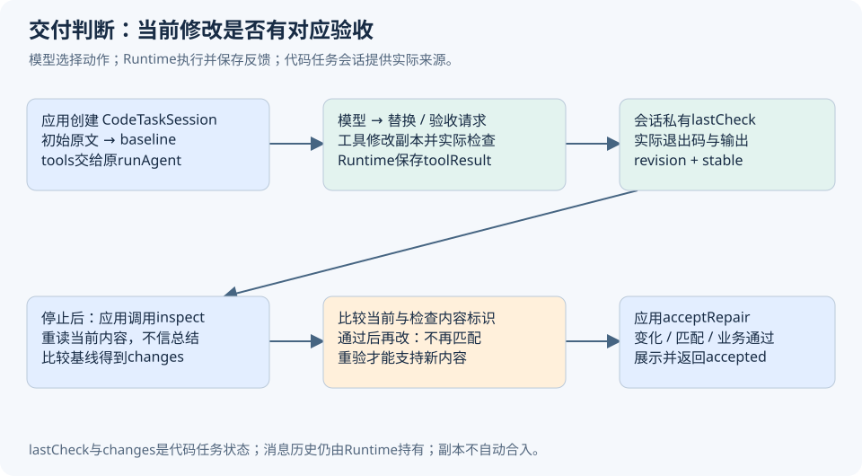
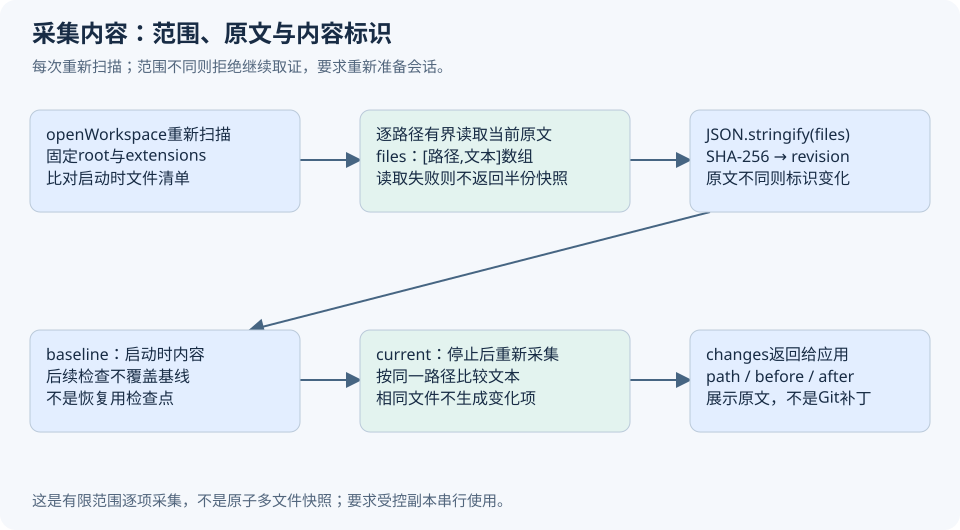
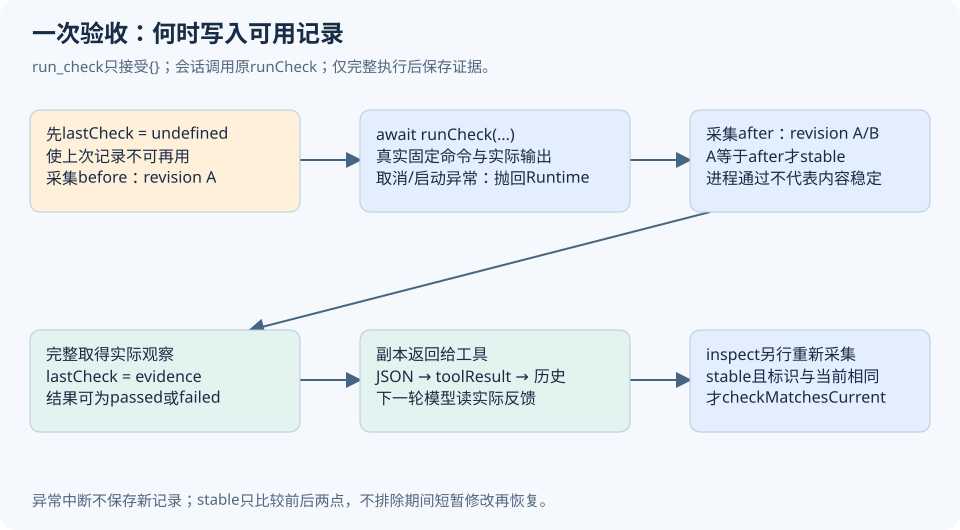
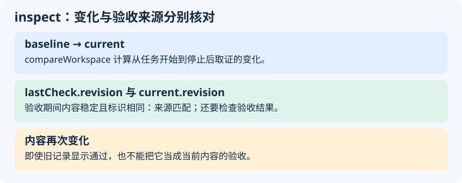
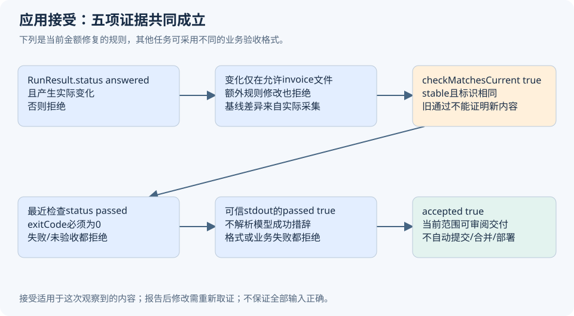

# 15 用当前变更和匹配的验收证据交付

本篇让应用**展示 Agent 的实际修改，核对验收检查的内容是否仍是当前内容，再决定是否接受这次代码任务**。即使模型说“完成了”，只要通过后又改过文件且没有重验，应用就拒绝交付。

这是第三阶段从“能修改、能根据反馈修正”走向“有依据地交付”的一步。沿用第 14 篇的副本、五个工具、验收程序和运行预算；在 coding-tools 增加内容取证与任务会话，在应用增加接受规则。model/runtime 不需要认识金额规则或文件版本。

## 本篇技术方案

### 实施前，先走完一次具体过程

本篇要解决的是：**Agent 改完代码，也跑过验收，但它最后交出的内容，还是刚才验收的那份吗？** 下面先按一次任务的顺序走完整个过程，再进入代码。

继续使用 14 的材料：`fixtures/workspace-review/` 保存原项目，应用复制到临时目录；只允许修改 `src/checkout/invoice.ts`，外置的 `examples/code-review/src/check-invoice.mjs` 检查一次折扣规则。这些材料已在上一篇提供，本篇不新增业务规则。

#### 1. 任务开始，保存修改前的内容

应用准备好工作副本后，创建一个“代码任务会话”。可以先把会话理解成：这次代码任务共用的一份内存记录，负责保留文件原文和实际验收事实。

会话先读取本次范围内的文件，把路径与原文保存为基线。比如 invoice 里还是重复折扣，规则文件里仍是满 10 件打一次折扣。后面第 4 步展示“到底改了什么”，就要拿这份基线与最终内容比较。

应用拿到会话返回的两项能力：一组工具，交给 Runtime 运行；一个停止后读取审阅结果的函数，留给最后的报告使用。它们共用同一份记录，不能在报告时再创建另一份会话。

#### 2. Agent 调查和修改，工具保存实际验收事实

模型先通过已有工具读取代码和规则，再提出修改请求。Runtime 调用替换工具，把重复折扣修成一次折扣，真正写进副本。模型接着请求 `run_check` 时，本篇新增的来源记录开始工作。

**2.1 先记下即将检查的内容。** 工具读取本次范围内的文件，包括计算代码和只读规则，根据路径与原文计算内容标识，记为 A。后面要用 A 说明“这次验收开始时，检查的是哪份内容”。这里不是只给 invoice 计一次修改次数，因为规则文件变化也可能影响结果。

**2.2 运行真实验收，接住实际结果。** 工具启动应用预先配置的验收程序，让它读取刚才的工作副本。程序返回退出码和用例输出，例如单价 100、数量 10，实际金额 900、预期金额也是 900。这份结果由本地执行取得，不是让模型自己填写“通过”。

**2.3 再读一次文件，把结果和来源一起保存。** 程序退出后，工具重新计算内容标识。如果仍是 A，说明这两次读取的内容相同，记录 `stable: true`；如果变成另一份内容，就记录 false。会话保存这次实际结果、检查前的标识 A 和前后是否相同，供第 5 步核对。

开始一次新验收时，会先清空旧记录。只有检查前读取、进程执行、检查后读取都完整结束，才保存新记录；如果中途取消或启动异常，就不能继续拿上次通过充当这次结果。这里的前后相同只是两次观察，不表示文件全程被锁住。

**2.4 把同一次结果反馈给模型。** 工具还会把带来源的结果返回给 Runtime。Runtime 关联原请求 ID，保存到消息历史，下一轮模型因此能看到实际退出码、用例和内容标识。会话保存验收事实，是为了最后接受；Runtime 保存反馈消息，是为了让模型继续，两处记录各有用途。

#### 3. 根据反馈继续修正，或者返回回答

如果上一项检查得到实际 1000、预期 900，模型下一轮可以根据失败值继续修改，然后再次请求验收；新的完整检查会替换会话里的最近记录。如果已经通过，模型也可以返回总结，Runtime 以 `answered` 停止。

这里沿用原来的 Agent 循环，不预先要求模型必须经过哪几轮。模型选择动作，工具执行，Runtime 保存反馈；本篇不把这些过程改成固定业务流程。后面的固定观察入口只是用来复现分支。

#### 4. 停止后，重新读取准备交付的内容

Runtime 停止后，应用调用第 1 步保留的审阅函数。会话重新读取文件，计算当前内容标识，记为 B；再拿当前原文与第 1 步的基线比较，返回变化文件及每份文件的修改前、修改后内容。

现在应用手里有两组依据：**基线与当前原文**回答“改了什么”；**第 2 步保存的验收标识 A 与当前标识 B**回答“验收的内容是否仍是当前这份”。这些事实来自实际文件和本地验收，不能只从模型总结里寻找“已完成”。

#### 5. 把变化、来源和业务结果放在一起判断

应用检查：运行是否正常回答，是否有实际变化，变化是否只在允许的 invoice 文件；最近验收是否前后内容相同，标识 A 是否等于当前 B；实际进程是否通过，以及业务输出是否通过。

如果这些条件都满足，就展示前后内容和验收依据，形成可审阅交付。如果模型通过验收后又加一行注释，当前标识就可能从 A 变成 B：即使上次验收仍显示 passed，应用也会拒绝用旧记录证明新内容。

要让新内容获得对应证据，需要在模型返回最终回答之前重新验收。检查通过后，新记录的标识与当前内容一致，应用才可能接受。报告拒绝时这次运行已经停止，不会自动再调用模型；原材料也不会被自动合入、提交或部署。

#### 6. 用三条轨迹观察同一机制

后面的本地观察会分别运行：修改后验收通过再回答；通过后又修改却没有重验；再次修改并重新验收后再回答。对应应看到接受、拒绝、重新接受，具体还要满足前面的变化和业务条件。

这些观察中的动作预先写好，文件修改和验收程序实际执行。接回真实模型时，只替换决策来源，仍使用同一套工具、记录和接受规则，不能把固定轨迹当作模型一定会自主做到的表现。

实现时，内容标识使用字段 `revision`，前后相同使用 `stable`，最近验收记录叫 `lastCheck`。标识由路径与实际原文计算，不由模型提供，也不是时间戳或 Git 提交号。改后又恢复为完全相同的内容，会恢复相同标识；因此判断依据是内容对应，不要求“最后一次操作必须是验收”。

### 实现架构图



接下来，前三个代码步骤实现内容与验收记录；第四步把记录接到应用接受；第五步接入上述三条可复现观察。终端中的 `answered` 仍然只是运行停止状态，不能替代交付判断。

## 从哪里开始，改动落在哪里

从第 14 篇完成的工程开始，在仓库根目录自行创建分支：

```bash
git status --short --branch
git switch -c agent/chapter-15-evidence-delivery
```

本篇不增加依赖、不修改根 scripts，不增加 npm 包。原 `createCodeTaskTools` 保留；新增 `createCodeTaskSession` 返回同一组工具和停止后取证函数。旧只读调查和发布调查入口继续使用原方式。

| 文件 | 本篇职责 |
|---|---|
| `packages/coding-tools/src/types/evidence.ts` | 内容、验收来源、审阅结果与会话类型 |
| `packages/coding-tools/src/workspace/snapshot.ts` | 从实际文件采集内容、计算标识、对比基线 |
| `packages/coding-tools/src/workspace/code-task.ts` | 将工具、基线、最近验收绑定到同一会话 |
| `packages/coding-tools/src/workspace/check.ts` | 保留空参数工具协议，调用会话的实际检查函数 |
| `examples/code-review/src/repair-acceptance.ts` | 当前金额任务的接受规则 |
| 原修复会话、报告和固定观察入口 | 接入同一会话，显示变化，演示过期证据 |

Pi 的 [edit 工具](https://github.com/badlogic/pi-mono/blob/8efd314fa3d3232ce197d8d7a6a5660530b9d83e/packages/coding-agent/src/core/tools/edit.ts)在写入后返回差异详情，其[差异模块](https://github.com/badlogic/pi-mono/blob/8efd314fa3d3232ce197d8d7a6a5660530b9d83e/packages/coding-agent/src/core/tools/edit-diff.ts)区分显示用差异和可应用补丁。本篇借鉴“交付包含实际变更”的职责，提供完整前后文本；下面的内容标识与接受条件是本课程设计，不宣称 Pi 有相同的验收会话协议。

## 第一步：分清三份数据

基线是工具创建时的文件内容；验收来源是启动检查前的内容标识及真实结果；当前内容是停止后重新采集的文件。三者各有用途：基线回答“改了什么”，验收来源回答“检查的是哪份”，当前内容回答“现在交出的是什么”。

新建 `packages/coding-tools/src/types/evidence.ts`，写入完整代码：

这份文件先约定本篇几种数据的形状：采集器返回“文件原文与标识”，验收工具返回“实际结果与来源”，停止后审阅返回“当前变化与匹配情况”，会话则向应用提供工具和审阅入口。后面的实现分别创建、保存和消费这些对象；这里的类型声明本身不会读文件、运行验收或保存记录。

<<< @/snippets/15-evidence-delivery/packages/coding-tools/src/types/evidence.ts

`WorkspaceSnapshot.files` 内是诸如 `['src/checkout/invoice.ts', '实际原文']` 的成对数据，按路径固定排序。这个内部类型保留全文，方便比较，不放进每轮模型输入。`CheckEvidence` 在原 `CheckResult` 上增加 `revision/stable`；原 status、exitCode、stdout、stderr 含义不变。

`CodeTaskSession` 是应用拿到的对象：`tools` 交给 Runtime，`inspect` 在停止后调用。它们来自同一次创建，才能看到同一份基线和检查记录。`CodeTaskReview` 是 `inspect` 返回给报告的新对象，不是模型提交的完成声明。

`checkMatchesCurrent` 只判断来源对应：最近验收前后内容相同，而且验收前标识等于当前标识。即使某次检查失败，只要内容对应，这个字段仍可能为 true；是否通过还要检查 `lastCheck.status` 和任务输出。

## 第二步：从实际文件取得内容，而不是靠修改次数猜版本

采集器要解决的具体问题是：同时观察 `invoice.ts`、它导入的规则以及本次范围内的其他文本。如果只记计算文件的修改次数，外部改了规则文件，计数并不会变化，旧验收仍可能被误用。

本篇对启动时的有限文本范围取证，包含只读文件。继续沿用 64 文件、单文件 16 KiB 等限制。每次重新扫描并复查实际根目录；根目录改变，或范围增加、删除、变成链接导致清单不同，就拒绝继续取证，要求重新创建任务。新增/删除文件能力仍不在本篇范围内。

新建 `packages/coding-tools/src/workspace/snapshot.ts`，写入完整代码：

这份代码负责**取得当前文件内容，以及找出相对初始内容发生的变化**，供后面的会话反复使用。

`captureWorkspace` 接收已经准备好的工作区，重新读取范围内的实际文件，返回“路径与原文的集合＋内容标识”。会话会在任务开始、验收前后、停止后调用它，取得各个时刻的文件事实。比如当前 invoice 已经改为一次折扣，返回的集合就保存这份新原文，其标识也由这份内容计算。

`compareWorkspace` 接收初始和当前两份采集结果，返回变化文件的 `{path,before,after}`，供应用展示改动。它们只负责取得和比较文件事实；验收是否通过、任务是否接受，由后面的模块判断。

<<< @/snippets/15-evidence-delivery/packages/coding-tools/src/workspace/snapshot.ts

调用 `captureWorkspace(workspace)` 后，`current` 接住重新准备的文件环境；它负责路径复查和原有有界读取。`files.push([path, await current.read(...)])` 将磁盘上的原文保存到这一次采集的局部数组。这里没有读取模型总结，也没有只相信 `replace_text` 的返回值。

`JSON.stringify(files)` 把路径和原文一起编码；因此相同文本换到不同路径也会影响标识。随后 `createHash('sha256')` 计算 SHA-256 摘要，`digest('hex')` 得到 64 个十六进制字符，返回的 `revision` 由后面的会话保存和比较。这是内容指纹，不是签名，也不证明代码正确。[Node Hash API](https://nodejs.org/docs/latest-v22.x/api/crypto.html#cryptocreatehashalgorithm-options)说明了这组计算接口。

`compareWorkspace(before, after)` 以基线原文建 Map。对于同一路径，文本相同就没有变化项，不同就返回 `{path,before,after}`。报告据此展示完整前后内容；这份结果没有实现 Git diff 算法，也不是可以直接应用的 patch。



文件扫描与读取仍是逐项执行，**不是文件系统的原子快照**。本阶段要求同一副本由一个任务串行使用，没有并发写入者。检查前后相同不能排除中间短暂改动后又恢复，后续仍需要更强的隔离；不要把哈希相等理解成进程运行全程被锁住。

## 第三步：把验收与这些内容放进同一个会话

原工厂只返回工具数组，应用无法直接读取工具内部的验收事实。新增会话仍返回这组工具，但额外保留基线和最近检查；应用通过 `inspect` 读取结果，无需反向分析对话历史。

先**完整替换 `packages/coding-tools/src/workspace/check.ts`**。保留工具名 `run_check`、参数 `{}`、参数检查及 JSON 文本反馈；`createCheckTool` 改为接收一个检查函数，移除原 workspace/command 参数和内部 `runCheck` 调用。真实进程调用随即接入下一份文件的会话函数，不增加另一套执行器。

这份代码负责**把会话提供的检查能力包装成 Runtime 能执行的工具**。会话将一个检查函数传给 `createCheckTool`，得到名为 `run_check` 的工具对象；Runtime 之后执行这个对象，交入参数与取消信号。工具检查参数确实是 `{}`，再调用会话检查函数，最后把实际结果转成文本交回 Runtime，供它保存并反馈给模型。

<<< @/snippets/15-evidence-delivery/packages/coding-tools/src/workspace/check.ts

执行器仍然调用 `execute(value, signal)`。它先拒绝非空字段，再把运行信号交给会话检查函数。`result` 接住的是带来源的实际观察；`JSON.stringify(result)` 交回 Runtime，之后由 Runtime 组成原请求 ID 对应的 `toolResult`，保存进下一轮输入。参数错误在真实检查之前发生，不会启动进程。

接着**完整替换 `packages/coding-tools/src/workspace/code-task.ts`**。保留原工厂名及配置；新增 `createCodeTaskSession`、`baseline/lastCheck`、会话内的 `check` 和 `inspect`。原五工具组装移入新会话；旧工厂委托它，仍返回工具数组。

这份代码负责**让工具执行与停止后审阅共用同一次任务的文件和验收记录**。应用提供副本目录、文件范围、写入许可、固定验收命令，`createCodeTaskSession` 返回 `{tools,inspect}`：应用把 tools 交给 Runtime，运行停止后再调用 inspect 取得当前差异与来源匹配结果。

在这两个入口背后，代码保存初始基线和最近一次完整验收。例如工具验收内容 A 后又把文件改成 B，inspect 会重新读取 B，将变化及“不再匹配 A”的结果交给应用。原 `createCodeTaskTools` 仍只返回工具数组，旧调用方不必跟着改接口。

<<< @/snippets/15-evidence-delivery/packages/coding-tools/src/workspace/code-task.ts

### 正常检查怎样保存事实

假设 `replace_text` 已把重复折扣改好。Runtime 执行 `run_check` 时，`createCheckTool` 调用这里的 `check(checkSignal)`。这次调用按以下顺序完成：

1. `lastCheck = undefined` 先使旧记录不可用。
2. `before` 接住进程开始前的实际内容，标识记为 A。
3. `result` 接住原 `runCheck` 返回的退出码和输出；仍然限制 3 秒、8 KiB、无 shell、空环境，并传播取消。
4. `after` 接住进程退出后的再次采集。标识仍为 A，得到 `stable: true`。
5. `lastCheck = evidence` 才真正更新会话私有记录，再返回一份副本供工具转成反馈。

基线 `baseline` 是工厂启动时那份原文，后续检查不会把它覆盖，所以报告始终能看见从原错误到最终修改的差别。



### 为什么先清空旧记录

如果前一次通过，下一次却在读取文件、启动进程或取消时中断，就没有完整的新验收。把旧记录保留为“最近结果”容易掩盖这次尝试失败。这里先清空，只有完整走完两次采集和实际进程等待才赋值。已正常取得的非零退出、超时或输出超限仍会保存为相应结果；异常中断则没有可用的 lastCheck。

这里的内存记录与 Runtime 消息历史不同。Runtime 仍保存每次实际反馈，方便模型继续；会话只保存最近一次完整检查，方便接受时核对。新建会话会重新建立基线且没有 lastCheck，不提供跨运行恢复。

### 停止后怎样核对

`inspect` 中的 `current` 接住停止后的重新采集；`compareWorkspace` 计算基线差异；最后比较 `lastCheck.revision === current.revision`。检查记录复制到返回对象，所以报告修改返回对象不会改掉会话内的原记录。文件本身仍未锁住，报告后发生变化也需要重新取证。



**完整替换 `packages/coding-tools/src/index.ts`**。保留所有原公开导出，增加 `createCodeTaskSession` 和四个审阅类型，内部 `WorkspaceSnapshot` 不公开：

这份入口代码让应用能从 `@ai-harness/coding-tools` 导入会话工厂与审阅类型，而不跨包访问内部文件。它只公开已有实现和类型，不负责启动任务或创建记录。

<<< @/snippets/15-evidence-delivery/packages/coding-tools/src/index.ts

### 先运行一个不接模型的小阶段

到这里，先保留 14 的应用文件；旧 `createCodeTaskTools` 兼容，所以原应用仍能检查。根目录运行下面的完整命令。它创建独立小目录，用真实 Node 验收展示“通过后修改”的对应关系，不调用模型、不读取 `.env`：

```bash
npm run check
node --import tsx --input-type=module <<'JS'
import { mkdtemp, writeFile, rm } from 'node:fs/promises';
import { tmpdir } from 'node:os';
import { join } from 'node:path';
import { createCodeTaskSession } from '@ai-harness/coding-tools';
const root = await mkdtemp(join(tmpdir(), 'content-evidence-'));
try {
  await writeFile(join(root, 'a.js'), 'const amount = 2;\n');
  const session = await createCodeTaskSession({
    root, extensions: ['.js'], writablePaths: ['a.js'],
    check: { executable: process.execPath, args: ['-e', 'process.exit(0)'] },
  });
  await session.tools.find((tool) => tool.name === 'run_check').execute({});
  console.log('通过后：', (await session.inspect()).checkMatchesCurrent);
  await session.tools.find((tool) => tool.name === 'replace_text').execute({
    path: 'a.js', oldText: 'amount = 2', newText: 'amount = 3',
  });
  const review = await session.inspect();
  console.log('再修改后：', review.checkMatchesCurrent);
  console.log('实际变化：', review.changes);
} finally { await rm(root, { recursive: true, force: true }); }
JS
```

应看见“通过后：true”“再修改后：false”，变化的 before 是 amount = 2，after 是 amount = 3。此处命令故意总退出 0，只验证来源匹配机制，不能证明金额计算正确；最终任务仍使用 14 的真实业务验收。下一步把同一个会话接回实际修复任务。

## 第四步：应用使用会话，按当前任务决定接受

### 保留同一次创建返回的句柄

**完整替换 `examples/code-review/src/types/repair-session.ts`**。保留 root/input；删除应用自己保存的 before 字段，改为 codeTask，基线由库内会话统一持有：

这份类型描述应用准备完成后交给运行入口的对象：root 指向工作副本，codeTask 指向刚才创建的代码任务会话，input 保存目标与工具。后面的运行代码使用 input，报告代码使用 codeTask；这个声明把两处需要的入口放在同一个应用对象中，本身不会创建副本或会话。

<<< @/snippets/15-evidence-delivery/examples/code-review/src/types/repair-session.ts

**完整替换 `examples/code-review/src/repair-session.ts`**。保留复制材料、固定验收配置、任务与准备失败清理；将 `createCodeTaskTools` 改为 `createCodeTaskSession`，删除单文件 readFile/before；返回 codeTask，并把 `codeTask.tools` 放进 input：

这份代码负责**替运行入口准备一次可以开始的修复任务**。入口调用 `createRepairSession(signal)`，它复制原材料、配置允许的动作和外置验收，再创建代码任务会话，返回 `{root,codeTask,input}`。调用方随后把 input 传给 Runtime，并保留 codeTask 供停止后的报告使用，因此执行与审阅能追到同一份记录。

<<< @/snippets/15-evidence-delivery/examples/code-review/src/repair-session.ts

现在外层 `runRepair` 接到的 session 包含 `{root,codeTask,input}`。`runAgent` 仍只使用 input；停止后报告使用同一 session.codeTask。不能在报告时新建另一个会话：新会话会把已修改的内容当成新基线，也没有此前检查记录。

### 接受规则不放进通用 Runtime

新建 `examples/code-review/src/repair-acceptance.ts`，写入完整代码：

`acceptRepair` 接收两份实际对象：Runtime 的运行结果和会话的当前审阅结果。这个金额任务要求正常回答、有实际变化、变化只在允许的 invoice 文件、验收来源对应当前内容、进程通过且退出 0，以及外置验收 stdout 的 `passed: true`。

这份函数替报告完成一次接受判断，返回 boolean：true 表示满足本任务的这些条件，false 表示至少一项不足。报告接住这个返回值后展示结论，再交给运行入口设置退出结果。函数本身不重新运行验收，也不把修改合回原项目。

<<< @/snippets/15-evidence-delivery/examples/code-review/src/repair-acceptance.ts

例如当前标识 B、最近验收标识 A，即使输出 passed，也会在 `!review.checkMatchesCurrent` 返回 false，不再借用旧输出。反过来，标识一致但验收失败也不能接受。没有变化同样不交付，因为当前任务明确要求修复原有错误。

业务 JSON 检查留在应用：别的任务可能接收另一种验收格式，不能把 `{passed:true}` 固定成 Runtime 的完成协议。本函数不分析模型说了哪些成功措辞，也不从模型生成的工具参数接收验收证据。



### 展示实际变更与接受依据

**完整替换 `examples/code-review/src/repair-report.ts`**。保留报告函数名和 boolean 返回；删除从 result.messages 搜集 CheckResult 的循环、单文件 readFile/after 和旧 readyForReview。改为 await session.codeTask.inspect，展示变化和最近真实验收，再调用 acceptRepair：

这份代码负责**把停止后的运行结果变成可以审阅、可以判断的交付报告**。原运行入口调用 `reportRepair(session,result)`，它从 session 中的同一会话重新取得当前内容和验收事实，展示变化与检查输出，再调用接受函数，最终返回 true 或 false 给运行入口。

例如模型已经回答，但当前内容 B 与受检内容 A 不同，报告会把两个标识和不匹配结果显示出来，并返回 false。入口据此退出失败；报告不会修改源码，也不会重新启动 Agent。文件中的 `decodeOutput` 仅把日志里的 JSON 展开显示，不负责判断业务通过。

<<< @/snippets/15-evidence-delivery/examples/code-review/src/repair-report.ts

`review` 真正接住 inspect 返回的当前对象。报告按每个 change 显示基线原文与当前原文，之后打印最近验收的完整 revision、stable、status、exitCode，以及 stdout 的用例值。最后“交付判断”并排显示当前与已检查标识，方便看出为什么 accepted 是 true 或 false。

`printRun(result)` 仍展示完整历史，但历史只是观察材料，接受不再从里面寻找“曾经通过”。`inspect` 读取异常会抛回原 runRepair 入口，入口退出失败，不能把取证失败当作业务通过。主动取消等停止状态仍不接受，退出码 130 的约定保留。

`repair-run.ts`、`repair-main.ts`、原 `check-invoice.mjs`、`examples/run.ts` 和根 scripts **保持原行为，无需替换**。原 `runRepair` 已经等待 `reportRepair` 返回：false 设置退出码 1，true 不设置失败码；无需为了新条件改执行循环。报告拒绝时，这次运行已经停止，只返回未接受和失败退出码，不自动追加一次模型调用；图中的重新验收发生在模型回答之前。

## 第五步：把过期证据做成可复现观察

**完整替换 `examples/code-review/src/repair-observe.ts`**。保留 14 的固定四轮计划与真实失败反馈检查；新增 `--stale` 和 `--recheck`，在最终回答前插入一次注释修改，后者同时追加重新验收：

这份代码是**无需模型服务就能重复观察交付判断的入口**。命令行传入无参数、`--stale` 或 `--recheck`，它就选择相应的预写请求，交给原 runRepair 执行真实文件修改与验收，并核对实际反馈后再返回下一条固定响应。

最终结果由同一报告显示：正常路径接受，旧证据路径拒绝，重新验收路径恢复接受。这个入口只控制演示中的动作来源，不实现新的 Agent 循环，也不证明真实模型会自主选择相同动作。

<<< @/snippets/15-evidence-delivery/examples/code-review/src/repair-observe.ts

这个文件是观察装置，动作预先写好，不是模型自主规划。它仍调用同一 runRepair、Runtime、实际文件工具和真实外置验收。新增条件只是决定插入哪项固定请求，不改变真实入口的任务或默认预算。

根目录运行：

```bash
npm run check
node --import tsx examples/code-review/src/repair-observe.ts
node --import tsx examples/code-review/src/repair-observe.ts --stale
node --import tsx examples/code-review/src/repair-observe.ts --recheck
```

| 观察入口 | 固定轨迹 | 最后应观察的值 |
|---|---|---|
| 无参数 | 错误修改、失败、修正、通过、回答；4 次模型调用、7 项工具 | changedFiles 含 invoice；stable true；当前/检查标识相同；accepted true |
| `--stale` | 通过后加注释，再回答；5 次模型调用、8 项工具 | 最近 status 仍 passed，但标识不同、checkMatchesCurrent false、accepted false，进程退出 1 |
| `--recheck` | 加注释后再检查，再回答；5 次模型调用、8 项工具 | 当前/新验收标识相同，checkMatchesCurrent true、accepted true |

`--recheck` 仅在固定观察里省去 read_entry，因此连同重验仍是 8 项；真实入口任务、五工具与 6/8/60s 预算不变。省略读取是演示装置的固定选择，不是对真实模型读取策略的要求。

正常的第一项验收反馈仍有 `status: failed`、exitCode 1、actual 1000/expected 900；修正后 actual 900。`tool_end` 的成功表示取得了检查观察，并不表示业务通过。“交付判断”来自应用重新取证，不是模型文本。

固定观察三次都会打印不同的临时副本位置；原 fixtures 保持不变，副本不会自动写回。若复制材料已被手动修好，固定 oldText 无法命中，应先恢复 14 的原材料，而不是修改工具让它忽略失败。

## 接回真实任务，读哪几条日志

配置沿用原服务；真实调用由操作者自行决定。仓库根目录执行：

```bash
npm start -- --example code-repair
```

模型仍自行决定读哪些文件、如何修改和何时检查，轮次不要求与固定演示一致。不要把上述固定轨迹当成模型必须经历的过程。

运行时先看每轮的 `tool_start/tool_end`，找到实际 `replace_text` 与 `run_check`。历史中的 run_check 返回现在多出 revision 和 stable，仍关联原请求 ID。若检查失败，下一轮输入包含具体退出码和用例，模型可以继续修正。

停止后看“修改前/当前内容”，确认差异确实落在 invoice；再看“最近实际验收”的 stable、status、exitCode，以及 stdout 用例的 expected/actual。最后看“交付判断”：`checkedRevision` 必须与 `currentRevision` 全串一致，`checkMatchesCurrent` 和 `accepted` 都应为 true。某次工具成功、answered 或模型说“已修好”都不能代替这一步。

如 `checkedRevision: notRun`，会话没有可用的完整检查；如 status passed 但标识不同，需当前内容重验；如标识相同却业务用例失败，应继续修代码或说明限制。预算耗尽仍保留已有修改和记录，但不通过接受。不要只为变成 true 盲目增加调用额度。

## 断点、可逆故障与小迁移

调试真实入口沿用：

```bash
npm run debug -- --example code-repair
```

先在 `packages/coding-tools/src/workspace/code-task.ts` 的 `lastCheck = evidence` 设断点，观察 before.revision、after.revision 和实际 result；再在 inspect 的 current 及 `examples/code-review/src/repair-acceptance.ts` 条件设断点。运行固定 `--stale` 时，检查记录没有被删掉，但当前标识已经变化；应能解释为何旧 passed 仍显示却不接受。

可逆故障：在 `examples/code-review/src/check-invoice.mjs` 的 cases 中，只将第一项 `expected: 900` 改为 `expected: 901`，然后运行无参数固定观察。源码修为一次折扣后实际仍为 900，检查应 failed，accepted false。由于原观察会核对预期的 passed，它可能先返回 model 阶段 failed；这也是如实停止，不是自主模型失败。完成后把该值恢复 900，再跑无参数观察确认恢复。

小迁移只改临时副本，不改通用包：先在 `examples/code-review/src/repair-report.ts` 的 `await session.codeTask.inspect()` 执行前暂停，再从 session.root 取得副本路径，手动给该副本的 `src/pricing/policy.ts` 加一行注释。在断点恢复前完成这项改动，继续执行的 inspect 应发现只读规则也变化，旧验收不能支持当前内容；即使随后重新验收通过，应用也会拒绝额外修改的规则文件。撤销该注释，恢复到原受检内容，再 inspect，来源匹配可以恢复。不要对原 fixtures 做这个实验。

## 这次交付的保证到哪里

本篇保证的是：在受控、串行使用的有限 UTF-8 文件范围内，应用能展示基线差异，并要求最近实际通过的检查对应停止后重新读取的内容。模型不能仅用文字或伪造的历史记录让应用接受。

范围仍由 extensions 与启动清单定义，不包括隐藏文件、被忽略目录、外部依赖、验收脚本本身、Node/工具链版本或环境的变化。可信命令与脚本需在会话期间保持不变；验收必须读取这份副本且不写输出文件到受检范围。`stable` 只有前后两点观察，没有锁、原子多文件快照或系统沙箱。报告后再改文件，也不会自动受到这次结论保护。

accepted 表示满足当前任务的有限接受条件，并非所有输入都正确、补丁可直接上线或已经完成合并。自动写回、Git 提交、部署、持久化恢复与并发运行都没有发生。下一单元才按任务需要引入可更新计划与进度，继续用实际证据约束完成判断。

## 完整文件核对

下面与分步代码引用同一候选快照。新增与修改文件按正文操作，未改文件只供核对；不要用整份快照覆盖已有工程。本篇没有新增根配置、依赖或材料文件。

::: details .env.example（保留核对）

<<< @/snippets/15-evidence-delivery/.env.example{text}

:::

::: details examples/code-review/package.json（保留核对）

<<< @/snippets/15-evidence-delivery/examples/code-review/package.json{json}

:::

::: details examples/code-review/src/cancellation/fixtures.ts（保留核对）

<<< @/snippets/15-evidence-delivery/examples/code-review/src/cancellation/fixtures.ts{typescript}

:::

::: details examples/code-review/src/cancellation/main.ts（保留核对）

<<< @/snippets/15-evidence-delivery/examples/code-review/src/cancellation/main.ts{typescript}

:::

::: details examples/code-review/src/check-events.ts（保留核对）

<<< @/snippets/15-evidence-delivery/examples/code-review/src/check-events.ts{typescript}

:::

::: details examples/code-review/src/check-invoice.mjs（保留核对）

<<< @/snippets/15-evidence-delivery/examples/code-review/src/check-invoice.mjs{javascript}

:::

::: details examples/code-review/src/check-protocol.ts（保留核对）

<<< @/snippets/15-evidence-delivery/examples/code-review/src/check-protocol.ts{typescript}

:::

::: details examples/code-review/src/check-stream.ts（保留核对）

<<< @/snippets/15-evidence-delivery/examples/code-review/src/check-stream.ts{typescript}

:::

::: details examples/code-review/src/check-tool-contract.ts（保留核对）

<<< @/snippets/15-evidence-delivery/examples/code-review/src/check-tool-contract.ts{typescript}

:::

::: details examples/code-review/src/limits/main.ts（保留核对）

<<< @/snippets/15-evidence-delivery/examples/code-review/src/limits/main.ts{typescript}

:::

::: details examples/code-review/src/limits/scenario.ts（保留核对）

<<< @/snippets/15-evidence-delivery/examples/code-review/src/limits/scenario.ts{typescript}

:::

::: details examples/code-review/src/main.ts（保留核对）

<<< @/snippets/15-evidence-delivery/examples/code-review/src/main.ts{typescript}

:::

::: details examples/code-review/src/protocol-fetch.ts（保留核对）

<<< @/snippets/15-evidence-delivery/examples/code-review/src/protocol-fetch.ts{typescript}

:::

::: details examples/code-review/src/repair-acceptance.ts（本篇新增/修改）

<<< @/snippets/15-evidence-delivery/examples/code-review/src/repair-acceptance.ts{typescript}

:::

::: details examples/code-review/src/repair-main.ts（保留核对）

<<< @/snippets/15-evidence-delivery/examples/code-review/src/repair-main.ts{typescript}

:::

::: details examples/code-review/src/repair-observe.ts（本篇新增/修改）

<<< @/snippets/15-evidence-delivery/examples/code-review/src/repair-observe.ts{typescript}

:::

::: details examples/code-review/src/repair-report.ts（本篇新增/修改）

<<< @/snippets/15-evidence-delivery/examples/code-review/src/repair-report.ts{typescript}

:::

::: details examples/code-review/src/repair-run.ts（保留核对）

<<< @/snippets/15-evidence-delivery/examples/code-review/src/repair-run.ts{typescript}

:::

::: details examples/code-review/src/repair-session.ts（本篇新增/修改）

<<< @/snippets/15-evidence-delivery/examples/code-review/src/repair-session.ts{typescript}

:::

::: details examples/code-review/src/report-run.ts（保留核对）

<<< @/snippets/15-evidence-delivery/examples/code-review/src/report-run.ts{typescript}

:::

::: details examples/code-review/src/stream-fetch.ts（保留核对）

<<< @/snippets/15-evidence-delivery/examples/code-review/src/stream-fetch.ts{typescript}

:::

::: details examples/code-review/src/task.ts（保留核对）

<<< @/snippets/15-evidence-delivery/examples/code-review/src/task.ts{typescript}

:::

::: details examples/code-review/src/tools.ts（保留核对）

<<< @/snippets/15-evidence-delivery/examples/code-review/src/tools.ts{typescript}

:::

::: details examples/code-review/src/types/repair-session.ts（本篇新增/修改）

<<< @/snippets/15-evidence-delivery/examples/code-review/src/types/repair-session.ts{typescript}

:::

::: details examples/code-review/src/workspace-main.ts（保留核对）

<<< @/snippets/15-evidence-delivery/examples/code-review/src/workspace-main.ts{typescript}

:::

::: details examples/code-review/src/workspace-observe.ts（保留核对）

<<< @/snippets/15-evidence-delivery/examples/code-review/src/workspace-observe.ts{typescript}

:::

::: details examples/code-review/src/workspace-task.ts（保留核对）

<<< @/snippets/15-evidence-delivery/examples/code-review/src/workspace-task.ts{typescript}

:::

::: details examples/package-consumer/main.mjs（保留核对）

<<< @/snippets/15-evidence-delivery/examples/package-consumer/main.mjs{javascript}

:::

::: details examples/release-impact/package.json（保留核对）

<<< @/snippets/15-evidence-delivery/examples/release-impact/package.json{json}

:::

::: details examples/release-impact/src/load-records.ts（保留核对）

<<< @/snippets/15-evidence-delivery/examples/release-impact/src/load-records.ts{typescript}

:::

::: details examples/release-impact/src/lookup-tool.ts（保留核对）

<<< @/snippets/15-evidence-delivery/examples/release-impact/src/lookup-tool.ts{typescript}

:::

::: details examples/release-impact/src/main.ts（保留核对）

<<< @/snippets/15-evidence-delivery/examples/release-impact/src/main.ts{typescript}

:::

::: details examples/release-impact/src/report-run.ts（保留核对）

<<< @/snippets/15-evidence-delivery/examples/release-impact/src/report-run.ts{typescript}

:::

::: details examples/release-impact/src/task.ts（保留核对）

<<< @/snippets/15-evidence-delivery/examples/release-impact/src/task.ts{typescript}

:::

::: details examples/release-impact/src/tools.ts（保留核对）

<<< @/snippets/15-evidence-delivery/examples/release-impact/src/tools.ts{typescript}

:::

::: details examples/release-impact/src/types/tools.ts（保留核对）

<<< @/snippets/15-evidence-delivery/examples/release-impact/src/types/tools.ts{typescript}

:::

::: details examples/release-impact/src/validation.ts（保留核对）

<<< @/snippets/15-evidence-delivery/examples/release-impact/src/validation.ts{typescript}

:::

::: details examples/run.ts（保留核对）

<<< @/snippets/15-evidence-delivery/examples/run.ts{typescript}

:::

::: details examples/shared/interrupt.ts（保留核对）

<<< @/snippets/15-evidence-delivery/examples/shared/interrupt.ts{typescript}

:::

::: details examples/shared/model.ts（保留核对）

<<< @/snippets/15-evidence-delivery/examples/shared/model.ts{typescript}

:::

::: details examples/shared/print-event.ts（保留核对）

<<< @/snippets/15-evidence-delivery/examples/shared/print-event.ts{typescript}

:::

::: details examples/shared/print-run.ts（保留核对）

<<< @/snippets/15-evidence-delivery/examples/shared/print-run.ts{typescript}

:::

::: details examples/shared/stream-model.ts（保留核对）

<<< @/snippets/15-evidence-delivery/examples/shared/stream-model.ts{typescript}

:::

::: details examples/shared/terminal.ts（保留核对）

<<< @/snippets/15-evidence-delivery/examples/shared/terminal.ts{typescript}

:::

::: details examples/shared/types/task.ts（保留核对）

<<< @/snippets/15-evidence-delivery/examples/shared/types/task.ts{typescript}

:::

::: details examples/stage-check/fixtures/fetch.ts（保留核对）

<<< @/snippets/15-evidence-delivery/examples/stage-check/fixtures/fetch.ts{typescript}

:::

::: details examples/stage-check/fixtures/plans.ts（保留核对）

<<< @/snippets/15-evidence-delivery/examples/stage-check/fixtures/plans.ts{typescript}

:::

::: details examples/stage-check/main.ts（保留核对）

<<< @/snippets/15-evidence-delivery/examples/stage-check/main.ts{typescript}

:::

::: details fixtures/code-review/src/cart.ts（保留核对）

<<< @/snippets/15-evidence-delivery/fixtures/code-review/src/cart.ts{typescript}

:::

::: details fixtures/code-review/src/invoice.ts（保留核对）

<<< @/snippets/15-evidence-delivery/fixtures/code-review/src/invoice.ts{typescript}

:::

::: details fixtures/code-review/src/pricing.ts（保留核对）

<<< @/snippets/15-evidence-delivery/fixtures/code-review/src/pricing.ts{typescript}

:::

::: details fixtures/model-protocol/anthropic.json（保留核对）

<<< @/snippets/15-evidence-delivery/fixtures/model-protocol/anthropic.json{json}

:::

::: details fixtures/model-protocol/deepseek.json（保留核对）

<<< @/snippets/15-evidence-delivery/fixtures/model-protocol/deepseek.json{json}

:::

::: details fixtures/model-stream/anthropic-answer.sse（保留核对）

<<< @/snippets/15-evidence-delivery/fixtures/model-stream/anthropic-answer.sse{text}

:::

::: details fixtures/model-stream/anthropic-tools.sse（保留核对）

<<< @/snippets/15-evidence-delivery/fixtures/model-stream/anthropic-tools.sse{text}

:::

::: details fixtures/model-stream/deepseek-answer.sse（保留核对）

<<< @/snippets/15-evidence-delivery/fixtures/model-stream/deepseek-answer.sse{text}

:::

::: details fixtures/model-stream/deepseek-tools.sse（保留核对）

<<< @/snippets/15-evidence-delivery/fixtures/model-stream/deepseek-tools.sse{text}

:::

::: details fixtures/package-consumer/source.ts（保留核对）

<<< @/snippets/15-evidence-delivery/fixtures/package-consumer/source.ts{typescript}

:::

::: details fixtures/release-impact/releases.json（保留核对）

<<< @/snippets/15-evidence-delivery/fixtures/release-impact/releases.json{json}

:::

::: details fixtures/release-impact/services.json（保留核对）

<<< @/snippets/15-evidence-delivery/fixtures/release-impact/services.json{json}

:::

::: details fixtures/release-impact/stage-releases.json（保留核对）

<<< @/snippets/15-evidence-delivery/fixtures/release-impact/stage-releases.json{json}

:::

::: details fixtures/release-impact/stage-services.json（保留核对）

<<< @/snippets/15-evidence-delivery/fixtures/release-impact/stage-services.json{json}

:::

::: details fixtures/workspace-review/README.md（保留核对）

<<< @/snippets/15-evidence-delivery/fixtures/workspace-review/README.md{text}

:::

::: details fixtures/workspace-review/src/checkout/invoice.ts（保留核对）

<<< @/snippets/15-evidence-delivery/fixtures/workspace-review/src/checkout/invoice.ts{typescript}

:::

::: details fixtures/workspace-review/src/legacy/invoice.ts（保留核对）

<<< @/snippets/15-evidence-delivery/fixtures/workspace-review/src/legacy/invoice.ts{typescript}

:::

::: details fixtures/workspace-review/src/main.ts（保留核对）

<<< @/snippets/15-evidence-delivery/fixtures/workspace-review/src/main.ts{typescript}

:::

::: details fixtures/workspace-review/src/pricing/policy.ts（保留核对）

<<< @/snippets/15-evidence-delivery/fixtures/workspace-review/src/pricing/policy.ts{typescript}

:::

::: details package.json（保留核对）

<<< @/snippets/15-evidence-delivery/package.json{json}

:::

::: details packages/coding-tools/package.json（保留核对）

<<< @/snippets/15-evidence-delivery/packages/coding-tools/package.json{json}

:::

::: details packages/coding-tools/src/files/read-text.ts（保留核对）

<<< @/snippets/15-evidence-delivery/packages/coding-tools/src/files/read-text.ts{typescript}

:::

::: details packages/coding-tools/src/index.ts（本篇新增/修改）

<<< @/snippets/15-evidence-delivery/packages/coding-tools/src/index.ts{typescript}

:::

::: details packages/coding-tools/src/process/run-check.ts（保留核对）

<<< @/snippets/15-evidence-delivery/packages/coding-tools/src/process/run-check.ts{typescript}

:::

::: details packages/coding-tools/src/read-file.ts（保留核对）

<<< @/snippets/15-evidence-delivery/packages/coding-tools/src/read-file.ts{typescript}

:::

::: details packages/coding-tools/src/types/code-task.ts（保留核对）

<<< @/snippets/15-evidence-delivery/packages/coding-tools/src/types/code-task.ts{typescript}

:::

::: details packages/coding-tools/src/types/evidence.ts（本篇新增/修改）

<<< @/snippets/15-evidence-delivery/packages/coding-tools/src/types/evidence.ts{typescript}

:::

::: details packages/coding-tools/src/types/read-file.ts（保留核对）

<<< @/snippets/15-evidence-delivery/packages/coding-tools/src/types/read-file.ts{typescript}

:::

::: details packages/coding-tools/src/types/workspace.ts（保留核对）

<<< @/snippets/15-evidence-delivery/packages/coding-tools/src/types/workspace.ts{typescript}

:::

::: details packages/coding-tools/src/workspace/arguments.ts（保留核对）

<<< @/snippets/15-evidence-delivery/packages/coding-tools/src/workspace/arguments.ts{typescript}

:::

::: details packages/coding-tools/src/workspace/check.ts（本篇新增/修改）

<<< @/snippets/15-evidence-delivery/packages/coding-tools/src/workspace/check.ts{typescript}

:::

::: details packages/coding-tools/src/workspace/code-task.ts（本篇新增/修改）

<<< @/snippets/15-evidence-delivery/packages/coding-tools/src/workspace/code-task.ts{typescript}

:::

::: details packages/coding-tools/src/workspace/find.ts（保留核对）

<<< @/snippets/15-evidence-delivery/packages/coding-tools/src/workspace/find.ts{typescript}

:::

::: details packages/coding-tools/src/workspace/index.ts（保留核对）

<<< @/snippets/15-evidence-delivery/packages/coding-tools/src/workspace/index.ts{typescript}

:::

::: details packages/coding-tools/src/workspace/open.ts（保留核对）

<<< @/snippets/15-evidence-delivery/packages/coding-tools/src/workspace/open.ts{typescript}

:::

::: details packages/coding-tools/src/workspace/read.ts（保留核对）

<<< @/snippets/15-evidence-delivery/packages/coding-tools/src/workspace/read.ts{typescript}

:::

::: details packages/coding-tools/src/workspace/replace.ts（保留核对）

<<< @/snippets/15-evidence-delivery/packages/coding-tools/src/workspace/replace.ts{typescript}

:::

::: details packages/coding-tools/src/workspace/search.ts（保留核对）

<<< @/snippets/15-evidence-delivery/packages/coding-tools/src/workspace/search.ts{typescript}

:::

::: details packages/coding-tools/src/workspace/snapshot.ts（本篇新增/修改）

<<< @/snippets/15-evidence-delivery/packages/coding-tools/src/workspace/snapshot.ts{typescript}

:::

::: details packages/coding-tools/tsconfig.json（保留核对）

<<< @/snippets/15-evidence-delivery/packages/coding-tools/tsconfig.json{json}

:::

::: details packages/model/package.json（保留核对）

<<< @/snippets/15-evidence-delivery/packages/model/package.json{json}

:::

::: details packages/model/src/complete.ts（保留核对）

<<< @/snippets/15-evidence-delivery/packages/model/src/complete.ts{typescript}

:::

::: details packages/model/src/errors/model-call-error.ts（保留核对）

<<< @/snippets/15-evidence-delivery/packages/model/src/errors/model-call-error.ts{typescript}

:::

::: details packages/model/src/index.ts（保留核对）

<<< @/snippets/15-evidence-delivery/packages/model/src/index.ts{typescript}

:::

::: details packages/model/src/providers/anthropic/anthropic-messages.ts（保留核对）

<<< @/snippets/15-evidence-delivery/packages/model/src/providers/anthropic/anthropic-messages.ts{typescript}

:::

::: details packages/model/src/providers/anthropic/anthropic-response.ts（保留核对）

<<< @/snippets/15-evidence-delivery/packages/model/src/providers/anthropic/anthropic-response.ts{typescript}

:::

::: details packages/model/src/providers/anthropic/anthropic.ts（保留核对）

<<< @/snippets/15-evidence-delivery/packages/model/src/providers/anthropic/anthropic.ts{typescript}

:::

::: details packages/model/src/providers/anthropic/request.ts（保留核对）

<<< @/snippets/15-evidence-delivery/packages/model/src/providers/anthropic/request.ts{typescript}

:::

::: details packages/model/src/providers/anthropic/stream.ts（保留核对）

<<< @/snippets/15-evidence-delivery/packages/model/src/providers/anthropic/stream.ts{typescript}

:::

::: details packages/model/src/providers/deepseek/deepseek-messages.ts（保留核对）

<<< @/snippets/15-evidence-delivery/packages/model/src/providers/deepseek/deepseek-messages.ts{typescript}

:::

::: details packages/model/src/providers/deepseek/deepseek-response.ts（保留核对）

<<< @/snippets/15-evidence-delivery/packages/model/src/providers/deepseek/deepseek-response.ts{typescript}

:::

::: details packages/model/src/providers/deepseek/deepseek.ts（保留核对）

<<< @/snippets/15-evidence-delivery/packages/model/src/providers/deepseek/deepseek.ts{typescript}

:::

::: details packages/model/src/providers/deepseek/request.ts（保留核对）

<<< @/snippets/15-evidence-delivery/packages/model/src/providers/deepseek/request.ts{typescript}

:::

::: details packages/model/src/providers/deepseek/stream.ts（保留核对）

<<< @/snippets/15-evidence-delivery/packages/model/src/providers/deepseek/stream.ts{typescript}

:::

::: details packages/model/src/providers/shared/read-sse.ts（保留核对）

<<< @/snippets/15-evidence-delivery/packages/model/src/providers/shared/read-sse.ts{typescript}

:::

::: details packages/model/src/providers/shared/request-json.ts（保留核对）

<<< @/snippets/15-evidence-delivery/packages/model/src/providers/shared/request-json.ts{typescript}

:::

::: details packages/model/src/providers/shared/request-response.ts（保留核对）

<<< @/snippets/15-evidence-delivery/packages/model/src/providers/shared/request-response.ts{typescript}

:::

::: details packages/model/src/request-options.ts（保留核对）

<<< @/snippets/15-evidence-delivery/packages/model/src/request-options.ts{typescript}

:::

::: details packages/model/src/stream.ts（保留核对）

<<< @/snippets/15-evidence-delivery/packages/model/src/stream.ts{typescript}

:::

::: details packages/model/src/types/anthropic-stream.ts（保留核对）

<<< @/snippets/15-evidence-delivery/packages/model/src/types/anthropic-stream.ts{typescript}

:::

::: details packages/model/src/types/anthropic.ts（保留核对）

<<< @/snippets/15-evidence-delivery/packages/model/src/types/anthropic.ts{typescript}

:::

::: details packages/model/src/types/context.ts（保留核对）

<<< @/snippets/15-evidence-delivery/packages/model/src/types/context.ts{typescript}

:::

::: details packages/model/src/types/failures.ts（保留核对）

<<< @/snippets/15-evidence-delivery/packages/model/src/types/failures.ts{typescript}

:::

::: details packages/model/src/types/messages.ts（保留核对）

<<< @/snippets/15-evidence-delivery/packages/model/src/types/messages.ts{typescript}

:::

::: details packages/model/src/types/options.ts（保留核对）

<<< @/snippets/15-evidence-delivery/packages/model/src/types/options.ts{typescript}

:::

::: details packages/model/src/types/sse.ts（保留核对）

<<< @/snippets/15-evidence-delivery/packages/model/src/types/sse.ts{typescript}

:::

::: details packages/model/src/types/stream.ts（保留核对）

<<< @/snippets/15-evidence-delivery/packages/model/src/types/stream.ts{typescript}

:::

::: details packages/model/src/types/tool-results.ts（保留核对）

<<< @/snippets/15-evidence-delivery/packages/model/src/types/tool-results.ts{typescript}

:::

::: details packages/model/src/types/tools.ts（保留核对）

<<< @/snippets/15-evidence-delivery/packages/model/src/types/tools.ts{typescript}

:::

::: details packages/model/src/validation.ts（保留核对）

<<< @/snippets/15-evidence-delivery/packages/model/src/validation.ts{typescript}

:::

::: details packages/model/tsconfig.json（保留核对）

<<< @/snippets/15-evidence-delivery/packages/model/tsconfig.json{json}

:::

::: details packages/runtime/package.json（保留核对）

<<< @/snippets/15-evidence-delivery/packages/runtime/package.json{json}

:::

::: details packages/runtime/src/control/run-control.ts（保留核对）

<<< @/snippets/15-evidence-delivery/packages/runtime/src/control/run-control.ts{typescript}

:::

::: details packages/runtime/src/errors/tool-batch-cancelled.ts（保留核对）

<<< @/snippets/15-evidence-delivery/packages/runtime/src/errors/tool-batch-cancelled.ts{typescript}

:::

::: details packages/runtime/src/errors/tool-batch-error.ts（保留核对）

<<< @/snippets/15-evidence-delivery/packages/runtime/src/errors/tool-batch-error.ts{typescript}

:::

::: details packages/runtime/src/errors/tool-batch-limit.ts（保留核对）

<<< @/snippets/15-evidence-delivery/packages/runtime/src/errors/tool-batch-limit.ts{typescript}

:::

::: details packages/runtime/src/errors/tool-execution-error.ts（保留核对）

<<< @/snippets/15-evidence-delivery/packages/runtime/src/errors/tool-execution-error.ts{typescript}

:::

::: details packages/runtime/src/events/dispatcher.ts（保留核对）

<<< @/snippets/15-evidence-delivery/packages/runtime/src/events/dispatcher.ts{typescript}

:::

::: details packages/runtime/src/index.ts（保留核对）

<<< @/snippets/15-evidence-delivery/packages/runtime/src/index.ts{typescript}

:::

::: details packages/runtime/src/run-agent.ts（保留核对）

<<< @/snippets/15-evidence-delivery/packages/runtime/src/run-agent.ts{typescript}

:::

::: details packages/runtime/src/tools/execute.ts（保留核对）

<<< @/snippets/15-evidence-delivery/packages/runtime/src/tools/execute.ts{typescript}

:::

::: details packages/runtime/src/tools/registry.ts（保留核对）

<<< @/snippets/15-evidence-delivery/packages/runtime/src/tools/registry.ts{typescript}

:::

::: details packages/runtime/src/types/events.ts（保留核对）

<<< @/snippets/15-evidence-delivery/packages/runtime/src/types/events.ts{typescript}

:::

::: details packages/runtime/src/types/failures.ts（保留核对）

<<< @/snippets/15-evidence-delivery/packages/runtime/src/types/failures.ts{typescript}

:::

::: details packages/runtime/src/types/model-call.ts（保留核对）

<<< @/snippets/15-evidence-delivery/packages/runtime/src/types/model-call.ts{typescript}

:::

::: details packages/runtime/src/types/run-control.ts（保留核对）

<<< @/snippets/15-evidence-delivery/packages/runtime/src/types/run-control.ts{typescript}

:::

::: details packages/runtime/src/types/run.ts（保留核对）

<<< @/snippets/15-evidence-delivery/packages/runtime/src/types/run.ts{typescript}

:::

::: details packages/runtime/src/types/tool-batch.ts（保留核对）

<<< @/snippets/15-evidence-delivery/packages/runtime/src/types/tool-batch.ts{typescript}

:::

::: details packages/runtime/src/types/tool-registry.ts（保留核对）

<<< @/snippets/15-evidence-delivery/packages/runtime/src/types/tool-registry.ts{typescript}

:::

::: details packages/runtime/src/types/tools.ts（保留核对）

<<< @/snippets/15-evidence-delivery/packages/runtime/src/types/tools.ts{typescript}

:::

::: details packages/runtime/tsconfig.json（保留核对）

<<< @/snippets/15-evidence-delivery/packages/runtime/tsconfig.json{json}

:::

::: details tsconfig.json（保留核对）

<<< @/snippets/15-evidence-delivery/tsconfig.json{json}

:::


## 保存本篇

在仓库根目录审阅实际改动后自行执行，命令不包含 `.env`。分支由本篇开头创建，推送不等于部署：

```bash
git status --short --branch
git add packages/coding-tools/src examples/code-review/src site docs AGENTS.md
git commit -F - <<'COMMIT'
第15篇：以当前变更和匹配验收完成交付判断

增加有限工作区内容采集、基线比较和带验收来源的代码任务会话。
保留旧工具工厂，将工具反馈与应用读取连接到同一会话私有记录。
应用展示实际前后内容，拒绝旧验收、越界变更、无变化或业务失败。
提供正常、通过后修改和重新验收的固定观察，保留真实模型入口。
同步教程、配图、阶段路线与内部验证边界，不自动写回原材料。
COMMIT
git push -u origin agent/chapter-15-evidence-delivery
```

<style>
.evidence-delivery .vp-doc summary { overflow-wrap: anywhere; }
</style>
