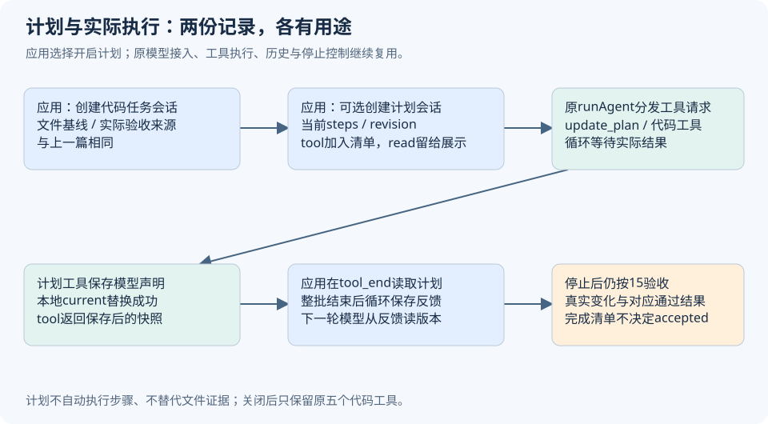
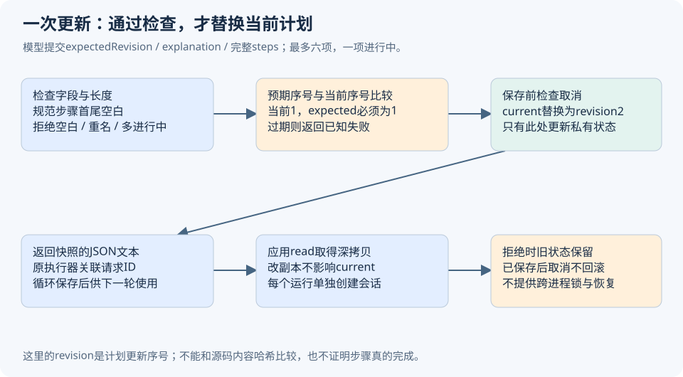
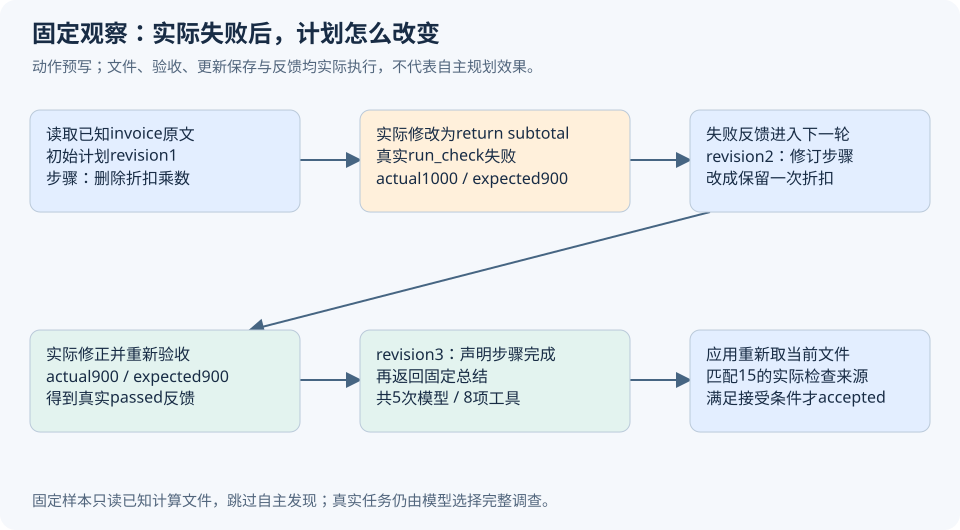
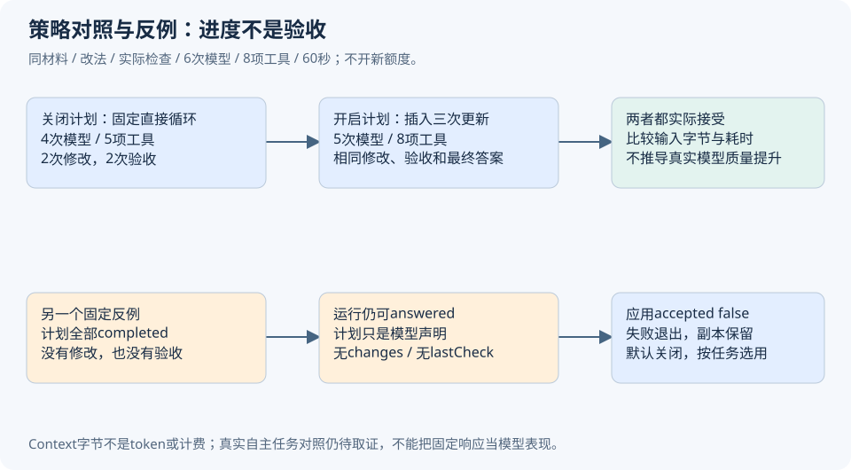

# 16 让 Agent 记录计划，并根据反馈修订进度

本篇让 Agent **把多步任务的当前安排保存成可查看的计划，取得新证据或遇到失败后修订，再继续实际执行**。计划是模型公开声明的工作进度，不是隐藏思维，也不是另一个替模型安排所有动作的执行器。

第 15 篇已经能核对实际修改与对应验收。本篇接着学习任务规划与进度：应用按需要开启一个计划工具，模型通过原来的工具调用提出更新，程序检查后保存，终端显示当前步骤。实际修复、验收和交付判断仍走原路径；不因为清单全部勾完就接受任务。

这是第三阶段的计划与进度单元。简单任务可以保持直接循环；本篇策略默认关闭，通过同一材料、同一预算的对照，观察计划带来的可见进度和额外开销。

## 本篇技术方案

### 实施前，先走完一次具体过程

继续使用 15 的金额修复：应用复制 `fixtures/workspace-review/`，只允许写当前 invoice，固定验收检查一次折扣。材料与验收程序均保留，不新增业务文件。

#### 1. 应用决定这次是否需要计划

原代码任务会话照常创建，负责工作副本、变化与验收来源。如果入口选择开启计划，应用额外创建一份独立计划记录，初始为空、更新序号为 0，再把计划工具加入本次工具清单。关闭时只有原五个代码工具，原循环不需要另一套实现。

这里有两份会话：代码任务会话保存实际文件和验收事实；计划会话保存模型声明的步骤。运行入口持有两者，但它们不互相代替。

#### 2. 模型提出计划，程序检查后才保存

模型读到材料后，可以声明“修正计算、运行验收”这样的简短步骤，每项处于待处理、进行中或已声明完成。模型通过工具请求提交整份列表，而不是只在普通回答里写一句“接下来我会修复”。

**2.1 检查数据与步骤关系。** Runtime 沿用原参数门禁，计划工具再检查步骤是否空白或重名、是否同时有两项进行中。输入不合格就返回原请求对应的已知失败，不保存半份列表。

**2.2 确认更新基于当前版本。** 模型首次填写预期序号 0，成功后程序保存为序号 1 并返回。如果后续仍拿 0 更新，就拒绝旧请求。这是计划自己的更新序号，与 15 的源码内容标识不同。

**2.3 保存并反馈。** 计划工具替换本地记录，返回实际保存的完整计划。Runtime 关联原请求 ID，保存到消息历史；下一轮模型能看见刚才是否保存成功，以及新的序号。

#### 3. 实际反馈改变下一步安排

计划本身不修改文件。模型仍需请求替换工具、请求实际验收。假设它最初认为“删掉全部折扣就行”，结果得到实际 1000、预期 900，失败反馈进入下一轮。

模型接着可以修订步骤说明为“保留一次折扣”，保留修复项进行中、验收项待处理，再提出新的修改和验收。这次更新依据刚取得的失败，而不是机械地将下一项勾完。先前标完成的项目发现新问题，也允许重新打开。

#### 4. 终端读取同一份计划，显示公开进度

当 update_plan 工具成功结束，应用从自己持有的计划会话读取副本，显示步骤与更新说明。终端不会从模型自然语言中猜进度，也不会通过打印来修改计划。

模型下一轮取得进度靠的是第 2 步的工具反馈，终端取得进度靠的是会话读取入口。原 Runtime 继续独立保存消息历史，两条路径用途不同。

#### 5. 任务停止，仍按实际变化与验收接受

模型返回总结后，应用可以展示最终计划，但 15 的接受规则不读取计划完成数。没有修改、没有对应验收，即使计划全是“完成”，也要拒绝。反过来，清单没有及时更新不会抹掉已经取得的实际文件与验收事实。

本篇不强迫 Runtime 按计划顺序调度工具，不提供任务依赖图、并发、人工审批或恢复。计划是帮助模型与操作者组织任务的一项可选能力，效果仍需观察。

#### 6. 用开启和关闭对照决定策略价值

固定观察用同一份材料、相同错误改法和真实验收，分别关闭与开启计划。比较接受结果、模型调用、工具处理次数、累计输入字节与耗时；不为了让计划版通过而扩大预算。作者预写的决定只证明机制与开销，不证明真实模型有更高完成率。

### 实现架构图



接下来先实现计划数据与保存工具，运行一个不接模型的小阶段；再把它接入修复应用、观察失败后修订和错误完成，最后开放真实任务开关。

## 起点、范围与参考

从 15 完成的工程开始，在仓库根目录自行创建分支：

```bash
git status --short --branch
git switch -c agent/chapter-16-task-plan
```

本篇不增加包或依赖，不修改根 scripts。runtime 包新增可选的 `planning/` 能力，原 `run-agent.ts`、执行器和事件类型不改；model 与 coding-tools 保留 15 的实现。未来 Harness 组合设施继续按阶段建设，本篇不提前创建空包。

| 位置 | 负责什么 |
|---|---|
| runtime 的 types/plan、planning/parameters、planning/session | 通用计划契约、输入检查和当前记录，不认识金额规则 |
| 修复应用的 session/run/report/main | 按需加入工具、显示计划，继续原预算和实际验收 |
| examples 下 planning/ | 终端计划显示与固定对照，不把预写动作放进框架 |

Pi 固定版本的 [plan-mode 扩展示例](https://github.com/badlogic/pi-mono/blob/8efd314fa3d3232ce197d8d7a6a5660530b9d83e/packages/coding-agent/examples/extensions/plan-mode/index.ts)自己维护待办、展示进度，并根据文本标记更新完成项。它还包含模式切换和状态持久化。本篇借鉴“计划记录与运行推进分开”，采用结构化工具更新，不照搬文本提取、只读模式或恢复，也不把可选计划写成所有 Agent 必须有的步骤。

## 第一步：约定模型更新与应用读取的数据

先区分两个方向：模型提交一次 `PlanUpdate`，程序保存后创建 `PlanSnapshot`；应用拿到 `PlanSession`，把 tool 交给 Runtime，使用 read 查看本地记录。类型声明本身不建立计划或启动运行。

新建 `packages/runtime/src/types/plan.ts`，写入完整代码：

<<< @/snippets/16-task-plan/packages/runtime/src/types/plan.ts

`steps` 是一份完整列表，不是只追加的日志。每项 step 说明公开动作，status 说明模型当前声明的进度。completed 允许退回，不能将它解释成已经取得业务验收。

模型提供 `expectedRevision`，会话返回 `revision`。例如当前是 1，下一次应提交 expectedRevision 为 1；成功后返回 2。这个数字只说明计划被更新几次，与源码哈希没有可比较关系。

初始快照 revision 为 0、说明为空、steps 为空。首次工具更新必须提交 1 到 6 项及非空说明；初始空记录不是一次合法的模型更新。类型不自动限制数量，下一步才实际检查。

## 第二步：让同一份规则服务说明与本地检查

这份代码负责**把未知更新参数变成可以保存的数据**。工具工厂调用 `createPlanParser` 得到检查函数；之后每次传入模型请求对象，成功返回复制后的 `PlanUpdate`，失败抛出可反馈错误。它不修改当前计划，也不判断模型说的失败是否真实发生。

新建 `packages/runtime/src/planning/parameters.ts`，写入完整代码：

<<< @/snippets/16-task-plan/packages/runtime/src/planning/parameters.ts

`planParameters` 是普通 schema，既成为工具说明，也由解析器编译。比如 steps 中给了一个空白 step，字段类型虽然是字符串，后面的 trim 与非空检查仍会拒绝；两项都为 in_progress 时，跨步骤检查也会拒绝。

正常输入经过 `validate(value)` 后，map 创建新步骤对象并规范首尾空白。`return` 只交回这份更新，尚未保存；保存语句在下一文件。重复步骤按规范后的文字比较，不自动合并或猜测它们是不是同一个任务。

每个计划会话编译一次本地检查，保证公开返回的 tool.execute 被直接调用时也有门禁；经 runAgent 调用时，07 的注册表仍从同一 schema 编译运行入口检查。这里复用规则而非另写一套 schema，两处都不在每轮重新编译。

## 第三步：创建可选的计划记录与更新工具

下面这份代码负责**保存当前计划，并向模型与应用提供同一记录的两个入口**。`createPlanSession()` 返回 `{tool,read}`：Runtime 执行 tool，应用调用 read。内部 current 由这个会话独有，另一次任务要重新创建。

新建 `packages/runtime/src/planning/session.ts`，写入完整代码：

<<< @/snippets/16-task-plan/packages/runtime/src/planning/session.ts

比如当前 revision 为 1，模型提交 expectedRevision 为 1、说明为“实际验收 1000、预期 900，需要保留一次折扣”，解析器先检查整份数据。版本匹配且未取消，`current = ...` 才将记录更新为 2。随后返回的 JSON 是实际保存结果，交给原工具执行器关联请求并写入历史。

如果版本仍填 0，则返回已知失败，current 仍是 1。模型应根据最近成功反馈重写，不能靠拒绝结果假装更新成功。这个检查可以发现同批第二项仍基于旧序号的请求，但不是跨进程锁或持久化并发协议。



`read()` 深拷贝当前记录。应用修改读出的 steps，不会改变私有 current；工具返回的 JSON 也没有暴露可写引用。取消发生在保存之前就不更新，已经保存的计划不会因后续取消自动撤销，这与之前“取消不等于回滚”一致。

### 公开能力后，先运行一小段

`packages/runtime/src/index.ts` **完整替换**为下面内容。原导出全部保留，新增计划工厂和类型；入口只公开能力，不强制创建计划，也不改变任何旧任务的工具清单。

<<< @/snippets/16-task-plan/packages/runtime/src/index.ts

到这里先保留 15 的应用文件。在根目录运行下面命令，只使用新工具与原批次执行器，不读取 `.env`、不调用模型：

```bash
npm run check
node --input-type=module <<'JS'
import { createPlanSession, executeTools } from '@ai-harness/runtime';
const plan = createPlanSession();
const request = (id, expectedRevision) => ({
  role: 'assistant', content: '', stopReason: 'toolUse',
  toolCalls: [{ id, name: 'update_plan', arguments: JSON.stringify({
    expectedRevision, explanation: '先调查，再根据实际反馈决定修改。',
    steps: [{ step: '读取当前实现', status: 'in_progress' }],
  }) }],
});
console.log('首次：', await executeTools(request('plan_1', 0), [plan.tool]));
console.log('旧版本：', await executeTools(request('plan_old', 0), [plan.tool]));
console.log('当前：', plan.read());
JS
```

首次结果 isError 为 false，content 中 revision 为 1。第二次 isError 为 true，代码为 invalid_arguments；最后 read 仍返回 revision 1 和原步骤。这证明拒绝旧更新没有改记录，还没有模型、实际修复或文件验收。

## 第四步：修复应用按需附加计划

### 让同一应用会话保留两种状态

这份类型让运行与报告能拿到可选计划句柄，但依旧分别保存代码任务会话和任务输入。新增 `RepairOptions` 只约定应用策略开关，不把它变成 Runtime 的强制运行参数。

**完整替换 `examples/code-review/src/types/repair-session.ts`**：保留 root/codeTask/input，新增可选 plan 和 RepairOptions.planning。

<<< @/snippets/16-task-plan/examples/code-review/src/types/repair-session.ts

接下来的准备函数负责**在原副本任务上按需增加一个工具**。入口给出 signal 与可选配置，函数仍复制原材料、创建代码任务会话；开启计划时额外创建 PlanSession，返回给运行和报告，并将 plan.tool 加入 input.tools。

**完整替换 `examples/code-review/src/repair-session.ts`**：保留 15 的副本、固定命令和任务，新增 options 参数、可选计划与说明。默认不传配置时，仍只有原五工具。

<<< @/snippets/16-task-plan/examples/code-review/src/repair-session.ts

这里没有将 invoice 或业务用例放进通用计划工厂。代码任务会话仍负责它的基线和验收；计划会话只接收公开步骤。`planningPrompt` 是开启时的实验策略，要求取得新反馈后更新进度，不预设具体文件调查或修复动作。

### 在实际更新后显示计划

这个小函数接收一份 `PlanSnapshot`，把状态换成中文标签并分块显示，供实时通知与最终报告共用。它不读取磁盘、不更新状态，也不将“已声明完成”显示为“已验收通过”。

新建 `examples/code-review/src/planning/print-plan.ts`，写入完整代码：

<<< @/snippets/16-task-plan/examples/code-review/src/planning/print-plan.ts

再把它接回实际运行。下面的 runRepair 接收原模型工厂与可选策略，准备同一副本，调用原 Runtime，并等待原报告；新增的观察只在成功 update_plan 后读取会话显示。

**完整替换 `examples/code-review/src/repair-run.ts`**：保留入口职责、6 次模型/8 项工具/60 秒预算、取消和清理；新增 options 传递，将原直接 onEvent:printEvent 改为先打印事件，再按需打印当前计划。

<<< @/snippets/16-task-plan/examples/code-review/src/repair-run.ts

此时工具已经把 current 更新成功，tool_end 让应用有机会查看。它不等于整批已写入消息历史：原执行器返回整批后，循环才保存反馈，下一轮模型再取得更新。打印抛错仍沿 08 的观察失败处理，不通过打印触发重试。

### 最终报告显示计划，但接受规则不变

这份报告继续从代码任务会话读取当前差异与匹配验收，返回实际接受结果。新增内容只是将可选计划也打印出来，方便对照“模型声明”和“执行事实”。

**完整替换 `examples/code-review/src/repair-report.ts`**：保留 15 的取证、差异、验收和 acceptRepair，新增 printPlan 导入与可选显示。`repair-acceptance.ts` **不改**。

<<< @/snippets/16-task-plan/examples/code-review/src/repair-report.ts

即使 plan.read 返回所有 completed，报告仍必须取得真实修改、当前对应的通过验收和业务输出。计划没有完成也不会自动否定实际证据；本篇并未把“清单全部完成”新增为交付条件。

## 第五步：用真实失败观察计划如何修订

为了可重复观察，下面提供固定模型。它替换的是决策来源，文件读取、写入、验收和计划保存都真实运行，不能把这个装置当成模型自主规划表现。

### 同一组动作，按开关插入计划更新

这份代码创建一个 `ModelCall`。调用方传入是否开启计划，它按调用次数返回预写请求；收到实际失败结果后才交出修正请求，收到实际通过后才声明完成。两模式的代码改法与验收相同，计划版多出三次更新。

新建 `examples/code-review/src/planning/sample-model.ts`，写入完整配套代码：

<<< @/snippets/16-task-plan/examples/code-review/src/planning/sample-model.ts

样本先读取已知 invoice，随后尝试删掉全部折扣，得到 1000/900 失败；下一轮计划版将“删除折扣乘数”修订为“保留一次折扣”，再实际修改、重验。通过后更新 completed，最后返回同一份固定总结。

这个受控对照只读已知计算文件，**故意不评估从入口发现文件与自主调查**；没有读取规则并不构成完整任务能力证明。真实入口仍保留原任务与全部工具，由模型自行决定读取动作。

`requireCheck` 在固定模型下一轮输入里寻找原请求对应的实际反馈，核对 failed 或 passed。如果程序没执行检查，或者结果不是预期值，就停止固定观察，不用预写成功文字掩盖差异。



### 入口记录可比较的开销

这个入口读取观察参数，创建对应固定模型，并调用同一个 runRepair。包装函数只累计每轮传入的项目 Context 字节，最后打印调用数与经过时间；它不改循环或执行预算。

新建 `examples/code-review/src/planning/observe.ts`，写入完整代码：

<<< @/snippets/16-task-plan/examples/code-review/src/planning/observe.ts

在根目录运行：

```bash
npm run check
node --import tsx examples/code-review/src/planning/observe.ts
node --import tsx examples/code-review/src/planning/observe.ts --plan
```

两次都会创建自己的独立副本，保留相同材料、原 6 次模型、8 项工具与 60 秒预算和接受条件。对照应看到：

| 项目 | 关闭计划的固定观察 | 开启计划的固定观察 |
|---|---:|---:|
| 模型函数调用数 | 4 | 5 |
| 工具处理数 | 5 | 8 |
| 实际文件修改/验收数 | 2/2 | 2/2 |
| 最终 accepted | true | true |
| 计划序号 | 没有计划 | 1→2→3 |
| 本候选一次观察的累计 Context 字节 | 15526 | 30747 |

看日志时，先找到 check_failed 的实际输出：status failed、exitCode 1、actual 1000/expected 900。再看下一轮 plan_revised 反馈：revision 2、第一项说明改为保留一次折扣。最后 check_passed 的 actual 900、计划 revision 3 全部声明完成，应用重新取证得到 accepted true。

`contextBytes` 是所有传入 Context 的 UTF-8 字节累计，包含历史、总体要求与工具说明；不是 token、服务原生 HTTP 字节或费用。真实策略还要比较任务质量和费用，不能只按输入体积判断。耗时取决于机器与程序启动，不要求复现某个毫秒值。

这个样本里两种方式都通过，计划版多用了模型轮次与工具额度。它说明计划有成本，不能从固定流程推导“计划让模型更聪明”。真实质量对照尚未完成，开关保持可选，不设为所有任务的默认策略。

## 第六步：故意勾完清单，确认不能绕过验收

还是使用同一个入口，在根目录运行：

```bash
node --import tsx examples/code-review/src/planning/observe.ts --plan --false-complete
```

这个固定反例只提交一份全为 completed 的计划，再返回回答，没有修改也没有验收。终端计划会显示“已声明完成”，Runtime 返回 answered，但“交付判断”应为 changedFiles 空、checkedRevision 为 notRun、checkMatchesCurrent false、accepted false，进程退出 1。



反例不表示真实模型一定会犯错，而是验证应用即使遇到这类声明，也不会把它当作执行事实。正常固定观察后，15 的旧 `repair-observe.ts` 仍能运行；本篇没有改它的四轮路径。

## 第七步：真实任务按需开启，再沿日志判断

真实入口负责读取 `--plan`，选择是否附加计划，再使用原模型连接与副本运行。它不解析模型计划内容，也不在入口预填任务步骤。

**完整替换 `examples/code-review/src/repair-main.ts`**：保留 createModelCall/runRepair，新增参数检查和策略传递。`examples/run.ts`、根 `package.json` 的 start/debug/check 都不改。

<<< @/snippets/16-task-plan/examples/code-review/src/repair-main.ts

操作者自行决定是否调用真实服务，在根目录运行：

```bash
npm start -- --example code-repair
npm start -- --example code-repair --plan
```

第一次保持直接循环，第二次提供 update_plan 和使用说明。真实模型可能采用不同步骤、更新次数，甚至未使用计划；不要要求它复现固定轨迹。只开一次、只成功一次，也不足以判断策略优劣。

真实日志先看实际 update_plan 请求参数和 toolResult。成功反馈里的 revision 是本地保存的版本，步骤与说明来自模型；若失败，看 isError 与受控说明，别把被拒更新当成当前计划。终端“任务计划”来自应用读本地会话，不是另一次模型调用。

再沿 replace_text、run_check 追到 actual/expected、内容来源与最终 accepted。若计划占用太多额度导致 toolLimit，按记录说明未完成；当前开关可关闭，不先把额度悄悄放大。公平比较应保持材料、任务、模型、验收和预算一致，分别记录失败、完成质量、轮次、输入与服务实际用量；本篇作者未自动请求付费服务。

## 断点、可逆故障与小迁移

调试沿用稳定命令：

```bash
npm run debug -- --example code-repair --plan
```

在 `packages/runtime/src/planning/session.ts` 的 `current = ...` 处暂停，观察旧 current、提交的 expectedRevision、解析后的 steps；在原执行器 results.push 和循环 messages.push 处，追踪保存计划返回怎样成为下一轮输入。计划赋值与历史追加是两次不同保存，均只在内存中。

可逆故障：将 `examples/code-review/src/planning/sample-model.ts` 中 plan_revised 的 expectedRevision 从 1 改成 0，重新运行开启计划的观察。初始计划仍为 revision 1，修订被拒；之后实际修复可以执行，但最后基于 2 的完成更新也会过期。此反例仍可得到实际 accepted true，因为文件已经修正且验收匹配；这不能证明计划修订成功。对照终端旧进度与实际结果，理解计划记录不会自动变成文件事实。完成后把这个 1 恢复，确认 revision 1→2→3 恢复。

小迁移：将同一 `createPlanSession` 工厂接入已有发布调查任务，替换应用的工具组合与计划文本，不改 planning、runAgent 或查询实现。查询结果仍由原工具实际取得，接受仍由原发布报告判断；计划不得预填发布材料中的负责人。这个迁移检验机制没有依赖 invoice，不要求现在搭建通用编排框架。

## 本篇能力与边界

现在有了可更新、可显示、可关闭的显式进度。模型更新会经过本地门禁，旧计划版本被拒，完成项可因新事实重新打开；但程序不验证每条说明的真实性，也不自动检查计划与文件版本对应。计划顺序不限制工具顺序，更没有调度依赖图。

每次运行创建新记录，read 返回副本，没有落盘或恢复。并发共享同一会话、跨进程更新、多 Agent 委派与权限审批均未实现。已保存计划不会因取消回滚，列表全部完成也不能代替验收。下一篇按原路线形成初步 Coding CLI，把任务、工作区和交互入口接到同一个底座。

## 完整文件核对

步骤与下面完整内容引用同一份候选。只按正文新增或替换，保留其余文件；不要用整份快照覆盖已有工程。只有本章变化带标记，旧章节变化标签已清理。

::: details .env.example（保留核对）

<<< @/snippets/16-task-plan/.env.example{text}

:::

::: details examples/code-review/package.json（保留核对）

<<< @/snippets/16-task-plan/examples/code-review/package.json{json}

:::

::: details examples/code-review/src/cancellation/fixtures.ts（保留核对）

<<< @/snippets/16-task-plan/examples/code-review/src/cancellation/fixtures.ts{typescript}

:::

::: details examples/code-review/src/cancellation/main.ts（保留核对）

<<< @/snippets/16-task-plan/examples/code-review/src/cancellation/main.ts{typescript}

:::

::: details examples/code-review/src/check-events.ts（保留核对）

<<< @/snippets/16-task-plan/examples/code-review/src/check-events.ts{typescript}

:::

::: details examples/code-review/src/check-invoice.mjs（保留核对）

<<< @/snippets/16-task-plan/examples/code-review/src/check-invoice.mjs{javascript}

:::

::: details examples/code-review/src/check-protocol.ts（保留核对）

<<< @/snippets/16-task-plan/examples/code-review/src/check-protocol.ts{typescript}

:::

::: details examples/code-review/src/check-stream.ts（保留核对）

<<< @/snippets/16-task-plan/examples/code-review/src/check-stream.ts{typescript}

:::

::: details examples/code-review/src/check-tool-contract.ts（保留核对）

<<< @/snippets/16-task-plan/examples/code-review/src/check-tool-contract.ts{typescript}

:::

::: details examples/code-review/src/limits/main.ts（保留核对）

<<< @/snippets/16-task-plan/examples/code-review/src/limits/main.ts{typescript}

:::

::: details examples/code-review/src/limits/scenario.ts（保留核对）

<<< @/snippets/16-task-plan/examples/code-review/src/limits/scenario.ts{typescript}

:::

::: details examples/code-review/src/main.ts（保留核对）

<<< @/snippets/16-task-plan/examples/code-review/src/main.ts{typescript}

:::

::: details examples/code-review/src/planning/observe.ts（本篇新增/修改）

<<< @/snippets/16-task-plan/examples/code-review/src/planning/observe.ts{typescript}

:::

::: details examples/code-review/src/planning/print-plan.ts（本篇新增/修改）

<<< @/snippets/16-task-plan/examples/code-review/src/planning/print-plan.ts{typescript}

:::

::: details examples/code-review/src/planning/sample-model.ts（本篇新增/修改）

<<< @/snippets/16-task-plan/examples/code-review/src/planning/sample-model.ts{typescript}

:::

::: details examples/code-review/src/protocol-fetch.ts（保留核对）

<<< @/snippets/16-task-plan/examples/code-review/src/protocol-fetch.ts{typescript}

:::

::: details examples/code-review/src/repair-acceptance.ts（保留核对）

<<< @/snippets/16-task-plan/examples/code-review/src/repair-acceptance.ts{typescript}

:::

::: details examples/code-review/src/repair-main.ts（本篇新增/修改）

<<< @/snippets/16-task-plan/examples/code-review/src/repair-main.ts{typescript}

:::

::: details examples/code-review/src/repair-observe.ts（保留核对）

<<< @/snippets/16-task-plan/examples/code-review/src/repair-observe.ts{typescript}

:::

::: details examples/code-review/src/repair-report.ts（本篇新增/修改）

<<< @/snippets/16-task-plan/examples/code-review/src/repair-report.ts{typescript}

:::

::: details examples/code-review/src/repair-run.ts（本篇新增/修改）

<<< @/snippets/16-task-plan/examples/code-review/src/repair-run.ts{typescript}

:::

::: details examples/code-review/src/repair-session.ts（本篇新增/修改）

<<< @/snippets/16-task-plan/examples/code-review/src/repair-session.ts{typescript}

:::

::: details examples/code-review/src/report-run.ts（保留核对）

<<< @/snippets/16-task-plan/examples/code-review/src/report-run.ts{typescript}

:::

::: details examples/code-review/src/stream-fetch.ts（保留核对）

<<< @/snippets/16-task-plan/examples/code-review/src/stream-fetch.ts{typescript}

:::

::: details examples/code-review/src/task.ts（保留核对）

<<< @/snippets/16-task-plan/examples/code-review/src/task.ts{typescript}

:::

::: details examples/code-review/src/tools.ts（保留核对）

<<< @/snippets/16-task-plan/examples/code-review/src/tools.ts{typescript}

:::

::: details examples/code-review/src/types/repair-session.ts（本篇新增/修改）

<<< @/snippets/16-task-plan/examples/code-review/src/types/repair-session.ts{typescript}

:::

::: details examples/code-review/src/workspace-main.ts（保留核对）

<<< @/snippets/16-task-plan/examples/code-review/src/workspace-main.ts{typescript}

:::

::: details examples/code-review/src/workspace-observe.ts（保留核对）

<<< @/snippets/16-task-plan/examples/code-review/src/workspace-observe.ts{typescript}

:::

::: details examples/code-review/src/workspace-task.ts（保留核对）

<<< @/snippets/16-task-plan/examples/code-review/src/workspace-task.ts{typescript}

:::

::: details examples/package-consumer/main.mjs（保留核对）

<<< @/snippets/16-task-plan/examples/package-consumer/main.mjs{javascript}

:::

::: details examples/release-impact/package.json（保留核对）

<<< @/snippets/16-task-plan/examples/release-impact/package.json{json}

:::

::: details examples/release-impact/src/load-records.ts（保留核对）

<<< @/snippets/16-task-plan/examples/release-impact/src/load-records.ts{typescript}

:::

::: details examples/release-impact/src/lookup-tool.ts（保留核对）

<<< @/snippets/16-task-plan/examples/release-impact/src/lookup-tool.ts{typescript}

:::

::: details examples/release-impact/src/main.ts（保留核对）

<<< @/snippets/16-task-plan/examples/release-impact/src/main.ts{typescript}

:::

::: details examples/release-impact/src/report-run.ts（保留核对）

<<< @/snippets/16-task-plan/examples/release-impact/src/report-run.ts{typescript}

:::

::: details examples/release-impact/src/task.ts（保留核对）

<<< @/snippets/16-task-plan/examples/release-impact/src/task.ts{typescript}

:::

::: details examples/release-impact/src/tools.ts（保留核对）

<<< @/snippets/16-task-plan/examples/release-impact/src/tools.ts{typescript}

:::

::: details examples/release-impact/src/types/tools.ts（保留核对）

<<< @/snippets/16-task-plan/examples/release-impact/src/types/tools.ts{typescript}

:::

::: details examples/release-impact/src/validation.ts（保留核对）

<<< @/snippets/16-task-plan/examples/release-impact/src/validation.ts{typescript}

:::

::: details examples/run.ts（保留核对）

<<< @/snippets/16-task-plan/examples/run.ts{typescript}

:::

::: details examples/shared/interrupt.ts（保留核对）

<<< @/snippets/16-task-plan/examples/shared/interrupt.ts{typescript}

:::

::: details examples/shared/model.ts（保留核对）

<<< @/snippets/16-task-plan/examples/shared/model.ts{typescript}

:::

::: details examples/shared/print-event.ts（保留核对）

<<< @/snippets/16-task-plan/examples/shared/print-event.ts{typescript}

:::

::: details examples/shared/print-run.ts（保留核对）

<<< @/snippets/16-task-plan/examples/shared/print-run.ts{typescript}

:::

::: details examples/shared/stream-model.ts（保留核对）

<<< @/snippets/16-task-plan/examples/shared/stream-model.ts{typescript}

:::

::: details examples/shared/terminal.ts（保留核对）

<<< @/snippets/16-task-plan/examples/shared/terminal.ts{typescript}

:::

::: details examples/shared/types/task.ts（保留核对）

<<< @/snippets/16-task-plan/examples/shared/types/task.ts{typescript}

:::

::: details examples/stage-check/fixtures/fetch.ts（保留核对）

<<< @/snippets/16-task-plan/examples/stage-check/fixtures/fetch.ts{typescript}

:::

::: details examples/stage-check/fixtures/plans.ts（保留核对）

<<< @/snippets/16-task-plan/examples/stage-check/fixtures/plans.ts{typescript}

:::

::: details examples/stage-check/main.ts（保留核对）

<<< @/snippets/16-task-plan/examples/stage-check/main.ts{typescript}

:::

::: details fixtures/code-review/src/cart.ts（保留核对）

<<< @/snippets/16-task-plan/fixtures/code-review/src/cart.ts{typescript}

:::

::: details fixtures/code-review/src/invoice.ts（保留核对）

<<< @/snippets/16-task-plan/fixtures/code-review/src/invoice.ts{typescript}

:::

::: details fixtures/code-review/src/pricing.ts（保留核对）

<<< @/snippets/16-task-plan/fixtures/code-review/src/pricing.ts{typescript}

:::

::: details fixtures/model-protocol/anthropic.json（保留核对）

<<< @/snippets/16-task-plan/fixtures/model-protocol/anthropic.json{json}

:::

::: details fixtures/model-protocol/deepseek.json（保留核对）

<<< @/snippets/16-task-plan/fixtures/model-protocol/deepseek.json{json}

:::

::: details fixtures/model-stream/anthropic-answer.sse（保留核对）

<<< @/snippets/16-task-plan/fixtures/model-stream/anthropic-answer.sse{text}

:::

::: details fixtures/model-stream/anthropic-tools.sse（保留核对）

<<< @/snippets/16-task-plan/fixtures/model-stream/anthropic-tools.sse{text}

:::

::: details fixtures/model-stream/deepseek-answer.sse（保留核对）

<<< @/snippets/16-task-plan/fixtures/model-stream/deepseek-answer.sse{text}

:::

::: details fixtures/model-stream/deepseek-tools.sse（保留核对）

<<< @/snippets/16-task-plan/fixtures/model-stream/deepseek-tools.sse{text}

:::

::: details fixtures/package-consumer/source.ts（保留核对）

<<< @/snippets/16-task-plan/fixtures/package-consumer/source.ts{typescript}

:::

::: details fixtures/release-impact/releases.json（保留核对）

<<< @/snippets/16-task-plan/fixtures/release-impact/releases.json{json}

:::

::: details fixtures/release-impact/services.json（保留核对）

<<< @/snippets/16-task-plan/fixtures/release-impact/services.json{json}

:::

::: details fixtures/release-impact/stage-releases.json（保留核对）

<<< @/snippets/16-task-plan/fixtures/release-impact/stage-releases.json{json}

:::

::: details fixtures/release-impact/stage-services.json（保留核对）

<<< @/snippets/16-task-plan/fixtures/release-impact/stage-services.json{json}

:::

::: details fixtures/workspace-review/README.md（保留核对）

<<< @/snippets/16-task-plan/fixtures/workspace-review/README.md{text}

:::

::: details fixtures/workspace-review/src/checkout/invoice.ts（保留核对）

<<< @/snippets/16-task-plan/fixtures/workspace-review/src/checkout/invoice.ts{typescript}

:::

::: details fixtures/workspace-review/src/legacy/invoice.ts（保留核对）

<<< @/snippets/16-task-plan/fixtures/workspace-review/src/legacy/invoice.ts{typescript}

:::

::: details fixtures/workspace-review/src/main.ts（保留核对）

<<< @/snippets/16-task-plan/fixtures/workspace-review/src/main.ts{typescript}

:::

::: details fixtures/workspace-review/src/pricing/policy.ts（保留核对）

<<< @/snippets/16-task-plan/fixtures/workspace-review/src/pricing/policy.ts{typescript}

:::

::: details package.json（保留核对）

<<< @/snippets/16-task-plan/package.json{json}

:::

::: details packages/coding-tools/package.json（保留核对）

<<< @/snippets/16-task-plan/packages/coding-tools/package.json{json}

:::

::: details packages/coding-tools/src/files/read-text.ts（保留核对）

<<< @/snippets/16-task-plan/packages/coding-tools/src/files/read-text.ts{typescript}

:::

::: details packages/coding-tools/src/index.ts（保留核对）

<<< @/snippets/16-task-plan/packages/coding-tools/src/index.ts{typescript}

:::

::: details packages/coding-tools/src/process/run-check.ts（保留核对）

<<< @/snippets/16-task-plan/packages/coding-tools/src/process/run-check.ts{typescript}

:::

::: details packages/coding-tools/src/read-file.ts（保留核对）

<<< @/snippets/16-task-plan/packages/coding-tools/src/read-file.ts{typescript}

:::

::: details packages/coding-tools/src/types/code-task.ts（保留核对）

<<< @/snippets/16-task-plan/packages/coding-tools/src/types/code-task.ts{typescript}

:::

::: details packages/coding-tools/src/types/evidence.ts（保留核对）

<<< @/snippets/16-task-plan/packages/coding-tools/src/types/evidence.ts{typescript}

:::

::: details packages/coding-tools/src/types/read-file.ts（保留核对）

<<< @/snippets/16-task-plan/packages/coding-tools/src/types/read-file.ts{typescript}

:::

::: details packages/coding-tools/src/types/workspace.ts（保留核对）

<<< @/snippets/16-task-plan/packages/coding-tools/src/types/workspace.ts{typescript}

:::

::: details packages/coding-tools/src/workspace/arguments.ts（保留核对）

<<< @/snippets/16-task-plan/packages/coding-tools/src/workspace/arguments.ts{typescript}

:::

::: details packages/coding-tools/src/workspace/check.ts（保留核对）

<<< @/snippets/16-task-plan/packages/coding-tools/src/workspace/check.ts{typescript}

:::

::: details packages/coding-tools/src/workspace/code-task.ts（保留核对）

<<< @/snippets/16-task-plan/packages/coding-tools/src/workspace/code-task.ts{typescript}

:::

::: details packages/coding-tools/src/workspace/find.ts（保留核对）

<<< @/snippets/16-task-plan/packages/coding-tools/src/workspace/find.ts{typescript}

:::

::: details packages/coding-tools/src/workspace/index.ts（保留核对）

<<< @/snippets/16-task-plan/packages/coding-tools/src/workspace/index.ts{typescript}

:::

::: details packages/coding-tools/src/workspace/open.ts（保留核对）

<<< @/snippets/16-task-plan/packages/coding-tools/src/workspace/open.ts{typescript}

:::

::: details packages/coding-tools/src/workspace/read.ts（保留核对）

<<< @/snippets/16-task-plan/packages/coding-tools/src/workspace/read.ts{typescript}

:::

::: details packages/coding-tools/src/workspace/replace.ts（保留核对）

<<< @/snippets/16-task-plan/packages/coding-tools/src/workspace/replace.ts{typescript}

:::

::: details packages/coding-tools/src/workspace/search.ts（保留核对）

<<< @/snippets/16-task-plan/packages/coding-tools/src/workspace/search.ts{typescript}

:::

::: details packages/coding-tools/src/workspace/snapshot.ts（保留核对）

<<< @/snippets/16-task-plan/packages/coding-tools/src/workspace/snapshot.ts{typescript}

:::

::: details packages/coding-tools/tsconfig.json（保留核对）

<<< @/snippets/16-task-plan/packages/coding-tools/tsconfig.json{json}

:::

::: details packages/model/package.json（保留核对）

<<< @/snippets/16-task-plan/packages/model/package.json{json}

:::

::: details packages/model/src/complete.ts（保留核对）

<<< @/snippets/16-task-plan/packages/model/src/complete.ts{typescript}

:::

::: details packages/model/src/errors/model-call-error.ts（保留核对）

<<< @/snippets/16-task-plan/packages/model/src/errors/model-call-error.ts{typescript}

:::

::: details packages/model/src/index.ts（保留核对）

<<< @/snippets/16-task-plan/packages/model/src/index.ts{typescript}

:::

::: details packages/model/src/providers/anthropic/anthropic-messages.ts（保留核对）

<<< @/snippets/16-task-plan/packages/model/src/providers/anthropic/anthropic-messages.ts{typescript}

:::

::: details packages/model/src/providers/anthropic/anthropic-response.ts（保留核对）

<<< @/snippets/16-task-plan/packages/model/src/providers/anthropic/anthropic-response.ts{typescript}

:::

::: details packages/model/src/providers/anthropic/anthropic.ts（保留核对）

<<< @/snippets/16-task-plan/packages/model/src/providers/anthropic/anthropic.ts{typescript}

:::

::: details packages/model/src/providers/anthropic/request.ts（保留核对）

<<< @/snippets/16-task-plan/packages/model/src/providers/anthropic/request.ts{typescript}

:::

::: details packages/model/src/providers/anthropic/stream.ts（保留核对）

<<< @/snippets/16-task-plan/packages/model/src/providers/anthropic/stream.ts{typescript}

:::

::: details packages/model/src/providers/deepseek/deepseek-messages.ts（保留核对）

<<< @/snippets/16-task-plan/packages/model/src/providers/deepseek/deepseek-messages.ts{typescript}

:::

::: details packages/model/src/providers/deepseek/deepseek-response.ts（保留核对）

<<< @/snippets/16-task-plan/packages/model/src/providers/deepseek/deepseek-response.ts{typescript}

:::

::: details packages/model/src/providers/deepseek/deepseek.ts（保留核对）

<<< @/snippets/16-task-plan/packages/model/src/providers/deepseek/deepseek.ts{typescript}

:::

::: details packages/model/src/providers/deepseek/request.ts（保留核对）

<<< @/snippets/16-task-plan/packages/model/src/providers/deepseek/request.ts{typescript}

:::

::: details packages/model/src/providers/deepseek/stream.ts（保留核对）

<<< @/snippets/16-task-plan/packages/model/src/providers/deepseek/stream.ts{typescript}

:::

::: details packages/model/src/providers/shared/read-sse.ts（保留核对）

<<< @/snippets/16-task-plan/packages/model/src/providers/shared/read-sse.ts{typescript}

:::

::: details packages/model/src/providers/shared/request-json.ts（保留核对）

<<< @/snippets/16-task-plan/packages/model/src/providers/shared/request-json.ts{typescript}

:::

::: details packages/model/src/providers/shared/request-response.ts（保留核对）

<<< @/snippets/16-task-plan/packages/model/src/providers/shared/request-response.ts{typescript}

:::

::: details packages/model/src/request-options.ts（保留核对）

<<< @/snippets/16-task-plan/packages/model/src/request-options.ts{typescript}

:::

::: details packages/model/src/stream.ts（保留核对）

<<< @/snippets/16-task-plan/packages/model/src/stream.ts{typescript}

:::

::: details packages/model/src/types/anthropic-stream.ts（保留核对）

<<< @/snippets/16-task-plan/packages/model/src/types/anthropic-stream.ts{typescript}

:::

::: details packages/model/src/types/anthropic.ts（保留核对）

<<< @/snippets/16-task-plan/packages/model/src/types/anthropic.ts{typescript}

:::

::: details packages/model/src/types/context.ts（保留核对）

<<< @/snippets/16-task-plan/packages/model/src/types/context.ts{typescript}

:::

::: details packages/model/src/types/failures.ts（保留核对）

<<< @/snippets/16-task-plan/packages/model/src/types/failures.ts{typescript}

:::

::: details packages/model/src/types/messages.ts（保留核对）

<<< @/snippets/16-task-plan/packages/model/src/types/messages.ts{typescript}

:::

::: details packages/model/src/types/options.ts（保留核对）

<<< @/snippets/16-task-plan/packages/model/src/types/options.ts{typescript}

:::

::: details packages/model/src/types/sse.ts（保留核对）

<<< @/snippets/16-task-plan/packages/model/src/types/sse.ts{typescript}

:::

::: details packages/model/src/types/stream.ts（保留核对）

<<< @/snippets/16-task-plan/packages/model/src/types/stream.ts{typescript}

:::

::: details packages/model/src/types/tool-results.ts（保留核对）

<<< @/snippets/16-task-plan/packages/model/src/types/tool-results.ts{typescript}

:::

::: details packages/model/src/types/tools.ts（保留核对）

<<< @/snippets/16-task-plan/packages/model/src/types/tools.ts{typescript}

:::

::: details packages/model/src/validation.ts（保留核对）

<<< @/snippets/16-task-plan/packages/model/src/validation.ts{typescript}

:::

::: details packages/model/tsconfig.json（保留核对）

<<< @/snippets/16-task-plan/packages/model/tsconfig.json{json}

:::

::: details packages/runtime/package.json（保留核对）

<<< @/snippets/16-task-plan/packages/runtime/package.json{json}

:::

::: details packages/runtime/src/control/run-control.ts（保留核对）

<<< @/snippets/16-task-plan/packages/runtime/src/control/run-control.ts{typescript}

:::

::: details packages/runtime/src/errors/tool-batch-cancelled.ts（保留核对）

<<< @/snippets/16-task-plan/packages/runtime/src/errors/tool-batch-cancelled.ts{typescript}

:::

::: details packages/runtime/src/errors/tool-batch-error.ts（保留核对）

<<< @/snippets/16-task-plan/packages/runtime/src/errors/tool-batch-error.ts{typescript}

:::

::: details packages/runtime/src/errors/tool-batch-limit.ts（保留核对）

<<< @/snippets/16-task-plan/packages/runtime/src/errors/tool-batch-limit.ts{typescript}

:::

::: details packages/runtime/src/errors/tool-execution-error.ts（保留核对）

<<< @/snippets/16-task-plan/packages/runtime/src/errors/tool-execution-error.ts{typescript}

:::

::: details packages/runtime/src/events/dispatcher.ts（保留核对）

<<< @/snippets/16-task-plan/packages/runtime/src/events/dispatcher.ts{typescript}

:::

::: details packages/runtime/src/index.ts（本篇新增/修改）

<<< @/snippets/16-task-plan/packages/runtime/src/index.ts{typescript}

:::

::: details packages/runtime/src/planning/parameters.ts（本篇新增/修改）

<<< @/snippets/16-task-plan/packages/runtime/src/planning/parameters.ts{typescript}

:::

::: details packages/runtime/src/planning/session.ts（本篇新增/修改）

<<< @/snippets/16-task-plan/packages/runtime/src/planning/session.ts{typescript}

:::

::: details packages/runtime/src/run-agent.ts（保留核对）

<<< @/snippets/16-task-plan/packages/runtime/src/run-agent.ts{typescript}

:::

::: details packages/runtime/src/tools/execute.ts（保留核对）

<<< @/snippets/16-task-plan/packages/runtime/src/tools/execute.ts{typescript}

:::

::: details packages/runtime/src/tools/registry.ts（保留核对）

<<< @/snippets/16-task-plan/packages/runtime/src/tools/registry.ts{typescript}

:::

::: details packages/runtime/src/types/events.ts（保留核对）

<<< @/snippets/16-task-plan/packages/runtime/src/types/events.ts{typescript}

:::

::: details packages/runtime/src/types/failures.ts（保留核对）

<<< @/snippets/16-task-plan/packages/runtime/src/types/failures.ts{typescript}

:::

::: details packages/runtime/src/types/model-call.ts（保留核对）

<<< @/snippets/16-task-plan/packages/runtime/src/types/model-call.ts{typescript}

:::

::: details packages/runtime/src/types/plan.ts（本篇新增/修改）

<<< @/snippets/16-task-plan/packages/runtime/src/types/plan.ts{typescript}

:::

::: details packages/runtime/src/types/run-control.ts（保留核对）

<<< @/snippets/16-task-plan/packages/runtime/src/types/run-control.ts{typescript}

:::

::: details packages/runtime/src/types/run.ts（保留核对）

<<< @/snippets/16-task-plan/packages/runtime/src/types/run.ts{typescript}

:::

::: details packages/runtime/src/types/tool-batch.ts（保留核对）

<<< @/snippets/16-task-plan/packages/runtime/src/types/tool-batch.ts{typescript}

:::

::: details packages/runtime/src/types/tool-registry.ts（保留核对）

<<< @/snippets/16-task-plan/packages/runtime/src/types/tool-registry.ts{typescript}

:::

::: details packages/runtime/src/types/tools.ts（保留核对）

<<< @/snippets/16-task-plan/packages/runtime/src/types/tools.ts{typescript}

:::

::: details packages/runtime/tsconfig.json（保留核对）

<<< @/snippets/16-task-plan/packages/runtime/tsconfig.json{json}

:::

::: details tsconfig.json（保留核对）

<<< @/snippets/16-task-plan/tsconfig.json{json}

:::


## 保存本篇

在仓库根目录审阅后自行执行，推送不会部署，`.env` 不加入 Git：

```bash
git status --short --branch
git add packages/runtime/src examples/code-review/src site docs AGENTS.md
git commit -F - <<'COMMIT'
第16篇：增加可选任务计划与反馈后的进度修订

提供通用计划会话、结构化更新工具、字段与版本门禁。
修复应用按需开启计划，实时展示模型声明，原执行循环与验收保持独立。
增加相同材料和预算的开关对照，以及只勾完成却无验收的反例。
提供整体实现逻辑、代码功能说明、配图与完整文件核对。
同步路线与验证记录，不将固定响应当作模型自主规划证据。
COMMIT
git push -u origin agent/chapter-16-task-plan
```

<style>
.task-plan .vp-doc .custom-block.details summary { overflow-wrap: anywhere; }
</style>
