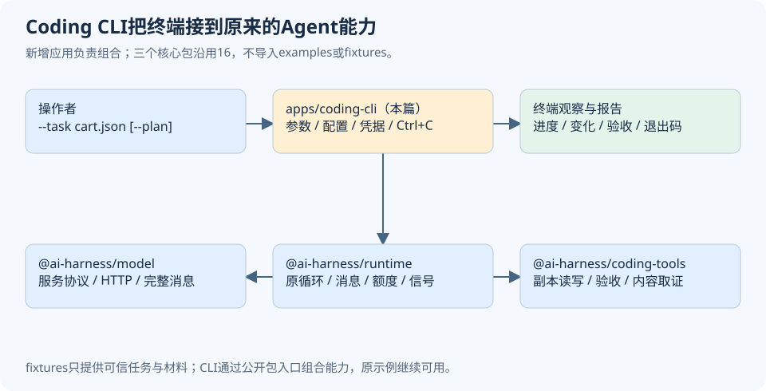
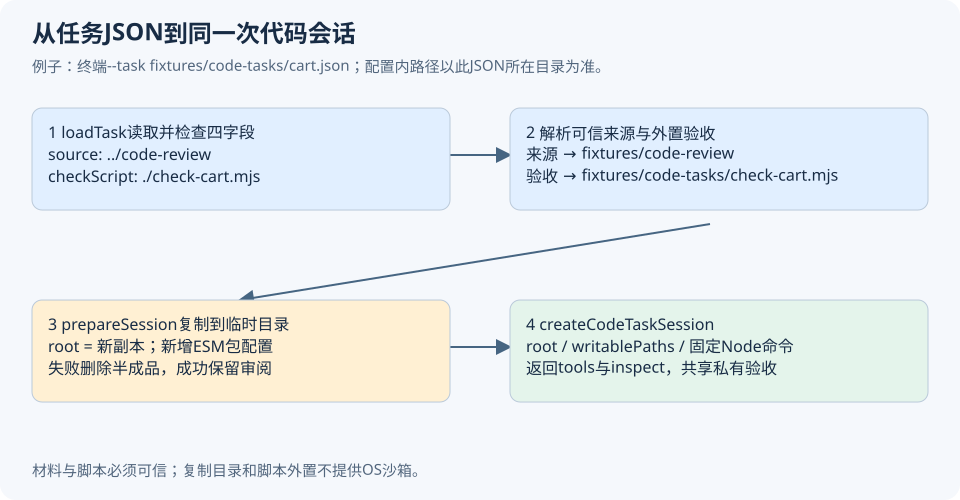
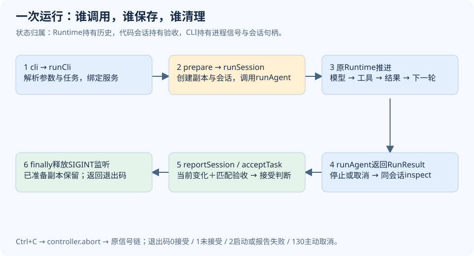

# 17 让 Coding CLI 使用同一个 Agent 内核

本篇把累计能力接成一个**能从终端接收任务配置、创建工作副本、运行 Agent 并返回交付结果的独立应用**。完成后，不必往示例选择器增加一个名字；同一个命令可以接不同材料及验收程序。

这是第三阶段的 Coding CLI 单元。CLI 是命令行应用：它负责参数、服务配置、进程信号与显示；模型仍选择动作，Runtime 仍执行循环，代码工具仍执行实际读写与验收。本篇不新增另一套 Agent 循环。

目前接入小型、可信、无外部依赖的教学材料。它是后续 Coding Agent 应用的起点；任意仓库、依赖安装、多轮终端对话、持久化恢复和系统隔离会继续建设。

## 实施前，先把整篇运行逻辑串起来

使用已有 `fixtures/code-review/src/cart.ts`：`total` 只累计 `price`，遗漏了 `quantity`。单价 10、数量 3 应得到 30，现在只有 10。下面会提供完整的任务配置与外置验收；材料文件继续沿用前面的内容，不要求模型凭空猜规则。

### 1. 操作者把任务交给终端应用

运行 `ai-harness --task fixtures/code-tasks/cart.json`。应用只把 `--task` 后面的字符串当作配置文件路径，先检查参数，再读取配置；此时还没有模型调用、工作副本或工具执行。

配置说明四件事：复制哪份材料、让模型完成什么、允许修改哪些既有文件、由哪个可信脚本验收。这里选择的脚本会在本机执行，配置应由操作者审阅提供，不能把模型生成的配置直接拿来运行。

### 2. 应用把配置解析为可执行的任务

#### 2.1 先确定路径与配置是否合法

终端传入的任务路径相对当前终端目录；配置中的材料和验收路径相对**配置文件所在目录**。例如任务文件在 `fixtures/code-tasks/cart.json`，其中 `../code-review` 就解析到 `fixtures/code-review/`，不会相对构建产物 `dist/` 查找。

#### 2.2 再创建独立副本和两份可选状态

应用复制材料到临时目录，用这个目录创建代码任务会话。基线与最近验收仍由代码工具保存，应用只持有会话句柄。开启 `--plan` 时另建计划会话；关闭时不提供计划工具。

验收脚本保留在副本之外。模型可以请求 `run_check({})`，但不能提交程序路径或命令参数。应用把“当前 Node、tsx、已选脚本、副本目录”固定下来，交给原有代码工具执行。

### 3. 原来的 Agent 循环接管动作与反馈

应用把配置的任务文本、同会话工具、服务连接、取消信号交给原 `runAgent`。模型可能先读 `src/cart.ts`，再请求精确替换，随后请求验收。Runtime 关联请求 ID、保存结果，再把实际反馈提供给下一次模型调用。

本篇继续使用 6 次模型、8 项工具、60 秒整次期限。CLI 接入不保证某次自主调查能在额度内完成；达到上限就停止，不能因为已经分析出问题而打印“已修复”。计划仍默认关闭，也占工具及模型额度。

### 4. 应用在停止后独立判断交付

应用重新读取同会话的当前变化和最近验收。只有正常回答、确实修改了允许文件、验收与当前内容匹配、进程通过且业务 JSON 为 `passed:true`，才返回退出码 0。

模型总结和计划清单都不提供通过证明。到达调用上限，即使最后一条响应提出修改或更新计划，也可能尚未执行；应以实际工具结果和变化为准。

### 5. 进程释放监听，副本留给人审阅

Ctrl+C 先触发取消信号，再等待已有协作操作退出；不立即强杀整个进程。结束时移除 SIGINT 监听，用退出码区分接受、未接受、启动错误和主动取消。已准备好的副本保留，来源材料不自动合入；准备失败的半成品则删除。



## 本篇借鉴 Pi 的哪一部分

固定版本的 Pi 用很薄的 [cli.ts](https://github.com/badlogic/pi-mono/blob/8efd314fa3d3232ce197d8d7a6a5660530b9d83e/packages/coding-agent/src/cli.ts) 把终端参数交给主入口；[main.ts](https://github.com/badlogic/pi-mono/blob/8efd314fa3d3232ce197d8d7a6a5660530b9d83e/packages/coding-agent/src/main.ts) 负责接入配置和运行模式。其 [runPrintMode](https://github.com/badlogic/pi-mono/blob/8efd314fa3d3232ce197d8d7a6a5660530b9d83e/packages/coding-agent/src/modes/print-mode.ts) 能发送任务、显示结果，并在结束时释放订阅与运行资源。

这里借鉴“终端入口组合已有运行能力”的职责划分。本篇只实现一次任务后退出的模式；任务 JSON、独立副本和交付规则是本课程当前选择，不等同于 Pi 的 SDK 或完整 CLI。

## 第一步：建立独立应用与包命令

先审阅当前修改，再自行创建本章分支：

```bash
git status
git switch -c agent/chapter-17-coding-cli
```

库仍在 `packages/`，终端应用放在 `apps/coding-cli/`，材料与验收放在 `fixtures/code-tasks/`。本地固定观察在 `examples/cli-observe/`，只作为检查入口。

根 `package.json` 的 workspaces 已包含 `apps/*`。**仅在 `scripts.build` 末尾追加应用构建**，其余命令与依赖保持原样：

```json
"build": "npm run build --workspace @ai-harness/model && npm run build --workspace @ai-harness/runtime && npm run build --workspace @ai-harness/coding-tools && npm run build --workspace @ai-harness/coding-cli"
```

根 `tsconfig.json` 的 `include` 数组追加 `"apps/**/*.ts"`，不删除现有两项。这样 `npm run check` 才会检查应用源文件；只有打包成功不能代替类型检查。

新建 `apps/coding-cli/package.json`。它声明应用依赖的三个公开包与验收所用的 tsx，并把可执行名称 `ai-harness` 指向构建后的 `dist/cli.js`。不新增按章节命名的脚本。

<<< @/snippets/17-coding-cli/apps/coding-cli/package.json

`bin` 是 npm 安装时建立命令链接的配置，不会替你启动 Agent。构建顺序先完成三个库，再构建应用。应用当前保持私有，不执行公开发布；字段规则见 [npm bin 文档](https://docs.npmjs.com/cli/v11/configuring-npm/package-json/#bin)。

新建 `apps/coding-cli/tsconfig.json`。它继承根编译选项，把本 workspace 的源码范围限定到 `src/`。

<<< @/snippets/17-coding-cli/apps/coding-cli/tsconfig.json

配置准备好后，在仓库根目录运行 `npm install`，同步 workspace 依赖与锁文件。此刻还没写完应用，不运行根构建；先写下面的配置解析并观察它。

## 第二步：让参数和任务配置有明确含义

新建 `apps/coding-cli/src/types/task.ts`。它定义两种应用侧数据：参数解析器返回的“帮助或运行选项”，以及任务加载器返回的实际任务配置。类型文件只声明形状，不会自己读取 JSON 或复制文件。

<<< @/snippets/17-coding-cli/apps/coding-cli/src/types/task.ts

`CliOptions` 的 `help` 区分两种结果，所以帮助分支不需要虚构一个任务路径。`TaskConfig` 中的两个目录/脚本位置已是解析后的绝对路径；这些值稍后由准备函数使用。`writablePaths` 则始终是副本内的项目相对路径，供代码工具检查。

新建 `apps/coding-cli/src/config/args.ts`。它接收终端参数数组，返回帮助选项，或任务路径与计划开关。坏参数直接拒绝，不向文件系统或模型服务继续推进。

<<< @/snippets/17-coding-cli/apps/coding-cli/src/config/args.ts

例如 `['--task','fixtures/code-tasks/cart.json','--plan']` 返回 `{help:false, taskFile:'fixtures/code-tasks/cart.json', planning:true}`。`args[++i]` 取走任务路径；重复 `--task`、重复 `--plan`、未知选项和缺值都失败。只有单独的 `--help` 表示帮助。

先在仓库根目录观察这一步，不需要密钥或付费服务：

```bash
node --import tsx --input-type=module <<'JS'
import { parseArgs } from './apps/coding-cli/src/config/args.ts';
console.log(parseArgs(['--task', 'fixtures/code-tasks/cart.json', '--plan']));
try { parseArgs(['--task', '--plan']); }
catch { console.log('已拒绝：缺少任务路径。'); }
JS
```

第一行应含 `help:false` 和 `planning:true`，第二次解析进入 catch。此时能证明参数分支，尚未证明任务可运行。

新建 `apps/coding-cli/src/config/task.ts`。它接收 `taskFile`，读取可信 JSON，校验四个字段，把配置内路径按配置文件目录解析，返回 `TaskConfig` 供副本准备使用。

<<< @/snippets/17-coding-cli/apps/coding-cli/src/config/task.ts

追踪商品任务：`realpath(resolve(taskFile))` 先取得任务文件位置；`dirname(configPath)` 得到 `fixtures/code-tasks/` 的绝对位置。`resolve(base, source)` 将 `../code-review` 变成来源目录；`checkScript` 同样解析，因而换终端目录或改成打包运行都不依赖源码文件的位置。

`relative(sourcePath, scriptPath)` 用来拒绝来源内部的验收脚本，防止把验收随材料放进模型处理范围。这里检查配置来源与脚本位置，不是系统沙箱。配置读取前检查 16 KiB，材料仍需操作者选小型可信目录；没有对抗恶意并发替换的保证。

四个字段必须刚好齐全，未知字段也拒绝，避免把拼错的配置默默忽略。精确路径是否存在于工作区、是否可写，仍由 `createCodeTaskSession` 检查。

## 第三步：提供任务材料和完整验收

先建立 `fixtures/code-tasks/`。下面四个文件都需要创建；验收程序是配套业务代码，不进入 Runtime。CLI 约定验收接收一个副本目录参数，标准输出为一个 JSON 对象，其中 `passed` 表示业务用例是否通过。

商品任务来源沿用 `fixtures/code-review/`，其中 `src/cart.ts` 已有以下关键逻辑，**这里只核对，不覆盖文件**：

```typescript
export function total(items: CartItem[]): number {
  return items.reduce((sum, item) => sum + item.price, 0);
}
```

它未使用数量。CLI 会创建副本，允许模型只修改副本中的 `src/cart.ts`。

新建 `fixtures/code-tasks/cart.json`。这份配置把商品任务文本、来源、可写文件和外置验收连在一起，供刚才的加载器读取。

<<< @/snippets/17-coding-cli/fixtures/code-tasks/cart.json

`../code-review` 相对当前 JSON 所在目录。配置里没有 API Key，也不接受模型临时传入 shell 命令。之后换任务，主要更换这种任务适配数据。

新建 `fixtures/code-tasks/check-cart.mjs`。它从 `process.argv[2]` 指定的副本加载 `total`，检查单商品、多商品与空清单，输出业务 JSON 并设置实际退出码，供 `run_check` 收集。

<<< @/snippets/17-coding-cli/fixtures/code-tasks/check-cart.mjs

例如第一项输入单价 10、数量 3，预期 30。原函数返回 10，因而 `passed:false` 且退出码 1；修复后三个用例通过，输出 `passed:true` 且退出码 0。`actual` 来自实际导入执行，既不是模型填的值，也不是日志里预写的通过状态。

如果导入或执行失败，catch 输出 `source_execution_failed`。这只验证有限用例；即使通过，也不能证明函数在所有输入上正确。

新建 `fixtures/code-tasks/invoice.json`。它把 14 至 16 的金额修复接到相同 CLI，来源仍是 `fixtures/workspace-review/`，允许路径仍为当前 invoice。

<<< @/snippets/17-coding-cli/fixtures/code-tasks/invoice.json

这份配置用于检验入口复用：应用不需要根据 `cart` 或 `invoice` 写分支，Runtime 也不认识这两个名字。任务文本及验收脚本各自承担材料差异。

新建 `fixtures/code-tasks/check-invoice.mjs`，写入完整配套验收。它接收同样的副本目录参数，执行已有的一次折扣用例，输出与商品验收相同的 `passed` 约定。

<<< @/snippets/17-coding-cli/fixtures/code-tasks/check-invoice.mjs

它从副本加载实际 `invoiceTotal`；满 10 件应只乘一次 0.9。这个文件是新入口使用的外置配套，旧示例的 `check-invoice.mjs` 保留，CLI 不导入旧示例中的文件。

## 第四步：把服务连接和工作副本交给原内核

新建 `apps/coding-cli/src/types/session.ts`。它声明应用持有的工作副本、代码任务会话与可选计划句柄，供准备、运行和报告三个模块使用。

<<< @/snippets/17-coding-cli/apps/coding-cli/src/types/session.ts

`codeTask` 是公开会话对象，不是复制出的第二份验收状态。报告必须对这里的同一个 `codeTask` 调用 `inspect()`，才能取得工具执行时保存的真实验收。

新建 `apps/coding-cli/src/model.ts`。它读取已有服务环境配置，创建一个 `ModelCall`；每次由 Runtime 调用时，消费原模型包的流并返回完整消息，文字分片交给回调。

<<< @/snippets/17-coding-cli/apps/coding-cli/src/model.ts

`createModelCall()` 只绑定配置，没有立即请求服务。真正网络调用发生在返回函数执行 `stream(context, {...options, signal})` 时。凭据不放进任务 JSON、消息或报告。`signal` 来自整次运行，继续沿用前面的取消与时限链。

应用没有导入 `examples/shared/model.ts`。两个入口各自完成很薄的环境接线，协议编解码和 HTTP 等待仍复用 `@ai-harness/model`。服务模型名称沿用原配置；CLI 将单次响应的输出上限设为 1024 token，为工具参数与最终说明留出空间。这个值是上限，不是每次固定用量，也不保证响应永不截断；这不是 CLI 对任意模型的兼容保证。

新建 `apps/coding-cli/src/session/prepare.ts`。它接收已解析任务和计划开关，复制材料、固定验收命令，创建同一次代码会话与可选计划，返回 `CliSession` 交给运行和报告。

<<< @/snippets/17-coding-cli/apps/coding-cli/src/session/prepare.ts

`root` 是新临时目录。`cp` 复制来源，`createCodeTaskSession({root,...})` 让原五工具都面对它。`task.checkScript` 已是副本外的实际路径，最后一个参数 `root` 供验收程序读取 `process.argv[2]`。

`import.meta.resolve('tsx')` 解析应用已声明的运行依赖；命令不用 shell，也不从模型参数读取路径。原工具仍限制直接子进程 3 秒与 8 KiB 输出。

本篇给无依赖 ESM 材料新增 `package.json`。`flag:'wx'` 表示已有时拒绝，避免覆盖材料自己的包配置；有完整依赖或包配置的仓库尚不在此接入范围。复制前后检查取消；复制本身不支持此信号，取消需等待它返回，不能承诺立即停止。

准备失败会删除半成品；成功返回后，目录保留给操作者审阅。原读取/写入门禁继续生效，但复制目录不是 OS 沙箱，可信脚本也能执行本机代码。



新建 `apps/coding-cli/src/session/run.ts`。它把任务文本、同会话工具、模型连接、信号和观察函数组装成 `runAgent` 输入，返回原 `RunResult`；它不保存第二份历史，也不自行分发工具。

<<< @/snippets/17-coding-cli/apps/coding-cli/src/session/run.ts

例如模型提出 `replace_text` 后，由原 Runtime 执行器调用代码工具；真实结果保存进 Runtime 消息，再进入下一次 `Context`。此文件只是应用组合位置，读写与消息更新并未搬到 CLI。

预算仍为 6/8/60s。第 6 次若仍提出工具请求，原循环会保存该模型消息后返回 `callLimit`，不会执行最后一批。需要区分“模型已经提出”与“工具已经完成”；不能靠最终文字判断发生过修改。

## 第五步：展示进度，并按当前证据返回退出码

新建 `apps/coding-cli/src/report/terminal.ts`。它将已发生的模型/工具事件显示为带运行身份和序号的进度行，并提供结果分块显示；不读取私有会话或改变运行状态。

<<< @/snippets/17-coding-cli/apps/coding-cli/src/report/terminal.ts

`tool_end` 显示“成功结果”，只表示这次工具处理成功，不表示业务验收通过。`run_check` 正常执行但用例失败时，也可能得到成功的工具结果；实际 `status` 和业务 JSON 要到报告里检查。

本篇终端显示聚焦调用、动作和最终报告，没有把流的每个文字片段全打印出来；模型连接仍正确消费增量，完整消息才进入运行记录。

新建 `apps/coding-cli/src/report/accept.ts`。它接收原运行结果、停止后取到的实际审阅数据、任务允许路径，返回本次修改任务是否满足接受条件。

<<< @/snippets/17-coding-cli/apps/coding-cli/src/report/accept.ts

先判断 `answered`、非空变化、路径都获准、验收匹配当前内容及进程通过；再解析可信脚本的 `stdout`，检查业务 `passed:true`。这是本 CLI 对“需要修改的任务”的接受规则；只读问答或无需修改的任务不适用。

`writablePaths.includes(change.path)` 来自任务配置，不再把 `src/checkout/invoice.ts` 写死。运行计划不参与判断，所以全部步骤 completed 也不能替代修改与验收。

新建 `apps/coding-cli/src/report/report.ts`。它在运行停止后，展示允许的运行字段、实际差异与验收，调用接受函数，返回 CLI 使用的退出码。

<<< @/snippets/17-coding-cli/apps/coding-cli/src/report/report.ts

`const review = await session.codeTask.inspect()` 重新取当前内容并读取同会话私有验收，不从模型历史里寻找“通过”。完整 `RunResult` 可能包含原始异常，代码只选择 `phase/code` 等字段展示。

返回 0 表示在当前规则内接受，1 表示未接受，130 表示主动取消；启动或报告本身异常交给下一步入口处理为 2。验收不通过不等于程序崩溃，调用上限也不等于网络异常。

## 第六步：连接一次终端运行的完整生命周期

新建 `apps/coding-cli/src/main.ts`。它接住参数数组，依次调用解析、任务加载、服务绑定、副本准备、Runtime 与报告；同时持有取消控制器，最终返回数字退出码。

<<< @/snippets/17-coding-cli/apps/coding-cli/src/main.ts

沿同一次商品任务追踪：`options.taskFile` 进入 `loadTask`，返回值由 `task` 接住；`prepareSession` 返回的会话赋给外层 `session`；`runSession` 返回 `result`，再和同一个会话一起交给 `reportSession`。`return await` 让报告在 try/finally 范围内结束，报告错误仍会被 catch 接住。

Ctrl+C 只调用一次 `controller.abort()`，Runtime 等待当前协作动作退出。`finally` 无论帮助、坏参数、取消或正常结束，都会移除本次 SIGINT 监听；已经准备好的副本位置也会再显示。

`phase` 仅帮助指出失败位置，不保存恢复状态。catch 不打印原异常，调试时在对应调用或异常断点查看。返回 2 的可能位置包括参数、任务配置、服务配置、准备及报告；其中运行期间已分类的模型失败则由 `RunResult` 正常报告为未接受。

第二个参数允许本地观察注入固定 `ModelCall` 工厂；真实可执行入口不提供这个参数。这使观察可以走同一应用过程，无需在 Runtime 添加“演示模式”。

新建 `apps/coding-cli/src/cli.ts`。它是 npm 命令真正进入的文件，只把终端参数交给 `runCli`，再把返回值设为进程退出码。

<<< @/snippets/17-coding-cli/apps/coding-cli/src/cli.ts

`process.exitCode` 允许已开始的清理自然结束，不主动调用 `process.exit()` 截断操作。首行保留可执行声明，打包后 `dist/cli.js` 可直接由 Node 运行。



至此文件齐全。在**仓库根目录**执行：

```bash
npm run check
npm rebuild --workspace @ai-harness/coding-cli
npm exec --offline -- ai-harness --help
```

`npm run check` 先构建三个库及 CLI，再检查包含 apps 的类型范围。首次安装时 `dist/cli.js` 尚不存在，命令链接可能还没建立；构建后 `npm rebuild` 补齐应用的 bin 链接。帮助应显示用法及退出码，不创建副本，不调用模型。

根 `start/debug` 继续运行原示例，不改回来，也不改成新的章节入口。CLI 的可执行构建入口单独使用。`--offline` 避免命令未链接时尝试从注册表获取同名包；它**不会禁止应用自身的模型网络调用**。

## 第七步：先用固定模型检查真实应用过程

这一节不需要服务密钥。只把模型的动作选择换成固定响应，参数、配置解析、副本、工具、验收进程、报告与退出码都实际执行。此检查不能证明真实模型会自主选择相同动作。

新建 `examples/cli-observe/sample-model.ts`。它创建一段固定商品修复轨迹：读源码、精确修改、真实验收、回答；有计划工具时额外更新进度。它将收到的真实验收反馈作为后续动作的前提。

<<< @/snippets/17-coding-cli/examples/cli-observe/sample-model.ts

关闭计划时：第 1 次读取，第 2 次修改与验收，第 3 次回答，共 3 次模型/3 项工具。开启时第 2 次多一项初始计划，第 3 次提交完成计划，第 4 次回答，共 4 次模型/5 项工具。

`context.messages.find(...)` 取得 Runtime 已保存的真实 `check` 反馈，检查实际状态是否 passed。固定函数决定动作，真实程序决定验收结果；二者证据不能混在一起。这里知道材料路径和替换原文，不能拿它衡量自主调查能力。

新建 `examples/cli-observe/main.ts`。它将固定模型工厂注入同一个 `runCli`，其余参数和退出处理都复用实际应用。

<<< @/snippets/17-coding-cli/examples/cli-observe/main.ts

依赖方向是观察入口导入应用，应用只依赖公开库与自身模块，不导入示例。后续删除观察入口不会破坏 CLI。

在根目录执行：

```bash
node --import tsx examples/cli-observe/main.ts --task fixtures/code-tasks/cart.json
node --import tsx examples/cli-observe/main.ts --task fixtures/code-tasks/cart.json --plan
```

第一次重点看四处：

1. 进度中先有 `read_file`，再有 `replace_text` 与 `run_check`；停止是 `answered`，模型 3 次、工具 3 项。
2. 修改前后 `total` 的差别是增加 `* item.quantity`，变化路径为 `src/cart.ts`。
3. 最近实际验收 `status:'passed'`、`exitCode:0`，stdout 含 `expected:30`、`actual:30` 与 `passed:true`。
4. 交付判断为 `accepted:true`、`checkMatchesCurrent:true`。终端显示独立副本位置，来源文件仍是原逻辑。

第二次应多显示计划 revision 1、2，最终仍按实际变化和验收接受。模型 4 次、工具 5 项；不是所有任务都必须先更新计划。

查看退出码应紧接刚执行的命令：

```bash
echo $?
```

本地通过时为 0。退出码只表达本篇规则下的任务接受，不代表已经把修改合入来源。

## 第八步：使用真实服务与另一份任务配置

真实服务由操作者决定何时调用和管理费用。沿用已有 `.env` 中的服务配置，**在根目录**执行：

```bash
node --env-file=.env apps/coding-cli/dist/cli.js --task fixtures/code-tasks/cart.json
```

构建后的 CLI 不依赖运行源码所需的 `--import tsx`；验收子进程的 tsx 由应用依赖与固定参数提供。也可以使用已链接命令：

```bash
npm exec --offline -- ai-harness --task fixtures/code-tasks/cart.json
```

后一条不加载 `.env`，仅在环境变量已经由终端配置时使用；不要把密钥写进命令或任务 JSON。两个命令都可能实际请求模型。

接入金额任务只换配置：

```bash
node --env-file=.env apps/coding-cli/dist/cli.js --task fixtures/code-tasks/invoice.json
```

计划仍是显式选择：

```bash
node --env-file=.env apps/coding-cli/dist/cli.js --task fixtures/code-tasks/cart.json --plan
```

真实模型的顺序和轮数可能不同。正常接受时仍需找到实际差异、通过验收、内容匹配和 `accepted:true`。如果是 `callLimit/toolLimit/timedOut`、未修改、未验收或匹配失败，保留完整日志与副本，不能把最后的意图文本当作已经执行；也不能仅凭一次尾部日志认定需要提高预算。

如果显示“模型配置失败”，先核对所选服务与凭据配置；如果“任务配置失败”，检查 JSON 字段与两种相对路径；如果“副本准备失败”，检查材料范围及来源是否已有 package.json。运行中的模型异常看 `异常分类.phase/code`，原异常到断点查看，避免直接输出请求对象。

## 断点与可逆故障实验

调试真实入口仍由操作者决定是否请求服务：

```bash
node --env-file=.env --enable-source-maps --inspect-brk apps/coding-cli/dist/cli.js --task fixtures/code-tasks/cart.json
```

建议断点依次放在 `loadTask` 返回、`prepareSession` 返回、`runSession` 的 `runAgent` 调用、`reportSession` 中 `inspect` 返回。检查 `task.source` 指向来源、`session.root` 指向新副本；最后 `review.lastCheck.revision` 应与 `review.currentRevision` 一致。

先做无需网络的坏参数实验：

```bash
node apps/coding-cli/dist/cli.js --task --plan
```

应显示参数失败并退出 2，没有工作副本或模型进度。取消实验可以在 `sample-model.ts` 的 `turn += 1` 后临时增加 `await new Promise((resolve) => setTimeout(resolve, 5000));`，运行固定观察后在五秒等待期间按 Ctrl+C。等待结束后，Runtime 应拒绝迟到响应并退出 130；已准备副本保留，不把取消当作 accepted。观察后删除这行临时等待，恢复原固定入口。这里也说明：不响应取消信号的等待仍要等它返回。

另一个可逆实验：临时把 `sample-model.ts` 的 `newText` 从 `sum + item.price * item.quantity, 0` 改成 `sum + item.price * item.quantity + 1, 0`，运行固定观察。实际验收应该失败；固定模型在下一轮发现反馈不符合预期而抛错，最终 `status:'failed'`、`accepted:false`、退出 1。这里模型失败是固定观察主动拒绝错误反馈，不是模型自主修正。恢复原文后重新运行，才应再次接受。

这些实验验证应用不会靠固定总结放行，不是新增单测编写任务。

## 小迁移：更换材料，保留应用和内核

在临时目录准备另一份小型、无依赖 ESM 材料和外置验收，约定同样的 JSON `passed` 输出。创建自己的四字段任务配置，允许一个既有文件被修改，用绝对任务路径启动 CLI。不要改 `apps/coding-cli/` 或三个核心包。

先核对路径解析和准备，再由操作者决定是否运行真实服务。记录模型实际读取了什么、如何修改、验收失败后怎样处理、最终是否接受。若必须修改核心循环才能识别新任务名，说明任务差异放错了位置。

第 18 篇会用未预设动作序列的新任务检验阶段能力。本篇的两份配套和固定运行先验证接入机制，不将它们记为学习者已完成独立迁移。

## 本篇留下的边界

- CLI 是一次任务后退出的应用，还没有多轮终端交互、持久化恢复或桌面通信。
- 任务配置、材料与脚本由操作者信任；外置脚本、独立目录和路径检查都不提供 OS 隔离。
- 当前只接小型无依赖 ESM 材料，不能直接对任意 npm 工程执行安装与命令；文本范围继续是 .ts/.json/.md、64 文件及原读取限制。
- 接受规则适用于需要修改并通过固定验收的任务。当前范围外依赖变化、并发修改和全部业务正确性仍无法由内容匹配证明。
- 未新增通用 Harness 包。已有运行与代码工具通过公开包供 CLI 使用；后续出现第二应用的稳定组合需求时再提炼，避免提前建立空框架。

## 完整文件核对

下面与正文引用同一份候选。`packages/` 与原 `examples/` 的执行逻辑沿用 16；本章新增应用、任务配套与固定观察，根配置仅增加 CLI 构建和类型范围。继承文件清除旧章节变化标记，保留意图说明。锁文件由根目录 `npm install` 生成，不手工抄写。

::: details .env.example（沿用核对）

<<< @/snippets/17-coding-cli/.env.example

:::

::: details apps/coding-cli/package.json（本篇新增）

<<< @/snippets/17-coding-cli/apps/coding-cli/package.json

:::

::: details apps/coding-cli/src/cli.ts（本篇新增）

<<< @/snippets/17-coding-cli/apps/coding-cli/src/cli.ts

:::

::: details apps/coding-cli/src/config/args.ts（本篇新增）

<<< @/snippets/17-coding-cli/apps/coding-cli/src/config/args.ts

:::

::: details apps/coding-cli/src/config/task.ts（本篇新增）

<<< @/snippets/17-coding-cli/apps/coding-cli/src/config/task.ts

:::

::: details apps/coding-cli/src/main.ts（本篇新增）

<<< @/snippets/17-coding-cli/apps/coding-cli/src/main.ts

:::

::: details apps/coding-cli/src/model.ts（本篇新增）

<<< @/snippets/17-coding-cli/apps/coding-cli/src/model.ts

:::

::: details apps/coding-cli/src/report/accept.ts（本篇新增）

<<< @/snippets/17-coding-cli/apps/coding-cli/src/report/accept.ts

:::

::: details apps/coding-cli/src/report/report.ts（本篇新增）

<<< @/snippets/17-coding-cli/apps/coding-cli/src/report/report.ts

:::

::: details apps/coding-cli/src/report/terminal.ts（本篇新增）

<<< @/snippets/17-coding-cli/apps/coding-cli/src/report/terminal.ts

:::

::: details apps/coding-cli/src/session/prepare.ts（本篇新增）

<<< @/snippets/17-coding-cli/apps/coding-cli/src/session/prepare.ts

:::

::: details apps/coding-cli/src/session/run.ts（本篇新增）

<<< @/snippets/17-coding-cli/apps/coding-cli/src/session/run.ts

:::

::: details apps/coding-cli/src/types/session.ts（本篇新增）

<<< @/snippets/17-coding-cli/apps/coding-cli/src/types/session.ts

:::

::: details apps/coding-cli/src/types/task.ts（本篇新增）

<<< @/snippets/17-coding-cli/apps/coding-cli/src/types/task.ts

:::

::: details apps/coding-cli/tsconfig.json（本篇新增）

<<< @/snippets/17-coding-cli/apps/coding-cli/tsconfig.json

:::

::: details examples/cli-observe/main.ts（本篇新增）

<<< @/snippets/17-coding-cli/examples/cli-observe/main.ts

:::

::: details examples/cli-observe/sample-model.ts（本篇新增）

<<< @/snippets/17-coding-cli/examples/cli-observe/sample-model.ts

:::

::: details examples/code-review/package.json（沿用核对）

<<< @/snippets/17-coding-cli/examples/code-review/package.json

:::

::: details examples/code-review/src/cancellation/fixtures.ts（沿用核对）

<<< @/snippets/17-coding-cli/examples/code-review/src/cancellation/fixtures.ts

:::

::: details examples/code-review/src/cancellation/main.ts（沿用核对）

<<< @/snippets/17-coding-cli/examples/code-review/src/cancellation/main.ts

:::

::: details examples/code-review/src/check-events.ts（沿用核对）

<<< @/snippets/17-coding-cli/examples/code-review/src/check-events.ts

:::

::: details examples/code-review/src/check-invoice.mjs（沿用核对）

<<< @/snippets/17-coding-cli/examples/code-review/src/check-invoice.mjs

:::

::: details examples/code-review/src/check-protocol.ts（沿用核对）

<<< @/snippets/17-coding-cli/examples/code-review/src/check-protocol.ts

:::

::: details examples/code-review/src/check-stream.ts（沿用核对）

<<< @/snippets/17-coding-cli/examples/code-review/src/check-stream.ts

:::

::: details examples/code-review/src/check-tool-contract.ts（沿用核对）

<<< @/snippets/17-coding-cli/examples/code-review/src/check-tool-contract.ts

:::

::: details examples/code-review/src/limits/main.ts（沿用核对）

<<< @/snippets/17-coding-cli/examples/code-review/src/limits/main.ts

:::

::: details examples/code-review/src/limits/scenario.ts（沿用核对）

<<< @/snippets/17-coding-cli/examples/code-review/src/limits/scenario.ts

:::

::: details examples/code-review/src/main.ts（沿用核对）

<<< @/snippets/17-coding-cli/examples/code-review/src/main.ts

:::

::: details examples/code-review/src/planning/observe.ts（沿用核对）

<<< @/snippets/17-coding-cli/examples/code-review/src/planning/observe.ts

:::

::: details examples/code-review/src/planning/print-plan.ts（沿用核对）

<<< @/snippets/17-coding-cli/examples/code-review/src/planning/print-plan.ts

:::

::: details examples/code-review/src/planning/sample-model.ts（沿用核对）

<<< @/snippets/17-coding-cli/examples/code-review/src/planning/sample-model.ts

:::

::: details examples/code-review/src/protocol-fetch.ts（沿用核对）

<<< @/snippets/17-coding-cli/examples/code-review/src/protocol-fetch.ts

:::

::: details examples/code-review/src/repair-acceptance.ts（沿用核对）

<<< @/snippets/17-coding-cli/examples/code-review/src/repair-acceptance.ts

:::

::: details examples/code-review/src/repair-main.ts（沿用核对）

<<< @/snippets/17-coding-cli/examples/code-review/src/repair-main.ts

:::

::: details examples/code-review/src/repair-observe.ts（沿用核对）

<<< @/snippets/17-coding-cli/examples/code-review/src/repair-observe.ts

:::

::: details examples/code-review/src/repair-report.ts（沿用核对）

<<< @/snippets/17-coding-cli/examples/code-review/src/repair-report.ts

:::

::: details examples/code-review/src/repair-run.ts（沿用核对）

<<< @/snippets/17-coding-cli/examples/code-review/src/repair-run.ts

:::

::: details examples/code-review/src/repair-session.ts（沿用核对）

<<< @/snippets/17-coding-cli/examples/code-review/src/repair-session.ts

:::

::: details examples/code-review/src/report-run.ts（沿用核对）

<<< @/snippets/17-coding-cli/examples/code-review/src/report-run.ts

:::

::: details examples/code-review/src/stream-fetch.ts（沿用核对）

<<< @/snippets/17-coding-cli/examples/code-review/src/stream-fetch.ts

:::

::: details examples/code-review/src/task.ts（沿用核对）

<<< @/snippets/17-coding-cli/examples/code-review/src/task.ts

:::

::: details examples/code-review/src/tools.ts（沿用核对）

<<< @/snippets/17-coding-cli/examples/code-review/src/tools.ts

:::

::: details examples/code-review/src/types/repair-session.ts（沿用核对）

<<< @/snippets/17-coding-cli/examples/code-review/src/types/repair-session.ts

:::

::: details examples/code-review/src/workspace-main.ts（沿用核对）

<<< @/snippets/17-coding-cli/examples/code-review/src/workspace-main.ts

:::

::: details examples/code-review/src/workspace-observe.ts（沿用核对）

<<< @/snippets/17-coding-cli/examples/code-review/src/workspace-observe.ts

:::

::: details examples/code-review/src/workspace-task.ts（沿用核对）

<<< @/snippets/17-coding-cli/examples/code-review/src/workspace-task.ts

:::

::: details examples/package-consumer/main.mjs（沿用核对）

<<< @/snippets/17-coding-cli/examples/package-consumer/main.mjs

:::

::: details examples/release-impact/package.json（沿用核对）

<<< @/snippets/17-coding-cli/examples/release-impact/package.json

:::

::: details examples/release-impact/src/load-records.ts（沿用核对）

<<< @/snippets/17-coding-cli/examples/release-impact/src/load-records.ts

:::

::: details examples/release-impact/src/lookup-tool.ts（沿用核对）

<<< @/snippets/17-coding-cli/examples/release-impact/src/lookup-tool.ts

:::

::: details examples/release-impact/src/main.ts（沿用核对）

<<< @/snippets/17-coding-cli/examples/release-impact/src/main.ts

:::

::: details examples/release-impact/src/report-run.ts（沿用核对）

<<< @/snippets/17-coding-cli/examples/release-impact/src/report-run.ts

:::

::: details examples/release-impact/src/task.ts（沿用核对）

<<< @/snippets/17-coding-cli/examples/release-impact/src/task.ts

:::

::: details examples/release-impact/src/tools.ts（沿用核对）

<<< @/snippets/17-coding-cli/examples/release-impact/src/tools.ts

:::

::: details examples/release-impact/src/types/tools.ts（沿用核对）

<<< @/snippets/17-coding-cli/examples/release-impact/src/types/tools.ts

:::

::: details examples/release-impact/src/validation.ts（沿用核对）

<<< @/snippets/17-coding-cli/examples/release-impact/src/validation.ts

:::

::: details examples/run.ts（沿用核对）

<<< @/snippets/17-coding-cli/examples/run.ts

:::

::: details examples/shared/interrupt.ts（沿用核对）

<<< @/snippets/17-coding-cli/examples/shared/interrupt.ts

:::

::: details examples/shared/model.ts（沿用核对）

<<< @/snippets/17-coding-cli/examples/shared/model.ts

:::

::: details examples/shared/print-event.ts（沿用核对）

<<< @/snippets/17-coding-cli/examples/shared/print-event.ts

:::

::: details examples/shared/print-run.ts（沿用核对）

<<< @/snippets/17-coding-cli/examples/shared/print-run.ts

:::

::: details examples/shared/stream-model.ts（沿用核对）

<<< @/snippets/17-coding-cli/examples/shared/stream-model.ts

:::

::: details examples/shared/terminal.ts（沿用核对）

<<< @/snippets/17-coding-cli/examples/shared/terminal.ts

:::

::: details examples/shared/types/task.ts（沿用核对）

<<< @/snippets/17-coding-cli/examples/shared/types/task.ts

:::

::: details examples/stage-check/fixtures/fetch.ts（沿用核对）

<<< @/snippets/17-coding-cli/examples/stage-check/fixtures/fetch.ts

:::

::: details examples/stage-check/fixtures/plans.ts（沿用核对）

<<< @/snippets/17-coding-cli/examples/stage-check/fixtures/plans.ts

:::

::: details examples/stage-check/main.ts（沿用核对）

<<< @/snippets/17-coding-cli/examples/stage-check/main.ts

:::

::: details fixtures/code-review/src/cart.ts（沿用核对）

<<< @/snippets/17-coding-cli/fixtures/code-review/src/cart.ts

:::

::: details fixtures/code-review/src/invoice.ts（沿用核对）

<<< @/snippets/17-coding-cli/fixtures/code-review/src/invoice.ts

:::

::: details fixtures/code-review/src/pricing.ts（沿用核对）

<<< @/snippets/17-coding-cli/fixtures/code-review/src/pricing.ts

:::

::: details fixtures/code-tasks/cart.json（本篇新增）

<<< @/snippets/17-coding-cli/fixtures/code-tasks/cart.json

:::

::: details fixtures/code-tasks/check-cart.mjs（本篇新增）

<<< @/snippets/17-coding-cli/fixtures/code-tasks/check-cart.mjs

:::

::: details fixtures/code-tasks/check-invoice.mjs（本篇新增）

<<< @/snippets/17-coding-cli/fixtures/code-tasks/check-invoice.mjs

:::

::: details fixtures/code-tasks/invoice.json（本篇新增）

<<< @/snippets/17-coding-cli/fixtures/code-tasks/invoice.json

:::

::: details fixtures/model-protocol/anthropic.json（沿用核对）

<<< @/snippets/17-coding-cli/fixtures/model-protocol/anthropic.json

:::

::: details fixtures/model-protocol/deepseek.json（沿用核对）

<<< @/snippets/17-coding-cli/fixtures/model-protocol/deepseek.json

:::

::: details fixtures/model-stream/anthropic-answer.sse（沿用核对）

<<< @/snippets/17-coding-cli/fixtures/model-stream/anthropic-answer.sse

:::

::: details fixtures/model-stream/anthropic-tools.sse（沿用核对）

<<< @/snippets/17-coding-cli/fixtures/model-stream/anthropic-tools.sse

:::

::: details fixtures/model-stream/deepseek-answer.sse（沿用核对）

<<< @/snippets/17-coding-cli/fixtures/model-stream/deepseek-answer.sse

:::

::: details fixtures/model-stream/deepseek-tools.sse（沿用核对）

<<< @/snippets/17-coding-cli/fixtures/model-stream/deepseek-tools.sse

:::

::: details fixtures/package-consumer/source.ts（沿用核对）

<<< @/snippets/17-coding-cli/fixtures/package-consumer/source.ts

:::

::: details fixtures/release-impact/releases.json（沿用核对）

<<< @/snippets/17-coding-cli/fixtures/release-impact/releases.json

:::

::: details fixtures/release-impact/services.json（沿用核对）

<<< @/snippets/17-coding-cli/fixtures/release-impact/services.json

:::

::: details fixtures/release-impact/stage-releases.json（沿用核对）

<<< @/snippets/17-coding-cli/fixtures/release-impact/stage-releases.json

:::

::: details fixtures/release-impact/stage-services.json（沿用核对）

<<< @/snippets/17-coding-cli/fixtures/release-impact/stage-services.json

:::

::: details fixtures/workspace-review/README.md（沿用核对）

<<< @/snippets/17-coding-cli/fixtures/workspace-review/README.md

:::

::: details fixtures/workspace-review/src/checkout/invoice.ts（沿用核对）

<<< @/snippets/17-coding-cli/fixtures/workspace-review/src/checkout/invoice.ts

:::

::: details fixtures/workspace-review/src/legacy/invoice.ts（沿用核对）

<<< @/snippets/17-coding-cli/fixtures/workspace-review/src/legacy/invoice.ts

:::

::: details fixtures/workspace-review/src/main.ts（沿用核对）

<<< @/snippets/17-coding-cli/fixtures/workspace-review/src/main.ts

:::

::: details fixtures/workspace-review/src/pricing/policy.ts（沿用核对）

<<< @/snippets/17-coding-cli/fixtures/workspace-review/src/pricing/policy.ts

:::

::: details package.json（本篇配置修改）

<<< @/snippets/17-coding-cli/package.json

:::

::: details packages/coding-tools/package.json（沿用核对）

<<< @/snippets/17-coding-cli/packages/coding-tools/package.json

:::

::: details packages/coding-tools/src/files/read-text.ts（沿用核对）

<<< @/snippets/17-coding-cli/packages/coding-tools/src/files/read-text.ts

:::

::: details packages/coding-tools/src/index.ts（沿用核对）

<<< @/snippets/17-coding-cli/packages/coding-tools/src/index.ts

:::

::: details packages/coding-tools/src/process/run-check.ts（沿用核对）

<<< @/snippets/17-coding-cli/packages/coding-tools/src/process/run-check.ts

:::

::: details packages/coding-tools/src/read-file.ts（沿用核对）

<<< @/snippets/17-coding-cli/packages/coding-tools/src/read-file.ts

:::

::: details packages/coding-tools/src/types/code-task.ts（沿用核对）

<<< @/snippets/17-coding-cli/packages/coding-tools/src/types/code-task.ts

:::

::: details packages/coding-tools/src/types/evidence.ts（沿用核对）

<<< @/snippets/17-coding-cli/packages/coding-tools/src/types/evidence.ts

:::

::: details packages/coding-tools/src/types/read-file.ts（沿用核对）

<<< @/snippets/17-coding-cli/packages/coding-tools/src/types/read-file.ts

:::

::: details packages/coding-tools/src/types/workspace.ts（沿用核对）

<<< @/snippets/17-coding-cli/packages/coding-tools/src/types/workspace.ts

:::

::: details packages/coding-tools/src/workspace/arguments.ts（沿用核对）

<<< @/snippets/17-coding-cli/packages/coding-tools/src/workspace/arguments.ts

:::

::: details packages/coding-tools/src/workspace/check.ts（沿用核对）

<<< @/snippets/17-coding-cli/packages/coding-tools/src/workspace/check.ts

:::

::: details packages/coding-tools/src/workspace/code-task.ts（沿用核对）

<<< @/snippets/17-coding-cli/packages/coding-tools/src/workspace/code-task.ts

:::

::: details packages/coding-tools/src/workspace/find.ts（沿用核对）

<<< @/snippets/17-coding-cli/packages/coding-tools/src/workspace/find.ts

:::

::: details packages/coding-tools/src/workspace/index.ts（沿用核对）

<<< @/snippets/17-coding-cli/packages/coding-tools/src/workspace/index.ts

:::

::: details packages/coding-tools/src/workspace/open.ts（沿用核对）

<<< @/snippets/17-coding-cli/packages/coding-tools/src/workspace/open.ts

:::

::: details packages/coding-tools/src/workspace/read.ts（沿用核对）

<<< @/snippets/17-coding-cli/packages/coding-tools/src/workspace/read.ts

:::

::: details packages/coding-tools/src/workspace/replace.ts（沿用核对）

<<< @/snippets/17-coding-cli/packages/coding-tools/src/workspace/replace.ts

:::

::: details packages/coding-tools/src/workspace/search.ts（沿用核对）

<<< @/snippets/17-coding-cli/packages/coding-tools/src/workspace/search.ts

:::

::: details packages/coding-tools/src/workspace/snapshot.ts（沿用核对）

<<< @/snippets/17-coding-cli/packages/coding-tools/src/workspace/snapshot.ts

:::

::: details packages/coding-tools/tsconfig.json（沿用核对）

<<< @/snippets/17-coding-cli/packages/coding-tools/tsconfig.json

:::

::: details packages/model/package.json（沿用核对）

<<< @/snippets/17-coding-cli/packages/model/package.json

:::

::: details packages/model/src/complete.ts（沿用核对）

<<< @/snippets/17-coding-cli/packages/model/src/complete.ts

:::

::: details packages/model/src/errors/model-call-error.ts（沿用核对）

<<< @/snippets/17-coding-cli/packages/model/src/errors/model-call-error.ts

:::

::: details packages/model/src/index.ts（沿用核对）

<<< @/snippets/17-coding-cli/packages/model/src/index.ts

:::

::: details packages/model/src/providers/anthropic/anthropic-messages.ts（沿用核对）

<<< @/snippets/17-coding-cli/packages/model/src/providers/anthropic/anthropic-messages.ts

:::

::: details packages/model/src/providers/anthropic/anthropic-response.ts（沿用核对）

<<< @/snippets/17-coding-cli/packages/model/src/providers/anthropic/anthropic-response.ts

:::

::: details packages/model/src/providers/anthropic/anthropic.ts（沿用核对）

<<< @/snippets/17-coding-cli/packages/model/src/providers/anthropic/anthropic.ts

:::

::: details packages/model/src/providers/anthropic/request.ts（沿用核对）

<<< @/snippets/17-coding-cli/packages/model/src/providers/anthropic/request.ts

:::

::: details packages/model/src/providers/anthropic/stream.ts（沿用核对）

<<< @/snippets/17-coding-cli/packages/model/src/providers/anthropic/stream.ts

:::

::: details packages/model/src/providers/deepseek/deepseek-messages.ts（沿用核对）

<<< @/snippets/17-coding-cli/packages/model/src/providers/deepseek/deepseek-messages.ts

:::

::: details packages/model/src/providers/deepseek/deepseek-response.ts（沿用核对）

<<< @/snippets/17-coding-cli/packages/model/src/providers/deepseek/deepseek-response.ts

:::

::: details packages/model/src/providers/deepseek/deepseek.ts（沿用核对）

<<< @/snippets/17-coding-cli/packages/model/src/providers/deepseek/deepseek.ts

:::

::: details packages/model/src/providers/deepseek/request.ts（沿用核对）

<<< @/snippets/17-coding-cli/packages/model/src/providers/deepseek/request.ts

:::

::: details packages/model/src/providers/deepseek/stream.ts（沿用核对）

<<< @/snippets/17-coding-cli/packages/model/src/providers/deepseek/stream.ts

:::

::: details packages/model/src/providers/shared/read-sse.ts（沿用核对）

<<< @/snippets/17-coding-cli/packages/model/src/providers/shared/read-sse.ts

:::

::: details packages/model/src/providers/shared/request-json.ts（沿用核对）

<<< @/snippets/17-coding-cli/packages/model/src/providers/shared/request-json.ts

:::

::: details packages/model/src/providers/shared/request-response.ts（沿用核对）

<<< @/snippets/17-coding-cli/packages/model/src/providers/shared/request-response.ts

:::

::: details packages/model/src/request-options.ts（沿用核对）

<<< @/snippets/17-coding-cli/packages/model/src/request-options.ts

:::

::: details packages/model/src/stream.ts（沿用核对）

<<< @/snippets/17-coding-cli/packages/model/src/stream.ts

:::

::: details packages/model/src/types/anthropic-stream.ts（沿用核对）

<<< @/snippets/17-coding-cli/packages/model/src/types/anthropic-stream.ts

:::

::: details packages/model/src/types/anthropic.ts（沿用核对）

<<< @/snippets/17-coding-cli/packages/model/src/types/anthropic.ts

:::

::: details packages/model/src/types/context.ts（沿用核对）

<<< @/snippets/17-coding-cli/packages/model/src/types/context.ts

:::

::: details packages/model/src/types/failures.ts（沿用核对）

<<< @/snippets/17-coding-cli/packages/model/src/types/failures.ts

:::

::: details packages/model/src/types/messages.ts（沿用核对）

<<< @/snippets/17-coding-cli/packages/model/src/types/messages.ts

:::

::: details packages/model/src/types/options.ts（沿用核对）

<<< @/snippets/17-coding-cli/packages/model/src/types/options.ts

:::

::: details packages/model/src/types/sse.ts（沿用核对）

<<< @/snippets/17-coding-cli/packages/model/src/types/sse.ts

:::

::: details packages/model/src/types/stream.ts（沿用核对）

<<< @/snippets/17-coding-cli/packages/model/src/types/stream.ts

:::

::: details packages/model/src/types/tool-results.ts（沿用核对）

<<< @/snippets/17-coding-cli/packages/model/src/types/tool-results.ts

:::

::: details packages/model/src/types/tools.ts（沿用核对）

<<< @/snippets/17-coding-cli/packages/model/src/types/tools.ts

:::

::: details packages/model/src/validation.ts（沿用核对）

<<< @/snippets/17-coding-cli/packages/model/src/validation.ts

:::

::: details packages/model/tsconfig.json（沿用核对）

<<< @/snippets/17-coding-cli/packages/model/tsconfig.json

:::

::: details packages/runtime/package.json（沿用核对）

<<< @/snippets/17-coding-cli/packages/runtime/package.json

:::

::: details packages/runtime/src/control/run-control.ts（沿用核对）

<<< @/snippets/17-coding-cli/packages/runtime/src/control/run-control.ts

:::

::: details packages/runtime/src/errors/tool-batch-cancelled.ts（沿用核对）

<<< @/snippets/17-coding-cli/packages/runtime/src/errors/tool-batch-cancelled.ts

:::

::: details packages/runtime/src/errors/tool-batch-error.ts（沿用核对）

<<< @/snippets/17-coding-cli/packages/runtime/src/errors/tool-batch-error.ts

:::

::: details packages/runtime/src/errors/tool-batch-limit.ts（沿用核对）

<<< @/snippets/17-coding-cli/packages/runtime/src/errors/tool-batch-limit.ts

:::

::: details packages/runtime/src/errors/tool-execution-error.ts（沿用核对）

<<< @/snippets/17-coding-cli/packages/runtime/src/errors/tool-execution-error.ts

:::

::: details packages/runtime/src/events/dispatcher.ts（沿用核对）

<<< @/snippets/17-coding-cli/packages/runtime/src/events/dispatcher.ts

:::

::: details packages/runtime/src/index.ts（沿用核对）

<<< @/snippets/17-coding-cli/packages/runtime/src/index.ts

:::

::: details packages/runtime/src/planning/parameters.ts（沿用核对）

<<< @/snippets/17-coding-cli/packages/runtime/src/planning/parameters.ts

:::

::: details packages/runtime/src/planning/session.ts（沿用核对）

<<< @/snippets/17-coding-cli/packages/runtime/src/planning/session.ts

:::

::: details packages/runtime/src/run-agent.ts（沿用核对）

<<< @/snippets/17-coding-cli/packages/runtime/src/run-agent.ts

:::

::: details packages/runtime/src/tools/execute.ts（沿用核对）

<<< @/snippets/17-coding-cli/packages/runtime/src/tools/execute.ts

:::

::: details packages/runtime/src/tools/registry.ts（沿用核对）

<<< @/snippets/17-coding-cli/packages/runtime/src/tools/registry.ts

:::

::: details packages/runtime/src/types/events.ts（沿用核对）

<<< @/snippets/17-coding-cli/packages/runtime/src/types/events.ts

:::

::: details packages/runtime/src/types/failures.ts（沿用核对）

<<< @/snippets/17-coding-cli/packages/runtime/src/types/failures.ts

:::

::: details packages/runtime/src/types/model-call.ts（沿用核对）

<<< @/snippets/17-coding-cli/packages/runtime/src/types/model-call.ts

:::

::: details packages/runtime/src/types/plan.ts（沿用核对）

<<< @/snippets/17-coding-cli/packages/runtime/src/types/plan.ts

:::

::: details packages/runtime/src/types/run-control.ts（沿用核对）

<<< @/snippets/17-coding-cli/packages/runtime/src/types/run-control.ts

:::

::: details packages/runtime/src/types/run.ts（沿用核对）

<<< @/snippets/17-coding-cli/packages/runtime/src/types/run.ts

:::

::: details packages/runtime/src/types/tool-batch.ts（沿用核对）

<<< @/snippets/17-coding-cli/packages/runtime/src/types/tool-batch.ts

:::

::: details packages/runtime/src/types/tool-registry.ts（沿用核对）

<<< @/snippets/17-coding-cli/packages/runtime/src/types/tool-registry.ts

:::

::: details packages/runtime/src/types/tools.ts（沿用核对）

<<< @/snippets/17-coding-cli/packages/runtime/src/types/tools.ts

:::

::: details packages/runtime/tsconfig.json（沿用核对）

<<< @/snippets/17-coding-cli/packages/runtime/tsconfig.json

:::

::: details tsconfig.json（本篇配置修改）

<<< @/snippets/17-coding-cli/tsconfig.json

:::

## 保存本篇

审阅实际改动后，由操作者执行，不将真实 `.env` 加入版本库：

```bash
git status
git add apps/coding-cli examples/cli-observe fixtures/code-tasks package.json package-lock.json tsconfig.json site docs AGENTS.md
git commit -F - <<'EOF'
新增第17篇：独立Coding CLI接入同一Agent内核

增加任务配置、工作副本准备、终端进度和退出结果处理。
通过公开模型、Runtime与代码工具执行修复和真实验收，计划按需开启。
提供商品与金额任务配套、固定观察及教程图解和验证记录。
EOF
git push -u origin agent/chapter-17-coding-cli
```

推送不表示部署或真实模型任务已通过。提交前应审阅本次源码、候选与记录是否符合实际实现。

<style scoped>
.vp-doc summary { overflow-wrap: anywhere; }
</style>
