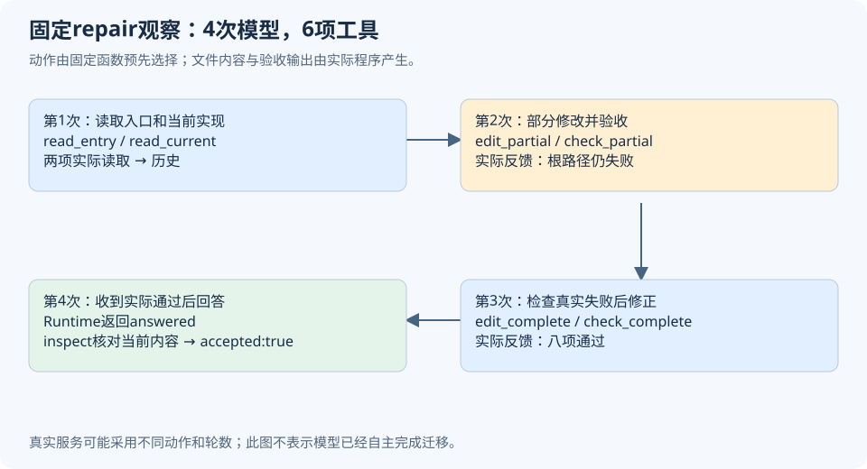

# 18 可选附录：用固定响应观察反馈与验收

本附录配合[第三阶段实践验收](/guide/18-stage-delivery)。先完成主文中的任务材料与报告接入，再按需使用这里的固定观察。无需调用模型服务，也无需把本附录作为进入后续课程的前置。

## 准备三个固定观察文件

这部分是可重复的**固定模型观察**，放在独立的 `examples/stage-delivery/`。它知道材料位置与预设替换，不能证明模型自主调查。真实 CLI 不导入这个目录，也不识别 `repair/stale/recheck` 这些观察名称。

固定动作先作一次不完整修复，再根据真实失败反馈修正；另两个模式在通过之后追加注释，检验旧验收是否还能用于当前内容。工具、文件、进程和接受判断全部实际执行。

新建 `examples/stage-delivery/types/scenario.ts`。它声明固定观察的三种场景名称，由观察入口选择、固定模型工厂读取；不是 Runtime 新增的状态。

<<< @/snippets/18-stage-delivery/examples/stage-delivery/types/scenario.ts

`repair` 是失败后修正，`stale` 是通过后修改却不重验，`recheck` 是修改后重新验收。真实任务配置和 CLI 不需要这些名称。

新建 `examples/stage-delivery/sample-model.ts`。它返回可注入 CLI 的固定 `ModelCall`，接收 Runtime 实际历史，按轮次生成请求；到需要使用验收时，先检查关联 ID 的真实反馈。

<<< @/snippets/18-stage-delivery/examples/stage-delivery/sample-model.ts

三个辅助关系需要分清：`request(...)` 只构造工具请求，不执行；`requireCheck(...)` 读取 Runtime 已保存的反馈，检查它是否符合当前演示的前提；`createSample(...)` 闭包里的 `turn` 只决定固定演示下一次返回什么，不是生产调度器。

以 `repair` 为例：第 2 次模型提出不完整替换和验收，实际程序会把根路径算成空字符串。第 3 次 `requireCheck(context,'check_partial','failed')` 必须先读到实际失败，才提出保留根路径的替换与第二次验收。第 4 次必须看到 `check_complete` 通过，才返回总结。

`oldText/newText` 中 `\` 是 TypeScript 字符串中表示反斜杠的写法，最终送给工具的是源码里的单个反斜杠。`\n` 表示最终替换文本的实际换行。不要把这些字符改成带行号的读取预览；精确替换需要原文。

`stale` 在第 4 次追加注释，第 5 次就回答；`recheck` 在第 5 次再请求验收，第 6 次回答。沿用主文的 8 次模型上限与 12 项工具预算；表中的次数是各场景实际使用量。

新建 `examples/stage-delivery/main.ts`。它解析固定观察场景，将同一任务路径与固定模型工厂交给原 `runCli`，再接住退出码。

<<< @/snippets/18-stage-delivery/examples/stage-delivery/main.ts

观察入口只允许一个场景参数，坏参数退出 2。`selected as Scenario` 发生在明确的三值检查之后；类型断言本身没有替代运行检查。应用主入口仍处理配置、副本、取消和报告，观察不再复制一套这些流程。

在仓库根目录执行，**不加 `.env`，不访问模型服务**：

```bash
node --import tsx examples/stage-delivery/main.ts repair
node --import tsx examples/stage-delivery/main.ts stale
node --import tsx examples/stage-delivery/main.ts recheck
```

每次都创建新副本，三个结果不是在同一目录连续叠加修改。

| 固定场景 | 模型 / 工具 | 关键证据 | 最终结果 |
|---|---|---|---|
| repair | 4 / 6 | 第一次实际验收根路径失败，第二次通过且匹配 | `answered`、`accepted:true`、退出 0 |
| stale | 5 / 7 | 最近验收仍 passed，但通过后加了注释 | `checkMatchesCurrent:false`、`accepted:false`、退出 1 |
| recheck | 6 / 8 | 相同的注释变更后，实际再验收 | `checkMatchesCurrent:true`、`accepted:true`、退出 0 |

### 沿一条具体反馈看下一轮

在 `repair` 日志里找请求 ID `check_partial`。对应工具反馈中 `isError:false`，但内容里的 `status:'failed'`、stdout 的根路径 `actual:''`、`expected:'/'`，说明进程确实执行了错误候选。

接着第 3 次模型响应应提出 `edit_complete` 与 `check_complete`。它不是把 stdout 当成可信指令执行，而是在固定演示中检查真实结果后提交下一项动作。第 4 次模型停止，再由应用依据同会话当前证据接受。

注意“模型第 3 次响应”和“报告打印第 3 条模型响应”是同一次响应，不是两次调用；工具请求多项也不表示多次模型调用。



### 为什么注释也使旧验收失效

`stale` 改的是注释，行为用例通常仍会通过，但工具会话比较的是配置范围的实际内容，不是在证明语义等价。当前文本变了，就不再用旧验收证明新内容。

`recheck` 没有绕过这个规则，而是重新执行验收并保存新的内容标识。它在第 5 次请求工具，仍有第 6 次读取反馈后回答的机会。在当前配置下，第 6 次仍可执行工具；若直到第 8 次才请求工具，就会被末轮门禁拦截。

## 断点：从模型的请求追到应用的接受

固定入口也能调试，无需服务：

```bash
node --inspect-brk --import tsx examples/stage-delivery/main.ts repair
```

建议按这一条调用链观察：

1. `examples/stage-delivery/sample-model.ts` 的第 3 次分支：看 `context.messages` 中 `check_partial` 的实际反馈。
2. `packages/runtime/src/tools/execute.ts`：看请求名、解析后的参数及原请求 ID；模型不直接执行函数。
3. `packages/coding-tools/src/workspace/code-task.ts` 的 `check`：看验收前后标识及更新的 `lastCheck`。
4. `apps/coding-cli/src/report/report.ts` 的 `inspect` 返回：看 `currentRevision`、`lastCheck.revision`、`checkMatchesCurrent`，再跟到 `acceptTask`。

调试观察到的变量只保留本地必要信息，不打印凭据或整个 HTTP 请求。

## 可逆故障：一段错误原文怎样影响后续任务

在固定 `sample-model.ts` 的 `edit_partial` 请求中，临时将 `oldText` 改成不存在的 `return missingPath;`，其余代码不改，再运行 `repair`。

应看到 `replace_text` 的失败反馈，实际文件没有这次替换；后续验收仍会执行原材料并失败。第 3 次固定请求仍试图匹配“预定的中间版本”，它也会因原文不匹配而失败；验收继续失败。第 4 次固定模型要求上次已经通过，结果不符合，故停止为模型阶段失败，`accepted:false`、退出 1。

这不是未知异常自动重试，而是已知工具失败进入历史后，固定模型没有正确调整。它说明脚本化动作序列不能替代可靠的自主修正；真实模型遇到原文不匹配，应先读取当前文本，再决定下一步。

恢复 `oldText`，重新运行应回到正常 `repair` 结果。不通过删除验收、放宽可写清单或提高预算来掩盖这次失败。


::: details examples/stage-delivery/types/scenario.ts（完整核对）

<<< @/snippets/18-stage-delivery/examples/stage-delivery/types/scenario.ts

:::

::: details examples/stage-delivery/sample-model.ts（完整核对）

<<< @/snippets/18-stage-delivery/examples/stage-delivery/sample-model.ts

:::

::: details examples/stage-delivery/main.ts（完整核对）

<<< @/snippets/18-stage-delivery/examples/stage-delivery/main.ts

:::
