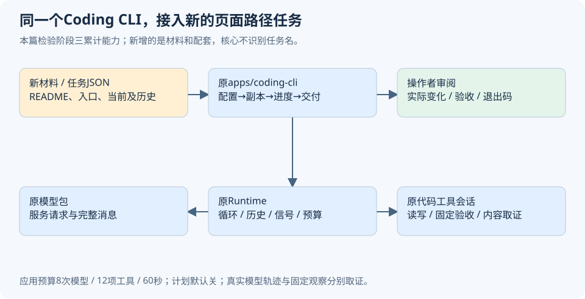
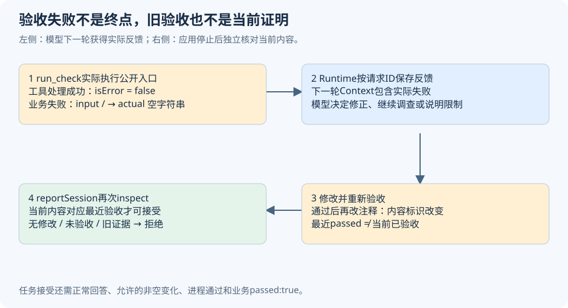

# 18 第三阶段实践验收：用现有 CLI 完成新任务

前面已经实现了调查、修改、验收和独立 Coding CLI。这一次换成页面路径修复任务，检查这些能力能否一起使用：**保留同一个内核与 CLI，让模型自行调查和修改，再审阅实际变化与验收证据。**

本篇位于第三阶段末尾。主要产物是一份有证据的任务记录；新增内容包括任务材料、外置验收、便于审阅请求和反馈的报告改动，以及应用层预算调整。三个核心包、原有工具和接受规则继续沿用第 17 篇；本篇使用 8 次模型调用、12 项工具、60 秒和单次输出上限 1024 token，给调查、修改、验收与完整回答留出有限余量。

正文按“准备材料 → 运行 CLI → 审阅证据 → 记录结果”完成一次实践。[固定响应演示](/guide/18-stage-delivery-appendix)作为可选附录，需要观察失败修正或旧验收失效时再使用，不要求跟写。

## 先看这一次任务怎样经过已有系统

### 1. 任务配置给出目标和范围

任务要求修复 `normalizePath`：例如 `/cart#details` 应得到 `/cart`，`/` 必须保留为 `/`。配置选择材料目录、允许修改的文件和可信验收脚本；页面路径规则留在材料中。

### 2. CLI 创建副本，Runtime 推进调查与修改

CLI 通过原来的 `prepareSession` 创建独立副本，把任务与工具交给 `runAgent`。模型从 `src/main.ts` 调查实际导出链，决定读取哪些文件及怎样调用 `replace_text`。同名历史实现只作为调查材料，不是当前修复目标。

Runtime 负责执行工具请求、保存实际反馈并继续调用模型。真实任务不规定第几轮读取哪个文件，也不给出完整修复代码。

### 3. 实际验收结果进入下一轮

模型请求 `run_check({})` 后，本地进程加载副本的公开入口，返回实际值、预期值和通过标志。代码任务会话保存本次验收对应的内容标识，Runtime 把反馈交给下一轮模型。

如果验收失败，模型可以根据反馈修改后重验；如果第一次就修对，不需要故意制造失败。选择动作的是模型，执行和取得结果的是本地程序。

### 4. CLI 根据当前证据判断交付

模型回答之后，CLI 再调用 `inspect()` 读取当前内容，与同会话验收比较。只有实际变化符合允许范围、验收通过且对应当前内容等条件同时成立，应用才接受。模型说完成、计划勾选完成或工具正常返回，都不能单独替代这些条件。



这次实践检验的是第三阶段累计能力。一次成功只说明这份材料和当前规则下的结果；没有真实运行，就记录未执行。任务未完成也可以留下有用的失败分析，后续课程继续推进，尚缺证据的能力继续保留待验证状态。

## 第一步：准备任务材料，确认缺陷

先审阅工作区，再由操作者创建分支：

```bash
git status
git switch -c agent/chapter-18-stage-delivery
```

下面六份任务文件可按完整内容直接准备。它们是实践材料：阅读规则和输入输出即可，不要求逐函数跟写验收算法。先保留缺陷，由 Agent 修改临时副本。

新建 `fixtures/route-repair/README.md`。它给出输入范围和接受规则，模型读取后才有判断依据；验收脚本稍后使用相同规则。

<<< @/snippets/18-stage-delivery/fixtures/route-repair/README.md

例如 `/a//b` 要保留中间两个斜杠，`/Cart/%2F/item/` 不应被小写或解码。规则没有要求处理完整网址、空输入或任意非法值；不能把有限任务的结果推成通用 URL 解析能力。

新建 `fixtures/route-repair/src/main.ts`。它是任务已知的公开入口，把当前实现导出给调用者和验收使用；模型也可以由此找到实际执行链。

<<< @/snippets/18-stage-delivery/fixtures/route-repair/src/main.ts

`./routing/normalize` 决定本次实际运行的位置。同名历史文件没有出现在这条导出链里，不能只按名称选择它。

新建 `fixtures/route-repair/src/routing/normalize.ts`。这是刻意保留缺陷的材料：接收页面路径，返回当前用于匹配的字符串。先保持下面的错误实现，让 Agent 修复副本。

<<< @/snippets/18-stage-delivery/fixtures/route-repair/src/routing/normalize.ts

现在它只按 `?` 截断，并删除最后一个斜杠。传入 `/` 会得到空字符串；传入 `/cart#details` 则仍保留片段。这段代码不是修复答案，不能先手工修好再把 Agent 的运行当作完成任务。

公开入口与当前文件分开，目的是让调查有一条实际可追踪的关系，不是为了堆目录。

新建 `fixtures/route-repair/src/legacy/normalize.ts`。它作为同名历史材料，只保留输入，供模型调查时区分；当前入口和验收均不导入它。

<<< @/snippets/18-stage-delivery/fixtures/route-repair/src/legacy/normalize.ts

历史文件可以读取但不允许修改。真实轨迹如果读了它，需要判断是否确有调查价值；不能仅因多读一次就断言死循环，也不能修改它来修复当前入口。

新建 `fixtures/code-tasks/route.json`。它把新材料与任务交给原 CLI；`writablePaths` 只允许当前实现，`checkScript` 指向材料目录外的可信验收。

<<< @/snippets/18-stage-delivery/fixtures/code-tasks/route.json

`source` 和 `checkScript` 都相对这份 JSON 所在目录解析，规则沿用 17。配置选择执行权限，模型仍需解释任务与决定动作；本篇不在 `runAgent` 内增加 `route` 分支。

新建 `fixtures/code-tasks/check-route.mjs`。它接收副本目录，从公开入口加载 `normalizePath`，执行八项输入，输出实际结果与业务通过标志，并设置真实退出码。

<<< @/snippets/18-stage-delivery/fixtures/code-tasks/check-route.mjs

例如 `/cart///?sort=price#details` 要同时处理后缀和末尾斜杠；`/a//b` 检查不要把中间内容一并改坏。每项 `actual` 来自副本里的函数调用，`expected` 由可信验收规定。

`cases.every(...)` 决定业务 `passed`。脚本退出 0 仍需配合 stdout 的 `passed:true` 及当前内容匹配，才满足原 CLI 的接受条件。有限用例不能证明所有输入都正确。

先在仓库根目录运行配套验收，**此命令不调用模型、不修改材料**：

```bash
node --import tsx fixtures/code-tasks/check-route.mjs fixtures/route-repair
```

应看到 `passed:false`：根路径实际为空，片段处理等用例失败，退出码为 1。这是已准备好缺陷材料的正常结果，不是让你先手工修到通过。之后模型的任务发生在新副本里。

## 第二步：让一次真实运行留下可对应的动作记录

17 的终端进度说明工具何时开始和结束，但最终报告没有完整显示每次请求参数和反馈。迁移失败时，只看 `callLimit` 无法判断前几轮做了什么。

本篇只补这一处报告：从 `result.messages` 展示 Runtime 已保存的完整模型消息与工具反馈。它不新增持久化、不重新调用工具，也不改变接受规则。

**完整替换已有 `apps/coding-cli/src/report/report.ts`。** 保留 `reportSession` 的参数、返回退出码、同会话 `inspect()`、差异及验收展示、`acceptTask` 调用。新增历史遍历；模型总结已经包含在历史中，删除旧的单独 `模型总结` 打印，避免重复。

<<< @/snippets/18-stage-delivery/apps/coding-cli/src/report/report.ts

新代码的核心是沿 Runtime 返回的消息顺序展示：

```typescript
for (const message of result.messages) {
  // assistant显示完整响应和请求；toolResult显示实际反馈及原请求ID。
}
```

这是上面实现的阅读摘录，无需追加第二个循环。`responseNumber` 是报告对已保存 assistant 消息的计数，不是额外调用模型；服务调用中途失败时没有完整消息，所以它也不一定等于 `result.modelCalls`。`toolCallId` 则保留服务请求的关联 ID。

以请求 `check_partial` 为例，模型消息中的 `toolCalls` 先声明 `run_check({})`；后来 `role:'toolResult'` 的 `toolCallId:'check_partial'` 才证明这次处理形成反馈。CLI 只读历史，原 Runtime 仍负责实际执行与保存。

工具反馈的 `isError:false` 只表示工具处理成功。验收用例失败可以正常返回 `status:'failed'`，因此还要读 `content` 里的实际输出。它是下一轮模型已经能看到的数据，不是报告后来补进历史的内容。

报告末尾仍重新 `inspect()`。打印的历史便于定位过程，当前代码对应的验收才用于交付；两者不能互相替代。CLI 最后一次模型请求没有对应反馈时，也不能因为日志里出现工具名就声称执行过。

### 为完整响应留出输出额度

检查 `apps/coding-cli/src/model.ts` 中 DeepSeek 和 Anthropic 两个配置分支，将两处 `maxTokens: 256` 修改为 `maxTokens: 1024`；已经是 1024 时无需重复修改。其他配置保持原样。

这个字段限制单次模型响应的输出量，与 8 次模型调用、12 项工具和 60 秒的整次运行预算分别计量。256 token 可能让修改说明在结尾被截断，甚至截断较长的工具参数。提高上限为完整响应留出空间，不代表每次固定消耗 1024 token，也不保证模型一定完成任务。

如果服务仍返回 `length`，Runtime 继续返回 `truncated`，CLI 仍拒绝接受；不能把截断当成正常回答。最终配置与候选中的完整文件一致：

<<< @/snippets/18-stage-delivery/apps/coding-cli/src/model.ts

### 为调查、修改、验收和回答留出运行额度

在已有 `apps/coding-cli/src/session/run.ts` 的 `runSession` 中，将 `maxModelCalls: 6` 改为 `maxModelCalls: 8`，将 `maxToolCalls: 8` 改为 `maxToolCalls: 12`；若工具额度已经是 12，保持即可。`timeoutMs: 60_000`、工具接线和事件回调不变。不修改 Runtime 的计数、末轮门禁或应用的接受条件。

这两个额度分别解决不同问题：

- 一次模型响应可以提出多项工具请求，每项分别计数。3 项查找、4 项读取和 1 项修改已经占满 8 项工具额度，第 9 项验收便无法执行。12 项为额外调查和修正留出一些余量。
- 工具处理之后，还需要下一次模型调用读取反馈。假设前 4 次响应用于调查，第 5 次修改、第 6 次请求验收，原来的 6 次模型额度会在执行验收前返回 `callLimit`。改为 8 次后，第 6 次可以实际验收，第 7 次可以读取反馈并回答；仍有一次调用的余量。

例如验收失败，第 7 次可能提出修正与重验，第 8 次读取反馈后回答。模型也可能继续调查而耗尽额度，因此 8/12 仍是有适用范围的应用策略，不是成功保证。60 秒总时限仍然有效，提高次数上限不会自动延长等待时间。

以下是 `runSession` 所在文件的完整实现。保留其签名、任务与工具接线，只修改预算块和对应注释：

<<< @/snippets/18-stage-delivery/apps/coding-cli/src/session/run.ts

## 第三步：运行现有 CLI，审阅实际交付

在仓库根目录检查并构建：

```bash
npm run check
node apps/coding-cli/dist/cli.js --help
```

确认工具集合与接受规则沿用原实现，运行预算为 8 次模型调用、12 项工具和 60 秒。首次观察先不加 `--plan`；简单任务没有必要强制维护计划。

如果准备调用真实服务，由操作者决定费用和时机，在**仓库根目录**执行：

```bash
node --env-file=.env apps/coding-cli/dist/cli.js --task fixtures/code-tasks/route.json
```

这里明确加载根 `.env`。不要直接把 `npm exec` 当成自动加载环境文件的命令；它只有在终端已经配置好环境变量时才能沿用相同服务配置。密钥不进入任务 JSON，也不需要贴进日志。

这条真实任务没有固定模型响应。模型可以自己选择调查顺序、替换内容和验收时机；轮数不保证与后面的固定观察一致。没有服务或暂不花费时，完成材料基线检查，并将真实迁移标为未执行；需要观察程序路径时可阅读[固定响应附录](/guide/18-stage-delivery-appendix)。

### 怎样读这次结果

先看完整记录，再看最终交付：

| 证据 | 看什么具体值 | 能说明什么 |
|---|---|---|
| 入口调查 | `read_file` 参数和实际反馈中 `src/main.ts` 的导出 | 模型取得了当前链路信息；只提出请求不算 |
| 修改 | `replace_text` 参数、对应反馈以及最终 `changedFiles` | 哪段实际内容被修改，是否仅当前文件 |
| 验收反馈 | `run_check` 的关联 ID、stdout 中 `actual/expected/passed` | 哪些规则确实执行过，哪项仍失败 |
| 后续动作 | 失败反馈之后的下一条模型消息与工具请求 | 是否利用新信息修正，或明确未完成 |
| 交付 | `answered`、`checkMatchesCurrent:true`、`accepted:true` | 当前变化符合本次接受规则，不表示所有业务都正确 |

真实模型可能第一次就修对，不要求故意出错。如果实际发生验收失败，就追踪那份反馈进入哪一轮、后面有什么动作；不能把后面的固定失败轨迹冒充这次实际表现。

正常接受还应有实际非空变化、可信验收退出 0 及业务 `passed:true`。副本中的历史文件和来源材料应保持原样。退出码紧接命令查看：

```bash
echo $?
```

0 是当前规则下接受，1 是任务未接受，2 是参数/配置/准备/报告失败，130 是主动取消。保持完整输出与副本供后续定位；它不是持久化恢复记录。

### 按停止原因定位，不把请求当成执行

先看 `status`，再把请求与同 ID 的实际反馈配对。预算属于应用配置，不能只看到 `accepted:false` 就断言修复代码有错。

| 停止或交付状态 | 要找的证据 | 下一步判断 |
|---|---|---|
| `toolLimit` | 已处理工具数、被拦下的下一项请求 | 区分必要调查、重复读取和参数失败，不只统计模型轮数 |
| `callLimit` | 最后一次模型响应是否仍提出工具 | 在当前 8 次上限下，第 8 次仍请求工具会被拦；第 6 次已经不是末轮 |
| `truncated` | 模型响应的 `stopReason:'length'` | 是输出截断；与工具次数和调用轮数分别检查 |
| `checkMatchesCurrent:false` | 最近实际验收、验收后是否再次修改 | 无验收、验收不稳定或内容变化均可能导致不匹配 |
| `answered` 但 `accepted:false` | 非空允许变化、匹配验收、退出码和业务通过值 | 正常回答不等于当前任务满足接受条件 |

最后一轮请求 `run_check` 却没有对应反馈，表示验收没有执行；报告里出现工具名不能当成通过。Runtime 保留末轮门禁，是为了避免执行动作后没有机会把结果交回模型；本章通过应用预算为正常任务留出余量，不为 `run_check` 开特殊放行，也不将 `callLimit` 或 `truncated` 改成正常回答。

先检查完整动作：是否重复取得已知内容、是否追到了历史文件、是否精确替换失败，或每轮确实在取得新证据。额外读取一次历史实现不自动等于死循环，正确完成也不要求刚好采用某个固定轮数。

比较预算或计划开关时，保留相同材料、规则与服务配置，分别记录结果。一次轨迹说明具体成功或失败，不能据此估算成功率；预算充分后仍反复调查，就要继续检查信息与动作选择，而不是不断增加上限。



## 阶段交付：保留事实，不只保留一句总结

一次迁移记录至少写明以下内容；作为本地记录保存在 `docs/stage-03-run-record.md`，不要把尚未运行的结果填成成功：

```markdown
# 第三阶段任务记录

- 证据来源：真实服务 / 固定模型观察 / 未执行
- 任务配置与材料版本：
- 服务与模型名称（不含密钥）：
- 约束：8次模型、12项工具、60秒；计划开启或关闭
- 实际调查到的当前入口及实现：
- 一项关键请求ID及对应实际反馈：
- 验收失败后的动作（未发生就写未发生）：
- 最终status、modelCalls、toolCalls、退出码：
- 实际变化、checkMatchesCurrent、accepted：
- 剩余问题与副本位置（本地保存，不复制到公开正文）：
```

完整日志放在操作者选择的本地位置，审阅后再决定哪些内容适合提交。记录不是断点恢复文件，也没有自动保存运行状态。

## 本篇做到什么程度就可以继续

完成材料准备与本地基线检查，知道真实 CLI 从哪里启动、怎样读取交付报告，并记录本次实际结果。运行过真实服务时，至少追踪一项请求与对应反馈；没有运行时，明确写“未执行”，不要用附录的固定成功替代。

如果真实任务失败，保留失败位置和缺失证据，不要求反复调用直到成功。下一阶段会继续演进同一套 CLI，处理完整历史、本轮输入和长任务信息选择。真实迁移、独立实现和延迟复用的证据，仍在后续实践中补充。

想进一步验证独立迁移时，可另选一份小型材料，配好任务规则与外置验收，只改变任务接入，不修改内核。它是后续练习，不是本篇必须再完成的一轮业务开发。

当前系统适用于可信、小型、无依赖 ESM 材料，支持受限修改与固定验收。任意仓库、依赖安装、系统隔离、持久化恢复和自动合入尚未提供。

## 按需调试与可逆故障

真实运行可在 `packages/runtime/src/tools/execute.ts` 查看请求名、参数与 ID，在 `packages/coding-tools/src/workspace/code-task.ts` 的 `check` 查看验收前后标识和 `lastCheck`，最后在 CLI 的 `reportSession` 跟到 `inspect()` 与 `acceptTask`。正常运行命令中的 `node` 后加入 `--inspect-brk` 即可启动调试；调用真实服务仍会产生相应费用。

不调用模型也能做一个可逆实验：在本地临时材料副本中，把 `src/main.ts` 的导出路径暂时改为不存在的文件，向 `check-route.mjs` 传入该副本路径。应看到 `passed:false`、`reason:'source_execution_failed'` 和退出 1；恢复导出后会回到原材料的用例失败结果。这个实验验证公开入口参与验收，不修改来源材料，也不证明模型能自行修复。

要观察精确替换失败、失败反馈后的修正或“验收通过后又修改”的拒绝路径，使用[固定响应附录](/guide/18-stage-delivery-appendix)。

## 本章文件核对

以下六份任务材料、第二步的 `report.ts`、模型接入配置与运行预算配置是正文所需文件，完整内容已经在首次使用处提供，均来自 `site/snippets/18-stage-delivery/`。其余包与 CLI 文件沿用第 17 篇，无需重新创建。

| 文件 | 用途 |
|---|---|
| `fixtures/route-repair/README.md` | 明确页面路径规则 |
| `fixtures/route-repair/src/main.ts` | 当前公开入口 |
| `fixtures/route-repair/src/routing/normalize.ts` | 待修复实现 |
| `fixtures/route-repair/src/legacy/normalize.ts` | 同名历史材料 |
| `fixtures/code-tasks/route.json` | 接入现有 CLI |
| `fixtures/code-tasks/check-route.mjs` | 副本外验收 |
| `apps/coding-cli/src/session/run.ts` | 模型调用 8 次、工具 12 项，总时限仍为 60 秒 |
| `apps/coding-cli/src/model.ts` | 单次模型响应输出上限为 1024 token |
| `apps/coding-cli/src/report/report.ts` | 展示已存请求与反馈，保留原接受判断 |

## 与 Pi 的职责对照

固定参考版本中，Pi 的[循环](https://github.com/badlogic/pi-mono/blob/8efd314fa3d3232ce197d8d7a6a5660530b9d83e/packages/agent/src/agent-loop.ts)、[编辑工具](https://github.com/badlogic/pi-mono/blob/8efd314fa3d3232ce197d8d7a6a5660530b9d83e/packages/coding-agent/src/core/tools/edit.ts)与[终端运行](https://github.com/badlogic/pi-mono/blob/8efd314fa3d3232ce197d8d7a6a5660530b9d83e/packages/coding-agent/src/modes/print-mode.ts)分别承担执行推进、文件操作与应用交互。本篇沿用这种职责分离，用任务配置接入新材料。

本项目的单处精确替换、固定预算、外置验收与接受规则是当前课程的具体选择，不能据此声称已经实现 Pi 的完整能力。

## 保存本篇

审阅本地变化后，由操作者选择需要保存的文件。下面命令保存正文所需的实现材料；若同时完成了可选附录，再把 `examples/stage-delivery` 加入暂存范围。教学站与内部记录可按实际变更另行审阅加入。

```bash
git status
git add apps/coding-cli/src/report/report.ts apps/coding-cli/src/model.ts apps/coding-cli/src/session/run.ts fixtures/route-repair fixtures/code-tasks/route.json fixtures/code-tasks/check-route.mjs
git commit -F - <<'EOF'
完成第18篇：用现有CLI进行第三阶段实践验收

接入页面路径任务材料与外置验收，保留原内核和工具，将模型次数调整为8次、工具额度调整为12项、输出上限调整为1024 token。
在报告中展示已保存的模型请求与工具反馈，沿用当前内容的验收判断。
通过任务记录区分实际运行结果、固定机制观察与未验证事项。
EOF
git push -u origin agent/chapter-18-stage-delivery
```

提交不代表真实任务已经成功，也不会自动将临时副本合入来源。真实环境文件不加入版本库。
