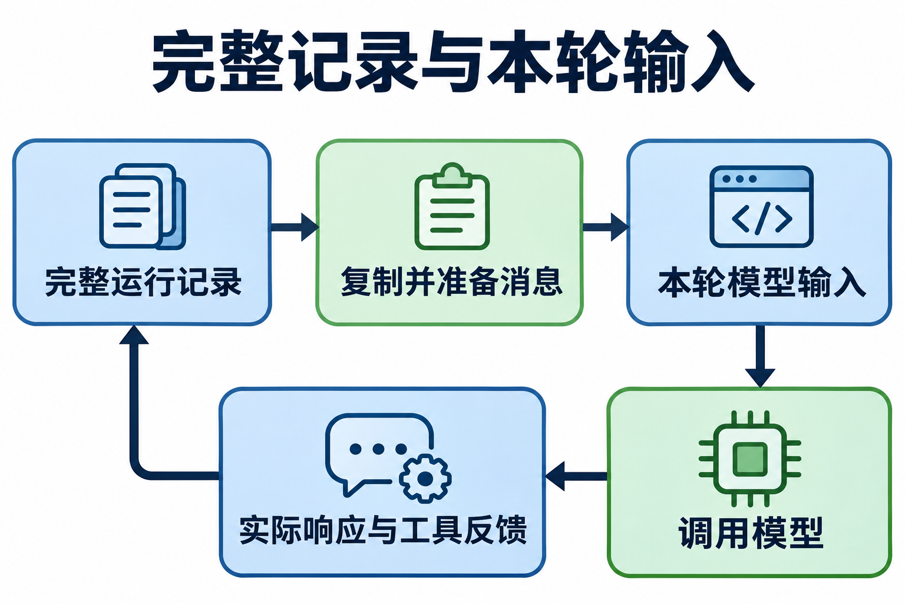
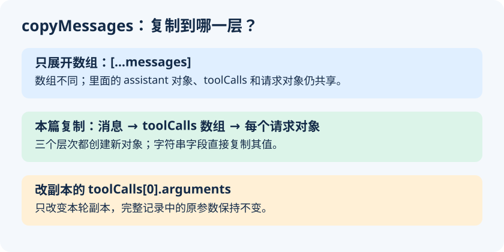
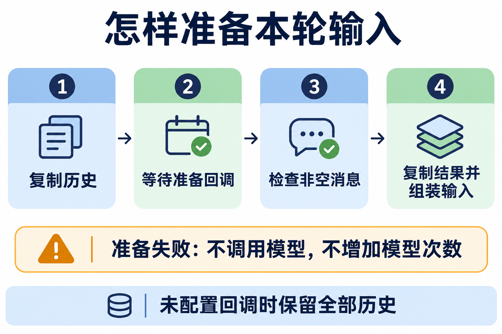
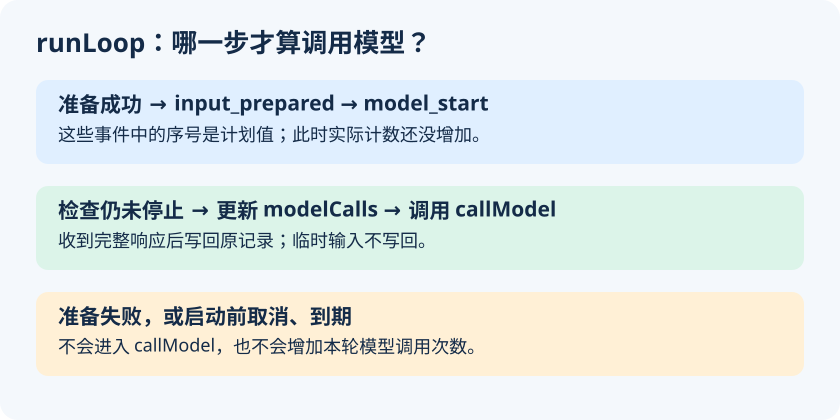
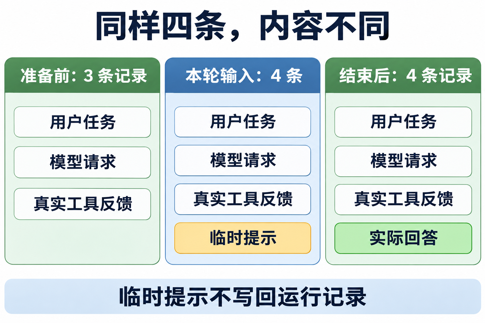

# 19 完整运行记录与本轮模型输入

第 18 篇里，CLI 能把模型请求、真实工具反馈和最终交付判断连起来。任务继续变长时，会遇到一个新问题：**如果只想改变下一次提供给模型的信息，应该改哪里，才能保留已经发生的事实？**

本篇在每次模型调用之前加入消息准备步骤。默认仍提供全部历史；应用也可以额外加入一条只对本轮有效的提示。模型使用准备后的输入继续决策，最终报告仍保留原始任务、实际请求和真实工具反馈。

这是第四阶段“长任务的信息管理”的起点。本篇先建立输入准备的位置与状态归属，后续再处理有限输入、摘要、记忆检索和同任务多轮交互。继续使用现有 Runtime 和 `apps/coding-cli`，不创建另一套循环。

## 实施前，先走完一次具体过程

沿用页面路径材料。这里先观察“读取当前实现”这一步，不再增加新的业务规则。

### 1. Runtime 保存已经发生的事实

第一次调用模型前，记录只有用户任务。模型请求 `read_file`，实际工具返回 `normalize.ts` 的文本后，记录变为三条：用户任务、assistant 工具请求、toolResult 真实反馈。

这三条由原循环依次保存。请求 ID `read_current` 连接“模型要求读取什么”和“本地实际返回什么”；下一轮必须能够根据真实反馈继续。

### 2. 为下一次调用单独准备一份输入

应用希望下一次模型用简短中文说明取得的材料。它可以在这三条消息的副本后面加一条提示，得到四条本轮输入。

这条提示由应用临时提供，不是用户刚发出的新消息，也不是工具执行结果。因此本篇不把它追加到完整运行记录。下一轮准备时仍从真实记录开始，不会累计出越来越多条相同提示。

### 3. 模型读取本轮输入，Runtime 保存实际响应

Runtime 把准备好的四条消息交给原来的模型调用函数。真实服务路径仍由模型包编码请求和解码响应；固定观察则由本地函数返回预写响应。

收到完整回答后，循环把这条实际 assistant 响应追加到原来的三条记录。于是模型刚才看到四条，最终记录也恰好是四条，但内容不同：前者多了临时提示，后者多了实际回答。不能只比较条数就认定两份数据相同。

### 4. 报告继续读取完整记录和实际验收

CLI 的历史报告仍读 `result.messages`，代码任务的接受判断仍读同会话 `inspect()`。改变本轮输入不自动产生验收证据，也不能通过一条“已通过”的临时提示让应用接受任务。



本篇的“完整记录”指 Runtime 在内存中保存的初始消息、完整模型响应和工具反馈。它不是原始 HTTP 抓包，不包含未完成的流式草稿，也尚未落盘。这里的“本轮输入”指交给 `callModel` 的 `Context`：系统要求、准备后的消息和工具说明；提供商随后还会转换协议格式。

## 为什么不能直接改循环里的 messages

此前模型调用使用 `messages: [...messages]`，复制了数组，但数组里的消息对象仍共享。若应用直接删除历史消息，报告就失去了原始事实；若只复制数组后改 `message.content` 或 `assistant.toolCalls[0]`，仍可能改到原对象。

本篇让准备函数和模型函数都使用独立的消息对象。复制范围明确覆盖当前文本消息，以及 assistant 中的工具请求数组和各请求对象。字符串作为值传递；将来引入图片或其他嵌套结构时，要重新检查这段复制逻辑，不能永久假定它覆盖所有数据。

输入准备也是一项可信应用能力。它可以影响模型判断，所以本篇只展示“保留全部消息，再加临时提示”，不提供默认裁剪。随意删除请求、只保留对应工具反馈，可能破坏模型协议或丢失任务依据；复制只保护历史，不能证明选择策略正确。

## 与 Pi 的职责对照

固定版本 Pi 的 [streamAssistantResponse](https://github.com/badlogic/pi-mono/blob/8efd314fa3d3232ce197d8d7a6a5660530b9d83e/packages/agent/src/agent-loop.ts) 在模型调用前先执行可选 `transformContext`，再用 `convertToLlm` 转成模型消息。实际响应继续写入运行上下文；本轮转换和历史保存有各自的位置。

它的 [AgentLoopConfig](https://github.com/badlogic/pi-mono/blob/8efd314fa3d3232ce197d8d7a6a5660530b9d83e/packages/agent/src/types.ts) 允许更丰富的 Agent 消息，并要求这些回调不要抛错。本项目目前只有统一的 `Message`，因此只引入一个消息准备回调，不照搬转换层；同时选择复制消息、把准备异常归为受控失败。这些是本项目的实现选择，不能据同名职责声称行为完全等价。

## 第一步：声明谁提供准备逻辑，谁使用结果

先审阅仓库，再由操作者创建本章分支：

```bash
git status
git switch -c agent/chapter-19-model-input
```

当前起点应已经具备第 18 篇的报告、页面路径材料和 8 次模型 / 12 项工具 / 60 秒预算。原来的模型、工具和接受规则继续使用。下面只新增两个 Runtime 文件、一个观察入口，并修改必要的类型、接线和显示。

新建 `packages/runtime/src/types/input.ts`。它约定应用怎样提供消息准备函数，以及循环怎样把系统要求、工具说明和信号交给包内组装函数。类型只描述契约，不创建消息或执行回调。

<<< @/snippets/19-model-input/packages/runtime/src/types/input.ts

`PrepareMessages` 的第一个参数是历史的独立副本；函数可以同步返回，也可以等待后返回消息数组。第二个参数是本次运行的信号，供等待外部材料的准备过程协作取消。

例如传入三条历史，返回原三条加一条提示，只有返回值进入本轮输入。函数不是工具，不由模型请求，也不占工具额度。`readonly Message[]` 限制经此类型增删数组，不会自动冻结其中的对象；真正的历史保护由下一步的复制完成。

`InputPreparationOptions` 只在包内使用。系统要求和工具说明仍由运行配置与真实注册表提供，准备函数只返回消息，不返回任意工具执行能力。

完整替换 `packages/runtime/src/types/run.ts`。保留 `RunAgentOptions`、`RunOutcome`、`RunResult` 及原预算、事件和停止状态；新增可选 `prepareMessages`，说明初始消息复制范围，并让失败的 `phase` 支持 `'input'`。它让调用方能接入策略，让报告能识别输入准备失败。

<<< @/snippets/19-model-input/packages/runtime/src/types/run.ts

旧应用没有传 `prepareMessages` 时，仍然保留全量消息。`modelCalls` 继续表示真正发起的模型调用数：如果准备第一轮输入就失败，模型还没调用，因此次数为 0。

`phase:'input'` 不是新增一种业务验收结果。它与模型服务失败、工具执行失败分开，方便知道应该去检查应用准备函数，而不是先怀疑网络或修改代码工具。

完整替换 `packages/runtime/src/types/failures.ts`。保留原失败类别和 `RunFailure` 字段，只新增 `input_preparation`，供循环生成不含输入正文的失败说明。

<<< @/snippets/19-model-input/packages/runtime/src/types/failures.ts

准备函数抛出的原异常仍放在 `RunResult.error`，只供本地断点检查。应用应展示 `phase/code`，不要把整个异常或输入内容直接输出。

完整替换 `packages/runtime/src/types/events.ts`。保留现有模型、工具和停止事件，只在 `RunEventData` 中新增 `input_prepared`，让 CLI 知道本轮输入已经准备好及两份消息各有几条。

<<< @/snippets/19-model-input/packages/runtime/src/types/events.ts

这里的 `modelCall` 是接下来拟发起的序号。事件观察期间仍可能取消，因此出现“输入准备 2”不证明第 2 次模型调用已经发生；真正的计数稍后在调用前更新。

`historyMessageCount` 和 `inputMessageCount` 只统计项目消息数组。系统要求和工具说明没有算在其中，它们也不是 token 数、服务计费或 HTTP 消息条数。

完整替换 `packages/runtime/src/index.ts`。原有公开导出全部保留，只增加 `PrepareMessages` 类型，让应用通过包入口声明回调；复制和组装函数留在包内。

<<< @/snippets/19-model-input/packages/runtime/src/index.ts

应用继续从 `@ai-harness/runtime` 导入，不跨包访问内部 `context/` 文件。以后新增消息选择策略时，应用替换回调，模型提供商仍负责自己的协议编码。

## 第二步：从历史副本组装本轮输入

新建 `packages/runtime/src/context/prepare-input.ts`。这份代码替循环完成“复制记录 → 等待应用准备 → 再复制返回值 → 组成 Context”。例如历史为三条、应用补一条提示，函数返回含四条消息的 `Context`，下一步由循环交给模型；它不会把提示写回历史。

<<< @/snippets/19-model-input/packages/runtime/src/context/prepare-input.ts

### copyMessages 复制哪些对象

对 user 和 toolResult，当前字段只有原始值，所以复制消息对象即可。对 assistant，还要复制 `toolCalls` 数组及每个请求对象。这样应用即使修改某个副本的 `toolCalls[0].arguments`，完整记录里的原请求参数也不会一起改变。



这个函数同时用于初始记录、交给准备回调的副本，以及交给模型的最终消息。三处复制分别防止调用方初始对象、准备函数和模型输入继续共享当前消息结构。

### prepareModelInput 怎样返回给调用方

`history` 是完整记录，`snapshot` 是交给应用的副本，`selected` 接住应用返回的消息数组。没有回调时，`selected` 就是完整副本；有回调时，可以是三条历史加一条提示。

最后创建的 `Context` 保留运行配置中的 `systemPrompt` 和从注册表生成的 `tools`，只将 `messages` 设置为准备后的另一份副本。返回值不会自动更新历史，下一步调用方用局部变量接住它。

回调等待结束后还要检查信号，因为取消或到期可能发生在等待期间。[Node 的 AbortSignal](https://nodejs.org/api/globals.html#abortsignalthrowifaborted) 提供取消状态和抛错检查；本项目还会在循环中核对整次时限。若回调忽略信号且一直不结束，Runtime 仍会等待，不能把协作取消说成强制终止。

非空数组检查用于拒绝明显无效的返回值。它没有检查每条消息的全部字段，也不验证工具请求/结果是否配对或提示是否真实。准备逻辑属于可信应用代码；后续选择策略仍需要独立验证。



## 第三步：接入原循环，保留原来的事实写回

完整替换 `packages/runtime/src/run-agent.ts`。保留 `runAgent`、`runLoop`、事件派发、工具注册、预算、取消和所有原停止分支；不移动或删除它们。修改点是初始消息复制、每次模型调用前准备 `context`、准备失败归类，以及将 `callModel` 的输入改为该局部对象。工具结果的执行与追加语句保持原职责。

<<< @/snippets/19-model-input/packages/runtime/src/run-agent.ts

### 用同一次读取追踪两份消息

第一次循环，`messages` 只有用户任务。`prepareModelInput` 返回本轮 `context`，然后才发出输入准备事件、模型开始事件，并更新 `modelCalls`。

`await options.callModel(context, ...)` 接住完整 assistant 响应。循环仍通过原来的 `messages.push(message)` 保存实际响应；如果是工具请求，原执行器处理完后，仍通过 `messages.push(...results)` 保存真实反馈。

第二次循环的 `messages` 因而是三条。若应用增加临时提示，本次 `context.messages` 是四条，但代码没有 `messages = context.messages`，也没有把整个 `context` 追加回历史。

下面两句是上方实现的对照摘录，无需再次写入：

```typescript
const messages = copyMessages(options.messages);
// 每次循环仅将本轮context交给模型，后续仍向messages追加实际响应与反馈。
```

`messages` 归循环持有，`context` 只服务这一轮调用。模型包收到 `context` 后才转换为服务消息、发送请求并解码响应；解码返回的 assistant 消息沿 `callModel` 返回到循环，由上面的实际追加语句保存。它不会因为输入里有临时提示就自动把提示写进记录。

### 准备失败为什么不消耗一次模型调用

准备逻辑放在更新 `modelCalls` 之前。回调抛错或返回空数组时，循环返回 `failed / input / input_preparation`，保留已有记录；不会发送 `model_start`，也不会调用服务。

如果失败实际上来自运行已经取消或到期，先沿原停止出口返回 `cancelled` 或 `timedOut`。准备返回后与输入事件之后也检查停止，避免迟到结果或观察期间取消启动下一动作。这里没有自动重试或静默回退：应用未能准备输入时，框架不会擅自换一种信息集合继续决策。



模型调用额度仍包括真正发起但失败的模型请求；工具额度、最后一轮不执行工具的规则和完整回答/截断的判断都没有改变。

### 先运行一个最小观察

目前只完成 Runtime 文件，CLI 显示和观察入口还没改，也可以先验证消息是否分离。在仓库根目录执行：

```bash
npm run check
node --input-type=module <<'JS'
import { runAgent } from '@ai-harness/runtime';

const result = await runAgent({
  messages: [{ role: 'user', content: '原始任务' }],
  tools: [],
  maxModelCalls: 1,
  prepareMessages(history) {
    return [...history, { role: 'user', content: '本轮临时提示' }];
  },
  async callModel(context) {
    console.log('本轮消息', context.messages.map((message) => message.content));
    return {
      role: 'assistant',
      content: '固定回答',
      stopReason: 'stop',
      toolCalls: [],
    };
  },
});
console.log('最终记录', result.messages.map((message) => message.content));
JS
```

应看到本轮消息为 `['原始任务', '本轮临时提示']`，最终记录为 `['原始任务', '固定回答']`。没有读取 `.env`，`callModel` 是固定函数，不访问模型服务。这只检查本轮提示的归属；下一步把真实文件读取与工具反馈接回来。

## 第四步：用真实工具反馈观察下一轮

新建 `examples/input-view/main.ts`。入口使用原工作区工具实际读取页面路径材料，由固定模型提出一次读取并在下一轮检查反馈。`full` 使用默认全量输入，`note` 增加本轮提示，`broken` 在第二次准备时制造受控失败。它让同一条真实反馈经过新接入位置，不是新增业务修复，也不证明模型自主选择。

<<< @/snippets/19-model-input/examples/input-view/main.ts

`prepareMessages` 只负责输入，闭包里的 `preparations` 用来定位固定故障；固定模型的 `calls` 则统计实际进入了几次模型函数。两者分别计量，因为第二次准备失败时，不应发生第二次模型调用。

第一次固定响应请求 `read_file`，工具真正读取 `fixtures/route-repair/src/routing/normalize.ts`。第二次固定响应前，代码沿请求 ID `read_current` 查找历史中的 toolResult，并确认实际内容含有 `normalizePath`。它没有执行修复，最后的固定文字也不能当成代码任务完成。

`note` 模式每轮都从收到的历史副本创建新数组，不把临时提示保存在外部数组里。`context.messages` 中的提示会影响模型输入；`result.messages` 只保存实际请求、反馈和回答。

在根目录执行，不加 `.env`：

```bash
node --import tsx examples/input-view/main.ts full
node --import tsx examples/input-view/main.ts note
node --import tsx examples/input-view/main.ts broken
```

每条命令独立创建一次运行，固定响应、本地读取和记录处理参与其中，不调用服务。

| 模式 | 第一次历史/输入 | 第二次历史/输入 | 停止与最终记录 |
|---|---|---|---|
| full | 1 / 1 | 3 / 3 | answered，2 次模型、1 项工具、4 条记录 |
| note | 1 / 2 | 3 / 4 | answered，2 次模型、1 项工具、4 条记录，hasInputNote:false |
| broken | 1 / 2 | 准备失败，无第二次输入事件 | failed / input / input_preparation，1 次模型、1 项工具、3 条记录 |

`broken` 退出 1 是预期失败，另外两条退出 0。它不是工具失败：第一次工具已经实际执行，其反馈仍在最终三条记录中；没有第二次完整模型响应。

例如 `note` 会打印：

```text
输入条数 { call: 2, history: 3, input: 4 }
固定模型实际收到 { call: 2, messages: 4, hasInputNote: true }
```

第一条来自 Runtime 的 `input_prepared` 事件；第二条来自实际进入固定 `callModel` 时收到的 `context`。这是同一次模型调用的两个观察位置，不是两次调用。最后报告 `messages:4`、`hasInputNote:false`，需要结合角色和内容判断，不能仅凭条数相等认定提示已经保存。



## 第五步：让原 CLI 显示输入准备位置

完整替换 `apps/coding-cli/src/report/terminal.ts`。保留 `printBlock` 和所有已有进度分支，只让 `printProgress` 显示新事件中的历史条数与本轮条数。报告不接管输入或历史，既不追加消息，也不重新执行工具。

<<< @/snippets/19-model-input/apps/coding-cli/src/report/terminal.ts

真实 CLI 暂时不配置选择策略，因此每轮默认两种条数相同。看到“输入准备 3：历史 7 条，本轮 7 条”，表示拟发起第 3 次模型调用前，Context 已组装好；系统要求、工具说明和服务协议转换仍在这两个数之外。

CLI 的 `runSession` 无需添加 `prepareMessages` 才能继续工作；省略时走全量默认行为。接下来第 20 篇再把实际信息选择接到同一个位置，不在这里提前增加裁剪参数。

`reportSession` 仍展示原 `result.messages`；`acceptTask` 仍要求正常回答、允许的非空变化、匹配当前内容的验收，以及进程和业务检查通过。输入准备事件不能替代任何一项。

检查并构建后，先确认应用入口可用：

```bash
npm run check
node apps/coding-cli/dist/cli.js --help
```

如果准备观察真实模型任务，由操作者管理费用并在根目录执行原命令：

```bash
node --env-file=.env apps/coding-cli/dist/cli.js --task fixtures/code-tasks/route.json
```

模型自行选择动作，条数取决于实际轨迹，不要求复现固定观察。CLI 保持 8 次模型、12 项工具、60 秒及 1024 输出 token 上限；这些是有限应用配置，不是本篇信息管理已带来质量收益的证明。没有运行服务时，记录“未执行”，不要把固定函数的成功填成真实模型成功。

## 断点：沿同一条反馈看两份数据

固定观察也可以调试，无需服务：

```bash
node --inspect-brk --import tsx examples/input-view/main.ts note
```

沿这一条链观察：

1. 在 `runLoop` 第二次调用 `prepareModelInput` 前，看完整 `messages` 的三条消息和 `read_current`。
2. 在 `prepareModelInput` 的 `snapshot`、`selected` 及返回处，看三条历史如何变成四条本轮消息。
3. 在固定 `callModel` 第二次进入处，看 `context.messages` 中实际工具反馈仍在，临时提示只多一条。
4. 在循环 `messages.push(message)` 之后，看最终四条记录的最后一条是 assistant 回答，历史没有临时提示。

调试变量中的 `modelCalls`、消息条数和工具项数分别对应不同对象，不用事件的条数估算费用。

## 可逆故障与小迁移

先不运行，预测 `broken` 的第二次准备失败后，已取得的工具反馈是否还应该保留。再执行它，核对 `phase:'input'`、`modelCalls:1`、`toolCalls:1` 与三条历史。切回 `note`，应恢复正常回答，不通过把准备异常当成功来“修复”。

还可以在观察入口的 `prepareMessages` 中临时返回空数组，替代原返回语句。第一次准备就会失败：模型和工具次数均为 0，记录仍有原始任务一条。恢复原返回语句再运行。这里检查返回值边界，不修改 Runtime 或材料。

小迁移只改一处：让观察入口的临时提示改为“请用 JSON 说明取得了什么材料”，保持原记录与工具不变。固定模型仍返回预写文字，不会自动遵循新提示；可观察目标是新提示进入每次 `context`，不积累进历史。若要评价真实模型是否遵循提示，需要另行观察真实服务结果，不能用固定答案证明。

## 本篇完成后的边界

现在应用有了可替换的消息准备位置，默认仍保留全部信息，并能区分输入准备失败、模型服务失败和工具执行失败。核心循环、执行工具和 CLI 持续复用。

本篇没有减少输入规模，也没有摘要、跨任务记忆或跨进程恢复。完整历史保护的是已保存的执行记录；输入选择的事实性、协议关系和任务效果仍需要验证。下一篇围绕长材料和有限输入开展选择实验，不能因为有了回调就声称已经解决上下文问题。

## 本章完整文件核对

下面只列本章新增或修改的九份文件。未列出的模型适配、工具、材料、CLI 会话与接受规则沿用第 18 篇。每份完整文件与步骤中的引用同源。

::: details packages/runtime/src/types/input.ts

<<< @/snippets/19-model-input/packages/runtime/src/types/input.ts

:::

::: details packages/runtime/src/types/run.ts

<<< @/snippets/19-model-input/packages/runtime/src/types/run.ts

:::

::: details packages/runtime/src/types/failures.ts

<<< @/snippets/19-model-input/packages/runtime/src/types/failures.ts

:::

::: details packages/runtime/src/types/events.ts

<<< @/snippets/19-model-input/packages/runtime/src/types/events.ts

:::

::: details packages/runtime/src/index.ts

<<< @/snippets/19-model-input/packages/runtime/src/index.ts

:::

::: details packages/runtime/src/context/prepare-input.ts

<<< @/snippets/19-model-input/packages/runtime/src/context/prepare-input.ts

:::

::: details packages/runtime/src/run-agent.ts

<<< @/snippets/19-model-input/packages/runtime/src/run-agent.ts

:::

::: details examples/input-view/main.ts

<<< @/snippets/19-model-input/examples/input-view/main.ts

:::

::: details apps/coding-cli/src/report/terminal.ts

<<< @/snippets/19-model-input/apps/coding-cli/src/report/terminal.ts

:::

## 保存本篇

运行检查、恢复临时故障并审阅本章文件后，由操作者执行：

```bash
git status
git add packages/runtime/src/types/input.ts packages/runtime/src/types/run.ts packages/runtime/src/types/failures.ts packages/runtime/src/types/events.ts packages/runtime/src/index.ts packages/runtime/src/context/prepare-input.ts packages/runtime/src/run-agent.ts apps/coding-cli/src/report/terminal.ts examples/input-view/main.ts
git commit -F - <<'EOF'
新增第19篇：分离完整运行记录与本轮模型输入

在每次模型调用前加入可选消息准备，默认保留全部历史。
复制当前消息及工具请求对象，临时输入不写回真实运行记录。
增加输入准备失败分类与条数事件，沿用取消、期限和调用预算。
提供真实文件读取加固定模型的正常、临时提示与准备失败观察。
EOF
git push -u origin agent/chapter-19-model-input
```

教学站和内部记录按实际变更另行审阅加入。提交或固定观察通过不代表真实任务质量、独立迁移或长期掌握已经验证。
