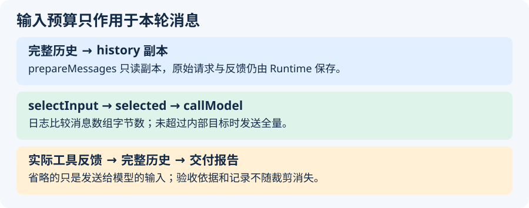

# 20 在有限输入中保留任务依据

第 19 篇把运行记录和本轮输入分开了。本篇利用这个接入点解决一个具体问题：**历史里有多轮工具输出，发送下一轮请求时，哪些可以省略，哪些必须一起保留？** 这是第四阶段的信息选择实验，由 Agent 应用层在发送前自动判断。完整运行记录、工具执行和验收规则不改。

## 实施前，先走完一次具体过程

沿用第 18 篇的路径修复任务。模型先读文件，再尝试修复；第一次验收失败，下一轮根据失败反馈修改，第二次验收通过。本篇要实现的是：**每次调用模型前，CLI 可以从完整历史里挑选本轮要发送的消息，同时保留任务和最近一组真实反馈。**

### 1. 用户提交任务，Agent 自行检查输入规模

用户照常指定任务。每次发请求前，应用通过 `prepareMessages` 计算当前消息大小。不超过内部目标 4,096 字节就发全量；超出才选择消息。用户不用提供预算，模型也不需要额外调用一次来作判断。

### 2. Runtime 保存实际发生的动作

第一次修改后，模型提出的修改与验收请求属于同一批。Runtime 执行后，把两个结果都写回历史：修改的结果，以及验收失败的反馈。原始任务、此前读取的内容、模型请求和工具反馈都留在完整历史里。

### 3. 下一轮调用前，CLI 从历史副本中按组选择

Runtime 把历史副本交给回调。只有超出内部目标时，CLI 才按请求 ID 把每条 assistant 工具请求消息与它的全部反馈放进同一组。它保留原任务和最近一组，再从近到远试加旧组；第一次放不下就停。这样，早期读取可以省略，但最近批次的修改结果与失败验收不会被拆开。任务和最近一组本身就超额时，仍保留，并记录 `overBudget: true`。

预算比较的是**项目消息数组序列化后的 UTF-8 字节数**，不包含系统提示、工具定义或提供商协议，也不是 token、费用或服务硬限制。

### 4. 模型用近期反馈继续，CLI 用实际验收判断交付

Runtime 把选出的消息交给模型。模型仍能看到刚才的失败验收，因此可以据此提出修正和重验；第二次验收通过后，新结果继续追加到完整历史。结束时，CLI 根据当前内容及其对应验收决定是否接受，并在报告中保留早期读取。**报告能看到旧证据，不代表本轮模型也能看到。**

## 动手前：从第 19 篇接着做

在仓库根目录确认第 19 篇的代码已完成，尤其是 Runtime 已支持 `prepareMessages`。本篇复用第 18 篇的路径修复材料 `fixtures/code-tasks/route.json`。本篇的固定模型会在第三步提供，无需补做第 18 篇的可选附录。

确认第 19 篇的修改已保存，并且 `git status --short` 没有尚待处理的变化，再创建第 20 篇分支：

```bash
git status --short
git switch -c agent/chapter-20-input-budget
```

接下来按这个顺序动手：

| 顺序 | 要做什么 | 做完能看到什么 |
|---|---|---|
| 1 | 新建 `context/select-input.ts` | 按完整批次保留任务和近期消息 |
| 2 | 修改 Agent 的运行接线 | 规模未超目标时发全量，超出后自动选择 |
| 3 | 新建固定观察入口，比较同一次运行的前后轮 | 看末轮字节数、完整报告和验收结果，无需模型密钥 |

## 第一步：给工具请求和结果分组，再选择近期记录

新建 `apps/coding-cli/src/context/select-input.ts`。策略放在 CLI，Runtime 仍只负责调用应用提供的 `prepareMessages`。函数接收历史副本和预算，返回一份新的消息数组。

<<< @/snippets/20-input-budget/apps/coding-cli/src/context/select-input.ts

`groupHistory` 从前向后读。遇到 assistant 工具请求，就把所有请求 ID 放进 `pending`；紧随其后的每个反馈都必须消掉一个 ID。例如请求 `edit_complete` 和 `check_complete`，两个反馈都消费后才结束这一组。缺项、重复或孤立反馈会抛错，Runtime 按第 19 篇的输入准备失败路径停止，不发送有缺口的新输入。工具反馈的业务失败不是格式错误，它仍是应该保留的真实消息。


`task` 接住开头连续的用户消息，`recent` 从最后一组开始。每次试放一整组，用序列化后的实际字节数判断是否放得下，保留原顺序。这个小实现会重复序列化候选，适合本篇的短运行，不是面向超长记录的高性能实现。

它只保证保留开头任务和最近一组，**不能判断更早的线索是否仍重要**。如果下一步还依赖被省略的失败输出或文件原文，应重新读取证据；调试时也可在应用代码中暂时禁用选择，不要靠模型回忆补齐。

## 第二步：在 Agent 调用模型前自动判断

完整替换 `apps/coding-cli/src/session/run.ts`。保留任务提示、工具、信号、事件和原运行预算；加入内部常量 `MESSAGE_BUDGET_BYTES` 和 `prepareMessages` 回调。先计量，超过目标才调用 `selectInput`。本篇用 4,096 字节让示例在同一次运行中出现全量和选择两种路径；这个数没有从提供商窗口推导。

<<< @/snippets/20-input-budget/apps/coding-cli/src/session/run.ts

参数解析、任务配置类型和 CLI 入口继续沿用第 19 篇。如果你已经按旧版教程接入了手动字节参数，请从 `config/args.ts`、`types/task.ts` 和 `main.ts` 移除对应的解析、类型字段和参数传递；保留其他本地改动。



`historyBytes` 和 `inputBytes` 分别是选择前后的本轮消息规模；`omittedMessages` 不是删除的历史条数。真正的工具结果仍由 Runtime 保存，CLI 接受与否仍由当前内容对应的验收决定。

## 第三步：观察同一任务何时自动切换

先新建 `examples/input-budget/sample-model.ts`。它提供固定修复动作，并确认下一轮确实收到了实际验收反馈。

<<< @/snippets/20-input-budget/examples/input-budget/sample-model.ts

再新建 `examples/input-budget/main.ts`，从同目录导入固定模型。它使用实际的工作副本和验收脚本，不会访问模型服务。

<<< @/snippets/20-input-budget/examples/input-budget/main.ts

在仓库根目录运行：

```bash
npm run check
node --import tsx examples/input-budget/main.ts
```

前三轮历史分别为 267、1,142 和 2,932 字节，均发送全量。最后一轮历史为 4,761 字节，超过内部目标后自动选为 3,886 字节，省略了早期读取所在的 3 条消息；失败验收和最新通过验收都还在，最终验收通过。字节数以本篇固定材料为例，真实任务会不同。

需要验证超额边界时，可以在隔离副本中把内部常量临时改成 1，再运行同一命令。最小集合仍保留，日志显示 `overBudget: true`。恢复常量后再继续。正常使用 CLI 仍只指定任务；固定观察不能证明真实模型效果或费用收益。

## 断点与可逆故障

在 `pending.delete(result.toolCallId)` 处断住，观察一个批次的两个 ID 怎样消失；在 `selectInput` 返回前检查近期组是否还包含对应的请求与反馈。最后对照完整报告里的早期读取，确认只改了输入。

在本地观察入口临时包装固定模型，让第四轮额外要求找到第一轮的 `read_current` 反馈：找不到就抛错。以当前 4,096 字节目标应无法满足要求；在隔离副本临时把目标改到高于完整历史后，应重新收到该反馈。恢复包装与常量即可。这个故障表明「最近验收还在」不等于「所有旧证据还在」。

本篇参考 [Pi 固定版本的调用前消息转换位置](https://github.com/badlogic/pi-mono/blob/8efd314fa3d3232ce197d8d7a6a5660530b9d83e/packages/agent/src/agent-loop.ts)。这里的字节计量、分组和保留策略是本项目的实验规则，不是 Pi 的压缩算法。下一篇再研究如何用带来源的摘要保留较早证据。

## 保存本篇

```bash
git status --short
git add apps/coding-cli/src examples/input-budget
git commit -F - <<'EOF_COMMIT'
在有限模型输入中保留任务和完整工具批次

由应用在模型调用前自动判断是否选择消息。
以同一修复任务观察输入规模，完整记录与验收保持独立。
EOF_COMMIT
git push -u origin agent/chapter-20-input-budget
```
