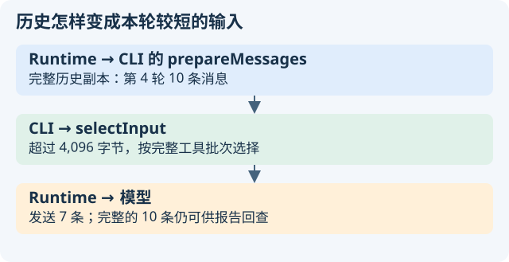
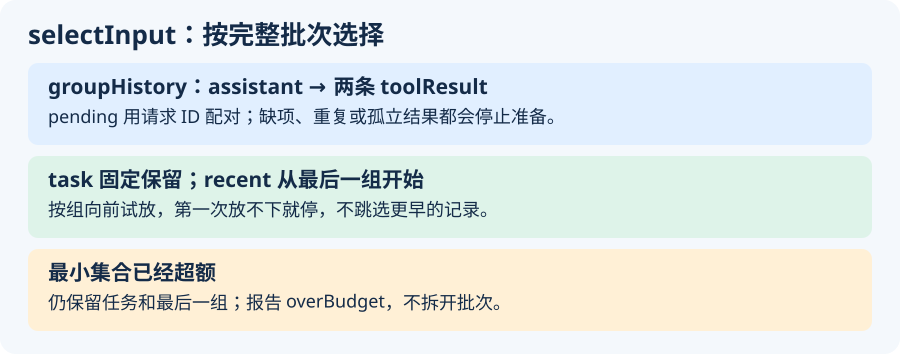

# 20 在有限输入中保留任务依据

第 19 篇把运行记录和本轮输入分开了。第四阶段接下来要解决的是，多轮工具输出累积后，模型还需要看到哪些信息才能继续当前任务？

## 本篇技术方案

**功能目标。** 用户照常提交路径修复任务。历史超过内部字节目标时，CLI 自动缩减本轮输入，同时保留原任务和最近一批完整的工具反馈。

### 实施前，先走完一次具体过程

沿用第 18 篇的路径修复任务。

1. **用户提交任务，模型先读文件。** 每次发请求前，CLI 通过第 19 篇的 `prepareMessages` 接入点计量本轮消息。任务刚开始，消息还少，CLI 发送全量。预算由应用设定，计量和选择都在本地完成。
2. **第一次修改，验收失败。** 模型在同一批里请求修改和验收，Runtime 执行后把两条反馈都写入完整历史。第三轮仍能收到全部消息，模型根据验收失败的反馈修正根路径，再请求验收。Runtime 把这批修改和通过的反馈接着写入历史。
3. **第四轮发送前，CLI 选择消息。** 这时完整历史超过 4,096 字节。CLI 从 Runtime 交来的历史副本里保留原任务和最后一批，再从近到远试加旧批次。第一次修改和失败验收还能放下，最早的读取批次超出目标，整批省略。
4. **模型收到两次验收反馈，CLI 判断交付。** Runtime 把选好的 7 条消息交给模型完成回答。CLI 根据当前文件及与之匹配的实际验收判断是否接受，并从完整历史生成报告，早期读取仍可回查。

### 实现架构图



### 职责与取舍

- **选择策略放在 CLI。** Runtime 持有完整历史，在每轮调用前接收应用选出的消息。这样其他应用复用 Runtime 时可以定义自己的选择策略。
- **工具请求和反馈按完整批次取舍。** 按请求 ID 配对后整批保留，模型才能把结果对应到动作。优先保留连续的近期批次，代价是早期文件原文可能离开本轮输入。后续动作依赖这些原文时，需要重新读取。
- **超额时仍保留必要反馈。** 4,096 字节只计项目消息数组序列化后的 UTF-8 大小，系统提示、工具定义和提供商协议都在计量范围之外。任务和最近一批本身就超额时，仍一起发送，并记录 `overBudget: true`。

### 验收标准

- 固定示例前三轮发送全量，第四轮由 10 条减到 7 条。两次验收反馈仍在本轮输入，省略的读取仍能从完整报告查到。
- 在隔离副本把内部目标降到 1 字节，任务和最近完整批次仍被保留，日志标出超额。固定示例验证选择与交付路径，真实模型的任务表现与费用需要另行评估。

## 动手前：从第 19 篇接着做

在仓库根目录确认第 19 篇的代码已完成，尤其是 Runtime 已支持 `prepareMessages`。本篇复用第 18 篇的路径修复材料 `fixtures/code-tasks/route.json`。本篇的固定模型会在第三步提供，无需补做第 18 篇的可选附录。

确认第 19 篇的修改已保存，并且 `git status --short` 没有尚待处理的变化，再创建第 20 篇分支：

```bash
git status --short
git switch -c agent/chapter-20-input-budget
```

接下来按这个顺序动手：

| 顺序 | 要做什么 | 做完能看到什么 |
|---|---|---|
| 1 | 新建 `context/select-input.ts` | 按完整批次保留任务和近期消息 |
| 2 | 修改 Agent 的运行接线 | 规模未超目标时发全量，超出后自动选择 |
| 3 | 新建固定观察入口，比较同一次运行的前后轮 | 看末轮字节数、完整报告和验收结果，无需模型密钥 |

## 第一步：给工具请求和结果分组，再选择近期记录

新建 `apps/coding-cli/src/context/select-input.ts`。策略放在 CLI，Runtime 仍只负责调用应用提供的 `prepareMessages`。函数接收历史副本和预算，返回一份新的消息数组。

<<< @/snippets/20-input-budget/apps/coding-cli/src/context/select-input.ts

`groupHistory` 从前向后读。遇到 assistant 工具请求，就把所有请求 ID 放进 `pending`；紧随其后的每个反馈都必须消掉一个 ID。例如请求 `edit_complete` 和 `check_complete`，两个反馈都消费后才结束这一组。缺项、重复或孤立反馈会抛错，Runtime 按第 19 篇的输入准备失败路径停止，不发送有缺口的新输入。工具反馈的业务失败不是格式错误，它仍是应该保留的真实消息。

### 跟着两个请求 ID 看一组消息何时完整

在 `apps/coding-cli/src/context/select-input.ts` 中看下面的摘录。它已包含在本步的完整实现里。

```ts
      const pending = new Set(message.toolCalls.map((call) => call.id));
      if (pending.size !== message.toolCalls.length) {
        throw new Error('同批工具请求 ID 重复。');
      }
      while (pending.size > 0) {
        const result = history[index++];
        if (result?.role !== 'toolResult' || !pending.delete(result.toolCallId)) {
          throw new Error('输入历史缺少与请求匹配的工具反馈。');
        }
        group.push(result);
      }
    }
```

在 `groupHistory` 读到修正批次时，`group` 先装着一条 assistant 请求消息，`pending` 有 `edit_complete` 和 `check_complete`。第一条反馈让集合只剩 `check_complete`，也让 `group` 增至两条。第二条反馈清空集合，这组共三条，再由 `groups.push(group)` 交给选择器。如果第二个反馈的 ID 写错，`delete` 返回 false，函数在组入列前抛错。



### 用第四轮的历史走一遍 `selectInput`

第三步的固定示例在第四轮调用前，已有一条任务消息和三个工具批次。下面的字节数都由 `messageBytes` 对整份候选消息数组计算，包含 JSON 数组的标点。

| 走到哪一步 | 候选输入，按发送顺序 | 字节数 | `recent` 怎样变化 |
|---|---|---:|---|
| 取出必须保留的消息 | 任务 → 修正与验收通过 | 2,096 | `task` 保存任务，`recent` 先放最后一批 |
| 试放前一批 | 任务 → 第一次修改与验收失败 → 修正与验收通过 | 3,886 | 在 4,096 字节以内，`recent` 更新为这两批 |
| 试放最早一批 | 任务 → 读取入口与实现 → 第一次修改与验收失败 → 修正与验收通过 | 4,761 | 超过 4,096 字节，`break`，保留上一步的两批 |

因此 `return [...task, ...recent]` 交回 7 条消息。一条是任务，其余是两批各自的 assistant 请求和两条工具反馈。应用把这 7 条交给 Runtime 发送，第四轮仍能读到 `check_partial` 和 `check_complete`。省略的 3 条是同一个读取批次，在完整报告里仍能找到 `read_entry` 和 `read_current`。

每次试放都重新序列化候选，以实际数组的大小为准。这个做法适合本篇的短运行，记录变长后，反复序列化也会增加开销。

它只保证保留开头任务和最近一组，**不能判断更早的线索是否仍重要**。如果下一步还依赖被省略的失败输出或文件原文，应重新读取证据；调试时也可在应用代码中暂时禁用选择，不要靠模型回忆补齐。

## 第二步：在 Agent 调用模型前自动判断

打开 `apps/coding-cli/src/session/run.ts`。保留任务提示、工具、信号、事件和原运行预算；加入内部常量 `MESSAGE_BUDGET_BYTES` 和 `prepareMessages` 回调。先计量，超过目标才调用 `selectInput`。本篇用 4,096 字节让示例在同一次运行中出现全量和选择两种路径；这个数没有从提供商窗口推导。

在导入区加入 `import { messageBytes, selectInput } from '../context/select-input';`。在 `runSession` 前定义 `const MESSAGE_BUDGET_BYTES = 4_096;`。接着在传给 `runAgent` 的配置对象里，于 `callModel,` 下一行插入：

```ts
    // 【新增】每轮发请求前，由应用自行判断是否需要选择。
    prepareMessages: (history, signal) => {
      signal.throwIfAborted();
      const historyBytes = messageBytes(history);
      const selected = historyBytes > MESSAGE_BUDGET_BYTES
        ? selectInput(history, MESSAGE_BUDGET_BYTES)
        : history;
      const selectedBytes = messageBytes(selected);
      console.log('输入选择', {
        historyBytes,
        inputBytes: selectedBytes,
        budget: MESSAGE_BUDGET_BYTES,
        omittedMessages: history.length - selected.length,
        overBudget: selectedBytes > MESSAGE_BUDGET_BYTES,
      });
      return selected;
    },
```

参数解析、任务配置类型和 CLI 入口继续沿用第 19 篇。如果你已经按旧版教程接入了手动字节参数，请从 `config/args.ts`、`types/task.ts` 和 `main.ts` 移除对应的解析、类型字段和参数传递；保留其他本地改动。


`historyBytes` 和 `inputBytes` 分别是选择前后的本轮消息规模；`omittedMessages` 不是删除的历史条数。真正的工具结果仍由 Runtime 保存，CLI 接受与否仍由当前内容对应的验收决定。

::: details 完整文件 apps/coding-cli/src/session/run.ts
<<< @/snippets/20-input-budget/apps/coding-cli/src/session/run.ts
:::

## 第三步：观察同一任务何时自动切换

先新建 `examples/input-budget/sample-model.ts`。它提供固定修复动作，并确认下一轮确实收到了实际验收反馈。

<<< @/snippets/20-input-budget/examples/input-budget/sample-model.ts

再新建 `examples/input-budget/main.ts`，从同目录导入固定模型。它使用实际的工作副本和验收脚本，不会访问模型服务。

<<< @/snippets/20-input-budget/examples/input-budget/main.ts

在仓库根目录运行：

```bash
npm run check
node --import tsx examples/input-budget/main.ts
```

前三轮历史分别为 267、1,142 和 2,932 字节，均发送全量。最后一轮历史为 4,761 字节，超过内部目标后自动选为 3,886 字节，省略了早期读取所在的 3 条消息；失败验收和最新通过验收都还在，最终验收通过。字节数以本篇固定材料为例，真实任务会不同。

需要验证超额边界时，可以在隔离副本中把内部常量临时改成 1，再运行同一命令。最小集合仍保留，日志显示 `overBudget: true`。恢复常量后再继续。正常使用 CLI 仍只指定任务；固定观察不能证明真实模型效果或费用收益。

## 断点与可逆故障

在 `pending.delete(result.toolCallId)` 处断住，观察一个批次的两个 ID 怎样消失；在 `selectInput` 返回前检查近期组是否还包含对应的请求与反馈。最后对照完整报告里的早期读取，确认只改了输入。

### 先预测，少 1 字节会少掉什么？

设第四轮的候选只差 1 字节就能放下前一批。对照 `messageBytes([...task, ...candidate]) > budget`，先写下预算为 3,886 和 3,885 时各会返回多少条消息，以及模型还能看到哪些 `run_check` 反馈。

在仓库根目录启动固定示例，连接 Node 调试器后继续运行。

```bash
node --enable-source-maps --inspect-brk --import tsx examples/input-budget/main.ts
```

在 `apps/coding-cli/src/session/run.ts` 的 `return selected` 处加条件断点 `history.length === 10`。停在第四轮时，在调试控制台执行下面的表达式。它对同一份历史试算两次，原来的运行仍使用 4,096 字节。

```ts
[3886, 3885].map((budget) => {
  const input = selectInput(history, budget);
  return {
    budget,
    bytes: messageBytes(input),
    messages: input.length,
    checks: input
      .filter((message) => message.role === 'toolResult' && message.toolName === 'run_check')
      .map((message) => message.toolCallId),
  };
})
```

::: details 对照结果
3,886 字节刚好放下两批，共 7 条消息，可见 `check_partial` 和 `check_complete`。少 1 字节时，代码舍弃整个第一次修改批次，返回 2,096 字节、4 条消息，只能看到 `check_complete`。如果本地示例的字节数不同，用第四轮日志里的 `inputBytes` 和比它小 1 的数重试。
:::

### 让第四轮依赖早期读取

在本地观察入口临时包装固定模型，让第四轮额外要求找到第一轮的 `read_current` 反馈：找不到就抛错。以当前 4,096 字节目标应无法满足要求；在隔离副本临时把目标改到高于完整历史后，应重新收到该反馈。恢复包装与常量即可。这个故障表明「最近验收还在」不等于「所有旧证据还在」。

本篇参考 [Pi 固定版本的调用前消息转换位置](https://github.com/badlogic/pi-mono/blob/8efd314fa3d3232ce197d8d7a6a5660530b9d83e/packages/agent/src/agent-loop.ts)。这里的字节计量、分组和保留策略是本项目的实验规则，不是 Pi 的压缩算法。下一篇再研究如何用带来源的摘要保留较早证据。

## 保存本篇

```bash
git status --short
git add apps/coding-cli/src examples/input-budget
git commit -F - <<'EOF_COMMIT'
在有限模型输入中保留任务和完整工具批次

由应用在模型调用前自动判断是否选择消息。
以同一修复任务观察输入规模，完整记录与验收保持独立。
EOF_COMMIT
git push -u origin agent/chapter-20-input-budget
```
