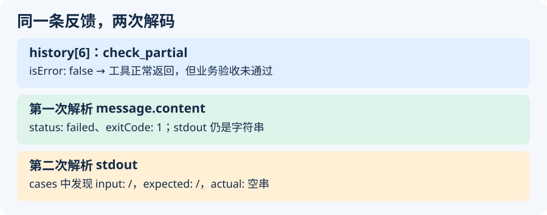
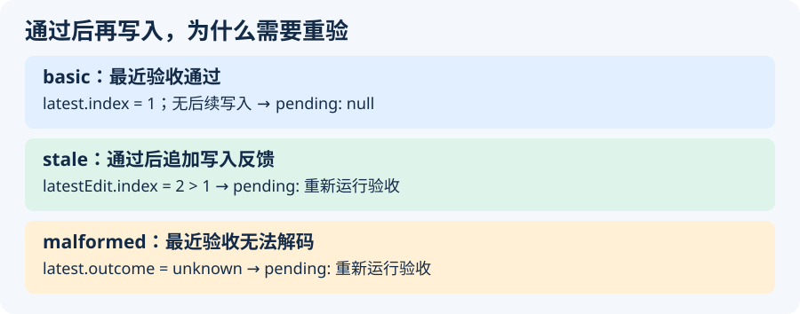

# 21 把被省略的验收证据带回本轮输入

第 20 篇能保留近期完整工具批次。可是一旦较早的验收反馈离开本轮输入，模型可能知道最后一次验收通过了，却说不清第一次到底哪个用例失败。

## 本篇技术方案

**功能目标。** 用户照常提交任务。当一次验收反馈被省略时，让模型收到一条可回查的摘要，能说清旧验收发现了什么、最近一次验收的结果，以及当前是否需要重验。

### 实施前，先走完一次具体过程

1. **第一次验收失败。** 路径修复只处理了后缀和尾斜杠，根路径 `/` 却变成空串。Runtime 保存 `check_partial` 的真实反馈，其中的 `stdout` 记录了失败用例。
2. **模型修正，再次验收。** 第二次通过，Runtime 把 `check_complete` 的反馈追加到完整记录。旧失败仍然是事实，但已不是最近的结果。
3. **第四轮调用前，CLI 发现第一次验收被省略。** 完整历史超过本地字节目标，CLI 给摘要预留 1,024 字节，再用第 20 篇的规则选择完整批次。它从未被选中的 `check_partial` 提取失败用例 `/`，记下历史下标 6 和工具请求 ID，并附上最近一次验收的来源和结果。
4. **模型收到原任务、摘要和近期批次。** 第四轮可以借摘要指出第一次失败的是根路径用例。Runtime 继续保留原始反馈，CLI 仍按当前文件和与之匹配的实际验收判断交付。

### 职责与取舍

- **在 CLI 的输入准备阶段提取。** CLI 从 Runtime 提供的完整历史中读取原始反馈，每轮按需计算摘要。摘要只随本轮输入发送，完整历史里的原文仍可供报告和调试回查。
- **只提取验收所需的字段。** 用固定规则记录最近一条被省略的验收、最近一次验收和最近一次修改，不额外调用模型。失败摘要只保留一个用例样本。需要核对完整诊断时，可用历史下标和请求 ID 找回原反馈。
- **通过结果只对应当时的验收。** 如果最新验收之后又出现写入工具反馈，摘要保留当时的通过结果，同时提示重验。最新验收无法确认通过时也提示重验。

### 验收标准

- 用同一次路径修复流程做两种对照。近期批次相同，只有含摘要的固定探针能在第四轮读到用例 `/`、下标 6 和 `check_partial`。两次文件验收都已通过，探针结果用于验证早期证据是否送达。
- 在独立观察入口模拟通过后再次写入，确认 `needsRecheck` 变为 `true`。再模拟不可解码的验收反馈，确认最新结果为 `unknown`，并提示重验。

## 动手前

以完成第 20 篇的源码为起点。确认已有 `selectInput`、内部字节目标和 `examples/input-budget` 固定观察入口。先检查工作区；第 20 篇的修改保存后再创建本章分支：

```bash
git status --short
git switch -c agent/chapter-21-evidence-summary
```

## 第一步：拆开同一条失败反馈

先看本章实际运行里的 `check_partial`。下面是从报告节选出的字段，省略其他用例；`stdout` 在外层仍然是字符串：

```json
{
  "role": "toolResult",
  "toolName": "run_check",
  "toolCallId": "check_partial",
  "isError": false,
  "content": "{\"status\":\"failed\",\"exitCode\":1,\"stdout\":\"{\\\"passed\\\":false,\\\"cases\\\":[{\\\"input\\\":\\\"/\\\",\\\"expected\\\":\\\"/\\\",\\\"actual\\\":\\\"\\\",\\\"passed\\\":false}]}\"}"
}
```

分两次解码：第一次解析 `message.content`，取得进程结果和 `stdout`；第二次解析 `stdout`，才能拿到 `cases`。这次 `isError: false` 是工具正常返回了结果，`status: failed` 和 `exitCode: 1` 表示验收没通过，`cases[0].input` 则告诉我们具体失败的是根路径 `/`。这三层不能互相替代。

把这条反馈转成摘要时，保留 `index: 6`、`id: "check_partial"`、`outcome: "failed-at-check"`、`failedInput: "/"`。原始反馈仍能解释失败原因：预期为 `/`，实际是空串。摘要只带用例输入，不假装保留了全部诊断细节。



## 第二步：实现摘要和来源定位

新建 `apps/coding-cli/src/context/evidence-summary.ts`。输入是同一次准备得到的完整历史和被选中的消息；输出是一条可选的输入消息。

<<< @/snippets/21-evidence-summary/apps/coding-cli/src/context/evidence-summary.ts

先按历史顺序扫描。只有 `run_check` 的实际工具反馈能形成验收条目；模型说“测试通过”不算。外层反馈的进程状态和内层 `stdout` 的业务结果都符合通过条件，才记为 `passed-at-check`。缺少可识别结果记为 `unknown`，不猜测。失败时只提取一个有界用例样本，不带入整段脚本输出。


`index` 是零基下标：`history[index]` 应是同一个 `toolCallId` 的工具反馈。它只在本次运行的完整历史里有意义，不能当成跨会话 ID。选择函数返回同一份历史副本里的消息对象，因此可用集合成员判断某条反馈有没有留下。不要拿另一次复制的对象来比较引用。

摘要只保留最近一条被省略的验收和最近一次验收。原任务继续通过保留的用户消息提供；若最近验收未通过，或它后面已有写入工具反馈，就提示重验。这里对写入采用保守判断，即使一次替换失败也可能要求重验。没有省略验收时就不加摘要。这是针对验收的结构化提取，不是对所有历史进行通用压缩。

### 从原记录追到摘要

在这次固定运行的末轮准备阶段，完整历史有 10 条：

| 零基下标 | 完整历史里的内容 | 本轮是否发送原文 |
|---|---|---|
| 0 | 用户任务 | 保留 |
| 1 到 3 | 第一次模型请求及两条读取反馈 | 省略 |
| 4 到 6 | 第一次修改与验收请求，以及两条反馈 | 省略；从下标 6 提取失败摘要 |
| 7 到 9 | 修正与重验请求，以及两条反馈 | 整组保留 |

这里的 6 是数组下标，即第七条消息。断在 `summarizeChecks` 里，沿 `history[6].toolCallId` 找到 `check_partial`，再从 `stdout` 找到 `/`。不能从摘要中的 ID 反推出原文内容；要核对时必须回到这份历史。

代码中，`checks` 按时间顺序收集验收条目，`kept` 标记仍出现在选中数组里的对象，`omitted` 找最近一条没被保留的验收，`latest` 则来自完整历史中的最后一次验收。后者不受裁剪影响，所以不会误把前一次失败当作最近结果。

### 任务、进展和待办分别从哪里来

- **任务目标**来自开头的用户消息，直接保留，不另写一份可能失真的目标。
- **进展**来自最近一次 `replace_text` 反馈，保留其下标和请求 ID。`tool-returned` 仅表示工具正常返回，不能单凭它宣布修复完成。
- **待办**由最新验收和写入顺序推导。写入反馈晚于最新验收，或者最新验收无法确认通过时，`pending` 为“重新运行验收”。否则为 `null`，只表示这条规则没有生成重验待办。

这版只覆盖修改与验收，不总结所有调查发现、设计决定或业务待办。

### 先单独运行摘要，不等 CLI 接完

新建 `examples/evidence-summary/inspect-summary.ts`。它用两条人工构造的验收反馈来模拟裁剪完成后的状态：`history` 有失败和通过两条记录，`selected` 只保留后者。这个入口直接调用摘要函数，不经过工具分组，也不会发请求。

<<< @/snippets/21-evidence-summary/examples/evidence-summary/inspect-summary.ts

在仓库根目录运行：

```bash
node --import tsx examples/evidence-summary/inspect-summary.ts
```

先核对这三个值，再接 CLI：

| 字段 | 预期 | 怎么核对 |
|---|---|---|
| `omitted` | 下标 0、`check_partial`、失败用例 `/` | 回到 `history[0]` 解码 `stdout` |
| `latest` | 下标 1、`check_complete`、`passed-at-check` | 即使通过反馈仍在 `selected`，它也是完整历史中的最近验收 |
| `needsRecheck` / `pending` | `false` / `null` | 最后一次验收通过，且样本里没有之后的写入 |

这里的下标是 0 和 1，因为样本只构造了两条反馈。真实 CLI 的下标 6 和 9 还计入任务、请求和其他反馈。不要把示例下标写进摘要函数。

## 第三步：只把摘要加到本轮输入

完整替换 `apps/coding-cli/src/session/run.ts`。保留原有 `runSession` 签名、工具、系统提示、运行预算和报告路径，增加摘要调用，并在超过字节目标时为摘要预留 1,024 字节。

<<< @/snippets/21-evidence-summary/apps/coding-cli/src/session/run.ts


摘要使用现有消息协议里的 `user` 角色承载，并明确标成应用生成的历史数据。插入在任务消息后、近期批次前，不拆开任何请求与反馈。它只从回调返回，下次仍从原历史重新计算。预留值是教学余量；如果任务、最近批次和摘要实际更大，仍如实报告 `overBudget`，不是服务硬上限。

## 第四步：让固定模型必须找到早期失败证据

普通修复示例的最后一轮只检查最近一次验收，即使没收到摘要也可能通过。要验证本篇增加的能力，得让最后一轮回答一个明确问题：**第一次验收哪个用例失败？**

新建 `examples/evidence-summary/main.ts`。前 3 轮复用第 20 篇的固定模型与真实工具；第 4 轮先确认原始失败反馈确实被省略，再检查当前输入能否提供早期失败用例。

<<< @/snippets/21-evidence-summary/examples/evidence-summary/main.ts

`cut-only` 只在本地固定模型入口移除应用生成的摘要，保留同一组近期原始消息；`summary` 原样接收。它们是观察入口的模式，正常 CLI 不增加参数。断在 `messages` 赋值后看实际交给探针的数组；CLI 此前打印的 `inputBytes` 是移除摘要前的值，不用于比较两个探针的输入大小。

```bash
npm run check
node --import tsx examples/evidence-summary/main.ts cut-only
node --import tsx examples/evidence-summary/main.ts summary
```

第一条观察命令预期退出 1，第二条退出 0，分别运行即可。实际结果：

| 对照 | 第 4 轮能否定位第一次失败 | 最终结果 |
|---|---|---|
| 仅裁剪 | 无原始反馈，也无摘要，明确报缺依据 | 未接受 |
| 有摘要 | 从摘要读到 `input: '/'`、`index: 6`、`id: 'check_partial'` | 固定模型完成，实际验收通过 |

两次的文件修复与验收都已在第 3 轮完成。仅裁剪未接受，是因为**最后一轮证据探针失败，运行没有正常回答**，不表示文件验收失败。有摘要的候选末轮从 4,761 字节选为 2,602 字节（含摘要）。这个对照只证明信息送达与固定检查，不证明真实模型会正确使用它。


## 第五步：验证旧通过不会变成当前通过

先看末轮摘要的三个来源：旧验收 `check_partial` 在下标 6，最近写入 `edit_complete` 在下标 8，最近验收 `check_complete` 在下标 9。此时写入早于通过验收，所以没有生成重验待办。

用刚才的独立入口复现，不必改文件或真的再执行一次工具：

```bash
node --import tsx examples/evidence-summary/inspect-summary.ts stale
node --import tsx examples/evidence-summary/inspect-summary.ts malformed
```

`stale` 在人工历史中追加写入反馈：`latest.index` 仍是 1，`latest.outcome` 仍是 `passed-at-check`，但 `latestEdit.index` 为 2，所以 `needsRecheck` 为 true，`pending` 为“重新运行验收”。`malformed` 用不可解析的正文替换最近验收：`latest.outcome` 为 `unknown`，也会提示重验。回到无参数运行就恢复基线。

两条命令都正常退出，因为它们在展示摘要，不在判断任务交付。真正的交付仍要用 CLI 重新取得当前内容及匹配的验收证据。



## 第六步：接回真实模型，分别核对摘要与验收

完成本篇代码后，沿用第 19 篇的服务配置，从仓库根目录运行。下面的 CLI 会调用实际模型服务，可能产生费用：

```bash
npm run check
node --env-file=.env apps/coding-cli/dist/cli.js --task fixtures/code-tasks/route.json
```

这个入口没有注入固定模型。CLI 通过默认的 `createModelCall` 接入服务，Runtime 仍在每次发请求前等待本篇的 `prepareMessages`，再把返回的消息交给模型调用。无需添加摘要开关。

| 要验证什么 | 看哪里 | 能说明什么 |
|---|---|---|
| 摘要是否生成 | 某轮的 `hasEvidenceSummary: true` | 输入准备已生成摘要；单看日志还不能证明请求已发出 |
| 本轮准备发送什么 | 在 `return input` 前查看摘要和近期批次；对照原始工具反馈的下标和 ID | 哪些旧验收事实进入了本轮输入，来源是否一致 |
| 模型是否引用了证据 | 对照实际回答、同轮输入和原始反馈 | 能核对陈述是否有依据；一次正确回答不能证明是摘要带来的 |
| 任务是否交付 | 查看 `answered`、匹配当前内容的验收和 `accepted` | 交付由实际运行与验收证据决定，不能用摘要代替 |

真实模型可能一次修好，也可能走不同的调查路径。如果全程没有省略验收、`hasEvidenceSummary` 始终为 false，这次只能验证真实 CLI 路径，不能算验证了摘要进入真实请求。保留观察结果即可，不必反复付费重跑。若要验证摘要是否改善效果，另用确实会省略旧验收的任务，按同一模型、材料与约束比较有无摘要。

本篇已实测固定响应配合真实文件操作和验收；真实模型验证步骤供读者执行，作者未调用模型服务。

## 断点：追踪同一条反馈从历史进入模型输入

用下面的命令启动调试，再附加到 Node：

```bash
node --inspect-brk --import tsx examples/evidence-summary/main.ts summary
```

1. 在 `session/run.ts` 的 `summarizeChecks(history, selected)` 调用处停在第 4 轮。查看 `history[6]`，请求 ID 应为 `check_partial`；再看 `selected`，里面没有这条反馈，但有 `check_complete`。
2. 进入 `evidence-summary.ts`，在 `checks.push` 处观察 `index === 6` 的那次执行。对照 `result.status`、`report.cases`、`failedInput`：外层为失败，内层失败用例为 `/`。
3. 在 `session/run.ts` 的 `return input` 处检查顺序：原任务、摘要、近期完整批次。此时 `history[6]` 仍是原始工具反馈。
4. 在观察入口的 `console.log('早期失败用例', ...)` 处检查 `evidence.omitted`。它能用来源回查原文，但提供给模型的是摘要字段。换成 `cut-only` 后应停在“本轮输入没有依据”的分支。

## 小迁移：换一组用例，验证提取规则

在独立观察脚本中，把两次验收的用例输入从 `/` 改成 `/docs/`，把旧请求 ID 改成 `check_docs`。不改摘要函数，预测默认运行的 `omitted.failedInput`、`omitted.id` 和 `pending`；再用 `stale` 模式验证待办会变化，但旧用例来源不会变化。结束后恢复示例。这个练习验证同一条提取规则能处理不同反馈，不是在验证路径修复的新业务规则。

[Pi 固定版本的 compaction 实现](https://github.com/badlogic/pi-mono/blob/8efd314fa3d3232ce197d8d7a6a5660530b9d83e/packages/coding-agent/src/core/compaction/compaction.ts)区分待摘要消息和保留区，并记录保留区起点。本篇只借鉴这个职责划分：摘要由确定性规则从真实反馈提取，不另调模型，也不持久化。

## 本章完整文件核对

这里只列本章新增或替换的文件；与正文使用同一份候选。第 20 篇的固定模型、输入选择器和验收材料继续复用。

::: details apps/coding-cli/src/context/evidence-summary.ts

<<< @/snippets/21-evidence-summary/apps/coding-cli/src/context/evidence-summary.ts

:::

::: details apps/coding-cli/src/session/run.ts

<<< @/snippets/21-evidence-summary/apps/coding-cli/src/session/run.ts

:::

::: details examples/evidence-summary/inspect-summary.ts

<<< @/snippets/21-evidence-summary/examples/evidence-summary/inspect-summary.ts

:::

::: details examples/evidence-summary/main.ts

<<< @/snippets/21-evidence-summary/examples/evidence-summary/main.ts

:::

## 保存本篇

```bash
git status --short
git add apps/coding-cli/src/context/evidence-summary.ts apps/coding-cli/src/session/run.ts examples/evidence-summary
git commit -F - <<'EOF_COMMIT'
在有限模型输入中保留带来源的验收摘要

从被省略的真实验收反馈提取事实，保留来源下标和请求 ID。
每轮重新核对后续修改，摘要只进入本轮输入，不替代验收。
EOF_COMMIT
git push -u origin agent/chapter-21-evidence-summary
```
