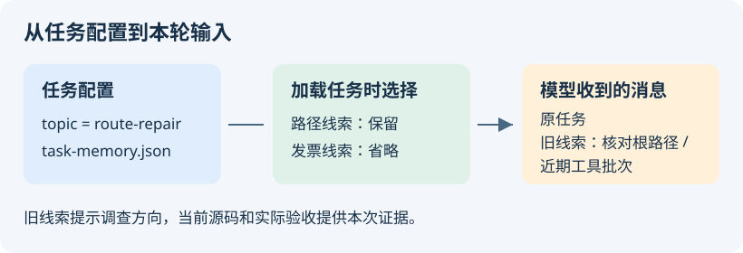
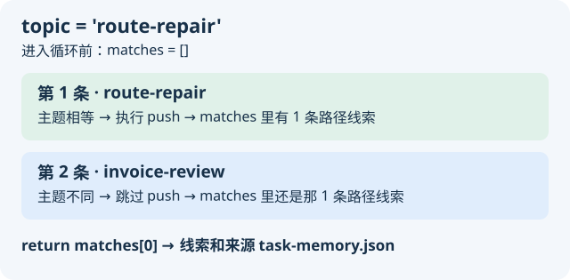
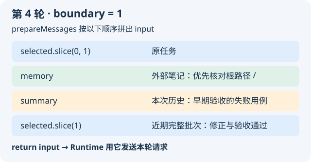

# 22 从旧任务取回一条有用的线索

第 21 篇从**这次运行**的历史里找回旧验收。这一次，CLI 刚开始一项新任务，还没有工具反馈。上次做类似任务留下的记录，怎样才能在这一轮帮上忙？

本篇实现 Agent **长期记忆的读取**。第 19 至 21 篇处理当前任务的历史和本轮输入，属于短期记忆。Runtime 保存当前运行历史，应用加载跨任务笔记，并按需把这两类信息放进模型输入。长期记忆的写入和更新在[第四阶段后续安排](/roadmap)中继续。

## 本篇技术方案

### 实施前，先走完一次具体过程

1. 操作者提交路径修复任务。任务配置指定从一份笔记里查找 `route-repair` 主题。
2. CLI 加载任务时找到一条旧线索：上次根路径 `/` 被错误地变成了空串。同一个文件里还有发票任务的记录，主题不同，所以留在文件里。
3. 第一次调用模型前，CLI 把原任务和选中的旧线索交给 Runtime 发送。模型可以据此优先核对根路径。现在代码是否有这个问题，仍要看当前源码和真实验收。



### 先看结果

装好项目依赖后，在仓库根目录直接跑教程的观察脚本。下面两条命令从 `site/snippets/22-task-memory/` 运行，脚本加载同一目录树里的现成实现和笔记。跟写到 1.3 后，再运行你自己放在 `examples/task-memory/` 里的脚本。

```bash
node --import tsx site/snippets/22-task-memory/examples/task-memory/inspect-memory.ts
node --import tsx site/snippets/22-task-memory/examples/task-memory/inspect-memory.ts unknown-topic
```

第一条会打印 `topic: 'route-repair'`、来源 `task-memory.json` 和包含 `/` 的线索。第二条只打印「没有匹配的任务记忆」。先带着一个问题往下读：**发票也在同一个文件里，哪行代码把它留在了输入之外？**

本章把「任务记忆」做成操作者整理的外部笔记，由 CLI 按主题精确查找。这里的主题是配置里明确给出的字符串，暂时无需理解相似度、向量或自动归档。做完后，同一个 CLI 应能在有记忆时收到一条适用线索，在无记忆时照常运行。两种情况下，交付都用当前实际验收判断。

## 动手前

从第 21 篇接着做。需要已有 `summarizeChecks` 和 CLI 的输入准备回调。固定运行复用 `examples/input-budget/sample-model.ts`。保存上章变化后，由你在仓库根目录开分支。

```bash
git status --short
git switch -c agent/chapter-22-task-memory
```

| 步骤 | 这一段要解决的问题 | 做完先检查什么 |
|---|---|---|
| 1. 读取笔记 | 两条笔记里哪条适用 | 观察脚本打印一条命中的记录 |
| 2. 加载任务 | 正式入口从哪拿主题和文件名 | `loadTask` 返回的 `memory` 已包含 `topic`、`source` 和 `hint` |
| 3. 准备输入 | 哪一行让模型收到这条笔记 | `prepareMessages` 返回的 `input[1]` 是参考消息 |
| 4. 实际运行 | 线索送到了吗，修复验收了吗 | 先看模型回调收到的消息，再看真实验收 |

## 第一步：从两条记录里选出路径线索

### 1.1 准备要查的资料

新建 **`fixtures/code-tasks/task-memory.json`**，写入下面以 `[` 开头的笔记数组。每条记录的 `topic` 是查找名称，`hint` 是命中后会发给模型的旧线索。第二步会在同目录新建 `route-memory.json`，用它指定从这份笔记中查哪个主题。

<<< @/snippets/22-task-memory/fixtures/code-tasks/task-memory.json

### 1.2 实现读取和查找

先替换 `apps/coding-cli/src/types/task.ts`。下面的完整文件保留了原有字段，新增 `TaskMemory`，描述查到的一条记录。第一步的读取函数会使用这个类型，第二步才会给 `TaskConfig.memory` 填入查到的值。

用路径示例对照这三个字段。`topic` 是查找用的 `route-repair`，`hint` 是笔记里关于根路径 `/` 的原文，`source` 则由加载器补成 `task-memory.json`。到了第三步，这三个值会一起进入模型收到的参考消息。

::: details 完整文件 types/task.ts
<<< @/snippets/22-task-memory/apps/coding-cli/src/types/task.ts
:::

接着新建 `apps/coding-cli/src/context/task-memory.ts`，把下面的完整实现写入该文件。它导出 `loadTaskMemory`，接收选择条件和配置所在目录，返回一条带来源的笔记或 `undefined`。下一小节的脚本会导入这个函数。

**`apps/coding-cli/src/context/task-memory.ts` 完整实现**

<<< @/snippets/22-task-memory/apps/coding-cli/src/context/task-memory.ts

回到刚创建的 `apps/coding-cli/src/context/task-memory.ts`。在 `loadTaskMemory` 中，先找到 `resolve(base, selection.file)`。以开头的观察脚本为例，`base` 指向 `fixtures/code-tasks`，`selection.file` 是 `task-memory.json`。读完文件后，`raw` 是包含两条笔记的数组，`topic` 是这次要找的 `route-repair`。

再看同一函数里的 `for (const note of raw)`。每次循环先检查这一条笔记的字段，然后才比较主题。下面三行在循环内部，已包含在完整实现里。

```ts
if (note.topic === topic) {
  matches.push({ topic, source: basename(path), hint: note.hint });
}
```

第一次循环中，`note.topic` 是 `route-repair`，所以 `matches` 多出一个对象。`hint` 来自当前笔记，`basename(path)` 取出文件名 `task-memory.json`，作为回查来源。第二次循环中，`note.topic` 是 `invoice-review`，所以 `matches` 仍只有第一条。最后的 `return matches[0]` 把这一条交回调用方。换成 `unknown-topic` 时，两条都不会加入，返回值就是 `undefined`。



### 1.3 用观察脚本核对返回值

新建 `examples/task-memory/inspect-memory.ts`。在这个文件里，`const memory = await loadTaskMemory(...)` 接住刚才返回的记录，下一行的 `console.log` 打印它。命令末尾的 `invoice-review` 只给这个观察脚本提供主题，正式 CLI 会在第二步改为从任务配置取得主题。

::: details 完整示例 inspect-memory.ts
<<< @/snippets/22-task-memory/examples/task-memory/inspect-memory.ts
:::

从 `examples/task-memory/inspect-memory.ts` 所在的目录往上两级就是仓库根目录，所以 `../../apps/coding-cli/src/context/task-memory` 指向 1.2 写好的文件。若运行时报 `does not provide an export named 'loadTaskMemory'`，先打开该文件检查完整实现是否已写入并保存。

```bash
node --import tsx examples/task-memory/inspect-memory.ts invoice-review
```

**可以先停在这里。** 运行前预测会输出哪一条提示，再用结果核对。如果能指出 `note.topic === topic` 怎样决定结果，就已经读懂了本章的查找逻辑。

::: details 加载失败时怎样排查

主题未命中会正常返回。配置了文件，但文件打不开、格式无效或同一主题重复命中时，加载会报错。可以临时复制一条 `route-repair` 记录再跑一次，观察「同一主题有多条记忆」后撤销这次改动。

:::

## 第二步：让任务配置给出主题

在 `fixtures/code-tasks/` 下新建 **`route-memory.json`**，把本节的任务配置写到这个新文件里。第 1.1 节的 `task-memory.json` 仍是单独的笔记数组。新任务和原路径任务使用同一份材料、提示和验收，只多了 `memory`。其中 `memory.file` 相对任务配置所在的目录解析。

这一步结束时，`fixtures/code-tasks/` 里要有两份独立的 JSON：

| 文件 | 内容 | 谁读取 |
|---|---|---|
| `route-memory.json` | 一个任务配置对象，以 `{` 开头 | 观察入口通过 `--task` 交给 `loadTask` |
| `task-memory.json` | 第 1.1 节的笔记数组，以 `[` 开头 | `loadTaskMemory` 根据 `memory.file` 读取 |

下面的任务配置对象写入 `route-memory.json`。

<<< @/snippets/22-task-memory/fixtures/code-tasks/route-memory.json

接下来替换 `apps/coding-cli/src/config/task.ts`。保留 `loadTask` 的四个必填字段及其校验，允许额外的 `memory` 配置。通过原有的来源目录和验收文件校验后，再读记忆。

下面这一行在 `apps/coding-cli/src/config/task.ts` 的 `loadTask` 尾部，紧接验收脚本位置校验，位于返回 `TaskConfig` 之前。它已包含在完整文件里。

```ts
const memory = await loadTaskMemory(value.memory, base, signal);
```

`value.memory` 是从 `route-memory.json` 读到的 `{ file: './task-memory.json', topic: 'route-repair' }`。`base` 指向该配置所在的目录。等待结束后，局部变量 `memory` 接住第一步观察过的对象，包含 `topic`、`source` 和 `hint`。返回的任务对象只在命中时带上这条记录。原来的 `route.json` 没有 `memory`，加载器立即返回 `undefined`，也无需读取笔记文件。

::: details 完整文件 config/task.ts
<<< @/snippets/22-task-memory/apps/coding-cli/src/config/task.ts
:::

## 第三步：把旧线索交给模型

完整替换 `apps/coding-cli/src/session/run.ts`。本步仍保留 `runSession`、系统提示、工具和运行预算。重点看同一个文件里的两个位置：

1. **`runSession` 中，`return runAgent({...})` 之前。** 把第二步得到的 `task.memory` 包成一条消息。前者是包含 `topic`、`source`、`hint` 的对象，后者是包含 `role`、`content` 的模型消息。代码用 `JSON.stringify(task.memory)` 将三个字段写入正文，在正文开头标明它是调查线索。没有命中时，局部变量 `memory` 保持 `undefined`。
2. **`runAgent` 的 `prepareMessages` 回调中，算出 `boundary` 之后。** 把这条消息插在原任务后、近期批次前。下面是完整文件中构造 `input` 的那几行。

```ts
const input = [
  ...selected.slice(0, boundary),
  ...(memory ? [memory] : []),
  ...(summary ? [summary] : []),
  ...selected.slice(boundary),
];
```

第一轮的 `selected` 只有原任务，`boundary` 是 1，`summary` 是 `undefined`。因此第一行展开原任务，第二行展开旧线索，后两行展开空数组。`return input` 把这两条消息交给 Runtime 发出本轮请求。后续轮次有了当前工具反馈，近期批次接在末尾。第 21 篇的验收摘要如果生成，也单独占一条消息。原始历史继续由 Runtime 持有。

下面是固定示例第 4 轮的拼接顺序。回看第 1 轮时，省略图中的 `summary` 和最后一段，剩下的就是原任务和旧线索。



::: details 完整文件 session/run.ts
<<< @/snippets/22-task-memory/apps/coding-cli/src/session/run.ts
:::

::: details 输入目标怎样计入新消息

`messageBytes([memory])` 算的是一条消息连同数组的两个方括号。把它插入已有的非空数组，只需要消息本身和一个逗号，所以减 1。超出目标时再使用第 21 篇的批次选择，并继续给验收摘要留余量。最终以 `inputBytes` 和 `overBudget` 为准。

:::

## 第四步：看模型实际接到了什么

新建 `examples/task-memory/main.ts`。在该文件传给 `runCli` 的模型回调里，先从 `context.messages` 找出带「应用提供的历史任务记忆」开头的消息。默认加载 `route-memory.json`，每轮预期一条路径记忆。传入 `baseline` 时加载原来的 `route.json`，每轮预期零条。检查通过后，回调把同一份 `context` 交给第 20 篇的固定模型，继续走实际文件修复和验收。

::: details 完整示例 main.ts
<<< @/snippets/22-task-memory/examples/task-memory/main.ts
:::

```bash
npm run check
node --import tsx examples/task-memory/main.ts
node --import tsx examples/task-memory/main.ts baseline
```

| 观察位置 | 有记忆的任务 | 原路径任务 |
|---|---|---|
| 第一次 `固定模型收到的记忆` | 带 `route-repair` 和来源的旧线索 | 无 |
| 报告的原始工具反馈 | 读文件、修改、第一次验收失败、修正后通过 | 相同的固定动作与验收 |
| `accepted` | `true` | `true` |

如果默认模式只报「任务配置失败」，回到第二步核对两个 JSON 的文件名和内容。默认入口会先打开 `route-memory.json`，再按其中的 `memory.file` 读取 `task-memory.json`。

### 对照日志，跟完第一轮

在有记忆的运行里，先看 `输入准备 1：历史 1 条，本轮 2 条`。这时完整历史只有用户任务，本轮多出来的是 CLI 拼进去的旧线索。接着看 `固定模型收到的记忆`，这条日志由 `examples/task-memory/main.ts` 的模型回调从 `context.messages` 打印，能核对那条消息确实传到了调用方。直到结尾的 `accepted: true` 和 `checkMatchesCurrent: true`，才确认当前副本的修复通过了验收。

::: details 想看数组里的值，可以打这两个断点

用 `node --inspect-brk --import tsx examples/task-memory/main.ts` 启动并连接 Node 调试器。

1. 在 `apps/coding-cli/src/session/run.ts` 的 `prepareMessages` 回调里断到 `return input`。第一轮比较 `history[0]`、`input[0]` 和 `input[1]`。前两项是同一份任务内容，第三项的 `content` 里有 `route-repair` 和 `task-memory.json`。
2. 在 `examples/task-memory/main.ts` 的模型回调里断到 `const note = memories[0]` 的下一行。此时 `note.content` 就是上一个断点里看到的 `input[1].content`。第一处看到的是 CLI 准备的输入，第二处看到的是 Runtime 传给模型回调的输入。

:::

这里的对照验证线索能送达模型调用，以及原任务依旧可运行。固定模型的动作事先写好，这两次结果无法判断线索是否提升了真实模型的判断质量。

### 小迁移：让记忆和当前证据有冲突

把笔记里的路径线索改成「上次验收根路径已经通过」。先预测固定运行的第一次实际验收。运行后，在报告中找 `check_partial`，核对当前副本实际发生了什么，然后恢复笔记。能解释为何历史线索和当前结果可同时出现，就能把这两种信息的用途区分开。

### 用已有服务观察一次真实请求

完成代码后，可自行用第 19 篇配置的服务运行。这条命令会调用实际模型，可能产生费用。

```bash
node --env-file=.env apps/coding-cli/dist/cli.js --task fixtures/code-tasks/route-memory.json
```

先看 `hasTaskMemory: true`，再在 `apps/coding-cli/src/session/run.ts` 的 `prepareMessages` 回调末尾，也就是 `return input` 处，核对旧线索和本轮工具反馈。最后用实际验收判断交付。一次真实运行可以核对输入与行为，下一篇再做同条件对照。

本篇参考 Pi 把外部上下文加载和模型输入组装分开的做法。Pi 的加载器收集项目上下文文件，Agent 会话再将这些文件交给系统提示组装。本篇采用任务主题精确查找，外部笔记作为调查数据进入本轮消息。 [Pi 资源加载器](https://github.com/badlogic/pi-mono/blob/8efd314fa3d3232ce197d8d7a6a5660530b9d83e/packages/coding-agent/src/core/resource-loader.ts#L218) · [Pi 会话输入组装](https://github.com/badlogic/pi-mono/blob/8efd314fa3d3232ce197d8d7a6a5660530b9d83e/packages/coding-agent/src/core/agent-session.ts#L1604)

## 保存本篇

```bash
git status --short
git add apps/coding-cli/src examples/task-memory fixtures/code-tasks/task-memory.json fixtures/code-tasks/route-memory.json
git commit -F - <<'EOF_COMMIT'
在模型输入中按主题加入旧任务线索

由 CLI 加载任务配置并查找外部记录，将命中的一条线索加入本轮输入。
用同一路径任务比较有无记忆的输入，并核对实际验收。
EOF_COMMIT
git push -u origin agent/chapter-22-task-memory
```
