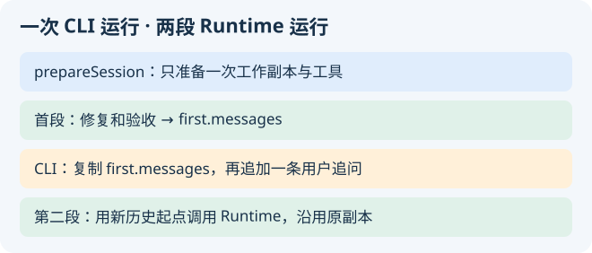
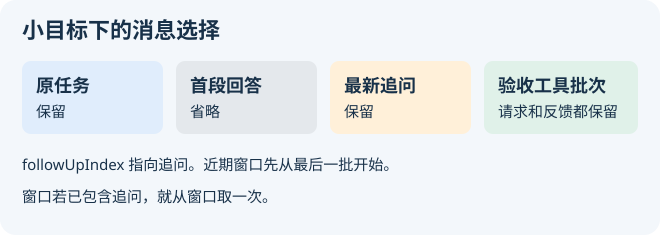

# 23 在同一个任务里继续追问

路径修好了，你接着问「第一次验收是哪个用例失败？」如果 CLI 为这句话重新复制一份工作区，旧验收结果就不在新会话里了。第 23 篇给现有 CLI 加一条可选追问，让它接着同一份工作副本和历史回答，再比较两种输入策略能把哪些依据交给模型。

## 本篇技术方案

### 实施前，先走完一次具体过程

1. **CLI 加载任务并准备一个副本。** 首段照常读文件、修复、验收。固定示例里，第一次验收发现根路径 `/` 出错，修正后第二次通过。
2. **首段回答结束，CLI 追加用户追问。** 它取 Runtime 返回的完整历史，拼上一条新的用户消息，再调用同一个运行入口。第二段复用原来的副本、工具和验收状态。
3. **第二段准备输入，再回答。** 全量策略能看到第一次失败的原始反馈。自动策略省略了原始反馈，但第 21 篇的摘要把失败用例及来源带回来。第 22 篇的外部笔记也可以在场，两组都拿到它。
4. **CLI 审阅当前副本。** 第二段回答结束后，报告仍用匹配当前内容的实际验收判断交付。输入对照另看模型调用次数、消息字节和答案依据。



这里先做一条在启动时传入的追问。每段有独立的运行 ID、调用预算和时限，两段按顺序运行。会话对象留在当前进程里，第五阶段再做进程退出后的会话保存与恢复。

### 先看结果

装好项目依赖后，在仓库根目录运行教程自带的预览脚本。它使用五条人工消息和 1 字节目标，直接调用输入选择器。无需先改学习源码。

```bash
node --import tsx site/snippets/23-task-follow-up/examples/task-follow-up/inspect-input.ts
```

你会看到「修复页面路径」「第一次验收是哪个用例失败？」以及完整的工具请求和反馈。首段回答被省略了。先带着这个问题往下读：**为什么最后一组已经是工具反馈，用户刚问的问题还能留下？**

### 验收标准

- 不传追问时仍只运行一段。首段没有正常回答时直接报告停止结果。
- 有追问时只创建一个副本。两种输入策略都能给出 `/` 和真实验收依据，并交付同一份修复。
- 目标过小时，原任务、最新追问和最近完整工具批次仍保留。报告照常能查到原始工具反馈。

## 本篇核心代码在哪

先认准一个入口：`apps/coding-cli/src/main.ts` 的 `runCli`。首段 `runSession` 返回 `first` 后，`nextInput.messages` 把 `first.messages` 和新的用户追问拼成第二段的起点。随后，第二次 `runSession` 继续传入同一个 `session`。**前一句保住历史，后一句保住工作副本。** 这两处就是本篇实现「同一任务继续追问」的核心，[第三步有完整代码和数据轨迹](#第三步-把上一段历史交给下一段)。

读其他文件时，可以用各自解决的问题来定位：

| 读到哪里 | 这一段解决什么 |
|---|---|
| `config/args.ts` 的 `parseArgs` | 把终端传来的追问读成 `options.followUp` |
| `session/run.ts` 的 `runSession` | 把第二段的历史起点交给 Runtime，并为每次模型调用准备输入 |
| `context/select-input.ts` 的 `selectInput` | 历史太长时，避免把正在回答的追问裁掉 |
| `examples/task-follow-up/main.ts` | 对照两种策略，检查模型能否从实际输入找到第一次验收失败的依据 |

## 动手前

从第 22 篇接着做。确认仓库已有 `fixtures/code-tasks/route-memory.json` 任务配置、`fixtures/code-tasks/task-memory.json` 笔记数组，以及 `examples/input-budget/sample-model.ts`。保存上章的改动后再开分支。

```bash
git status --short
git switch -c agent/chapter-23-task-follow-up
```

## 第一步：在裁剪时保住追问

第 20 篇保留原任务和最后一组。在上面的五条消息里，最后一组已变成新一批工具请求和反馈。如果输入太小，旧规则会把追问留在裁剪线外。这样模型刚得到工具结果，却可能丢掉它要回答的问题。

完整替换 `apps/coding-cli/src/context/select-input.ts`。保留 `messageBytes` 和 `groupHistory`。只修改 `selectInput` 取近期组的部分，让它另外保留最后一条用户消息。

::: details 完整文件 context/select-input.ts
<<< @/snippets/23-task-follow-up/apps/coding-cli/src/context/select-input.ts
:::

在同一文件的 `selectInput` 中，取出开头的原任务后，找到下面这两行。它们已包含在完整文件里。

```ts
const followUpIndex = groups.map((group) => group[0]!.role).lastIndexOf('user');
let recentStart = Math.max(0, groups.length - 1);
```

此时 `task` 是原任务，`groups` 里依次是首段回答、追问和工具批次。因此 `followUpIndex` 是 1，`recentStart` 是 2。`inputFrom(2)` 会把 `groups[1]` 单独放在工具批次前，因为追问还没进入从下标 2 开始的近期窗口。循环试着把窗口扩到下标 1 时，追问已经在窗口里，代码就只从窗口取一次。目标太小时，扩展会停止，函数仍返回原任务、追问和最新批次。



新建 `examples/task-follow-up/inspect-input.ts`，把下面的完整示例写入。这个脚本构造那五条消息，调用你刚改好的选择器，再逐条打印选中结果。

::: details 完整示例 inspect-input.ts
<<< @/snippets/23-task-follow-up/examples/task-follow-up/inspect-input.ts
:::

```bash
node --import tsx examples/task-follow-up/inspect-input.ts
```

**可以先停在这里。** 试着预测把预算从 `1` 改为 `4096` 后，首段回答会不会出现、追问会出现几次。核对后恢复预算。

## 第二步：让 CLI 读到一条追问

先替换 `apps/coding-cli/src/types/task.ts`。在 `CliOptions` 中新增 `followUp?`，保存终端传来的问题。再新增 `RunInputOptions`，用来把第二段的初始历史交给运行入口，也为观察脚本提供全量对照。原有任务配置和记忆字段继续沿用。

::: details 完整文件 types/task.ts
<<< @/snippets/23-task-follow-up/apps/coding-cli/src/types/task.ts
:::

再替换 `apps/coding-cli/src/config/args.ts`。在 `parseArgs` 的循环里处理 `--follow-up`，读取紧随其后的一个参数。终端引号让一句含空格的追问仍是一个参数。重复传入或没有值会走参数错误。解析成功后，`runCli` 会从 `options.followUp` 读到这句话。

::: details 完整文件 config/args.ts
<<< @/snippets/23-task-follow-up/apps/coding-cli/src/config/args.ts
:::

## 第三步：把上一段历史交给下一段

先替换 `apps/coding-cli/src/session/run.ts`。保留 `runSession` 的工具、系统提示和预算，新增最后一个可选参数 `inputOptions`。首段没有传入历史，所以从 `task.prompt` 开始。第二段从 `inputOptions.messages` 开始。默认仍用自动策略。全量对照保留完整历史并省略验收摘要，两组继续使用同一条外部笔记。

在这个文件的 `runSession` 中，关注传给 `runAgent` 的 `messages` 和 `prepareMessages`。前者给 Runtime 一份完整起点，后者每次模型调用前从完整历史派生本轮输入。即使自动策略在追问时省略了 `check_partial` 的原文，下一轮仍可从完整历史生成摘要。

::: details 完整文件 session/run.ts
<<< @/snippets/23-task-follow-up/apps/coding-cli/src/session/run.ts
:::

然后完整替换 `apps/coding-cli/src/main.ts`。保留参数加载、取消监听、模型创建、副本准备和最后的报告。把运行事件回调提到 `onEvent` 变量里供两段共用。首段返回 `first` 后，若有追问且状态为 `answered`，`runCli` 才进入第二段。

在同一文件的 `runCli` 中，下面这一段位于判断 `first.status` 的分支内，已包含在完整实现中。

```ts
const nextInput: RunInputOptions = {
  messages: [...first.messages, { role: 'user', content: options.followUp }],
  fullHistory,
};
result = await runSession(task, session, callModel, controller.signal, onEvent, nextInput);
```

用固定示例对照。`first.messages` 有 11 条，包括最初的任务、三个请求与反馈批次以及首段回答。数组展开后追加一个 `user`，`nextInput.messages` 就有 12 条，最后一条正是追问。两次调用拿到的是同一个 `session`，所以第二段仍能访问已经修好的文件。最后 `reportSession` 收到第二段结果和这个 `session`，一次性报告累积历史，并重新查看当前副本与验收是否匹配。

::: details 完整文件 apps/coding-cli/src/main.ts
<<< @/snippets/23-task-follow-up/apps/coding-cli/src/main.ts
:::

参考 Pi 的 `Agent.prompt` 怎样把新消息和已有上下文快照一起交给循环。本篇在 CLI 持有工作副本，并利用现有 Runtime 的初始消息参数完成接续。 [Pi 固定版本的 prompt 与快照](https://github.com/badlogic/pi-mono/blob/8efd314fa3d3232ce197d8d7a6a5660530b9d83e/packages/agent/src/agent.ts#L349)

## 第四步：在同一个问题上比较两种输入

新建 `examples/task-follow-up/main.ts`。它让两组都运行同一个配置、同一套固定修复动作和同一句追问。每次调用前累计 `context.messages` 的字节数。追问那一轮，固定回调从 `readFailure` 取得旧失败的来源，再确认 `check_complete` 确实通过。找不到依据就报错。

想看两组差异，先在这个文件里找到 `readFailure`。全量模式走函数的第一个分支。它在本轮消息中找到 `check_partial`，从外层工具结果的 `stdout` 解析用例报告，取得第一条失败用例的 `input`。自动模式走第二个分支。它读第 21 篇生成的摘要，从 `omitted` 核对请求 ID 和 `failedInput`。两条路最后都得到 `input: '/'`，`source` 则会告诉你走了哪条路。

::: details 完整示例 examples/task-follow-up/main.ts
<<< @/snippets/23-task-follow-up/examples/task-follow-up/main.ts
:::

```bash
npm run check
node --import tsx examples/task-follow-up/main.ts managed
node --import tsx examples/task-follow-up/main.ts full
```

先找 `首段停止`。它的运行 ID 与后面的追问运行不同，前面的「工作副本」只打印一次。自动策略的追问开始时历史有 12 条，准备后给模型 8 条。接着看 `追问证据` 和最后的 `模型输入对照`。

| 观察项 | 自动策略 managed | 全量历史 full |
|---|---|---|
| 旧失败的依据 | 验收摘要里的 `check_partial` | `check_partial` 原始反馈 |
| 失败用例与最终验收 | `/`，最终通过 | `/`，最终通过 |
| 模型调用数，两段合计 | 5 | 5 |
| 追问阶段消息字节 | 3,204 | 5,389 |
| 所有调用的消息字节合计 | 11,423 | 15,793 |
| 当前副本交付 | `accepted: true` | `accepted: true` |

字节数来自项目消息数组的 UTF-8 序列化。它们随材料和消息内容变化。表里的五次调用来自观察回调计数，其中首段四次、追问段一次。末尾「运行停止」里的计数只属于最后一段。固定对照验证了证据送达和实际文件验收，真实模型能否据此回答还需要观察。

### 断点：同一个旧失败经过了哪条路

用 `node --inspect-brk --import tsx examples/task-follow-up/main.ts managed` 启动并连接调试器。在 `apps/coding-cli/src/main.ts` 的第二次 `runSession` 调用前查看 `nextInput.messages`，此时仍有 `check_partial` 原始反馈。接着断到 `examples/task-follow-up/main.ts` 的 `readFailure`，检查传入的数组。自动策略的数组里可以找到摘要，换成 `full` 后则会先命中原始反馈。

### 可逆故障：让自动组缺少摘要

在隔离副本的 `apps/coding-cli/src/session/run.ts` 中，把 `prepareMessages` 里的 `summary` 临时设为 `undefined`，保留其余选择逻辑。分别再跑两个对照。自动组预期在追问时失败，因为旧原文和摘要都没进入模型输入。全量组依然能从原文回答。实验后恢复 `summary`。这一步可以定位是输入丢了证据，还是工作副本的验收失败。

### 可选：用真实模型复跑同一对照

按第 19 篇配置好服务后，可以用正常 CLI 传入自己的追问。先执行第四步的构建。下面的命令会请求模型，可能产生费用。

```bash
node --env-file=.env apps/coding-cli/dist/cli.js \
  --task fixtures/code-tasks/route-memory.json \
  --follow-up '第一次验收是哪个用例失败？请给出当前运行的依据。'
```

如果要比较自动策略和全量历史，用下面的观察入口。两条命令都使用同一份任务配置和问题，每次创建一份独立工作副本。

```bash
node --env-file=.env --import tsx examples/task-follow-up/main.ts managed --live
node --env-file=.env --import tsx examples/task-follow-up/main.ts full --live
```

先比两份报告里的实际验收和追问依据，再比调用数和消息字节。如果模型一次就修好了，历史里可能从未出现失败验收。此时合理的追问回答是说明没有失败记录。把这种实际行为记下来即可。作者验证使用固定模型和真实本地工具。

## 保存本篇

```bash
git status --short
git add apps/coding-cli/src examples/task-follow-up
git commit -F - <<'EOF_COMMIT'
在同一工作副本上接续用户追问

保留首段完整历史并追加追问，输入裁剪时保留最新用户消息。
用同一任务比较全量和自动输入策略的证据与消息规模。
EOF_COMMIT
git push -u origin agent/chapter-23-task-follow-up
```
