# 24 把已验收的经验留给下一个任务

第 22 篇能读现成笔记。这一篇从空笔记开始。第一次路径修复验收通过后，CLI 记录根路径用例的预期结果。第二次启动同类任务时，CLI 从磁盘取出这条记录，交给模型当调查线索。

## 本篇在 Agent 的什么位置

这是第四阶段「长任务的信息管理」的最后一篇。第 19 至 21 篇在**任务运行中**整理本轮输入。第 24 篇接在**任务收尾**，由 CLI 从当前验收中提取线索并保存。下一次任务启动时，第 22 篇的读取逻辑再把这条线索带入模型输入。

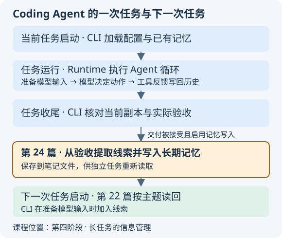

## 本篇技术方案

### 实施前，先走完一次具体过程

1. 操作者在任务配置中指定笔记文件、主题 `route-repair` 和要记录的验收用例 `/`。首轮读取空笔记，模型照常调查并修复。
2. 任务结束后，CLI 重新审阅当前副本。已有交付判断确认通过的验收对应当前文件，才允许尝试记笔记。
3. 写入函数从验收输出里找到 `input: "/"`、`expected: "/"` 的通过项，生成一条带验收脚本名和内容标识的笔记。同一文件内用主题决定新增或更新。
4. 下一次独立任务启动时，第 22 篇的读取入口从同一个文件找到这条笔记。旧笔记提供调查方向，本次是否通过仍由本次验收决定。

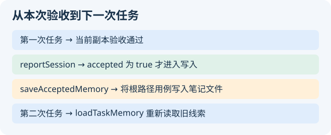

**验收标准。** 第一次首轮无记忆，交付后文件多出一条；第二次使用新副本，首轮能读到它，重复保存同一证据保持一条。新证据可更新同主题，设为停用后读取和自动更新都跳过。应用负责存取，Runtime 继续管理当次运行历史。

### 先看结果

装好项目依赖后，从仓库根目录运行。预览只使用人工构造的验收对象和临时文件。

```bash
node --import tsx site/snippets/24-memory-writeback/examples/memory-writeback/inspect-memory.ts
```

先看前三行：`saved`、`unchanged`、`saved`。第一次写入，第二次证据相同所以不写，第三次的人工证据把预期值换成了 `/home`，随后读取到更新后的提示。这里的 `/home` 只用来演示更新，正式路径任务仍按原规则验收。

## 本篇核心代码在哪

看 `apps/coding-cli/src/report/report.ts` 的 `reportSession`。它在 `acceptTask` 得到 `accepted` 后，才把同一份 `review` 交给 `saveAcceptedMemory`。这几行决定**什么时候允许记**。

接着看 `apps/coding-cli/src/context/save-memory.ts` 的 `saveAcceptedMemory`。里面的 `report.cases.find(...)` 决定**从哪条证据取内容**，而 `notes.map(...)` 或 `[...notes, next]` 决定**更新哪一条，还是新增一条**。配置负责告诉它记哪个用例，第 22 篇的读取入口负责下次取回。

## 动手前

从第 23 篇的学习源码接着做。本篇用原路径材料和第 20 篇的 `examples/input-budget/sample-model.ts`，实验会自行创建临时任务配置和笔记。

```bash
git status --short
git switch -c agent/chapter-24-memory-writeback
```

## 第一步：读写共用同一份笔记格式

### 1.1 定义写入所需的两份数据

打开 `apps/coding-cli/src/types/task.ts`，在 `export interface TaskConfig` 的文档注释前新增下面两个类型。`MemoryNote` 描述磁盘上的笔记，`MemoryCapture` 描述本次要把哪个用例写到哪里。
```ts
/** 【新增】磁盘上的一条笔记。写入时保留已有的附加字段。 */
export interface MemoryNote {
  /** 同一文件内用于查找与更新的键。 */
  topic: string;
  /** 选中后提供给模型的调查线索。 */
  hint: string;
  /** 操作者设为 false 后停止检索和自动更新。 */
  enabled?: unknown;
  /** 保留来源等附加字段，由各自的写入方解释。 */
  [key: string]: unknown;
}

/** 【新增】操作者为本任务授权的写入范围，由 loadTask 解析后交给报告层。 */
export interface MemoryCapture {
  /** 已存在的笔记文件的绝对路径。 */
  path: string;
  /** 文件内唯一的主题，同时作为更新时的键。 */
  topic: string;
  /** 从最终验收中提取的用例输入，例如根路径 /。 */
  caseInput: string;
}
```

在同一个文件的 `TaskConfig` 里，紧接 `memory?: TaskMemory;` 追加一个字段。原来的 `memory` 是已经读出的线索，新字段会由配置加载器填好，交给报告层使用。

```ts
  /** 【新增】有此配置才在交付后尝试保存验收线索。 */
  memoryCapture?: MemoryCapture;
```

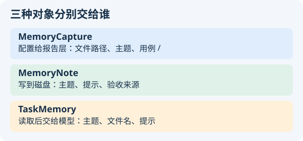

::: details 完整文件 types/task.ts
<<< @/snippets/24-memory-writeback/apps/coding-cli/src/types/task.ts
:::

### 1.2 把读文件和选笔记分开

打开 `apps/coding-cli/src/context/task-memory.ts`。先把 `../types/task` 的类型导入改为 `import type { MemoryNote, TaskMemory } from '../types/task';`。然后在 `isRecord` 和 `loadTaskMemory` 之间加入下面这个函数。它只管读取和校验，选哪个主题仍由原来的函数决定。

```ts
/** 【新增】供读取与写入共用的文件校验，额外字段在写入时原样保留。 */
export async function readMemoryNotes(path: string, signal?: AbortSignal): Promise<MemoryNote[]> {
  const info = await stat(path);
  if (!info.isFile() || info.size > 8 * 1024) {
    throw new Error('任务记忆应为小型 JSON 文件。');
  }

  const raw: unknown = JSON.parse(await readFile(path, { encoding: 'utf8', signal }));
  if (!Array.isArray(raw)) {
    throw new Error('任务记忆应为记录数组。');
  }

  return raw.map((note: unknown) => {
    if (
      !isRecord(note) ||
      typeof note.topic !== 'string' ||
      typeof note.hint !== 'string' ||
      !note.hint.trim() ||
      note.hint.length > 240
    ) {
      throw new Error('记忆记录应包含 topic 和简短的 hint。');
    }
    return { ...note, topic: note.topic, hint: note.hint };
  });
}
```

现在回到同一文件的 `loadTaskMemory`，保留开头的选择条件校验和 `const path = resolve(base, selection.file);`。从它下一行开始，把原来的 `stat(path)`、JSON 解析、筛选循环和函数末尾的返回逻辑，替换为下面这一段。保留函数最后的闭合花括号。

```ts
  const notes = await readMemoryNotes(path, signal);

  // 配置给出要找的主题，笔记给出线索正文，来源文件名由加载器补上。
  const topic = selection.topic.trim();
  const matches: TaskMemory[] = [];
  for (const note of notes) {
    // 【修改】停用的笔记仍留在文件里，加载时跳过。
    if (note.topic === topic && note.enabled !== false) {
      matches.push({ topic, source: basename(path), hint: note.hint });
    }
  }

  // 多条同主题记录需要操作者合并，避免用文件顺序决定哪条生效。
  if (matches.length > 1) {
    throw new Error('同一主题有多条记忆，请先合并。');
  }
  return matches[0];
```

在 `loadTaskMemory` 的循环里，`note.enabled !== false` 使老笔记默认可用。操作者把某条记录的 `enabled` 设为 `false` 后，记录还在磁盘，但不会被放进模型输入。

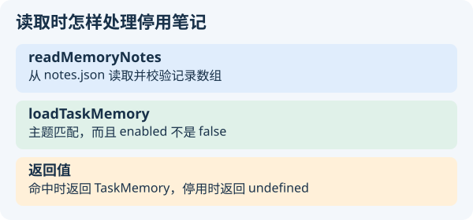

::: details 完整文件 context/task-memory.ts
<<< @/snippets/24-memory-writeback/apps/coding-cli/src/context/task-memory.ts
:::

## 第二步：从验收提取一条记录，再按主题保存

新建 `apps/coding-cli/src/context/save-memory.ts`。它接收目标笔记和验收快照。先读下面两个摘录，再展开完整实现写入新文件。正式入口会在第三步接入。这里先只跟一条用例：操作者选的是 `/`，验收输出里要有同样的 `input`，且实际值与预期值相等。

在这个文件的 `saveAcceptedMemory` 里，下面几行位于解析 `check.stdout` 并确认 `report.cases` 是数组之后。摘录已包含在完整文件里。

```ts
const sample = report.cases.find((item: unknown) =>
  object(item) && item.input === capture.caseInput && item.passed === true,
);
```

如果找到 `input: "/"`、`expected: "/"`、`actual: "/"` 的通过项，后续代码就把预期值写进 `hint`。同时，`evidence` 保留验收脚本文件名和该次验收的 `revision`，用于核对来源。找不到合适的用例会返回 `no-evidence`，笔记保持原样。

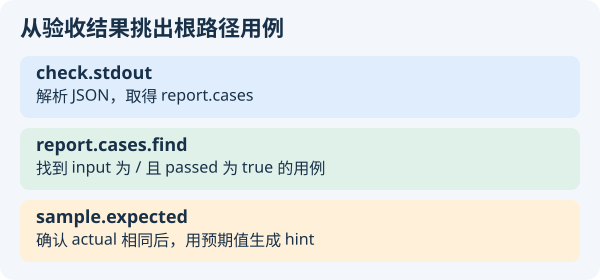

### 为什么第二次保存不会再写一条

在 `apps/coding-cli/src/context/save-memory.ts` 中看下面的摘录。它已包含在本步的完整实现里。

```ts
  const previous = existing[0];
  if (previous?.enabled === false) {
    return 'disabled';
  }

  const evidence = { checkScript: basename(checkScript), revision: check.revision };
  if (previous?.hint === hint && object(previous.evidence) &&
      previous.evidence.checkScript === evidence.checkScript &&
      previous.evidence.revision === evidence.revision) {
    return 'unchanged';
  }
```

在 `saveAcceptedMemory` 中，首次运行没有旧条目，`previous` 是 undefined，两处提前返回都跳过。第二次运行找到同主题条目后，先检查它是否被停用。仍启用时，再比较提示、验收脚本名和内容标识。三项都相同就返回 `unchanged`，执行在打开暂存文件之前结束。如果示例换成 `sample-v2`，标识变化，代码继续走到下面的替换逻辑。

在同一文件的 `saveAcceptedMemory` 里，读完停用和重复判断后，再看下面这段。它已包含在完整实现里。

```ts
  const next: MemoryNote = { ...previous, topic: capture.topic, hint, evidence };
  const updated = previous
    ? notes.map((note) => note === previous ? next : note)
    : [...notes, next];
```

首次空文件时，`previous` 为空，代码追加 `next`。第二次同主题命中后，若提示、脚本和内容标识都一致，会提前返回 `unchanged`。证据变化时，代码只替换原来那一条，其他主题照常保留。停用的笔记会先返回 `disabled`。

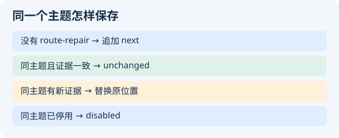

::: details 完整实现 context/save-memory.ts
<<< @/snippets/24-memory-writeback/apps/coding-cli/src/context/save-memory.ts
:::

写文件时先在目标文件所在目录暂存完整 JSON，成功后再替换原文件。这样写到一半失败时，原笔记仍可读。本章的示例按顺序运行；多个进程同时更新同一文件需要额外的并发控制。

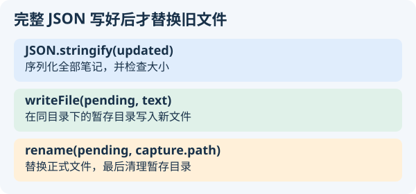

新建 `examples/memory-writeback/inspect-memory.ts`。它把三份人工验收依次交给刚写好的函数，最后用原来的读取函数核对内容。

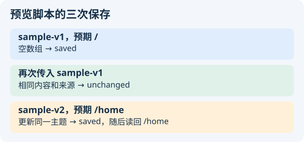

::: details 完整示例 inspect-memory.ts
<<< @/snippets/24-memory-writeback/examples/memory-writeback/inspect-memory.ts
:::

```bash
node --import tsx examples/memory-writeback/inspect-memory.ts
```

**可以先停在这里。** 能指出 `/home` 来自哪个字段，以及为什么更新后只有一个主题记录，就已经读懂本章的写入逻辑。

## 第三步：让 CLI 在确认交付后保存

### 3.1 让配置明确要保存哪个用例

打开 `apps/coding-cli/src/config/task.ts`，在原有的类型导入里加入 `MemoryCapture`，改成 `import type { MemoryCapture, TaskConfig } from '../types/task';`。在 `loadTask` 里找到 `const memory = await loadTaskMemory(value.memory, base, signal);`，紧接着插入下面这段。
```ts
  // 【新增】读取笔记和授权写入是两项独立的配置决定。
  let memoryCapture: MemoryCapture | undefined;
  if (isRecord(value.memory) && Object.hasOwn(value.memory, 'captureCase')) {
    const { file, topic, captureCase } = value.memory;
    if (
      typeof file !== 'string' ||
      typeof topic !== 'string' ||
      typeof captureCase !== 'string' ||
      captureCase.length === 0 ||
      captureCase.length > 64
    ) {
      throw new Error('记忆写入需要指定可核对的验收用例。');
    }
    memoryCapture = {
      path: await realpath(resolve(base, file)),
      topic: topic.trim(),
      caseInput: captureCase,
    };
  }
```

在同一函数的返回对象里，紧接 `...(memory ? { memory } : {}),` 插入下面一行。比如配置给出 `captureCase: "/"` 时，报告层就能拿到用例 `/` 和笔记的绝对路径。只有 `file` 和 `topic` 的旧配置继续只读取笔记。

```ts
    ...(memoryCapture ? { memoryCapture } : {}),
```

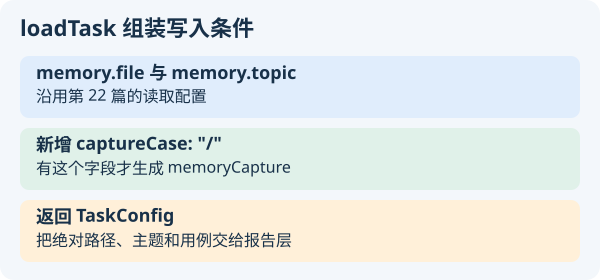

::: details 完整文件 config/task.ts
<<< @/snippets/24-memory-writeback/apps/coding-cli/src/config/task.ts
:::

### 3.2 只在交付被接受后写入

打开 `apps/coding-cli/src/report/report.ts`，在导入区加入 `import { saveAcceptedMemory } from '../context/save-memory';`。再到 `reportSession` 末尾，在原来的 `return result.status === 'cancelled' ? 130 : accepted ? 0 : 1;` **之前插入**下面这段。前面的验收判断和最后的返回语句继续使用原来的代码。

```ts
  // 【新增】仅从已接受的交付提取笔记。记忆写入失败独立报告。
  if (accepted && task.memoryCapture) {
    try {
      const status = await saveAcceptedMemory(task.memoryCapture, review, task.checkScript);
      printBlock('长期记忆写入', { status });
    } catch {
      printBlock('长期记忆写入', { status: 'failed' });
    }
  }
```

外层只有在 `accepted && task.memoryCapture` 时进入。这里的 `review` 就是 `session.codeTask.inspect()` 返回、刚被 `acceptTask` 用过的对象。写入失败单独显示 `failed`，当前文件验收仍按原规则报告。

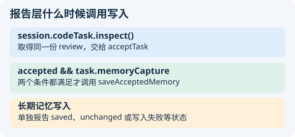

::: details 完整文件 report/report.ts
<<< @/snippets/24-memory-writeback/apps/coding-cli/src/report/report.ts
:::

## 第四步：让下一次任务从磁盘取回

新建 `examples/memory-writeback/main.ts`。它先生成临时任务配置与空笔记，再两次调用 `runCli`。每次使用新的固定模型、新的副本和新的运行历史。它们共用的只有源材料和磁盘上的笔记。

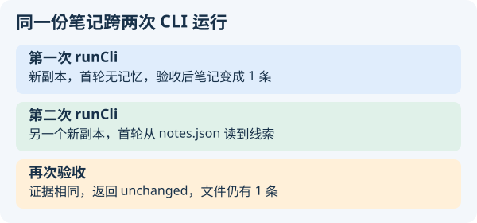

::: details 完整示例 main.ts
<<< @/snippets/24-memory-writeback/examples/memory-writeback/main.ts
:::

```bash
npm run check
node --import tsx examples/memory-writeback/main.ts
```

| 看哪条日志 | 第一次任务 | 第二次任务 |
|---|---|---|
| 首轮的记忆 | 无 | 来自 `notes.json` 的根路径提示 |
| 交付判断 | `accepted: true` | `accepted: true` |
| 长期记忆写入 | `saved` | `unchanged` |
| 任务后笔记条数 | 1 | 1 |

第一轮的日志来自观察脚本读取 `context.messages`，写入日志来自报告层。第二次调用看到的是文件重新加载后的记录。两次修复使用固定模型与实际本地验收，结果用于核对读写链路。

### 断点与小迁移

在 `report/report.ts` 调用 `saveAcceptedMemory` 前断住，先核对 `accepted`、`review.checkMatchesCurrent` 和 `review.lastCheck.revision`。继续到 `context/save-memory.ts` 的 `const updated`，看第一条记录如何从空数组生成。第二次运行会在 `unchanged` 分支提前返回。

想验证停用，在独立观察脚本的 `try` 中，把初始的 `[]` 换成一条带 `enabled: false` 的同主题笔记。运行后写入状态应为 `disabled`，最后读取为 `undefined`。验证完恢复空数组。

### 可选：接回真实 CLI

有已配置服务时，可复制已有路径任务配置和笔记到同一目录，给复制后的任务配置指向那份笔记，再加 `memory.captureCase: "/"`。任务配置中的来源与验收路径仍按配置所在目录解析。运行 `npm run check` 后，沿用正常 CLI 的 `--task` 入口。第一次看交付判断与写入状态，第二次看首轮 `hasTaskMemory`。真实服务可能产生费用，本地验证使用固定模型。

Pi 的 `AgentSession` 会把已发生的消息交给 `SessionManager.appendMessage` 保存，`appendCustomEntry` 另有独立记录结构。本篇借鉴把持久记录放在应用层的做法。我们以实际交付为写入条件，按主题维护独立笔记文件；Pi 的这两处代码负责会话记录。 [Pi 消息持久化](https://github.com/badlogic/pi-mono/blob/8efd314fa3d3232ce197d8d7a6a5660530b9d83e/packages/coding-agent/src/core/agent-session.ts#L1098) · [Pi 自定义会话记录](https://github.com/badlogic/pi-mono/blob/8efd314fa3d3232ce197d8d7a6a5660530b9d83e/packages/coding-agent/src/core/session-manager.ts#L1200)

## 保存本篇

```bash
git status --short
git add apps/coding-cli/src examples/memory-writeback
git commit -F - <<'EOF_COMMIT'
从已验收任务保存可复用的记忆

用实际验收用例生成带来源的线索，按主题写入或更新。
用两次独立任务验证首次保存、下次读取和重复写入去重。
EOF_COMMIT
git push -u origin agent/chapter-24-memory-writeback
```
