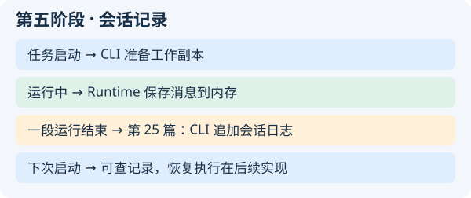
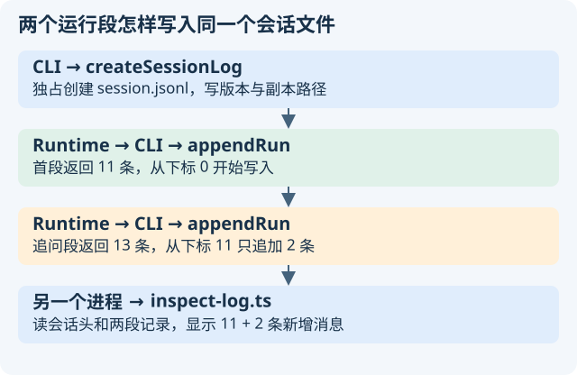
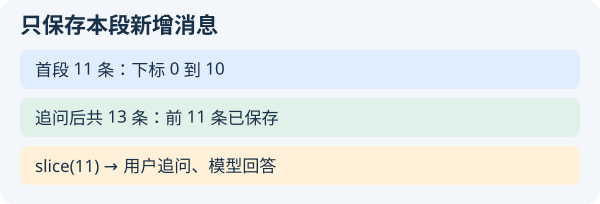
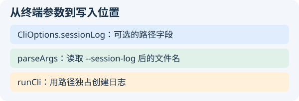
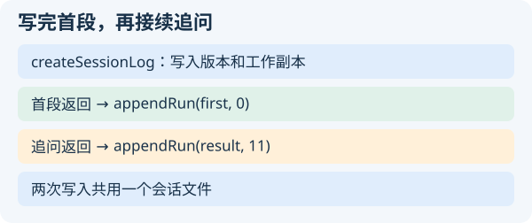
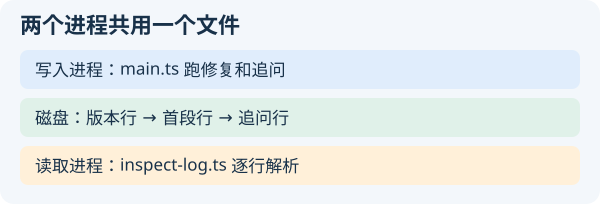

# 25 让 Coding Agent 退出后仍能查到会话

第 23 篇能在同一个 CLI 进程里接续追问。关掉进程后，完整消息和停止原因就只能靠终端输出回查。本篇给同一个 CLI 加一个可选的会话日志，先保存已经发生的事实，为下一步恢复执行打基础。

## 本篇在 Agent 的什么位置

第五阶段「可靠执行与恢复」从会话记录开始。每段 Agent 循环结束，Runtime 返回结果，**CLI 在接续追问或生成交付报告之前写盘**。



## 本篇技术方案

### 实施前，先走完一次具体过程

1. 用户提交路径修复任务和一条追问，并用 `--session-log` 指定一个新文件。CLI 准备副本后，把版本和副本路径写入首行。
2. 第一段修复并验收，Runtime 返回 11 条历史。CLI 把这 11 条连同运行 ID、停止状态一起写入第二行，再开始追问。
3. 追问结束，Runtime 返回 13 条累计历史。前 11 条已经保存，CLI 只追加用户追问和模型回答。退出后，用另一个进程读取这三行。

### 实现架构图



每行各自是一份 JSON，这种格式叫 JSONL。验收时找三个数字：版本 `1`、首段新增 `11` 条、追问段新增 `2` 条。交付仍看实际验收。日志含任务和工具反馈原文，选择本地私有目录保存。本篇只在运行段返回后写盘，段内突然退出时，磁盘上只有此前已写的记录。

### 先看一行怎样落盘

安装项目依赖后，在仓库根目录运行。它只写一个临时文件，使用人工记录，不启动模型。

```bash
node --import tsx --input-type=module <<'JS'
import { mkdtemp, readFile, rm } from 'node:fs/promises';
import { tmpdir } from 'node:os';
import { join } from 'node:path';
import { createSessionLog, appendRun } from './site/snippets/25-session-log/apps/coding-cli/src/session/session-log.ts';

const dir = await mkdtemp(join(tmpdir(), 'session-preview-'));
try {
  const path = await createSessionLog(join(dir, 'session.jsonl'), dir);
  await appendRun(path, {
    runId: 'sample',
    status: 'answered',
    modelCalls: 1,
    toolCalls: 0,
    messages: [
      { role: 'user', content: '修复路径' },
      { role: 'assistant', content: '已经修好', stopReason: 'stop', toolCalls: [] },
      { role: 'user', content: '验收通过了吗？' },
    ],
  }, 2);
  console.log(await readFile(path, 'utf8'));
} finally {
  await rm(dir, { recursive: true, force: true });
}
JS
```

第二行的 `messages` 只剩「验收通过了吗？」。这个预览专门演示从下标 2 开始写入，正式追问段的起点由首段历史长度决定。

## 本篇核心代码在哪

看 `apps/coding-cli/src/main.ts` 的 `runCli`。**首段传 `0`，第二段传 `first.messages.length`**。再看 `apps/coding-cli/src/session/session-log.ts` 的 `appendRun`，其中 `result.messages.slice(start)` 取出尚未保存的那段历史。这两处决定什么时候写，以及写哪几条。

Pi 固定版本的 `SessionManager.appendMessage` 把消息包装成会话条目，`_appendEntry` 再调用 `_persist` 写入 JSONL。课程沿用应用层追加记录的做法，以每段返回为写入时机。 [Pi 会话持久化源码](https://github.com/badlogic/pi-mono/blob/8efd314fa3d3232ce197d8d7a6a5660530b9d83e/packages/coding-agent/src/core/session-manager.ts#L1090)

## 动手前

从第 24 篇接着做。实验复用原路径任务和 `examples/input-budget/sample-model.ts`。

```bash
git status --short
git switch -c agent/chapter-25-session-log
```

## 第一步：一行保存一段运行

新建 `apps/coding-cli/src/session/session-log.ts`。它负责两件事：任务开始时创建日志，Runtime 每返回一段结果时追加一条记录。先展开完整实现一次写入，再跟着三个小节读代码。

::: details 完整实现 session/session-log.ts
<<< @/snippets/25-session-log/apps/coding-cli/src/session/session-log.ts
:::

### 1.1 首行记录这是谁的会话

在这个文件的 `createSessionLog` 中，`file` 来自终端的 `--session-log`，`workspace` 来自 CLI 已准备好的工作副本。假设传入 `./session.jsonl`，`resolve(file)` 会把它转成相对终端当前目录的绝对路径。

```ts
  const path = resolve(file);
  const header = { type: 'session', version: 1, workspace };
  await writeFile(path, JSON.stringify(header) + '\n', { flag: 'wx', mode: 0o600 });
  return path;
```

`header` 描述整个日志。`type: 'session'` 让读取方知道这一行是头部，`version: 1` 标记文件格式，`workspace` 指向这次使用的副本。`JSON.stringify(header)` 把对象变成一行文本，加上的 `'\n'` 让下一条记录从新的一行开始。等待写入成功后，CLI 接住返回的 `path`，后面的两段都用它追加。

`wx` 要求目标是新文件，同名文件已存在就报错。初始权限用 `0o600`，因为记录会包含任务和工具反馈原文。

### 1.2 一段运行变成一条记录

在同一文件的 `appendRun` 中，`result` 是 Runtime 返回给 CLI 的一段完整结果，`start` 由调用方传入，表示**日志里已经写过几条历史消息**。先看函数怎样挑出要落盘的字段。

```ts
  const entry = {
    type: 'run',
    runId: result.runId,
    status: result.status,
    modelCalls: result.modelCalls,
    toolCalls: result.toolCalls,
    messages: result.messages.slice(start),
  };
```

`entry` 的运行 ID、停止状态和调用计数都属于当前这一段。只有 `messages` 要按下标截取，因为 Runtime 返回的历史会累积。以本篇固定示例为例：

| 哪一段刚结束 | Runtime 返回的 `result.messages` | CLI 传的 `start` | 本行实际保存 |
|---|---|---|---|
| 首段修复 | 共 11 条，包含任务、工具请求和反馈、首段回答 | `0` | 下标 0 到 10，共 11 条 |
| 追问段 | 共 13 条，前 11 条与首段一致 | `first.messages.length`，也就是 `11` | 下标 11 的用户追问和下标 12 的模型回答 |

`slice(11)` 从下标 11 开始复制到数组末尾。它只改变写进日志的那份数组，Runtime 返回的 13 条历史仍然完整。比如首段的 `check_complete` 工具反馈仍可在文件的首段记录中查到。



### 1.3 把这一条追加到文件末尾

`appendRun` 组装完 `entry` 后，最后一行把对象转成 JSON 文本，并补一个换行。

```ts
  await appendFile(path, JSON.stringify(entry) + '\n', { flag: constants.O_WRONLY | constants.O_APPEND });
```

`O_WRONLY` 以只写方式打开，`O_APPEND` 让本次写入从文件末尾开始。这里没有创建标志，日志如果被移走，追加会失败，CLI 就能知道原会话文件已经不在了。两段都写完后，文件依次是「会话头 → 首段记录 → 追问段记录」。第四步的读取脚本会逐行解析这三条记录。

**读到这里可以先停一下。** 如果追问段改成传 `start = 0`，第二条运行记录会写入 13 条消息，其中前 11 条会重复。这就是第三步传入首段长度的原因。

## 第二步：让终端能指定日志位置

打开 `apps/coding-cli/src/types/task.ts`，在 `CliOptions` 有 `taskFile` 的分支里，在 `followUp?: string;` 下方追加：

```ts
      /** 【新增】操作者指定的新会话记录文件，省略时只保留终端报告。 */
      sessionLog?: string;
```

::: details 完整文件 types/task.ts
<<< @/snippets/25-session-log/apps/coding-cli/src/types/task.ts
:::

打开 `apps/coding-cli/src/config/args.ts`，在 `parseArgs` 的 `let followUp` 下方加 `let sessionLog: string | undefined;`。在参数循环里，找到以 `} else if (arg === '--task'` 开头的整行，在它正上方插入以下代码。

```ts
    } else if (arg === '--session-log' && sessionLog === undefined) {
      // 【新增】文件路径相对启动 CLI 时的工作目录。
      const value = args[++i];
      if (!value?.trim() || value.startsWith('--')) {
        throw new Error('会话记录路径缺失。');
      }
      sessionLog = value;
```

原来的 `--task` 分支首行保留，它开头的 `}` 会闭合刚插入的分支。接着在同一文件的 `parseArgs` 返回对象里，找到 `...(followUp ? { followUp } : {}),`，紧接着加入下面这一行：

```ts
    ...(sessionLog ? { sessionLog } : {}),
```

参数分支把路径存进局部变量，这一行才把路径交给 `runCli`。漏写时，修复任务仍可能正常验收，但 `options.sessionLog` 是 `undefined`，CLI 会跳过写入。最后在 `helpText` 的用法行追加 `[--session-log <文件>]`，在 `--help` 之前说明它保存到一个新文件。



::: details 完整文件 config/args.ts
<<< @/snippets/25-session-log/apps/coding-cli/src/config/args.ts
:::

## 第三步：在两个运行段返回后分别写入

打开 `apps/coding-cli/src/main.ts`，新增导入 `import { appendRun, createSessionLog } from './session/session-log';`。在 `runCli` 打印工作副本之后、第一次设置 `phase = '运行与报告';` 之前插入：

```ts
    // 【新增】先独占创建文件，防止两次 CLI 运行混写。
    let logPath: string | undefined;
    if (options.sessionLog) {
      phase = '会话记录';
      logPath = await createSessionLog(options.sessionLog, session.root);
    }
```

在 `const first = await runSession(...)` 之后、`let result = first;` 之前插入：

```ts
    // 【新增】首段落盘之后才启动追问。
    if (logPath) {
      phase = '会话记录';
      await appendRun(logPath, first, 0);
      phase = '运行与报告';
    }
```

在追问分支内、`result = await runSession(..., nextInput);` 的下一行插入：

```ts
      if (logPath) {
        phase = '会话记录';
        await appendRun(logPath, result, first.messages.length);
        phase = '运行与报告';
      }
```

这里的 `await` 决定了先后顺序。首段写失败时，CLI 走原有异常分支并显示「会话记录失败」，追问尚未开始。未指定路径时，三个写入点都跳过。两个段的 `runId` 各自保存，共用同一个日志首行。

### 首段保存后，追问从哪条消息开始

在 `apps/coding-cli/src/main.ts` 中看下面的摘录。它已包含在本步的完整实现里。

```ts
      const nextInput: RunInputOptions = {
        messages: [...first.messages, { role: 'user', content: options.followUp }],
        fullHistory,
      };
      result = await runSession(task, session, callModel, controller.signal, onEvent, nextInput);
      if (logPath) {
        phase = '会话记录';
        await appendRun(logPath, result, first.messages.length);
        phase = '运行与报告';
      }
```

在 `runCli` 的追问分支里，`first.messages` 有 11 条。先展开它，再追加追问，`nextInput.messages` 变成 12 条。第二次 `runSession` 完成回答后，`result.messages` 变成 13 条。调用 `appendRun` 时仍传入首段长度 11，因此日志最后一行仅包含下标 11、12。若首段 `appendRun` 抛错，执行会在进入追问分支前跳到 `catch`，第二次 `runSession` 尚未开始。



::: details 完整文件 main.ts
<<< @/snippets/25-session-log/apps/coding-cli/src/main.ts
:::

## 第四步：退出后用另一个进程读记录

新建 `examples/session-log/main.ts`。它让固定模型完成实际修复，追问时从 `check_complete` 读取最后一次验收。然后新建 `examples/session-log/inspect-log.ts`。这个脚本只读文件，逐行解析 JSON 后打印概要。



::: details 完整示例 main.ts
<<< @/snippets/25-session-log/examples/session-log/main.ts
:::

::: details 完整示例 inspect-log.ts
<<< @/snippets/25-session-log/examples/session-log/inspect-log.ts
:::

```bash
npm run check
session_dir=$(mktemp -d)
node --import tsx examples/session-log/main.ts "$session_dir/session.jsonl" &&
test -f "$session_dir/session.jsonl" &&
node --import tsx examples/session-log/inspect-log.ts "$session_dir/session.jsonl"
```

第二条 Node 命令输出：

```text
会话版本 1
运行 answered 新增消息 11
运行 answered 新增消息 2
```

**可以先停在这里。** 打开日志的最后一行，预测其中会不会再次出现 `check_complete` 工具反馈。核对后再找首段记录。追问段只保存新问题与新回答，完整验收反馈在首段。

### 可逆故障：重复指定同一个文件

再运行一次写入命令，沿用刚才的日志路径。预期 CLI 显示「会话记录失败」、退出码为 2。再次读日志，仍应是原来的三行。换一个新文件名即可恢复。也可以在 `runCli` 的第二次 `appendRun` 调用处断住，核对 `result.messages.length` 是 13、`first.messages.length` 是 11。

### 可选：接回真实 CLI

完成构建和已有服务配置后，可运行下面的命令。它会调用模型服务，可能产生费用。先核对日志是否记录了实际停止状态，再核对当前交付结果。

```bash
session_dir=$(mktemp -d)
node --env-file=.env apps/coding-cli/dist/cli.js --task fixtures/code-tasks/route.json \
  --follow-up '最后一次实际验收结果是什么？' --session-log "$session_dir/session.jsonl"
node --import tsx examples/session-log/inspect-log.ts "$session_dir/session.jsonl"
```

## 保存本篇

```bash
git status --short
git add apps/coding-cli/src examples/session-log
git commit -F - <<'EOF_COMMIT'
保存 Coding CLI 的会话运行记录

逐段保存运行状态和新增消息，拒绝覆盖已有会话日志。
用独立读取进程核对首段与追问段的记录。
EOF_COMMIT
git push -u origin agent/chapter-25-session-log
```
