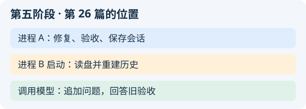
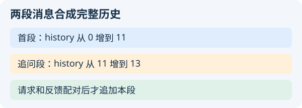
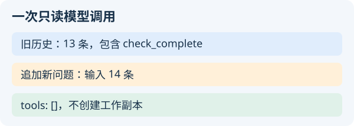
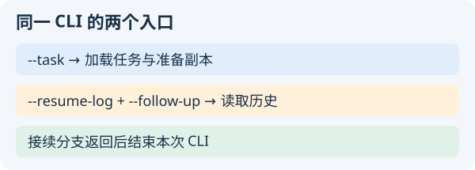

# 26 退出后继续追问上一场任务

第 25 篇能在退出后查到日志。本篇让 Coding CLI 在新进程里读回这份历史，回答「修正后最后一次验收是什么结果？」。

## 本篇在 Agent 的什么位置

第五阶段「可靠执行与恢复」。这一步接在**新进程启动、第一次调用模型之前**。旧工具反馈作为历史消息进入新请求，执行工具的工作副本和验收状态仍属于原来的进程。



## 本篇技术方案

### 实施前，先走完一次具体过程

1. 第一个 CLI 进程修复路径，保存会话头、首段 11 条消息和追问段 2 条新增消息。
2. 退出后，第二个 CLI 进程收到日志路径和新问题。它验证文件版本、运行段边界和工具请求与反馈的配对，再按顺序拼出 13 条历史。
3. CLI 把新问题放在第 14 条，调用一次模型。模型能引用旧的 `check_complete`。本次工具列表为空，回答描述的是历史验收结果。

**验收标准。** 两个进程分别运行，第二个进程能依据磁盘记录回答。日志截断或工具反馈缺失时，读入失败，模型工厂也不会被调用。

### 先看旧进程留下了什么

从已完成第 25 篇的仓库根目录运行。以下是固定模型与真实本地验收，无需密钥。后面继续用同一个终端中的 `session_dir`。

```bash
session_dir=$(mktemp -d)
node --import tsx examples/session-log/main.ts "$session_dir/session.jsonl" &&
node --import tsx examples/session-log/inspect-log.ts "$session_dir/session.jsonl"
```

你会看到首段 11 条和追问段 2 条。先预测：如果直接把最后一行的两条消息交给模型，它还能找到原始验收反馈吗？

## 本篇核心代码在哪

`apps/coding-cli/src/session/read-session-log.ts` 的 `readSessionHistory` 用 `history.push(...entry.messages)` 恢复原顺序。`apps/coding-cli/src/session/resume-conversation.ts` 的 `resumeConversation` 再用 `[...history, { role: 'user', content: question }]` 构造模型输入。前者负责取回旧事实，后者负责提出新问题。

Pi 的 `buildSessionProjection` 从会话条目构造模型上下文，还处理分支和上下文编辑。本篇借鉴「从保存条目重建输入」的职责划分，用第 25 篇的线性日志。 [Pi 固定版本源码](https://github.com/badlogic/pi-mono/blob/8efd314fa3d3232ce197d8d7a6a5660530b9d83e/packages/coding-agent/src/core/session-manager.ts#L505)

## 动手前

从第 25 篇已保存的实现起步。由你创建本章分支。

```bash
git status --short
git switch -c agent/chapter-26-resume-conversation
```

## 第一步：把每段新增消息拼回历史

新建 `apps/coding-cli/src/session/read-session-log.ts`。调用方给它日志路径，等它交回一份能传给模型的历史消息。这里沿用开头生成的那份三行日志。先展开完整实现，一次写入新文件。后面的几个小节用同源摘录解释这份代码。

::: details 完整实现 session/read-session-log.ts
<<< @/snippets/26-resume-conversation/apps/coding-cli/src/session/read-session-log.ts
:::

### 1.1 先分清会话头和运行段

在 `readSessionHistory` 中，找到读取文件之后的这几行。

```ts
  const [first, ...lines] = text.slice(0, -1).split('\n');
  const header: unknown = JSON.parse(first!);
  if (!record(header) || header.type !== 'session' || header.version !== 1 ||
      typeof header.workspace !== 'string' || lines.length === 0) {
    throw new Error('缺少可接续的版本 1 会话记录。');
  }
```

上一条检查已确认文件以换行结尾，所以 `slice(0, -1)` 先去掉最后一个换行，再按行切开。此时 `first` 是会话头的文本，`lines` 是两条运行记录的文本。头部必须是版本 1，而且至少有一条运行记录。只有会话头的文件还没有一段结束的运行可供接续。

### 1.2 确认一行里装的是可以接续的消息

继续看 `readSessionHistory` 的循环。每轮只解析一行。下面是进入 `history` 之前的检查。

```ts
    const entry: unknown = JSON.parse(line);
    if (!record(entry) || entry.type !== 'run' || entry.status !== 'answered' ||
        !Array.isArray(entry.messages) || !entry.messages.every(message) ||
        !completeSegment(entry.messages)) {
      throw new Error('运行段未正常回答或工具反馈不完整。');
    }
```

`JSON.parse` 只能告诉我们它是合法 JSON。因此先把结果当 `unknown`，再逐项确认。对于本例，首段的 `entry.status` 是 `answered`，`entry.messages` 有 11 条。`every(message)` 检查单条结构。比如 `toolResult` 必须有字符串内容、工具请求 ID 和工具名，以及布尔值 `isError`。`completeSegment` 则检查这些消息连在一起是否完整。

### 1.3 用 `check_complete` 走一遍请求与反馈

在同一个文件里找到 `completeSegment`。开头要求这段从用户消息开始，最后是有文字、没有待执行请求的正常回答。循环内部有一张 `pending` 表，键是请求 ID，值是工具名。读到 assistant 消息里的工具请求时，下面这段把每个请求登记进去，同一批重复 ID 会失败。

```ts
        for (const call of item.toolCalls) {
          if (pending.has(call.id)) {
            return false;
          }
          pending.set(call.id, call.name);
        }
```

例如读到请求 `{ id: "check_complete", name: "run_check", … }` 后，表里有 `"check_complete" → "run_check"`。下一条实际工具反馈到来时，循环走到同一函数的 `toolResult` 分支：

```ts
      if (pending.get(item.toolCallId) !== item.toolName) {
        return false;
      }
      pending.delete(item.toolCallId);
```

ID 和工具名都匹配，才把这条待配对请求删掉。假如删掉该反馈，`pending` 里仍有 `check_complete`，循环读到下一条模型回答时会返回 `false`，外层随即拒绝整个日志。验收业务通过或失败则仍由反馈正文表达，配对检查只确认这条反馈对应哪个请求。

### 1.4 拼回完整历史

回到 `readSessionHistory`。这一行在所有检查通过后执行：

```ts
    history.push(...entry.messages);
```

第一条运行记录把 `history` 从 0 条变成 11 条，第二条再追加追问与回答，变成 13 条。这样最后一轮留下的两条消息不会把首段的原始验收覆盖掉。



**可以先停在这里。** 试着说出 13 条来自哪两行，以及删掉一条反馈时为什么不能继续组装。

## 第二步：把新问题交给模型

新建 `apps/coding-cli/src/session/resume-conversation.ts`。它接住日志路径和新问题，等校验通过再向模型发一次请求。先展开下面的完整实现写入新文件。

::: details 完整实现 session/resume-conversation.ts
<<< @/snippets/26-resume-conversation/apps/coding-cli/src/session/resume-conversation.ts
:::

### 等待日志校验通过

回到同一文件中 `resumeConversation` 的开头，下面是完整实现里的摘录。

```ts
  const history = await readSessionHistory(path, signal);
  signal.throwIfAborted();
```

如果第一步抛错，执行停在 `await`，因此下面的 `createCallModel()` 不会执行。正常时 `history` 有 13 条，函数把它们交给 `runAgent`：

```ts
  return runAgent({
    messages: [...history, { role: 'user', content: question }],
    systemPrompt: '根据保存的会话回答最新问题。历史反馈只说明当时的事实；没有依据时明确说明。',
    tools: [],
    callModel: createCallModel(),
    maxModelCalls: 1,
    maxToolCalls: 0,
    timeoutMs: 60_000,
    signal,
  });
```

数组展开保留旧 `check_complete`，再把这次问题放在第 14 条。模型可以用保存的反馈说明当时的结果。`tools: []` 与 `maxToolCalls: 0` 让这段只回答问题，`maxModelCalls: 1` 限制为一次调用。Runtime 返回的停止状态和回答会交回 CLI，由第三步的接续分支打印。



## 第三步：接到同一个 CLI

### 3.1 声明接续模式

在 `apps/coding-cli/src/types/task.ts` 的 `CliOptions` 联合类型里，紧接 `| { help: true }` 插入这个分支。

```ts
  | {
      help: false;
      /** 【新增】只读接续模式使用的会话日志路径。 */
      resumeLog: string;
      /** 追加到旧历史末尾的新问题。 */
      question: string;
    }
```

`resumeLog` 标识只读接续分支，`question` 是随后要追加的用户消息。普通任务的字段仍在原来的分支里。

::: details 完整文件 types/task.ts
<<< @/snippets/26-resume-conversation/apps/coding-cli/src/types/task.ts
:::

### 3.2 把路径和问题交给 CLI

打开 `apps/coding-cli/src/config/args.ts`，在 `parseArgs` 的 `let sessionLog` 下一行新增 `let resumeLog: string | undefined;`。在参数循环中，找到以 `} else if (arg === '--task'` 开头的整行，在它上方插入下面这段。

```ts
    } else if (arg === '--resume-log' && resumeLog === undefined) {
      const value = args[++i];
      if (!value?.trim() || value.startsWith('--')) {
        throw new Error('会话日志路径缺失。');
      }
      resumeLog = value;
```

原来的 `--task` 行开头的花括号会闭合这个分支。随后在同一函数的 `if (!taskFile) {` 前插入以下返回分支。前一段只给局部变量赋值，这一段才把路径和问题交给 `runCli`。

```ts
  if (resumeLog) {
    if (taskFile || sessionLog || planning || !followUp) {
      throw new Error('只读接续需要且仅接受日志路径和一条追问。');
    }
    return { help: false, resumeLog, question: followUp };
  }
```

在 `helpText` 增加用法 `ai-harness --resume-log <文件> --follow-up <问题>`。普通任务用法行保留 `[--session-log <文件>]`。



::: details 完整文件 config/args.ts
<<< @/snippets/26-resume-conversation/apps/coding-cli/src/config/args.ts
:::

在 `apps/coding-cli/src/main.ts` 的导入区加入 `import { resumeConversation } from './session/resume-conversation';`。在 `runCli` 的帮助分支之后、`phase = '任务配置';` 之前加入下面的接续分支：

```ts
    if ('resumeLog' in options) {
      phase = '会话接续';
      const result = await resumeConversation(
        options.resumeLog,
        options.question,
        createCallModel,
        controller.signal,
      );
      printBlock('接续停止', { status: result.status });
      if (result.status === 'answered') {
        printBlock('接续回答', result.answer.content);
        return 0;
      }
      return result.status === 'cancelled' ? 130 : 1;
    }
```

这里直接返回，所以后面的 `prepareSession`、普通任务报告和记忆写入都不会运行。

::: details 完整文件 apps/coding-cli/src/main.ts
<<< @/snippets/26-resume-conversation/apps/coding-cli/src/main.ts
:::

## 第四步：关掉写入进程后再问

新建 `examples/resume-conversation/main.ts`，写入下面的完整示例。

::: details 完整示例 examples/resume-conversation/main.ts
<<< @/snippets/26-resume-conversation/examples/resume-conversation/main.ts
:::

这个脚本调用 `runCli` 时注入固定模型。固定回调检查最后一条是新问题、工具列表为空，而且原始验收反馈仍在。

```bash
npm run check
node --import tsx examples/resume-conversation/main.ts "$session_dir/session.jsonl"
```

看到 `接续停止` 为 `answered`，以及「日志中最后一次验收通过，依据是 check_complete」。可在 `resumeConversation` 的 `return runAgent` 前打断点，看 `history.length` 是否为 13，再到示例回调看 `context.messages.length` 是否为 14。

### 可逆故障：模拟末行没写完

从原文件生成一份坏副本，保留原件：

```bash
node --input-type=module -e 'import { readFileSync, writeFileSync } from "node:fs"; const [src, dst] = process.argv.slice(1); writeFileSync(dst, readFileSync(src).subarray(0, -4));' "$session_dir/session.jsonl" "$session_dir/broken.jsonl"
node --import tsx examples/resume-conversation/main.ts "$session_dir/broken.jsonl"
```

预期显示「会话接续失败」并退出 2。切回原日志即可恢复。这个实验覆盖的是拒绝不完整记录。工作副本校验、执行检查点和中断时未知的副作用，留在第五阶段后续实现。

### 可选：用真实模型问一句

完成构建和已有服务配置后，可自行运行。该命令会调用真实模型，可能产生费用。

```bash
node --env-file=.env apps/coding-cli/dist/cli.js \
  --resume-log "$session_dir/session.jsonl" --follow-up '修正后最后一次验收的结果是什么？'
```

## 保存本篇

```bash
git status --short
git add apps/coding-cli/src examples/resume-conversation
git commit -F - <<'EOF_COMMIT'
从已保存的会话接续只读追问

校验会话记录并重建完整历史，追加用户问题后调用模型。
用两个独立进程验证历史验收可回查，并拒绝截断日志。
EOF_COMMIT
git push -u origin agent/chapter-26-resume-conversation
```
