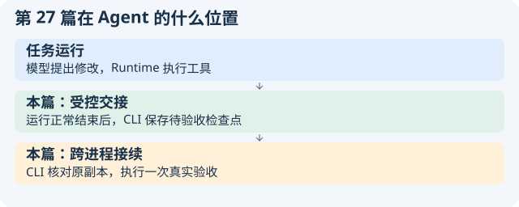
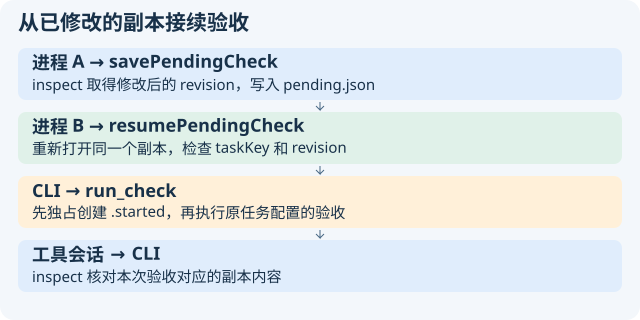
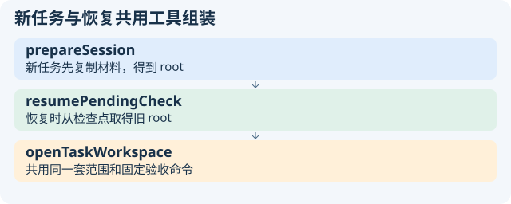
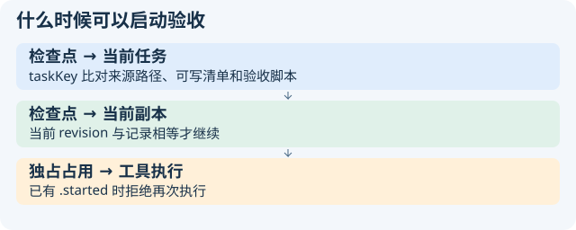
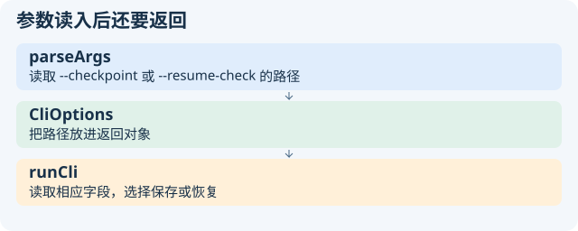
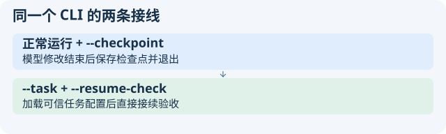
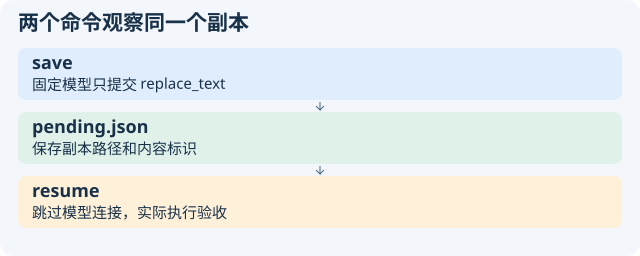

# 27 改完文件后，重启接着验收

第 26 篇能从日志找回历史。现在让新进程接着做一次真实动作。先用路径修复走通一个明确的交接点：文件已经改好，验收还没启动。

## 本篇在 Agent 的什么位置

第五阶段「可靠执行与恢复」。旧进程完成修改后交接，新进程从验收接续。



## 本篇技术方案

### 实施前，先走完一次具体过程

1. 旧 CLI 在副本里修复根路径 `/`，模型正常结束且没有请求验收。CLI 检查确实有允许的改动，保存副本路径、内容指纹与下一步 `check`。
2. 新 CLI 用相同任务配置打开检查点。它重新计算任务和副本的指纹。任一对不上，就在启动验收前停住。
3. 匹配后，新进程独占创建 `.started` 标记，再执行现有 `run_check`。工具会话重新检查结果是否对应当前文件。

### 实现架构图



**验收标准。** 正常路径下，新进程沿用旧副本且验收通过。副本被改动时拒绝恢复。同一个检查点第二次提交时，独占标记会挡住重跑。

### 先看一次本地结果

第四步的固定模型实验会在两个独立进程里得到下面的结果（节选）。

```text
进程 A：检查点已保存
进程 B：恢复验收 → passed: true
```

阅读时先追一个问题：进程 B 在哪里确认自己要验收的仍是进程 A 改过的那份内容？

## 本篇核心代码在哪

看 `apps/coding-cli/src/session/checkpoint.ts` 的 `resumePendingCheck`。关键顺序是 **比对 `before.currentRevision` → 独占创建 `.started` → 调用 `check.execute`**。这三处决定能不能继续、如何阻止重复尝试，以及真正做什么。

Pi 的会话管理器会从持久记录重建会话；本篇另外用副本指纹约束动作，并将接续限定在已知待验收的状态。 [Pi 固定版本会话管理源码](https://github.com/badlogic/pi-mono/blob/8efd314fa3d3232ce197d8d7a6a5660530b9d83e/packages/coding-agent/src/core/session-manager.ts)

## 动手前

从第 26 篇的学习源码起步。

```bash
git status --short
git switch -c agent/chapter-27-checkpoint
```

## 第一步：复用工作副本的工具接线

打开 `apps/coding-cli/src/session/prepare.ts`。在 `prepareSession` 的 `try` 块里，找到 `const codeTask = await createCodeTaskSession(` 开始的整条语句，替换到它自己的 `);` 为止。保留下一行的 `return {`。替换后的代码如下：

```ts
    const codeTask = await openTaskWorkspace(task, root, signal);
```

在同一文件末尾追加下面的函数。原有的文件范围和验收命令移入这个函数。新任务传刚创建的 `root`，恢复时传检查点里的旧 `root`。

```ts
/** 从指定副本重新建立工具会话，供新任务与检查点恢复共用。 */
export function openTaskWorkspace(task: TaskConfig, root: string, signal?: AbortSignal) {
  return createCodeTaskSession(
    {
      root,
      extensions: ['.ts', '.json', '.md'],
      writablePaths: task.writablePaths,
      check: {
        executable: process.execPath,
        args: ['--import', import.meta.resolve('tsx'), task.checkScript, root],
      },
    },
    signal,
  );
}
```



::: details 完整文件 apps/coding-cli/src/session/prepare.ts
<<< @/snippets/27-checkpoint/apps/coding-cli/src/session/prepare.ts
:::

## 第二步：保存与恢复待验收检查点

新建 `apps/coding-cli/src/session/checkpoint.ts`。它接收 CLI 已准备好的会话，或从磁盘读取一个待验收交接。先写入完整文件，再沿本次根路径修复走读。

::: details 完整文件 apps/coding-cli/src/session/checkpoint.ts
<<< @/snippets/27-checkpoint/apps/coding-cli/src/session/checkpoint.ts
:::

### 保存时，哪几项事实能证明下一步是验收

在 `savePendingCheck` 中，先扫过模型的工具请求，再等待 `session.codeTask.inspect(signal)`。固定例只有 `replace_text`，所以 `requestedCheck` 为 false，`review.changes` 包含 `src/routing/normalize.ts`。这里同时检查请求和会话中的最近验收，因为某次请求可能失败而没有留下可用的验收证据。

```ts
  const entry: PendingCheck = {
    version: 1,
    next: 'check',
    workspace: await realpath(session.root),
    revision: review.currentRevision,
    taskKey: await taskKey(task, signal),
  };
```

`revision` 来自改后的文件。 `taskKey` 则来自材料来源路径、允许修改的路径列表、验收脚本位置和正文。这两种指纹分别回答「还是这份副本内容吗」与「仍由同一套任务配置验收吗」。检查点用 `wx` 创建，同名文件会被拒绝。

### 恢复时，先比对再占用

在 `resumePendingCheck` 中，先验证版本 1 与 `next: 'check'`，再核对 `taskKey`。下面这段位于重新打开旧工作副本之后，来自同一完整文件。

```ts
  const before = await session.inspect(signal);
  if (before.currentRevision !== entry.revision) {
    throw new Error('副本内容与检查点不一致。');
  }
  const check = session.tools.find((tool) => tool.name === 'run_check');
  if (!check) throw new Error('当前任务缺少验收工具。');

  // 先占用再执行。若中途退出，保留标记以拒绝自动重跑。
  signal?.throwIfAborted();
  await writeFile(checkpointPath + '.started', '', { flag: 'wx', mode: 0o600 });
  const feedback = await check.execute({}, signal);
```

如果副本改了一个字符，重新采集的 `before.currentRevision` 就会不同，函数在写标记之前抛错。指纹一致才创建 `.started`，然后真正调用 `check.execute({})`。如果进程在标记写入后停掉，磁盘无法告诉我们验收是否已经运行，所以再次使用这个检查点会被拒绝。验收完成后，`passed` 还要求进程退出 0、业务结果通过，并且验收对应的内容仍匹配。



**可以先停在这里。** 试着解释为什么检查点内容匹配仍不足以重跑一个已经有 `.started` 的任务。

## 第三步：接入同一个 CLI

### 3.1 把两个路径交给入口

在 `apps/coding-cli/src/types/task.ts` 的普通任务分支中，紧接 `sessionLog?: string;` 加入：

```ts
      /** 受控交接时写入的新检查点路径。 */
      checkpoint?: string;
      /** 从此检查点对旧副本执行一次验收。 */
      resumeCheck?: string;
```

两个可选值分别用于保存和恢复。
::: details 完整文件 apps/coding-cli/src/types/task.ts
<<< @/snippets/27-checkpoint/apps/coding-cli/src/types/task.ts
:::

打开 `apps/coding-cli/src/config/args.ts`。在 `parseArgs` 的参数循环前新增：

```ts
  let checkpoint: string | undefined;
  let resumeCheck: string | undefined;
```

在原 `--task` 分支首行前插入以下两段，保留原首行的闭合花括号。

```ts
    } else if (arg === '--checkpoint' && checkpoint === undefined) {
      const value = args[++i];
      if (!value?.trim() || value.startsWith('--')) {
        throw new Error('检查点路径缺失。');
      }
      checkpoint = value;
    } else if (arg === '--resume-check' && resumeCheck === undefined) {
      const value = args[++i];
      if (!value?.trim() || value.startsWith('--')) {
        throw new Error('恢复检查点路径缺失。');
      }
      resumeCheck = value;
```

在 `if (resumeLog)` 内，将校验参数组合的内层 `if` 整块替换为：

```ts
    if (taskFile || sessionLog || planning || checkpoint || resumeCheck || !followUp) {
      throw new Error('只读接续需要且仅接受日志路径和一条追问。');
    }
```

在普通任务的返回对象前添加下面的组合检查。

```ts
  if ((checkpoint || resumeCheck) && (followUp || (resumeCheck && (checkpoint || planning || sessionLog)))) {
    throw new Error('检查点选项不能与当前参数组合。');
  }
```

在普通任务的返回对象中，紧接 `...(sessionLog ? { sessionLog } : {}),` 插入下面两行。入口从这个返回对象接收路径。

```ts
    ...(checkpoint ? { checkpoint } : {}),
    ...(resumeCheck ? { resumeCheck } : {}),
```

将 `helpText` 开头的普通任务用法行替换为下面两行，保留紧接着的 `--resume-log` 用法行。

```text
用法：ai-harness --task <任务.json> [--plan] [--follow-up <问题>] [--session-log <文件>] [--checkpoint <文件>]
ai-harness --task <任务.json> --resume-check <检查点>
```



::: details 完整文件 apps/coding-cli/src/config/args.ts
<<< @/snippets/27-checkpoint/apps/coding-cli/src/config/args.ts
:::

### 3.2 在运行之前恢复，在运行之后交接

在 `apps/coding-cli/src/main.ts` 的导入区加入：

```ts
import { resumePendingCheck, savePendingCheck } from './session/checkpoint';
```

在 `runCli` 的 `loadTask` 之后、`phase = '模型配置';` 之前插入：

```ts
    if (options.resumeCheck) {
      phase = '检查点恢复';
      const result = await resumePendingCheck(options.resumeCheck, task, controller.signal);
      printBlock('恢复验收', result);
      return result.passed ? 0 : 1;
    }
```

这个分支直接返回，因此恢复时模型工厂和新副本准备都不执行。在同一函数里，紧接两段运行逻辑之后、`return await reportSession(...)` 之前插入：

```ts
    if (options.checkpoint) {
      phase = '保存检查点';
      await savePendingCheck(options.checkpoint, task, session, result, controller.signal);
      printBlock('检查点已保存', options.checkpoint);
      return 0;
    }
```

这里的退出码 0 表示交接文件已保存。实际验收结果等下一条命令执行后再看。



::: details 完整文件 apps/coding-cli/src/main.ts
<<< @/snippets/27-checkpoint/apps/coding-cli/src/main.ts
:::

## 第四步：跨进程执行一次验收

新建 `examples/checkpoint/main.ts`。它通过现有 CLI 注入固定模型来制造明确的交接点。

::: details 完整文件 examples/checkpoint/main.ts
<<< @/snippets/27-checkpoint/examples/checkpoint/main.ts
:::

`save` 模式第一次调用模型时给出一条修改请求，第二次返回「等待验收」。`resume` 模式的模型工厂若被调用会主动抛错，成功结果因此同时验证了恢复分支跳过模型。



```bash
npm run check
checkpoint_dir=$(mktemp -d)
node --import tsx examples/checkpoint/main.ts save "$checkpoint_dir/pending.json" &&
node --import tsx examples/checkpoint/main.ts resume "$checkpoint_dir/pending.json"
```

### 故障对照

- 用同一份检查点再运行一次 `resume`，预期退出 2。已经存在的 `.started` 会让独占创建失败。
- 在另一个临时目录重新运行 `save`，在打印出的工作副本里给 `src/routing/normalize.ts` 加一行注释，再运行 `resume`。预期退出 2，目录中没有 `.started`。这说明内容校验先于工具占用。

这一步覆盖受控交接。任意工具执行中崩溃、并发修改工作区和磁盘断电恢复，需要在后续定义各自的证据与恢复规则。

## 保存本篇

```bash
git add apps/coding-cli/src examples/checkpoint
git commit -F - <<'EOF_COMMIT'
从待验收检查点接续代码任务

保存已修改副本的内容标识，恢复前核对任务与文件。
先占用检查点，再执行一次现有验收。
EOF_COMMIT
git push -u origin agent/chapter-27-checkpoint
```
