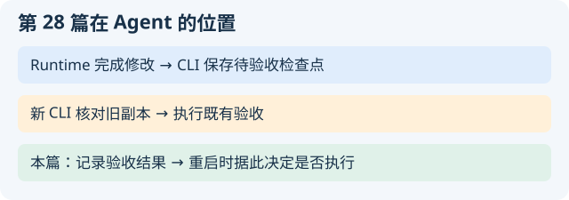
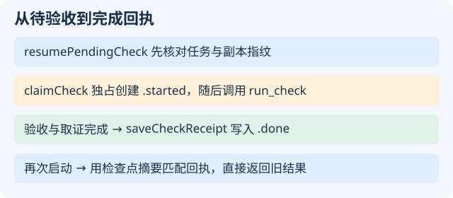
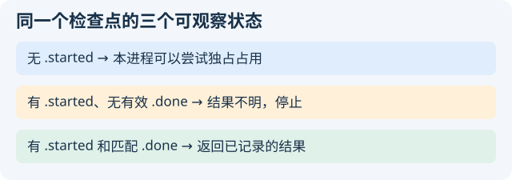
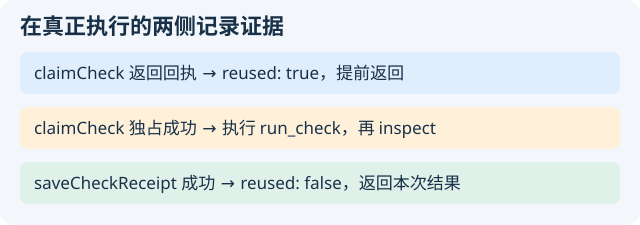
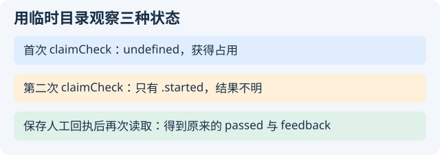

# 28 验收中断后，先确认结果再决定是否重跑

第 27 篇在执行验收前创建 `.started`。进程退出后，只有这个文件时，你无法知道验收是还没启动、正在运行，还是已经结束。本篇加一份完成回执，让 CLI 能区分「已记录结果」和「结果不明」。

## 本篇在 Agent 的什么位置

第五阶段「可靠执行与恢复」。改动落在 CLI 的**跨进程恢复入口**，围绕一次真实的 `run_check` 记录可核对的状态。



## 本篇技术方案

### 实施前，先走完一次具体过程

1. 路径修复已经落盘。新 CLI 打开 `pending.json`，像第 27 篇一样核对任务和副本指纹。
2. CLI 用 `wx` 独占创建 `pending.json.started`，随后执行验收。等工具返回并核对当前内容后，把通过与否和实际反馈写进 `pending.json.done`。
3. 再次提交同一个检查点时，CLI 发现已经占用。有匹配回执就显示历史结果。只有占用标记，或回执损坏、摘要不匹配时，CLI 停下来，要求操作者核对现场。

### 实现架构图



### 先看一个小例子

在装好依赖的仓库根目录执行。这个脚本只写临时标记和人工回执。

```bash
node --import tsx site/snippets/28-check-receipt/examples/check-receipt/inspect.ts
```

首次占用打印 `undefined`，下一次报告「结果不明」，保存回执后再读就能取得 `passed: true`。本篇的验收标准是，真实验收首次执行后返回 `reused: false`，再次提交返回 `reused: true`。只有占用标记时，退出码为 2，验收不会重新启动。

## 本篇核心代码在哪

`apps/coding-cli/src/session/check-receipt.ts` 的 `claimCheck` 决定现在能不能开始。接着看 `apps/coding-cli/src/session/checkpoint.ts` 的 `resumePendingCheck`，其中 `if (receipt)` 在工具执行前返回历史结果，`await saveCheckReceipt(...)` 则在取得实际反馈后保存回执。

Pi 的 `SessionManager.appendCustomEntry` 为应用扩展提供独立的持久记录。本篇借鉴把额外事实交由应用保存的做法，使用独立文件记录验收占用与完成。 [Pi 固定版本源码](https://github.com/badlogic/pi-mono/blob/8efd314fa3d3232ce197d8d7a6a5660530b9d83e/packages/coding-agent/src/core/session-manager.ts#L1200)

## 动手前

从第 27 篇起步，复用原来的路径修复和验收脚本。

```bash
git status --short
git switch -c agent/chapter-28-check-receipt
```

## 第一步：判断能执行，还是只能读回执

新建 `apps/coding-cli/src/session/check-receipt.ts`。这个文件接收检查点路径与原文摘要，并将状态交给恢复入口。

::: details 完整实现 check-receipt.ts
<<< @/snippets/28-check-receipt/apps/coding-cli/src/session/check-receipt.ts
:::



### 先看占用发生在哪里

在同一文件的 `claimCheck` 开头，完整代码包含下面两行。

```ts
    await writeFile(path + '.started', '', { flag: 'wx', mode: 0o600 });
    return undefined;
```

假设 `path` 是 `pending.json`。第一次创建 `pending.json.started` 成功，`undefined` 表示本次拿到了执行资格。第二个进程碰到 `EEXIST` 会去读回执。其他错误，例如目录不可写，会直接向上抛出。

### 已经占用时，哪些值才算完成证据

继续看同一函数的回执判断。这里的 `checkpointKey` 由恢复入口传入，代表当前检查点原文的摘要。

```ts
  if (
    typeof receipt === 'object' && receipt !== null &&
    'checkpointKey' in receipt && receipt.checkpointKey === checkpointKey &&
    'passed' in receipt && typeof receipt.passed === 'boolean' &&
    'feedback' in receipt && typeof receipt.feedback === 'string'
  ) {
    return { checkpointKey, passed: receipt.passed, feedback: receipt.feedback };
  }
```

如果 `.done` 还没写，`receipt` 是 `undefined`，判断失败后抛出「结果不明」。如果 `.done` 存在且摘要与当前检查点一致，函数返回完整回执。即使 `passed` 是 false，它仍是一份已完成的结果，调用方也会提前返回。摘要用于关联本地可信记录，文件由操作者保管。

## 第二步：在验收前后接入回执

打开 `apps/coding-cli/src/session/checkpoint.ts`，在导入区添加：

```ts
import { claimCheck, saveCheckReceipt } from './check-receipt';
```

在 `resumePendingCheck` 里，找到验收前原有的「先占用再执行」注释，从该注释开始，替换到创建 `.started` 的 `await writeFile(...);` 为止。紧随其后的 `const feedback = await check.execute({}, signal);` 保留。

```ts
  // 【修改】已有匹配回执时复用结果；已占用且无回执时由 claimCheck 拒绝继续。
  signal?.throwIfAborted();
  const checkpointKey = createHash('sha256').update(text).digest('hex');
  const receipt = await claimCheck(checkpointPath, checkpointKey);
  if (receipt) {
    return { workspace: entry.workspace, passed: receipt.passed, feedback: receipt.feedback, reused: true };
  }
```

这里计算的是**原始检查点文本**的摘要。若读到回执，代码从 `if (receipt)` 提前返回，下一行的 `check.execute` 根本没有运行。若 `claimCheck` 抛出结果不明，也会在这一行前退出。

在同一函数末尾，用下面两行替换原来的 `return { workspace: entry.workspace, passed, feedback };`，保留闭合花括号。

```ts
  // 【新增】先写回执，再向调用方返回结果。
  await saveCheckReceipt(checkpointPath, { checkpointKey, passed, feedback });
  return { workspace: entry.workspace, passed, feedback, reused: false };
```

`feedback` 由本次 `run_check` 返回，`passed` 来自原有的验收与内容一致性判断。写完才向 CLI 返回，因此进程如果在写回执前退出，下次仍会停在「结果不明」。



::: details 改完的完整 checkpoint.ts
<<< @/snippets/28-check-receipt/apps/coding-cli/src/session/checkpoint.ts
:::

## 第三步：核对重复提交与结果不明

新建 `examples/check-receipt/inspect.ts`，用临时文件复现三种状态。

::: details 完整示例 inspect.ts
<<< @/snippets/28-check-receipt/examples/check-receipt/inspect.ts
:::



从仓库根目录运行：

```bash
npm run check
node --import tsx examples/check-receipt/inspect.ts
receipt_dir=$(mktemp -d)
node --import tsx examples/checkpoint/main.ts save "$receipt_dir/pending.json" &&
node --import tsx examples/checkpoint/main.ts resume "$receipt_dir/pending.json" &&
node --import tsx examples/checkpoint/main.ts resume "$receipt_dir/pending.json"
```

第一条 `resume` 看到 `passed: true` 和 `reused: false`。第二条仍显示通过，`reused` 变成 true。可以在 `check.execute` 打断点确认只有第一次会到达。

### 可逆故障：让完成回执暂时不可见

在刚才的临时目录中，把回执移到另一个名字，再尝试恢复。保留 `.started`。

```bash
mv "$receipt_dir/pending.json.done" "$receipt_dir/held.done"
node --import tsx examples/checkpoint/main.ts resume "$receipt_dir/pending.json"
mv "$receipt_dir/held.done" "$receipt_dir/pending.json.done"
```

中间命令预期退出 2。这个实验模拟重新启动时只看到占用标记。它覆盖的是**停止盲目重试**。进程实际中断后，要判定子进程是否仍在运行、是否已经产生副作用，还需要独立证据。回执记录的是当时的结果，副本变化仍由第 27 篇的核对拒绝。

## 保存本篇

```bash
git add apps/coding-cli/src examples/check-receipt
git commit -F - <<'EOF_COMMIT'
用完成回执区分已验收和结果不明

验收完成后保存与检查点关联的实际结果。
重复提交读取回执，只有占用证据时停止重跑。
EOF_COMMIT
git push -u origin agent/chapter-28-check-receipt
```
