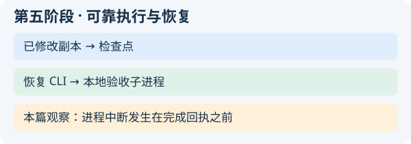
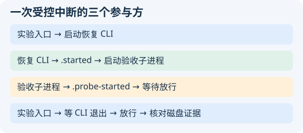
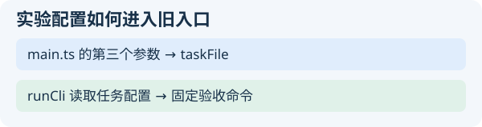
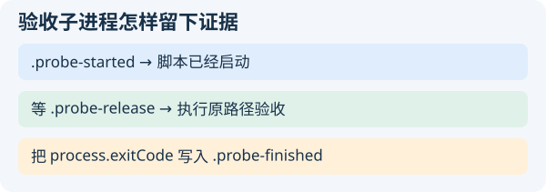
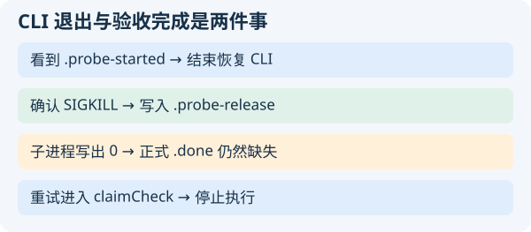

# 29 验收进程中断后，怎样核对现场

第 28 篇通过移走回执模拟结果不明。这次让恢复 CLI 在验收子进程运行期间真的退出，再看两个进程分别留下了什么。

## 本篇在 Agent 的什么位置

第五阶段「可靠执行与恢复」。这次观察的是恢复 CLI 调用本地验收之后、保存完成回执之前的窗口。



## 本篇技术方案

### 实施前，先走完一次具体过程

1. 实验入口用固定模型改好路径处理函数，保存 `pending.json`，随后启动一个恢复 CLI。
2. 恢复 CLI 按原逻辑校验副本、创建 `.started`，再启动验收子进程。子进程写下 `.probe-started`，等实验入口放行。
3. 实验入口看到启动标记后，只结束自己启动的恢复 CLI，并等待该进程退出。随后写入 `.probe-release`。子进程继续执行原验收，把脚本的退出码写进 `.probe-finished`。
4. 再次提交同一个检查点。操作者能看到子进程留下的通过线索，CLI 看到的仍只有占用标记，缺少由原恢复流程签发的完成回执，所以拒绝重跑。

### 实现架构图



**验收标准。** 恢复 CLI 确实因信号退出，验收脚本随后记录 `0`，正式 `.done` 缺失，第二次恢复退出 `2`。本实验用固定模型控制交接位置。验证真实模型能否自主停在「改完且未验收」是另一项实验，本篇无需调用模型服务。

## 本篇核心代码在哪

看 `examples/interrupted-check/main.ts` 的三处等待：先等 `.probe-started`，再等恢复 CLI 退出，最后放行子进程并等 `.probe-finished`。这个顺序让我们能确认**验收在 CLI 退出之后完成**。第 28 篇的 `claimCheck` 仍根据正式回执决定能否继续。

Pi 的 `AgentSession.abort()` 在发出取消后等待空闲，说明主动取消需要等运行退出。本篇用突然终止进程观察这条等待链无法完成时的磁盘状态。[Pi 固定版本源码](https://github.com/badlogic/pi-mono/blob/8efd314fa3d3232ce197d8d7a6a5660530b9d83e/packages/coding-agent/src/core/agent-session.ts#L2314)

## 动手前

从第 28 篇接着做。在 macOS 或 Linux 的仓库根目录运行。实验会生成临时任务配置和工作副本。

```bash
git status --short
git switch -c agent/chapter-29-interrupted-check
```

## 第一步：让固定示例可以换一份任务配置

打开 `examples/checkpoint/main.ts`。替换读取命令行参数的解构语句：

```ts
const [mode, path, taskFile = 'fixtures/code-tasks/route.json'] = process.argv.slice(2);
```

替换传给 `runCli` 的第一个参数：

```ts
  ['--task', taskFile, mode === 'save' ? '--checkpoint' : '--resume-check', path],
```

已有命令省略第三个参数时继续使用原配置。实验入口会把临时配置作为第三个参数传入，使恢复流程启动本篇的观察脚本。

::: details 改完的完整 examples/checkpoint/main.ts
<<< @/snippets/29-interrupted-check/examples/checkpoint/main.ts
:::



## 第二步：让验收子进程留下独立线索

新建 `fixtures/code-tasks/check-route-interrupted.mjs`，完整代码如下。它在运行原验收前等待实验入口放行。

::: details 完整 check-route-interrupted.mjs
<<< @/snippets/29-interrupted-check/fixtures/code-tasks/check-route-interrupted.mjs
:::

在这个文件里，`.probe-started` 由验收子进程自己创建。因此看到它时，可以确认程序已经进入脚本。随后循环等待 `.probe-release`。放行后执行以下几行（摘录已包含在完整实现中）：

```js
await import('./check-route.mjs');
const pending = join(workspace, '.probe-result-tmp');
await writeFile(pending, String(process.exitCode), { flag: 'wx' });
await rename(pending, join(workspace, '.probe-finished'));
```

CLI 退出时会关闭接收 stdout 的管道，原验收输出可能遇到 `EPIPE`。实验脚本只处理这个预期错误，让独立证据还能写出，其他输出错误照常抛出。原脚本根据根路径等用例设置 `process.exitCode`。这里先把值写进临时文件，等写完再改名为 `.probe-finished`，避免观察进程刚看到文件就读到空内容。正式回执还需要恢复 CLI 收到工具返回、重新核对副本并执行 `saveCheckReceipt`。



## 第三步：真的中断一次，再比较证据

新建 `examples/interrupted-check/main.ts`。它生成临时任务配置，启动本地 CLI，最后核对信号、文件和退出码。

::: details 完整 examples/interrupted-check/main.ts
<<< @/snippets/29-interrupted-check/examples/interrupted-check/main.ts
:::

在该文件的第一个 `try` 内，下面几行决定中断发生在哪个边界（摘录）：

```ts
  await waitForFile(join(workspace, '.probe-started'));
  assert.equal(running.child.kill('SIGKILL'), true);
  assert.equal((await running.closed).signal, 'SIGKILL');
```

`running.child` 指向实验入口创建的**恢复 CLI**，验收脚本是该 CLI 另行启动的子进程。`kill` 返回后还要等 `closed`，确认收到的退出信号。离开 `finally` 后才写 `.probe-release`，因此脚本通过时，已经没有原 CLI 来接收结果。最后用另一个恢复 CLI 提交同一个检查点，验证它停在第 28 篇的回执判断。



```bash
npm run check
node --import tsx examples/interrupted-check/main.ts
```

| 看哪里 | 本次实验的结果 |
|---|---|
| 恢复 CLI 的退出信号 | `SIGKILL` |
| 旧副本里的 `.probe-finished` | `0`，原验收脚本的通过线索 |
| `pending.json.started` / `pending.json.done` | 占用存在，完成回执缺失 |
| 重新提交 | 退出 `2`，保留现场 |

实验会打印临时目录和工作副本位置，便于回查。放行后的脚本有界运行，等待证据也有超时。本篇的观察限定于这组本地进程与脚本。若要把外部结果用于正式恢复，下一步需要定义可信的证据来源和人工处置规则。

## 保存本篇

```bash
git status --short
git add examples/checkpoint/main.ts examples/interrupted-check fixtures/code-tasks/check-route-interrupted.mjs
git commit -F - <<'EOF_COMMIT'
验证验收中断时的结果不明

等待验收子进程启动后中断恢复 CLI。
观察子进程结果与正式回执的差异，验证重复提交停止。
EOF_COMMIT
git push -u origin agent/chapter-29-interrupted-check
```
