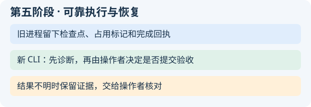
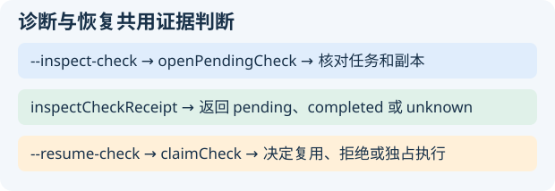
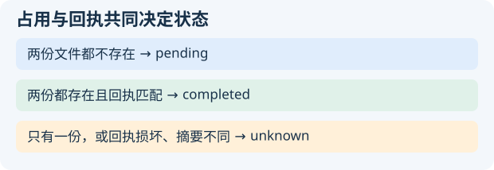
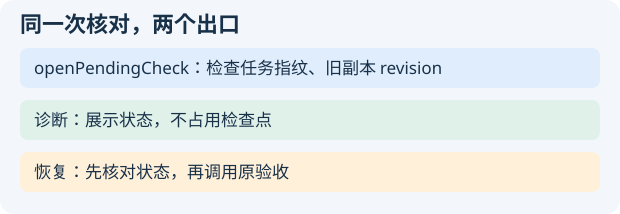
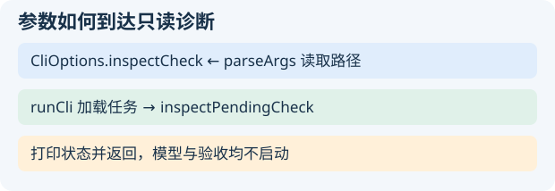

# 30 在正式 CLI 里检查恢复证据

第 29 篇真的中断了恢复 CLI。再次提交时，它拒绝重跑，但终端只显示「检查点恢复失败」。这篇给正式 CLI 增加 `--inspect-check`。操作者可以先查证据，再决定是否提交验收。

## 本篇在 Agent 的什么位置

这是第五阶段「可靠执行与恢复」的收尾篇。入口位于加载任务之后、启动模型或验收之前。



## 本篇技术方案

### 实施前，先走完一次具体过程

1. 用第 27 篇的固定入口生成路径修复检查点。正式 CLI 重新读取任务与旧副本，两项指纹都对上时才查看验收记录。
2. 没有占用文件与回执时，诊断显示 `pending`。操作者可以另行提交恢复。恢复仍要重新核对并独占创建 `.started`。
3. 验收结束后有匹配回执，诊断显示 `completed` 和 `historicalPassed`。如果只剩占用标记、回执不可用，或者反过来只看到回执，诊断显示 `unknown`。保留文件，核对子进程和实际副作用。

### 实现架构图



**验收标准。** 诊断能区分三种状态，前后不改变检查点、占用和回执。结果不明时，真正的恢复入口也停止。任务或副本变化时，诊断和恢复都会在输出状态或执行之前拒绝。

## 本篇核心代码在哪

先看 `apps/coding-cli/src/session/check-receipt.ts` 的 `inspectCheckReceipt`。它把磁盘证据分类。再看同文件的 `claimCheck`，只有读到 `pending` 才去尝试独占创建文件。最后是 `main.ts` 的诊断分支，打印状态后直接返回。

Pi 的会话管理器通过 `ReadonlySessionManager` 提供一个只含查询方法的接口。本篇借鉴把查看与执行分开的职责设计。检查点指纹和回执判断沿用课程自己的实现。 [Pi 固定版本会话管理源码](https://github.com/badlogic/pi-mono/blob/8efd314fa3d3232ce197d8d7a6a5660530b9d83e/packages/coding-agent/src/core/session-manager.ts#L228)

## 动手前

从第 29 篇接着做。本篇修改正式 CLI，复用现有的 `examples/checkpoint/main.ts` 生成待验收副本。

```bash
git status --short
git switch -c agent/chapter-30-inspect-checkpoint
```

## 第一步：让读取证据成为一个独立操作

打开 `apps/coding-cli/src/session/check-receipt.ts`，在现有文件系统导入里增加 `lstat`：

```ts
import { lstat, readFile, writeFile } from 'node:fs/promises';
```

在 `saveCheckReceipt` 的文档注释前插入类型与两个读取函数。

```ts
/** 读取时看到的证据。pending 只是观察结果，执行前仍须独占创建。 */
export type CheckReceiptState =
  | { status: 'pending' }
  | { status: 'completed'; receipt: CheckReceipt }
  | { status: 'unknown' };

async function hasEntry(path: string): Promise<boolean> {
  try {
    await lstat(path);
    return true;
  } catch (error) {
    if (error instanceof Error && 'code' in error && error.code === 'ENOENT') {
      return false;
    }
    throw error;
  }
}

/** 检查当前证据，不创建占用标记。 */
export async function inspectCheckReceipt(path: string, checkpointKey: string): Promise<CheckReceiptState> {
  if (!await hasEntry(path + '.started')) {
    return { status: await hasEntry(path + '.done') ? 'unknown' : 'pending' };
  }

  const receipt: unknown = await readFile(path + '.done', 'utf8')
    .then((text) => JSON.parse(text))
    .catch(() => undefined);
  if (
    typeof receipt === 'object' && receipt !== null &&
    'checkpointKey' in receipt && receipt.checkpointKey === checkpointKey &&
    'passed' in receipt && typeof receipt.passed === 'boolean' &&
    'feedback' in receipt && typeof receipt.feedback === 'string'
  ) {
    return { status: 'completed', receipt: { checkpointKey, passed: receipt.passed, feedback: receipt.feedback } };
  }

  return { status: 'unknown' };
}
```

例如恢复 CLI 被中断时，`.started` 已存在，读取 `.done` 得不到可用对象，于是返回 `unknown`。如果看到 `.done` 却没有 `.started`，两份证据也对不上，仍是 `unknown`。只有两份都不存在才显示 `pending`。

接着用下面的函数替换整个 `claimCheck`。它先读证据，再在需要时争抢执行资格。

```ts
export async function claimCheck(path: string, checkpointKey: string): Promise<CheckReceipt | undefined> {
  const observed = await inspectCheckReceipt(path, checkpointKey);
  if (observed.status === 'completed') return observed.receipt;
  if (observed.status === 'unknown') {
    throw new Error('验收结果不明，请核对现场。');
  }

  try {
    await writeFile(path + '.started', '', { flag: 'wx', mode: 0o600 });
    return undefined;
  } catch (error) {
    if (!(error instanceof Error && 'code' in error && error.code === 'EEXIST')) {
      throw error;
    }
  }

  const state = await inspectCheckReceipt(path, checkpointKey);
  if (state.status === 'completed') {
    return state.receipt;
  }
  throw new Error('验收已占用，但没有匹配的完成回执。结果不明，请核对现场。');
}
```

另一个进程可能在第一次读取与 `writeFile` 之间占用检查点，所以 `pending` 只说明**读取那一刻**的状态。独占创建遇到 `EEXIST` 时重读一次，有回执就复用，否则停下。



::: details 改完的完整 session/check-receipt.ts
<<< @/snippets/30-inspect-checkpoint/apps/coding-cli/src/session/check-receipt.ts
:::

## 第二步：诊断和恢复先核对同一份副本

打开 `apps/coding-cli/src/session/checkpoint.ts`，替换原来的回执导入：

```ts
import { claimCheck, inspectCheckReceipt, saveCheckReceipt } from './check-receipt';
```

在原 `resumePendingCheck` 中，从函数文档注释开始，替换到副本 `revision` 检查结束的花括号为止。紧接着原来的 `const check = session.tools.find(...)` 及之后逻辑保留。

```ts
async function openPendingCheck(path: string, task: TaskConfig, signal?: AbortSignal) {
  const checkpointPath = await realpath(resolve(path));
  const info = await stat(checkpointPath);
  if (!info.isFile() || info.size > 8 * 1024) {
    throw new Error('检查点文件无效或超限。');
  }
  const text = await readFile(checkpointPath, { encoding: 'utf8', signal });
  const entry: unknown = JSON.parse(text);
  if (Buffer.byteLength(text) > 8 * 1024 || !isPendingCheck(entry) ||
      entry.taskKey !== await taskKey(task, signal) ||
      await realpath(entry.workspace) !== entry.workspace) {
    throw new Error('检查点与当前任务不匹配。');
  }

  const session = await openTaskWorkspace(task, entry.workspace, signal);
  const before = await session.inspect(signal);
  if (before.currentRevision !== entry.revision) {
    throw new Error('副本内容与检查点不一致。');
  }
  const checkpointKey = createHash('sha256').update(text).digest('hex');
  return { checkpointPath, checkpointKey, entry, session };
}

/** 操作者查看当前检查点。输出只含状态、路径和历史验收结论。 */
export async function inspectPendingCheck(path: string, task: TaskConfig, signal?: AbortSignal) {
  const { checkpointPath, checkpointKey, entry } = await openPendingCheck(path, task, signal);
  const state = await inspectCheckReceipt(checkpointPath, checkpointKey);
  return {
    workspace: entry.workspace,
    status: state.status,
    ...(state.status === 'completed' ? { historicalPassed: state.receipt.passed } : {}),
  };
}

/** 先确认副本和任务，再占用检查点并执行一次原有验收。 */
export async function resumePendingCheck(path: string, task: TaskConfig, signal?: AbortSignal) {
  const { checkpointPath, checkpointKey, entry, session } = await openPendingCheck(path, task, signal);
```

然后删除原来位于 `claimCheck` 调用前计算 `checkpointKey` 的那一行。现在这个摘要已经由 `openPendingCheck` 返回。

如果旧副本中的路径实现后来又改过，两条命令都会停在 `currentRevision` 比对。能继续时，诊断只取路径、状态和历史通过字段。恢复则接着找到原来的验收工具。



::: details 改完的完整 session/checkpoint.ts
<<< @/snippets/30-inspect-checkpoint/apps/coding-cli/src/session/checkpoint.ts
:::

## 第三步：接入正式 CLI

在 `apps/coding-cli/src/types/task.ts` 的普通任务分支中，紧接 `resumeCheck?: string;` 加入：

```ts
      /** 检查指定检查点的证据，不执行验收。 */
      inspectCheck?: string;
```

::: details 改完的完整 types/task.ts
<<< @/snippets/30-inspect-checkpoint/apps/coding-cli/src/types/task.ts
:::

打开 `apps/coding-cli/src/config/args.ts`。在参数循环前追加：

```ts
  let inspectCheck: string | undefined;
```

在原来 `--task` 分支首行前插入以下分支。原首行的花括号用于闭合它。

```ts
    } else if (arg === '--inspect-check' && inspectCheck === undefined) {
      const value = args[++i];
      if (!value?.trim() || value.startsWith('--')) {
        throw new Error('检查点诊断路径缺失。');
      }
      inspectCheck = value;
```

在 `if (resumeLog)` 内替换原参数组合判断：

```ts
    if (taskFile || sessionLog || planning || checkpoint || resumeCheck || inspectCheck || !followUp) {
      throw new Error('只读接续需要且仅接受日志路径和一条追问。');
    }
```

在普通任务的 `if ((checkpoint || resumeCheck) ...)` 前插入：

```ts
  if (inspectCheck && (checkpoint || resumeCheck || followUp || planning || sessionLog)) {
    throw new Error('检查点诊断只接受任务配置与检查点路径。');
  }
```

在返回对象的 `resumeCheck` 展开行之后插入：

```ts
    ...(inspectCheck ? { inspectCheck } : {}),
```

最后在 `helpText` 的 `--resume-check` 用法行后增加：

```text
ai-harness --task <任务.json> --inspect-check <检查点>
```

读取参数分支给局部变量赋值。返回对象里的展开才让 `runCli` 接到路径。

::: details 改完的完整 config/args.ts
<<< @/snippets/30-inspect-checkpoint/apps/coding-cli/src/config/args.ts
:::

打开 `apps/coding-cli/src/main.ts`，替换检查点函数的导入：

```ts
import { inspectPendingCheck, resumePendingCheck, savePendingCheck } from './session/checkpoint';
```

在 `loadTask` 之后、`if (options.resumeCheck)` 之前插入：

```ts
    if (options.inspectCheck) {
      phase = '检查点诊断';
      const report = await inspectPendingCheck(options.inspectCheck, task, controller.signal);
      printBlock('检查点诊断', report);
      return 0;
    }
```

诊断成功的退出码是 `0`，表示已完成查看。是否适合继续看输出中的 `status`。例如 `unknown` 也是正常诊断结果。



::: details 改完的完整 main.ts
<<< @/snippets/30-inspect-checkpoint/apps/coding-cli/src/main.ts
:::

## 第四步：用正式入口核对三个状态

从仓库根目录运行。第一条 Node 命令用固定模型生成实际改动；后续命令都走构建后的 CLI。

```bash
npm run check
checkpoint_dir=$(mktemp -d)
checkpoint="$checkpoint_dir/pending.json"
task=fixtures/code-tasks/route.json
node --import tsx examples/checkpoint/main.ts save "$checkpoint" &&
node apps/coding-cli/dist/cli.js --task "$task" --inspect-check "$checkpoint" &&
node apps/coding-cli/dist/cli.js --task "$task" --resume-check "$checkpoint" &&
node apps/coding-cli/dist/cli.js --task "$task" --inspect-check "$checkpoint"
```

先看到 `status: 'pending'`，实际验收通过后再看到 `status: 'completed'` 和 `historicalPassed: true`。

只在本实验的临时目录模拟一次回执缺失：

```bash
mv "$checkpoint.done" "$checkpoint_dir/held.done"
node apps/coding-cli/dist/cli.js --task "$task" --inspect-check "$checkpoint"
node apps/coding-cli/dist/cli.js --task "$task" --resume-check "$checkpoint"
mv "$checkpoint_dir/held.done" "$checkpoint.done"
```

诊断显示 `unknown`，恢复预期退出 `2`。放回回执后，再诊断就能回到 `completed`。实际中断时，先核对验收子进程和工作副本；保留原记录，另行决定是否建立新的验收尝试。

**本篇不需要跑真实模型。** 重点是验证正式 CLI 的诊断、独占与回执行为。真实模型能否自主停在指定交接边界，仍是单独的质量验证。

## 保存本篇

```bash
git status --short
git add apps/coding-cli/src
git commit -F - <<'EOF_COMMIT'
为检查点添加只读诊断入口

共享任务与副本校验，并区分待执行、已完成和结果不明。
从正式 CLI 验证诊断不会启动验收。
EOF_COMMIT
git push -u origin agent/chapter-30-inspect-checkpoint
```
