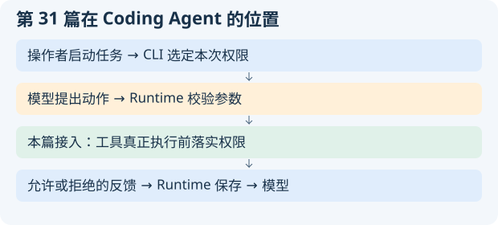
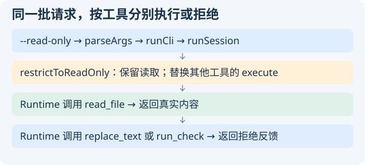
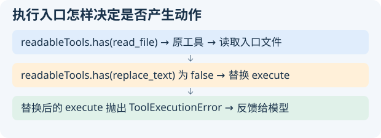
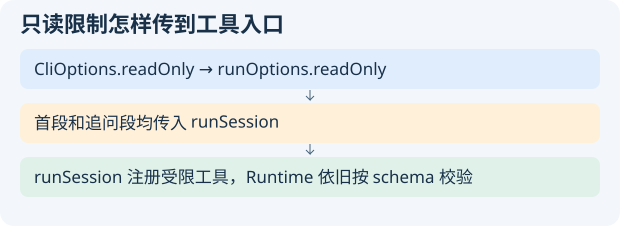
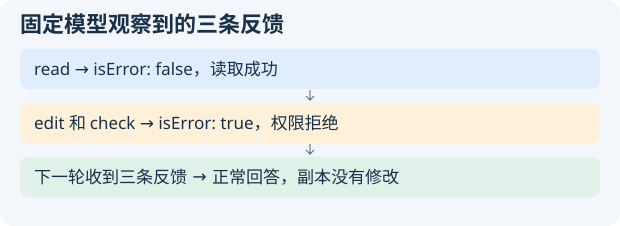

# 31 让 Coding Agent 在只读模式下调查代码

第 30 篇把检查和执行分开。本篇把同样的区别用到一个新任务里。操作者说「只调查」，即使模型接着请求改文件或运行验收，CLI 也只允许调查工具执行。

## 本篇在 Agent 的什么位置

这是第六阶段「扩展、安全与人工介入」的起点。本篇由 CLI 选择工具权限，Runtime 仍负责按协议执行和记录反馈。



## 本篇技术方案

### 实施前，先走完一次具体过程

1. 操作者用 `--read-only` 启动路径修复材料上的调查任务。CLI 把这条限制传进每一段运行，包括用户追问。
2. CLI 保留三个调查工具的原执行函数。其余工具仍有名称和参数说明，但本地执行入口被替换成拒绝函数。
3. 固定模型在同一批请求里读取入口、修改路径函数、启动验收。Runtime 先检查参数。读取成功；后两项返回拒绝反馈，各自保留原请求 ID。模型据此总结，实际副本没有修改。

### 实现架构图



验收要同时看到：读请求成功、改写和验收被拒、运行正常回答、`changedFiles: []`。现有 CLI 的交付规则需要通过验收的改动，所以这次只读调查仍显示 `accepted: false`，退出码为 1。

## 本篇核心代码在哪

看 `apps/coding-cli/src/session/read-only-tools.ts` 的 `restrictToReadOnly`。决定性的一行是 `readableTools.has(tool.name)`：命中的保留原函数，其他动作的 `execute` 被替换。这样模型的请求即使符合参数结构，也要经过应用选择的权限。

Pi 的 Agent 在组装循环配置时传递 `beforeToolCall`，给调用前的控制留出位置。本篇用应用层工具包装落实这个边界，沿用已有 Runtime。 [Pi 固定版本源码](https://github.com/badlogic/pi-mono/blob/8efd314fa3d3232ce197d8d7a6a5660530b9d83e/packages/agent/src/agent.ts#L440)

## 动手前

从第 30 篇接着做。

```bash
git status --short
git switch -c agent/chapter-31-read-only-policy
```

## 第一步：在工具真正动手之前拦住它

新建 `apps/coding-cli/src/session/read-only-tools.ts`，把完整实现写入新文件。

::: details 完整文件 apps/coding-cli/src/session/read-only-tools.ts
<<< @/snippets/31-read-only-policy/apps/coding-cli/src/session/read-only-tools.ts
:::



在 `restrictToReadOnly` 中，`tools.map` 逐项处理 CLI 已注册的工具。对于 `read_file`，直接返回原工具，原来的路径校验和读取都会继续执行。对于 `replace_text`，展开 `...tool` 先保留名称、说明和参数 schema，后面的 `execute` 覆盖旧执行函数：

```ts
    return {
      ...tool,
      async execute() {
        throw new ToolExecutionError('只读模式禁止执行这个工具。可继续调查并报告发现。');
      },
    };
```

Runtime 接住 `ToolExecutionError`，形成 `isError: true` 的工具反馈，关联原请求 ID。即使传入的是允许写入的路径，原来的替换函数也没有被调用。新增工具默认走拒绝分支，允许列表对应的是这套 CLI 中由应用信任的本地工具。

## 第二步：从终端传递只读权限

打开 `apps/coding-cli/src/types/task.ts`。在 `CliOptions` 的普通任务分支中，紧接 `planning` 加入：

```ts
      /** 操作者明确限制本次任务只能执行调查工具。 */
      readOnly?: boolean;
```

在同文件的 `RunInputOptions` 中，紧接 `fullHistory` 加入：

```ts
  /** 每段运行沿用同一个只读限制。 */
  readOnly?: boolean;
```

第一个字段由终端解析产生，第二个由 CLI 在执行时传给每一段运行。

::: details 完整文件 apps/coding-cli/src/types/task.ts
<<< @/snippets/31-read-only-policy/apps/coding-cli/src/types/task.ts
:::

打开 `apps/coding-cli/src/config/args.ts`，在 `let planning = false;` 后插入：

```ts
  let readOnly = false;
```

在循环中原 `--follow-up` 分支首行前插入下面的分支，保留原首行用于闭合它：

```ts
    } else if (arg === '--read-only' && !readOnly) {
      readOnly = true;
```

将 `if (resumeLog)` 内原有的冲突判断替换为：

```ts
    if (readOnly || taskFile || sessionLog || planning || checkpoint || resumeCheck || inspectCheck || !followUp) {
      throw new Error('只读接续需要且仅接受日志路径和一条追问。');
    }
```

在普通任务的 `if (inspectCheck && ...)` 之前插入：

```ts
  if (readOnly && (planning || checkpoint || resumeCheck || inspectCheck)) {
    throw new Error('只读任务不能与计划或检查点选项混用。');
  }
```

在普通任务的返回对象中紧接 `planning,` 插入：

```ts
    ...(readOnly ? { readOnly } : {}),
```

现在路径修复任务传 `--read-only` 时，`runCli` 能收到 `readOnly: true`。检查点模式会走独立的本地验收入口，因此组合参数在解析时拒绝。帮助文字按下方完整文件同步。

::: details 完整文件 apps/coding-cli/src/config/args.ts
<<< @/snippets/31-read-only-policy/apps/coding-cli/src/config/args.ts
:::

## 第三步：让两段运行都使用受限工具

打开 `apps/coding-cli/src/main.ts`。用下面的代码替换原来的首段 `const first = await runSession(...)`：

```ts
    const runOptions: RunInputOptions = {
      fullHistory,
      ...(options.readOnly ? { readOnly: true } : {}),
    };
    const first = await runSession(task, session, callModel, controller.signal, onEvent, runOptions);
```

在追问分支的 `nextInput` 中，用下面一行替换原来的 `fullHistory,`：

```ts
        ...runOptions,
```

这样追问段和首段携带同一个 `readOnly` 值，原有历史追加逻辑仍由 `messages` 负责。

::: details 完整文件 apps/coding-cli/src/main.ts
<<< @/snippets/31-read-only-policy/apps/coding-cli/src/main.ts
:::

打开 `apps/coding-cli/src/session/run.ts`，在导入区加入：

```ts
import { restrictToReadOnly } from './read-only-tools';
```

在 `return runAgent({` 前插入：

```ts
  const tools = session.plan
    ? [...session.codeTask.tools, session.plan.tool]
    : session.codeTask.tools;
```

将原来传给 `runAgent` 的 `tools` 属性整段替换为：

```ts
    tools: inputOptions.readOnly ? restrictToReadOnly(tools) : tools,
```

传入 true 时，Runtime 注册的是包装后的工具。普通任务仍使用原工具。



::: details 完整文件 apps/coding-cli/src/session/run.ts
<<< @/snippets/31-read-only-policy/apps/coding-cli/src/session/run.ts
:::

## 第四步：亲眼看一次拒绝

新建 `examples/read-only-policy/main.ts`。它用固定响应提出一批可复现的工具请求。

::: details 完整文件 examples/read-only-policy/main.ts
<<< @/snippets/31-read-only-policy/examples/read-only-policy/main.ts
:::

脚本的第二次模型调用从 `context.messages` 找 `read`、`edit` 和 `check` 的反馈，检查一次成功和两次拒绝。`turn === 2` 证明拒绝已返回模型，`exitCode === 1` 则对应现有 CLI 的交付规则。



```bash
npm run check &&
node --import tsx examples/read-only-policy/main.ts
```

在输出里找 `read_file：成功结果`、`replace_text：失败反馈` 和 `run_check：失败反馈`。接着看交付判断中的 `changedFiles: []`。也可以在包装后的 `execute` 和原工具执行函数各放一个断点，对照哪一个被调用。

本篇的本地权限验证无需真实模型。要观察真实模型在只读权限下如何选择工具或解释拒绝，可在配置好服务后自行运行下列命令。该命令会使用模型服务，可能产生费用。

```bash
node --env-file=.env apps/coding-cli/dist/cli.js --task fixtures/code-tasks/route.json --read-only
```

这个权限边界只约束此 CLI 注册的受信任工具。后续接入外部工具时，还要决定如何审核工具来源和执行权限。

## 保存本篇

```bash
git status --short
git add apps/coding-cli/src examples/read-only-policy
git commit -F - <<'EOF_COMMIT'
为 Coding CLI 增加只读工具权限

在工具执行前允许调查，拒绝文件修改和验收。
把拒绝作为工具反馈交回模型，并验证工作副本无变化。
EOF_COMMIT
git push -u origin agent/chapter-31-read-only-policy
```
