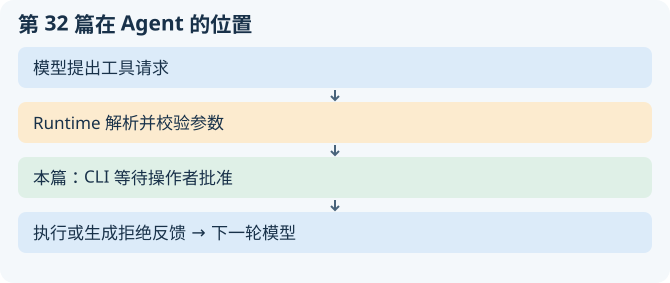
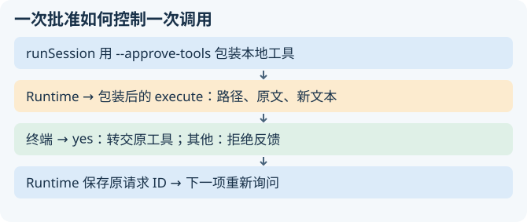
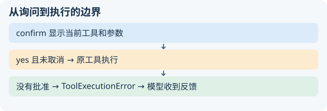
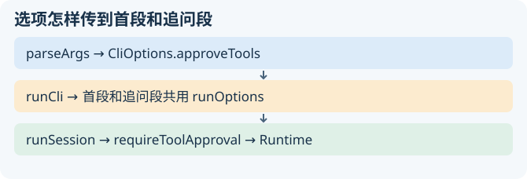
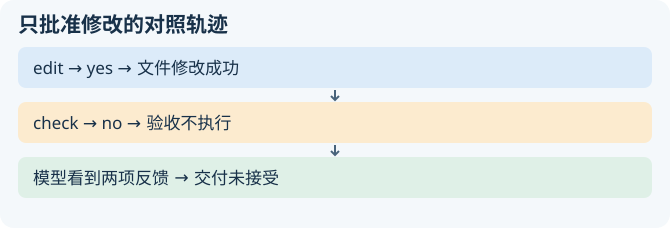

# 32 在修改和验收前逐次询问操作者

第 31 篇的只读模式适合调查。现在操作者允许 Agent 提出修改，但想在真正写入前先看它要改什么。本篇给 CLI 加入 `--approve-tools`，让一次终端回答只影响眼前的工具调用。

## 本篇在 Agent 的什么位置

第六阶段「扩展、安全与人工介入」。权限判断接在 Runtime 完成参数校验之后、原工具执行之前。



## 本篇技术方案

### 实施前，先走完一次具体过程

1. CLI 收到 `--approve-tools`，在注册工具前包装 `replace_text` 和 `run_check`。调查工具仍可直接执行。
2. 模型请求修改 `src/routing/normalize.ts`。Runtime 校验参数，调用包装后的 `execute`。终端展示路径、原文和新文本，等待操作者输入。
3. 输入 `yes` 时，包装函数把这一组参数交给原工具。其余输入产生失败反馈。Runtime 保存反馈时仍使用原请求 ID。
4. 同一批的下一条 `run_check` 会重新询问。即使修改已获准，验收也可以拒绝。只有文件变化和实际验收都满足现有交付条件，CLI 才会接受交付。

### 实现架构图



Pi 的 `Agent.createLoopConfig` 把 `beforeToolCall` 传给循环，工具调用经过 `prepareToolCall` 再进入执行。这一篇延续现有 CLI 的工具包装方式，判断留在原 `execute` 前。 [Pi Agent 配置](https://github.com/badlogic/pi-mono/blob/8efd314fa3d3232ce197d8d7a6a5660530b9d83e/packages/agent/src/agent.ts#L440) · [Pi 工具循环](https://github.com/badlogic/pi-mono/blob/8efd314fa3d3232ce197d8d7a6a5660530b9d83e/packages/agent/src/agent-loop.ts#L546)

## 本篇核心代码在哪

看 `apps/coding-cli/src/session/approve-tools.ts` 的 `requireToolApproval`。核心是 **等 `confirm` → 检查取消状态 → 只有明确批准才调用原 `tool.execute(value, signal)`**。批准只存在于这次调用的局部变量。下一次调用会重新执行这几行。

## 动手前

从第 31 篇的分支起步，在仓库根目录创建本篇分支。如果本篇改动已经在工作区里，下面的命令会从当前提交建立新分支，并带着这些未提交的改动继续。

```bash
git status --short --branch
git switch -c agent/chapter-32-tool-approval
```

## 先看一轮停在哪里

在仓库根目录运行下面的固定示例。等第一次提示出现时，先不要输入。

```bash
node --import tsx examples/tool-approval/main.ts edit-only
```

此时终端已经打印「开始 replace_text」，但这只表示 Runtime 开始处理请求。原修改工具还没运行。输入 `yes` 后，看到「replace_text：成功结果」，才说明这次修改实际完成。等第二个提示出现，输入 `no`。最后找下面三处证据：

| 从哪里看 | 本次应观察到什么 |
|---|---|
| 修改请求 `edit` 对应的反馈 | `isError: false`，实际文件已改 |
| 验收请求 `check` 对应的反馈 | `isError: true`，内容是「该工具请求未获本次批准」 |
| 交付判断 | `changedFiles` 有路径函数，`accepted: false` |

这次审批拒绝不会撤销已经批准的修改。用户仍可审阅保留的工作副本。末尾的实验会对照另外两种回答组合。

## 第一步：读懂执行前的批准门槛

打开新文件 `apps/coding-cli/src/session/approve-tools.ts`。它接收 CLI 准备好的工具数组，返回包装后的工具数组。

::: details 完整文件 apps/coding-cli/src/session/approve-tools.ts
<<< @/snippets/32-tool-approval/apps/coding-cli/src/session/approve-tools.ts
:::

在同一文件的 `requireToolApproval` 中，先用名称筛出修改与验收。拿改路径函数的请求为例，`value` 已经是 Runtime 解析并校验过的参数对象。提示显示同一份对象，控制字符和非 ASCII 字符用转义显示。

```ts
        const approved = await confirm(
          `批准本次 ${tool.name} ${preview}？输入 yes 执行，其余拒绝：`,
          signal,
        );
        signal?.throwIfAborted();
        if (!approved) {
          throw new ToolExecutionError('该工具请求未获本次批准。');
        }

        return tool.execute(value, signal);
```

例如你对修改输入 `yes`，这次 `approved` 为 true，末尾调用原修改工具，继续检查路径和原文。返回后这个变量随调用结束。下一条验收使用自己的参数 `{}`，独立等待批准。若对验收输入 `no`，抛出的已知工具错误会被 Runtime 变成 `isError: true` 的反馈，原验收函数没有执行。

`confirm` 在交互终端通过 `question` 等待一行，只接受去除首尾空白后的 `yes`。非交互输入直接返回 false，终端关闭也按拒绝处理。等待共用 Runtime 的整次时限，若运行信号中止，包装函数会在执行前检查信号并退出。



### 1.1 参数校验通过后，为什么还要再问

跟踪这次 `edit`。模型返回的 `arguments` 是 JSON 字符串，Runtime 的 `executeToolBatch` 将它解析为 `value`，再交给注册工具的 schema 校验。已有代码位于 `packages/runtime/src/tools/execute.ts`：

```ts
      if (!tool.validate(value)) {
        // 指出结构不符，但不把参数值、schema 或库内部错误拼入反馈。
        throw new ToolExecutionError('参数不符合工具说明，请检查字段类型、必填项与额外字段。', 'invalid_arguments');
      }
      // 把信号传给真实操作；等待退出后拒绝迟到结果。
      content = await tool.execute(value, signal);
```

如果参数形状不对，代码在 `invalid_arguments` 分支直接抛错，操作者不会看到批准提示。校验通过后，`tool.execute` 指向被包装的执行函数，暂停在刚才的 `await confirm(...)`。这时 `value.path` 已是 `src/routing/normalize.ts`，`oldText` 和 `newText` 也已确定。包装函数展示这三个值，同一次调用的 `value` 随后才会交给原工具。路径许可、原文匹配仍由原工具检查。

### 1.2 等待输入的 Promise 怎样结束

回到 `apps/coding-cli/src/session/approve-tools.ts` 的 `confirm`。这里的 `terminal` 是本次询问使用的 readline 接口。它有两类结束路径：

```ts
    terminal.once('close', () => {
      signal?.removeEventListener('abort', close);
      resolve(false);
    });
    terminal.once('SIGINT', close);
    signal?.addEventListener('abort', close, { once: true });
    terminal.question(prompt, (answer) => {
      resolve(answer.trim() === 'yes');
      close();
    });
```

正常输入 `yes` 时，`question` 回调先执行 `resolve(true)`，再关闭接口。关闭事件随后尝试 `resolve(false)`，但 Promise 只采用第一次结果。直接结束输入时，没有答案先到，关闭事件就以 false 结束等待。运行信号中止也会让接口关闭。即使等待恰好拿到批准，外层的 `signal?.throwIfAborted()` 仍会在交给原工具之前再次检查。

非交互运行走函数开头的分支，连 readline 接口都不会创建。当前批准以进程内这一次调用为单位，等待时间会占用 Runtime 的运行时限。

### 1.3 拒绝怎样回到模型

现在轮到第二条 `check`。你输入 `no`，`confirm` 返回 false，包装函数抛出 `ToolExecutionError`。回到 Runtime 的 `executeToolBatch` 末尾：

```ts
      content = JSON.stringify({ code: cause.code, message: cause.message });
      isError = true;
    }
    results.push({ role: 'toolResult', toolCallId: call.id, toolName: call.name, content, isError });
```

这段用原来的 `call.id` 和 `call.name` 创建工具反馈。因此模型下一轮能看到 `toolCallId: 'check'`、`toolName: 'run_check'` 和 `isError: true`，知道这次请求被拒。整批结果由 `runAgent` 加回历史，第一条成功修改的反馈也一起保留。若运行信号已经中止，执行器走前面的取消分支，退出本批并保留此前结果。

## 第二步：把终端选项送到本次运行

实际源码已经接好。这一步对照三处新增字段和分支，看选项如何从命令行到达工具注册。

在 `apps/coding-cli/src/types/task.ts` 的普通任务选项和 `RunInputOptions` 中各有一个字段。前者由参数解析器返回，后者供首段和追问段使用。

```ts
approveTools?: boolean;
```

::: details 完整文件 apps/coding-cli/src/types/task.ts
<<< @/snippets/32-tool-approval/apps/coding-cli/src/types/task.ts
:::

打开 `apps/coding-cli/src/config/args.ts`。在 `parseArgs` 的 `let readOnly = false;` 下一行新增：

```ts
  let approveTools = false;
```

在参数循环中，找到以 `} else if (arg === '--follow-up'` 开头的整行，在它之前插入下列分支。原来的那行保留，它开头的花括号会闭合新增分支。

```ts
    } else if (arg === '--approve-tools' && !approveTools) {
      approveTools = true;
```

在普通任务返回对象的 `readOnly` 展开行之后加上这一行。循环只是更新局部变量，这次展开才让入口拿到设置：

```ts
    ...(approveTools ? { approveTools } : {}),
```

参数解析器拒绝把逐次批准与只读或检查点选项混用。会话日志和普通任务的追问仍可一起使用。

::: details 完整文件 apps/coding-cli/src/config/args.ts
<<< @/snippets/32-tool-approval/apps/coding-cli/src/config/args.ts
:::

在 `apps/coding-cli/src/main.ts` 的 `runOptions` 对象中，把解析结果传给每段运行：

```ts
      ...(options.approveTools ? { approveTools: true } : {}),
```

首段直接使用 `runOptions`，追问段展开同一份选项并追加消息。

::: details 完整文件 apps/coding-cli/src/main.ts
<<< @/snippets/32-tool-approval/apps/coding-cli/src/main.ts
:::

在 `apps/coding-cli/src/session/run.ts` 的 `runSession` 中，传给 `runAgent` 的 `tools` 是以下选择的结果：

```ts
  const allowedTools = inputOptions.readOnly
    ? restrictToReadOnly(tools)
    : inputOptions.approveTools ? requireToolApproval(tools) : tools;
```

未开逐次批准时保持第 31 篇的原有行为。开启时，Runtime 看到的工具名称与参数说明保持一致，真正执行时经过本篇包装函数。



::: details 完整文件 apps/coding-cli/src/session/run.ts
<<< @/snippets/32-tool-approval/apps/coding-cli/src/session/run.ts
:::

## 第三步：运行三组对照

打开 `examples/tool-approval/main.ts`。这个固定模型在同一批里请求修改和验收，下一轮逐项核对原 ID 的反馈。

::: details 完整文件 examples/tool-approval/main.ts
<<< @/snippets/32-tool-approval/examples/tool-approval/main.ts
:::



从仓库根目录运行。交互命令请在自己的终端中执行：

```bash
npm run check
node --import tsx examples/tool-approval/main.ts deny
node --import tsx examples/tool-approval/main.ts edit-only
node --import tsx examples/tool-approval/main.ts approve
```

| 参数 | 第一条回答 | 第二条回答 | 应观察到的结果 |
|---|---|---|---|
| `deny` | `no` | `no` | 两项都拒绝，副本无变化 |
| `edit-only` | `yes` | `no` | 文件已改，验收未运行，交付未接受 |
| `approve` | `yes` | `yes` | 两项执行，实际验收通过，交付接受 |

**先只跑 `edit-only` 也可以。** 跟到第二次提示就能回答本篇的问题：为什么刚批准了修改，验收仍要再问一次？最后看 `accepted: false` 与已修改文件同时出现。

也可以用非交互输入验证两项都会拒绝：

```bash
node --import tsx examples/tool-approval/main.ts deny </dev/null
```

**本篇无需真实模型。** 固定模型让请求和执行顺序可复现，实际文件修改与验收仍由本地工具运行。若要观察模型收到拒绝之后会怎样调整任务，才需要用真实服务。以下命令会调用模型，可能产生费用：

```bash
node --env-file=.env apps/coding-cli/dist/cli.js --task fixtures/code-tasks/route.json --approve-tools
```

本篇覆盖进程内逐次确认。批准等待期间重启、跨进程保存待批准请求与允许范围的持久化留到后续。

## 保存本篇

先确认当前分支是 `agent/chapter-32-tool-approval`，再暂存并审阅本篇改动。若本篇同时补齐了第 31 篇的只读实现，也一并纳入审阅。

```bash
git status --short --branch
git add AGENTS.md \
  apps/coding-cli/src/config/args.ts apps/coding-cli/src/main.ts \
  apps/coding-cli/src/types/task.ts apps/coding-cli/src/session/run.ts \
  apps/coding-cli/src/session/approve-tools.ts apps/coding-cli/src/session/read-only-tools.ts \
  examples/read-only-policy/main.ts examples/tool-approval/main.ts \
  docs/chapter-32-verification.md docs/conversation-handoff.md docs/jd-learning-map.md \
  docs/learning-state.md docs/stage-06-plan.md docs/system-map.md \
  site/.vitepress/config.mts site/index.md site/roadmap.md \
  site/guide/32-tool-approval.md site/public/diagrams/32-approval-*.svg \
  site/snippets/32-tool-approval
git diff --cached --check
git diff --cached --stat
```

确认暂存区只含这次要交付的改动后，执行提交。需要将本篇保存在远端时，再执行最后一行。

```bash
git commit -F - <<'EOF_COMMIT'
为 Coding CLI 增加逐次工具批准

在修改和验收前分别等待终端答复，取消或未批准时不执行当前工具。
保留原请求 ID，将拒绝作为工具反馈交回模型。
同步教程与源码，并验证批准、拒绝及非交互输入。
EOF_COMMIT
git push -u origin agent/chapter-32-tool-approval
```
