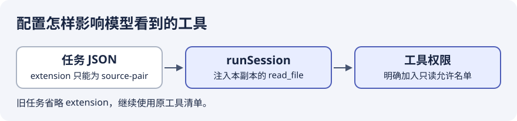

# 第 34 篇：给 Coding Agent 接入双文件调查工具

发票任务有一个实际入口和两份同名实现。调查重复折扣时，先读 `src/main.ts`，再读入口指向的 `src/checkout/invoice.ts`，才能判断当前逻辑在哪里。我们给这类调查接入一个可选工具 `read_source_pair`。模型一次请求提供两个相对路径，下一轮收到两份带行号的预览，仍可沿用原来的工具修改和验收。

[](/diagrams/34-source-pair-position.svg)

第一次阅读，先跟一遍发票任务，再直接看第一步里两次 `await read`。图解可以点击放大。若已有本篇代码，可先跑 `node --import tsx examples/source-pair/main.ts repair`，从终端找 `inspect_invoice` 的工具反馈和最终 `accepted`。

## 本篇技术方案

CLI 的任务配置增加一个可选名称 `"extension": "source-pair"`。CLI 本身持有受信任的扩展代码，任务文件只能选择已知名称。这里把扩展定义为由应用额外装配、能遵守既有工具契约的一段代码。通用 Runtime 接收到的仍是普通的工具声明和执行函数。

### 实施前，先走完一次具体过程

1. 操作者提交 `invoice-source-pair.json`。CLI 解析已有任务配置、准备工作副本，并找到与这份副本绑定的 `read_file`。应用把该执行函数传给扩展，扩展便能处理同一副本里的读取请求。
2. 模型第一次收到工具清单时看到 `read_source_pair`，请求中提供 `entry: 'src/main.ts'` 和 `candidate: 'src/checkout/invoice.ts'`。
3. Runtime 校验参数后调用扩展。扩展先读取入口，再读取候选实现。两次读取都经过工作区索引。扩展把带行号的原始文本裁成两份有界预览，作为同一个 `inspect_invoice` 请求的工具结果交回 Runtime。
4. 在下一轮输入中，模型根据入口的导出语句和候选实现的乘法表达式判断要改哪里，再调用原来的 `replace_text` 和 `run_check`。最终接受依据仍是当前副本的实际改动和匹配验收结果。

[](/diagrams/34-source-pair-architecture.svg)

关键代码在 **`apps/coding-cli/src/extensions/source-pair.ts` 的 `createSourcePairTool`**。同一个 `read` 执行函数处理两个 `path`。接线点在 `apps/coding-cli/src/session/run.ts`，它决定该扩展是否进入当前运行。若第 2 步的候选路径是 `../outside.ts`，读取失败会随原请求 ID 回到模型一侧，下一轮可以换成工作区中的合法路径。

这个设计让路径约束继续由工作区的读取工具落实，也让 Runtime 继续统一处理参数、事件和反馈。代码通过普通模块在 CLI 进程内运行，适用于随 CLI 发布并经过审查的扩展。操作系统进程、文件系统与网络隔离仍是独立能力。

Pi 的扩展 API 在 `registerTool` 中接收具备参数 schema 的工具定义，扩展运行器的 `getAllRegisteredTools` 收集注册结果。本篇借鉴应用装配工具的职责分工，从一个静态内置扩展起步。 [Pi 的 registerTool](https://github.com/badlogic/pi-mono/blob/8efd314fa3d3232ce197d8d7a6a5660530b9d83e/packages/coding-agent/src/core/extensions/loader.ts#L289) · [Pi 的 getAllRegisteredTools](https://github.com/badlogic/pi-mono/blob/8efd314fa3d3232ce197d8d7a6a5660530b9d83e/packages/coding-agent/src/core/extensions/runner.ts#L637)

## 创建分支

在仓库根目录从已提交的第 33 篇继续。若本篇代码已写入工作区，可以在当前提交上建分支，工作区改动会随分支保留。

```bash
git status --short --branch
git switch -c agent/chapter-34-source-pair
```

## 第一步：把同一个读取入口借给扩展

新建 `apps/coding-cli/src/extensions/source-pair.ts`。工厂函数由应用调用，输入是当前 `read_file` 的执行函数，产出 Runtime 认识的 `ExecutableTool`。扩展模块自身只处理两个输入路径和两份输出预览。

<<< @/snippets/34-source-pair/apps/coding-cli/src/extensions/source-pair.ts

[](/diagrams/34-source-pair-execution.svg)

### 模型需要传什么

在同文件 `createSourcePairTool` 的返回对象里，`name` 是模型发起工具请求时要引用的名称，`parameters` 是它收到的参数描述。下面摘录同时给出两个字段的含义和必填关系。

```ts
name: 'read_source_pair',
description: '并排读取入口和候选实现的带行号预览。两个路径都必须位于工作区索引。调用者自行核对文件间的引用关系。',
parameters: {
  type: 'object',
  properties: {
    entry: { type: 'string', minLength: 1, maxLength: 240, description: '公开入口的相对路径' },
    candidate: { type: 'string', minLength: 1, maxLength: 240, description: '候选实现的相对路径' },
  },
  required: ['entry', 'candidate'],
  additionalProperties: false,
},
```

当模型给出两个字符串，Runtime 可以按照这份说明校验参数。如果模型漏掉 `candidate`，请求会在执行器运行前失败。函数内对 `unknown` 还有类型检查，使其从其他 TypeScript 调用点执行时能安全取得两个字符串。路径是否在工作区索引中，由实际读取时的工作区规则判断。

### 谁在打开文件

同文件 `createSourcePairTool` 返回对象的 `execute`，在类型检查后使用传入的执行函数。这里是整章最值得停下来的几行。

```ts
signal?.throwIfAborted();
const entry = preview(await read({ path: value.entry }, signal));
signal?.throwIfAborted();
const candidate = preview(await read({ path: value.candidate }, signal));
return JSON.stringify({ entry, candidate });
```

具体到发票任务，第一次 `read` 收到 `{ path: 'src/main.ts' }`，返回的带行号文本包含 `from './checkout/invoice'`。第二次收到 `{ path: 'src/checkout/invoice.ts' }`，文本中有两次乘以 `(1 - rate)` 的语句。两个调用都使用同一个取消信号，且在每次读取开始前检查。这些文本只在两次都成功后成为工具反馈，候选读取失败时不会回传第一份文件的半成品。

工具负责并排呈现证据。读取实际的导出语句后，模型或操作者才能判断候选是不是当前执行链上的实现。与它同名的历史实现同样可能读得出来，内容可读本身不能证明它正在生效。

同文件 `preview` 接住每次读取的结果，再决定要保留多少。

```ts
function preview(text: string) {
  return {
    text: text.slice(0, PREVIEW_LIMIT),
    truncated: text.length > PREVIEW_LIMIT,
  };
}
```

这个长度针对由 `read_file` 返回的**带行号文本**，单位是 JavaScript 字符串使用的 UTF-16 代码单元。短文本完整返回并标为 `truncated: false`。长文本只保留前 1800 个代码单元，标为 `true`，模型需要其余部分时可以单独调查。两份预览最后由 `JSON.stringify` 转成工具契约要求的字符串。

## 第二步：让任务配置选择已知的扩展

在 `apps/coding-cli/src/types/task.ts` 的 `TaskConfig` 中，将字段加在 `checkScript` 后面。

```ts
/** 【新增】操作者选择的内置扩展。省略时仅使用原工具。 */
extension?: 'source-pair';
```

这是加载后的应用契约。真实任务 JSON 仍可能传进任意值，所以接着在 `apps/coding-cli/src/config/task.ts` 中更新 `loadTask`。保留原来的四个必填字段，用下一段替换从 `const keys` 到任务字段解构的区块。

```ts
const keys = ['source', 'prompt', 'writablePaths', 'checkScript'];
// 【修改】扩展配置是内置名称，任务文件不能指定模块路径。
if (
  !isRecord(value) ||
  keys.some((key) => !Object.hasOwn(value, key)) ||
  Object.keys(value).some((key) => !keys.includes(key) && key !== 'memory' && key !== 'extension')
) {
  throw new Error('任务字段不匹配。');
}
const { source, prompt, writablePaths, checkScript, extension } = value;
if (extension !== undefined && extension !== 'source-pair') {
  throw new Error('任务指定了未知扩展。');
}
```

当前配置只接受指定名称。省略字段时，`extension` 为 `undefined`；如果填写 `"./arbitrary.mjs"`，加载器直接抛出错误。这里没有把字符串交给模块加载器。通过检查后，在 `loadTask` 的返回对象里，紧接 `checkScript: scriptPath,` 插入下方一行。

```ts
...(extension ? { extension } : {}),
```

旧的 `invoice.json` 没有该字段，加载后的对象也省略它。新的任务文件会得到 `task.extension === 'source-pair'`，供运行装配入口选择。

新建 `fixtures/code-tasks/invoice-source-pair.json`。它沿用上一阶段的发票材料和可信验收脚本，只修改实际计算文件。这个新入口把启用扩展的决定留在任务配置里。

<<< @/snippets/34-source-pair/fixtures/code-tasks/invoice-source-pair.json

[](/diagrams/34-source-pair-wiring.svg)

::: details 类型与配置加载的完整文件

<<< @/snippets/34-source-pair/apps/coding-cli/src/types/task.ts

<<< @/snippets/34-source-pair/apps/coding-cli/src/config/task.ts

:::

## 第三步：接入现有运行入口和权限规则

在 `apps/coding-cli/src/session/run.ts` 中，将下面的导入加入 `requireToolApproval` 的导入之前。

```ts
import { createSourcePairTool } from '../extensions/source-pair';
```

找到 `runSession` 中原来根据 `session.plan` 计算的整个 `const tools` 声明，替换成下方装配区块。

```ts
// 【修改】在应用层装配扩展，之后仍走同一份工具策略和 Runtime 调用。
const tools = [...session.codeTask.tools];
if (session.plan) {
  tools.push(session.plan.tool);
}
if (task.extension === 'source-pair') {
  const read = tools.find((tool) => tool.name === 'read_file');
  if (!read) {
    throw new Error('双文件调查扩展需要工作区读取工具。');
  }
  tools.push(createSourcePairTool(read.execute));
}
```

先复制工具数组，使扩展注册只影响本次运行。发票配置明确选择该扩展，CLI 才会从当前任务的工具里找到 `read_file`，取出其 `execute` 传给工厂，再把返回的工具加入同一个数组。如果宿主拿不到读取工具，运行准备会暴露配置错误，模型不会收到一个实际无法运行的能力。

这段接线位于后续 `availableTools` 和 `allowedTools` 之前。原有延后验收、只读和逐次批准分支，会继续收到装配过的列表。Runtime 仍从 `runAgent({ tools: allowedTools, ... })` 取得执行工具。

在 `apps/coding-cli/src/session/read-only-tools.ts` 中，替换 `readableTools` 这一行。

```ts
// 【修改】双文件调查只复用工作区读取，明确允许在只读模式下执行。
const readableTools = new Set(['find_files', 'search_source', 'read_file', 'read_source_pair']);
```

现在 `--read-only` 中的合法双文件调查可以执行。向相同工具传 `../outside.ts` 会由底层读取边界拒绝。只读名单列入了经审查的工具名，便于以后核对新增工具哪些确实只读。原来的写入工具继续由原策略处理。

[](/diagrams/34-source-pair-wiring.svg)

::: details 运行装配与只读策略的完整文件

<<< @/snippets/34-source-pair/apps/coding-cli/src/session/run.ts

<<< @/snippets/34-source-pair/apps/coding-cli/src/session/read-only-tools.ts

:::

## 第四步：让真实工具跑完一次固定轨迹

新建 `examples/source-pair/main.ts`。它把一个固定模型回调传给 `runCli`，读取 CLI 注入的工具声明和 Runtime 保存的上一条反馈，按场景选择下一条请求。其余执行路径和正式 CLI 相同。

<<< @/snippets/34-source-pair/examples/source-pair/main.ts

[](/diagrams/34-source-pair-experiment.svg)

在示例的 `runCli` 模型回调中，第一轮构造同一个 ID，场景只决定候选路径的取值。

```ts
if (turn === 1) {
  return request('inspect_invoice', 'read_source_pair', {
    entry: 'src/main.ts',
    candidate: mode === 'repair' ? 'src/checkout/invoice.ts' : '../outside.ts',
  });
}
```

`request` 把参数转成真实模型接入使用的 JSON 字符串。Runtime 把 `inspect_invoice` 放入工具反馈的 `toolCallId`，第二轮回调由此确认拿到的是刚才这次调查。成功场景还检查两个关键文本，再发出精确替换。第三轮请求原验收工具，第四轮结束运行。

越界场景在命令参数中启用只读。它收到第一次失败后，才用新 ID `retry_invoice` 和索引里的实际路径重试。第三轮校验成功反馈并结束。此时应看到调查成功、源码零变化。固定响应让这条轨迹可控，文件读取、覆盖范围校验和验收仍来自真实代码。

## 运行与验收

在仓库根目录执行。

```bash
npm run check
node --import tsx examples/source-pair/main.ts repair
node --import tsx examples/source-pair/main.ts out-of-scope
```

在 `repair` 的输出中，找到「工具反馈 · read_source_pair」，核对 `toolCallId: 'inspect_invoice'`、`isError: false`，以及 `content` 里的两个文件。然后在「最近实际验收」确认 `price: 100, quantity: 10` 时实际金额为 900。最后的 `accepted: true` 与 `checkMatchesCurrent: true` 才是这份副本形成交付的证据。

在 `out-of-scope` 中，同一个工具的第一份结果为 `inspect_invoice / isError: true`，重试结果为 `retry_invoice / isError: false`。最后 `changedFiles: []`、`accepted: false`，命令预期退出 1。这条轨迹的目标是查证工作区约束和只读调查，未进行代码交付。

如果第一次就报没有工具，可在 `runSession` 调用 `runAgent` 之前断点检查 `task.extension` 与 `allowedTools.map(tool => tool.name)`。若路径被拒绝，在扩展中第二次 `await read` 处核对传给原工具的 `path`，再回终端看对应的工具请求 ID。把配置中合法的扩展名暂时改成任意路径，应在加载任务时退出 2。还原后重新运行即可。

想观察模型是否能主动使用该能力，可在配置模型后通过正式 CLI 启动。此命令会调用配置的模型。先看模型是否使用 `read_source_pair`，再核对实际修改和验收。也可用原来的 `invoice.json` 作对照，其工具清单少这个扩展。

```bash
node --env-file=.env apps/coding-cli/dist/cli.js --task fixtures/code-tasks/invoice-source-pair.json
```

合上代码做一次追踪。若模型把候选改成历史实现，读取仍有可能成功。要证明它被当前入口引用，还需要在反馈里找到哪一行？

## 保存本篇

```bash
git status --short --branch
git diff --check
git add apps/coding-cli/src/config/task.ts apps/coding-cli/src/types/task.ts \
  apps/coding-cli/src/extensions/source-pair.ts apps/coding-cli/src/session/run.ts \
  apps/coding-cli/src/session/read-only-tools.ts examples/source-pair/main.ts \
  fixtures/code-tasks/invoice-source-pair.json docs/chapter-34-verification.md \
  docs/conversation-handoff.md docs/jd-learning-map.md docs/learning-state.md \
  docs/stage-06-plan.md docs/system-map.md site/.vitepress/config.mts site/index.md \
  site/roadmap.md site/guide/34-source-pair.md site/public/diagrams/34-source-pair-*.svg \
  site/snippets/34-source-pair
git diff --cached --check
git diff --cached --stat

git commit -F - <<'COMMIT'
为 Coding CLI 接入双文件调查扩展

通过任务配置选择内置扩展，复用当前工作区的读取入口。
沿用 Runtime 的参数和反馈契约，验证只读调查与越界拒绝。
补充第 34 篇教程、图解和发票任务验收记录。
COMMIT

git push -u origin agent/chapter-34-source-pair
```
