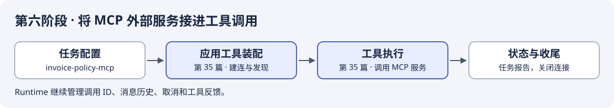
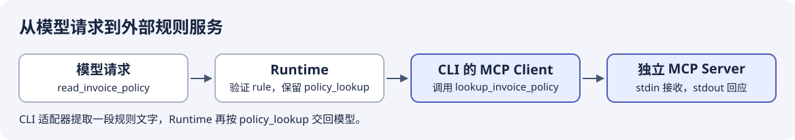
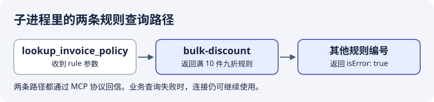
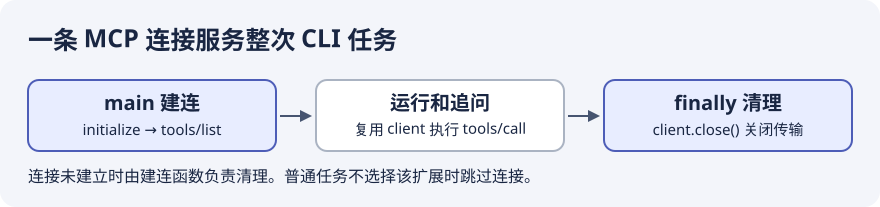
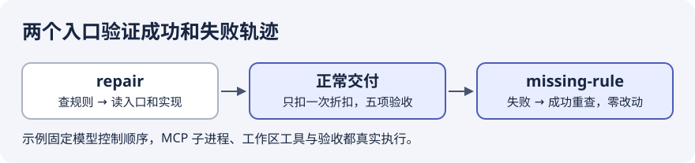

# 第 35 篇：用 MCP 接入进程外的发票规则

第 34 篇的调查工具和 CLI 跑在同一个进程里。现在假设发票规则由另一个团队维护。我们让 Coding Agent 先通过独立的 MCP 服务查询「满 10 件享 10% 折扣，只应用一次」，再读取实际入口、修复代码并验收。规则服务可以独立运行，CLI 只通过协议向它查询。

[](/diagrams/35-invoice-mcp-position.svg)

第一次阅读可先走一遍技术方案，再到第二步看 `client.callTool`。如果已经有本篇代码，运行 `node --import tsx examples/invoice-mcp/main.ts repair` 即可在终端看到规则反馈与实际验收。这条观察命令使用固定模型，无需模型密钥。图解可以点击放大。

## 本篇技术方案

MCP（Model Context Protocol）规定应用怎样发现和调用外部工具。本篇由 Coding CLI 担任宿主，它创建一个 MCP 客户端。客户端使用 stdio 传输，也就是经由子进程的标准输入和标准输出收发协议消息。模型提出的依旧是普通 Agent 工具调用，CLI 的适配器负责把它转换成 MCP 请求。

### 实施前，先走完一次具体过程

1. 操作者选择 `invoice-mcp.json`，配置指定 `invoice-policy-mcp`。CLI 用固定的 Node 程序和随包提供的服务脚本启动子进程。客户端完成初始化握手，再用 `tools/list` 确认服务提供 `lookup_invoice_policy`。
2. CLI 向这次运行注册 `read_invoice_policy`。它带有本地定义的参数校验规则。模型传入 `{ "rule": "bulk-discount" }`，Runtime 校验参数并调用本地适配器。
3. 适配器把规则编号交给 MCP 客户端。`tools/call` 到达子进程，服务返回一段文本。适配器检查成功状态、内容类型和长度，再把文本交回 Runtime。Runtime 保留原工具调用 ID `policy_lookup` ，将工具反馈追加进历史。
4. 模型下一轮拿到规则，再调查公开入口与实际实现。修改和验收还用原来的工作区工具。CLI 使用验收结果判断交付，退出时关闭 MCP 连接。

[](/diagrams/35-invoice-mcp-architecture.svg)

**本篇核心是 `apps/coding-cli/src/invoice-policy-mcp.ts` 的 `openInvoicePolicy`。** 先看 `connect` 和 `listTools` 如何使工具可用，再看它返回的 `execute` 怎样调用固定远端名称并提取文本。`main.ts` 负责把连接的生命周期绑定到整个 CLI 任务。

这次只发布一项经核对的规则查询。配置只选扩展名，启动程序、脚本和工具名由应用决定。服务与 CLI 分属两个进程，服务仍以当前用户权限运行。工具的只读策略由 CLI 落实，操作系统的资源隔离需要独立实现和验证。

MCP 的 `tools/list` 和 `tools/call` 分别对应发现与调用。stdio 的 stdout 承载协议消息，诊断输出应走 stderr。 [MCP 工具规范](https://modelcontextprotocol.io/specification/2025-11-25/server/tools) · [MCP stdio 传输规范](https://modelcontextprotocol.io/specification/2025-11-25/basic/transports)

Pi 的 `wrapRegisteredTool` 将扩展工具适配成 Agent 所使用的工具。本篇沿用「由应用适配，核心循环走统一工具接口」的思路，另外使用 MCP SDK 实现进程间通信。 [Pi 固定版本的扩展工具包装器](https://github.com/badlogic/pi-mono/blob/8efd314fa3d3232ce197d8d7a6a5660530b9d83e/packages/coding-agent/src/core/extensions/wrapper.ts#L17)

## 创建分支

在仓库根目录确认已提交第 34 篇。如果本篇代码已写进工作区，可以在当前提交上创建分支，改动会随分支保留。

```bash
git status --short --branch
git switch -c agent/chapter-35-invoice-mcp
```

## 第一步：让子进程提供发票规则

在仓库根目录执行以下命令，将 SDK 和用于服务参数校验的 Zod 加入 CLI workspace。依赖版本和根目录锁文件一起保存。

```bash
npm install --workspace @ai-harness/coding-cli --save-exact --ignore-scripts @modelcontextprotocol/sdk@1.32.2 zod@4.6.7
```

然后在 `apps/coding-cli/package.json` 将 `files` 字段替换为下面这一段。打包时，构建后的 CLI 与服务脚本都要在产物中。若使用已包含本篇的检出版本，在根目录执行 `npm ci` 即可按锁文件安装。

```json
"files": [
  "dist",
  "mcp"
],
```

新建 `apps/coding-cli/mcp/invoice-policy.mjs`。这个服务接收规则编号，返回一条发票规则或一条业务失败结果。它的调用者是 CLI 中的 MCP 客户端，业务逻辑留在服务侧。

<<< @/snippets/35-invoice-mcp/apps/coding-cli/mcp/invoice-policy.mjs

[](/diagrams/35-invoice-mcp-server.svg)

程序顶层的 `registerTool` 提供远端名称、描述和入参 schema。SDK 根据 `inputSchema` 把符合要求的字符串传给回调。在同文件的回调里，先找这个判断。

```js
if (rule !== 'bulk-discount') {
  return { isError: true, content: [{ type: 'text', text: '规则不存在。' }] };
}
```

例如 `unknown-rule` 本身是合法字符串，所以能进入回调。但服务没有对应的业务规则，回传 `isError: true`。`bulk-discount` 则走下面的成功结果。

```js
return {
  content: [{
    type: 'text',
    text: 'bulk-discount：满 10 件享 10% 折扣，同一笔订单只应用一次折扣。',
  }],
};
```

这条文本属于服务的业务数据。后面接入真正的规则来源时，客户端仍可以保持「编号进，规则文本出」的契约。文件末尾的 `server.connect` 将刚注册的能力接到标准输入和输出。客户端启动服务时无需自己解析进程输出。

::: details CLI 包配置完整文件

<<< @/snippets/35-invoice-mcp/apps/coding-cli/package.json

:::

## 第二步：把 MCP 工具包装成 Runtime 工具

新建 `apps/coding-cli/src/invoice-policy-mcp.ts`。这个客户端模块接收 CLI 的取消信号，连到固定服务，产出一个 `ExecutableTool` 与关闭连接的方法。CLI 用 `tool` 装配运行，用 `close` 结束子进程连接。

<<< @/snippets/35-invoice-mcp/apps/coding-cli/src/invoice-policy-mcp.ts

[](/diagrams/35-invoice-mcp-adapter.svg)

### 连接建立后，哪个工具会交给模型？

在同文件的 `openInvoicePolicy`，先找到从 `new StdioClientTransport` 到发现工具的这段代码。

```ts
const transport = new StdioClientTransport({
  command: process.execPath,
  args: [fileURLToPath(new URL('../mcp/invoice-policy.mjs', import.meta.url))],
  maxBufferSize: 16 * 1024,
});

try {
  await client.connect(transport, { signal, timeout: REQUEST_TIMEOUT_MS });
  const { tools } = await client.listTools(undefined, { signal, timeout: REQUEST_TIMEOUT_MS });
  if (!tools.some((tool) => tool.name === REMOTE_TOOL)) {
    throw new Error('发票 MCP 服务缺少已登记的规则查询工具。');
  }
} catch (error) {
  await client.close();
  throw error;
}
```

`process.execPath` 指向正在运行 CLI 的 Node。脚本路径从当前模块的位置解析，源码入口在 `src`、构建入口在 `dist`，二者向上一级都能找到同一个 `mcp` 目录。SDK 负责启动子进程和初始化握手，并接管协议收发。连接或发现失败时，函数先清理客户端，再将失败交还 CLI。

`listTools` 在这里核对已约定的 `REMOTE_TOOL` 是否出现在当前服务返回的清单中。这个服务只有一个工具。本地 `tool` 对象自行定义 `read_invoice_policy` 的说明和 schema，因此服务返回的新工具不会随发现结果进入模型输入。

### 一次工具调用怎样到达服务？

仍在 `openInvoicePolicy` 内，定位 `tool.execute` 校验 `value` 后的调用代码。

```ts
const result = await client.callTool({
  name: REMOTE_TOOL,
  arguments: { rule: value.rule },
}, undefined, { signal: toolSignal, timeout: REQUEST_TIMEOUT_MS }).catch(() => {
  toolSignal?.throwIfAborted();
  throw new ToolExecutionError('发票规则服务暂时不可用。');
});
```

前一轮模型提交的 `rule` 已被 Runtime 校验。执行函数再把 `unknown` 缩窄成带有效字符串的对象，随后只发送 `{ rule: value.rule }` 给固定远端工具。模型提出的调用名是 `read_invoice_policy`，服务端注册名是 `lookup_invoice_policy`，两个名字在适配器里连接起来。SDK 使用自己的请求 ID 关联协议应答。模型工具历史仍使用 Runtime 的 `policy_lookup`。

初始化、发现和单次查询分别使用 5000 毫秒的 SDK 请求时限。工具执行时使用 Runtime 传进来的 `toolSignal`。若调用失败，先检查信号，已取消时继续沿取消路径退出；其他协议或传输失败返回简短错误，避免把原始异常交给模型。

### 下一轮会拿到什么？

在同一个 `execute` 中，紧接 `client.callTool` 的是结果检查。

```ts
if (result.isError) {
  throw new ToolExecutionError('发票规则服务未能返回所请求的规则。');
}
const content = Array.isArray(result.content) ? result.content : [];
const item = content[0];
if (content.length !== 1 || item?.type !== 'text' ||
    typeof item.text !== 'string' || item.text.length > 1_000) {
  throw new ToolExecutionError('发票规则服务返回的内容格式无效。');
}
return item.text;
```

`unknown-rule` 到达服务后会返回业务失败标志，适配器把它转换成已知工具错误。成功时只接收一段长度不超过 1000 个 UTF-16 代码单元的文本。这里的返回值是规则原文，由 Runtime 加上本地工具名和调用 ID。收到规则说明工具查询成功，最终能否交付仍要查看工作副本和实际验收。

## 第三步：由 CLI 管理整次任务的连接

在 `apps/coding-cli/src/types/task.ts` 中新增工具类型导入，扩展 `TaskConfig.extension` 的合法值，并在 `RunInputOptions.deferCheck` 后新增已连接工具字段。

```ts
import type { ExecutableTool } from '@ai-harness/runtime';
```

```ts
/** 【修改】操作者选择的扩展。省略时仅使用原工具。 */
extension?: 'source-pair' | 'invoice-policy-mcp';
```

```ts
/** 【新增】CLI 已接通的规则工具，由同一任务的各个运行段复用。 */
invoicePolicyTool?: ExecutableTool;
```

在 `apps/coding-cli/src/config/task.ts` 的 `loadTask` 中，紧接任务字段解构替换原来的扩展校验。

```ts
// 【修改】只接受两个已知扩展名。
if (extension !== undefined && extension !== 'source-pair' && extension !== 'invoice-policy-mcp') {
  throw new Error('任务指定了未知扩展。');
}
```

类型供应用内部使用。JSON 文件的值仍要经过运行时判断。如果填入其他字符串，CLI 会在启动模型循环和服务之前拒绝。创建 `fixtures/code-tasks/invoice-mcp.json`，复用发票材料、可写文件范围和配套验收。

<<< @/snippets/35-invoice-mcp/fixtures/code-tasks/invoice-mcp.json

在 `apps/coding-cli/src/main.ts` 中，给 `createModelCall` 的导入后加一行，再在 `runCli` 内的 `session` 声明后保留连接句柄。

```ts
import { openInvoicePolicy } from './invoice-policy-mcp';
```

```ts
let invoicePolicy: Awaited<ReturnType<typeof openInvoicePolicy>> | undefined;
```

在 `runCli` 准备会话日志之后、注册运行事件观察器之前插入建连代码。

```ts
// 【新增】准备模型循环前发现规则工具，首段和追问共用连接。
if (task.extension === 'invoice-policy-mcp') {
  phase = '发票规则服务连接';
  invoicePolicy = await openInvoicePolicy(controller.signal);
}
```

这条分支执行时，任务配置和副本都已准备。完成初始化和发现之后 CLI 才进入 `runSession`。在 `runOptions` 内 `fullHistory` 后面插入同一已连接工具。

```ts
...(invoicePolicy ? { invoicePolicyTool: invoicePolicy.tool } : {}),
```

首段运行和同进程的追问共用 `runOptions`，因此它们也共用工具内部捕获的客户端。检查点恢复和日志只读接续已在更早的入口分支返回。旧任务省略该扩展时，CLI 直接跳过建连。

在 `runCli` 的 `finally` 中，移除 SIGINT 监听前插入关闭连接的代码。

```ts
// 【新增】正常退出、异常和取消都要关闭本任务持有的连接。
if (invoicePolicy) {
  await invoicePolicy.close().catch(() => console.error('关闭发票规则服务连接失败。'));
}
```

连接完成后，正常退出、运行失败和取消都会通过这条清理路径。若建连时失败，第二步的 `openInvoicePolicy` 自己清理，因为这时 `invoicePolicy` 尚未赋值。

[](/diagrams/35-invoice-mcp-lifecycle.svg)

::: details 任务类型、配置加载与 CLI 入口完整文件

<<< @/snippets/35-invoice-mcp/apps/coding-cli/src/types/task.ts

<<< @/snippets/35-invoice-mcp/apps/coding-cli/src/config/task.ts

<<< @/snippets/35-invoice-mcp/apps/coding-cli/src/main.ts

:::

## 第四步：把外部工具接到原有权限策略

在 `apps/coding-cli/src/session/run.ts` 的 `runSession` 中，双文件工具装配区块之后、`availableTools` 声明之前插入以下代码。

```ts
// 【新增】MCP 适配器作为普通工具进入后续的应用权限判断。
if (inputOptions.invoicePolicyTool) {
  tools.push(inputOptions.invoicePolicyTool);
}
```

同一个对象会经过现有的 `availableTools` 和 `allowedTools` 装配，再交给 `runAgent`。Runtime 看到的是和本地 `read_file` 同样形状的工具接口。

在 `apps/coding-cli/src/session/read-only-tools.ts` 中替换整个 `readableTools` 声明。

```ts
// 【修改】允许已核对过的固定发票服务查询。
const readableTools = new Set([
  'find_files', 'search_source', 'read_file', 'read_source_pair', 'read_invoice_policy',
]);
```

这一项授权经过审查的发票规则查询在只读任务里执行。判断依据是固定服务的行为。以后接入其他外部工具时，应按各自的实际副作用决定权限。写入与验收仍受原策略约束。

[](/diagrams/35-invoice-mcp-adapter.svg)

::: details 运行装配与只读策略完整文件

<<< @/snippets/35-invoice-mcp/apps/coding-cli/src/session/run.ts

<<< @/snippets/35-invoice-mcp/apps/coding-cli/src/session/read-only-tools.ts

:::

## 第五步：用真实子进程验证两条轨迹

新建 `examples/invoice-mcp/main.ts`。它把固定模型注入正式 CLI 的 `runCli`。模型回调产生的请求会通过 Runtime 执行规则查询、实际文件读取、修改和验收。配套验收继续使用现有发票用例。

<<< @/snippets/35-invoice-mcp/examples/invoice-mcp/main.ts

[](/diagrams/35-invoice-mcp-verify.svg)

在同文件的 `runCli` 模型回调里，第一轮为正常和失败场景共用同一个初次调用 ID。

```ts
if (turn === 1) {
  const rule = mode === 'repair' ? 'bulk-discount' : 'unknown-rule';
  return request('policy_lookup', 'read_invoice_policy', { rule });
}
```

`request` 把规则参数转成模型消息的 JSON 字符串。`repair` 会先核对取回的文字，再通过原有的 `read_file` 查入口和当前实现。读出重复乘法后，才会发出修改请求。第五轮请求原有的 `run_check`，最后由 `answer` 结束。它的总结没有参与实际验收。

`missing-rule` 用只读模式启动。第二轮检查首次反馈的 ID 和 `isError`，然后改用 `bulk-discount` 发送 `policy_retry`。第三轮确认拿到业务规则后结束，从这里可以观察同一连接在一次工具级失败后继续可用。

## 运行与验收

在仓库根目录执行。

```bash
npm run check
node --import tsx examples/invoice-mcp/main.ts repair
node --import tsx examples/invoice-mcp/main.ts missing-rule
```

在 `repair` 输出中，先找到 `toolCallId: 'policy_lookup'`，查看 `isError: false` 和规则文字。随后在「最近实际验收」找单价 100、数量 10 的用例，实际金额应为 900。交付判断应显示 `accepted: true` 和 `checkMatchesCurrent: true`。

在 `missing-rule` 输出中，先出现 `policy_lookup / isError: true`，再出现 `policy_retry / isError: false`。没有文件变化，运行预期退出 1。这个退出码来自没有形成代码交付；重试查询的结果则应为成功。

若终端报「发票规则服务连接失败」，在 `openInvoicePolicy` 查看 `transport` 的构造参数，随后区分 `connect` 与 `listTools` 哪一步失败。也可以临时把适配器发现用的 `REMOTE_TOOL` 改成一个不存在的名称，再跑示例。应在进入模型循环前退出 2。观察后改回原名称。

配置了真实模型的读者可以另行运行下方入口，观察它是否主动查询规则、读取实际入口并成功交付。该命令会调用所配置的模型。

```bash
node --env-file=.env apps/coding-cli/dist/cli.js --task fixtures/code-tasks/invoice-mcp.json
```

合上代码后试着回答：如果服务的 `tools/list` 里多出一个工具，当前模型会看到它吗？从发现结果一路追到 `runAgent` 的工具清单即可验证。

## 保存本篇

```bash
git status --short --branch
git diff --check
git add package-lock.json apps/coding-cli/package.json apps/coding-cli/mcp/invoice-policy.mjs \
  apps/coding-cli/src/invoice-policy-mcp.ts apps/coding-cli/src/main.ts \
  apps/coding-cli/src/config/task.ts apps/coding-cli/src/types/task.ts \
  apps/coding-cli/src/session/run.ts apps/coding-cli/src/session/read-only-tools.ts \
  examples/invoice-mcp/main.ts fixtures/code-tasks/invoice-mcp.json \
  docs/chapter-35-verification.md docs/conversation-handoff.md docs/jd-learning-map.md \
  docs/learning-state.md docs/stage-06-plan.md docs/system-map.md \
  site/.vitepress/config.mts site/index.md site/roadmap.md site/guide/35-invoice-mcp.md \
  site/public/diagrams/35-invoice-mcp-*.svg site/snippets/35-invoice-mcp
git diff --cached --check
git diff --cached --stat

git commit -F - <<'COMMIT'
通过 MCP 为 Coding CLI 接入发票规则查询

启动固定 stdio 规则服务，将经过核对的外部工具适配为 Runtime 工具。
复用现有只读策略、工作区工具和交付验收，随 CLI 任务关闭连接。
补充第 35 篇教程、图解与实际子进程验证记录。
COMMIT

git push -u origin agent/chapter-35-invoice-mcp
```
