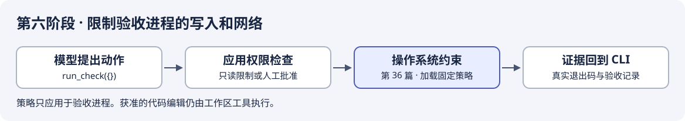
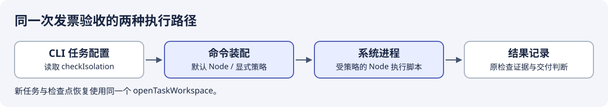
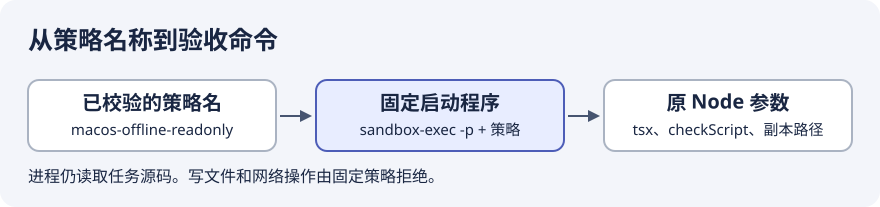
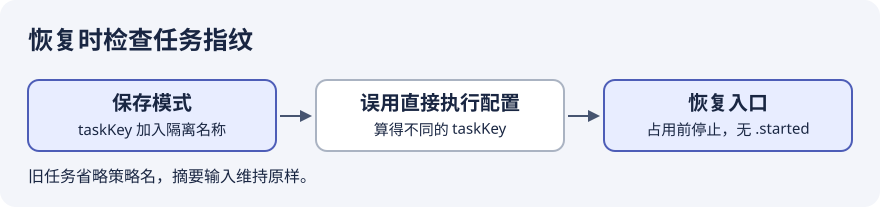
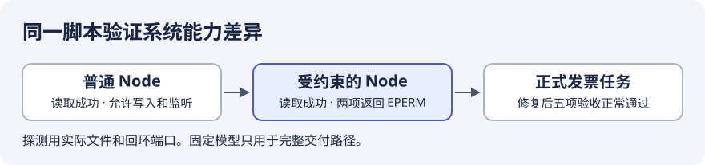

# 第 36 篇：限制验收进程写文件和使用网络

Coding Agent 修复发票计算后，会执行一份可信验收脚本。脚本还会导入工作副本里刚被修改的代码。即使模型只能请求 `run_check({})`，被导入的代码也会真的在 Node 进程里执行。这个进程能否写文件、打开网络监听，是另一层需要验证的权限。

本篇在 macOS 给验收子进程加上只读、离线策略。模型仍通过原工具编辑获准的计算文件。进入验收后，同一份修改可被读取和执行，此时写入和网络操作会受到系统约束。

[](/diagrams/36-check-isolation-position.svg)

如果已经检出了本篇代码，先运行 `node --import tsx examples/check-isolation/main.ts compare`。在带 `sandbox-exec` 的 macOS 上，观察两行结果里哪两项从 `allowed` 变成 `EPERM`。阅读时先跟技术方案，再看第一步的固定策略和最终参数数组。图解可以点击放大。

## 本篇技术方案

同一次运行有两道不同的问题。第一道由应用决定模型提出的 `run_check` 是否获准。第二道由操作系统决定验收进程启动后可以访问哪些资源。用同一份脚本做对照，才能判断第二道限制究竟拦住了什么。

### 实施前，先走完一次具体过程

1. 操作者选择 `invoice-isolated.json`。CLI 解析显式的 `checkIsolation`，然后准备发票工作副本、精确的可写路径和可信验收脚本。
2. CLI 装配验收时，把固定 Node 命令交给 macOS 的 `sandbox-exec` 启动，并传入应用定义的策略。模型收到的工具说明仍只允许提交空对象。
3. 模型用 `replace_text` 调整重复折扣，再请求 `run_check({})`。运行器启动验收。脚本能够读取并导入计算文件，五个业务用例照常运行。若进程尝试写文件或监听端口，对照实验能观察到系统拒绝。
4. Runtime 保存工具反馈，CLI 判断实际验收是否匹配当前的修改。若这次任务经检查点稍后恢复，CLI 会先校验任务指纹，再以相同执行策略打开副本。

[](/diagrams/36-check-isolation-architecture.svg)

**核心代码在 `apps/coding-cli/src/session/check-command.ts` 的 `createCheckCommand`。** 一个无配置任务得到原本的 Node 命令，显式选择隔离的任务得到带固定策略的启动命令。`openTaskWorkspace` 是新运行与已保存任务恢复的共用入口。

这是针对可信本地练习材料的 macOS 实验。系统策略允许一般文件读取，代码仍能访问当前用户有权读取的宿主机内容。权限也只作用于验收进程，模型调用、MCP 服务和 CLI 主进程都有自己的边界。`sandbox-exec` 已被 macOS 的本机手册标记为弃用。本章用它直接观察系统拒绝，生产部署仍需为文件读取、进程树与资源消耗分别设计和验证。 [Apple 的 macOS 权限说明](https://developer.apple.com/library/archive/documentation/Security/Conceptual/AuthenticationAndAuthorizationGuide/Permissions/Permissions.html)

Pi 的工具可以在应用组装时注入具体执行操作，例如 `bash.ts` 的 `BashOperations` 和 `options.operations`。这里借鉴保持工具接口稳定、由应用选择后端的做法，具体系统限制来自 macOS。 [Pi 固定版本的执行后端](https://github.com/badlogic/pi-mono/blob/8efd314fa3d3232ce197d8d7a6a5660530b9d83e/packages/coding-agent/src/core/tools/bash.ts#L215)

## 创建分支

在仓库根目录从已提交的第 35 篇继续。如果本篇改动已经写入工作区，可以直接从当前提交创建本篇分支。

```bash
git status --short --branch
git switch -c agent/chapter-36-check-isolation
```

## 第一步：把固定策略变成验收命令

新建 `apps/coding-cli/src/session/check-command.ts`。它接收已校验的任务配置与副本路径，返回现有 coding-tools 接口要求的 `CheckCommand`。具体启动、限时与有界输出仍由原验收运行器处理。

<<< @/snippets/36-check-isolation/apps/coding-cli/src/session/check-command.ts

[](/diagrams/36-check-isolation-command.svg)

在同文件顶部，`MACOS_PROFILE` 定义了这章要观察的系统策略。

```ts
const MACOS_PROFILE = [
  '(version 1)',
  '(allow default)',
  '(deny file-write*)',
  '(deny network*)',
].join('\n');
```

`allow default` 保留大多数默认权限，让 Node 还能读取脚本、源码和依赖。两个 `deny` 分别禁止文件写入与网络操作。运行探测脚本时，前者会拦住在副本中新建临时标记文件，后者会拦住监听本机回环地址。

接着看同文件 `createCheckCommand` 的两条返回路径。

```ts
export function createCheckCommand(task: TaskConfig, root: string): CheckCommand {
  const nodeArgs = ['--import', import.meta.resolve('tsx'), task.checkScript, root];

  if (task.checkIsolation === undefined) {
    return { executable: process.execPath, args: nodeArgs };
  }

  if (process.platform !== 'darwin') {
    throw new Error('macos-offline-readonly 只支持带 sandbox-exec 的 macOS。');
  }

  return {
    executable: '/usr/bin/sandbox-exec',
    args: ['-p', MACOS_PROFILE, process.execPath, ...nodeArgs],
  };
}
```

例如任务脚本是 `check-invoice.mjs`，`root` 就是 CLI 刚创建的副本。普通配置将 `nodeArgs` 原样交给当前 Node。启用隔离时，`-p` 后面是完整策略，后面才是同一个 Node 和参数数组。底层启动函数仍用 `shell: false`，所以两层参数在不同位置解析，配置也没有提供任意命令的入口。

如果系统不是 macOS，配置了该策略的任务会在准备时失败。在 macOS 缺少启动程序或策略应用失败时，验收会失败，程序不会自动改走直接执行。

## 第二步：让任务选择策略并接到现有工具

在 `apps/coding-cli/src/types/task.ts` 的 `TaskConfig.checkScript` 之后插入字段。

```ts
/** 【新增】仅约束验收子进程的写入和网络。省略时沿用本地执行。 */
checkIsolation?: 'macos-offline-readonly';
```

在 `apps/coding-cli/src/config/task.ts` 的 `loadTask` 中，替换从 `const keys` 到已有扩展校验之前的部分。

```ts
const keys = ['source', 'prompt', 'writablePaths', 'checkScript'];
// 【修改】可选项只允许指定的字段，仍保持四个必填字段。
const optionalKeys = ['memory', 'extension', 'checkIsolation'];
if (
  !isRecord(value) ||
  keys.some((key) => !Object.hasOwn(value, key)) ||
  Object.keys(value).some((key) => !keys.includes(key) && !optionalKeys.includes(key))
) {
  throw new Error('任务字段不匹配。');
}
const { source, prompt, writablePaths, checkScript, extension, checkIsolation } = value;
// 【新增】任务只选择已知策略名，策略正文由 CLI 持有。
if (checkIsolation !== undefined && checkIsolation !== 'macos-offline-readonly') {
  throw new Error('任务指定了未知验收隔离策略。');
}
// 只接受两个已知扩展名。
```

任务文件写入的是策略名。值由 `loadTask` 当作外部数据检查。拼错名称会在准备副本之前报任务配置错误。通过后，把下面一行插入返回对象的 `checkScript: scriptPath,` 之后。

```ts
...(checkIsolation ? { checkIsolation } : {}),
```

新建 `fixtures/code-tasks/invoice-isolated.json`。它使用与普通发票任务相同的材料和验收脚本，显式选择本篇策略。

<<< @/snippets/36-check-isolation/fixtures/code-tasks/invoice-isolated.json

在 `apps/coding-cli/src/session/prepare.ts` 的导入区末尾新增下面一行。

```ts
import { createCheckCommand } from './check-command';
```

在同文件 `openTaskWorkspace` 传给 `createCodeTaskSession` 的对象里，替换原来的整个 `check` 属性。

```ts
// 【修改】为新任务与恢复任务应用同一个验收执行策略。
check: createCheckCommand(task, root),
```

以后新任务和恢复任务都从这里创建 `run_check`，两者能得到同一个策略。工作区工具仍负责控制模型能改哪些源码，系统策略的加载时机是验收命令启动。

[](/diagrams/36-check-isolation-architecture.svg)

::: details 任务配置与工作区准备完整文件

<<< @/snippets/36-check-isolation/apps/coding-cli/src/types/task.ts

<<< @/snippets/36-check-isolation/apps/coding-cli/src/config/task.ts

<<< @/snippets/36-check-isolation/apps/coding-cli/src/session/prepare.ts

:::

## 第三步：恢复时核对同一执行策略

在 `apps/coding-cli/src/session/checkpoint.ts` 的 `taskKey` 函数里，将下面的内容插到用于计算摘要的数组末尾，紧接 `script,`。

```ts
// 【新增】只为启用隔离的新任务追加策略，旧检查点的摘要仍可用。
...(task.checkIsolation ? [task.checkIsolation] : []),
```

`invoice-isolated.json` 和 `invoice.json` 使用同一份代码材料和验收脚本。若摘要里只看这两项，两者会混在一起。加上显式策略名以后，用普通配置恢复隔离检查点时，`openPendingCheck` 算出的任务指纹不同，恢复在创建 `.started` 之前停止。这个校验同样约束已获得批准的检查点。

对于旧任务，数组仍然按原长度和顺序计算。以前生成的直接执行检查点仍能读取。以后如果要改变这里命名的策略语义，应使用新的策略名，否则旧指纹无法区分两种行为。

[](/diagrams/36-check-isolation-checkpoint.svg)

::: details 检查点完整文件

<<< @/snippets/36-check-isolation/apps/coding-cli/src/session/checkpoint.ts

:::

## 第四步：测量系统实际允许了什么

新建 `examples/check-isolation/probe.mjs`。这是专用于对照实验的探测脚本，输入是 CLI 准备的临时副本路径，输出是一次源码读取和两项能力尝试的结果。普通发票验收继续使用原业务脚本。

<<< @/snippets/36-check-isolation/examples/check-isolation/probe.mjs

在该文件顶层，先读取 `src/main.ts`。后续写入专用标记文件时，`flag: 'wx'` 保证只创建新文件；直接执行成功后就删掉该文件。网络探测只尝试监听 `127.0.0.1`，端口 0 由操作系统分配，成功后立即关闭。打印对象里的 `write` 和 `listen` 各自保存系统返回的错误码或 `allowed`。

新建 `examples/check-isolation/main.ts`。它提供两个入口。`compare` 让同一份探测脚本在两种验收环境里执行，`repair` 则注入固定模型响应，走完整 CLI 交付流程。

<<< @/snippets/36-check-isolation/examples/check-isolation/main.ts

[](/diagrams/36-check-isolation-probe.svg)

在示例的 `compare` 分支中，注意两次使用的是同一个 `checkScript`。

```ts
for (const isolation of [undefined, checkIsolation]) {
  const session = await prepareSession({ ...task, checkScript, checkIsolation: isolation }, false);
  try {
    const check = session.codeTask.tools.find((tool) => tool.name === 'run_check');
    if (!check) {
      throw new Error('任务缺少验收工具。');
    }

    // 直接观察两种执行环境，用相同探测脚本，避开模型选择的影响。
    const result = JSON.parse(await check.execute({}));
    if (result.status !== 'passed') {
      throw new Error(`探测脚本未正常结束：${result.status} ${result.stderr}`);
    }
    console.log(isolation ?? 'direct', JSON.parse(result.stdout));
  } finally {
    await rm(session.root, { recursive: true, force: true });
  }
}
```

循环第一次只准备普通命令，第二次保留任务中的隔离名。两次都找实际的 `run_check` 执行，分别从 stdout 读取探测 JSON。退出 0 只表示探测脚本跑完并记录了现象，哪种资源受到限制要看输出内的 `write` 和 `listen`。探测用临时副本由示例在 `finally` 中清理。

`repair` 则由第一轮固定响应构造 `replace_text`，第二轮构造 `run_check`，第三轮停止。Runtime 完整执行这些请求，最后的 `accepted` 由原来的交付报告计算。CLI 会保留交付副本供审阅。

## 运行与验收

在带 `sandbox-exec` 的 macOS 上，于仓库根目录执行。

```bash
npm run check
node --import tsx examples/check-isolation/main.ts compare
node --import tsx examples/check-isolation/main.ts repair
```

对照实验中，两种执行方式都应出现 `readEntry: true`。直接执行的 `write`、`listen` 都是 `allowed`，隔离执行的两个字段都应出现权限错误，本篇实测为 `EPERM`。

交付实验里，找到 `isolation_check` 对应的工具反馈，确认真实验收脚本完成。再读「最近实际验收」及最终交付，五项业务检查通过，`checkMatchesCurrent` 和 `accepted` 为 `true`。这也解释了为什么验收进程禁止写入后，前一轮的修改仍能交付：两个动作是在不同执行边界完成的。

调试时可以在 `createCheckCommand` 的最后一个 `return` 停住，比较两种配置下的 `task.checkIsolation`、`executable` 和 `args`。要核对错配，可以在 `openPendingCheck` 比较检查点的 `entry.taskKey` 与当前任务计算出的 `taskKey`。用同一个发票脚本保存隔离检查点后，普通任务配置应在占用前失败，切回隔离配置可按原有批准或恢复流程继续。

若机器不支持这项策略，其他任务仍可使用未配置隔离的原有执行方式。执行本章正式 CLI 入口会调用所配置的模型。可以单独观察模型如何修复发票，再核对同样的实际验收证据。

```bash
node --env-file=.env apps/coding-cli/dist/cli.js --task fixtures/code-tasks/invoice-isolated.json
```

合上代码后思考：若操作者在只读模式下提交任务，`run_check` 会在哪一层被拒绝？如果运行已经通过工具权限检查，谁会阻止脚本打开监听端口？

## 保存本篇

```bash
git status --short --branch
git diff --check
git add apps/coding-cli/src/config/task.ts apps/coding-cli/src/types/task.ts \
  apps/coding-cli/src/session/check-command.ts apps/coding-cli/src/session/prepare.ts \
  apps/coding-cli/src/session/checkpoint.ts examples/check-isolation/main.ts \
  examples/check-isolation/probe.mjs fixtures/code-tasks/invoice-isolated.json \
  docs/chapter-36-verification.md docs/conversation-handoff.md docs/jd-learning-map.md \
  docs/learning-state.md docs/stage-06-plan.md docs/system-map.md \
  site/.vitepress/config.mts site/index.md site/roadmap.md site/guide/36-check-isolation.md \
  site/public/diagrams/36-check-isolation-*.svg site/snippets/36-check-isolation
git diff --cached --check
git diff --cached --stat

git commit -F - <<'COMMIT'
限制 macOS 验收进程的写入和网络操作

让任务显式选择验收策略，并在检查点恢复时核对相同策略。
对照验证系统拒绝写入与监听，保留现有业务验收和交付逻辑。
补充第 36 篇教程、图解和验证记录。
COMMIT

git push -u origin agent/chapter-36-check-isolation
```
