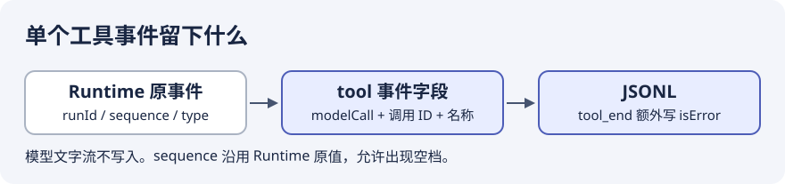
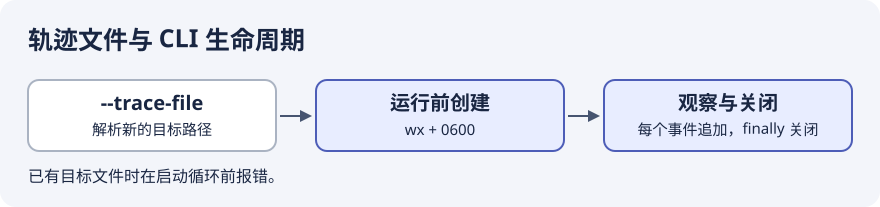
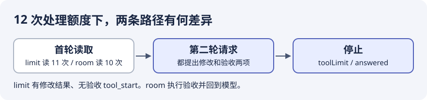

# 第 37 篇：用结构化轨迹定位工具为什么没执行

模型提出了修改文件和运行验收，最后却只看到文件变了，验收没跑。只看模型的最后响应，很容易把「提出了验收请求」读成「已经执行验收」。本篇在 Coding CLI 增加可选的 `--trace-file`，把 Runtime 的事件写成可逐行读取的 JSONL 文件。出问题后，可以从模型响应一路数到实际处理的请求，再看停止原因。

[](/diagrams/37-run-trace-position.svg)

第一次阅读，先跟一遍下方的 12 项预算，再看第一步怎样把同一条事件变成一行 JSON。已有本篇代码时，可以直接跑底部的两组对照。每张图都可以点击放大。

## 本篇技术方案

JSONL 是一行一个 JSON 对象的文件格式。第 25 篇的会话日志用于保存模型和工具消息。本篇另写一份运行轨迹，记录何时取得模型响应、何时开始处理某项工具请求，以及运行在哪个状态停止。应用层选择诊断需要的字段，Runtime 仍用原来的调用计数和执行逻辑。

### 实施前，先走完一次具体过程

1. 运行发票任务，指定一个新路径 `limit.jsonl`。CLI 在运行前创建文件。Runtime 从 `run_start` 开始发出事件，每一条都有 `runId` 和该次运行内的 `sequence`。
2. 固定模型第一轮要求读取入口 11 次。这是为了稳定复现额度耗尽。第二轮请求执行 `invoice_edit` 和 `invoice_check`。`model_end.toolCallCount` 为 2，这个数字来自该次完整模型响应。
3. 工具预算是 12 项。修改请求占用第 12 项，留下一条 `tool_start` 和一条 `tool_end`。下一项的预算申请失败，因此没有 `tool_start`，Runtime 写下 `run_end.status: 'toolLimit'`。CLI 的交付报告显示文件发生了变化且未接受。
4. 用新的副本跑对照，把第一轮读取从 11 次减到 10 次。第二轮仍请求同样两项。两项都获得额度，验收产生符合当前内容的证据，模型再收到工具结果后结束，CLI 最终接受。

[](/diagrams/37-run-trace-architecture.svg)

**核心代码在 `apps/coding-cli/src/report/trace.ts` 的 `traceRecord` 和 `openRunTrace`。** 第一处决定什么字段入盘，第二处负责独占文件和逐行追加。原 Runtime 不知道目标文件路径，也不会从轨迹恢复运行。

这次保留工具名和调用 ID，以便和 CLI 报告关联。模型文字流、请求参数、源码正文与工具输出没有写入这份轨迹。工具名和调用 ID 仍是外部元数据，分享轨迹前应先检查内容。诊断文件是应用观察结果，中途停止或写入失败时可能只留下一段前缀。

Pi 的 `AgentEvent` 提供工具执行及结束事件，供调用者观察。这里复用自己的事件接口，在 CLI 明确选择持久化字段。 [Pi 固定版本的 AgentEvent](https://github.com/badlogic/pi-mono/blob/8efd314fa3d3232ce197d8d7a6a5660530b9d83e/packages/agent/src/types.ts#L516)

## 创建分支

从已提交的第 36 篇继续。在仓库根目录执行。如果本篇代码已经写入工作区，建分支会保留这些改动。

```bash
git status --short --branch
git switch -c agent/chapter-37-run-trace
```

## 第一步：只写能用于归因的事件字段

新建 `apps/coding-cli/src/report/trace.ts`。模块接收一个新文件路径，返回追加事件和关闭的方法。每次追加先从 Runtime 事件取出规定字段，只有得到一条记录时才写入。

<<< @/snippets/37-run-trace/apps/coding-cli/src/report/trace.ts

[](/diagrams/37-run-trace-record.svg)

### 一条工具记录怎样和前后事件关联

在同文件 `traceRecord` 的开头，先固定每行公共字段。

```ts
const common = {
  version: 1,
  runId: event.runId,
  sequence: event.sequence,
  type: event.type,
};
```

`version: 1` 用于辨认本章的记录格式。`runId` 说明事件属于哪个运行段，`sequence` 来自 Runtime，保留该段内原有顺序。后面的 `switch` 则按照 `type` 给每种记录补上该类型需要的字段。

例如同函数中的工具分支，会为开始、结束、取消和异常处理保留原调用身份。

```ts
case 'tool_start':
case 'tool_cancelled':
case 'tool_end':
case 'tool_failed':
  return {
    ...common,
    modelCall: event.modelCall,
    toolCallId: event.toolCallId,
    toolName: event.toolName,
    ...(event.type === 'tool_end' ? { isError: event.isError } : {}),
    ...(event.type === 'tool_failed' ? { code: event.code } : {}),
  };
```

读到 `invoice_edit` 的 `tool_end` 时，`modelCall: 2` 可以指向第二轮模型响应，`toolCallId` 将它关联到同一个工具的开始事件，`isError: false` 表示形成了成功结果。对于 `tool_start`，Runtime 刚开始处理请求，后续仍可能在参数校验或权限判断处失败。`tool_failed.code` 是 Runtime 的错误分类，原始异常正文留在原有调试路径中。

类似地，`model_end` 记录当轮提出的项数，`run_end` 记录整段实际计数和停止原因。预览事件没有匹配的分支，落到 `default` 后被略过。看到序号跳过一项是允许的。

### 文件怎样写入

在同文件 `openRunTrace` 查找打开方式及 `append`。

```ts
export async function openRunTrace(path: string) {
  const file = await open(path, 'wx', 0o600);
  return {
    async append(event: RunEvent) {
      const record = traceRecord(event);
      if (record) {
        await file.appendFile(JSON.stringify(record) + '\n', 'utf8');
      }
    },
    close: () => file.close(),
  };
}
```

`wx` 要求目标文件尚不存在。两次运行指向同一个现存文件，后一次会在创建时失败，旧轨迹可保留。文件请求权限为 `0600`，只有当前用户可读写。每条记录序列化后追加一个换行符。CLI 按事件顺序等待追加，方便排查时直接按行检查。此处没有逐行 `fsync`，异常断电时的落盘完整性需要另外保证。

## 第二步：给新任务增加诊断文件参数

在 `apps/coding-cli/src/types/task.ts` 的任务选项内，紧接 `sessionLog?: string;` 插入下方字段。

```ts
/** 【新增】本次 CLI 要独占创建的 JSONL 诊断轨迹。 */
traceFile?: string;
```

在 `apps/coding-cli/src/config/args.ts` 的帮助文案加入 `--trace-file <新文件>`，在 `parseArgs` 的 `sessionLog` 声明后加入路径变量。

```ts
let traceFile: string | undefined;
```

继续在参数循环中找到 `--resume-log` 分支的首行，用下面的区块替换它。原分支的其余内容继续接在末行之后。

```ts
} else if (arg === '--trace-file' && traceFile === undefined) {
  // 【新增】路径由操作者提供，后续只允许新建文件。
  const value = args[++i];
  if (!value?.trim() || value.startsWith('--')) {
    throw new Error('诊断轨迹路径缺失。');
  }
  traceFile = value;
} else if (arg === '--resume-log' && resumeLog === undefined) {
```

`traceFile === undefined` 使重复参数落入无效参数分支。空白值或把另一个开关误当文件名时，也会在解析阶段得到错误。相对路径由 CLI 按启动目录使用。

在原有 `resumeLog` 的组合检查中加入 `traceFile`，同时在 `!taskFile` 检查之后加入下面的拒绝分支。最后将结果字段加在返回对象已有的 `sessionLog` 之后。完整帮助文案与分支见本步完整文件。

```ts
if (resumeLog) {
  if (approveTools || readOnly || taskFile || sessionLog || traceFile || planning || checkpoint || resumeCheck || inspectCheck || gateCheck || decideCheck || !followUp) {
    throw new Error('只读接续需要且仅接受日志路径和一条追问。');
  }
  return { help: false, resumeLog, question: followUp };
}
```

```ts
// 【新增】这些入口不会启动任务模型循环。
if (traceFile && (resumeCheck || inspectCheck || decideCheck)) {
  throw new Error('诊断轨迹只支持新任务运行。');
}
```

```ts
...(traceFile ? { traceFile } : {}),
```

检查点的检查、批准和恢复入口不经过任务模型循环，所以这些模式会拒绝该选项。单次任务和任务内追问都可以生成运行轨迹。

[](/diagrams/37-run-trace-lifecycle.svg)

::: details 类型和参数解析完整文件

<<< @/snippets/37-run-trace/apps/coding-cli/src/types/task.ts

<<< @/snippets/37-run-trace/apps/coding-cli/src/config/args.ts

:::

## 第三步：接到既有的 Runtime 观察器

在 `apps/coding-cli/src/main.ts` 导入 `openRunTrace`，再在 `runCli` 内 `phase` 声明之前增加由 CLI 持有的文件句柄。

```ts
import { openRunTrace } from './report/trace';
```

```ts
let trace: Awaited<ReturnType<typeof openRunTrace>> | undefined;
```

在 `runCli` 中，MCP 装配分支之后、进入「运行与报告」阶段之前增加文件创建。将原观察器改为 `async`，保留原来的进度和计划报告逻辑，再在观察器末尾追加轨迹。

```ts
// 【新增】开始循环前独占创建文件，首段和追问共用句柄。
if (options.traceFile) {
  phase = '诊断轨迹';
  trace = await openRunTrace(options.traceFile);
}

phase = '运行与报告';
const onEvent: RunEventListener = async (event) => {
  printProgress(event);
  if (
    event.type === 'tool_end' &&
    event.toolName === 'update_plan' &&
    !event.isError &&
    session?.plan
  ) {
    printBlock('任务计划（模型声明）', session.plan.read());
  }
  await trace?.append(event);
};
```

同一条事件先用于终端进度，再尝试写入 JSONL。首段和追问使用同一个 `onEvent` 与文件句柄。两个运行段由不同的 `runId` 区分，各自的序号从 1 开始。创建文件失败时会停在 CLI 的准备阶段。如果运行中某次追加失败，Runtime 会把观察器失败计入 `observerErrors`，原工具的结果仍按执行路径产生。排查时先看报告里的这个字段和文件中是否有对应的 `run_end`。

在 `runCli` 的 `finally` 开头增加关闭逻辑。

```ts
if (trace) {
  await trace.close().catch(() => console.error('关闭诊断轨迹失败。'));
}
```

关闭覆盖正常退出、失败和取消。关闭本身出错时给出简短提示。诊断文件与第 25 篇的会话日志可同时使用，应为它们提供不同的路径。

[](/diagrams/37-run-trace-architecture.svg)

::: details CLI 入口完整文件

<<< @/snippets/37-run-trace/apps/coding-cli/src/main.ts

:::

## 第四步：固定两条轨迹，只改变一次读取

新建 `examples/run-trace/main.ts`。它通过 `runCli` 注入固定模型，让两次运行使用相同发票任务、相同修改和验收请求。固定模型只控制请求的数量和顺序，真实工作区由应用创建。

<<< @/snippets/37-run-trace/examples/run-trace/main.ts

[](/diagrams/37-run-trace-compare.svg)

同文件的固定模型第一轮发出一条预览，再构造多次读取。比较两个模式，先找首轮请求数。

```ts
const reads = mode === 'limit' ? 11 : 10;
```

```ts
if (turn === 1) {
  await onTextDelta?.('这一段预览只在实时显示中使用。');
  return {
    role: 'assistant',
    content: '',
    stopReason: 'toolUse',
    toolCalls: Array.from({ length: reads }, (_, index) =>
      request(`inspect_${index + 1}`, 'read_file', { path: 'src/main.ts' }),
    ),
  };
}
```

第二轮的 `invoice_edit`、`invoice_check` 在两个模式完全相同，因此可以直接对齐这两个 ID。若还有第三轮，回调就返回一条非空总结，触发 Runtime 的正常回答路径。真实交付仍要看副本和验收证据。

## 运行与验收

在仓库根目录运行以下命令。`limit` 预期退出 1，`room` 预期退出 0。若终端启用了遇到非零即退出，请分别运行。

```bash
npm run check
trace_dir=$(mktemp -d)
node --import tsx examples/run-trace/main.ts limit "$trace_dir/limit.jsonl"
node --import tsx examples/run-trace/main.ts room "$trace_dir/room.jsonl"

rg '"modelCall":2.*"toolCallCount":|"toolCallId":"invoice_(edit|check)"|"type":"run_end"' \
  "$trace_dir/limit.jsonl" "$trace_dir/room.jsonl"
```

从过滤后的行依次核对：

| 线索 | limit | room |
| --- | --- | --- |
| 第二轮 `model_end.toolCallCount` | 2 | 2 |
| `invoice_edit` | 开始处理并得到成功结果 | 开始处理并得到成功结果 |
| `invoice_check` | 无对应 `tool_start` | 有开始和结束事件 |
| `run_end.status` | `toolLimit` | `answered` |
| 最终交付 | `accepted: false` | `accepted: true` |

两个模式在 `run_end` 都会显示 `toolCalls: 12`。它统计开始处理的项数。判断具体是哪一项没有开始，要按事件里的 ID 核对。这里结合了完整轨迹、`observerErrors: 0`、停止状态和交付报告。若文件只有前缀，单凭缺少某一行无法证明该请求没处理。

调试时可在 `traceRecord` 的工具分支检查传入的 `event`，再到 Runtime 的 `tryStartToolCall` 看第 13 项如何被拦。如果重复使用已经存在的轨迹路径，CLI 应在开始新循环前退出 2，并保留之前的文件。换新路径后可以重新运行。

配置模型后，也可通过正式 CLI 观察一次新任务。这会调用配置的模型。上面的固定模型对照已经足以验证本章的诊断机制。

```bash
node --env-file=.env apps/coding-cli/dist/cli.js \
  --task fixtures/code-tasks/invoice.json --trace-file "$trace_dir/real.jsonl"
```

## 保存本篇

```bash
git status --short --branch
git diff --check
git add apps/coding-cli/src/report/trace.ts apps/coding-cli/src/config/args.ts \
  apps/coding-cli/src/types/task.ts apps/coding-cli/src/main.ts examples/run-trace/main.ts \
  docs/chapter-37-verification.md docs/stage-07-plan.md docs/conversation-handoff.md \
  docs/jd-learning-map.md docs/learning-state.md docs/system-map.md \
  site/.vitepress/config.mts site/index.md site/roadmap.md site/guide/37-run-trace.md \
  site/public/diagrams/37-run-trace-*.svg site/snippets/37-run-trace
git diff --cached --check
git diff --cached --stat

git commit -F - <<'COMMIT'
为 Coding CLI 保存结构化运行轨迹

用独占 JSONL 文件记录选定的 Runtime 事件和调用身份。
对照复现工具额度耗尽，关联模型请求、已处理工具与停止状态。
补充第 37 篇教程、图解和验证记录。
COMMIT

git push -u origin agent/chapter-37-run-trace
```
