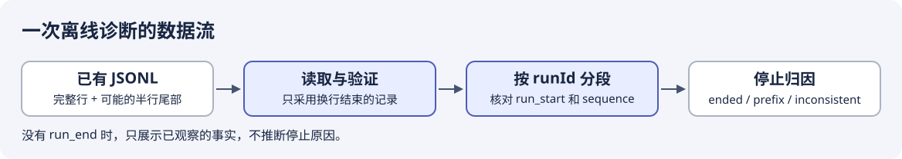
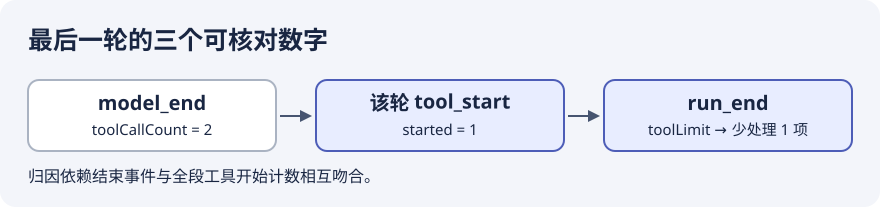
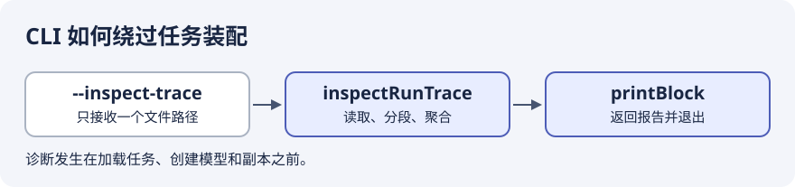

# 第 38 篇：离线诊断一份 Agent 运行轨迹

第 37 篇把发票任务的运行事件存成 JSONL。现在任务已经结束，我们手头可能只有这个文件。能否直接知道最后一轮提出几项工具请求、实际开始处理几项，以及有没有足够证据解释停止原因？本篇新增 `--inspect-trace`，给出可从原始行核对的诊断。读取过程中不会再次执行工具。

[](/diagrams/38-inspect-trace-position.svg)

第一次阅读，先看下方的发票案例，然后跳到第一步里的 `summarizeRun` 看三个数字的来源。有第 37 篇留下的文件时，构建本篇 CLI 后可直接运行 `node apps/coding-cli/dist/cli.js --inspect-trace 路径`。图解可以点开看原图。

## 本篇技术方案

诊断器只读取第 37 篇的版本 1 轨迹。它区分「有可核对的停止事件」「只观察到一段前缀」「已经结束但关键数字对不上」。这里的前缀是从 `run_start` 开始、尚未观察到 `run_end` 的记录。进程中途停止、文件正在写入，或观察器未写下某个事件，都可能减少可用证据。

### 实施前，先走完一次具体过程

1. 从上篇的发票失败任务取得 `limit.jsonl`。操作者运行独立诊断命令。CLI 在加载任务配置、模型和副本之前分流，只打开指定轨迹。
2. 读取器按照换行取出完整行，校验版本、运行 ID、序号和值的类型。以 `run_start` 开始一段，并把后续事件归入同一个 `runId`。有追问的文件可能包含多个运行段，每段各算各的。
3. 拿到该段的 `run_end` 后，诊断器先核对全段 `tool_start` 的计数。发票失败轨迹的最后一次模型响应提出修改和验收共 2 项，该轮开始处理 1 项。尾部状态是 `toolLimit`，因此可以报告 `skippedByToolLimit: 1`。
4. 把同一轨迹的最后一行替换成半行，重新读取。此时仍能报告已观察的 12 项开始记录，但只给出 `evidence: 'prefix'` 和 `partialTail: true`。如果保留结束事件却删掉修改的开始事件，末尾计数将对不上，报告 `inconsistent`。

[](/diagrams/38-inspect-trace-architecture.svg)

**核心代码在 `apps/coding-cli/src/report/inspect-trace.ts` 的 `summarizeRun`。** 它只依赖已保存的事件：先确定这段运行的结尾，再从最后一轮的两个计数算出差额。文件读取、分段和字段校验为这个判断准备证据。

结束报告说明 Runtime 的停止状态。就算是 `answered`，交付是否接受也得看原任务的业务验收报告。轨迹目前只有模型响应里的请求总数，未处理项没有单独的事件，所以诊断器只能报告数量。要确定具体是哪个请求，仍需结合原 CLI 终端报告或会话日志。

Pi 的 `parseSessionEntries` 演示了怎样逐行读取会话 JSON。它会跳过格式错误的行。本篇用于故障归因，完整行损坏时直接报错，只允许末尾半行缺失。这能让损坏位置保留在诊断流程中。 [Pi 固定版本的 parseSessionEntries](https://github.com/badlogic/pi-mono/blob/8efd314fa3d3232ce197d8d7a6a5660530b9d83e/packages/coding-agent/src/core/session-manager.ts#L355)

## 创建分支

从已提交的第 37 篇继续。在仓库根目录执行。已有本篇工作区改动时，建分支会保留这些改动。

```bash
git status --short --branch
git switch -c agent/chapter-38-inspect-trace
```

## 第一步：从有边界的文件读取停止证据

新建 `apps/coding-cli/src/report/inspect-trace.ts`。它接收一个轨迹文件路径和可选取消信号，返回每段运行的诊断和尾部标记。文件只读打开，函数负责关闭句柄。字段校验复用 CLI 已有的 Zod 依赖。

<<< @/snippets/38-inspect-trace/apps/coding-cli/src/report/inspect-trace.ts

### 一条记录从哪里开始可信

在同文件顶部，`envelope` 描述所有事件共有的头部，`row` 描述读取器认识的类型。先看这一小段公共校验。

```ts
const count = z.number().int().nonnegative();
const envelope = z.object({
  version: z.literal(1),
  runId: z.string().min(1),
  sequence: count.min(1),
});
```

版本不匹配时，读取器无法按这章的格式解释该行。`runId` 为空或 `sequence` 不是正整数也会失败。用于归因的分支各自校验必要字段，例如 `model_end` 的请求数量非负、`tool_start` 有模型轮次和调用身份、`run_end` 有合法停止状态和累计计数。其余已知事件只参与顺序校验。遇到解析错误时，`parseLine` 保存行号和受控说明，便于进入调试器核对。

### 为什么要把末尾残片留在报告外

在同文件的 `inspectRunTrace` 中，打开后先确认对象是普通文件。读取时缓冲区只留 256 KiB 加一个字节，多出来的一个字节用来检测超限。这既限制读入的数据量，也能区分恰好达到上限和已经超限。带 `O_NONBLOCK` 打开可避免误选命名管道时等待另一端写入。

在读取循环后，按换行判断最后一项。

```ts
const lines = buffer.subarray(0, length).toString('utf8').split('\n');
const partialTail = lines.pop() !== '';
```

第 37 篇的写入器总会给每条记录附一个换行。完整文件分割后，最后一项是空字符串；如果末尾是 `{"version":1,`，最后一项就不是空字符串。`pop` 在两种情况下都取走最后一项，循环只解析之前的行。整行已带换行而 JSON 损坏，则由 `parseLine` 报错。这里把换行当作记录边界，单靠它无法保证异常断电后的文件持久性。

[](/diagrams/38-inspect-trace-framing.svg)

### 为什么两段运行要分别计数

继续在 `inspectRunTrace` 的循环中，查看已有 `runId` 对应的数组如何使用。

```ts
const runs = new Map<string, Array<z.infer<typeof row>>>();
let activeRun: string | undefined;
for (const [index, line] of lines.entries()) {
  signal?.throwIfAborted();
  const event = parseLine(line, index + 1);
  const rows = runs.get(event.runId);
  if (!rows) {
    if (event.type !== 'run_start' || event.sequence !== 1) {
      throw new Error(`第 ${index + 1} 行缺少运行起点。`);
    }
    runs.set(event.runId, [event]);
    activeRun = event.runId;
    continue;
  }

  const previous = rows.at(-1)!;
  if (event.runId !== activeRun || event.type === 'run_start' ||
      previous.type === 'run_end' || event.sequence <= previous.sequence) {
    throw new Error(`第 ${index + 1} 行不符合运行顺序。`);
  }
  rows.push(event);
}
```

第一次遇到某个 ID，只接受编号为 1 的 `run_start`。随后只能给当前段追加序号更大的事件。另一个 ID 开始后，旧 ID 再出现就意味着运行段交错；同样，`run_end` 后也不能为这段追加事件。原写入器会跳过文字流，所以允许递增序号之间有空档。函数最终用 `runs.values()` 依序生成报告，然后在 `finally` 关闭文件。

### 何时能说有一项因额度没开始

在同文件的 `summarizeRun` 里，先根据 `events.at(-1)` 判断是否观察到结束，接着比较 `end.toolCalls` 和 `starts.length`。

```ts
if (end.type !== 'run_end') {
  return { ...base, evidence: 'prefix' as const };
}
if (end.toolCalls !== starts.length) {
  return { ...base, evidence: 'inconsistent' as const, status: end.status, toolCalls: end.toolCalls };
}
```

只看到开始的工具时，我们能报告 `observedToolStarts`。有末尾事件时，才有依据比较 Runtime 报出的工具总数。如果工具开始行丢了，累计值仍是 12，当前文件只能数到 11，这段标为 `inconsistent`。

在同函数的后半段，找只针对最后一次模型响应的计算。

```ts
const startsInLastResponse = starts.filter((event) => event.modelCall === end.modelCalls).length;
const lastBatch = lastResponse?.modelCall === end.modelCalls && lastResponse.stopReason === 'toolUse'
  ? { requested: lastResponse.toolCallCount, started: startsInLastResponse }
  : undefined;
if (end.status === 'toolLimit' && (!lastBatch || lastBatch.requested <= lastBatch.started)) {
  return { ...base, evidence: 'inconsistent' as const, status: end.status, toolCalls: end.toolCalls };
}
const skippedByToolLimit = end.status === 'toolLimit' && lastBatch
  ? lastBatch.requested - lastBatch.started
  : undefined;
```

发票失败样本中，最终响应的 `modelCall` 与 `run_end.modelCalls` 都是 2，响应要求处理两项。找到轮次为 2 的 `tool_start` 后，`lastBatch` 得到 `{ requested: 2, started: 1 }`。只有结束状态是 `toolLimit`，而且这批确实存在未开始的请求，才能得出差额 1。若结束声称工具额度耗尽，但找不到支撑它的最后一批，报告也会标为 `inconsistent`。

[](/diagrams/38-inspect-trace-diagnosis.svg)

## 第二步：给正式 CLI 增加独立诊断入口

在 `apps/coding-cli/src/types/task.ts` 的 `CliOptions` 联合类型中，在帮助选项后添加一项。

```ts
| {
    help: false;
    /** 【新增】独立诊断入口只读取此轨迹文件。 */
    inspectTrace: string;
  }
```

这条分支只有路径和 `help: false`。它既不携带任务配置，也无需准备副本。在 `apps/coding-cli/src/config/args.ts` 的帮助文案加入新用法。然后在 `parseArgs` 的帮助分支后、`taskFile` 声明之前插入如下代码。

```ts
// 【新增】离线诊断只接受一个路径，独立于任务参数。
if (args[0] === '--inspect-trace') {
  const path = args[1];
  if (args.length !== 2 || !path?.trim() || path.startsWith('--')) {
    throw new Error('轨迹诊断只接受一个文件路径。');
  }
  return { help: false, inspectTrace: path };
}
```

因为模式只接收路径，`args.length` 应为 2。在文件路径后接 `--task` 或 `--follow-up` 会报参数错误。其他命令仍走原逻辑。

在 `apps/coding-cli/src/main.ts` 紧接 `openRunTrace` 导入增加一行，随后在 `runCli` 的帮助分支之后插入诊断入口。

```ts
import { inspectRunTrace } from './report/inspect-trace';
```

```ts
// 【新增】离线诊断先于模型、任务和工作副本装配。
if ('inspectTrace' in options) {
  phase = '离线轨迹诊断';
  printBlock('离线轨迹诊断', await inspectRunTrace(options.inspectTrace, controller.signal));
  return 0;
}
```

诊断完成后由 `printBlock` 展示结果，返回 0。这表示诊断读完，即便报告的是运行失败或截断。无效文件返回 2。该分支在装配任务、工具以及模型之前返回，因此任何既有请求都不会被重新提交。

[](/diagrams/38-inspect-trace-cli.svg)

::: details 类型、参数和入口完整文件

<<< @/snippets/38-inspect-trace/apps/coding-cli/src/types/task.ts

<<< @/snippets/38-inspect-trace/apps/coding-cli/src/config/args.ts

<<< @/snippets/38-inspect-trace/apps/coding-cli/src/main.ts

:::

## 运行与验收

在仓库根目录运行。前两条示例通过固定响应生成原始轨迹，其中 `limit` 退出 1 是预期的任务结果。如果终端启用了遇到非零即退出，请分别运行。

```bash
npm run check
trace_dir=$(mktemp -d)
cli=apps/coding-cli/dist/cli.js
node --import tsx examples/run-trace/main.ts limit "$trace_dir/limit.jsonl"
node --import tsx examples/run-trace/main.ts room "$trace_dir/room.jsonl"
node "$cli" --inspect-trace "$trace_dir/limit.jsonl"
node "$cli" --inspect-trace "$trace_dir/room.jsonl"
```

第一份报告中，应能找到 `evidence: 'ended'`、`status: 'toolLimit'`、`lastBatch: { requested: 2, started: 1 }` 和 `skippedByToolLimit: 1`。第二份有 `status: 'answered'`，结尾的模型响应提出 0 项工具，最终报告不会提供额度跳过数量。若要确认业务交付，看生成第二份轨迹时的验收及接受输出。

再制造两份可逆的故障副本，原始轨迹保持可复查。

```bash
sed '$d' "$trace_dir/limit.jsonl" > "$trace_dir/prefix.jsonl"
printf '{"version":1,' >> "$trace_dir/prefix.jsonl"
node "$cli" --inspect-trace "$trace_dir/prefix.jsonl"

sed '/"type":"tool_start".*"toolCallId":"invoice_edit"/d' \
  "$trace_dir/limit.jsonl" > "$trace_dir/inconsistent.jsonl"
node "$cli" --inspect-trace "$trace_dir/inconsistent.jsonl"
```

第一份副本应显示 `partialTail: true`、`evidence: 'prefix'` 和 12 项已观察的开始记录，且没有停止状态。第二份保留结束事件，但已观察的开始数只有 11，报告 `evidence: 'inconsistent'`。两者都不会产生 `skippedByToolLimit`。

调试时，在 `parseLine` 看原始行号和字段校验，在 `summarizeRun` 看 `end.type`、`starts.length`、`lastResponse.modelCall`。作为小迁移，可以把成功、失败两份轨迹串到一个新文件，然后检查是否按两个独立的 `runId` 输出。

```bash
cat "$trace_dir/limit.jsonl" "$trace_dir/room.jsonl" > "$trace_dir/both.jsonl"
node "$cli" --inspect-trace "$trace_dir/both.jsonl"
```

合上代码后试答：为什么只有 `model_end.toolCallCount: 2` 的时候，无法得出「第二项没有执行」的结论？

## 保存本篇

```bash
git status --short --branch
git diff --check
git add apps/coding-cli/src/report/inspect-trace.ts apps/coding-cli/src/config/args.ts \
  apps/coding-cli/src/types/task.ts apps/coding-cli/src/main.ts \
  docs/chapter-38-verification.md docs/stage-07-plan.md docs/conversation-handoff.md \
  docs/jd-learning-map.md docs/learning-state.md docs/system-map.md \
  site/.vitepress/config.mts site/index.md site/roadmap.md site/guide/38-inspect-trace.md \
  site/public/diagrams/38-inspect-trace-*.svg site/snippets/38-inspect-trace
git diff --cached --check
git diff --cached --stat

git commit -F - <<'COMMIT'
为 Coding CLI 增加离线运行轨迹诊断

按运行身份读取版本化事件，区分已结束、前缀与计数矛盾。
仅在结束和计数证据吻合时输出工具额度归因。
补充第 38 篇教程、图解和真实轨迹对照验证。
COMMIT

git push -u origin agent/chapter-38-inspect-trace
```
