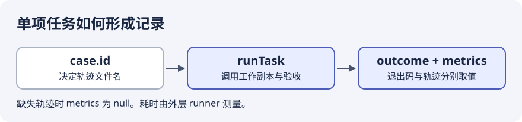
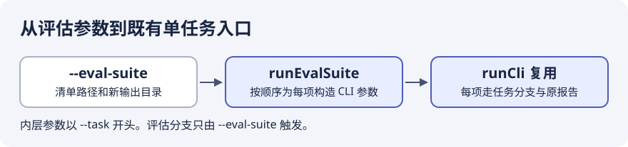
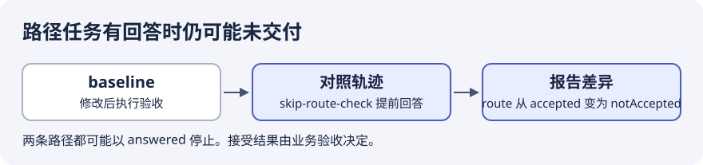

# 第 39 篇：建立一组可重复运行的代码任务

一条轨迹可以解释一次失败。要判断一次改动有没有影响 Coding Agent，还需要让它在相同的一组任务上运行，并留下每项的结果。本篇实现 `--eval-suite`。它顺序运行发票和路径两项任务，生成各自的轨迹以及一份 `report.json`。报告能区分任务发出总结和任务通过真实验收。

[](/diagrams/39-eval-suite-position.svg)

第一次阅读，先跟技术方案里路径任务的变化，再看第二步如何把两个证据来源合在一条记录。已有本篇代码时，可直接运行文末的 `baseline` 和 `skip-route-check` 两条命令。图解可点击放大。

## 本篇技术方案

任务集是一份有顺序的用例清单。每项包含稳定 ID 与既有任务配置，任务配置仍负责材料、目标、允许修改的范围和验收脚本。同一版本下重复运行清单，可按 ID 对齐交付结果。每项实际使用原来的 CLI 运行路径，报告读取原 CLI 的退出码和第 38 篇支持的轨迹。

### 实施前，先走完一次具体过程

1. 操作者选择 `fixtures/eval/code-tasks.json` 和一个尚不存在的输出目录。清单依次指向 `invoice.json` 和 `route.json`。运行器给每项构造自己的 `--task` 和 `--trace-file` 参数。
2. 发票项启动独立任务，准备新副本。修改和验收成功后，单任务 CLI 退出 0。批次记录 `outcome: 'accepted'`，再从 `invoice.jsonl` 获取 `status`、模型调用数和工具处理数。
3. 路径项从另一份新副本开始。正常对照也执行真实验收。随后用同一清单再起一批，这一次固定模型在路径修复后直接回答。路径项的轨迹仍然显示 `answered`，但是没有当前验收结果，单任务 CLI 返回 1，批次记录 `notAccepted`。
4. 批次写下 `report.json`。正常批接受 2 项，缺少路径验收的批只接受 1 项。每项都有独立的轨迹文件名，需要归因时可交给 `--inspect-trace`。

[](/diagrams/39-eval-suite-architecture.svg)

**核心代码在 `apps/coding-cli/src/eval/run-suite.ts` 的 `runEvalSuite`。** 第一次读代码先找 `await runTask(...)` 和紧接其后的 `readMetrics(tracePath)`。第一句拿到实际交付退出码，第二句拿到停止状态和运行计数。把二者分别保存，才能发现「模型已经回答，任务没有交付」的情况。

这篇先建立可重复的测量入口。清单使用仓库中的版本化材料，跨批比较要保留同一份清单、任务材料和验收版本。报告含清单与任务路径，复现实验时还要留存对应 Git 版本。耗时是 CLI 每项从启动到退出的实测时间，包含准备副本、模型等待、工具执行和报告；调用数没有直接换算成 token 或费用。固定模型用来证明评估链路，真实模型质量需从实际运行另行观察。

Pi 的 `AgentSession` 通过订阅 Agent 事件来处理会话数据。本项目已有应用层轨迹，评估运行器复用持久化证据和单任务退出码，并在应用层增加任务集编排。 [Pi 固定版本的 AgentSession](https://github.com/badlogic/pi-mono/blob/8efd314fa3d3232ce197d8d7a6a5660530b9d83e/packages/coding-agent/src/core/agent-session.ts#L1104)

## 创建分支

在仓库根目录从已提交的第 38 篇继续。如果本篇改动已经写入工作区，可以直接从当前提交创建分支。

```bash
git status --short --branch
git switch -c agent/chapter-39-eval-suite
```

## 第一步：冻结用例的顺序和身份

新建 `fixtures/eval/code-tasks.json`。它保存两个用例及其任务配置路径，路径相对于清单所在目录。

<<< @/snippets/39-eval-suite/fixtures/eval/code-tasks.json

`invoice` 和 `route` 是跨批对齐的主键，后面也用来生成 `invoice.jsonl`、`route.jsonl`。任务配置继续指向已有材料及验收脚本。例如发票验收仍会验证满 10 件时只应用一次折扣。新的清单不需要复制业务逻辑。

报告使用了单任务 CLI 的真实执行，因此和运行普通任务一样，清单及其引用的任务配置应由操作者控制。固定响应可以复现实验，验收脚本仍然实际运行。

[](/diagrams/39-eval-suite-architecture.svg)

## 第二步：运行用例，并保留两份证据

新建 `apps/coding-cli/src/eval/run-suite.ts`。它接收可信清单路径、新输出目录、单任务调用函数以及取消信号。它负责逐项创建调用、收集时间与轨迹，最后写出结构化报告。组装模型和准备副本仍由调用方实现。

<<< @/snippets/39-eval-suite/apps/coding-cli/src/eval/run-suite.ts

### 如何防止用例互相覆盖

在同文件的 `runEvalSuite` 开头，Zod 检查版本、用例数量和 ID 形状。用例 ID 只能包含受限的小写字符、数字和短横线。随后这一段检查 ID 唯一性，再创建输出目录。

```ts
if (new Set(manifest.cases.map(({ id }) => id)).size !== manifest.cases.length) {
  throw new Error('任务集用例 ID 必须唯一。');
}

signal.throwIfAborted();
const output = resolve(outputDirectory);
await mkdir(output, { mode: 0o700 });
```

如果出现两个 `route`，两项会争同一个文件名，因此在启动任何用例之前拒绝。输出目录必须是新目录。跨批比较时可以保留 `baseline` 与 `skip-route-check` 的目录，让后一次运行引用自己的证据。

### 从哪里知道路径任务完成了没有

在同函数的 `for` 循环正文中，以下代码处理一项任务。

```ts
const taskFile = resolve(dirname(manifestPath), item.taskFile);
const traceFile = item.id + '.jsonl';
const tracePath = join(output, traceFile);
const startedAt = performance.now();
const code = await runTask(['--task', taskFile, '--trace-file', tracePath]);
const elapsedMs = Math.round(performance.now() - startedAt);
const metrics = await readMetrics(tracePath);
const outcome = outcomes[code as keyof typeof outcomes] ?? 'infrastructureFailure';
results.push({ id: item.id, taskFile, outcome, elapsedMs, traceFile, metrics: metrics ?? null });
```

处理 `route` 时，`taskFile` 使用清单目录和 `../code-tasks/route.json` 解析出路径。单任务入口收到 `--task`，按原有逻辑创建副本，执行模型请求并作出接受判断。返回的 0 和 1 分别映射到 `accepted` 和 `notAccepted`。这里不用匹配终端颜色、行文或模型总结。

`readMetrics` 是同文件中的一个辅助函数。它调用第 38 篇的离线诊断，仅在文件含一段有结束证据且无半行的运行时才取计数。如果准备失败没有写出轨迹，或轨迹不足以取证，该项仍保留自己的退出结果，`metrics` 则为 `null`。因此缺失计数不会被算成零次调用。

[](/diagrams/39-eval-suite-case.svg)

### 批次何时能给出接受率

在 `runEvalSuite` 的循环之后，先从结果行计算汇总。

```ts
const accepted = results.filter((item) => item.outcome === 'accepted').length;
const cancelled = signal.aborted || results.some((item) => item.outcome === 'cancelled');
const complete = !cancelled && results.length === manifest.cases.length &&
  results.every((item) => item.outcome !== 'infrastructureFailure');
const report = {
  version: 1,
  manifest: manifestPath,
  planned: manifest.cases.length,
  evaluated: results.length,
  accepted,
  acceptanceRate: complete ? accepted / manifest.cases.length : null,
  cancelled,
  results,
};
```

`planned` 是清单项数，`evaluated` 是已经收到的用例结果数。`accepted` 只统计退出码表里的 `accepted`。两项都完成且没有基础设施失败时，可以用接受项数除以计划数。取消或存在准备等基础设施失败时，接受率留为 `null`，逐项结果仍保留以便排查。

最后用 `writeFile` 写 `report.json`，`wx` 保护报告文件。用户取消的批次返回 130，其次若有基础设施失败则返回 2，其余用 0 表示全接受、1 表示有未接受。整个进程被直接终止时，部分轨迹可能已留下，而汇总文件尚未写出。取消是批次的控制信号，运行器在启动下一项前检查它。

## 第三步：让正式 CLI 支持评估入口

在 `apps/coding-cli/src/types/task.ts` 的 `CliOptions` 里，将下面的入口加在帮助选项后面。

```ts
| {
    help: false;
    /** 【新增】可信任务集清单，清单内任务路径相对其目录。 */
    evalSuite: string;
    /** 【新增】本批次要创建的新目录。 */
    evalOutput: string;
  }
```

`evalSuite` 指向清单，`evalOutput` 指向本批创建的目录。然后在 `apps/coding-cli/src/config/args.ts` 的帮助文案增加 `--eval-suite <清单.json> --eval-output <新目录>`。在 `parseArgs` 的 `taskFile` 声明之前，加入以下参数分支。

```ts
// 【新增】评估入口只接受清单路径和一个新目录。
if (args[0] === '--eval-suite') {
  const [, suite, outputFlag, output] = args;
  if (args.length !== 4 || outputFlag !== '--eval-output' ||
      !suite?.trim() || suite.startsWith('--') ||
      !output?.trim() || output.startsWith('--')) {
    throw new Error('任务集评估需要清单和新输出目录。');
  }
  return { help: false, evalSuite: suite, evalOutput: output };
}
```

这一分支只接受四项参数。缺少目录或者混进单任务开关会在解析阶段失败。其余既有入口保持自己的参数规则。

在 `apps/coding-cli/src/main.ts` 内，把导入放到 `inspectRunTrace` 导入之后。然后在 `runCli` 的帮助分支之后加入评估入口。

```ts
import { runEvalSuite } from './eval/run-suite';
```

```ts
// 【新增】批次逐项重用单任务入口，每项准备新的副本与运行状态。
if ('evalSuite' in options) {
  phase = '任务集评估';
  const { report, exitCode } = await runEvalSuite(
    options.evalSuite,
    options.evalOutput,
    (taskArgs) => runCli(taskArgs, createCallModel, fullHistory),
    controller.signal,
  );
  printBlock('任务集结果', report);
  return exitCode;
}
```

外层命令通过 `evalSuite` 选中批次路径。它传给运行器一个调用函数，内层每次收到的却是以 `--task` 开头的参数，所以进入原有单任务分支。每项都会重新创建模型回调、会话和工作副本。固定示例可以注入模型工厂；正式命令使用当前配置的模型。

[](/diagrams/39-eval-suite-cli.svg)

::: details 类型、参数和入口完整文件

<<< @/snippets/39-eval-suite/apps/coding-cli/src/types/task.ts

<<< @/snippets/39-eval-suite/apps/coding-cli/src/config/args.ts

<<< @/snippets/39-eval-suite/apps/coding-cli/src/main.ts

:::

## 第四步：刻意少跑一次验收

新建 `examples/eval-suite/main.ts`。它用两种固定模型行为驱动同一个 CLI 评估入口，读到路径任务时构造路径修复，读到发票任务时构造折扣修复。固定模型会提交真实的工具请求。

<<< @/snippets/39-eval-suite/examples/eval-suite/main.ts

[](/diagrams/39-eval-suite-compare.svg)

在示例文件的模型回调里，第一轮始终提出修改。第二轮的条件是唯一控制差异的地方。

```ts
if (turn === 2 && !(route && mode === 'skip-route-check')) {
  return request('eval_check', 'run_check', {});
}
```

`baseline` 总会请求验收。`skip-route-check` 只在路径任务的第二轮跳过验收并返回总结。发票任务与同组基线走相同轨迹。因为 `request` 仍生成原来的工具请求形状，实际验收过程与真实模型生成同样请求时相同。

## 运行与验收

在仓库根目录运行。`skip-route-check` 预期退出 1。如果终端启用了遇到非零即退出，请分别运行。

```bash
npm run check
out=$(mktemp -d)
node --import tsx examples/eval-suite/main.ts baseline "$out/baseline"
node --import tsx examples/eval-suite/main.ts skip-route-check "$out/skip-route-check"

cat "$out/baseline/report.json"
cat "$out/skip-route-check/report.json"
node apps/coding-cli/dist/cli.js --inspect-trace "$out/skip-route-check/route.jsonl"
```

| 检查项 | baseline | skip-route-check |
| --- | --- | --- |
| 批次接受率 | 2/2，`acceptanceRate: 1` | 1/2，`acceptanceRate: 0.5` |
| 发票任务 | `accepted` | `accepted` |
| 路径任务 | `accepted`，2 项工具处理 | `notAccepted`，1 项工具处理 |
| 路径任务的 Runtime 停止 | `answered` | `answered` |

在两份报告中先找到 `id: 'route'` 对应结果，再核对 `outcome`、`metrics.status`、`metrics.toolCalls` 和对应轨迹。虽然两个模型都回答了，只有执行验收的路径项被接受。观察 `elapsedMs` 时保留原始值，单次耗时会受本机和模型调用影响。

断点可以下在 `runEvalSuite` 的 `const code = await runTask(...)` 后，看同一任务两次获得的 0 和 1。把清单复制一份，再重复一个用例 ID，应在创建输出目录前报错。换另一条可信任务配置可检验这个运行器是否仍只依赖清单和单任务入口。

配置真实模型后，也可以通过下面命令执行两项任务。该命令会对每项调用配置的模型，运行前先核对清单。

```bash
node --env-file=.env apps/coding-cli/dist/cli.js \
  --eval-suite fixtures/eval/code-tasks.json --eval-output "$out/real"
```

合上代码想一想，为什么同样看到 `metrics.status: 'answered'`，仍需要在报告中保留单独的 `outcome`？

## 保存本篇

```bash
git status --short --branch
git diff --check
git add apps/coding-cli/src/eval/run-suite.ts apps/coding-cli/src/config/args.ts \
  apps/coding-cli/src/types/task.ts apps/coding-cli/src/main.ts examples/eval-suite/main.ts \
  fixtures/eval/code-tasks.json docs/chapter-39-verification.md docs/stage-07-plan.md \
  docs/conversation-handoff.md docs/jd-learning-map.md docs/learning-state.md docs/system-map.md \
  site/.vitepress/config.mts site/index.md site/roadmap.md site/guide/39-eval-suite.md \
  site/public/diagrams/39-eval-suite-*.svg site/snippets/39-eval-suite
git diff --cached --check
git diff --cached --stat

git commit -F - <<'COMMIT'
为 Coding CLI 接入可复现的任务集评估

串行运行发票与路径任务，保留各自的交付结果、运行轨迹和耗时。
通过跳过一项验收的对照验证接受率与 Runtime 停止状态的区别。
补充第 39 篇教程、图解和验证记录。
COMMIT

git push -u origin agent/chapter-39-eval-suite
```
