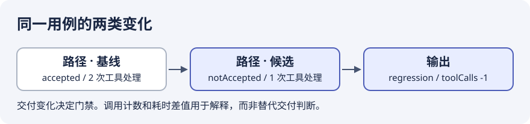

# 第 40 篇：比较两次评估，定位哪项任务退化了

第 39 篇留下两份发票与路径任务的报告。基线通过 2 项，候选通过 1 项。整批比例能告诉我们有变化，排查时还要知道是哪一项，以及候选少做了什么。本篇实现 `--compare-eval`，按用例 ID 对齐报告，将接受变未接受的项标为回归，并为完整比较返回可供脚本使用的退出码。

[](/diagrams/40-compare-eval-position.svg)

第一次阅读，先跟以下路径任务，再到第一步的 `compareCase` 看交付和工具计数如何分别比较。已有第 39 篇的两个 `report.json` 时，可以直接用文末命令。图解可以点击查看原图。

## 本篇技术方案

输入顺序是基线、候选，差值一律按「候选减基线」计算。先检查两份报告各自成立，再用稳定 ID 匹配同一任务。相同清单路径、相同用例集合、相同任务路径和完整批次是本篇的可比条件。结果仍要由操作者用相同版本的材料与验收生成。第 39 篇报告只记录路径，相同路径无法证明文件内容没变。

### 实施前，先走完一次具体过程

1. 操作者将第 39 篇的 `baseline/report.json` 和 `skip-route-check/report.json` 交给 CLI。比较器只读两个文件，分别复算 `accepted` 与 `acceptanceRate`，检查它们是否符合逐项结果。
2. 基线的 `invoice` 按 ID 找到候选的 `invoice`，两次都 `accepted`，因此标为 `unchanged`。候选报告里的数组即使顺序倒过来，查找关系也一样。
3. 基线的 `route` 为 `accepted`，候选为 `notAccepted`，因此是 `regression`。两份轨迹的停止状态都为 `answered`，候选的工具处理数却从 2 变为 1。把两者一起显示，读者可以回到轨迹核对少了验收。
4. 整批接受率差值为 `-0.5`，对应少 50 个百分点。CLI 退出 1。若候选在路径项之前取消，比较器保留发票项的对照结果，路径项报 `missingCase`，整批差值留空并退出 2。

[](/diagrams/40-compare-eval-architecture.svg)

**核心在 `apps/coding-cli/src/eval/compare-reports.ts` 的 `compareEvalReports` 和 `compareCase`。** 前者决定哪两条记录能配对，后者根据交付结果分类。运行计数和耗时差值便于解释。一次短运行耗时更少，可能只是少跑了验收，因此门禁由交付退化决定。

Pi 的 `buildEntryIndex` 使用 `Map` 通过持久化记录的 ID 建索引，后续路径查找无需依赖数组位置。本篇把同一索引做法用于评估报告的用例 ID。 [Pi 固定版本的 buildEntryIndex](https://github.com/badlogic/pi-mono/blob/8efd314fa3d3232ce197d8d7a6a5660530b9d83e/packages/coding-agent/src/core/session-manager.ts#L382)

## 创建分支

从已提交的第 39 篇继续。在仓库根目录执行。若本篇代码已写入工作区，建分支会保留这些改动。

```bash
git status --short --branch
git switch -c agent/chapter-40-compare-eval
```

## 第一步：读报告、按身份配对，再计算变化

新建 `apps/coding-cli/src/eval/compare-reports.ts`。它接收两份报告的路径与取消信号，返回逐项对照和 CLI 退出码。输入数据由第 39 篇的任务集入口生成。

<<< @/snippets/40-compare-eval/apps/coding-cli/src/eval/compare-reports.ts

### 为什么要复算报告汇总

在同文件的 `readReport` 中，文件只读打开。读取范围最多为 256 KiB 加一个用于检查超限的字节。随后 `reportSchema` 校验版本、结果字段与数值类型，然后执行下面的复算。

```ts
const report = reportSchema.parse(JSON.parse(data.toString('utf8')));
const byId = new Map(report.results.map((item) => [item.id, item]));
const accepted = report.results.filter((item) => item.outcome === 'accepted').length;
const incomplete = report.cancelled || report.evaluated !== report.planned ||
  report.results.some((item) => item.outcome === 'infrastructureFailure' || item.outcome === 'cancelled');
const acceptanceRate = incomplete ? null : accepted / report.planned;
if (byId.size !== report.results.length || report.evaluated !== report.results.length ||
    report.evaluated > report.planned || report.accepted !== accepted ||
    report.acceptanceRate !== acceptanceRate ||
    (!report.cancelled && report.results.some((item) => item.outcome === 'cancelled'))) {
  throw new Error('评估报告汇总与逐项结果不一致。');
}
return { report, byId };
```

例如候选的结果是发票 `accepted` 和路径 `notAccepted`，所以 `accepted` 必须为 1。完整批次的接受率必须为 `1 / 2`。若有人只改汇总数字，没有对应的逐项结果，读报告时就会报错。重复 ID 也会触发失败，因为 `Map` 中同一个键只占一个位置。

取消或基础设施失败时，原任务集的接受率为 `null`。读取器允许这一结果，后面仍可对齐已完成的项。报告语法有效与整批可比较是两个独立判断。

[](/diagrams/40-compare-eval-integrity.svg)

### 为什么以两边 ID 的并集开始

在同文件的 `compareEvalReports` 中，两份报告读完以后生成这段用例列表。

```ts
const sameManifest = baseline.report.manifest === candidate.report.manifest;
const ids = new Set([...baseline.byId.keys(), ...candidate.byId.keys()]);
const cases = [...ids].map((id) => {
  const before = baseline.byId.get(id);
  const after = candidate.byId.get(id);
  if (!sameManifest) {
    return { id, change: 'incomparable' as const, reason: 'manifestPathMismatch' };
  }
  if (!before || !after) {
    return { id, change: 'incomparable' as const, reason: 'missingCase' };
  }
  return { id, ...compareCase(before, after) };
});
```

先遍历基线中的 ID，再补上只出现在候选里的 ID。于是无论哪边少一项，报告里都有一条记录说明缺失。报告中的清单路径不同会标为 `manifestPathMismatch`。同一 ID 仍会进入 `compareCase` 检查实际记录的任务路径，路径改了就记 `taskPathMismatch`。

### 交付退化和工具差值如何同时出现

在同文件的 `compareCase` 中，先确认两边交付结果可比较，再根据候选的交付结果分类。

```ts
function compareCase(baseline: z.infer<typeof caseSchema>, candidate: z.infer<typeof caseSchema>) {
  if (baseline.taskFile !== candidate.taskFile) {
    return { change: 'incomparable' as const, reason: 'taskPathMismatch' };
  }
  const comparable = (outcome: string) => outcome === 'accepted' || outcome === 'notAccepted';
  if (!comparable(baseline.outcome) || !comparable(candidate.outcome)) {
    return { change: 'incomparable' as const, reason: 'missingOutcome' };
  }
  const change = baseline.outcome === candidate.outcome
    ? 'unchanged' as const
    : candidate.outcome === 'accepted' ? 'improvement' as const : 'regression' as const;

  return {
    change,
    baselineOutcome: baseline.outcome,
    candidateOutcome: candidate.outcome,
    elapsedDeltaMs: candidate.elapsedMs - baseline.elapsedMs,
    metricsDelta: baseline.metrics && candidate.metrics ? {
      baselineStatus: baseline.metrics.status,
      candidateStatus: candidate.metrics.status,
      modelCalls: candidate.metrics.modelCalls - baseline.metrics.modelCalls,
      toolCalls: candidate.metrics.toolCalls - baseline.metrics.toolCalls,
    } : null,
  };
}
```

以路径任务为例，基线是 `accepted`，候选是 `notAccepted`，这一步就能确定 `regression`。运行计数有独立条件：两边都有 `metrics` 时才计算差值。若有一边只有交付结果，`metricsDelta` 留空，`regression` 仍可成立。准备失败或取消时，缺少可用于本篇交付分类的结果，故返回 `missingOutcome`。

[](/diagrams/40-compare-eval-case.svg)

### 如何得到整批退出码

在 `compareEvalReports` 最后，找到判断整批可比性的语句。

```ts
const baselineAcceptanceRate = baseline.report.acceptanceRate;
const candidateAcceptanceRate = candidate.report.acceptanceRate;
const comparable = sameManifest && baselineAcceptanceRate !== null &&
  candidateAcceptanceRate !== null && cases.every((item) => item.change !== 'incomparable');
const regressions = cases.filter((item) => item.change === 'regression').length;
const improvements = cases.filter((item) => item.change === 'improvement').length;
const acceptanceRateDelta = comparable
  ? candidateAcceptanceRate - baselineAcceptanceRate
  : null;
return {
  report: {
    comparable,
    baselineAcceptanceRate,
    candidateAcceptanceRate,
    acceptanceRateDelta,
    regressions,
    improvements,
    cases,
  },
  exitCode: !comparable ? 2 : regressions > 0 ? 1 : 0,
};
```

`comparable` 还要求两份报告的接受率都有值，而且每个用例都可比较。两份报告不满足协定时，退出 2。完整比较只要发现一项退化就退出 1，即使另一项恰好改善、整体接受率没变。完整且没有退化时退出 0。这样脚本可以区分「看到了退化」和「证据不足，不能作门禁判断」。

## 第二步：接入正式 CLI

在 `apps/coding-cli/src/types/task.ts` 的 `CliOptions` 中，紧接帮助选项加入下面一项。

```ts
| {
    help: false;
    /** 【新增】两份只读评估报告的路径，顺序决定差值方向。 */
    compareEval: { baseline: string; candidate: string };
  }
```

`baseline` 和 `candidate` 分别保存两个文件路径。去 `apps/coding-cli/src/config/args.ts` 的帮助文案加入 `--compare-eval <基线.json> <候选.json>`，然后在 `parseArgs` 的 `taskFile` 声明之前插入参数分支。

```ts
// 【新增】回归比较只接收两份已写出的评估报告。
if (args[0] === '--compare-eval') {
  const [, baseline, candidate] = args;
  if (args.length !== 3 || !baseline?.trim() || baseline.startsWith('--') ||
      !candidate?.trim() || candidate.startsWith('--')) {
    throw new Error('评估比较按顺序接受基线和候选报告。');
  }
  return { help: false, compareEval: { baseline, candidate } };
}
```

这个入口只接受三个参数，漏一个路径或混入任务选项会报错。在 `apps/coding-cli/src/main.ts` 的 `runEvalSuite` 导入后补上比较模块，再在 `runCli` 的帮助分支之后插入比较入口。

```ts
import { compareEvalReports } from './eval/compare-reports';
```

```ts
// 【新增】比较既有报告，直接返回回归门禁退出码。
if ('compareEval' in options) {
  phase = '评估报告比较';
  const { baseline, candidate } = options.compareEval;
  const { report, exitCode } = await compareEvalReports(baseline, candidate, controller.signal);
  printBlock('评估报告比较', report);
  return exitCode;
}
```

该分支直接读取并打印比较结果，然后返回门禁退出码。既有运行材料、模型工厂和工作副本没有参与这次比较。

[](/diagrams/40-compare-eval-cli.svg)

::: details 参数与 CLI 完整文件

<<< @/snippets/40-compare-eval/apps/coding-cli/src/types/task.ts

<<< @/snippets/40-compare-eval/apps/coding-cli/src/config/args.ts

<<< @/snippets/40-compare-eval/apps/coding-cli/src/main.ts

:::

## 运行与验收

在仓库根目录运行。候选示例及第一次比较都预期退出 1。如果终端配置了遇到非零立即退出，请分别运行。

```bash
npm run check
out=$(mktemp -d)
cli=apps/coding-cli/dist/cli.js
node --import tsx examples/eval-suite/main.ts baseline "$out/baseline"
node --import tsx examples/eval-suite/main.ts skip-route-check "$out/candidate"
node "$cli" --compare-eval "$out/baseline/report.json" "$out/candidate/report.json"
```

在输出中确认 `comparable: true`、`acceptanceRateDelta: -0.5`、`regressions: 1`。找到 `id: 'route'` 的记录，核对它标为 `regression`，工具数变化是 `-1`。接着可以查看候选的原轨迹，确认发生了什么。

```bash
node "$cli" --inspect-trace "$out/candidate/route.jsonl"
node "$cli" --compare-eval "$out/candidate/report.json" "$out/baseline/report.json"
```

第二条命令交换了方向，预期 `route` 变为 `improvement`，差值 `+0.5`，退出 0。若两份报告只交换了数组顺序，用例身份与结论均不会变。

还可以制作一份模拟提前终止的候选副本，原报告保持可复查。

```bash
node --input-type=module - "$out/candidate/report.json" "$out/partial.json" <<'JS'
import { readFileSync, writeFileSync } from 'node:fs';
const [, , source, target] = process.argv;
const report = JSON.parse(readFileSync(source, 'utf8'));
report.results = report.results.filter((item) => item.id !== 'route');
report.evaluated = report.results.length;
report.accepted = report.results.filter((item) => item.outcome === 'accepted').length;
report.cancelled = true;
report.acceptanceRate = null;
writeFileSync(target, JSON.stringify(report, null, 2) + '\n', { flag: 'wx' });
JS
node "$cli" --compare-eval "$out/baseline/report.json" "$out/partial.json"
```

预期路径项为 `missingCase`，整批差值是 `null`，退出 2。若只删结果行却不更新汇总，读取器会报评估报告比较失败。调试时先在 `readReport` 观察重算的接受率，再到 `compareEvalReports` 观察 `before` 和 `after`。这可以区分「文件自己矛盾」与「两份文件合法，但其中一份少了结果」。

本篇提供评估报告的离线门禁。生成报告的对照使用固定模型，实际修改和验收使用正式工具。合上代码想一想：候选减少一次工具调用、耗时也更短，为什么这次比较仍退出 1？

## 保存本篇

```bash
git status --short --branch
git diff --check
git add apps/coding-cli/src/eval/compare-reports.ts apps/coding-cli/src/config/args.ts \
  apps/coding-cli/src/types/task.ts apps/coding-cli/src/main.ts \
  docs/chapter-40-verification.md docs/stage-07-plan.md docs/conversation-handoff.md \
  docs/jd-learning-map.md docs/learning-state.md docs/system-map.md \
  site/.vitepress/config.mts site/index.md site/roadmap.md site/guide/40-compare-eval.md \
  site/public/diagrams/40-compare-eval-*.svg site/snippets/40-compare-eval
git diff --cached --check
git diff --cached --stat

git commit -F - <<'COMMIT'
为 Coding CLI 增加离线评估报告比较

按用例 ID 对齐基线与候选，核对报告汇总并识别交付退化。
分开汇报交付变化、运行计数和缺失证据，提供明确退出码。
补充第 40 篇教程、图解与真实验收对照记录。
COMMIT

git push -u origin agent/chapter-40-compare-eval
```
