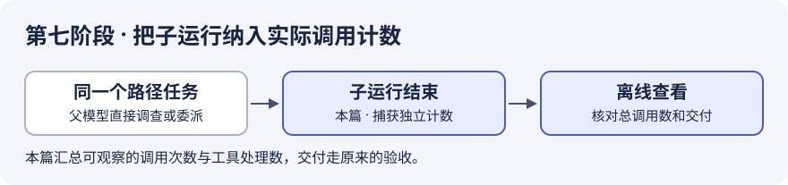
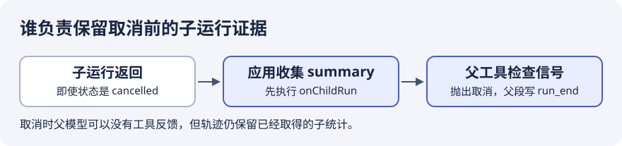
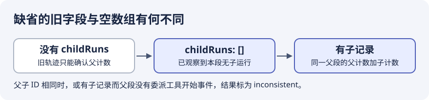

# 第 42 篇：用同一任务对照直接调查与只读委派

第 41 篇的父运行报告了 5 次模型调用，子运行在工具反馈里另外报告了 2 次。只拿父报告做对照，会漏掉委派里的这两次调用。本篇把子运行统计附在父轨迹的结束记录里，再用相同任务对照直接调查和委派，确认总工作量如何变化。

[](/diagrams/42-delegation-cost-position.svg)

第一次阅读，先跟下方两条路径，然后阅读第二步为什么只在 `run_end` 写入子统计。已有本篇代码时，可直接运行文末的成对命令。图解可点击放大。

## 本篇技术方案

两次实验使用同一个 `route-delegated.json`、同一份路径材料和同一个验收脚本。固定父模型第一次要么直接读入口，要么请求委派。后续都在父运行中读取当前实现、修改并验收。我们测量实际发起的模型调用数、开始处理的工具项数和是否通过实际交付。工具项数包括父委派工具自身。

### 实施前，先走完一次具体过程

1. 直接调查时，父模型第一轮调用 `read_file`，后续正常修改和验收。父轨迹 `run_end` 写入 `childRuns: []`，说明这段没有记录到子运行。
2. 委派时，父模型改用 `delegate_entry_review`。子运行调用自身模型两次、读取一次入口，结束后产生独立运行 ID 和计数。委派工具把实际终态交给 CLI 的观察回调，随后按原有方式向父模型返回线索。
3. 父运行仍有 5 次模型调用和 4 项工具处理。在它自己的结束事件中，CLI 写下这次子运行的 ID、状态和计数。离线检查逐项相加，得到 7 次模型调用与 5 项工具处理。
4. 两次运行都通过原脚本的 8 项业务验收。这里的委派多发起了 2 次模型调用，多处理了 1 项工具。若读取历史轨迹时看不到新字段，检查器保留父计数，不给出无法确认的总数。

[](/diagrams/42-delegation-cost-architecture.svg)

**核心在 `apps/coding-cli/src/session/delegate-review.ts` 的 `onChildRun` 和 `apps/coding-cli/src/report/inspect-trace.ts` 的 `summarizeRun`。** 第一处收集真实子结果，第二处从父结束记录核对和汇总。模型生成的结论没有参与计数。

本篇对照使用固定响应，回答的是这两条具体执行路径各做了多少。更复杂任务是否值得委派，需要用真实模型在同一任务材料上测量质量、延迟和实际用量。第 39 篇任务集报告里的运行计数仍是原来的父段计数，本篇的父子总数从 `--inspect-trace` 获取。

Pi 的子 Agent 扩展示例分别记录子 Agent 的轮次与消息使用量。本篇借鉴调用方收集子证据的方式，使用自己的 Runtime 终态，并与既有轨迹兼容。 [Pi 固定版本的子运行使用量收集](https://github.com/badlogic/pi-mono/blob/8efd314fa3d3232ce197d8d7a6a5660530b9d83e/packages/coding-agent/examples/extensions/subagent/index.ts#L360)

## 创建分支

从已提交的第 41 篇继续。在仓库根目录执行。若本篇代码已写入工作区，建分支会保留这些改动。

```bash
git status --short --branch
git switch -c agent/chapter-42-delegation-cost
```

## 第一步：收集实际子结果，也保留取消时的状态

新建 `apps/coding-cli/src/types/trace.ts`。它定义应用用于观测的子运行摘要，不携带模型消息和源码。子工具创建此对象，CLI 收集，轨迹模块随后写入。

<<< @/snippets/42-delegation-cost/apps/coding-cli/src/types/trace.ts

打开 `apps/coding-cli/src/session/delegate-review.ts`，在原导入后加入类型导入，并替换 `createEntryReviewTool` 的函数签名。

```ts
import type { ChildRunSummary } from '../types/trace';
```

```ts
export function createEntryReviewTool(
  read: ExecutableTool,
  callModel: ModelCall,
  onChildRun?: (summary: ChildRunSummary) => void,
): ExecutableTool {
```

在同一函数的 `execute` 中，将 `await runAgent` 后的检查信号及返回对象替换为下面这段。

```ts
// 【新增】先记录实际结束的子运行，父取消时也能保留计数。
const summary: ChildRunSummary = {
  childRunId: child.runId,
  status: child.status,
  modelCalls: child.modelCalls,
  toolCalls: child.toolCalls,
};
onChildRun?.(summary);
signal?.throwIfAborted();

// 仅返回必要观察，不把子历史复制进父上下文。
return JSON.stringify({
  ...summary,
  ...(child.status === 'answered' ? { finding: child.answer.content.slice(0, 1_000) } : {}),
});
```

`child.runId` 和两个计数来自 Runtime，父模型可以继续看到原来的工具反馈字段。新的 `onChildRun` 是应用层回调，在检查父信号之前执行。举例来说，子模型等待期间收到取消，`runAgent` 返回带有 `cancelled` 状态的结果。即使委派工具随后按照原逻辑抛出取消，应用仍已取得真实统计。

[](/diagrams/42-delegation-cost-cancel.svg)

::: details 委派工具完整文件

<<< @/snippets/42-delegation-cost/apps/coding-cli/src/session/delegate-review.ts

:::

## 第二步：在父段结束时写入关联的子统计

在 `apps/coding-cli/src/types/task.ts` 的导入区加入摘要类型，随后在 `RunInputOptions` 的 `invoicePolicyTool` 后加入应用回调。去 `apps/coding-cli/src/session/run.ts` 的 `runSession` 中替换 `createEntryReviewTool` 的调用行。

```ts
import type { ChildRunSummary } from './trace';
```

```ts
/** 【新增】接收实际子运行的终态，给父轨迹记录独立的计数。 */
onChildRun?: (summary: ChildRunSummary) => void;
```

```ts
? createEntryReviewTool(read, callModel, inputOptions.onChildRun)
```

接着打开 `apps/coding-cli/src/main.ts`。在 `CliSession` 导入之后插入类型导入。在 `runCli` 的「运行与报告」阶段，用以下区块替换原事件回调，再于 `runOptions.fullHistory` 后加入收集函数。

```ts
import type { ChildRunSummary } from './types/trace';
```

```ts
// 【新增】首段与追问共用观察器，但每次 run_start 清空本段的子计数。
const childRuns: ChildRunSummary[] = [];
const onEvent: RunEventListener = async (event) => {
  if (event.type === 'run_start') {
    childRuns.length = 0;
  }
  printProgress(event);
  if (
    event.type === 'tool_end' &&
    event.toolName === 'update_plan' &&
    !event.isError &&
    session?.plan
  ) {
    printBlock('任务计划（模型声明）', session.plan.read());
  }
  await trace?.append(event, event.type === 'run_end' ? childRuns : undefined);
};
```

```ts
onChildRun: (summary) => {
  childRuns.push(summary);
},
```

旧命令和后续追问都使用同一个 `onEvent`。收到 `run_start` 时清空数组，可以保证第一段的子记录不会带进第二段。真正的关联发生在 `run_end`，当行的 `runId` 是父 ID，数组中的 `childRunId` 是实际子 ID。子事件序列没有加入父序列，因此第 38 篇依赖的父段顺序仍可核对。

打开 `apps/coding-cli/src/report/trace.ts`。加入类型导入并修改 `traceRecord` 的签名。在 `run_end` 分支中把子统计加入返回对象，最后替换 `openRunTrace` 的 `append` 签名及构造记录那一行。

```ts
import type { ChildRunSummary } from '../types/trace';
```

```ts
function traceRecord(event: RunEvent, childRuns?: readonly ChildRunSummary[]) {
```

```ts
// 【新增】明确投影子统计，缺省字段为历史记录保留语义。
childRuns: childRuns?.map(({ childRunId, status, modelCalls, toolCalls }) => ({
  childRunId, status, modelCalls, toolCalls,
})),
```

```ts
async append(event: RunEvent, childRuns?: readonly ChildRunSummary[]) {
  const record = traceRecord(event, childRuns);
```

对子摘要逐字段投影使轨迹只落盘 ID、状态和次数。正常 CLI 即使没派发也会传入空数组；历史版本根本没写这个字段。两种情况对我们能确认的事实不同。

[](/diagrams/42-delegation-cost-architecture.svg)

::: details 应用类型、运行装配与写入完整文件

<<< @/snippets/42-delegation-cost/apps/coding-cli/src/types/task.ts

<<< @/snippets/42-delegation-cost/apps/coding-cli/src/session/run.ts

<<< @/snippets/42-delegation-cost/apps/coding-cli/src/main.ts

<<< @/snippets/42-delegation-cost/apps/coding-cli/src/report/trace.ts

:::

## 第三步：区分空数组和历史未知，再计算总数

打开 `apps/coding-cli/src/report/inspect-trace.ts`。在 `count` 后加入共用停止状态和子摘要校验，随后在 `row` 的 `run_end` 分支用同一份 `status`，并增加可选的 `childRuns`。

```ts
const status = z.enum(['answered', 'callLimit', 'truncated', 'emptyAnswer', 'failed', 'cancelled', 'timedOut', 'toolLimit']);
// 【新增】可选扩展字段。历史轨迹缺省它，表示子运行计数未知。
const childSummary = z.object({
  childRunId: z.string().min(1),
  status,
  modelCalls: count.max(3),
  toolCalls: count.max(2),
});
```

```ts
type: z.literal('run_end'),
status,
modelCalls: count,
toolCalls: count,
childRuns: z.array(childSummary).max(1).optional(),
```

这一版每个父段最多派发一次，子摘要最多一项。读到旧文件时数组缺省，整个结束事件仍能解析。读到新文件的 `[]` 时，才可以将子计数记为零。

接着在同文件的 `summarizeRun` 中，检查全段工具开始数之后、计算最后一轮之前，加入父子关联校验。

```ts
// 【新增】子运行必须与父运行身份不同，且父段有委派请求的处理证据。
if (end.childRuns?.some((child) => child.childRunId === end.runId) ||
    (end.childRuns?.length && !starts.some((event) => event.toolName === 'delegate_entry_review'))) {
  return { ...base, evidence: 'inconsistent' as const, status: end.status, toolCalls: end.toolCalls };
}
```

如果父子 ID 一样，或根本没有观察到委派工具开始，当前段的子统计无法与已有证据配对，报告 `inconsistent`。通过校验后，在该函数末尾的返回对象里、父 `toolCalls` 字段之后插入以下统计。

```ts
...(end.childRuns === undefined ? {} : {
  childRuns: end.childRuns,
  totalModelCalls: end.modelCalls + end.childRuns.reduce((sum, child) => sum + child.modelCalls, 0),
  totalToolCalls: end.toolCalls + end.childRuns.reduce((sum, child) => sum + child.toolCalls, 0),
}),
```

委派样例里得到 `5 + 2 = 7` 次模型调用、`4 + 1 = 5` 项工具处理。从父字段读取的数值仍可用于第 38 篇的停止诊断。历史记录没有数组时省略总数，避免把无法确认的子调用记为零。

[](/diagrams/42-delegation-cost-counts.svg)

::: details 离线读取完整文件

<<< @/snippets/42-delegation-cost/apps/coding-cli/src/report/inspect-trace.ts

:::

## 第四步：给现有示例增加直接调查

打开 `examples/delegate-review/main.ts`。扩展模式检查，并在原 `args` 创建后追加可选的诊断路径。

```ts
// 【修改】direct 用同一任务自行读取入口，可选路径按原 CLI 写入轨迹。
if (mode !== 'repair' && mode !== 'deny-write' && mode !== 'direct') {
  throw new Error('用法：main.ts repair|deny-write|direct [新轨迹文件]');
}
const args = ['--task', 'fixtures/code-tasks/route-delegated.json'];
const traceFile = process.argv[3];
if (traceFile) {
  args.push('--trace-file', traceFile);
}
```

在该文件的父模型回调里，用下面的区块替换第一轮分支。第二轮确认收到成功反馈后，在解析子报告之前加入直接调查分支。

```ts
if (parentTurn === 1) {
  if (mode === 'direct') {
    return request('parent_entry', 'read_file', { path: 'src/main.ts' });
  }
  return request('parent_delegate', 'delegate_entry_review', { entry: 'src/main.ts' });
}
```

```ts
if (mode === 'direct') {
  if (!feedback.content.includes('./routing/normalize')) {
    throw new Error('直接调查未找到实际入口。');
  }
  return request('parent_verify', 'read_file', { path: edit.path });
}
```

两种模式使用相同任务配置，并在收到线索后执行相同的 `parent_verify`、`parent_edit`、`parent_check`。直接组在第一轮直接读入口，委派组则把这一步交给子运行，因此既能比较实际交付，也能定位工作量差异的来源。

[](/diagrams/42-delegation-cost-compare.svg)

::: details 对照入口完整文件

<<< @/snippets/42-delegation-cost/examples/delegate-review/main.ts

:::

## 运行与验收

在仓库根目录运行。不需要模型密钥。固定模型决定工作顺序，两个工作副本和验收由正式 CLI 创建与执行。

```bash
npm run check
out=$(mktemp -d)
cli=apps/coding-cli/dist/cli.js
node --import tsx examples/delegate-review/main.ts direct "$out/direct.jsonl"
node --import tsx examples/delegate-review/main.ts repair "$out/delegated.jsonl"
node "$cli" --inspect-trace "$out/direct.jsonl"
node "$cli" --inspect-trace "$out/delegated.jsonl"
```

| 核对点 | 直接调查 | 只读委派 |
| --- | --- | --- |
| 父模型次数、工具项数 | 5、4 | 5、4 |
| 子运行 | 空数组 | 2 次模型调用、1 项工具处理 |
| 总模型次数、总工具项数 | 5、4 | 7、5 |
| 业务交付 | 8 项通过，`accepted: true` | 8 项通过，`accepted: true` |

可以用 `tail -n 1 "$out/delegated.jsonl"` 对照父 ID 和子 ID。若有第 41 篇的旧轨迹，用同一个检查器打开，它仍报告父计数，且没有总次数字段。调试关联时在 `onChildRun` 和 `summarizeRun` 分别查看数组，若有同进程追问，再看第二个 `run_start` 是否清空了数组。

合上代码想一想，如果父次数字段相同，但一份旧轨迹没有 `childRuns`，能否据此说两种路径的实际模型调用总量相同？

## 保存本篇

```bash
git status --short --branch
git diff --check
git add apps/coding-cli/src/types/trace.ts apps/coding-cli/src/types/task.ts \
  apps/coding-cli/src/session/delegate-review.ts apps/coding-cli/src/session/run.ts \
  apps/coding-cli/src/main.ts apps/coding-cli/src/report/trace.ts \
  apps/coding-cli/src/report/inspect-trace.ts examples/delegate-review/main.ts \
  docs/chapter-42-verification.md docs/stage-07-plan.md docs/conversation-handoff.md \
  docs/jd-learning-map.md docs/learning-state.md docs/system-map.md \
  site/.vitepress/config.mts site/index.md site/roadmap.md site/guide/42-delegation-cost.md \
  site/public/diagrams/42-delegation-cost-*.svg site/snippets/42-delegation-cost
git diff --cached --check
git diff --cached --stat

git commit -F - <<'COMMIT'
记录父子运行计数并对照直接调查与委派

收集真实子运行结束统计，随父运行完成事件写入轨迹。
区分历史未知与明确零委派，按同一任务核对工作量和交付。
补充第 42 篇教程、图解和取消边界验证。
COMMIT

git push -u origin agent/chapter-42-delegation-cost
```
