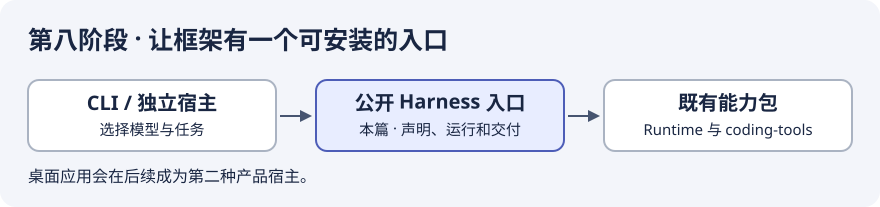
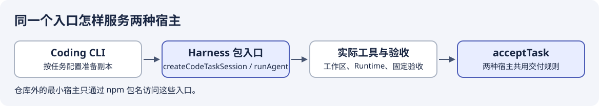
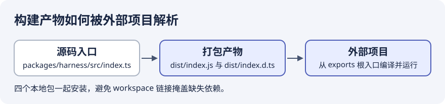

# 第 44 篇：让仓库外的应用安装并使用 Harness

前面一直在同一个仓库里运行 Coding CLI。第八阶段要接入新的宿主，第一步是确认另一份应用可以安装发布形态的构建产物、用公开类型编译，然后独立完成真实任务。本篇建立 `@ai-harness/harness` 的包入口，让 Coding CLI 和一个仓库外的最小应用共用运行、工作区和交付判断。

[](/diagrams/44-harness-package-position.svg)

第一次阅读，先跟下面的总价修复，再看第二步的公开包入口。已经检出本篇时，可以直接跑「在仓库外验证」，亲自观察打包、安装、编译和业务验收。图解可点击放大。

## 本篇技术方案

宿主是调用框架的应用，例如当前的 Coding CLI。宿主提供模型回调、任务副本、可写文件和验收脚本；框架提供代码任务会话、运行循环和统一接受规则。我们把这三项放到 `@ai-harness/harness` 的根导入端。当前包是私有的，使用本地打包产物交付本章实验。

### 实施前，先走完一次具体过程

1. 在框架仓库构建，并分别打包 `model`、`runtime`、`coding-tools` 和 `harness`。构建产物里包含 JavaScript 和类型声明。包之间继续通过 npm 包名声明依赖。
2. 在仓库外建一个独立项目，把四份压缩包作为本地依赖安装。独立宿主从 `@ai-harness/harness` 的根入口导入 `createCodeTaskSession`、`runAgent`、`acceptTask` 和模型回调类型。
3. 宿主在临时副本写入一个错误的总价函数。固定模型提交精确替换，再请求执行可信验收。验收将单价与数量的真实计算结果写到 stdout。
4. 宿主读取当前副本和验收记录，交给公共 `acceptTask`。正常运行被接受。只跳过验收时，模型仍结束为 `answered`，但交付拒绝。仓库内的 Coding CLI 也通过同一公开入口使用这套规则。

[](/diagrams/44-harness-package-architecture.svg)

**核心在 `packages/harness/src/index.ts` 和 `packages/harness/package.json` 的 `exports`。** 前者声明宿主可使用的能力与类型，后者把包名映射到构建后的 JavaScript 和声明文件。章节范围是最小公开入口及独立安装验证。模型供应商配置、终端输出、权限交互和桌面进程仍由各自宿主接线。

Pi 的 Coding Agent 根入口列出会话相关类和类型，供外部宿主使用。本篇同样从一个明确的根入口开始，公开范围以当前 CLI 和独立任务所需能力为准。 [Pi 固定版本的 Coding Agent 公开入口](https://github.com/badlogic/pi-mono/blob/8efd314fa3d3232ce197d8d7a6a5660530b9d83e/packages/coding-agent/src/index.ts)

## 创建分支

从已提交的第 43 篇开始。在仓库根目录执行。若本篇改动已写入工作区，创建分支会保留它们。

```bash
git status --short --branch
git switch -c agent/chapter-44-harness-package
```

## 第一步：迁移两种宿主共用的交付判断

将 `apps/coding-cli/src/report/accept.ts` 迁移到 `packages/harness/src/accept-task.ts`。它接收一次运行结果、工作区审阅结果和允许修改的路径。判断逻辑沿用原 CLI，之后由框架根入口导出。

<<< @/snippets/44-harness-package/packages/harness/src/accept-task.ts

在 `acceptTask` 中看第一段返回条件。总价任务即使有修改，也必须拿到匹配当前副本的验收。没有匹配证据时会提前返回 `false`。验收进程退出 0 后，函数还会解析 stdout，确认业务脚本给出 `passed: true`。这样无法用模型总结或工具本身完成来替代实际交付证据。

## 第二步：公开包入口和构建产物

新建 `packages/harness/src/index.ts`。它把既有 Runtime 和代码工具公开为宿主能用的接口，同时导出刚迁移的接受规则。宿主无需知道这些实现分散在哪几个文件。

<<< @/snippets/44-harness-package/packages/harness/src/index.ts

这三个运行时导出对应三个时点。先用 `createCodeTaskSession` 取得当前副本的工具，然后让 `runAgent` 执行循环，最后用 `acceptTask` 核对独立证据。`export type` 的声明供 TypeScript 使用，例如 `ModelCall` 约束宿主注入的回调。

新建 `packages/harness/package.json`。它声明本章包依赖、分发文件和根入口。npm 安装时依赖会进入消费者的安装树。

<<< @/snippets/44-harness-package/packages/harness/package.json

当外部项目写 `import { runAgent } from '@ai-harness/harness'`，Node 的 ESM 解析选择 `import` 条件，TypeScript 选择 `types`。随包分发的是 `dist`，因此只在本仓库写通导入还不足以验证发布形态。下面的独立安装会检查这一点。

新建 `packages/harness/tsconfig.json`。它继承仓库编译选项，并声明从 `src` 构建到 `dist`。

<<< @/snippets/44-harness-package/packages/harness/tsconfig.json

[](/diagrams/44-harness-package-pack.svg)

在根 `package.json` 的 scripts 里替换 `build`。Harness 会在它依赖的包完成构建后构建，再由 CLI 消费。

```json
"build": "npm run build --workspace @ai-harness/model && npm run build --workspace @ai-harness/runtime && npm run build --workspace @ai-harness/coding-tools && npm run build --workspace @ai-harness/harness && npm run build --workspace @ai-harness/coding-cli",
```

在 `apps/coding-cli/package.json` 的 dependencies 加上对应依赖。

```json
"@ai-harness/harness": "0.1.0",
```

仓库本来已经用 `packages/*` 声明 workspace，执行 `npm install --ignore-scripts` 让本地包进入安装树并同步根锁文件。外部验证还会做一次独立安装，检查打包的依赖能否被实际解析。

::: details 根配置和 CLI 包配置完整文件

<<< @/snippets/44-harness-package/package.json

<<< @/snippets/44-harness-package/apps/coding-cli/package.json

:::

## 第三步：让 Coding CLI 自己也消费公开入口

分别在 `apps/coding-cli/src/report/report.ts` 和 `apps/coding-cli/src/session/prepare.ts` 的导入区替换交付和工作区工厂导入。在 `apps/coding-cli/src/session/run.ts` 的导入区，移除原 Runtime 导入中的 `runAgent`，加入第三条导入。

```ts
import { acceptTask } from '@ai-harness/harness';
import { createCodeTaskSession } from '@ai-harness/harness';
import { runAgent } from '@ai-harness/harness';
```

对应调用点都保留原来的参数和调用顺序。宿主层的工作区准备、终端报告、权限和事件处理仍在 CLI，接受规则由 Harness 提供。

::: details CLI 接入完整文件

<<< @/snippets/44-harness-package/apps/coding-cli/src/report/report.ts

<<< @/snippets/44-harness-package/apps/coding-cli/src/session/prepare.ts

<<< @/snippets/44-harness-package/apps/coding-cli/src/session/run.ts

:::

## 第四步：写一个独立的最小宿主

新建 `examples/standalone-harness/check.mjs`。它接收任务副本路径，加载里面的 `total.mjs` 并检查正常数量和零数量。

<<< @/snippets/44-harness-package/examples/standalone-harness/check.mjs

新建 `examples/standalone-harness/main.ts`。它导入打包后的公开入口，创建一个临时副本和固定模型，运行真实编辑与验收。实验结束后清理临时副本。

<<< @/snippets/44-harness-package/examples/standalone-harness/main.ts

[](/diagrams/44-harness-package-check.svg)

在 `main.ts` 的运行结果之后找这两行。

```ts
const review = await session.inspect();
const accepted = acceptTask(result, review, writablePaths);
```

`session.inspect` 取得当前副本的变化与对应验收。正常模式先将加法改成乘法，验收用 `total(8, 3)` 和 `total(8, 0)` 确认结果。传入 `--skip-check` 后，固定模型提前结束，接受函数仍会依据缺失的实际验收拒绝交付。

## 在仓库外验证

在仓库根目录执行下列命令。安装以本地压缩包提供框架依赖，npm 仍按配置下载或从缓存取得第三方依赖与编译器。

```bash
npm run check
out=$(mktemp -d)
mkdir "$out/packs" "$out/app"

for package in model runtime coding-tools harness; do
  npm pack --workspace "@ai-harness/$package" --pack-destination "$out/packs"
done

cp examples/standalone-harness/main.ts examples/standalone-harness/check.mjs "$out/app/"
(
  cd "$out/app"
  printf '{"name":"standalone-harness-example","private":true,"type":"module"}\n' > package.json
  npm install --ignore-scripts "$out"/packs/*.tgz
  npm install --ignore-scripts -D typescript@5.9.3 @types/node@22.20.5
  ./node_modules/.bin/tsc main.ts --module NodeNext --target ES2022 --strict --outDir dist
  node dist/main.js
)
```

正常运行应显示 `status: 'answered'`、`changedFiles: ['total.mjs']`、`checkMatchesCurrent: true` 和 `accepted: true`。沿用同一个临时项目，跑一次缺验收的对照。它预期退出 1。

```bash
(cd "$out/app" && node dist/main.js --skip-check)
```

如果外部项目编译时找不到声明，先检查解包后的 `node_modules/@ai-harness/harness/dist/index.d.ts`。如果运行时找不到依赖，核对安装命令是否同时传入四份压缩包。如果有人尝试直接导入 `@ai-harness/harness/dist/accept-task.js`，Node 应以 `ERR_PACKAGE_PATH_NOT_EXPORTED` 拒绝。只有根入口由本篇公开。

回到仓库根目录还可运行第 37 篇的业务交付对照，验证 CLI 接入后的原路径。

```bash
node --import tsx examples/run-trace/main.ts room "$out/cli.jsonl"
```

两个宿主都使用固定模型响应和真实工作区工具。这个结果确认包结构、类型和运行入口可从仓库外使用。后续的桌面进程和渲染层会在此基础上再接线。

## 保存本篇

```bash
git status --short --branch
git diff --check
git add package.json package-lock.json packages/harness apps/coding-cli/package.json \
  apps/coding-cli/src/report/accept.ts apps/coding-cli/src/report/report.ts \
  apps/coding-cli/src/session/prepare.ts apps/coding-cli/src/session/run.ts \
  examples/standalone-harness docs/chapter-44-verification.md docs/stage-08-plan.md \
  docs/conversation-handoff.md docs/jd-learning-map.md docs/learning-state.md docs/system-map.md \
  site/.vitepress/config.mts site/index.md site/roadmap.md site/guide/44-harness-package.md \
  site/public/diagrams/44-harness-package-*.svg site/snippets/44-harness-package
git diff --cached --check
git diff --cached --stat

git commit -F - <<'COMMIT'
建立可由独立宿主安装的 Harness 公开入口

将运行、代码任务会话和交付判断公开给 CLI 与仓库外宿主。
用四份打包产物验证类型编译、业务验收和缺失验收拒绝。
补充第 44 篇教程、图解和外部安装记录。
COMMIT

git push -u origin agent/chapter-44-harness-package
```
