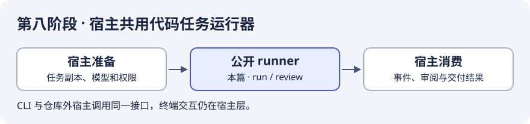
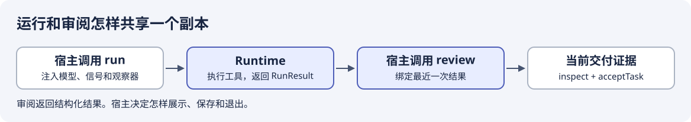
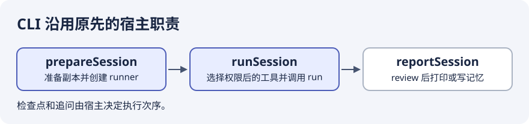
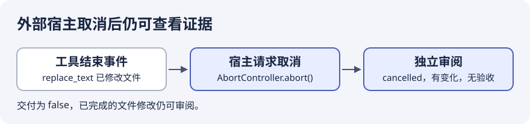

# 第 45 篇：让 CLI 和独立宿主共用任务运行器

第 44 篇让独立项目能安装 Harness。外部应用仍要自己串起三件事：运行 Agent、审阅当前副本、根据证据判断交付。CLI 也有同一段接线。本篇把这段流程收敛为绑定一份任务会话的 `createCodeTaskRunner`。CLI 和独立宿主用相同的方法运行、传递取消、接收事件和审阅交付。

[](/diagrams/45-task-runner-position.svg)

第一次阅读，先跟下面的总价任务，再跳到第二步的 `run` 和 `review`。如果已检出本篇，可以直接运行文末的外部安装实验。图解可以点击放大。

## 本篇技术方案

一个 runner 绑定一份已经准备好的代码任务会话。宿主先用 `runner.run` 执行一段，得到原有的 `RunResult`；再用 `runner.review` 对照当前副本和验收。`run` 与 `review` 分开，是因为 CLI 可能要先保存首段、接一轮追问，或者走检查点交接。宿主仍负责这些命令次序。

### 实施前，先走完一次具体过程

1. 仓库外宿主按第 44 篇准备总价任务副本，创建 `CodeTaskSession`，用会话和可写路径绑定 runner。
2. 宿主调用 `runner.run`，提供模型回调、预算、取消信号以及事件观察器。正常模式把加法改成乘法，再执行验收。Runtime 返回 `answered`，runner 记录这是最近一次结果。
3. 宿主把该结果交给 `runner.review`。runner 读取此刻副本及验收证据，用原规则判断交付，返回 `{ review, accepted }`。宿主可以直接展示结构化字段。
4. 在取消对照中，宿主收到 `replace_text` 的结束事件后调用 `abort()`。这时文件已改，下一次模型调用和验收都没开始。运行返回 `cancelled`，宿主仍能单独审阅，看到改动和 `accepted: false`。
5. CLI 同样创建 runner。首段与追问串行使用这个对象，最后只审阅最终一段。CLI 继续负责权限装配、终端交互、日志和退出码。

[](/diagrams/45-task-runner-architecture.svg)

**核心代码在 `packages/harness/src/code-task-runner.ts`。** 重点看 `run` 怎样保存 `latest`，以及 `review` 怎样要求请求结果属于这份会话的最近一段。这样审阅不会把旧结果和新副本的验收拼在一起。这个约束作用于同一个 runner；宿主应为每份会话创建一个实例，避免绕过它去并发调用同一会话的工具。

Pi 的 `AgentSession` 分别提供运行入口、事件订阅和取消入口。本篇按自己的 Runtime 契约收敛宿主接线，通过 `onEvent` 与 `AbortSignal` 沿用已有行为。 [Pi 固定版本的 AgentSession](https://github.com/badlogic/pi-mono/blob/8efd314fa3d3232ce197d8d7a6a5660530b9d83e/packages/coding-agent/src/core/agent-session.ts)

## 创建分支

从已提交的第 44 篇继续。在仓库根目录执行。若本篇改动已经在工作区，建分支会保留它们。

```bash
git status --short --branch
git switch -c agent/chapter-45-task-runner
```

## 第一步：声明宿主能调用什么

新建 `packages/harness/src/types/code-task-runner.ts`。它定义运行参数、审阅结果和 runner 的两个方法。应用从 Harness 根入口取得这些类型。

<<< @/snippets/45-task-runner/packages/harness/src/types/code-task-runner.ts

运行参数沿用 Runtime 原有字段，`tools` 改为可选。独立宿主省略它，使用会话默认工具。CLI 传经过权限装配的工具。显式传入空数组时，Runtime 看到的是空工具清单。

`CodeTaskDelivery` 把业务接受与审阅证据一起返回。宿主如果需要退出码，可以自行从运行状态与 `accepted` 映射。运行和审阅可以使用独立的信号，因此运行发生取消后仍可读取证据。

## 第二步：绑定会话，再协调运行与审阅

新建 `packages/harness/src/code-task-runner.ts`。它接收一份任务会话和可写路径，返回绑定该会话的 runner。内部复用原 Runtime 和第 44 篇的接受函数。

<<< @/snippets/45-task-runner/packages/harness/src/code-task-runner.ts

[](/diagrams/45-task-runner-guard.svg)

### 为什么进入一次新运行时清空旧结果

在同文件 `createCodeTaskRunner` 的 `run` 方法，查看取得运行资格之后的区块。

```ts
busy = true;
latest = undefined;
try {
  const result = await runAgent({ ...options, tools: options.tools ?? session.tools });
  latest = result;
  return result;
} finally {
  busy = false;
}
```

CLI 首段结束后，`latest` 指向首段结果。追问启动时旧指针立即失效。若追问正常停止，`latest` 才会换成第二段结果。若 Runtime 调用抛错，先前结果也不会悄悄恢复为当前结果。

`busy` 在 `await` 前设置，另一个并发调用在进入 Runtime 或审阅前被拒绝。`finally` 释放占用，正常结束、取消或异常都会经过它。`options.tools ?? session.tools` 的默认值只在宿主未传工具时启用，保留了空数组禁用全部工具的含义。

### 为什么审阅要传入那次运行结果

在同一工厂的 `review` 方法，找下面的判断和证据读取。

```ts
if (result !== latest) {
  throw new Error('只允许审阅此任务最近一次运行的结果。');
}

busy = true;
try {
  const review = await session.inspect(signal);
  return { review, accepted: acceptTask(result, review, allowedPaths) };
} finally {
  busy = false;
}
```

调用者传入的是 `run` 返回的原结果对象。来自其他 runner 或同一任务的旧对象会因身份不同而失败。通过校验后，`session.inspect` 再读取当前副本。假如验收后文件内容变化，原会话仍会识别验收与当前状态不匹配，接受判断继续拒绝。复制的 `allowedPaths` 保持该 runner 使用的路径清单稳定。

接着在 `packages/harness/src/index.ts` 的现有导出之后，增加工厂函数和类型的公开导出。

```ts
// 【新增】两个宿主共用同一运行与审阅入口。
export { createCodeTaskRunner } from './code-task-runner';
export type { CodeTaskRunner, CodeTaskRunOptions, CodeTaskDelivery } from './types/code-task-runner';
```

::: details Harness 根入口完整文件

<<< @/snippets/45-task-runner/packages/harness/src/index.ts

:::

## 第三步：接到 CLI 的会话、运行与报告

打开 `apps/coding-cli/src/types/session.ts`。替换导入 `CodeTaskSession` 的语句，在 `codeTask` 字段后插入 runner。

```ts
import type { CodeTaskRunner, CodeTaskSession } from '@ai-harness/harness';
```

```ts
/** 【新增】绑定同一副本，运行首段和追问，再审阅最后一段。 */
runner: CodeTaskRunner;
```

在 `apps/coding-cli/src/session/prepare.ts`，替换 Harness 导入，并在 `prepareSession` 返回对象的 `codeTask` 之后创建 runner。

```ts
import { createCodeTaskRunner, createCodeTaskSession } from '@ai-harness/harness';
```

```ts
// 【新增】运行与审阅使用同一个已经准备好的工具会话。
runner: createCodeTaskRunner(codeTask, task.writablePaths),
```

两者引用同一个任务会话。CLI 原来的代码任务句柄还会用于准备工具与检查点。然后在 `apps/coding-cli/src/session/run.ts` 删除原 `runAgent` 的导入，把 `runSession` 最后一个调用的起始行替换为下面的内容。调用参数保持原样。

```ts
// 【修改】仍由 CLI 组装工具策略，准备好的 runner 执行本段。
return session.runner.run({
```

因此只读、逐次批准和外部工具都先由 CLI 装配，再传给共享运行接口。最后在 `apps/coding-cli/src/report/report.ts` 删除 `acceptTask` 导入和后面单独调用接受函数的声明，把原来直接 `inspect` 的一行替换为以下内容。

```ts
// 【修改】同一 runner 审阅最近一段，并给出当前证据的交付判断。
const { review, accepted } = await session.runner.review(result);
```

CLI 使用共享结果打印改动和验收，原有接受后写入记忆的分支仍从 `accepted` 判断是否执行。追问与检查点依然按 CLI 既有顺序运行。

[](/diagrams/45-task-runner-cli.svg)

::: details CLI 改动完整文件

<<< @/snippets/45-task-runner/apps/coding-cli/src/types/session.ts

<<< @/snippets/45-task-runner/apps/coding-cli/src/session/prepare.ts

<<< @/snippets/45-task-runner/apps/coding-cli/src/session/run.ts

<<< @/snippets/45-task-runner/apps/coding-cli/src/report/report.ts

:::

## 第四步：让独立宿主收到工具事件后取消

打开 `examples/standalone-harness/main.ts`。替换来自 Harness 的导入，并在 `skipCheck` 后创建取消选项和控制器。

```ts
import { createCodeTaskRunner, createCodeTaskSession, type ModelCall } from '@ai-harness/harness';
```

```ts
const cancelAfterEdit = process.argv[2] === '--cancel';
const controller = new AbortController();
```

然后用下一段替换原来的 `runAgent` 调用，以及后面单独读取审阅和调用 `acceptTask` 的代码。将原退出码赋值替换为第二段。

```ts
// 【修改】宿主只通过 runner 运行和审阅，观察器可请求取消。
const runner = createCodeTaskRunner(session, writablePaths);
const result = await runner.run({
  messages: [{ role: 'user', content: '将总价改为单价乘以数量。' }],
  callModel,
  maxModelCalls: 4,
  maxToolCalls: 4,
  timeoutMs: 10_000,
  signal: controller.signal,
  onEvent(event) {
    if (cancelAfterEdit && event.type === 'tool_end' && event.toolName === 'replace_text') {
      controller.abort();
    }
  },
});
const { review, accepted } = await runner.review(result);
```

```ts
process.exitCode = result.status === 'cancelled' ? 130 : accepted ? 0 : 1;
```

正常模式使用默认工具后完成实际验收。取消对照等 `replace_text` 的结束事件到达，才由宿主触发取消。此时 Runtime 停止发起后续动作，已经写入的修改仍可审阅。审阅调用没有传入已取消的信号，所以能读取副本并返回不接受的结果。

[](/diagrams/45-task-runner-cancel.svg)

::: details 独立宿主完整文件

<<< @/snippets/45-task-runner/examples/standalone-harness/main.ts

:::

## 在仓库外验证

在仓库根目录执行。沿用第 44 篇现有 `check.mjs`。两个失败对照分别预期退出 1 和 130。

```bash
npm run check
out=$(mktemp -d)
mkdir "$out/packs" "$out/app"

for package in model runtime coding-tools harness; do
  npm pack --workspace "@ai-harness/$package" --pack-destination "$out/packs"
done

cp examples/standalone-harness/main.ts examples/standalone-harness/check.mjs "$out/app/"
(
  cd "$out/app"
  printf '{"name":"standalone-harness-example","private":true,"type":"module"}\n' > package.json
  npm install --ignore-scripts "$out"/packs/*.tgz
  npm install --ignore-scripts -D typescript@5.9.3 @types/node@22.20.5
  ./node_modules/.bin/tsc main.ts --module NodeNext --target ES2022 --strict --outDir dist
  node dist/main.js
)
(cd "$out/app" && node dist/main.js --skip-check)
(cd "$out/app" && node dist/main.js --cancel)
```

| 场景 | 停止状态 | 副本改动 | 交付 | 退出码 |
| --- | --- | --- | --- | --- |
| 正常 | `answered` | `total.mjs` | `accepted: true` | 0 |
| 跳过验收 | `answered` | `total.mjs` | `accepted: false` | 1 |
| 修改完成后取消 | `cancelled` | `total.mjs` | `accepted: false` | 130 |

还可以在仓库内跑现有发票示例，确认 CLI 同样通过共享接口交付。

```bash
node --import tsx examples/run-trace/main.ts room "$out/cli.jsonl"
```

调试时在 runner 的 `latest = result` 和 `review` 的身份判断处看对象。宿主若在第二段结束后传回第一段结果，应得到明确拒绝。两个宿主均用固定响应和真实工作区工具。合上代码想一想：为什么已经发出取消的运行，仍有可能报告一项文件改动？

## 保存本篇

```bash
git status --short --branch
git diff --check
git add packages/harness/src apps/coding-cli/src/types/session.ts \
  apps/coding-cli/src/session/prepare.ts apps/coding-cli/src/session/run.ts \
  apps/coding-cli/src/report/report.ts examples/standalone-harness/main.ts \
  docs/chapter-45-verification.md docs/stage-08-plan.md docs/conversation-handoff.md \
  docs/jd-learning-map.md docs/learning-state.md docs/system-map.md \
  site/.vitepress/config.mts site/index.md site/roadmap.md site/guide/45-task-runner.md \
  site/public/diagrams/45-task-runner-*.svg site/snippets/45-task-runner
git diff --cached --check
git diff --cached --stat

git commit -F - <<'COMMIT'
收敛 CLI 和独立宿主共用的代码任务运行器

在同一任务会话上协调运行、取消和最近结果审阅。
复用工作区取证与接受判断，验证外部安装、真实交付和取消。
补充第 45 篇教程、图解和验证记录。
COMMIT

git push -u origin agent/chapter-45-task-runner
```
