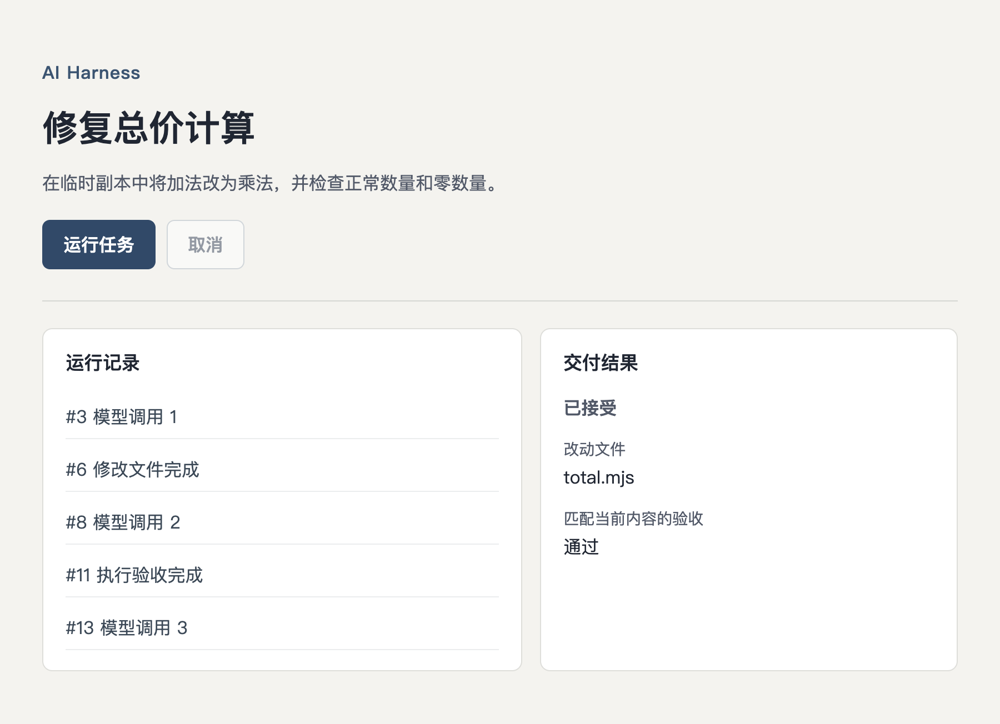

# 第 46 篇：让桌面窗口运行和取消同一个代码任务

第 45 篇让两个宿主共享 `createCodeTaskRunner`。本篇加上可打开的 Electron 窗口。点击「运行任务」会修改临时副本中的总价函数、执行实际验收，并把运行进度和交付结果显示在窗口里。点击「取消」或关闭窗口，也会走同一条任务取消链路。

[](/diagrams/46-desktop-host-position.svg)

第一次阅读，先追一遍「运行任务」，再看第二步的 `task:start` 和第三步的 `runner.run`。若已检出本篇，可从仓库根目录执行 `npm run desktop:start`。图解可点开看原图。

## 本篇技术方案

Electron 的主进程可以使用 Node API，负责准备任务、调用 Harness 和清理副本。渲染进程负责页面显示。两者用 IPC，也就是进程间消息来通信。preload 是窗口加载页面前执行的桥接脚本，它只公开这个页面需要的三个操作。

### 实施前，先走完一次具体过程

1. 用户在窗口点击「运行任务」。`renderer.js` 调用 `window.task.start()`。preload 把它转成固定的 `task:start` 请求。
2. 主进程检查请求是否来自本地页面的顶层帧，也检查当前没有运行中的任务。它创建取消控制器和临时 `total.mjs`，再用与 CLI 共用的 `createCodeTaskRunner` 执行。
3. 固定模型先提交真实替换，将加法改成乘法。主进程从 Runtime 事件里选出阶段和序号，推送到窗口。下一轮执行可信验收，最后用共享 runner 核对当前副本，页面显示 `total.mjs`、验收通过和「已接受」。
4. 若在「修改文件完成」后点击取消，preload 调用固定的 `task:cancel`。主进程退出等待并审阅已有改动，页面显示「已取消」和改动文件，验收栏为「无」。关窗时，主进程也先发出取消，等任务清理后退出。

[](/diagrams/46-desktop-host-architecture.svg)

**本篇关键位置在 `apps/desktop/src/main.ts` 的两个 IPC 处理器，以及 `apps/desktop/src/run-total-task.ts` 的 `runner.run`。** 前一处确认谁能开始或取消，后一处产生真正的执行和验收证据。

本章使用固定模型响应和真实文件操作来验证桌面接线。任务路径、验收文件和模型入口由主进程决定。界面不能提交任意程序、目录或模型参数。真实模型配置、用户选择任务、交互式批准和历史会话留待后续接入。 [Electron 进程间通信](https://www.electronjs.org/docs/latest/tutorial/ipc) · [Electron 渲染器沙箱](https://www.electronjs.org/docs/latest/tutorial/sandbox) · [Electron IPC 发送方校验](https://www.electronjs.org/docs/latest/tutorial/security/#17-validate-the-sender-of-all-ipc-messages)

Pi 的 RPC 模式订阅会话事件并交给外部宿主。本篇同样将运行放在有执行能力的一侧，再让界面通过受限的请求和事件消费它。 [Pi 固定版本的 RPC 模式](https://github.com/badlogic/pi-mono/blob/8efd314fa3d3232ce197d8d7a6a5660530b9d83e/packages/coding-agent/src/modes/rpc/rpc-mode.ts#L353)

## 创建分支

从已提交的第 45 篇继续。在仓库根目录执行。若本篇改动已经在工作区，建分支会保留它们。

```bash
git status --short --branch
git switch -c agent/chapter-46-desktop-host
```

## 第一步：准备桌面 workspace 和启动命令

新建 `apps/desktop/package.json` 与 `apps/desktop/tsconfig.json`。前者声明 Electron、Harness 和主进程入口，后者用仓库统一配置检查主进程 TypeScript。

<<< @/snippets/46-desktop-host/apps/desktop/package.json

<<< @/snippets/46-desktop-host/apps/desktop/tsconfig.json

构建主进程时，`--external electron` 保留 `import 'electron'` 给运行时处理。直接打包 npm 安装器会把用于启动 Electron 的代码混入应用主进程。窗口文件和 preload 保持在自己的路径，启动时由主进程加载。

在根 `package.json` 的 `scripts` 中加入启动命令。它先构建共享包，再构建桌面应用和启动 Electron。

```json
"desktop:start": "npm run build && npm run build --workspace @ai-harness/desktop && npm run start --workspace @ai-harness/desktop"
```

执行 `npm install` 让现有的 `apps/*` workspace 识别新包并同步锁文件。首次启动可能需要下载 Electron 二进制。这里使用锁定的 Electron 45.3.3。桌面构建脚本在打包后还会运行 TypeScript 检查。

::: details 根配置完整文件

<<< @/snippets/46-desktop-host/package.json

:::

## 第二步：让窗口只能申请固定的操作

新建 `apps/desktop/src/main.ts`。主进程持有当前窗口及运行中的任务。它接收开始和取消请求，将阶段摘要送回发起调用的窗口，并在退出前等待活动任务完成清理。

<<< @/snippets/46-desktop-host/apps/desktop/src/main.ts

在同文件的 `verifySender`，先看三项校验。

```ts
function verifySender(event: IpcMainInvokeEvent): void {
  if (!window || event.sender !== window.webContents ||
      event.senderFrame !== window.webContents.mainFrame || event.senderFrame.url !== page.href) {
    throw new Error('请求来源无效。');
  }
}
```

这三项分别检查当前窗口、该窗口的顶层帧和预期文件地址。它们在每个 IPC 处理器实际触发执行前运行。窗口也启用了上下文隔离和沙箱，关闭页面的 Node 集成，并阻止页面导航和打开新窗口。

继续看同文件的 `task:start` 处理器。

```ts
ipcMain.handle('task:start', async (event) => {
  verifySender(event);
  if (active) {
    throw new Error('已有任务在运行。');
  }

  const sender = event.sender;
  const controller = new AbortController();
  const completed = runTotalTask(controller.signal, (update) => {
    if (!sender.isDestroyed()) {
      sender.send('task:progress', update);
    }
  });
  active = { controller, completed };
  try {
    return await completed;
  } catch (error) {
    console.error(error);
    throw new Error(controller.signal.aborted ? '任务准备已取消。' : '任务运行失败，请查看主进程日志。');
  } finally {
    active = undefined;
  }
});
```

当已有运行时，主进程直接拒绝再次调用。这项限制在主进程实现，即使有人绕开按钮禁用，也不能并发开始。取消处理器只调用当前控制器的 `abort()`。应用退出时先触发相同信号，等待活动任务完成清理后才发起下一次退出。

[](/diagrams/46-desktop-host-cancel.svg)

新建 `apps/desktop/preload.cjs`。它定义页面的 `window.task`，将两个操作映射到固定通道，并支持订阅、取消订阅进度。

<<< @/snippets/46-desktop-host/apps/desktop/preload.cjs

在 `onProgress` 中，只把 `update` 给页面，IPC 的事件对象留在桥接侧。这样页面可以展示数据，同时不会取得发送方或通用 IPC 能力。 [Electron contextBridge](https://www.electronjs.org/docs/latest/api/context-bridge)

## 第三步：由主进程运行并投影证据

新建 `apps/desktop/src/types/task.ts`。它定义可以跨边界发送的阶段摘要和最终业务结果。不会携带整个 Runtime 消息或工作副本的绝对路径。

<<< @/snippets/46-desktop-host/apps/desktop/src/types/task.ts

新建 `apps/desktop/check-total.mjs`。它在临时副本中实际调用 `total`，验证单价 8、数量 3 时为 24，数量 0 时为 0。

<<< @/snippets/46-desktop-host/apps/desktop/check-total.mjs

新建 `apps/desktop/src/run-total-task.ts`。它负责准备可信的固定任务，从 npm 启动环境取得用于验收的 Node 程序，并用上一章的公开 runner 运行、观察、审阅和清理。

<<< @/snippets/46-desktop-host/apps/desktop/src/run-total-task.ts

在同文件 `runTotalTask` 的 `runner.run` 选项中，这段观察器只选出界面展示所需的内容。

```ts
onEvent(event) {
  if (event.type === 'model_start') {
    publish({ sequence: event.sequence, label: `模型调用 ${event.modelCall}` });
  } else if (event.type === 'tool_end') {
    const verb = event.toolName === 'replace_text' ? '修改文件' : '执行验收';
    publish({ sequence: event.sequence, label: `${verb}${event.isError ? '失败' : '完成'}` });
  }
},
```

例如工具结束事件会被转换成「修改文件完成」或「执行验收完成」。这是相应工具调用已经写回结果的进度，最终是否交付还要等 `runner.review`。返回给页面的结果区分「是否有匹配当前内容的验收」和「该验收是否成功」。取消发生在修改后时，仍进行一次独立审阅，所以页面能看到已经修改的文件。

[](/diagrams/46-desktop-host-projection.svg)

## 第四步：把主进程结果显示到页面

新建 `apps/desktop/ui/index.html`、`style.css` 与 `renderer.js`。页面只有任务、操作按钮、进度和交付结果。CSP 只允许本地脚本和样式；运行事件用 `textContent` 写入界面。

<<< @/snippets/46-desktop-host/apps/desktop/ui/index.html

<<< @/snippets/46-desktop-host/apps/desktop/ui/style.css

<<< @/snippets/46-desktop-host/apps/desktop/ui/renderer.js

在 `renderer.js`，点击运行后清空上一轮状态并等待 `window.task.start()`。进度来自独立订阅，可在最终结果返回前显示。取消按钮先显示「正在取消」，收到主进程的结果后才显示「已取消」。用户关闭窗口时页面取消订阅，任务清理仍由主进程完成。

[](/diagrams/46-desktop-host-window.png)

## 运行与验收

在仓库根目录执行。窗口以固定模型运行，使用真实编辑和验收工具，无需配置模型密钥。

```bash
npm install
npm run desktop:start
```

| 操作 | 应观察到的证据 |
| --- | --- |
| 运行任务并等待结束 | 进度出现「修改文件完成」和「执行验收完成」，结果为「已接受」，文件为 `total.mjs`。 |
| 修改后立即点击取消 | 结果为「已取消」，仍有 `total.mjs`，验收为「无」。 |
| 修改后直接关闭窗口 | 应用取消活动任务、清理临时副本后退出。 |
| 从页面尝试连续调用两次开始 | 第一项继续运行，主进程拒绝第二项。 |

调试时，先在主进程 `verifySender` 查看窗口、顶层帧和 URL，再到 `runTotalTask` 的 `onEvent` 与 `runner.review` 检查数据怎样改变。修改过的文件属于本次临时副本，结束时会被清理。若窗口启动时看到 Electron 模块的动态 `require` 错误，检查桌面构建命令是否保留了 `--external electron`。

合上代码试答：点击取消时，为什么页面只提交一个请求即可？哪个进程持有真正的取消控制器？

## 保存本篇

```bash
git status --short --branch
git diff --check
git add package.json package-lock.json apps/desktop docs/chapter-46-verification.md \
  docs/stage-08-plan.md docs/conversation-handoff.md docs/jd-learning-map.md \
  docs/learning-state.md docs/system-map.md site/.vitepress/config.mts site/index.md \
  site/roadmap.md site/guide/46-desktop-host.md site/public/diagrams/46-desktop-host-* \
  site/snippets/46-desktop-host
git diff --cached --check
git diff --cached --stat

git commit -F - <<'COMMIT'
通过 Electron 桌面窗口运行和取消 Harness 任务

在主进程持有既有运行器、任务副本与取消信号。
用受限 preload 接口连接页面阶段展示和真实交付结果。
补充第 46 篇教程、图解和实际原生窗口验证。
COMMIT

git push -u origin agent/chapter-46-desktop-host
```
