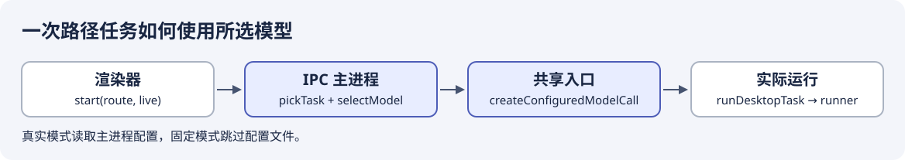
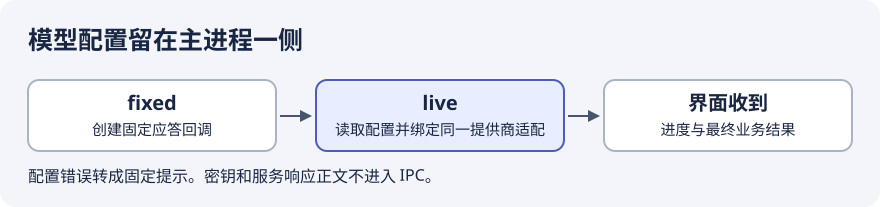
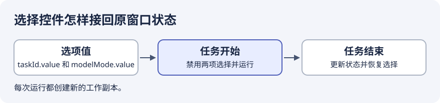
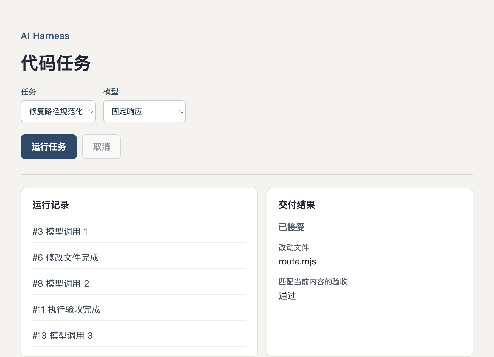

# 第 47 篇：在桌面选择任务，并接入已配置的模型

第 46 篇的窗口只能运行固定的总价修复。本篇让窗口可以选择「修复总价计算」或「修复路径规范化」，再决定用可重复的固定响应，还是调用已配置的模型服务。两种模型走同一条 Harness 运行和验收链路。

[](/diagrams/47-desktop-task-model-position.svg)

第一次阅读，先走一遍下面的路径任务，再到第二步看主进程怎样创建模型回调。已有本篇代码时，可以先运行 `npm run desktop:start` 验证两个固定任务。图解可点击放大。

## 本篇技术方案

页面的两个选项最终只是任务 ID 和模型模式。主进程收到值后，自己选择可信材料、允许修改的文件和验收脚本。模型配置也由主进程读取。CLI 和桌面会复用同一个配置转换函数，将提供商、模型和凭据转换成 Runtime 接受的回调。

### 实施前，先走完一次具体过程

1. 用户选择「修复路径规范化」和「固定响应」，点击运行。页面通过 preload 发送 `route` 和 `fixed`。
2. 主进程先校验窗口来源，再从任务字典取出 `route.mjs`、任务提示和 `check-route.mjs`。固定模式直接创建可重复的回调，不读取模型配置文件。
3. 主进程准备独立工作副本并运行。修改完成后执行实际验收，检查根路径、查询串和片段。页面只接收进度、改动文件名和最终交付。
4. 若改选「已配置的模型服务」，主进程才读取配置并创建提供商回调。缺配置时在创建工作副本前结束，窗口显示固定提示。配置有效时，模型工具调用仍进入原来的 Harness，与固定模式使用同一个验收脚本。

[](/diagrams/47-desktop-task-model-architecture.svg)

**核心在 `apps/desktop/src/main.ts` 的 `task:start`，以及 `apps/desktop/src/model.ts` 的 `selectModel`。** 前者验证任务与模式，后者决定是否读取配置。当前只开放内置任务。桌面页面不给主进程提供文件路径、命令或凭据。

主进程只把所选配置绑定给模型回调。验收仍会执行副本中的代码，沿用当前有限任务的可信材料边界。真实模型结果是否正确取决于实际工具和验收。Pi 的 RPC 模式将界面请求转交给宿主会话；这里把模型配置和任务选择仍放在有执行能力的一侧。 [Pi 固定版本的 RPC 模式](https://github.com/badlogic/pi-mono/blob/8efd314fa3d3232ce197d8d7a6a5660530b9d83e/packages/coding-agent/src/modes/rpc/rpc-mode.ts#L394)

## 创建分支

从已提交的第 46 篇继续。在仓库根目录执行。如果本篇修改已经写入工作区，建分支会保留它们。

```bash
git status --short --branch
git switch -c agent/chapter-47-desktop-task-model
```

## 第一步：用任务 ID 选择可信材料

新建 `apps/desktop/src/tasks.ts`。该模块接收未知值，只允许两个已登记的 ID。选中后返回本地任务材料、允许修改的文件名、模型提示和验收入口，供主进程使用。

<<< @/snippets/47-desktop-task-model/apps/desktop/src/tasks.ts

在 `pickTask` 里，`route` 返回路径规范化任务；如果页面提交 `../route`，函数返回 `undefined`。实际执行时的文件名来自任务对象，页面传来的字符串始终只用于选择。

新建 `apps/desktop/check-route.mjs`。它检查临时副本里的真实函数，沿用原来的 `{ passed }` 输出协议。`total` 仍使用第 46 篇已有的 `check-total.mjs`。

<<< @/snippets/47-desktop-task-model/apps/desktop/check-route.mjs

[](/diagrams/47-desktop-task-model-task.svg)

## 第二步：把模型配置留在执行进程

将原 CLI 模型配置转换迁至 `packages/harness/src/configured-model.ts`。这个模块接收宿主传入的字符串配置，沿用原先的 DeepSeek 与 Anthropic 适配，并返回既有 `ModelCall`。进程环境由调用方选择和传入。

<<< @/snippets/47-desktop-task-model/packages/harness/src/configured-model.ts

和原 CLI 的区别集中在输入：`createConfiguredModelCall(env)` 读取传给它的对象。它选出提供商、模型和对应凭据，由现有 `stream` 负责协议响应，再把完整消息交回 Runtime。实时文字增量也沿用原来的回调。

在 `packages/harness/src/index.ts` 末尾增加以下导出，在 `packages/harness/package.json` 的依赖中声明它使用的模型包。

```ts
// 【新增】宿主显式传入模型服务配置。
export { createConfiguredModelCall } from './configured-model';
```

```json
"@ai-harness/model": "0.1.0",
```

然后将 `apps/coding-cli/src/model.ts` 替换为宿主接线。它仍使用当前终端进程环境，原 CLI 的配置方式保持可用。

<<< @/snippets/47-desktop-task-model/apps/coding-cli/src/model.ts

新建 `apps/desktop/src/model.ts`。固定模式从所选业务任务生成固定响应；服务模式读取主进程提供的环境和可选配置文件，再调用同一个公共函数。

<<< @/snippets/47-desktop-task-model/apps/desktop/src/model.ts

在 `selectModel` 内找这个分支。

```ts
if (mode === 'live') {
  try {
    const configFile = process.env.AI_HARNESS_DESKTOP_ENV_FILE;
    const fileEnv = configFile ? parseEnv(await readFile(configFile, 'utf8')) : {};
    return createConfiguredModelCall({ ...fileEnv, ...process.env });
  } catch {
    throw new DesktopModelConfigurationError();
  }
}
```

只有选择服务模式才进入分支。若设置了 `AI_HARNESS_DESKTOP_ENV_FILE`，主进程读取该配置文件；同名进程环境覆盖文件值。文件内容和凭据不经过 preload。配置错误会转为固定提示，避免页面显示原始异常。

[](/diagrams/47-desktop-task-model-model.svg)

修改依赖后，在仓库根目录运行 `npm install --ignore-scripts` 更新锁文件。已有 Electron 准备流程仍沿用第 46 篇。

::: details Harness 接线完整文件

<<< @/snippets/47-desktop-task-model/packages/harness/src/index.ts

<<< @/snippets/47-desktop-task-model/packages/harness/package.json

:::

## 第三步：让桌面主进程使用所选任务和模型

把 `apps/desktop/src/run-total-task.ts` 迁移为 `apps/desktop/src/run-task.ts`。新文件的 `runDesktopTask` 同时接收可信任务定义和已经配置好的模型函数，负责临时副本、工具会话、运行、审阅和清理。

<<< @/snippets/47-desktop-task-model/apps/desktop/src/run-task.ts

`writablePaths` 只包含 `task.file`。验收路径由模块位置与受控的 `task.check` 组合。在 `runner.run` 中，任务对象给出用户提示，模型回调由主进程传入。新任务仍会传递原取消信号，并按真实退出状态和最新副本判定交付。

在 `apps/desktop/src/main.ts` 替换原 `runTotalTask` 导入，加上下面三个导入。然后替换 `task:start` 处理器。

```ts
import { runDesktopTask } from './run-task';
import { DesktopModelConfigurationError, selectModel } from './model';
import { pickTask } from './tasks';
```

```ts
ipcMain.handle('task:start', async (event, taskId: unknown, modelMode: unknown) => {
  verifySender(event);
  if (active) {
    throw new Error('已有任务在运行。');
  }

  // 【新增】渲染器只能提交已登记的 ID 与模式。
  const task = pickTask(taskId);
  if (!task || (modelMode !== 'fixed' && modelMode !== 'live')) {
    throw new Error('任务或模型模式无效。');
  }

  const sender = event.sender;
  const controller = new AbortController();
  const completed = selectModel(modelMode, task).then((callModel) =>
    runDesktopTask(task, callModel, controller.signal, (update) => {
      if (!sender.isDestroyed()) {
        sender.send('task:progress', update);
      }
    }),
  );
  active = { controller, completed };
  try {
    return await completed;
  } catch (error) {
    if (error instanceof DesktopModelConfigurationError) {
      throw error;
    }
    throw new Error(controller.signal.aborted ? '任务准备已取消。' : '任务准备或审阅失败。');
  } finally {
    active = undefined;
  }
});
```

这段代码同时检查任务与模式值，再创建实际任务。通过 `active` 继续保持单任务互斥，取消和关闭窗口依然等待本次 Promise 清理。处理器对模型配置错误保留受控提示。其他准备或审阅错误使用固定短文本。

在 `apps/desktop/preload.cjs` 把 `start` 定义换成下面这行。

```js
start: (id, mode) => ipcRenderer.invoke('task:start', id, mode),
```

它只改变既有请求的两项参数。允许什么值仍由主进程决定。preload 没有公开通用通道。

::: details 主进程与 preload 完整文件

<<< @/snippets/47-desktop-task-model/apps/desktop/src/main.ts

<<< @/snippets/47-desktop-task-model/apps/desktop/preload.cjs

:::

## 第四步：在页面选任务和模型模式

在 `apps/desktop/ui/index.html` 头部替换原标题与说明，加入两个选择控件。在 `apps/desktop/ui/renderer.js` 取得这两个元素，开始时禁用选择，完成后恢复。在 `apps/desktop/ui/style.css` 末尾追加这组选项样式。三个文件的实际改动如下。

```html
<h1>代码任务</h1>
<div class="settings">
  <label for="task-id">任务
    <select id="task-id">
      <option value="total">修复总价计算</option>
      <option value="route">修复路径规范化</option>
    </select>
  </label>
  <label for="model-mode">模型
    <select id="model-mode">
      <option value="fixed">固定响应</option>
      <option value="live">已配置的模型服务</option>
    </select>
  </label>
</div>
<p id="model-note" hidden>运行任务将调用你配置的模型服务。</p>
```

```js
const taskId = document.querySelector('#task-id');
const modelMode = document.querySelector('#model-mode');
const modelNote = document.querySelector('#model-note');

modelMode.addEventListener('change', () => {
  modelNote.hidden = modelMode.value !== 'live';
});
```

```js
start.addEventListener('click', async () => {
  start.disabled = true;
  taskId.disabled = true;
  modelMode.disabled = true;
  cancel.disabled = false;
  progress.replaceChildren();
  status.textContent = '运行中';
  changes.textContent = '—';
  check.textContent = '—';
  try {
    const result = await window.task.start(taskId.value, modelMode.value);
    status.textContent = result.status === 'cancelled'
      ? '已取消'
      : result.status === 'failed' ? '运行失败' : result.accepted ? '已接受' : '未接受';
    changes.textContent = result.changedFiles.join('、') || '无改动';
    check.textContent = !result.checkMatchesCurrent ? '无' : result.checkPassed ? '通过' : '失败';
  } catch (error) {
    status.textContent = error.message;
  } finally {
    start.disabled = false;
    taskId.disabled = false;
    modelMode.disabled = false;
    cancel.disabled = true;
  }
});
```

```css
.settings { display: flex; flex-wrap: wrap; gap: 14px; margin-top: 20px; }
.settings label { display: grid; gap: 6px; color: #384857; font-size: .875rem; }
.settings select {
  min-height: 40px;
  padding: 8px 10px;
  border: 1px solid #c3c8ce;
  border-radius: 6px;
  background: #fff;
  color: #263852;
  font: inherit;
}
```

页面默认为固定响应。切换到服务模式时才显示调用提示。真正的模型调用由「运行任务」触发，切换选项本身不会启动任务。运行期间保持现有取消按钮，结束后恢复选择。

[](/diagrams/47-desktop-task-model-view.svg)

::: details 渲染层完整文件

<<< @/snippets/47-desktop-task-model/apps/desktop/ui/index.html

<<< @/snippets/47-desktop-task-model/apps/desktop/ui/renderer.js

<<< @/snippets/47-desktop-task-model/apps/desktop/ui/style.css

:::

## 运行与验收

先在仓库根目录启动桌面。此时保持「固定响应」。

```bash
npm run check
npm run desktop:start
```

分别运行总价和路径任务。两次均应显示「已接受」与验收通过，并分别显示 `total.mjs` 和 `route.mjs`。修改完成后仍可取消，取消发生在实际验收前时应看到改动文件与无验收。

[](/diagrams/47-desktop-task-model-window.png)

如果已有适用于 CLI 的模型配置文件，可以在启动时指定其绝对路径。之后在窗口选择「已配置的模型服务」，再点击运行。这一步会调用配置的服务。

```bash
AI_HARNESS_DESKTOP_ENV_FILE="$PWD/.env" npm run desktop:start
```

也可以使用启动环境里已有的模型配置。若未提供服务凭据，选择服务模式后应看到「模型配置不可用」，进度里没有模型调用。调试时先在 `selectModel` 确认模式和配置来源，后续在 `runDesktopTask` 对照任务文件名。调试配置时无需打印凭据内容。

本章的服务路径验证使用主进程里的模拟流式响应联通现有模型适配，并实际修改与验收。合上代码想一想，为什么选择了 `route` 仍不能让页面指定一个验收脚本？

## 保存本篇

```bash
git status --short --branch
git diff --check
git add apps/desktop apps/coding-cli/src/model.ts packages/harness package-lock.json \
  docs/chapter-47-verification.md docs/stage-08-plan.md docs/conversation-handoff.md \
  docs/jd-learning-map.md docs/learning-state.md docs/system-map.md \
  site/.vitepress/config.mts site/index.md site/roadmap.md site/guide/47-desktop-task-model.md \
  site/public/diagrams/47-desktop-task-model-* site/snippets/47-desktop-task-model
git diff --cached --check
git diff --cached --stat

git commit -F - <<'COMMIT'
让桌面任务可选并由主进程接入模型配置

验证内置任务 ID，将工作区、验收和模型配置的选择留在主进程。
CLI 与桌面共享模型回调工厂，保留固定响应验证入口。
补充第 47 篇教程、图解及原生窗口验证记录。
COMMIT

git push -u origin agent/chapter-47-desktop-task-model
```
