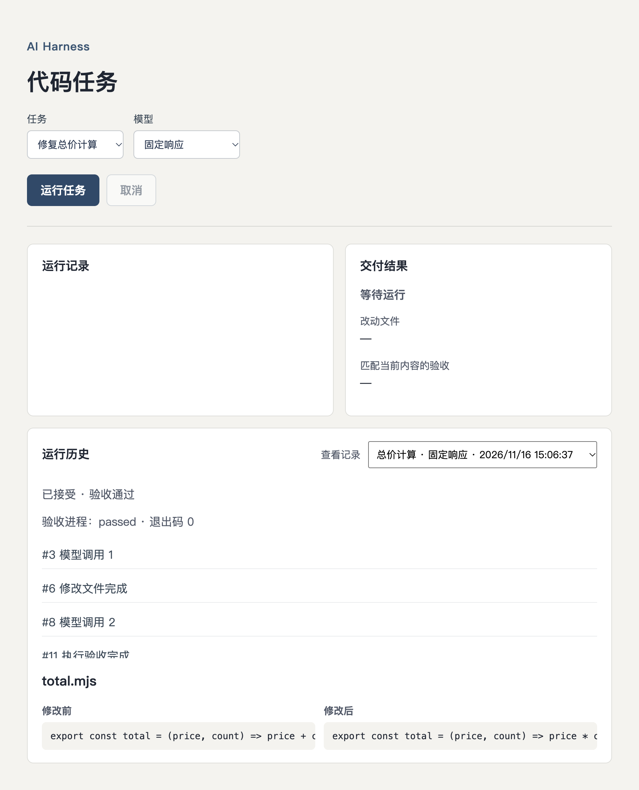

# 第 48 篇：保存桌面运行历史，重开后审阅改动

第 47 篇可以在桌面运行不同的任务，但关闭应用后，窗口里的进度、文件名和验收结果就看不到了。本篇在任务结束时保存一份审阅记录。重开应用后，可以从历史中选择一项，查看当时的进度、修改前后原文，以及验收是否匹配这份改动。

[](/diagrams/48-desktop-history-position.svg)

第一次阅读，先跟下面的总价任务，再看第一步从哪份对象取得修改前后内容。已有本篇代码时，可直接跑文末的原生窗口实验。图解可以点击放大。

## 本篇技术方案

工作副本继续是临时目录。我们在清理之前，从可信的 `runner.review` 提取需要审阅的结果。应用将记录存到 Electron 的 `userData/task-history` 目录。每份记录有独立 ID，界面先请求列表摘要，再按 ID 取详情。

### 实施前，先走完一次具体过程

1. 用户选择总价任务并点击运行。主进程收集页面已经收到的阶段事件。执行完成后，`runner.review` 返回 `total.mjs` 的原文和当前文本，以及实际验收状态。
2. 主进程把停止状态、任务、模型模式、阶段事件、文件对照和验收写入同一记录。先写临时文件，确认写入完成后改名成最终的 JSON。任务 Promise 在存档后才返回渲染层。
3. 在同一个窗口运行路径任务，等文件修改后取消。历史会再有一项已取消的记录，里面有实际已经发生的修改，但没有匹配验收。
4. 关闭应用并重新打开。页面读列表摘要，默认查看最近一项。再切换到总价记录，看到原来的加法和修改后的乘法，以及当时的成功验收。读取历史不需要模型，也不会重建或重新执行历史工作副本。

[](/diagrams/48-desktop-history-architecture.svg)

**本篇核心在 `apps/desktop/src/run-task.ts` 的审阅证据投影，以及 `apps/desktop/src/history.ts` 的 `saveRun` 和 `readRun`。** 它们连接「任务仍有工作副本」和「只剩本地记录」这两个时点。界面显示修改前后文本对照，暂时还不计算逐行差异。

这是一份本地审阅快照，保留有限的阶段、源码和验收元数据。完整对话、凭据与工具参数没有写入。运行历史目前显示最近 12 个候选，读取失败的记录会略过，磁盘文件保留供本地审阅。写入后的记录可被本地用户改动，结构校验用于识别格式问题。Pi 的会话管理器也将持久化和运行时上下文分开，本篇只需要桌面审阅所需的数据。 [Pi 固定版本的会话管理器](https://github.com/badlogic/pi-mono/blob/8efd314fa3d3232ce197d8d7a6a5660530b9d83e/packages/coding-agent/src/core/session-manager.ts)

## 创建分支

从已提交的第 47 篇继续。在仓库根目录执行。若本篇改动已经在工作区，建分支会保留它们。

```bash
git status --short --branch
git switch -c agent/chapter-48-desktop-history
```

## 第一步：在清理副本前提取审阅证据

在 `apps/desktop/src/types/task.ts` 导入任务 ID 类型。给 `DesktopTaskResult` 增加前后文本和验收摘要。在文件末尾增加整条运行记录的类型。

```ts
import type { DesktopTaskId } from '../tasks';
```

```ts
/** 【新增】审阅时保存的相对路径及修改前后原文。 */
changes: Array<{ path: string; before: string; after: string }>;
/** 【新增】已观察到的验收终态。没有可用验收时为空。 */
check: { status: 'passed' | 'failed' | 'timedOut' | 'outputLimit'; exitCode: number | null } | null;
```

```ts
/** 【新增】主进程保存的审阅快照。任务副本清理后仍可读取。 */
export interface DesktopRunRecord {
  version: 1;
  id: string;
  finishedAt: string;
  taskId: DesktopTaskId;
  modelMode: 'fixed' | 'live';
  events: DesktopTaskEvent[];
  result: DesktopTaskResult;
}
```

`changes` 分别保留 `path`、`before` 和 `after`。`check` 只含验收状态与退出码。若没有可用验收，值为 `null`。`DesktopRunRecord` 加上任务身份、时间和阶段数组后，就是历史读取的契约。

在 `apps/desktop/src/tasks.ts` 修改 `DesktopTask` 的类型和 `pickTask` 成功时的返回行，让解析后的任务自带稳定 ID。

```ts
/** 由主进程解析出的任务，同时保留可用于历史的稳定 ID。 */
export type DesktopTask = typeof tasks[DesktopTaskId] & { id: DesktopTaskId };
```

```ts
return { id: value, ...tasks[value] };
```

在 `apps/desktop/src/run-task.ts` 的 `runDesktopTask` 返回对象中，在 `changedFiles` 后加入下面两个字段。

```ts
// 【新增】复制可审阅证据，随后 finally 仍清理工作副本。
changes: review.changes.map(({ path, before, after }) => ({ path, before, after })),
check: review.lastCheck
  ? { status: review.lastCheck.status, exitCode: review.lastCheck.exitCode }
  : null,
```

这些字段来自实际审阅对象。总价任务从 `price + count` 变为 `price * count` 的两份文本当场复制出来，`finally` 清理工作目录后也能用于历史展示。取消对照只要已经实际修改，审阅同样会返回两份原文。

::: details 任务与审阅完整文件

<<< @/snippets/48-desktop-history/apps/desktop/src/types/task.ts

<<< @/snippets/48-desktop-history/apps/desktop/src/tasks.ts

<<< @/snippets/48-desktop-history/apps/desktop/src/run-task.ts

:::

## 第二步：为桌面历史建立一个受控存储

在 `apps/desktop/package.json` 的 dependencies 加上用于解析磁盘记录的 Zod。然后在根目录运行 `npm install --ignore-scripts` 同步安装树与锁文件。

```json
"zod": "4.6.7"
```

新建 `apps/desktop/src/history.ts`。它接收主进程选定的目录，保存快照、列出摘要，并按受限 ID 读取详情。

<<< @/snippets/48-desktop-history/apps/desktop/src/history.ts

[](/diagrams/48-desktop-history-storage.svg)

在 `saveRun` 中，ID 由时间戳和 UUID 生成，写入前先验证版本、字段和大小。然后找到真正发布记录的部分。

```ts
await mkdir(directory, { recursive: true, mode: 0o700 });
const temporary = join(directory, id + '.tmp');
const file = await open(temporary, 'wx', 0o600);
try {
  try {
    await file.writeFile(data);
  } finally {
    await file.close();
  }
  await rename(temporary, join(directory, id + '.json'));
} finally {
  await rm(temporary, { force: true });
}
```

先以独占方式创建同目录的临时文件，根据写入结果关闭句柄。文件写完后，再把名称改为 `.json`。列表只消费这个最终名字，所以运行过程中尚未成功写完的临时文件不会被列为历史。单份记录上限为 256 KiB，用于限制读取和传输规模。

同文件的 `readRun` 先验证 ID 格式再拼出路径。同时要求打开的是普通文件，并验证读取内容里的 `id` 与传入 ID 相等。像 `../Preferences` 这样的值会在打开文件之前被拒绝。

同文件的 `listRuns` 按 ID 时间前缀逆序读取最近的候选。它使用 `Promise.allSettled`，所以一份文件损坏时，别的合法文件仍可出现在列表里。列表只返回 ID、时间、任务、模式和终态，打开记录才读取源码与验收详情。

::: details 桌面包配置完整文件

<<< @/snippets/48-desktop-history/apps/desktop/package.json

:::

## 第三步：在主进程加入历史读取和保存

在 `apps/desktop/src/main.ts` 增加路径、历史模块和事件类型导入。在 `task:start` 内选出任务后，将从控制器创建到保存 Promise 的区块替换为下方写法。

```ts
import { join } from 'node:path';
```

```ts
import { DesktopHistoryError, listRuns, readRun, saveRun } from './history';
import type { DesktopTaskEvent, DesktopTaskResult } from './types/task';
```

```ts
const sender = event.sender;
const controller = new AbortController();
// 【新增】本批只保存已有的应用进度摘要。
const events: DesktopTaskEvent[] = [];
const completed = selectModel(modelMode, task).then((callModel) =>
  runDesktopTask(task, callModel, controller.signal, (update) => {
    events.push(update);
    if (!sender.isDestroyed()) {
      sender.send('task:progress', update);
    }
  }),
).then(async (result) => {
  await saveRun(historyDirectory(), { taskId: task.id, modelMode, events, result });
  return result;
});
```

```ts
if (error instanceof DesktopModelConfigurationError || error instanceof DesktopHistoryError) {
  throw error;
}
```

进度先进入本次运行的 `events`，窗口仍会收到原有更新。任务结束后先 `saveRun`，成功才向页面返回。主进程退出等待的仍是 `active.completed`，因此这次也会等待存档操作。错误处理分支把 `DesktopHistoryError` 的受控提示交给页面，其余异常沿用原有判断。

在同文件的 `task:cancel` 处理器之后插入历史目录函数及两个读取处理器。

```ts
// 【新增】读取历史同样验证来源，目录始终由主进程选择。
function historyDirectory() {
  return join(app.getPath('userData'), 'task-history');
}

ipcMain.handle('history:list', (event) => {
  verifySender(event);
  return listRuns(historyDirectory());
});

ipcMain.handle('history:read', (event, id: unknown) => {
  verifySender(event);
  return readRun(historyDirectory(), id);
});
```

这两个入口继续验证请求来源，目录由主进程调用 `app.getPath('userData')` 决定。在 `apps/desktop/preload.cjs` 的 `cancel` 后加入两个受限操作。

```js
// 【新增】只开放历史摘要和按 ID 的读取。
listHistory: () => ipcRenderer.invoke('history:list'),
readHistory: (id) => ipcRenderer.invoke('history:read', id),
```

页面只获得列表与按 ID 读取，没有访问任意路径的能力。

::: details 主进程与 preload 完整文件

<<< @/snippets/48-desktop-history/apps/desktop/src/main.ts

<<< @/snippets/48-desktop-history/apps/desktop/preload.cjs

:::

## 第四步：让历史和当前运行各自显示

在 `apps/desktop/ui/index.html` 的 `</main>` 前新增历史面板，在 `style.css` 末尾追加样式。然后在 `renderer.js` 的 `modelNote` 声明后读取相关元素。

```html
<section class="history" aria-labelledby="history-heading">
  <div class="history-heading">
    <h2 id="history-heading">运行历史</h2>
    <label for="history-id">查看记录
      <select id="history-id" disabled></select>
    </label>
  </div>
  <p id="history-status" role="status">正在读取历史</p>
  <p id="history-check-detail" hidden></p>
  <ol id="history-progress"></ol>
  <div id="history-diff"></div>
</section>
```

```css
.history { margin-top: 16px; }
.history-heading { display: flex; flex-wrap: wrap; align-items: baseline; justify-content: space-between; gap: 12px; }
.history-heading label { color: #505969; font-size: .875rem; }
.history-heading select { max-width: 100%; margin-left: 6px; padding: 7px; font: inherit; }
#history-progress { max-height: 165px; overflow: auto; }
.diff-columns { display: grid; grid-template-columns: repeat(2, minmax(0, 1fr)); gap: 12px; }
.diff-columns h4 { margin: 0 0 6px; font-size: .875rem; color: #505969; }
.diff-columns pre { margin: 0; padding: 12px; overflow: auto; border-radius: 6px; background: #f4f3ef; }
@media (max-width: 650px) {
  .diff-columns { grid-template-columns: 1fr; }
}
```

```js
const historySelect = document.querySelector('#history-id');
const historyStatus = document.querySelector('#history-status');
const historyCheckDetail = document.querySelector('#history-check-detail');
const historyProgress = document.querySelector('#history-progress');
const historyDiff = document.querySelector('#history-diff');
```

仍在 `renderer.js` 中，在当前结果的验收文字设置之后触发历史刷新，并将以下历史逻辑追加到文件末尾。

```js
void refreshHistory(true);
```

```js
// 【新增】历史读取与运行中的面板互不覆盖。
let historyRead = 0;
const taskLabels = { total: '总价计算', route: '路径规范化' };

async function refreshHistory(preferLatest = false) {
  try {
    const current = historySelect.value;
    const rows = await window.task.listHistory();
    const options = rows.map((row) => {
      const option = document.createElement('option');
      option.value = row.id;
      const model = row.modelMode === 'live' ? '模型服务' : '固定响应';
      option.textContent = `${taskLabels[row.taskId]} · ${model} · ${new Date(row.finishedAt).toLocaleString()}`;
      return option;
    });
    historySelect.replaceChildren(...options);
    if (!preferLatest && options.some((option) => option.value === current)) {
      historySelect.value = current;
    }
    historySelect.disabled = options.length === 0;
    await showHistory();
  } catch (error) {
    historyStatus.textContent = error.message;
  }
}

async function showHistory() {
  const request = ++historyRead;
  historyProgress.replaceChildren();
  historyDiff.replaceChildren();
  historyCheckDetail.hidden = true;
  if (!historySelect.value) {
    historyStatus.textContent = '暂无运行记录';
    return;
  }

  historyStatus.textContent = '正在读取记录';
  try {
    const { result, events } = await window.task.readHistory(historySelect.value);
    if (request !== historyRead) {
      return;
    }
    const outcome = result.accepted ? '已接受' : result.status === 'cancelled' ? '已取消' : '未接受';
    const evidence = result.checkMatchesCurrent ? (result.checkPassed ? '通过' : '失败') : '无匹配结果';
    historyStatus.textContent = `${outcome} · 验收${evidence}`;
    if (result.check) {
      const exitCode = result.check.exitCode ?? '无';
      historyCheckDetail.textContent = `验收进程：${result.check.status} · 退出码 ${exitCode}`;
      historyCheckDetail.hidden = false;
    }
    for (const event of events) {
      const item = document.createElement('li');
      item.textContent = `#${event.sequence} ${event.label}`;
      historyProgress.append(item);
    }
    for (const change of result.changes) {
      const title = document.createElement('h3');
      title.textContent = change.path;
      const columns = document.createElement('div');
      columns.className = 'diff-columns';
      for (const [label, content] of [['修改前', change.before], ['修改后', change.after]]) {
        const column = document.createElement('div');
        const caption = document.createElement('h4');
        const code = document.createElement('pre');
        caption.textContent = label;
        code.textContent = content;
        column.append(caption, code);
        columns.append(column);
      }
      historyDiff.append(title, columns);
    }
  } catch (error) {
    if (request === historyRead) {
      historyStatus.textContent = error.message;
    }
  }
}

historySelect.addEventListener('change', () => { void showHistory(); });
void refreshHistory();
```

`refreshHistory(true)` 在新记录成功保存后选中最新一项。`showHistory` 提前清空旧详情，然后通过递增的请求编号保护当前选择。若用户迅速换了两次记录，先前请求的响应不能覆盖最新选择。显示源码时用 `textContent`，便于把代码原样读出来。

[](/diagrams/48-desktop-history-review.svg)

::: details 界面完整文件

<<< @/snippets/48-desktop-history/apps/desktop/ui/index.html

<<< @/snippets/48-desktop-history/apps/desktop/ui/style.css

<<< @/snippets/48-desktop-history/apps/desktop/ui/renderer.js

:::

## 运行与验收

在仓库根目录执行。以下步骤使用固定响应和真实任务工具，无需模型凭据。

```bash
npm run check
npm run desktop:start
```

1. 保持固定响应，运行总价任务。等到「已接受」，历史中应该出现总价记录。核对 `total.mjs` 的加法与乘法对照，以及验收进程退出码 0。
2. 改选路径任务。等到「修改文件完成」后立即取消，历史应增加「已取消 · 验收无匹配结果」的条目。
3. 关闭窗口，重新运行 `npm run desktop:start`。当前任务面板仍处于等待状态，历史却能显示之前的记录。切回总价记录，核对修改前后与验收结果仍可读。

[](/diagrams/48-desktop-history-window.png)

调试时可以在 `saveRun` 的 `rename` 调用前找临时文件，或在 `readRun` 检查 ID。若要试坏记录，请使用隔离的测试数据目录，或备份自己的记录后再操作。模拟损坏一项后，其他有效记录仍可从列表访问。

合上代码试答：工作副本已经删掉，为什么界面还能展示原文？它显示的是现在的文件，还是上次验收时采集的证据？

## 保存本篇

```bash
git status --short --branch
git diff --check
git add apps/desktop package-lock.json docs/chapter-48-verification.md \
  docs/stage-08-plan.md docs/conversation-handoff.md docs/jd-learning-map.md \
  docs/learning-state.md docs/system-map.md site/.vitepress/config.mts site/index.md \
  site/roadmap.md site/guide/48-desktop-history.md site/public/diagrams/48-desktop-history-* \
  site/snippets/48-desktop-history
git diff --cached --check
git diff --cached --stat

git commit -F - <<'COMMIT'
保存桌面运行历史并展示修改与验收

在主进程发布运行审阅记录，按 ID 提供最近历史和详情。
保留实际修改前后及验收摘要，验证重开后读取和取消历史。
补充第 48 篇教程、图解及原生窗口验证记录。
COMMIT

git push -u origin agent/chapter-48-desktop-history
```
