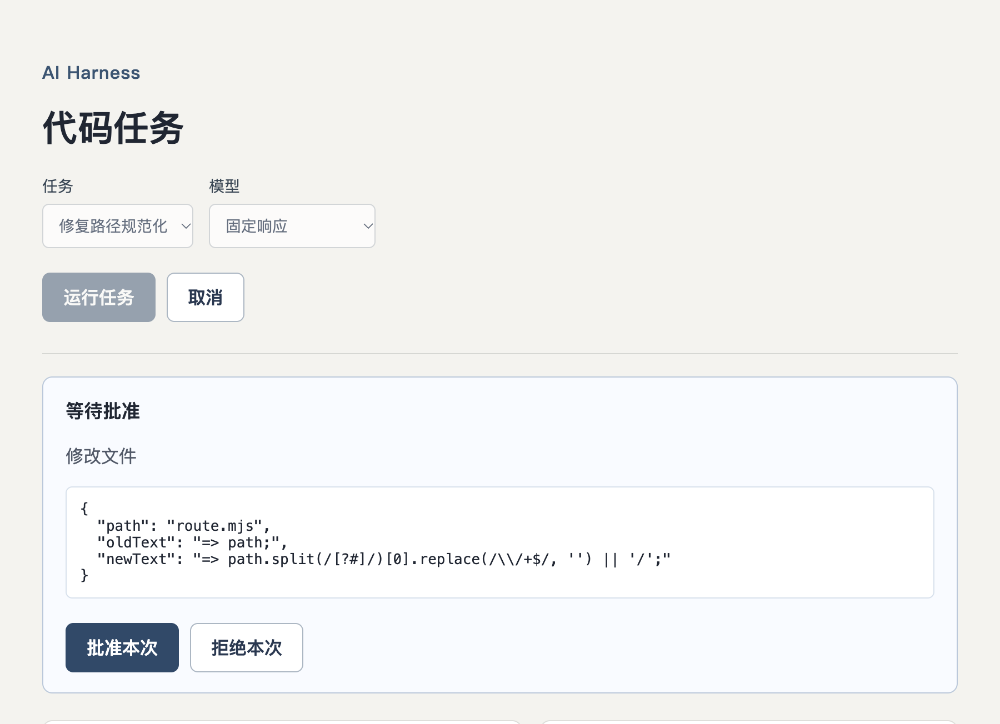

# 第 49 篇：在桌面逐次批准修改和验收

第 48 篇让桌面能保存和审阅已经发生的改动。最后一篇把操作者放回执行前：模型提出「修改文件」时，窗口先展示本次参数，等你批准；稍后提出「运行验收」时，再问一次。拒绝、取消和关闭窗口都能结束等待，已经发生的改动仍可从历史审阅。

[](/diagrams/49-desktop-approval-position.svg)

第一次阅读，先走下方的路径任务，再跳到第二步的 `decide`。已有本篇代码时，可直接启动桌面，体验批准一次修改、拒绝随后的验收。图解可以点击放大。

## 本篇技术方案

CLI 和桌面共用「修改、验收需要逐次批准」的工具包装。应用决定如何询问，审批结果在具体调用的执行函数中落实。桌面的主进程为每次待批准请求生成 ID，页面只能给这个 ID 提交布尔决定。

### 实施前，先走完一次具体过程

1. 用户选择路径任务和固定响应。模型提交 `replace_text`，Runtime 检查参数后进入包装过的执行函数。此时 `route.mjs` 仍是原内容。主进程发出请求 ID、工具名和参数，窗口显示「等待批准」。
2. 点击「批准本次」。主进程匹配当前 ID，结束等待并清空请求。共享包装再次检查取消信号，然后执行真实修改。
3. 模型随后请求 `run_check`。这是一个新 ID，旧修改批准不能用于验收。第二次点击批准后，可信脚本执行，三个路径用例通过，窗口及历史显示「已接受」。
4. 若拒绝修改，Runtime 给模型返回失败反馈，副本无改动。若只拒绝验收，已完成的修改仍可审阅，最终未接受。若等待时取消或关窗，信号释放待答复项；主进程审阅已有证据、清理副本并保存历史。

[](/diagrams/49-desktop-approval-architecture.svg)

**核心代码在 `packages/harness/src/tool-approval.ts` 的包装器，以及 `apps/desktop/src/approval.ts` 的 `request` 与 `decide`。** 前者控制真实工具何时执行，后者把当前等待与一个请求 ID 绑定起来。页面负责展示和提交，工具权限仍在执行侧。

当前逐次批准覆盖两项已知工作区工具：`replace_text` 和 `run_check`。读取调查沿用原权限。每次决定只在本次进程有效，参数用于当前审阅并从历史保存范围排除。CLI 第 33 篇的跨进程批准使用自己的检查点流程。Pi 的循环也会在工具实际执行之前调用 `beforeToolCall`；本篇沿用自己的工具执行包装。 [Pi 固定版本的执行前工具钩子](https://github.com/badlogic/pi-mono/blob/8efd314fa3d3232ce197d8d7a6a5660530b9d83e/packages/agent/src/agent-loop.ts#L728)

## 创建分支

从已提交的第 48 篇继续。在仓库根目录执行。如果本篇改动已经写入工作区，建分支会保留它们。

```bash
git status --short --branch
git switch -c agent/chapter-49-desktop-approval
```

## 第一步：提炼 CLI 和桌面共用的执行门禁

新建 `packages/harness/src/tool-approval.ts`。它接收应用已装配的工具清单和批准回调。返回的清单保留原工具说明，同时对修改和验收更换执行函数。

<<< @/snippets/49-desktop-approval/packages/harness/src/tool-approval.ts

在 `wrapToolsWithApproval` 里面看改写后的 `execute`。

```ts
async execute(args, signal) {
  signal?.throwIfAborted();
  const approved = await approve({ toolName, args }, signal);
  signal?.throwIfAborted();
  if (!approved) {
    throw new ToolExecutionError('该工具请求未获本次批准。');
  }
  return tool.execute(args, signal);
},
```

如果回调返回 `false`，包装器用已知工具错误拒绝本次执行，Runtime 能形成正式的失败反馈。若等待期间信号已经取消，即便有决定到达，也会在调用原工具之前抛出取消。只有拿到本次肯定决定且信号仍有效，才执行捕获在闭包中的原工具与参数。

在 `packages/harness/src/index.ts` 末尾新增公开导出。

```ts
// 【新增】两种宿主复用执行前批准规则，交互由应用决定。
export { wrapToolsWithApproval, type ToolApprovalRequest } from './tool-approval';
```

在 `apps/coding-cli/src/session/approve-tools.ts` 替换导入，并用下面的函数替换原 `requireToolApproval`。终端的 `confirm` 继续负责获取 yes 或拒绝，受控工具的实际执行由共享包装器处理。

```ts
import { wrapToolsWithApproval } from '@ai-harness/harness';
import type { ExecutableTool } from '@ai-harness/runtime';
```

```ts
export function requireToolApproval(tools: readonly ExecutableTool[]): ExecutableTool[] {
  // 【修改】终端只负责显示提示和取得本次决定。
  return wrapToolsWithApproval(tools, ({ toolName, args }, signal) => {
    const preview = JSON.stringify(args).replace(/[\u007f-\uffff]/g,
      (character) => '\\u' + character.charCodeAt(0).toString(16).padStart(4, '0'));
    return confirm(`批准本次 ${toolName} ${preview}？输入 yes 执行，其余拒绝：`, signal);
  });
}
```

::: details Harness 与 CLI 接线完整文件

<<< @/snippets/49-desktop-approval/packages/harness/src/index.ts

<<< @/snippets/49-desktop-approval/apps/coding-cli/src/session/approve-tools.ts

:::

## 第二步：主进程持有一次等待

打开 `apps/desktop/src/types/task.ts`，在文件末尾增加窗口可以展示的请求类型。

```ts
/** 【新增】只供窗口展示与决定，审批参数不写入审阅历史。 */
export interface DesktopApproval {
  /** 主进程为该请求生成的唯一 ID。 */
  id: string;
  /** 需要批准的具体动作。 */
  toolName: 'replace_text' | 'run_check';
  /** 展示给用户审阅的参数文本。 */
  argumentsText: string;
}
```

新建 `apps/desktop/src/approval.ts`。它由主进程为每次运行创建，记录唯一待批项、通知窗口并返回一个等待决定的 Promise。

<<< @/snippets/49-desktop-approval/apps/desktop/src/approval.ts

[](/diagrams/49-desktop-approval-lifecycle.svg)

在 `createDesktopApproval.request` 中，先创建 ID，再把 `finish` 和 ID 写入 `pending`，最后通知页面。这保证窗口收到通知后，主进程已经可以接收答复。观察 `finish`，它会清空当前项、移除取消监听，再让 Promise 完成。批准、拒绝和取消都经过相同清理。

同一对象的 `decide` 是页面决定的入口。

```ts
decide(id: unknown, allowed: unknown): boolean {
  if (!pending || id !== pending.id || typeof allowed !== 'boolean') {
    return false;
  }
  pending.finish(allowed);
  return true;
},
```

页面提交的决定只有在 ID 一致且是布尔值时成立。批准完成后，原 ID 无法再找到等待项。验收的新 ID 和修改 ID 不同，重放修改 ID 返回 `false`，不会继续验收。

## 第三步：把主进程的决定接到 runner

打开 `apps/desktop/src/run-task.ts`。替换原 Harness 导入，在 `publish` 参数后加入批准回调，并在 `runner.run` 的 `callModel` 后加入工具列表。

```ts
import { createCodeTaskRunner, createCodeTaskSession, wrapToolsWithApproval,
  type ModelCall, type ToolApprovalRequest } from '@ai-harness/harness';
```

```ts
approve: (request: ToolApprovalRequest, signal?: AbortSignal) => Promise<boolean>,
```

```ts
// 【新增】受控工具实际执行之前等待主进程的批准。
tools: wrapToolsWithApproval(session.tools, approve),
```

这里的 `session.tools` 仍来自本次任务副本。包装后传给 runner，执行器在操作前使用主进程的决定回调。工作区仍负责对文件范围和替换内容执行原校验。

打开 `apps/desktop/src/main.ts`。加入批准器导入，替换 `active` 声明，为每次运行持有自己的批准器。然后替换开始处理器里从取消控制器到保存活动任务的区块。

```ts
import { createDesktopApproval } from './approval';
```

```ts
let active: {
  controller: AbortController;
  completed: Promise<DesktopTaskResult>;
  approval: ReturnType<typeof createDesktopApproval>;
} | undefined;
```

```ts
const controller = new AbortController();
const approval = createDesktopApproval((request) => {
  if (!sender.isDestroyed()) {
    sender.send('task:approval', request);
  }
});
// 本批只保存已有的应用进度摘要。
const events: DesktopTaskEvent[] = [];
const completed = selectModel(modelMode, task).then((callModel) =>
  runDesktopTask(task, callModel, controller.signal, (update) => {
    events.push(update);
    if (!sender.isDestroyed()) {
      sender.send('task:progress', update);
    }
  }, approval.request),
).then(async (result) => {
  await saveRun(historyDirectory(), { taskId: task.id, modelMode, events, result });
  return result;
});
active = { controller, completed, approval };
```

现有开始处理器仍拥有同一个 `controller`。按钮取消、关闭窗口和渲染进程异常退出都会请求它停止。等待中的批准回调收到 Runtime 传来的信号后退出，在原执行处再次检查信号。退出操作依旧等待 `active.completed`，已有运行证据会在任务清理后保存。

在 `task:cancel` 之前加入决定入口。在窗口装配中、`will-navigate` 之前新增渲染器异常退出时的取消监听。

```ts
// 【新增】只有同一窗口能提交当前请求的决定。
ipcMain.handle('task:decide', (event, id: unknown, allowed: unknown) => {
  verifySender(event);
  return active?.approval.decide(id, allowed) ?? false;
});
```

```ts
window.webContents.on('render-process-gone', () => active?.controller.abort());
```

在 `apps/desktop/preload.cjs` 的 `onProgress` 之前加入审批订阅与答复。页面拿到的只有请求数据，没有 IPC 事件对象。

```js
decide: (id, allowed) => ipcRenderer.invoke('task:decide', id, allowed),
onApproval(callback) {
  const listener = (_event, request) => callback(request);
  ipcRenderer.on('task:approval', listener);
  return () => ipcRenderer.removeListener('task:approval', listener);
},
```

最后改 `apps/desktop/src/model.ts` 中的固定模型分支。收到失败工具反馈时直接结束。移除第 46 篇为了方便点取消而加的固定延迟，现在等待人工决定本身就提供可观察的停点。服务模式仍使用正常模型适配。

```ts
return async ({ messages }) => {
  turn += 1;
  const feedback = messages.at(-1);
  if (feedback?.role === 'toolResult' && feedback.isError) {
    return { role: 'assistant', content: '本次动作未执行成功，已停止。', stopReason: 'stop', toolCalls: [] };
  }
  if (turn === 1) {
    return request('edit-file', 'replace_text', {
      path: task.file, oldText: task.oldText, newText: task.newText,
    });
  }
  if (turn === 2) {
    return request('check-file', 'run_check', {});
  }
  return { role: 'assistant', content: '请查看验收结果。', stopReason: 'stop', toolCalls: [] };
};
```

[](/diagrams/49-desktop-approval-ipc.svg)

::: details 桌面主进程接线完整文件

<<< @/snippets/49-desktop-approval/apps/desktop/src/types/task.ts

<<< @/snippets/49-desktop-approval/apps/desktop/src/main.ts

<<< @/snippets/49-desktop-approval/apps/desktop/src/run-task.ts

<<< @/snippets/49-desktop-approval/apps/desktop/src/model.ts

<<< @/snippets/49-desktop-approval/apps/desktop/preload.cjs

:::

## 第四步：显示正在等待的这一项

在 `apps/desktop/ui/index.html` 的运行面板之前插入审批区块。在 `style.css` 最后加入审批面板样式。

```html
<section id="approval" class="approval" aria-labelledby="approval-heading" hidden>
  <h2 id="approval-heading">等待批准</h2>
  <p id="approval-tool"></p>
  <pre id="approval-args"></pre>
  <p id="approval-message" role="status"></p>
  <div class="actions">
    <button id="approve" type="button">批准本次</button>
    <button id="deny" type="button">拒绝本次</button>
  </div>
</section>
```

```css
.approval {
  margin-top: 20px;
  border-color: #b8c9dc;
  background: #f8fbff;
}
.approval pre {
  max-height: 200px;
  padding: 12px;
  overflow: auto;
  border: 1px solid #d6e1ed;
  border-radius: 6px;
  background: #fff;
  white-space: pre-wrap;
  overflow-wrap: anywhere;
}
#approval-message:empty { display: none; }
```

在 `apps/desktop/ui/renderer.js` 的 `historyDiff` 声明之后插入下面的渲染逻辑。然后在运行按钮处理函数的 `finally` 首行增加清理调用。

```js
const approvalPanel = document.querySelector('#approval');
const approvalTool = document.querySelector('#approval-tool');
const approvalArgs = document.querySelector('#approval-args');
const approvalMessage = document.querySelector('#approval-message');
const approve = document.querySelector('#approve');
const deny = document.querySelector('#deny');
let pendingApproval = null;

function showApproval(request) {
  pendingApproval = request;
  approvalPanel.hidden = request === null;
  approvalTool.textContent = request?.toolName === 'replace_text' ? '修改文件' : '运行验收';
  approvalArgs.textContent = request?.argumentsText ?? '';
  approvalMessage.textContent = '';
  approve.disabled = deny.disabled = request === null;
}

async function decideApproval(allowed) {
  const request = pendingApproval;
  if (!request) {
    return;
  }
  approve.disabled = deny.disabled = true;
  try {
    if (!await window.task.decide(request.id, allowed) && pendingApproval === request) {
      showApproval(null);
    }
  } catch (error) {
    if (pendingApproval === request) {
      approvalMessage.textContent = error.message;
      approve.disabled = deny.disabled = false;
    }
  }
}

approve.addEventListener('click', () => { void decideApproval(true); });
deny.addEventListener('click', () => { void decideApproval(false); });
const unsubscribeApproval = window.task.onApproval(showApproval);
window.addEventListener('pagehide', unsubscribeApproval, { once: true });
```

```js
showApproval(null);
```

请求到达时，页面显示更改的工具和原始参数，用 `textContent` 写入参数。提交决定时先保存当前请求的引用再禁用按钮。如果下一条请求更早到达，上一条答复的结果无法覆盖它。收到 `null` 或整段结束时，页面隐藏批准面板。

::: details 渲染层完整文件

<<< @/snippets/49-desktop-approval/apps/desktop/ui/index.html

<<< @/snippets/49-desktop-approval/apps/desktop/ui/renderer.js

<<< @/snippets/49-desktop-approval/apps/desktop/ui/style.css

:::

## 运行与第八阶段验收

在仓库根目录执行。选择路径规范化任务和固定响应。这个实验不调用付费模型，文件编辑与验收实际运行。

```bash
npm run check
npm run desktop:start
```

[](/diagrams/49-desktop-approval-window.png)

| 操作 | 查证点 |
| --- | --- |
| 批准修改，再批准验收 | 各显示一次独立的等待，最后验收通过、交付接受。 |
| 拒绝修改 | 工具失败，副本无改动、未接受。 |
| 批准修改，拒绝验收 | 有文件改动，无验收、未接受。 |
| 等待修改批准时点击取消 | 任务取消，副本无改动。 |
| 等待验收批准时关闭窗口 | 应用取消、保存已有修改证据并清理副本。重开后能查看该取消记录。 |

[](/diagrams/49-desktop-approval-verify.svg)

还可以在真实终端运行下面的 CLI 回归，在修改和验收两个提示中分别输入 `yes`。它通过同一个 Harness 包装器获得终端的逐次决定。

```bash
node --import tsx examples/tool-approval/main.ts approve
```

调试时先在 `approval.decide` 检查收到 ID 与 `pending.id`，再到工具包装器确认原 `execute` 是否进入。试着说明：已经批准修改却未批准验收时，为什么改动可以保留，交付仍然拒绝？

本篇完成后，第八阶段的教学主线到此收尾。仓库外安装、同底座 CLI 与桌面运行、桌面重启审阅和逐次批准均有独立验收记录。发布、生产部署与真实服务长测有各自的验证边界。 [第八阶段验收](/roadmap#第八阶段-框架收敛与桌面应用)

## 保存本篇

```bash
git status --short --branch
git diff --check
git add apps/desktop apps/coding-cli/src/session/approve-tools.ts packages/harness/src \
  docs/chapter-49-verification.md docs/stage-08-plan.md docs/stage-08-verification.md \
  docs/conversation-handoff.md docs/jd-learning-map.md docs/learning-state.md docs/system-map.md \
  site/.vitepress/config.mts site/index.md site/roadmap.md site/guide/49-desktop-approval.md \
  site/public/diagrams/49-desktop-approval-* site/snippets/49-desktop-approval
git diff --cached --check
git diff --cached --stat

git commit -F - <<'COMMIT'
为桌面接入逐次工具批准并收尾第八阶段

共享 CLI 与桌面的工具执行前门禁，按请求 ID 绑定当前决定。
验证实际修改和验收、拒绝、取消及关窗后的证据与清理。
补充第 49 篇教程、图解和第八阶段验收。
COMMIT

git push -u origin agent/chapter-49-desktop-approval
```
